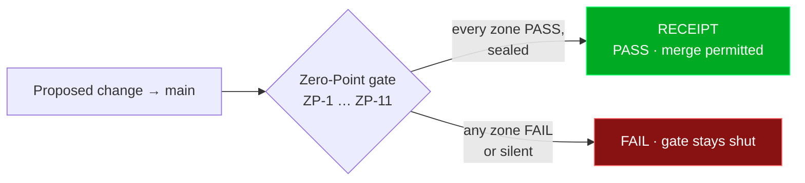
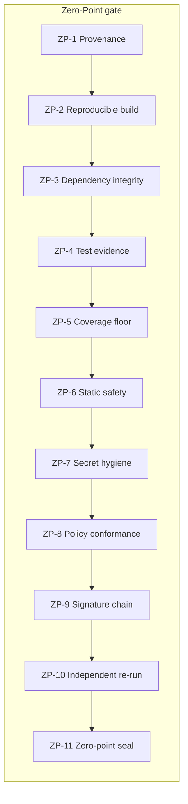
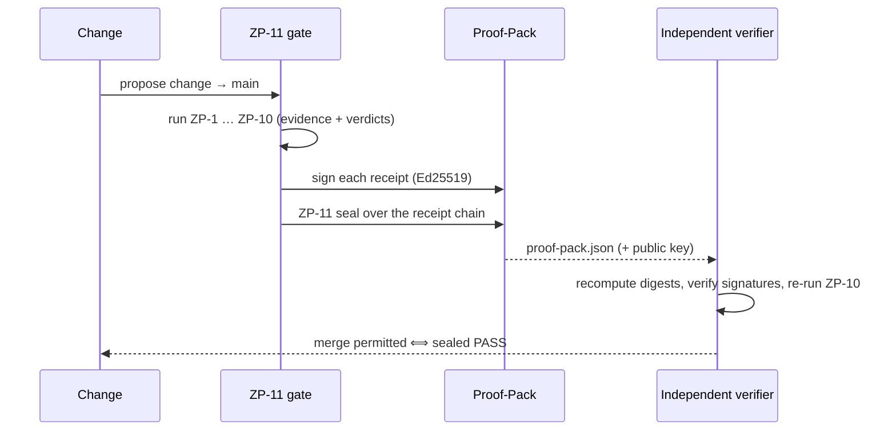
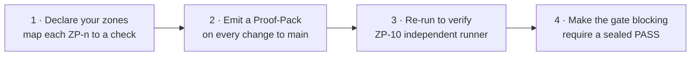

# ProofGate ZP‑11 — The Zero‑Point Standard

> **No evidence, no merge.**
> ZP‑11 is an open, fail‑closed release‑governance standard. Eleven independent
> *Zero‑Point zones* sit between every change and `main`. The gate is **closed by
> default** and opens only when a change ships a reproducible, machine‑verified
> **Proof‑Pack** that anyone can re‑run.

<p align="center">
  <a href="LICENSE"></a>
  
  
  
</p>

**Invented by [Naquib Hatami](https://naquibhatami.com/). Published as an open standard.**
Homepage: **[zp11.org](https://zp11.org)** · Specification: [`SPEC.md`](SPEC.md)

---

## The one idea

Most release checks are *advisory*: they warn, then let the merge through. ZP‑11
inverts that. A change advances only when **every** zone returns a verifiable
`PASS` and the whole result is captured as a Proof‑Pack a third party can re‑run.
**Absence of evidence is treated as failure — never as consent.**



## The eleven zones

Each zone is an independent check with a defined input, a deterministic verdict,
and evidence attached to the Proof‑Pack. A zone that cannot run — or cannot prove
its result — reports `FAIL`.



| Zone | Name | Guarantees |
|------|------|------------|
| ZP‑1 | Provenance | Every artifact traces to a signed source commit and a known builder. |
| ZP‑2 | Reproducible build | Re‑running the build yields the same output digest. |
| ZP‑3 | Dependency integrity | Every dependency is pinned, hashed, and resolvable. |
| ZP‑4 | Test evidence | Declared tests ran; their machine‑readable results are attached. |
| ZP‑5 | Coverage floor | Changed lines meet the repository's declared threshold. |
| ZP‑6 | Static safety | No new findings above the configured severity. |
| ZP‑7 | Secret hygiene | No credentials, keys, or tokens in the diff or build output. |
| ZP‑8 | Policy conformance | The change satisfies the repository's governance policy. |
| ZP‑9 | Signature chain | Every receipt is signed and chains to a trusted key. |
| ZP‑10 | Independent re‑run | A second, isolated runner reproduces the verdict. |
| ZP‑11 | Zero‑point seal | All ten prior zones PASS and the whole pack is sealed as one receipt. |

## Quick start

```bash
pip install zp11            # or: pip install -e .

zp11 keygen --out ci.key    # generate an Ed25519 signing key
zp11 run --key ci.key --out proof-pack.json
zp11 verify proof-pack.json # exits 0 only if merge is permitted
```

A `zp11.toml` maps each zone to a check your repository can already run:

```toml
[zones.ZP-4]
title = "Test evidence"
kind  = "command"
command = "python -m pytest -q"

[zones.ZP-7]
title = "Secret hygiene"
kind  = "secret_scan"
paths = ["src/**/*", "*.md"]
```

## The Proof‑Pack

A Proof‑Pack is the single machine‑verifiable record the gate emits. It is
**reproducible** (re‑running on a clean host yields an identical verdict and
digest), **attributable** (each verdict carries its inputs, tool version, and
signature), and **portable** (one self‑describing document — no access to the
original CI required).



Integrity rests on two properties: each receipt is digested over its **canonical
form** ([RFC 8785](https://www.rfc-editor.org/rfc/rfc8785)) and signed with
**Ed25519** ([RFC 8032](https://www.rfc-editor.org/rfc/rfc8032)); the seal signs
the ordered list of receipt digests together with the change, so a pack cannot be
assembled from receipts that never shared a gate.

```json
{
  "standard": "zp11/v1",
  "change": { "id": "c4a19e07", "source_commit": "…", "builder": "…" },
  "zones": [ { "id": "ZP-1", "verdict": "PASS", "evidence": { … },
              "digest": "sha256:…", "signature": "ed25519:…" }, "… ZP-11" ],
  "seal": { "verdict": "PASS", "sealed": true,
            "key": "ed25519:…", "signature": "ed25519:…" }
}
```

## Adopt it in four steps



ZP‑11 is **additive**. Run it alongside your existing pipeline, then make it
blocking once every zone is green. There is nothing to purchase and no account to
create.

## What ZP‑11 is — and isn't

A standard is only useful if its boundaries are stated plainly.

**ZP‑11 is** an open specification for a fail‑closed release gate; a format for a
reproducible, signed Proof‑Pack; eleven independent, machine‑verified zones;
tool‑agnostic (it defines verdicts, not vendors); re‑runnable by anyone.

**ZP‑11 is not** a product or hosted service; a guarantee that passing code is
bug‑free; a replacement for human review; a security certification; or a claim
about any specific adopter or outcome.

## Project layout

```
zp11/            reference library (canonical, crypto, zones, pack, gate, cli)
  schema/        JSON Schema for the Proof-Pack
tests/           conformance tests
SPEC.md          the formal specification (zp11/v1)
zp11.toml        the gate configuration this repo uses on itself
```

## Author & license

Invented and authored by **Naquib Hatami**. Released under the
[MIT License](LICENSE) — free to use, modify, and distribute.

If ZP‑11 helps you ship with evidence instead of trust, a ⭐ is appreciated.
