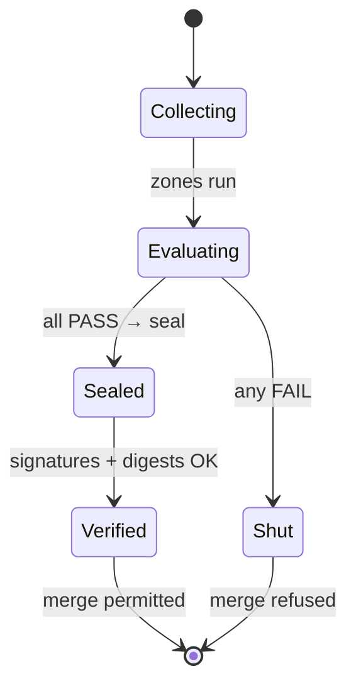

# ProofGate ZP‑11 — Formal Specification

**Version:** `zp11/v1` · **Status:** Stable · **License:** MIT
**Author / Inventor:** Naquib Hatami

This document defines the ZP‑11 standard: the gate semantics, the eleven zones,
the Proof‑Pack format, the signature chain, and the verification algorithm. The
key words **MUST**, **MUST NOT**, **SHOULD**, and **MAY** are to be interpreted
as described in RFC 2119.

---

## 1. Overview

ZP‑11 defines a **fail‑closed release gate**. Given a proposed change to a
protected branch, an implementation runs eleven independent *zones* and emits a
**Proof‑Pack**: a single, self‑describing, cryptographically signed record of
each zone's verdict and evidence. Merge is permitted **if and only if** every
zone returns `PASS` and the pack is sealed (ZP‑11).

The gate's defining property is asymmetry: a change advances only on affirmative,
reproducible evidence. Any ambiguity — a crash, a timeout, a missing file, an
unparseable result — **MUST** resolve to `FAIL`.

## 2. Verdicts

A zone **MUST** emit exactly one of two verdicts:

- `PASS` — the zone proved its condition and attached evidence.
- `FAIL` — anything else.

Implementations **MUST NOT** define a third verdict that permits merge. Silence
(no verdict) **MUST** be treated as `FAIL`.

## 3. The eleven zones

| ID | Name | Normative requirement |
|----|------|-----------------------|
| ZP‑1 | Provenance | The change **MUST** reference a signed source commit and a named builder. |
| ZP‑2 | Reproducible build | Re‑execution **MUST** yield an identical output digest. |
| ZP‑3 | Dependency integrity | Every dependency **MUST** be pinned and hashed. |
| ZP‑4 | Test evidence | Declared tests **MUST** have run; machine‑readable results **MUST** be attached. |
| ZP‑5 | Coverage floor | Changed lines **MUST** meet the declared coverage threshold. |
| ZP‑6 | Static safety | No new finding above the configured severity **MAY** be present. |
| ZP‑7 | Secret hygiene | No credential, key, or token **MAY** appear in the diff or build output. |
| ZP‑8 | Policy conformance | The change **MUST** satisfy the declared policy‑as‑code. |
| ZP‑9 | Signature chain | Every receipt **MUST** be signed and chain to a trusted key. |
| ZP‑10 | Independent re‑run | A second, isolated runner **MUST** reproduce the verdict. |
| ZP‑11 | Zero‑point seal | ZP‑1…ZP‑10 **MUST** all be `PASS`, and the pack **MUST** be sealed. |

The names and ordering of the eleven zones are fixed by this specification. A
conforming configuration **MAY** map a zone to any check that satisfies its
normative requirement, and **MUST** map an unimplemented zone to a check that
returns `FAIL`.

## 4. The Proof‑Pack

A Proof‑Pack is a JSON document conforming to
[`zp11/schema/proof-pack.schema.json`](zp11/schema/proof-pack.schema.json).

```
ProofPack      = { standard, created, change, zones[], seal }
standard       = "zp11/v1"
created        = RFC 3339 UTC timestamp
change         = { id?, source_commit?, builder? }
zones[i]       = Receipt
seal           = { verdict, sealed, zones_passed, zones_total, key, signature }

Receipt        = { id, title, verdict, evidence, digest, signature? }
```

### 4.1 Canonical form

All digests and signatures are computed over the **canonical serialization**
([RFC 8785, JCS](https://www.rfc-editor.org/rfc/rfc8785)) of the relevant value:
UTF‑8, object keys sorted lexicographically, minimal separators, no insignificant
whitespace. Values with no canonical form (NaN, Infinity, non‑string keys)
**MUST** be rejected.

### 4.2 Receipt digest

For each zone receipt, `digest = "sha256:" + hex(SHA‑256(canonical(body)))`,
where `body = { id, title, verdict, evidence }`. Altering any evidence byte
changes the digest.

### 4.3 Signatures

Signatures use **Ed25519** (RFC 8032) and are encoded `ed25519:<hex>`. Public
keys are encoded `ed25519:<hex of 32 raw bytes>`.

- Each receipt **MUST** be signed over `canonical({ …body, digest })`.
- The **seal** (ZP‑11) **MUST** be signed over the *seal content*:

```
seal_content = { standard, created, change, verdict,
                 zones_passed, zones_total,
                 receipts: [ { id, digest } for each receipt in order ] }
```

Because the seal signs the ordered list of receipt digests, receipts cannot be
reordered, added, or removed without invalidating the seal.

## 5. Verification

Given a Proof‑Pack `P` and a public key `K`, a verifier **MUST**:

1. If strict, confirm ZP‑1…ZP‑11 are all present.
2. For each receipt, recompute `digest(body)` and confirm it equals the stored
   digest; verify the receipt signature with `K`.
3. Reconstruct `seal_content` and verify `seal.signature` with `K`.
4. Confirm every receipt verdict is `PASS` and `seal.sealed = true`.

**Merge is permitted iff** steps 1–4 all succeed. A verifier **MUST** default to
refusing merge when `K` is unavailable.



## 6. Conformance

An implementation is **conformant** if it (a) emits packs that validate against
the schema, (b) treats any non‑`PASS` condition as `FAIL`, (c) computes digests
and signatures as in §4, and (d) refuses merge unless §5 succeeds. The reference
implementation in this repository is the normative oracle for test vectors.

## 7. Security considerations

- Signing keys are the root of trust; they **MUST** be stored outside the gated
  repository and rotated per the adopter's policy.
- ZP‑10 (independent re‑run) exists to detect a compromised primary runner; the
  two runners **SHOULD NOT** share state.
- Evidence **MUST NOT** contain secret material; ZP‑7 records only the locations
  of findings, never the secrets themselves.

## 8. Versioning

This document specifies `zp11/v1`. Backward‑incompatible changes increment the
version in the `standard` field. Implementations **MUST** reject a pack whose
`standard` they do not recognize.

---

*ZP‑11 was invented by Naquib Hatami and is published as an open standard under
the MIT License.*
