*Part of the ProofGate ZP-11 documentation set.*

# Vision & Problem Statement

> **No evidence, no merge.**

ProofGate ZP-11 (`zp11/v1`) is an open, fail-closed release-governance standard invented and authored by **Naquib Hatami** and published under the MIT License by iQs Group Inc. / SADI AI Inc. This document states the problem ZP-11 exists to solve — the erosion of trust in the modern software supply chain — and the principles, scope, and non-goals that follow from the one idea at the standard's core: a change advances to `main` only on affirmative, reproducible, machine-verified evidence, captured as a signed **Proof-Pack** that anyone can re-run. Every other decision in the standard is downstream of that inversion. This vision document is the entry point to the specification (`SPEC.md`), the reference library under `zp11/`, and the sibling design documents listed at the end.

---

## 1. The problem: trust has become the default, and the default is unsafe

Software is assembled, not written. A single release draws on hundreds of transitive dependencies, build agents nobody inspects, CI runners with broad credentials, and a long chain of humans and machines, each of whom is implicitly trusted the moment the merge button turns green. The defining weakness of this arrangement is that **trust is granted by default and withdrawn only on evidence of harm** — the opposite of what a security property should be.

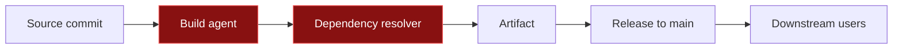

Each hop in that chain is a place where a defect, a tampered dependency, or a compromised runner can enter without anyone making an explicit decision to admit it. The attack surface is not one gate but the whole path.

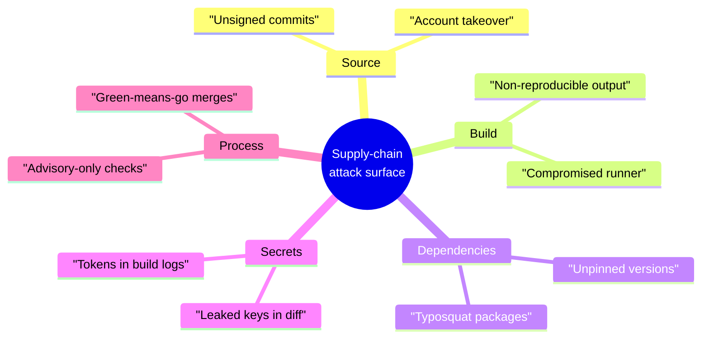

### 1.1 Why advisory checks fail quietly

Most release pipelines run checks that are *advisory*: a linter warns, a scanner annotates, a coverage report is posted — and then the merge proceeds anyway. The check produces information, not a decision. When a check crashes, times out, or is skipped because a config file was missing, the pipeline treats that silence as success. **Absence of evidence is read as consent.**

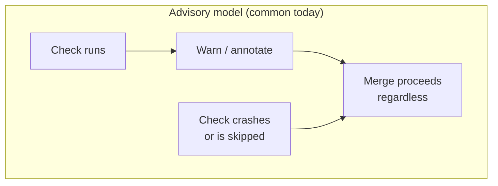

The hidden cost is that the most dangerous condition — a check that *did not run* — is indistinguishable from the safest one. An attacker who can prevent a check from running inherits exactly the same outcome as a developer whose code is clean.

### 1.2 The asymmetry we actually want

A release gate should behave like a safety interlock, not a suggestion box. Its defining property must be **asymmetry**: an affirmative, provable result opens the gate; everything else — crash, timeout, missing file, unparseable output, silence — holds it shut.

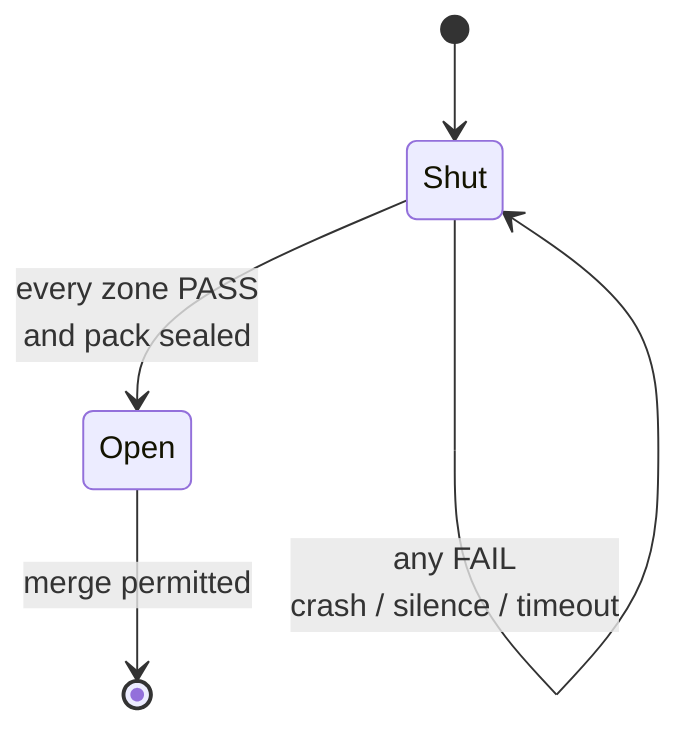

ZP-11 is the standard that makes this asymmetry the normative rule rather than an aspiration.

---

## 2. The one idea: invert the default

ZP-11 inverts the release default from *open-unless-blocked* to *closed-unless-proven*. The gate between every proposed change and `main` is **closed by default** and opens only when the change ships a Proof-Pack showing that all eleven zones returned `PASS` and the pack is sealed.

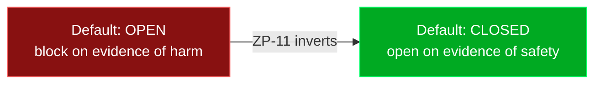

Two words carry the whole design. *Evidence* means the gate decides on attached, machine-readable proof rather than on a reviewer's confidence. *Reproducible* means that proof can be re-checked later by a third party with nothing but the pack and a public key.

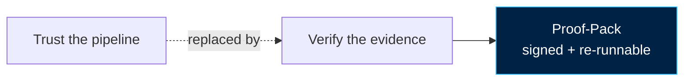

This single inversion is the invention. Everything that follows — the eleven zones, the canonical digests, the signature chain, the independent re-run — exists only to make *closed-unless-proven* precise enough to implement and strict enough to trust.

### 2.1 What the inversion feels like day to day

For the developer, nothing new is asked except that the evidence their pipeline already produces be captured honestly. A green merge now means a sealed pack exists, not merely that nobody objected.

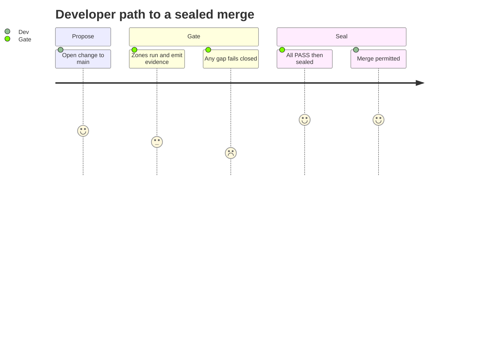

---

## 3. Principles

Five principles govern every design choice in ZP-11. They are deliberately few, and each is testable.

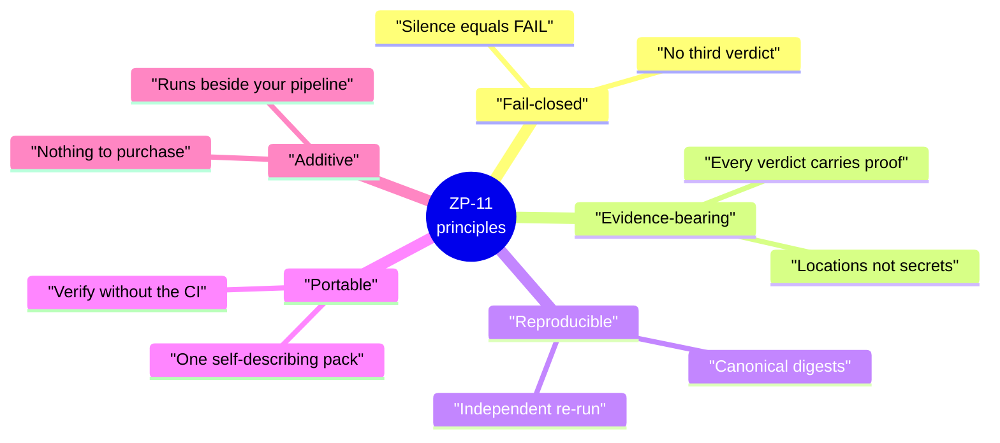

### 3.1 Fail-closed

A zone emits exactly one of two verdicts, `PASS` or `FAIL`. No implementation may define a third verdict that permits merge, and any ambiguity resolves to `FAIL`.

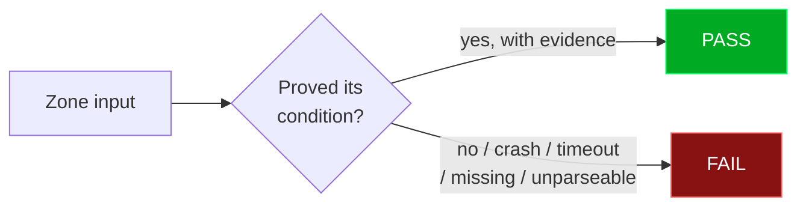

### 3.2 Evidence-bearing

Every verdict carries the inputs, tool identity, and tool version that produced it. The evidence is part of the signed record, so altering a byte of it invalidates the receipt.

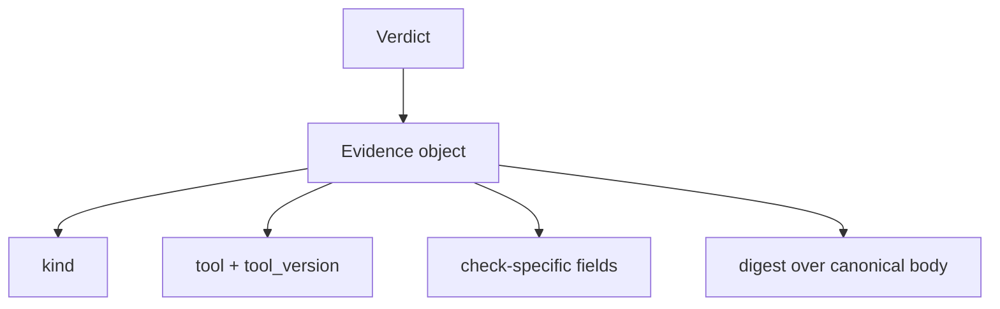

### 3.3 Reproducible

A pack re-run on a clean host yields an identical verdict and digest. Reproducibility is not a nicety; it is what lets a stranger confirm the result years later.

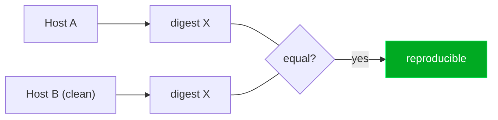

### 3.4 Portable

The Proof-Pack is a single self-describing JSON document. Verification needs the pack and a public key — never access to the CI system that produced it.

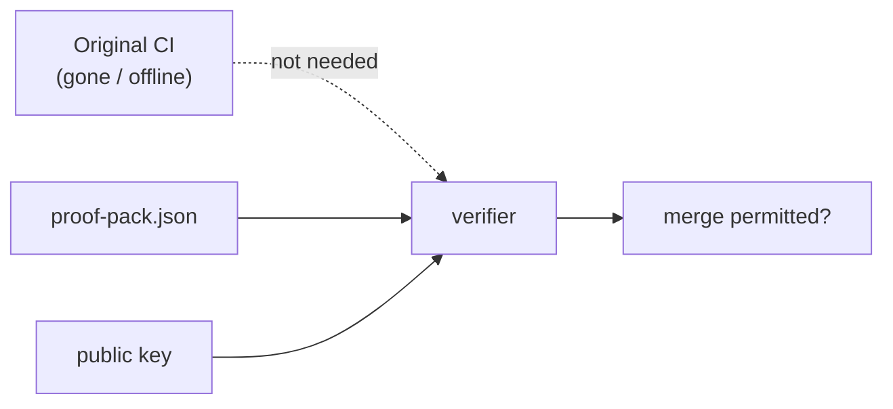

### 3.5 Additive

ZP-11 runs alongside an existing pipeline. An adopter maps each zone to a check they already run, emits packs in observe-only mode, then makes the gate blocking once every zone is green.


---

## 4. The eleven zones

ZP-11 decomposes "is this change safe to merge?" into eleven independent, machine-verified **Zero-Point zones**. Their names and ordering are fixed by the standard; a conforming configuration may map each zone to any check that satisfies its normative requirement, and must map an unimplemented zone to a check that returns `FAIL`.

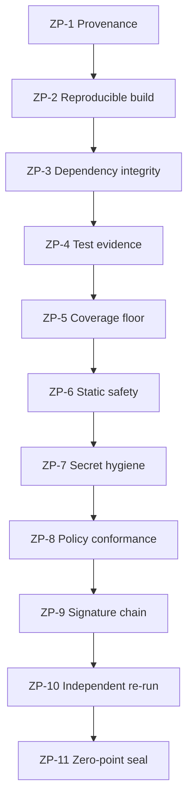

| Zone | Name | Normative requirement |
|------|------|-----------------------|
| ZP-1 | Provenance | Change references a signed source commit and a named builder. |
| ZP-2 | Reproducible build | Re-execution yields an identical output digest. |
| ZP-3 | Dependency integrity | Every dependency is pinned and hashed. |
| ZP-4 | Test evidence | Declared tests ran; machine-readable results are attached. |
| ZP-5 | Coverage floor | Changed lines meet the declared coverage threshold. |
| ZP-6 | Static safety | No new finding above the configured severity. |
| ZP-7 | Secret hygiene | No credential, key, or token in the diff or build output. |
| ZP-8 | Policy conformance | The change satisfies the declared policy-as-code. |
| ZP-9 | Signature chain | Every receipt is signed and chains to a trusted key. |
| ZP-10 | Independent re-run | A second, isolated runner reproduces the verdict. |
| ZP-11 | Zero-point seal | ZP-1…ZP-10 all PASS and the pack is sealed. |

### 4.1 ZP-1 — Provenance

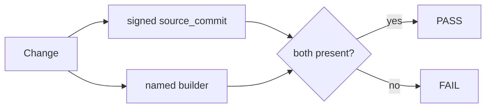

Provenance answers *where did this come from*. Without a signed commit and a known builder, the chain has no anchor.

### 4.2 ZP-2 — Reproducible build

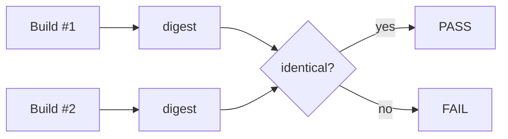

A build that cannot be reproduced cannot be trusted to contain only its declared inputs.

### 4.3 ZP-3 — Dependency integrity

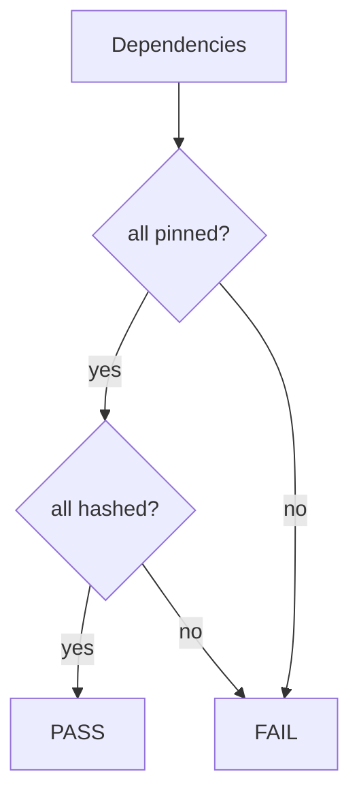

Every dependency must be pinned to an exact version and hashed, closing the door on silent substitution.

### 4.4 ZP-4 — Test evidence

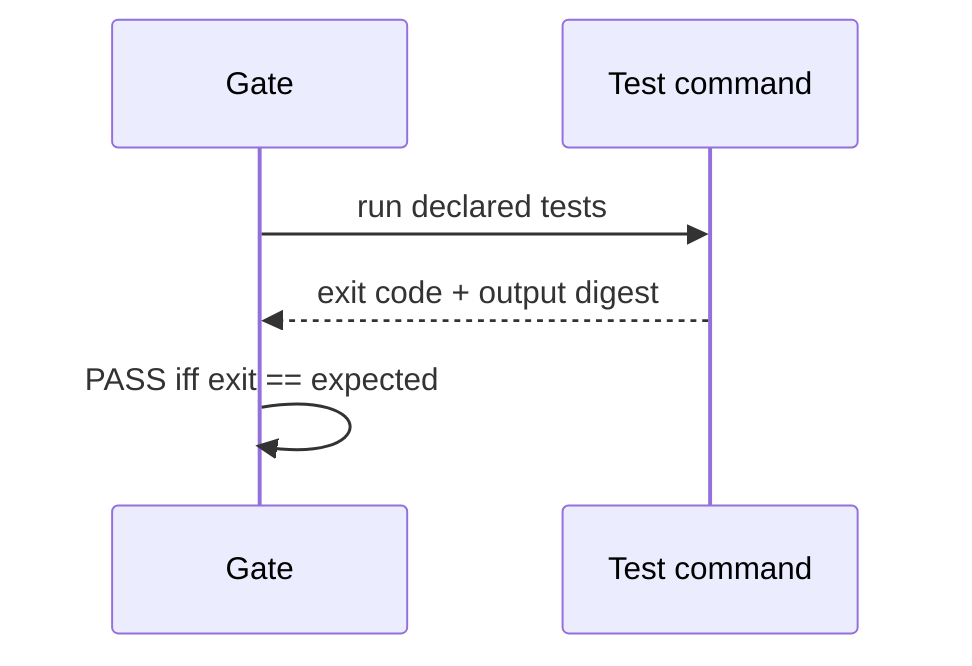

The zone proves the tests *ran* and attaches their machine-readable result — not a claim that tests exist.

### 4.5 ZP-5 — Coverage floor

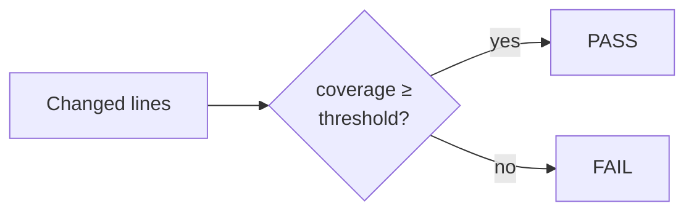

Coverage is measured against the repository's declared floor for the lines the change touched.

### 4.6 ZP-6 — Static safety

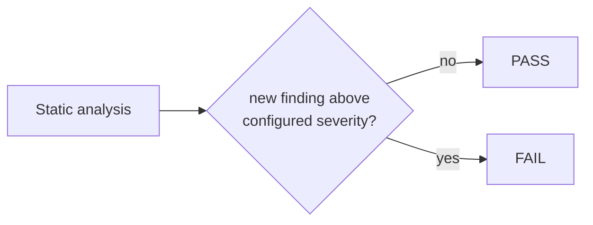

The bar is *no new finding* above the configured severity, so the gate does not reward pre-existing debt but refuses net-new risk.

### 4.7 ZP-7 — Secret hygiene

```mermaid
flowchart TB
    SCAN["Scan diff + build output"] --> PAT{"pattern or<br/>high-entropy hit?"}
    PAT -->|none| P7["PASS"]
    PAT -->|found| F7["FAIL<br/>record location only"]
    classDef no fill:#811,stroke:#f66,color:#fff;
    class F7 no;
```

Evidence records only the *locations* of findings, never the secret material itself — a deliberate constraint so the pack is safe to publish.

### 4.8 ZP-8 — Policy conformance

```mermaid
flowchart LR
    CH["Change"] --> POL["policy-as-code"]
    POL --> R{"satisfied?"}
    R -->|yes| P8["PASS"]
    R -->|no| F8["FAIL"]
```

Governance rules the adopter declares as code are evaluated like any other zone.

### 4.9 ZP-9 — Signature chain

```mermaid
flowchart LR
    RC["Each receipt"] --> SG["Ed25519 signature"]
    SG --> K{"chains to<br/>trusted key?"}
    K -->|yes| P9["PASS"]
    K -->|no| F9["FAIL"]
```

Every receipt must be signed and chain to a key the verifier trusts.

### 4.10 ZP-10 — Independent re-run

```mermaid
sequenceDiagram
    participant R1 as Primary runner
    participant R2 as Independent runner
    R1->>R1: produce verdict
    R2->>R2: reproduce in isolation
    R2-->>R1: verdicts match?
    Note over R1,R2: runners SHOULD NOT share state
```

ZP-10 exists specifically to detect a compromised primary runner: a second, isolated runner must reproduce the verdict.

### 4.11 ZP-11 — Zero-point seal

```mermaid
stateDiagram-v2
    [*] --> Checking
    Checking --> Sealed: ZP-1…ZP-10 all PASS
    Checking --> Unsealed: any prior FAIL
    Sealed --> [*]: merge permitted
    Unsealed --> [*]: merge refused
```

The seal is the eleventh zone. It passes only when every prior zone passed, and it signs the ordered chain of receipt digests so the pack cannot be reassembled from receipts that never shared a gate.

---

## 5. The Proof-Pack

The gate emits exactly one artifact: the **Proof-Pack**, a JSON document conforming to `zp11/schema/proof-pack.schema.json`. It names the change, lists every zone's verdict and evidence, and carries a signature chain closed by the seal.

```mermaid
classDiagram
    class ProofPack {
      standard = "zp11/v1"
      created
      change
      zones[]
      seal
    }
    class Change {
      id
      source_commit
      builder
    }
    class Receipt {
      id
      title
      verdict
      evidence
      digest
      signature
    }
    class Seal {
      verdict
      sealed
      zones_passed
      zones_total
      key
      signature
    }
    ProofPack --> Change
    ProofPack --> Receipt
    ProofPack --> Seal
```

```mermaid
erDiagram
    PROOFPACK ||--|| CHANGE : names
    PROOFPACK ||--o{ RECEIPT : contains
    PROOFPACK ||--|| SEAL : closed-by
    RECEIPT {
      string id
      string title
      string verdict
      object evidence
      string digest
      string signature
    }
    SEAL {
      string verdict
      bool sealed
      int zones_passed
      int zones_total
      string key
      string signature
    }
```

### 5.1 How a pack is produced

```mermaid
sequenceDiagram
    participant Dev as Change
    participant Gate as ZP-11 gate
    participant Pack as Proof-Pack
    participant V as Verifier
    Dev->>Gate: propose change to main
    Gate->>Gate: run ZP-1 … ZP-10
    Gate->>Pack: sign each receipt (Ed25519)
    Gate->>Pack: ZP-11 seal over receipt chain
    Pack-->>V: proof-pack.json + public key
    V->>V: recompute digests, verify, re-run ZP-10
    V-->>Dev: merge permitted iff sealed PASS
```

Note that the gate emits a pack even when zones fail — as evidence of *why* the gate stays shut — but such a pack is never sealed and merge is not permitted.

```mermaid
flowchart LR
    RUN["run_gate"] --> AP{"all zones<br/>PASS?"}
    AP -->|yes| SE["seal = true<br/>merge permitted"]
    AP -->|no| NS["seal = false<br/>evidence of why"]
    classDef ok fill:#0a2,stroke:#0f6,color:#fff;
    classDef no fill:#811,stroke:#f66,color:#fff;
    class SE ok; class NS no;
```

---

## 6. Integrity: digests, canonical form, and the signature chain

The pack's trustworthiness rests on two independent properties, both computable by anyone.

### 6.1 Canonical serialization

All digests and signatures are computed over the **canonical serialization** of the value — RFC 8785 (JCS): UTF-8, object keys sorted lexicographically, minimal separators, no insignificant whitespace. Values with no canonical form (NaN, Infinity, non-string keys) are rejected.

```mermaid
flowchart LR
    OBJ["JSON value"] --> JCS["RFC 8785 / JCS<br/>canonicalise"]
    JCS --> BY["stable UTF-8 bytes"]
    BY --> SHA["SHA-256"]
    SHA --> DG["digest = sha256:hex"]
```

### 6.2 Receipt digest

For each receipt, `digest = sha256:hex(SHA-256(canonical(body)))` where `body = { id, title, verdict, evidence }`. Altering any evidence byte changes the digest.

```mermaid
flowchart TB
    B["body = id, title, verdict, evidence"] --> C["canonical(body)"]
    C --> H["SHA-256"]
    H --> R["receipt.digest"]
    ALT["any byte changed"] -.-> MM["digest mismatch on verify"]
    classDef no fill:#811,stroke:#f66,color:#fff;
    class MM no;
```

### 6.3 Signatures

Signatures use Ed25519 (RFC 8032), encoded `ed25519:<hex>`; public keys are `ed25519:<hex of 32 raw bytes>`. Each receipt is signed over `canonical({ …body, digest })`.

```mermaid
sequenceDiagram
    participant R as Receipt
    participant K as Ed25519 key
    R->>R: compute digest(body)
    R->>K: sign canonical(body + digest)
    K-->>R: signature ed25519:hex
```

### 6.4 The seal signs the ordered chain

The seal is signed over the *seal content*: the standard, timestamp, change, verdict, zone counts, and the ordered list of `{ id, digest }` for each receipt. Because the seal signs the ordered digests, receipts cannot be reordered, added, or removed without invalidating it.

```mermaid
flowchart TB
    SC["seal_content"] --> L["ordered receipts:<br/>id + digest"]
    SC --> M["standard, created, change"]
    SC --> V["verdict, zones_passed, zones_total"]
    SC --> SIG["Ed25519 seal signature"]
```

```mermaid
graph LR
    r1["ZP-1 digest"] --> r2["ZP-2 digest"]
    r2 --> r3["… digest"]
    r3 --> r10["ZP-10 digest"]
    r10 --> SEAL["ZP-11 seal<br/>signs the chain"]
    classDef hi fill:#024,stroke:#37c6ff,color:#fff;
    class SEAL hi;
```

### 6.5 The root of trust

Signing keys are the root of trust. They must be stored outside the gated repository and rotated per the adopter's policy. A verifier defaults to refusing merge when the key is unavailable.

```mermaid
flowchart LR
    KEY["Signing key<br/>(outside the repo)"] --> SIGN["signs receipts + seal"]
    PUB["public key"] --> VER["verifier checks"]
    NOKEY["no key available"] --> REF["refuse merge (default)"]
    classDef no fill:#811,stroke:#f66,color:#fff;
    class REF no;
```

---

## 7. Verification

Given a Proof-Pack `P` and a public key `K`, a verifier confirms the zones are present, recomputes every receipt digest, verifies every signature and the seal, and confirms every verdict is `PASS` and the pack is sealed. Merge is permitted if and only if all steps succeed.

```mermaid
flowchart TB
    S1["1 · all ZP-1…ZP-11 present?"] --> S2["2 · each digest recomputed = stored?<br/>receipt signature valid?"]
    S2 --> S3["3 · reconstruct seal_content,<br/>verify seal signature"]
    S3 --> S4["4 · every verdict PASS?<br/>sealed = true?"]
    S4 --> OK{"all succeed?"}
    OK -->|yes| M["merge permitted"]
    OK -->|no| R["merge refused"]
    classDef ok fill:#0a2,stroke:#0f6,color:#fff;
    classDef no fill:#811,stroke:#f66,color:#fff;
    class M ok; class R no;
```

```mermaid
stateDiagram-v2
    [*] --> Collecting
    Collecting --> Evaluating: zones run
    Evaluating --> Sealed: all PASS, seal
    Evaluating --> Shut: any FAIL
    Sealed --> Verified: signatures + digests OK
    Verified --> [*]: merge permitted
    Shut --> [*]: merge refused
```

A third party re-runs the decision without contacting the original pipeline.

```mermaid
sequenceDiagram
    participant Auditor
    participant Pack as proof-pack.json
    participant Key as public key
    Auditor->>Pack: load
    Auditor->>Key: load
    Auditor->>Auditor: recompute digests
    Auditor->>Auditor: verify receipt + seal signatures
    Auditor->>Auditor: confirm all PASS + sealed
    Auditor-->>Auditor: merge permitted?
```

The fail-closed decision is explicit in the verifier's logic: anything missing produces a reason and refuses merge.

```mermaid
flowchart LR
    MISS["missing zone"] --> NO["refuse"]
    DMM["digest mismatch"] --> NO
    BSIG["bad signature"] --> NO
    NP["not all PASS"] --> NO
    US["not sealed"] --> NO
    ALLOK["all checks pass"] --> YES["permit"]
    classDef no fill:#811,stroke:#f66,color:#fff;
    classDef ok fill:#0a2,stroke:#0f6,color:#fff;
    class NO no; class YES ok;
```

---

## 8. The reference implementation

The repository ships a small Python reference library that is the normative oracle for conformance test vectors. It is intentionally compact so the whole trust path can be read in an afternoon.

```mermaid
classDiagram
    class canonical_py { "RFC 8785 serialisation" }
    class crypto_py { "Ed25519 / SHA-256" }
    class verdict_py { "PASS / FAIL" }
    class zones_py { "zone kinds" }
    class pack_py { "Receipt, ProofPack, verify_pack" }
    class gate_py { "run the zones, seal" }
    class cli_py { "keygen zones run verify" }
    gate_py --> zones_py
    gate_py --> pack_py
    pack_py --> crypto_py
    pack_py --> canonical_py
    zones_py --> verdict_py
    cli_py --> gate_py
    cli_py --> pack_py
```

Zones are declarative. A repository maps each `ZP-n` to one of a small set of *kinds* in `zp11.toml`.

```mermaid
flowchart TB
    K["Zone kinds"] --> r["require: named fields present"]
    K --> f["file: path exists, non-empty, hashed"]
    K --> c["command: exits 0, output digested"]
    K --> s["secret_scan: no secret under paths"]
    K --> se["seal: ZP-11, set by the gate"]
```

Each kind reduces to the same two-valued verdict, and any crash inside a zone fails closed rather than propagating.

```mermaid
stateDiagram-v2
    [*] --> Run
    Run --> PASS: condition proved + evidence
    Run --> FAIL: unknown kind / exception / unmet
    PASS --> [*]
    FAIL --> [*]
```

The CLI exposes four verbs. `run` exits 0 only when merge is permitted, which is what makes it safe to wire as a required status check.

```mermaid
flowchart LR
    kg["keygen"] --> ze["zones"]
    ze --> ru["run"]
    ru --> ve["verify"]
    classDef hi fill:#024,stroke:#37c6ff,color:#fff;
    class ru,ve hi;
```

```mermaid
sequenceDiagram
    participant U as Operator
    participant CLI as zp11
    U->>CLI: keygen --out ci.key
    U->>CLI: run --key ci.key --out proof-pack.json
    CLI-->>U: exit 0 iff sealed PASS
    U->>CLI: verify proof-pack.json
    CLI-->>U: exit 0 iff merge permitted
```

The `secret_scan` kind illustrates the evidence-without-exposure principle concretely: it records matched locations and a rule label, never the matched secret.

```mermaid
flowchart TB
    FILES["files under declared paths"] --> SKIP["skip .git and binaries"]
    SKIP --> PAT["known-pattern match"]
    SKIP --> ENT["high-entropy token"]
    PAT --> FND["finding: path + rule"]
    ENT --> FND
    FND --> V{"any finding?"}
    V -->|no| P["PASS"]
    V -->|yes| F["FAIL"]
    classDef no fill:#811,stroke:#f66,color:#fff;
    class F no;
```

---

## 9. Scope

ZP-11 is deliberately narrow. Stating its boundaries plainly is part of the design.

```mermaid
flowchart TB
    subgraph IN["In scope"]
      i1["Fail-closed release gate semantics"]
      i2["Signed, reproducible Proof-Pack format"]
      i3["Eleven independent machine-verified zones"]
      i4["Verification from pack + public key"]
      i5["A tool-agnostic reference implementation"]
    end
```

```mermaid
graph TB
    IS["ZP-11 IS"] --> a["an open specification"]
    IS --> b["a Proof-Pack format"]
    IS --> c["eleven verdict-bearing zones"]
    IS --> d["re-runnable by anyone"]
    classDef hi fill:#024,stroke:#37c6ff,color:#fff;
    class IS hi;
```

The standard defines *verdicts, not vendors*. It says what must be proved and how the proof is recorded, and leaves the choice of scanner, test runner, and build system entirely to the adopter.

```mermaid
mindmap
  root(("Threat model<br/>ZP-11 addresses"))
    "Silent skipped checks"
      "silence = FAIL"
    "Tampered evidence"
      "canonical digest"
    "Reordered receipts"
      "seal over chain"
    "Compromised runner"
      "ZP-10 independent re-run"
    "Leaked secrets"
      "ZP-7 locations only"
```

---

## 10. Non-goals

What a standard refuses to claim is as important as what it promises. ZP-11 makes no claim beyond the integrity of its own gate.

```mermaid
flowchart TB
    subgraph OUT["Explicit non-goals"]
      n1["Not a product or hosted service"]
      n2["Not a guarantee that passing code is bug-free"]
      n3["Not a replacement for human review"]
      n4["Not a security certification"]
      n5["Not a claim about any adopter or outcome"]
    end
    classDef no fill:#811,stroke:#f66,color:#fff;
    class n1,n2,n3,n4,n5 no;
```

A sealed pack means the eleven zones were proved and recorded — nothing more. It does not promise the software is correct, that review is unnecessary, or that any particular organization is secure.

```mermaid
graph TB
    ISNOT["ZP-11 IS NOT"] --> x1["a product"]
    ISNOT --> x2["a bug-free guarantee"]
    ISNOT --> x3["a human-review replacement"]
    ISNOT --> x4["a certification"]
    classDef no fill:#811,stroke:#f66,color:#fff;
    class ISNOT,x1,x2,x3,x4 no;
```

ZP-11 also does not mandate specific tooling, host any service, or require an account. There is nothing to purchase.

---

## 11. Adoption

ZP-11 is additive by design. An organization adopts it in four steps, moving from observation to enforcement at its own pace.

```mermaid
journey
    title Four-step adoption
    section Declare
      Map each ZP-n to a check: 4: Team
    section Emit
      Produce a pack on every change: 4: CI
    section Re-run
      Independent runner verifies: 3: CI
    section Enforce
      Require a sealed PASS to merge: 5: Team
```

```mermaid
flowchart LR
    A["1 · Declare zones"] --> B["2 · Emit Proof-Pack"]
    B --> C["3 · Re-run to verify"]
    C --> D["4 · Make gate blocking"]
    classDef hi fill:#024,stroke:#37c6ff,color:#fff;
    class D hi;
```

A typical rollout keeps the gate in observe-only mode while zones are mapped, then flips it to blocking once each is reliably green.

```mermaid
gantt
    title Illustrative rollout phases
    dateFormat  YYYY-MM-DD
    section Declare
    Map zones to checks      :a1, 2026-01-01, 14d
    section Observe
    Emit packs, non-blocking :a2, after a1, 21d
    section Enforce
    Make gate blocking       :a3, after a2, 7d
```

Because the gate is additive, adoption never requires replacing the existing pipeline — only wrapping its outputs in verifiable evidence.

---

## 12. Conformance and versioning

An implementation is conformant if it emits packs that validate against the schema, treats any non-`PASS` condition as `FAIL`, computes digests and signatures as specified, and refuses merge unless verification succeeds.

```mermaid
flowchart TB
    C1["Packs validate against schema"] --> OKC{"conformant?"}
    C2["Non-PASS treated as FAIL"] --> OKC
    C3["Digests + signatures as specified"] --> OKC
    C4["Refuse merge unless verified"] --> OKC
    OKC -->|all hold| CONF["Conformant"]
    classDef ok fill:#0a2,stroke:#0f6,color:#fff;
    class CONF ok;
```

This document specifies `zp11/v1`. Backward-incompatible changes increment the version in the `standard` field, and implementations must reject a pack whose standard they do not recognize.

```mermaid
timeline
    title ZP-11 standard line
    zp11/v1 : Stable : Eleven fixed zones : Proof-Pack + seal
    future : Increment on breaking change : Reject unknown standard
```

The reference library in the repository is the normative oracle: where prose and code could be read differently, the test vectors the reference produces decide.

```mermaid
graph TB
    SPEC["SPEC.md (zp11/v1)"] --> REF["reference library"]
    REF --> VEC["conformance test vectors"]
    VEC --> IMPL["any implementation"]
    IMPL --> CHK{"matches vectors?"}
    CHK -->|yes| CONF["conformant"]
    classDef ok fill:#0a2,stroke:#0f6,color:#fff;
    class CONF ok;
```

---

## 13. Summary

ZP-11 takes one defect in how software ships — that trust is granted by default and withdrawn only on proof of harm — and inverts it. The gate is closed until a change proves, through eleven independent zones, that it is safe, and records that proof as a signed, reproducible Proof-Pack any third party can re-run. The standard is open, MIT-licensed, tool-agnostic, additive, and narrow: it guarantees the integrity of its own evidence and claims nothing further.

```mermaid
flowchart LR
    PROB["Trust by default"] --> IDEA["Invert: prove before merge"]
    IDEA --> ZONES["Eleven zones"]
    ZONES --> PACK["Signed Proof-Pack"]
    PACK --> VER["Anyone can verify"]
    VER --> GATE["Gate opens iff sealed PASS"]
    classDef hi fill:#024,stroke:#37c6ff,color:#fff;
    class GATE hi;
```

ZP-11 was invented and authored by **Naquib Hatami** and is published as an open standard under the MIT License at [github.com/iQs-Group/ZP-11](https://github.com/iQs-Group/ZP-11) with its homepage at [zp11.org](https://zp11.org).

---

## Related documents

- [`03-architecture.md`](03-architecture.md) — System architecture and the gate/zone/pack component model.
- [`05-data-model.md`](05-data-model.md) — The Proof-Pack schema, canonical form, and signature chain in depth.
- [`10-zones-reference.md`](10-zones-reference.md) — Per-zone normative requirements, kinds, and evidence.
- [`13-conformance.md`](13-conformance.md) — The verification algorithm, test vectors, and conformance criteria.
- [`17-adoption-guide.md`](17-adoption-guide.md) — Mapping zones to existing checks and moving the gate to blocking.
