*Part of the ProofGate ZP-11 documentation set.*

# ProofGate ZP-11 — Technical Whitepaper

## Abstract

ProofGate ZP-11 (`zp11/v1`) is an open, fail-closed release-governance standard invented and authored by **Naquib Hatami** and published under the MIT License by iQs Group Inc. / SADI AI Inc. It replaces the prevailing *advisory* model of release checks — where a pipeline warns and then lets a change through — with an *evidentiary* one: a change advances to a protected branch **if and only if** eleven independent Zero-Point zones each return a verifiable `PASS` and the whole result is captured in a single, cryptographically sealed **Proof-Pack** that any third party can re-run from the pack and a public key alone. The gate is closed by default; silence, a crash, a timeout, or a missing artifact all resolve to `FAIL`. This whitepaper gives a rigorous technical overview of the standard's verdict semantics, the eleven zones, the Proof-Pack format, the canonicalisation and signature chain (RFC 8785 / RFC 8032), and the verification algorithm, together with the Python reference library (`canonical.py`, `crypto.py`, `verdict.py`, `zones.py`, `pack.py`, `gate.py`, `cli.py`) that serves as the standard's normative oracle. It also states plainly the threat ZP-11 addresses and the threats it does not. The repository is published at github.com/iQs-Group/ZP-11 with its homepage at zp11.org.

---

## 1. Introduction: the threat

Most continuous-integration checks are advisory. A linter flags, a scanner warns, a coverage report drops — and the merge button stays green. The decision to trust the result is delegated to a human who, under delivery pressure, routinely overrides it. The security property that matters at a release boundary — *this change is backed by evidence* — is therefore enforced by convention, not by construction. ZP-11 addresses the gap between **a check having run** and **a change being provably entitled to merge**.

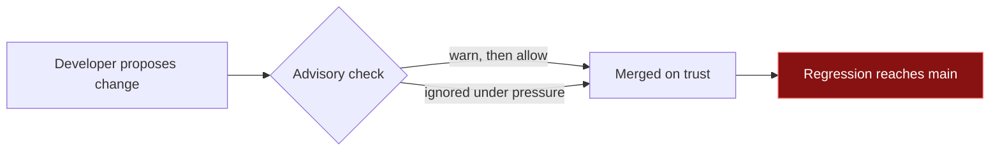

The failure mode above is not a tooling defect; it is a *semantics* defect. The check emits a signal, but the gate treats the absence of a blocking signal as consent. The industry has spent two decades improving the *quality* of signals — faster test runners, deeper static analysis, richer coverage reports — while leaving the *decision rule* untouched. A thousand green checks and one silently skipped scanner still produce a merge, because the merge rule is "nothing is actively red," not "everything is provably green." ZP-11 inverts that default: the quantity that matters is not how many checks warned but whether a complete, signed body of affirmative evidence exists for every obligation the repository has declared.

This matters most precisely when it is least convenient. The release decisions that cause incidents are rarely the ones made in a calm review; they are the ones made at the end of a long day, when a flaky job is re-run until it is green, when a scanner is disabled "temporarily" to unblock a hotfix, or when a reviewer approves on the strength of a description rather than the diff. In each case the human has, in good faith, substituted trust for evidence. ZP-11's contribution is to make that substitution *impossible to perform silently*: the only path to a merge is a sealed Proof-Pack, and a sealed Proof-Pack cannot exist unless every zone produced affirmative, signed evidence.

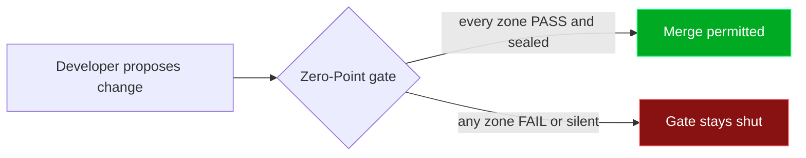

The threat model is deliberately narrow and honest. ZP-11 defends the integrity of a *release decision*: that a merge happened only because reproducible, attributable, machine-verified evidence existed and was sealed. It is explicitly **not** a guarantee that passing code is bug-free, a replacement for human review, a security certification, or a claim about any adopter or outcome.

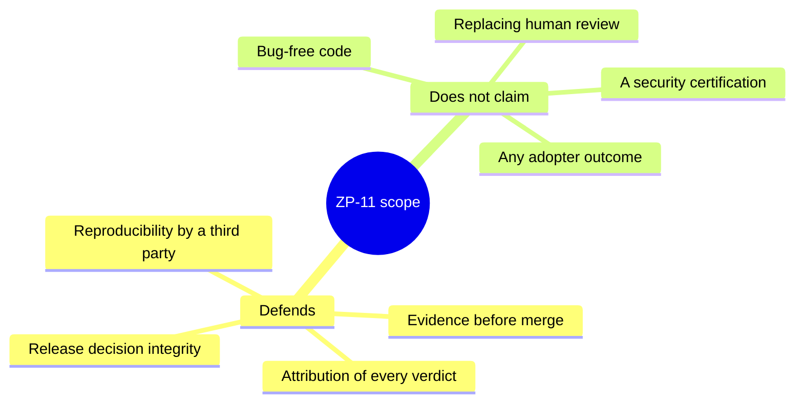

---

## 2. Design principles

### 2.1 Fail-closed by construction

The standard turns on a single asymmetry, encoded directly in `verdict.py`: a zone returns exactly one of two verdicts, `PASS` or `FAIL`. Everything else a zone might do — raise an exception, time out, return nothing, or emit something unparseable — collapses to `FAIL`. There is no third state that permits a merge.

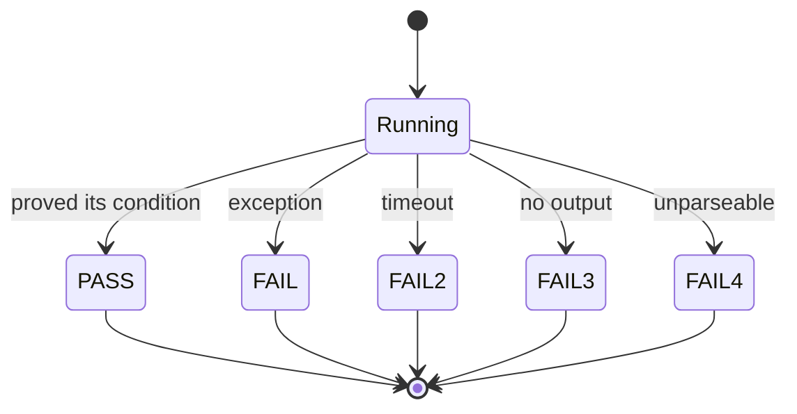

In the reference `Verdict` enum, `PASS` is truthy and `FAIL` is falsy, so a pack passes only when *all* receipts are truthy. The `coerce` helper maps anything unrecognised onto `FAIL`, which is what "fail-closed, by construction" means in code rather than in prose. The distinction is worth dwelling on: in most systems a check that errors out is treated as inconclusive, and inconclusive is operationally closer to "allow" than to "deny," because an erroring check is usually flaky infrastructure rather than a real defect. ZP-11 refuses that convenience on principle. A zone that cannot produce evidence of its condition has, by definition, failed to establish that condition, and the gate cannot distinguish an honestly inconclusive result from a maliciously suppressed one. Collapsing both to `FAIL` is therefore not pessimism; it is the only rule under which the pack's meaning is preserved — a sealed pack says every obligation was *met and proven*, with no asterisk for the checks that happened not to run.

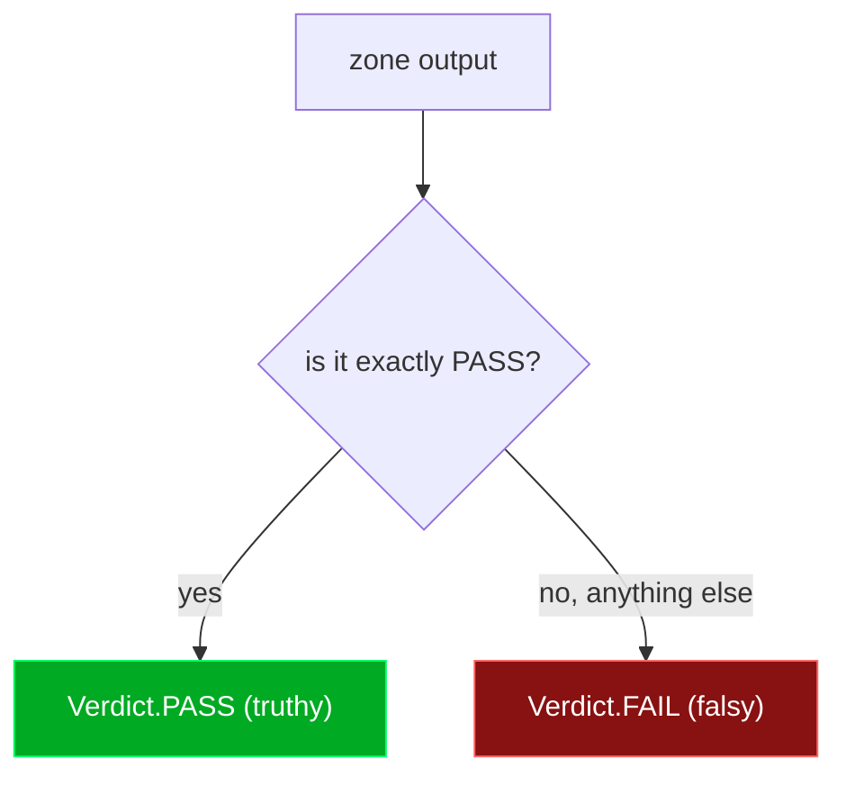

### 2.2 Independence of zones

Each zone is an independent check with a defined input, a deterministic verdict, and evidence attached to the pack. A zone that cannot run or cannot prove its result reports `FAIL` rather than abstaining. Zones compose only at the gate, which is the single place the eleven are assembled.

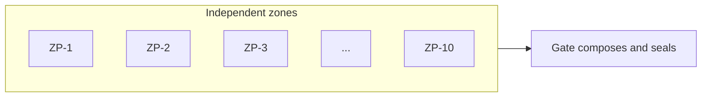

### 2.3 Portability of evidence

A Proof-Pack is self-describing. Verification needs nothing but the pack and a public key — no access to the original CI, no network, no vendor service. This is what makes a verdict re-runnable by a party who did not trust the pipeline that produced it.

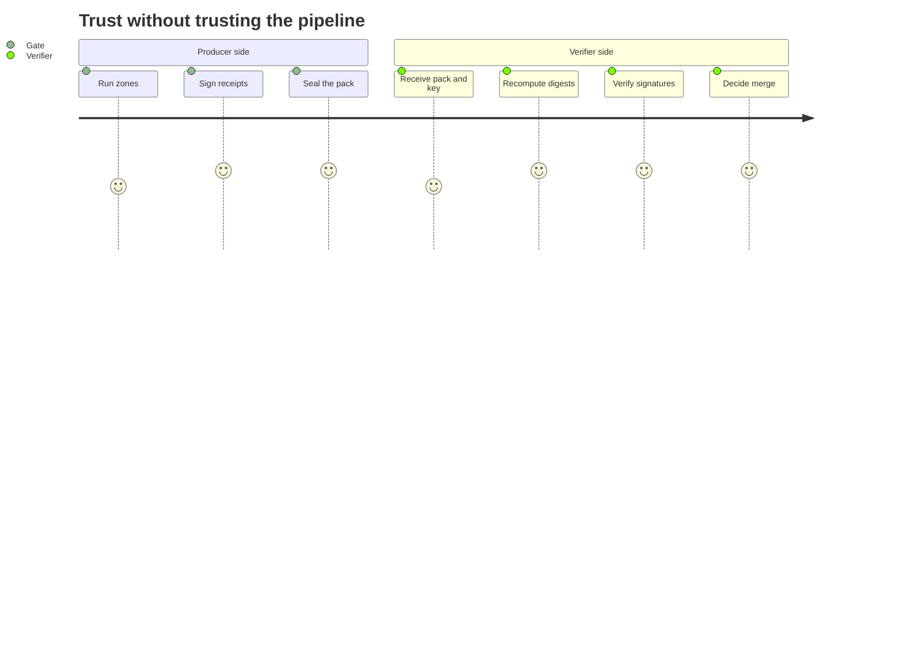

### 2.4 Tool-agnosticism

ZP-11 defines verdicts, not vendors. A conforming configuration maps each zone to any check that satisfies the zone's normative requirement, and maps an unimplemented zone to a check that returns `FAIL`. The standard is additive: run it alongside an existing pipeline, then make it blocking once every zone is green.

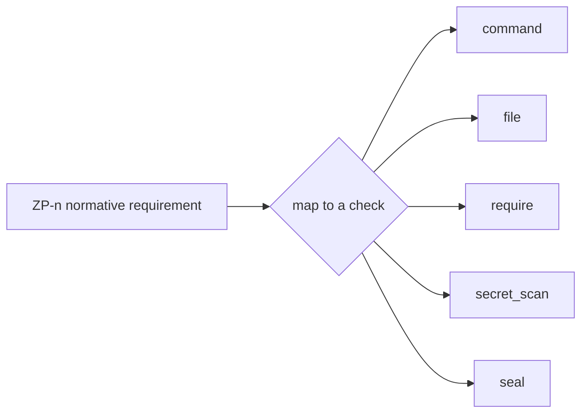

---

## 3. The eleven zones

The names and ordering of the eleven zones are fixed by the specification. The reference library holds the canonical titles in `zones.py`. A repository binds each zone to one of five *kinds*: `require`, `file`, `command`, `secret_scan`, and `seal`.

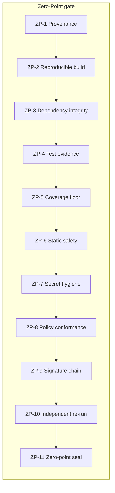

The separation between the eleven fixed zones and the five reusable kinds is the heart of the standard's tool-agnosticism. The zones are *obligations* — provenance, reproducibility, dependency integrity, and so on — and are fixed because a release decision is only comparable across repositories if it covers the same obligations. The kinds are *mechanisms*, and are deliberately few, because every mechanism the standard admits is a mechanism a verifier must be able to reason about. A `require` kind asserts that named context fields are present and non-empty; a `file` kind asserts a path exists, meets a minimum size, and records its SHA-256; a `command` kind runs a shell command under a timeout and makes the exit code the verdict while digesting the combined output; a `secret_scan` kind applies pattern and entropy detectors and records only finding locations; and a `seal` kind is reserved for ZP-11 and is set by the gate. An adopter whose real check is a bespoke policy engine, a proprietary SAST tool, or a coverage gate wraps it as a `command` whose exit code encodes the verdict, and the resulting receipt is as verifiable as any other.

The five kinds map onto the eleven zones as the adopter declares. The reference `zp11.toml`, in which the standard governs its own repository, illustrates one valid binding.

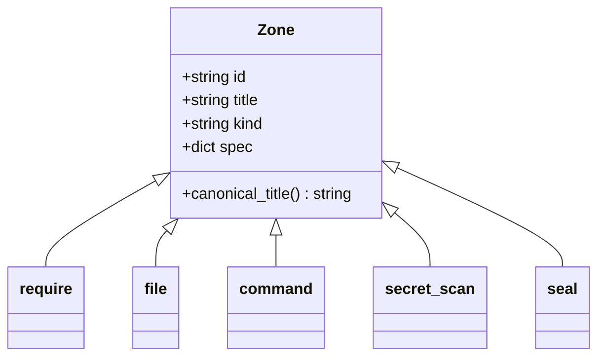

### 3.1 ZP-1 Provenance

The change **MUST** reference a signed source commit and a named builder. In the reference binding this is a `require` kind over the `source_commit` and `builder` context fields; any missing or empty field yields `FAIL`.

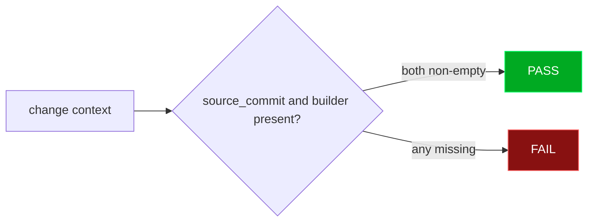

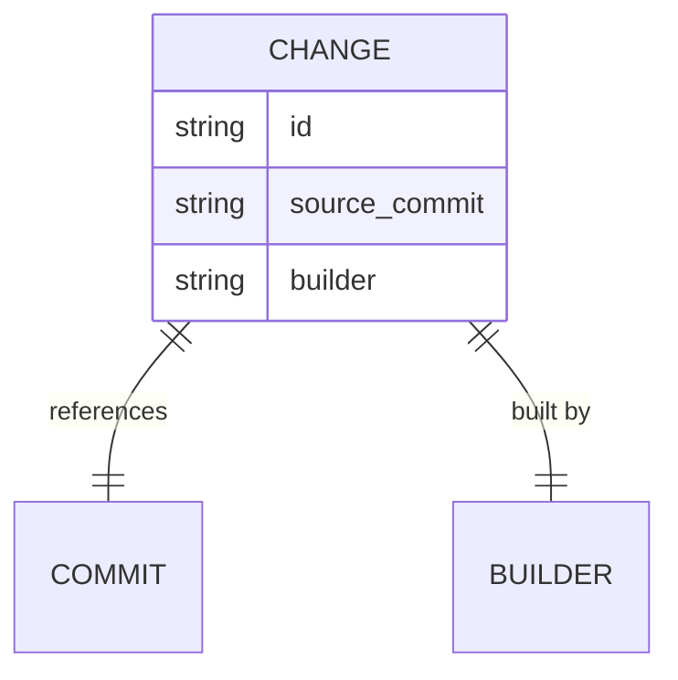

### 3.2 ZP-2 Reproducible build

Re-execution **MUST** yield an identical output digest. The reference binding runs a `command` kind and digests the combined stdout and stderr; a differing output or a non-zero exit code is `FAIL`.

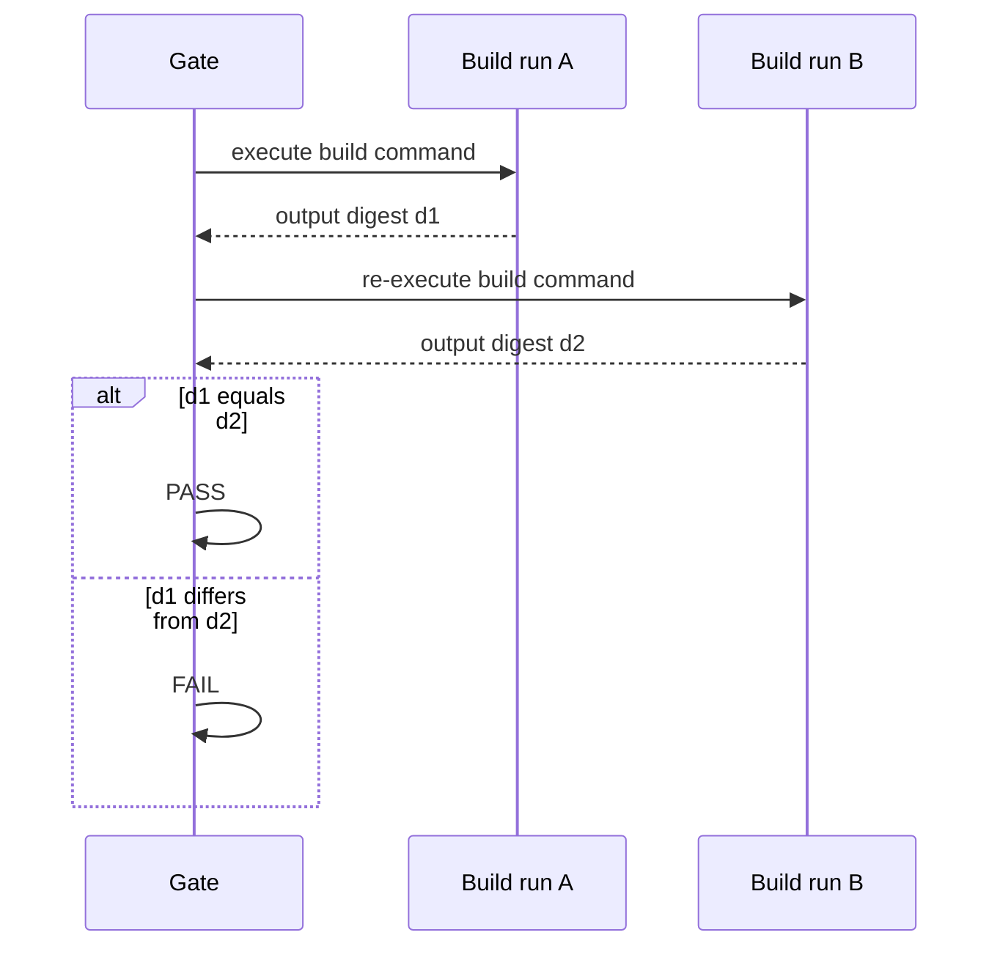

### 3.3 ZP-3 Dependency integrity

Every dependency **MUST** be pinned and hashed. The reference binding uses a `file` kind over `requirements.lock`; a missing or empty lock file is `FAIL`, and the file's SHA-256 becomes evidence.

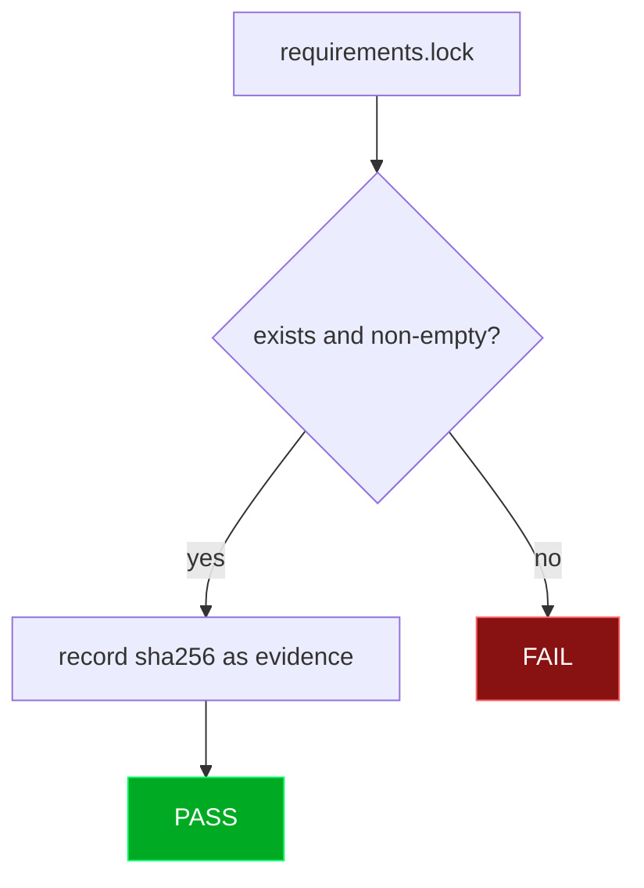

### 3.4 ZP-4 Test evidence

Declared tests **MUST** have run, and machine-readable results **MUST** be attached. The reference binding runs the test suite as a `command`; the exit code decides the verdict and the output digest is recorded.

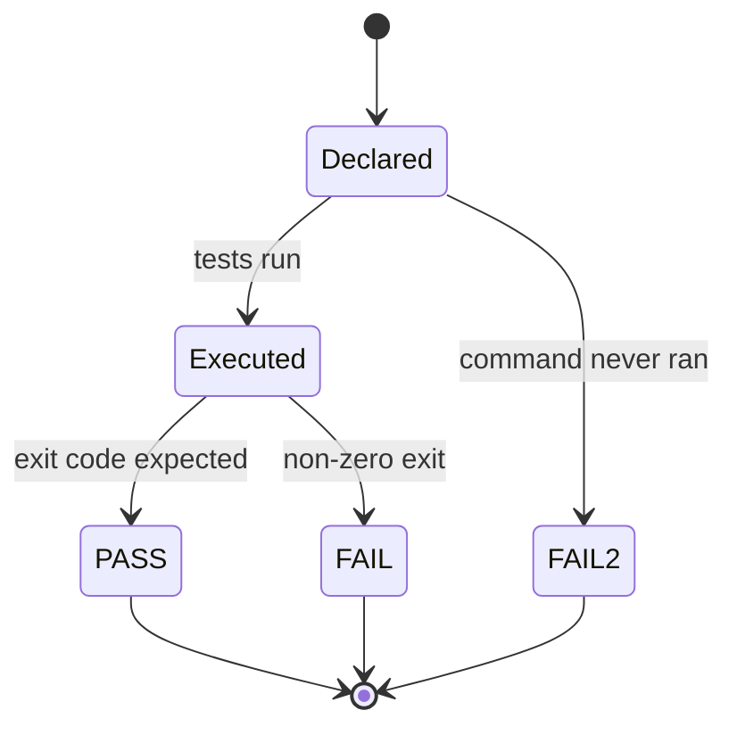

### 3.5 ZP-5 Coverage floor

Changed lines **MUST** meet the declared coverage threshold. Expressed as a `command` whose success criterion encodes the floor; a result below the threshold exits non-zero and fails.

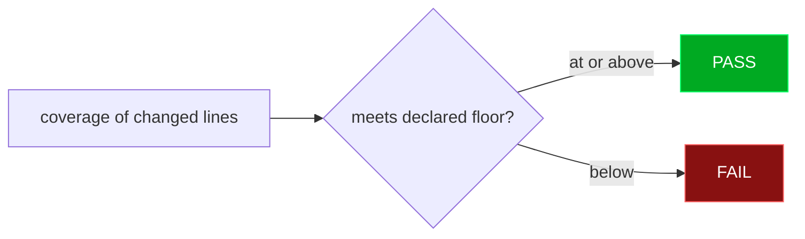

### 3.6 ZP-6 Static safety

No new finding above the configured severity **MAY** be present. A `command` kind whose non-zero exit on a disqualifying finding becomes `FAIL`.

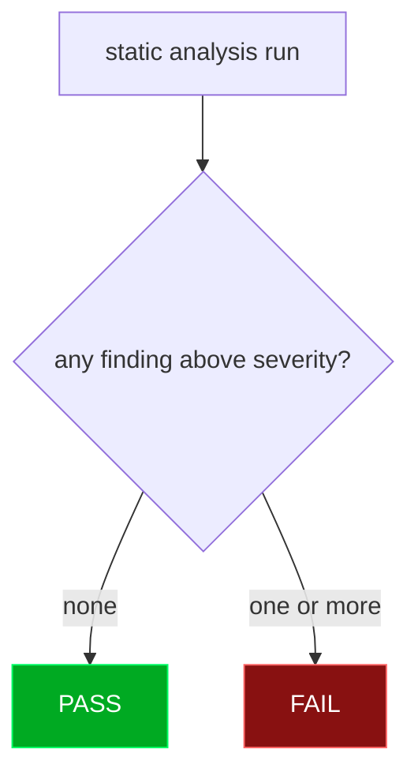

### 3.7 ZP-7 Secret hygiene

No credential, key, or token **MAY** appear in the diff or build output. The `secret_scan` kind combines known-pattern detectors (private-key headers, AWS access-key ids, GitHub, Slack, and generic API tokens) with a Shannon-entropy screen. Crucially, evidence records only the *locations* of findings, never the secret material itself.

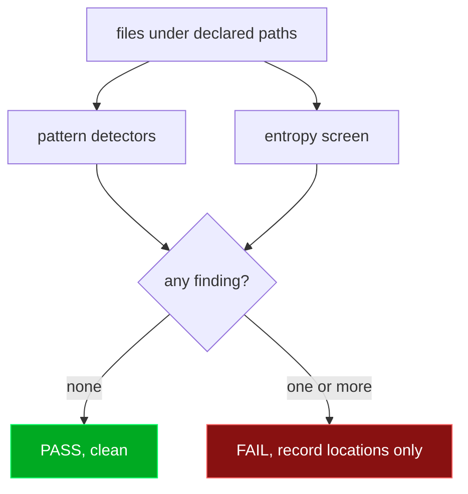

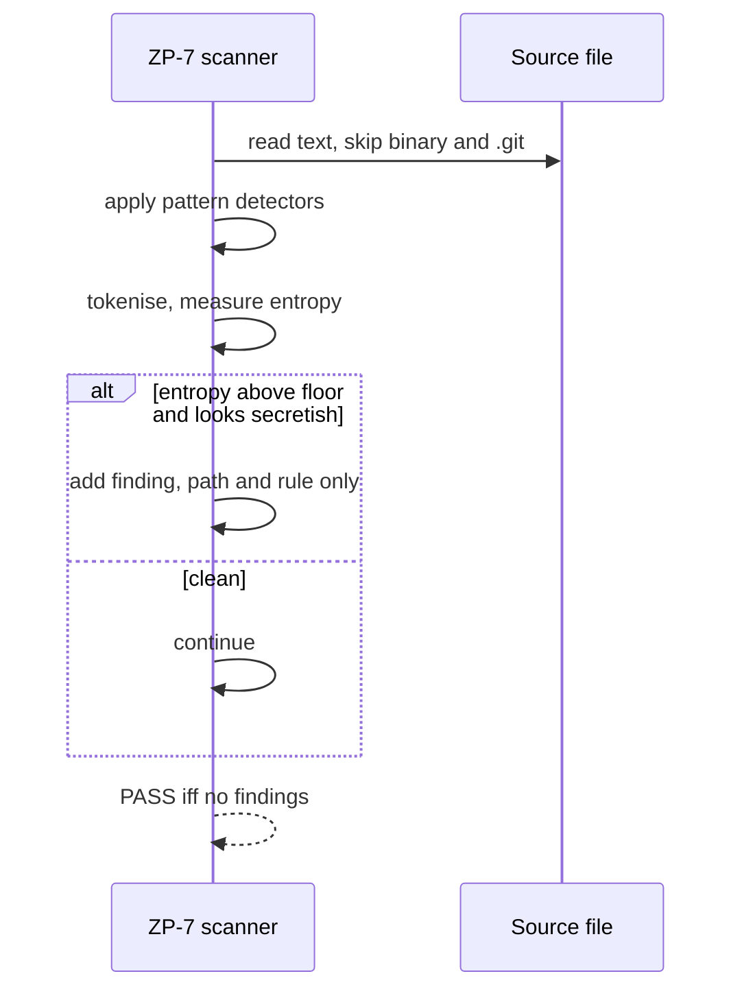

### 3.8 ZP-8 Policy conformance

The change **MUST** satisfy the declared policy-as-code. In the reference binding this is a `file` kind asserting a governance document is present and non-trivial; an adopter may substitute any policy engine.

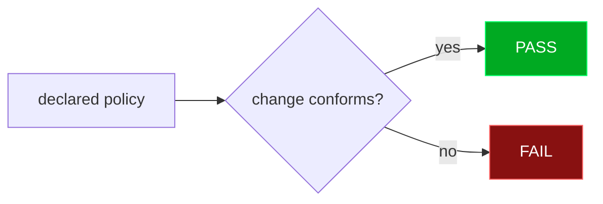

### 3.9 ZP-9 Signature chain

Every receipt **MUST** be signed and chain to a trusted key. This zone's own verdict asserts the provenance input needed for the chain to be meaningful; the cryptographic chaining itself is enforced by the pack's signing and the seal.

```mermaid
flowchart LR
    R1["receipt ZP-1"] --> R2["receipt ZP-2"]
    R2 --> R3["..."]
    R3 --> R10["receipt ZP-10"]
    R10 --> SEAL["ZP-11 seal over the digest chain"]
    SEAL --> K["trusted public key"]
```

### 3.10 ZP-10 Independent re-run

A second, isolated runner **MUST** reproduce the verdict. ZP-10 exists specifically to detect a compromised primary runner; the two runners should not share state.

```mermaid
sequenceDiagram
    participant P as Primary runner
    participant I as Independent runner
    P->>P: compute verdict v1
    I->>I: recompute verdict v2 in isolation
    alt v1 equals v2
      I-->>P: PASS, reproduced
    else v1 differs from v2
      I-->>P: FAIL, divergence detected
    end
```

```mermaid
flowchart TB
    subgraph NoShared["no shared state"]
      A["Primary"]
      B["Independent"]
    end
    A --> R{"verdicts agree?"}
    B --> R
    R -->|"yes"| P["PASS"]
    R -->|"no"| F["FAIL"]
    classDef ok fill:#0a2,stroke:#0f6,color:#fff;
    classDef no fill:#811,stroke:#f66,color:#fff;
    class P ok; class F no;
```

### 3.11 ZP-11 Zero-point seal

ZP-1 through ZP-10 **MUST** all be `PASS`, and the pack **MUST** be sealed. The seal is the only zone the gate derives rather than runs: its verdict is `PASS` precisely when every prior receipt was truthy, and it signs the ordered chain of receipt digests.

```mermaid
stateDiagram-v2
    [*] --> Collecting
    Collecting --> Evaluating: ZP-1..ZP-10 run
    Evaluating --> Sealed: all prior PASS
    Evaluating --> Shut: any prior FAIL
    Sealed --> [*]: merge permitted
    Shut --> [*]: merge refused
```

```mermaid
flowchart TB
    PR["prior ten verdicts"] --> Q{"all PASS?"}
    Q -->|"yes"| S["seal verdict PASS, sealed true"]
    Q -->|"no"| U["seal verdict FAIL, sealed false"]
    classDef ok fill:#0a2,stroke:#0f6,color:#fff;
    classDef no fill:#811,stroke:#f66,color:#fff;
    class S ok; class U no;
```

The zones can be summarised by the kind each reference binding uses and the normative keyword that governs it.

| ID | Name | Normative keyword | Reference kind |
|----|------|-------------------|----------------|
| ZP-1 | Provenance | MUST reference signed commit and builder | require |
| ZP-2 | Reproducible build | MUST yield identical digest | command |
| ZP-3 | Dependency integrity | MUST be pinned and hashed | file |
| ZP-4 | Test evidence | MUST have run with attached results | command |
| ZP-5 | Coverage floor | MUST meet threshold | command |
| ZP-6 | Static safety | MAY have no finding above severity | command |
| ZP-7 | Secret hygiene | MAY have no secret in diff or output | secret_scan |
| ZP-8 | Policy conformance | MUST satisfy policy-as-code | file |
| ZP-9 | Signature chain | MUST be signed and chain to a key | require |
| ZP-10 | Independent re-run | MUST reproduce the verdict | command |
| ZP-11 | Zero-point seal | MUST have all PASS and be sealed | seal |

---

## 4. The Proof-Pack

A Proof-Pack is the single machine-verifiable record the gate emits. It names the change, lists every zone's verdict and evidence, and carries a signature chain. Its top-level shape is fixed:

```
ProofPack = { standard, created, change, zones[], seal }
standard  = "zp11/v1"
created   = RFC 3339 UTC timestamp
change    = { id?, source_commit?, builder? }
zones[i]  = Receipt
seal      = { verdict, sealed, zones_passed, zones_total, key, signature }
Receipt   = { id, title, verdict, evidence, digest, signature? }
```

```mermaid
erDiagram
    PROOFPACK ||--|{ RECEIPT : "contains"
    PROOFPACK ||--|| SEAL : "closed by"
    PROOFPACK ||--|| CHANGE : "describes"
    PROOFPACK {
      string standard
      string created
    }
    CHANGE {
      string id
      string source_commit
      string builder
    }
    RECEIPT {
      string id
      string title
      string verdict
      object evidence
      string digest
      string signature
    }
    SEAL {
      string verdict
      bool sealed
      int zones_passed
      int zones_total
      string key
      string signature
    }
```

```mermaid
classDiagram
    class ProofPack {
      +dict change
      +string created
      +list~Receipt~ receipts
      +string key_id
      +string seal_signature
      +bool sealed
      +verdict() Verdict
      +passed() int
      +seal(keypair) ProofPack
      +to_dict() dict
    }
    class Receipt {
      +string id
      +string title
      +Verdict verdict
      +dict evidence
      +string digest
      +string signature
      +body() dict
      +signed_body() dict
      +finalize(keypair) Receipt
    }
    ProofPack "1" o-- "11" Receipt
```

Three properties make the pack trustworthy without trusting the pipeline that produced it: it is **reproducible** (re-running on a clean host yields an identical verdict and digest), **attributable** (each verdict carries its inputs, tool version, and signature), and **portable** (one self-describing document). These three are not independent niceties; each closes a specific escape route. Reproducibility closes "it passed on my machine" — if a third party cannot reproduce the digest, the claim is not evidence but anecdote. Attribution closes "a check ran but we cannot say which version or with what inputs" — a verdict without its provenance is unfalsifiable. Portability closes "you had to be inside our CI to see the green" — a pack that can only be interpreted by the system that produced it recreates the very trust dependency the standard sets out to remove. Together they make the pack a *bearer instrument* for a release decision: whoever holds the pack and the public key can reach the same verdict the gate did, without credentials, network access, or any residual trust in the producer.

```mermaid
mindmap
  root(("Proof-Pack"))
    Reproducible
      Clean host
      Identical digest
      Deterministic serialisation
    Attributable
      Inputs recorded
      Tool and version
      Per-receipt signature
    Portable
      Self-describing
      No CI access needed
      Pack plus public key
```

An example pack skeleton, as emitted by `pack.to_dict()`:

```json
{
  "standard": "zp11/v1",
  "created": "2026-01-01T00:00:00Z",
  "change": { "id": "c4a19e07", "source_commit": "…", "builder": "…" },
  "zones": [ { "id": "ZP-1", "title": "Provenance", "verdict": "PASS",
               "evidence": { "kind": "require" },
               "digest": "sha256:…", "signature": "ed25519:…" } ],
  "seal": { "verdict": "PASS", "sealed": true,
            "zones_passed": 11, "zones_total": 11,
            "key": "ed25519:…", "signature": "ed25519:…" }
}
```

The pack validates against `zp11/schema/proof-pack.schema.json`, which requires at least eleven receipts, pins `standard` to the constant `zp11/v1`, and constrains digests to `sha256:<64 hex>` and keys and signatures to `ed25519:<hex>`.

```mermaid
flowchart LR
    PK["candidate JSON"] --> SC{"schema validation"}
    SC -->|"required fields, patterns ok"| V["well-formed pack"]
    SC -->|"missing or malformed"| X["rejected"]
    classDef ok fill:#0a2,stroke:#0f6,color:#fff;
    classDef no fill:#811,stroke:#f66,color:#fff;
    class V ok; class X no;
```

---

## 5. Cryptographic integrity

### 5.1 Canonical serialisation

All digests and signatures are computed over the **canonical serialisation** of the relevant value — RFC 8785, the JSON Canonicalization Scheme (JCS). The reference `canonical.py` implements the subset the standard relies on: UTF-8, lexicographically sorted object keys, minimal separators, no insignificant whitespace, and rejection of values with no canonical form (NaN, Infinity, non-string keys). The output is stable across Python versions and platforms, which is precisely what makes a digest portable between the producer and an independent verifier.

Canonicalisation is the quiet foundation the entire chain rests on. A digest is only meaningful if two honest parties serialising the same logical value arrive at the same bytes; otherwise a receipt would verify in one environment and fail in another for reasons that have nothing to do with tampering. Ordinary JSON serialisers are free to vary key order, whitespace, and number formatting, so a naive `json.dumps` on each side would produce mismatching digests from identical data. The reference `_number` helper is careful here: it rejects booleans as numbers (Python makes `bool` a subclass of `int`), emits integers without a decimal point, rejects non-finite floats, and otherwise uses the shortest round-trippable representation. The reference `_string` helper escapes control characters deterministically. The result is that the byte string is a pure function of the logical value, which is the property every downstream digest and signature silently depends on.

```mermaid
flowchart TB
    V["JSON-compatible value"] --> C["canonicalize (RFC 8785)"]
    C --> R1["sort object keys"]
    C --> R2["minimal separators"]
    C --> R3["reject NaN, Infinity, non-string keys"]
    R1 --> B["deterministic UTF-8 bytes"]
    R2 --> B
    R3 --> B
```

```mermaid
sequenceDiagram
    participant Pa as Party A
    participant Pb as Party B
    Pa->>Pa: canonicalize(value)
    Pb->>Pb: canonicalize(value)
    Note over Pa,Pb: identical bytes on both sides
    Pa->>Pa: sha256 digest
    Pb->>Pb: sha256 digest
    Note over Pa,Pb: identical digest, no shared state
```

### 5.2 Receipt digest

For each zone receipt, `digest = "sha256:" + hex(SHA-256(canonical(body)))`, where `body = { id, title, verdict, evidence }`. Altering any evidence byte changes the digest, which in turn invalidates the signature that covers it.

```mermaid
flowchart LR
    B["body: id, title, verdict, evidence"] --> CN["canonicalize"]
    CN --> SH["SHA-256"]
    SH --> D["digest: sha256:hex"]
```

```mermaid
stateDiagram-v2
    [*] --> Intact
    Intact --> Tampered: one evidence byte changed
    Tampered --> DigestMismatch: recomputed digest differs
    DigestMismatch --> Rejected: verification fails
    Rejected --> [*]
    Intact --> Verified: digest matches
    Verified --> [*]
```

### 5.3 Signatures

Signatures use **Ed25519** (RFC 8032), encoded `ed25519:<hex>`. Public keys are encoded `ed25519:<hex of 32 raw bytes>`. Each receipt is signed over `canonical({ …body, digest })`; the signed body therefore binds the digest to the receipt. The reference `crypto.py` handles keys as raw 32-byte values and derives the public key id directly from the raw bytes, so a pack is self-describing.

```mermaid
classDiagram
    class KeyPair {
      -Ed25519PrivateKey _private
      +generate() KeyPair
      +from_seed(bytes) KeyPair
      +public() PublicKey
      +seed_hex() string
      +sign_bytes(bytes) string
    }
    class PublicKey {
      +bytes raw
      +id() string
      +parse(text) PublicKey
    }
    KeyPair --> PublicKey : derives
```

```mermaid
sequenceDiagram
    participant R as Receipt
    participant K as KeyPair
    R->>R: body = {id,title,verdict,evidence}
    R->>R: digest = sha256(canonical(body))
    R->>K: sign canonical({...body, digest})
    K-->>R: signature ed25519:hex
```

### 5.4 The seal over the chain

The seal (ZP-11) is signed over the *seal content*: the standard, timestamp, change, verdict, counts, and the **ordered list of receipt digests**. Because the seal binds the ordered digest chain together with the change, receipts cannot be reordered, added, or removed, and a pack cannot be assembled from receipts that never shared a gate.

```
seal_content = { standard, created, change, verdict,
                 zones_passed, zones_total,
                 receipts: [ { id, digest } for each receipt in order ] }
```

```mermaid
flowchart TB
    R1["ZP-1 digest"] --> SC["seal_content"]
    R2["ZP-2 digest"] --> SC
    R3["..."] --> SC
    R11["ZP-11 digest"] --> SC
    CH["change, verdict, counts"] --> SC
    SC --> SG["Ed25519 seal signature"]
```

```mermaid
stateDiagram-v2
    [*] --> Ordered
    Ordered --> Reordered: attacker swaps receipts
    Reordered --> SealBreaks: seal_content differs
    SealBreaks --> Rejected
    Rejected --> [*]
    Ordered --> SealHolds: chain intact
    SealHolds --> [*]
```

```mermaid
sequenceDiagram
    participant Atk as Attacker
    participant Pack as Proof-Pack
    participant V as Verifier
    Atk->>Pack: inject a forged PASS receipt
    V->>V: reconstruct seal_content with new digest list
    V->>V: verify seal signature
    V-->>Atk: seal invalid, merge refused
```

---

## 6. Verification

Given a Proof-Pack `P` and a public key `K`, a verifier must: (1) in strict mode, confirm ZP-1 through ZP-11 are all present; (2) for each receipt, recompute the digest and confirm it matches, then verify the receipt signature with `K`; (3) reconstruct `seal_content` and verify the seal signature with `K`; (4) confirm every receipt verdict is `PASS` and the seal is sealed. Merge is permitted if and only if all four steps succeed, and a verifier must default to refusing merge when `K` is unavailable.

```mermaid
flowchart TB
    S1["1. all 11 zones present (strict)"] --> S2["2. recompute each digest, verify receipt signature"]
    S2 --> S3["3. reconstruct seal_content, verify seal signature"]
    S3 --> S4["4. every verdict PASS and sealed true"]
    S4 --> D{"all steps succeed?"}
    D -->|"yes"| M["merge permitted"]
    D -->|"no"| R["merge refused"]
    classDef ok fill:#0a2,stroke:#0f6,color:#fff;
    classDef no fill:#811,stroke:#f66,color:#fff;
    class M ok; class R no;
```

The reference `verify_pack` returns a structured `VerifyReport` carrying `ok`, `merge_permitted`, the list of `reasons`, and the passed and total counts. Any accumulated reason sets integrity to false; merge requires integrity, an all-pass tally, and a sealed pack.

```mermaid
classDiagram
    class VerifyReport {
      +bool ok
      +bool merge_permitted
      +list~string~ reasons
      +int zones_passed
      +int zones_total
    }
```

```mermaid
sequenceDiagram
    participant V as verify_pack
    participant P as ProofPack
    participant K as PublicKey
    V->>P: list receipt ids
    V->>V: check all required zones present
    loop each receipt
      V->>V: digest(body) equals stored digest?
      V->>K: verify receipt signature
    end
    V->>V: reconstruct seal_content
    V->>K: verify seal signature
    V->>V: all_pass and sealed?
    V-->>P: VerifyReport
```

Missing a public key is itself a recorded reason: without `K`, signatures cannot be checked and the verifier refuses merge.

```mermaid
flowchart LR
    K{"public key available?"} -->|"yes"| CH["check signatures"]
    K -->|"no"| NR["reason: no key; refuse merge"]
    classDef no fill:#811,stroke:#f66,color:#fff;
    class NR no;
```

```mermaid
stateDiagram-v2
    [*] --> Checking
    Checking --> IntegrityOK: no reasons accumulated
    Checking --> IntegrityFail: a reason recorded
    IntegrityOK --> MergePermitted: all_pass and sealed
    IntegrityOK --> MergeRefused: not sealed or a FAIL
    IntegrityFail --> MergeRefused
    MergePermitted --> [*]
    MergeRefused --> [*]
```

The strict versus partial distinction matters operationally: strict mode (the default) requires all eleven zones to be present, which is what a release-blocking check should demand.

```mermaid
flowchart TB
    PK["pack"] --> MODE{"require all zones?"}
    MODE -->|"strict (default)"| ALL["all 11 must be present"]
    MODE -->|"partial"| SOME["subset allowed"]
    ALL --> DEC["decision"]
    SOME --> DEC
```

---

## 7. The reference library

The Python reference library is the normative oracle for conformance test vectors. Its modules separate concerns cleanly: serialisation, cryptography, verdicts, zones, pack, gate, and CLI.

```mermaid
flowchart TB
    canonical["canonical.py — RFC 8785 serialisation"] --> crypto["crypto.py — Ed25519 and SHA-256"]
    verdict["verdict.py — PASS or FAIL"] --> zones["zones.py — zone kinds"]
    crypto --> pack["pack.py — Receipt, ProofPack, verify_pack"]
    zones --> gate["gate.py — run the zones, seal the pack"]
    pack --> gate
    gate --> cli["cli.py — keygen, zones, run, verify"]
```

```mermaid
classDiagram
    class canonical
    class crypto
    class verdict
    class zones
    class pack
    class gate
    class cli
    crypto ..> canonical : uses
    pack ..> crypto : uses
    pack ..> verdict : uses
    zones ..> crypto : uses
    zones ..> verdict : uses
    gate ..> zones : uses
    gate ..> pack : uses
    cli ..> gate : uses
    cli ..> pack : uses
```

### 7.1 The gate

The gate is the only place the eleven zones are composed. It runs ZP-1 through ZP-10, derives ZP-11 from whether every prior zone returned `PASS`, signs the receipt chain, and emits the pack. When any zone is `FAIL` or silent, the pack is still emitted — as evidence of *why* the gate stays shut — but it is never sealed and merge is not permitted. This last point is a deliberate design choice with real operational value. A naive gate would simply abort on the first failure, leaving the developer to guess which obligation went unmet. ZP-11 instead always produces a complete, signed record of every zone's verdict and evidence, failing closed on the *decision* while remaining fully transparent about the *diagnosis*. The unsealed pack is a first-class artifact: it can be stored, diffed against a later run, and verified to confirm that the failure it reports is genuine and was not itself fabricated. The gate records ZP-11's verdict as `PASS` only when its running tally of prior verdicts, carried in `prior_all_pass`, is still true when the seal receipt is derived, and the pack's `sealed` flag is set only when the overall verdict is `PASS`.

```mermaid
sequenceDiagram
    participant G as run_gate
    participant Z as zones
    participant P as ProofPack
    participant K as KeyPair
    loop ZP-1 .. ZP-10
      G->>Z: run_zone(zone, ctx)
      Z-->>G: ZoneResult(verdict, evidence)
      G->>P: append Receipt
    end
    G->>G: ZP-11 verdict = all prior PASS?
    G->>P: append seal receipt
    G->>K: seal(keypair) signs the chain
    P-->>G: Proof-Pack
```

```mermaid
flowchart TB
    START["run_gate"] --> LOAD["build_zones from config"]
    LOAD --> LOOP{"more zones?"}
    LOOP -->|"zone is seal"| SEAL["derive from prior_all_pass"]
    LOOP -->|"ordinary zone"| RUN["run_zone, update prior_all_pass"]
    RUN --> LOOP
    SEAL --> ASSEMBLE["assemble ProofPack"]
    ASSEMBLE --> SIGN["pack.seal(keypair)"]
    SIGN --> EMIT["emit pack"]
```

### 7.2 Zone execution

`run_zone` dispatches on the zone kind. A `seal` kind reaching `run_zone` returns `FAIL` by design, since the seal is the gate's responsibility; an unknown kind returns `FAIL`; and any exception inside a runner is caught and failed closed.

```mermaid
flowchart TB
    RZ["run_zone(zone, ctx)"] --> KIND{"kind?"}
    KIND -->|"seal"| SF["FAIL (set by gate, not here)"]
    KIND -->|"require"| RR["_run_require"]
    KIND -->|"file"| RF["_run_file"]
    KIND -->|"command"| RC["_run_command"]
    KIND -->|"secret_scan"| RS["_run_secret_scan"]
    KIND -->|"unknown"| UF["FAIL (unknown kind)"]
    RR --> OUT["ZoneResult"]
    RF --> OUT
    RC --> OUT
    RS --> OUT
```

```mermaid
stateDiagram-v2
    [*] --> Dispatch
    Dispatch --> Runner: known kind
    Dispatch --> FailUnknown: unknown kind
    Runner --> Result: returns ZoneResult
    Runner --> FailCrash: raises exception
    FailCrash --> Result: FAIL, error recorded
    FailUnknown --> Result
    Result --> [*]
```

### 7.3 Context and evidence

Each runner receives a `Context` (root path, change dict, timestamp, environment) and returns a `ZoneResult` (verdict plus evidence). Evidence always records the tool and version, so a receipt is attributable.

```mermaid
classDiagram
    class Context {
      +Path root
      +dict change
      +string now
      +dict env
    }
    class ZoneResult {
      +Verdict verdict
      +dict evidence
    }
    Context --> ZoneResult : run_zone produces
```

---

## 8. Command-line interface

The reference CLI exposes four verbs: `keygen`, `zones`, `run`, and `verify`. The `run` verb exits 0 only when merge is permitted — a sealed, all-pass pack — which is exactly what makes it safe to wire as a required status check. The `verify` verb exits 0 only when the pack verifies and merge is permitted.

```mermaid
flowchart LR
    CLI["zp11"] --> KG["keygen — Ed25519 key"]
    CLI --> ZN["zones — list the eleven"]
    CLI --> RN["run — emit a Proof-Pack"]
    CLI --> VF["verify — check integrity and decision"]
```

```mermaid
sequenceDiagram
    participant U as Developer
    participant C as zp11 CLI
    participant Gate as Gate
    U->>C: zp11 keygen --out ci.key
    C-->>U: ed25519 public key id
    U->>C: zp11 run --key ci.key --out proof-pack.json
    C->>Gate: run the eleven zones and seal
    Gate-->>C: proof-pack.json
    C-->>U: exit 0 iff merge permitted
    U->>C: zp11 verify proof-pack.json
    C-->>U: exit 0 iff sealed PASS
```

```mermaid
stateDiagram-v2
    [*] --> run
    run --> PermittedExit0: sealed PASS
    run --> RefusedExit1: any FAIL or unsealed
    PermittedExit0 --> [*]
    RefusedExit1 --> [*]
```

Wiring the exit code as a branch-protection required check is where the standard becomes blocking rather than advisory. The exit-code contract is intentionally minimal so that it composes with any CI system: `run` exits 0 if and only if the pack it produced is sealed with an all-`PASS` verdict, and `verify` exits 0 if and only if the pack it reads verifies and merge is permitted. A platform that can require a job to succeed before merge — which is every mainstream CI system — can therefore enforce ZP-11 without understanding anything about zones, receipts, or signatures. The separation of `run` from `verify` also lets the independent re-run of ZP-10 be a genuinely separate process, often on a separate host with a separate checkout, reading only the emitted `proof-pack.json` and the public key. That is the operational expression of ZP-10's requirement that the two runners not share state.

```mermaid
flowchart TB
    PR["pull request to main"] --> RUN["zp11 run in CI"]
    RUN --> CODE{"exit code"}
    CODE -->|"0"| GREEN["required check passes"]
    CODE -->|"non-zero"| RED["required check fails, merge blocked"]
    classDef ok fill:#0a2,stroke:#0f6,color:#fff;
    classDef no fill:#811,stroke:#f66,color:#fff;
    class GREEN ok; class RED no;
```

---

## 9. Conformance

An implementation is conformant if it emits packs that validate against the schema, treats any non-`PASS` condition as `FAIL`, computes digests and signatures as specified, and refuses merge unless the verification steps succeed. The reference implementation is the normative oracle for test vectors.

```mermaid
flowchart TB
    IMPL["candidate implementation"] --> C1["packs validate against schema"]
    IMPL --> C2["non-PASS treated as FAIL"]
    IMPL --> C3["digests and signatures per spec"]
    IMPL --> C4["refuse merge unless verification succeeds"]
    C1 --> J{"all hold?"}
    C2 --> J
    C3 --> J
    C4 --> J
    J -->|"yes"| CONF["conformant"]
    J -->|"no"| NON["non-conformant"]
    classDef ok fill:#0a2,stroke:#0f6,color:#fff;
    classDef no fill:#811,stroke:#f66,color:#fff;
    class CONF ok; class NON no;
```

```mermaid
mindmap
  root(("Conformance"))
    Schema
      Eleven receipts
      standard pinned
      digest and key patterns
    Semantics
      PASS or FAIL only
      silence is FAIL
    Crypto
      RFC 8785 canonical
      SHA-256 digest
      Ed25519 signature
    Decision
      Refuse without a key
      Merge iff sealed PASS
```

---

## 10. Threat model and security considerations

Signing keys are the root of trust. They must be stored outside the gated repository and rotated per the adopter's policy. ZP-10 exists to detect a compromised primary runner, so the two runners should not share state. Evidence must never contain secret material; ZP-7 records only the locations of findings. This constraint is easy to state and easy to violate, because the obvious way to make a secret-scan finding actionable is to show the matched string — and that would write the leaked credential straight into a signed, widely distributed artifact, turning a detection control into a disclosure channel. The reference scanner is written to record a path and a rule identifier and nothing more, and caps the number of findings it emits so that a pathological input cannot inflate the pack without bound. More generally, every zone author must treat the pack as public: a Proof-Pack is designed to travel, so any value an adopter is unwilling to publish must never enter evidence.

The threat model is best read as a set of specific attacks and the mechanism that defeats each. A verdict forged after the gate ran is defeated by the per-receipt signature over the body and its digest. Reordering, inserting, or removing receipts is defeated by the seal, which signs the ordered list of receipt digests together with the change — a pack assembled from receipts that never shared a gate cannot produce a valid seal. A compromised primary runner is defeated by ZP-10's independent re-run on isolated state. A secret leaking into the artifact is defeated by ZP-7's locations-only discipline. And a check that is silently skipped, hangs, or crashes is defeated by the fail-closed verdict rule, under which each of those outcomes is `FAIL`. None of these mechanisms depends on trusting the producer; each is checkable from the pack and a public key alone.

```mermaid
flowchart TB
    subgraph Threats
      T1["forged verdict after the fact"]
      T2["reordered or injected receipts"]
      T3["compromised primary runner"]
      T4["secret leaked into evidence"]
      T5["silent or crashing check"]
    end
    T1 --> D1["receipt signature over body + digest"]
    T2 --> D2["seal over ordered digest chain"]
    T3 --> D3["ZP-10 independent re-run"]
    T4 --> D4["ZP-7 records locations only"]
    T5 --> D5["fail-closed: silence is FAIL"]
```

```mermaid
sequenceDiagram
    participant Atk as Adversary
    participant Runner as Primary runner
    participant Ind as Independent runner
    participant V as Verifier
    Atk->>Runner: tamper with a verdict
    Runner->>V: emit pack
    V->>V: recompute digest, signature fails
    Ind->>V: re-run disagrees
    V-->>Atk: merge refused
```

```mermaid
stateDiagram-v2
    [*] --> KeyHeld
    KeyHeld --> Rotated: policy interval
    Rotated --> KeyHeld
    KeyHeld --> Compromised: key leaked
    Compromised --> Revoked: trust withdrawn
    Revoked --> [*]
```

A residual-risk register makes the honest boundaries explicit: ZP-11 constrains the *decision*, not the *correctness* of the code the decision admits.

```mermaid
mindmap
  root(("Residual risk"))
    Out of scope
      Latent logic bugs
      Design flaws
      Supply-chain upstream of pins
    In scope
      Unattributed merges
      Forged verdicts
      Silent check bypass
```

---

## 11. Versioning and adoption

This standard specifies `zp11/v1`. Backward-incompatible changes increment the `standard` field, and an implementation must reject a pack whose `standard` it does not recognise. Adoption is additive and proceeds in four steps.

```mermaid
timeline
    title Adopting ZP-11
    Declare : map each ZP-n to a check in zp11.toml
    Emit : produce a Proof-Pack on every change to main
    Re-run : verify with the ZP-10 independent runner
    Block : make a sealed PASS a required status check
```

```mermaid
flowchart LR
    A["1 Declare your zones"] --> B["2 Emit a Proof-Pack"]
    B --> C["3 Re-run to verify"]
    C --> D["4 Make the gate blocking"]
```

```mermaid
gantt
    title An additive rollout
    dateFormat YYYY-MM-DD
    section Non-blocking
    Declare zones        :a1, 2026-01-01, 7d
    Emit packs in CI     :a2, after a1, 7d
    section Verification
    Wire ZP-10 re-run    :a3, after a2, 7d
    section Blocking
    Require sealed PASS   :a4, after a3, 7d
```

```mermaid
stateDiagram-v2
    [*] --> v1
    v1 --> vNext: backward-incompatible change
    vNext --> RejectOld: unknown standard rejected
    RejectOld --> [*]
    v1 --> [*]: recognised and accepted
```

ZP-11 is free to use, modify, and distribute under the MIT License. It was invented and authored by **Naquib Hatami** and published as an open standard by iQs Group Inc. / SADI AI Inc. There is nothing to purchase and no account to create; the whole mechanism is the pack, the key, and the decision.

```mermaid
flowchart TB
    S["ZP-11 standard, zp11/v1"] --> O["open, MIT licensed"]
    S --> I["invented by Naquib Hatami"]
    S --> P["published by iQs Group Inc. / SADI AI Inc."]
    S --> H["homepage zp11.org"]
    S --> R["repo github.com/iQs-Group/ZP-11"]
```

```mermaid
journey
    title From proposal to sealed merge
    section Propose
      Open change to main: 3: Developer
    section Prove
      Run eleven zones: 5: Gate
      Seal the pack: 5: Gate
    section Verify
      Independent re-run: 5: Verifier
      Check signatures: 5: Verifier
    section Merge
      Sealed PASS admitted: 5: Developer
```

---

## Related documents

- `02-architecture.md` — the reference library's module architecture and data flow in depth.
- `03-spec-reference.md` — an annotated companion to the normative `zp11/v1` specification.
- `04-proof-pack-format.md` — the Proof-Pack JSON schema, field by field, with worked examples.
- `05-integration-guide.md` — wiring `zp11 run` and `zp11 verify` into CI as a required status check.
