*Part of the ProofGate ZP-11 documentation set*

# Software Requirements Specification — ProofGate ZP-11

> A specification of the functional and non-functional requirements of the ZP-11 gate, its eleven Zero-Point zones, the Proof-Pack, the reference command-line interface, and the independent verifier. ZP-11 (standard identifier `zp11/v1`) is an open, fail-closed release-governance standard invented and authored by **Naquib Hatami**, published under the MIT License by iQs Group Inc. / SADI AI Inc. at [zp11.org](https://zp11.org) and [github.com/iQs-Group/ZP-11](https://github.com/iQs-Group/ZP-11). Requirement key words **MUST**, **MUST NOT**, **SHOULD**, **MAY** follow RFC 2119.

---

## 1. Introduction

### 1.1 Purpose

This SRS states *what* a conforming ZP-11 implementation must do, independent of *how* any one implementation is built. It is the requirements companion to the formal `SPEC.md`: where the specification fixes the normative semantics of the standard, this document decomposes those semantics into numbered, testable requirements for the five subsystems — the **gate**, the eleven **zones**, the **Proof-Pack**, the **CLI**, and the **verifier**. Each requirement is traceable to the reference library shipped in `zp11/`.

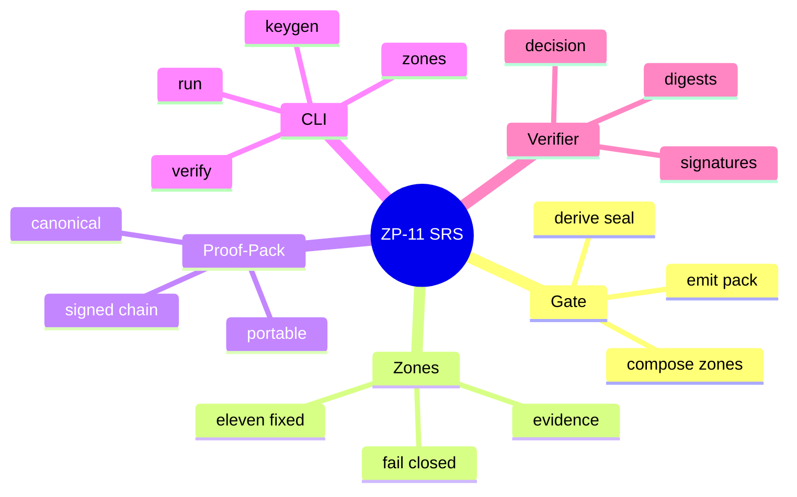

### 1.2 Scope

ZP-11 governs the transition of a proposed change onto a protected branch. The gate runs eleven independent zones, records each verdict and its evidence, and emits one signed Proof-Pack. Merge is permitted **if and only if** every zone returns `PASS` and the pack is sealed. ZP-11 is additive: it runs alongside an existing pipeline and becomes blocking once every zone is green. It is not a hosted product, a bug-freeness guarantee, a substitute for human review, or a security certification.

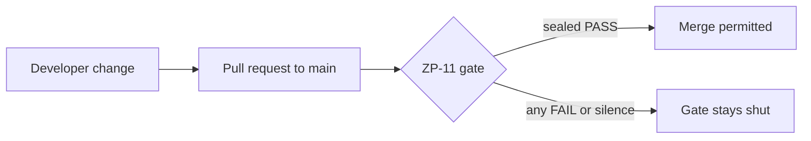

### 1.3 Definitions

The table fixes terms used throughout. These terms are normative and MUST be used consistently in any conforming implementation's documentation.

| Term | Meaning |
|------|---------|
| Zone | One independent check mapped to a `ZP-n` identifier, producing a verdict and evidence. |
| Verdict | Exactly one of `PASS` or `FAIL`; no third value may permit merge. |
| Evidence | The machine-readable record a zone attaches to justify its verdict. |
| Receipt | One zone's `{id, title, verdict, evidence, digest, signature}` entry. |
| Proof-Pack | The single JSON document a gate run emits. |
| Seal | ZP-11's receipt, signing the ordered chain of receipt digests. |
| Fail-closed | Any ambiguity (crash, timeout, missing file, silence) resolves to `FAIL`. |
| Canonical form | RFC 8785 (JCS) serialization used for every digest and signature. |

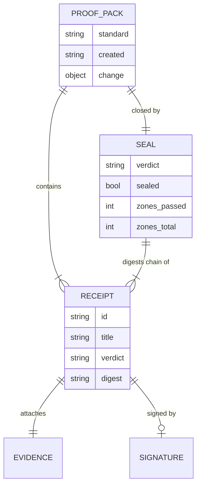

### 1.4 References

Normative dependencies: RFC 2119 (requirement terms), RFC 3339 (timestamps), RFC 8032 (Ed25519 signatures), RFC 8785 / JCS (canonical JSON), SHA-256 (digests), and JSON Schema 2020-12 (`zp11/schema/proof-pack.schema.json`). The reference library in `zp11/` is the normative oracle for test vectors.

### 1.5 Document overview

Section 2 gives the overall description and system context. Sections 3–7 state functional requirements for the gate, zones, Proof-Pack, CLI, and verifier. Section 8 states non-functional requirements. Section 9 covers data requirements. Section 10 provides traceability.

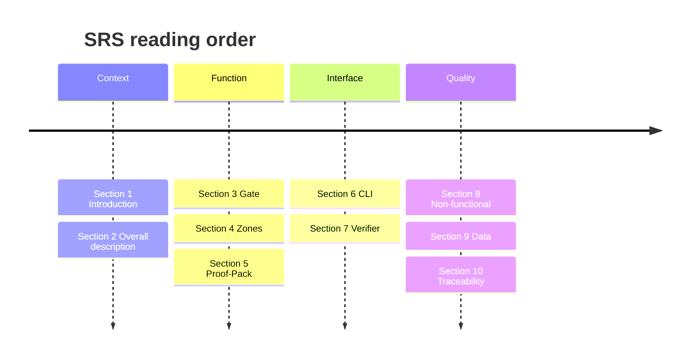

---

## 2. Overall description

### 2.1 Product perspective

A conforming implementation is a library plus a CLI. The reference library (Python) is organised into single-responsibility modules: `canonical.py` (RFC 8785 serialization), `crypto.py` (Ed25519 and SHA-256), `verdict.py` (the PASS/FAIL asymmetry), `zones.py` (the zone kinds), `pack.py` (`Receipt`, `ProofPack`, `verify_pack`), `gate.py` (composition and sealing), and `cli.py` (the four verbs). The gate is the only place the eleven zones are composed.

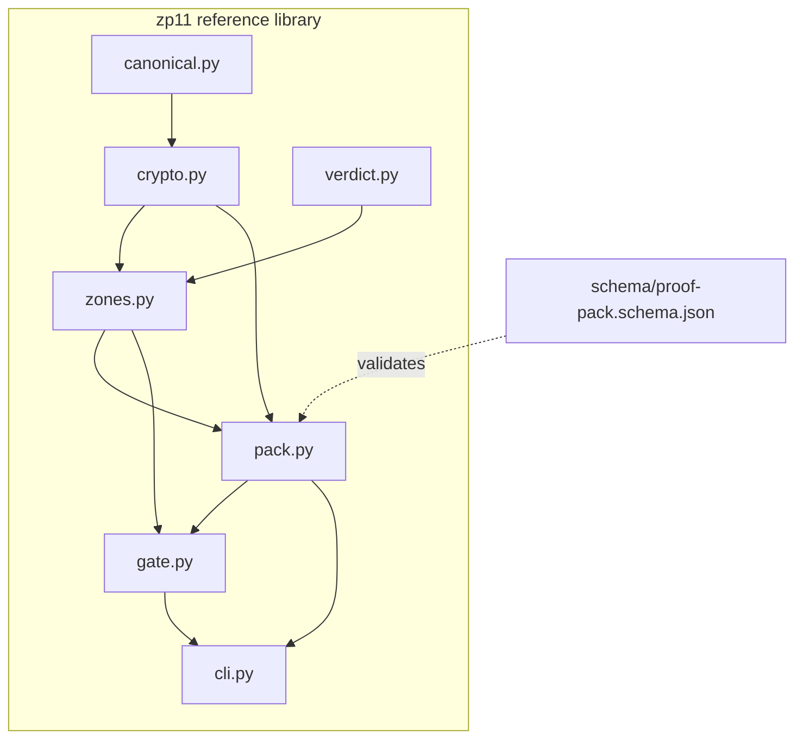

### 2.2 Module dependency graph

Dependencies flow strictly downward from serialization toward the CLI; there are no cycles. This keeps the trust-critical core (`canonical`, `crypto`) small and independently testable.

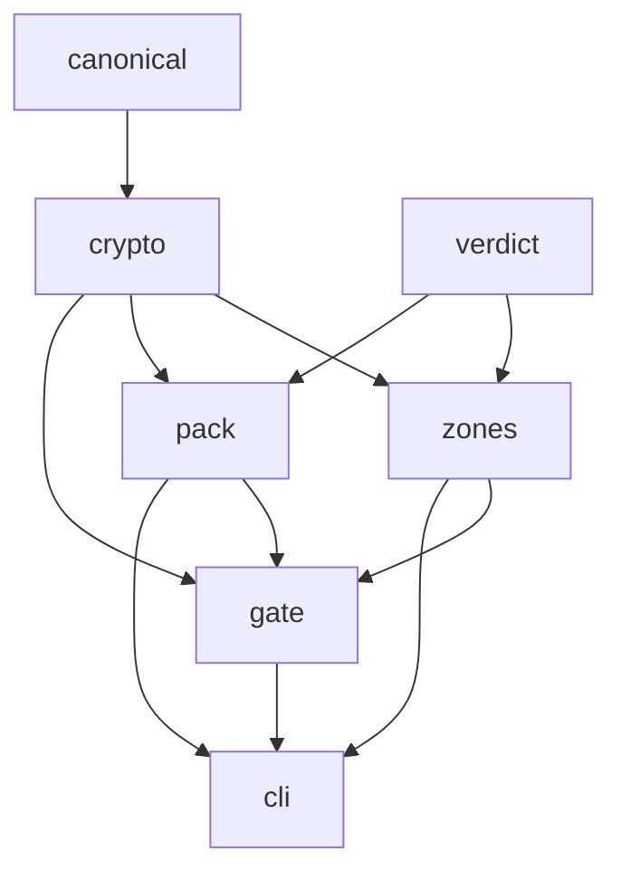

### 2.3 Product functions

The implementation performs five function families, summarised below and detailed in later sections.

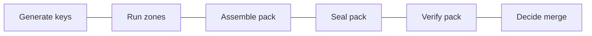

### 2.4 User classes

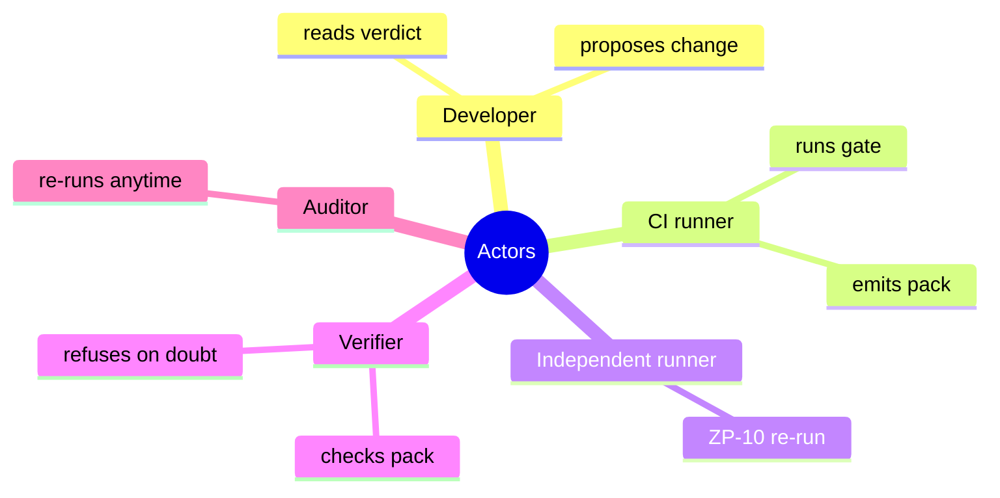

### 2.5 Constraints

The implementation targets Python 3.11+ (for `tomllib`). Every digest and signature MUST be computed over canonical form. No evidence field MUST ever contain secret material. The gate MUST NOT introduce a third verdict.

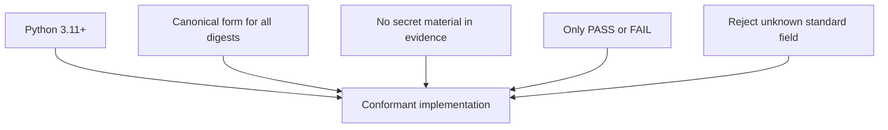

### 2.6 Assumptions and dependencies

Signing keys exist outside the gated repository and are rotated per the adopter's policy. The two runners used by ZP-10 do not share state. A verifier has access to a trusted public key; absent one, it refuses merge.

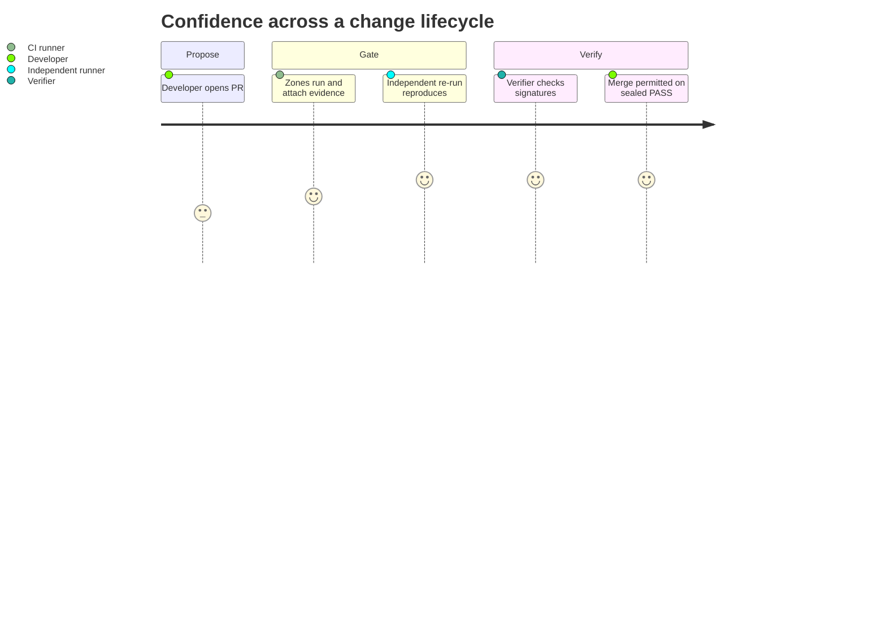

---

## 3. Functional requirements — the gate

### 3.1 Overview

The gate loads configuration, builds the ordered zone list, runs ZP-1…ZP-10, derives ZP-11 from whether every prior zone passed, assembles the receipts into a `ProofPack`, and seals it with the signing keypair. A failing or silent zone does not abort the run: the pack is still emitted as evidence of *why* the gate stays shut, but it is never sealed.

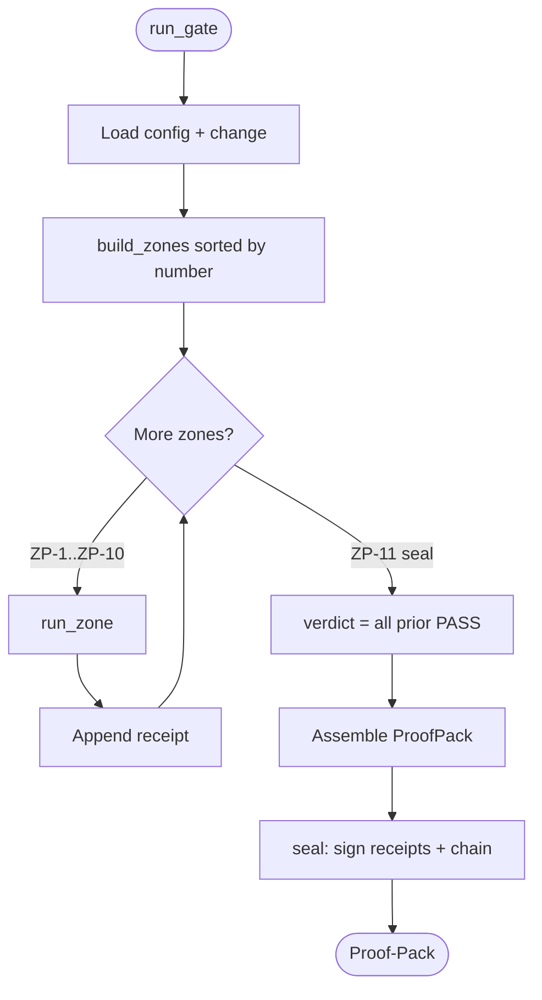

### 3.2 Execution phases

```mermaid
gantt
    title Gate run phases
    dateFormat X
    axisFormat %s
    section Load
    Config and change      :0, 1
    section Zones
    Run ZP-1 to ZP-10      :1, 6
    section Seal
    Derive ZP-11           :6, 7
    section Emit
    Assemble and sign pack :7, 8
```

### 3.3 Requirements

| ID | Requirement |
|----|-------------|
| FR-G1 | The gate **MUST** build zones in ascending numeric order of their `ZP-n` identifier. |
| FR-G2 | The gate **MUST** run each of ZP-1…ZP-10 exactly once and record a receipt per zone. |
| FR-G3 | The gate **MUST** derive ZP-11's verdict as `PASS` iff every prior receipt is `PASS`, else `FAIL`. |
| FR-G4 | The gate **MUST** emit a Proof-Pack even when one or more zones `FAIL`. |
| FR-G5 | The gate **MUST** seal the pack (set `sealed = true`) only when the pack verdict is `PASS`. |
| FR-G6 | The gate **MUST NOT** allow a zone exception to abort the run; the zone's receipt becomes `FAIL`. |

### 3.4 Zone ordering

The `_zone_order` rule parses the integer after the hyphen so that `ZP-2` precedes `ZP-10`. A malformed identifier sorts last.

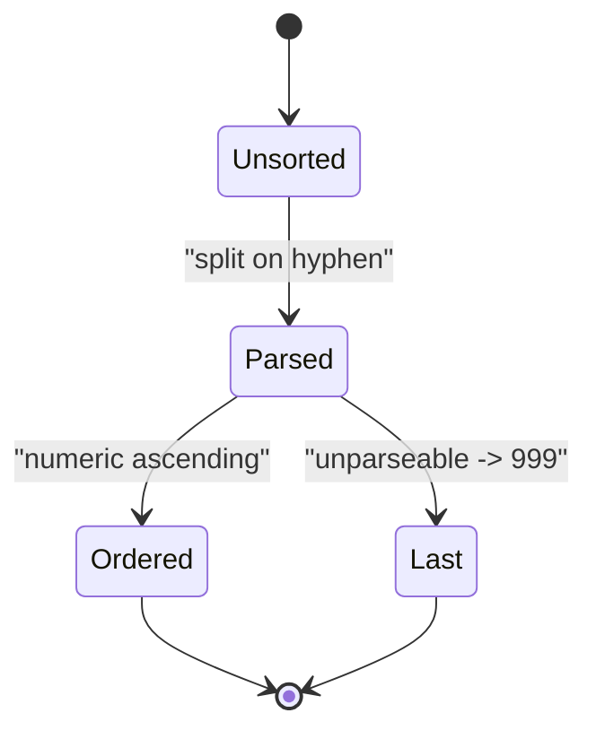

### 3.5 Seal derivation

ZP-11 is not an external check; the gate sets it from the running `prior_all_pass` flag. One failing zone turns the flag false for all subsequent zones and for the seal.

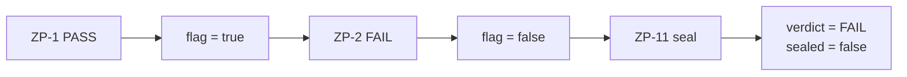

### 3.6 Gate decision boundary

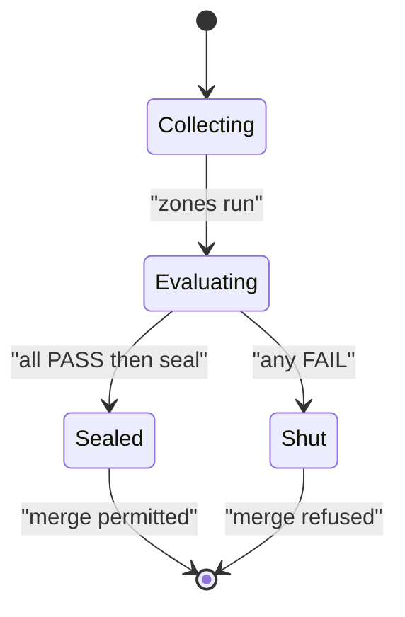

---

## 4. Functional requirements — the eleven zones

### 4.1 The fixed set

The names and ordering of the eleven zones are fixed by the standard. A configuration **MAY** map any zone to any check satisfying its normative requirement, and **MUST** map an unimplemented zone to a check that returns `FAIL`.

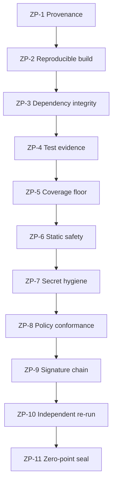

### 4.2 Zone kinds

A zone maps to one of five *kinds*. The kind determines how evidence is produced; the verdict is always PASS or FAIL. Any failure to produce a provable PASS yields FAIL.

| Kind | Passes when | Evidence recorded |
|------|-------------|-------------------|
| `require` | every named change field is present and non-empty | required, missing, present field names |
| `file` | a path exists and meets `min_bytes` | path, byte count, `sha256` |
| `command` | a shell command exits with `expect_code` | command, exit code, output `sha256` |
| `secret_scan` | no pattern or high-entropy token matches | files scanned, finding locations |
| `seal` | every prior zone passed (set by the gate) | zones passed/total, all-prior-pass flag |

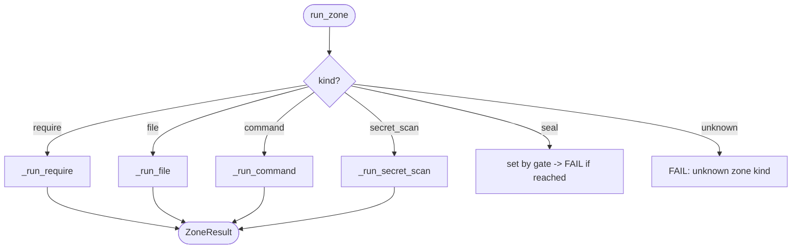

The zone data model is uniform across kinds: a `Zone` holds its id, title, kind, and spec; `run_zone` returns a `ZoneResult` carrying a verdict and evidence.

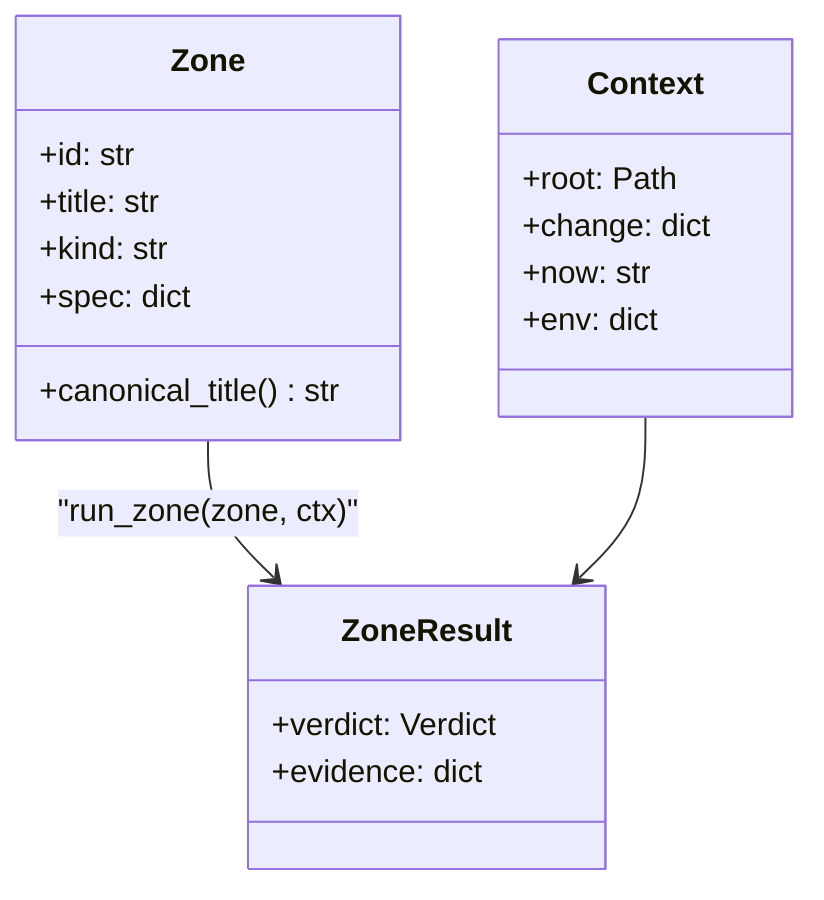

### 4.3 Zone requirements

| ID | Requirement |
|----|-------------|
| FR-Z1 | Every zone **MUST** return exactly one verdict, `PASS` or `FAIL`. |
| FR-Z2 | A zone whose check raises, times out, or produces unparseable output **MUST** return `FAIL`. |
| FR-Z3 | A zone of an unknown kind **MUST** return `FAIL`. |
| FR-Z4 | A zone **MUST** attach evidence recording its `kind`, tool, and tool version. |
| FR-Z5 | The `secret_scan` zone **MUST** record only finding *locations*, never secret material. |
| FR-Z6 | Each zone's evidence **MUST** be deterministic for identical inputs. |

### 4.4 ZP-1 Provenance

Normative: the change **MUST** reference a signed source commit and a named builder. In the reference config this is a `require` zone over `source_commit` and `builder`.

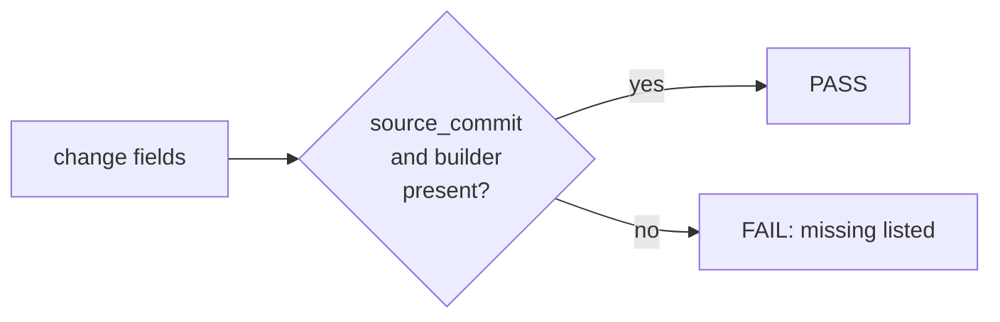

### 4.5 ZP-2 Reproducible build

Normative: re-execution **MUST** yield an identical output digest. Modelled as a `command` whose stdout/stderr digest is the reproducibility evidence.

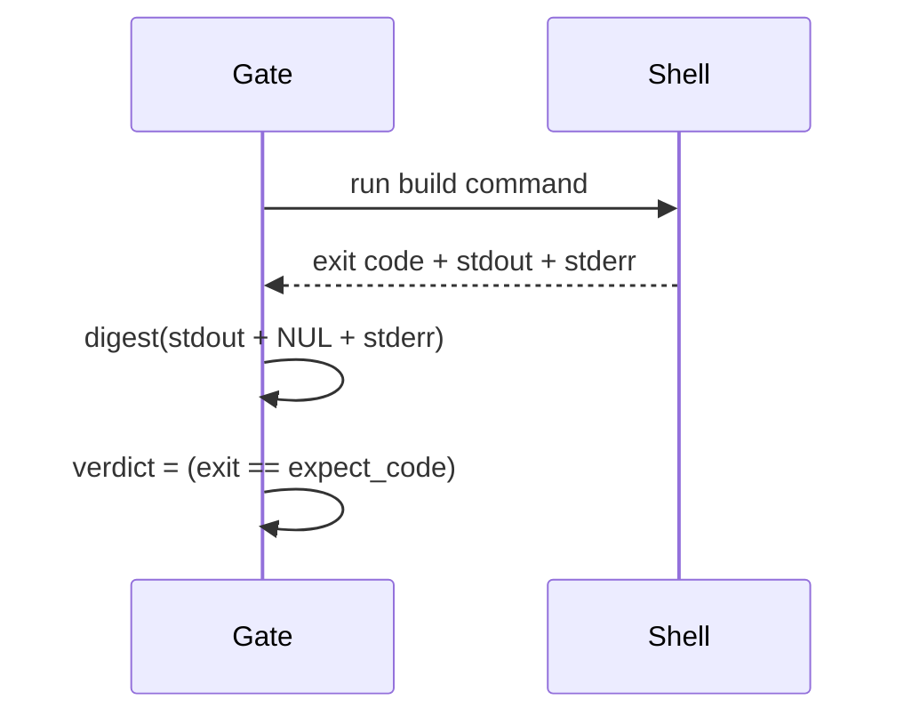

### 4.6 ZP-3 Dependency integrity

Normative: every dependency **MUST** be pinned and hashed. Modelled as a `file` zone over `requirements.lock`, whose SHA-256 becomes evidence.

```mermaid
flowchart TD
    P["requirements.lock"] --> E{"exists and<br/>bytes >= min_bytes?"}
    E -->|yes| H["record sha256"] --> PASS["PASS"]
    E -->|no| FAIL["FAIL: exists=false"]
```

### 4.7 ZP-4 Test evidence and ZP-5 Coverage floor

Declared tests **MUST** have run with machine-readable results; changed lines **MUST** meet the coverage threshold. Both are `command` zones in the reference config.

```mermaid
flowchart LR
    T["pytest command"] --> EC{"exit == 0?"}
    EC -->|yes| OK["ZP-4 / ZP-5 PASS"]
    EC -->|no| NO["FAIL"]
```

### 4.8 ZP-6 Static safety and ZP-7 Secret hygiene

No new finding above the configured severity **MAY** be present; no credential **MAY** appear in the diff or build output. ZP-7 combines fixed pattern matching with a Shannon-entropy heuristic.

```mermaid
flowchart TD
    START["Iterate paths"] --> SKIP{"binary or .git?"}
    SKIP -->|yes| NEXT["skip"]
    SKIP -->|no| READ["read text"]
    READ --> PAT{"known pattern?"}
    PAT -->|match| FIND["record location"]
    PAT -->|no| ENT{"entropy >= floor<br/>and secretish?"}
    ENT -->|yes| FIND
    ENT -->|no| NEXT
    FIND --> DONE["findings -> FAIL"]
    NEXT --> DONE
```

### 4.9 ZP-8 Policy conformance and ZP-9 Signature chain

The change **MUST** satisfy declared policy-as-code; every receipt **MUST** be signed and chain to a trusted key. ZP-9 is a `require` zone at gate time; the cryptographic chaining is enforced by the seal and verifier.

```mermaid
classDiagram
    class PolicyZone {
      +kind: file
      +file: LICENSE
      +min_bytes: 100
      +verdict() PASS or FAIL
    }
    class ChainZone {
      +kind: require
      +require: source_commit
      +verdict() PASS or FAIL
    }
    PolicyZone --> Receipt
    ChainZone --> Receipt
```

### 4.10 ZP-10 Independent re-run

A second, isolated runner **MUST** reproduce the verdict. The two runners **SHOULD NOT** share state; divergence is itself a failure signal.

```mermaid
sequenceDiagram
    participant A as Primary runner
    participant B as Independent runner
    A->>A: produce verdict + digests
    B->>B: re-run zones independently
    B->>A: compare digests
    alt digests match
        A-->>A: ZP-10 PASS
    else divergence
        A-->>A: ZP-10 FAIL
    end
```

### 4.11 ZP-11 Zero-point seal

ZP-1…ZP-10 **MUST** all be `PASS` and the pack **MUST** be sealed. The seal is the single receipt that binds the whole run.

```mermaid
stateDiagram-v2
    [*] --> Checking
    Checking --> Sealing: "all prior PASS"
    Checking --> NotSealed: "any prior FAIL"
    Sealing --> [*]: "sealed=true, PASS"
    NotSealed --> [*]: "sealed=false, FAIL"
```

### 4.12 Entropy heuristic

The `_looks_secretish` test avoids flagging ordinary base64 or hex digests: a token must mix digits and letters and have more than twelve distinct characters.

```mermaid
flowchart TD
    TOK["candidate token"] --> D{"has digit?"}
    D -->|no| CLEAN["not secret"]
    D -->|yes| AL{"has alpha?"}
    AL -->|no| CLEAN
    AL -->|yes| SET{"distinct chars > 12?"}
    SET -->|yes| SEC["flag high-entropy"]
    SET -->|no| CLEAN
```

---

## 5. Functional requirements — the Proof-Pack

### 5.1 Structure

A Proof-Pack is `{ standard, created, change, zones[], seal }`. Each zone entry is a receipt; the seal closes the chain.

```mermaid
flowchart TB
    PP["Proof-Pack"] --> ST["standard: zp11/v1"]
    PP --> CR["created: RFC 3339"]
    PP --> CH["change: id, source_commit, builder"]
    PP --> ZS["zones: ordered receipts"]
    PP --> SL["seal: verdict, sealed, counts, key, signature"]
    ZS --> R1["receipt ZP-1"]
    ZS --> RN["receipt ZP-11"]
```

### 5.2 Requirements

| ID | Requirement |
|----|-------------|
| FR-P1 | The pack `standard` field **MUST** equal `zp11/v1`; a verifier **MUST** reject unknown values. |
| FR-P2 | `created` **MUST** be an RFC 3339 UTC timestamp. |
| FR-P3 | Each receipt digest **MUST** be `sha256:` + hex of SHA-256 over canonical `{id,title,verdict,evidence}`. |
| FR-P4 | Each receipt signature **MUST** be over canonical `{…body, digest}` using Ed25519. |
| FR-P5 | The seal signature **MUST** be over the ordered list of `{id, digest}` plus change and counts. |
| FR-P6 | The pack **MUST** validate against `proof-pack.schema.json` (minimum 11 zones). |

### 5.3 Receipt digest and signature

Altering any evidence byte changes the receipt's body digest, which in turn breaks the receipt signature and the seal.

```mermaid
flowchart LR
    BODY["body: id,title,verdict,evidence"] --> CAN["canonicalize (RFC 8785)"]
    CAN --> SHA["SHA-256"]
    SHA --> DIG["digest: sha256:hex"]
    DIG --> SB["signed body: body + digest"]
    SB --> SIG["Ed25519 sign -> ed25519:hex"]
```

### 5.4 Seal content

The seal signs a reconstruction of the ordered receipt chain, so receipts cannot be reordered, added, or removed without invalidating it.

```mermaid
flowchart TB
    SC["seal_content"] --> A["standard"]
    SC --> B["created"]
    SC --> C["change"]
    SC --> D["verdict"]
    SC --> E["zones_passed / zones_total"]
    SC --> F["receipts: ordered id + digest"]
    F --> SIG["Ed25519 sign"]
```

### 5.5 Tamper resistance

```mermaid
sequenceDiagram
    participant Att as Attacker
    participant Pack as Proof-Pack
    participant Ver as Verifier
    Att->>Pack: edit one evidence byte
    Pack->>Pack: body digest now differs
    Ver->>Pack: recompute digest(body)
    Ver-->>Ver: mismatch -> integrity fails
    Ver-->>Att: merge refused
```

### 5.6 Receipt lifecycle

```mermaid
stateDiagram-v2
    [*] --> Drafted: "id, title, verdict, evidence"
    Drafted --> Digested: "finalize computes digest"
    Digested --> Signed: "sign signed_body"
    Signed --> Serialized: "to_dict"
    Serialized --> [*]
```

### 5.7 Pack assembly class view

```mermaid
classDiagram
    class ProofPack {
      +change: dict
      +created: str
      +receipts: list
      +verdict() Verdict
      +passed() int
      +seal(keypair) ProofPack
      +to_dict() dict
    }
    class Receipt {
      +id: str
      +title: str
      +verdict: Verdict
      +evidence: dict
      +finalize(keypair) Receipt
    }
    ProofPack "1" o-- "11" Receipt
```

---

## 6. Functional requirements — the CLI

### 6.1 Verbs

The reference CLI (`zp11`) exposes four verbs. `run` and `verify` are designed to be wired as required status checks: each exits 0 only when merge is permitted.

```mermaid
flowchart LR
    CLI["zp11"] --> KG["keygen"]
    CLI --> ZN["zones"]
    CLI --> RN["run"]
    CLI --> VF["verify"]
    KG --> K1["Ed25519 key + .pub"]
    ZN --> Z1["list eleven zones"]
    RN --> R1["emit Proof-Pack"]
    VF --> V1["verify + decide"]
```

### 6.2 Requirements

| ID | Requirement |
|----|-------------|
| FR-C1 | `keygen` **MUST** generate an Ed25519 key, print the public id, and (with `--out`) write seed and `.pub`. |
| FR-C2 | `zones` **MUST** list the eleven canonical zones in order. |
| FR-C3 | `run` **MUST** emit a Proof-Pack and exit 0 only for a sealed, all-PASS pack. |
| FR-C4 | `verify` **MUST** exit 0 only when the pack verifies and merge is permitted. |
| FR-C5 | `run` with `--now` **MUST** produce a reproducible timestamp for deterministic runs. |
| FR-C6 | A missing subcommand **MUST** be an error (subparser is required). |

### 6.3 keygen flow

```mermaid
sequenceDiagram
    participant U as User
    participant CLI as zp11 keygen
    participant FS as Filesystem
    U->>CLI: keygen --out ci.key
    CLI->>CLI: KeyPair.generate (Ed25519)
    CLI->>FS: write ci.key (seed hex)
    CLI->>FS: write ci.key.pub (ed25519:hex)
    CLI-->>U: print public id
```

### 6.4 run flow

```mermaid
flowchart TD
    A(["zp11 run"]) --> B["resolve root"]
    B --> C["load_config(zp11.toml)"]
    C --> D{"--key given?"}
    D -->|yes| E["load seed -> KeyPair"]
    D -->|no| F["generate ephemeral key"]
    E --> G["run_gate"]
    F --> G
    G --> H["to_dict -> JSON sorted"]
    H --> I{"sealed and PASS?"}
    I -->|yes| J["exit 0: MERGE PERMITTED"]
    I -->|no| K["exit 1: GATE STAYS SHUT"]
```

### 6.5 verify flow

```mermaid
flowchart TD
    A(["zp11 verify pack"]) --> B["load JSON"]
    B --> C["ProofPack.from_dict"]
    C --> D{"--key given?"}
    D -->|yes| E["parse public key"]
    D -->|no| F["use key embedded in pack"]
    E --> G["verify_pack"]
    F --> G
    G --> H["print report JSON"]
    H --> I{"merge_permitted?"}
    I -->|yes| J["exit 0"]
    I -->|no| K["exit 1"]
```

### 6.6 Exit-code contract

```mermaid
stateDiagram-v2
    [*] --> Run
    Run --> Zero: "sealed PASS"
    Run --> NonZero: "any FAIL or error"
    Zero --> [*]: "status check green"
    NonZero --> [*]: "status check red"
```

### 6.7 CI wiring

```mermaid
sequenceDiagram
    participant GH as CI job
    participant CLI as zp11
    participant Pack as proof-pack.json
    GH->>CLI: run --key ci.key --out proof-pack.json
    CLI-->>GH: exit code (0 or 1)
    GH->>CLI: verify proof-pack.json
    CLI-->>GH: exit code gates the merge
```

---

## 7. Functional requirements — the verifier

### 7.1 Overview

`verify_pack` takes a pack and an optional public key and returns a structured report: integrity, merge decision, reasons, and zone counts. Verification needs nothing but the pack and a public key; the gate's decision is never a matter of trust.

```mermaid
flowchart TD
    IN["Proof-Pack + public key"] --> S1["1. Required zones present?"]
    S1 --> S2["2. Recompute each digest"]
    S2 --> S3["3. Verify each receipt signature"]
    S3 --> S4["4. Reconstruct + verify seal"]
    S4 --> S5["5. All PASS and sealed?"]
    S5 --> OUT["VerifyReport"]
```

The report itself is a small value object consumed by the CLI and by any embedding program.

```mermaid
classDiagram
    class VerifyReport {
      +ok: bool
      +merge_permitted: bool
      +reasons: list
      +zones_passed: int
      +zones_total: int
    }
```

### 7.2 Requirements

| ID | Requirement |
|----|-------------|
| FR-V1 | In strict mode the verifier **MUST** confirm ZP-1…ZP-11 are all present. |
| FR-V2 | The verifier **MUST** recompute each receipt digest and flag any mismatch as evidence tampering. |
| FR-V3 | With a key, the verifier **MUST** verify every receipt signature and the seal signature. |
| FR-V4 | The verifier **MUST** refuse merge when no public key is available. |
| FR-V5 | The verifier **MUST** permit merge iff integrity holds, every zone passed, and the pack is sealed. |
| FR-V6 | The verifier **MUST** collect human-readable reasons for every failure it detects. |

### 7.3 Decision logic

Merge is `integrity_ok AND all_pass AND sealed`. Any missing key, any digest mismatch, any bad signature, any failed zone, or an unsealed pack collapses the decision to refuse.

```mermaid
flowchart TD
    I{"integrity_ok?"} -->|no| REF["Refuse merge"]
    I -->|yes| AP{"all zones PASS?"}
    AP -->|no| REF
    AP -->|yes| SE{"pack sealed?"}
    SE -->|no| REF
    SE -->|yes| PER["Permit merge"]
```

### 7.4 Reason accumulation

```mermaid
flowchart LR
    R["reasons = []"] --> M1["missing zones"]
    M1 --> M2["digest mismatch"]
    M2 --> M3["bad or missing signature"]
    M3 --> M4["seal signature invalid"]
    M4 --> M5["no public key available"]
    M5 --> M6["fail-closed: zones did not pass"]
    M6 --> EMPTY{"reasons empty?"}
    EMPTY -->|yes| OK["integrity_ok = true"]
    EMPTY -->|no| BAD["integrity_ok = false"]
```

### 7.5 No-key default

```mermaid
stateDiagram-v2
    [*] --> HaveKey
    HaveKey --> Verify: "key present"
    HaveKey --> Refuse: "no key"
    Verify --> Decide
    Refuse --> [*]: "merge refused by default"
    Decide --> [*]
```

### 7.6 Strict vs partial

```mermaid
flowchart TD
    MODE{"require_all_zones?"} -->|strict| CHK["all 11 must be present"]
    MODE -->|partial| SKIP["skip presence check"]
    CHK --> REST["digests + signatures + decision"]
    SKIP --> REST
```

### 7.7 End-to-end verification sequence

```mermaid
sequenceDiagram
    participant V as Verifier
    participant P as Pack
    participant K as Public key
    V->>P: load receipts + seal
    V->>P: recompute digest(body) per receipt
    V->>K: verify receipt signatures
    V->>V: reconstruct seal_content
    V->>K: verify seal signature
    V->>V: all PASS and sealed?
    V-->>V: VerifyReport(merge_permitted)
```

---

## 8. Non-functional requirements

### 8.1 Categories

```mermaid
mindmap
  root(("NFRs"))
    Determinism
      canonical bytes
      stable digests
    Security
      Ed25519
      keys outside repo
    Portability
      self-describing pack
      no CI access
    Reliability
      fail closed
      no silence
    Usability
      exit codes
      four verbs
```

### 8.2 Determinism

Two honest parties MUST serialize identical data to identical bytes. The canonicalizer rejects NaN, Infinity, and non-string keys, and emits shortest round-trippable numbers.

```mermaid
flowchart LR
    V["value"] --> C{"finite + string keys?"}
    C -->|no| ERR["CanonicalizationError"]
    C -->|yes| B["sorted keys, minimal separators"]
    B --> BYTES["stable UTF-8 bytes"]
```

| ID | Requirement |
|----|-------------|
| NFR-1 | Canonical output **MUST** be identical across Python versions and platforms. |
| NFR-2 | The canonicalizer **MUST** reject values with no canonical form. |

### 8.3 Security

```mermaid
flowchart TD
    K["Ed25519 signing key"] --> OUT["stored outside gated repo"]
    OUT --> ROT["rotated per policy"]
    ROT --> SIGN["signs receipts + seal"]
    SIGN --> VER["public key verifies"]
    VER --> NOKEY{"key missing?"}
    NOKEY -->|yes| REF["refuse merge"]
```

| ID | Requirement |
|----|-------------|
| NFR-3 | Signatures **MUST** use Ed25519 over canonical form. |
| NFR-4 | Evidence **MUST NOT** contain secret material. |
| NFR-5 | ZP-10's two runners **SHOULD NOT** share state. |

### 8.4 Reliability (fail-closed)

The single asymmetry that defines ZP-11: `Verdict.PASS` is truthy, `Verdict.FAIL` is falsy, and anything unexpected coerces to `FAIL`.

```mermaid
stateDiagram-v2
    [*] --> Attempt
    Attempt --> Pass: "proven condition"
    Attempt --> Fail: "crash / timeout / missing / silence"
    Pass --> [*]
    Fail --> [*]
```

### 8.5 Portability

A pack is one self-describing document. A verifier with the pack and a public key needs no access to the original CI.

```mermaid
flowchart LR
    PACK["proof-pack.json"] --> ANY["any host"]
    PUB["public key"] --> ANY
    ANY --> RESULT["same verdict, same digest"]
```

### 8.6 Usability and performance

```mermaid
journey
    title Operator experience
    section Setup
      Generate key: 4: Operator
      Write zp11.toml: 4: Operator
    section Daily
      Run gate in CI: 5: CI
      Read exit code: 5: Operator
    section Audit
      Re-verify offline: 5: Auditor
```

| ID | Requirement |
|----|-------------|
| NFR-6 | `run` and `verify` **MUST** communicate the decision through the process exit code. |
| NFR-7 | The reference implementation **MUST** depend only on a small, auditable core. |

---

## 9. Data requirements

### 9.1 Schema binding

Every emitted pack MUST validate against `proof-pack.schema.json` (JSON Schema 2020-12): `standard` is `const` `zp11/v1`, `zones` has at least 11 items, keys match the `ed25519:` and `sha256:` patterns, and receipt ids match `ZP-(1..11)`.

```mermaid
flowchart TD
    PACK["Proof-Pack JSON"] --> SCH["proof-pack.schema.json"]
    SCH --> R1{"standard == zp11/v1?"}
    SCH --> R2{"zones >= 11?"}
    SCH --> R3{"key matches ed25519 hex 64?"}
    SCH --> R4{"receipt id in ZP-1..ZP-11?"}
    R1 & R2 & R3 & R4 --> VALID["valid pack"]
```

### 9.2 Pattern constraints

```mermaid
flowchart LR
    DIG["digest"] --> P1["sha256: 64 hex"]
    KEY["key"] --> P2["ed25519: 64 hex"]
    SIG["signature"] --> P3["ed25519: hex"]
    ID["receipt id"] --> P4["ZP-1 through ZP-11"]
```

### 9.3 Field constraints

```mermaid
classDiagram
    class Change {
      +id: string
      +source_commit: string
      +builder: string
    }
    class Seal {
      +verdict: PASS or FAIL
      +sealed: boolean
      +zones_passed: int >= 0
      +zones_total: int >= 0
      +key: ed25519 pattern
      +signature: ed25519 pattern
    }
    Change --> ProofPack
    Seal --> ProofPack
```

### 9.4 Context data

The gate's `Context` carries the repository root, the change dictionary, the timestamp, and an environment map passed to command zones.

```mermaid
erDiagram
    CONTEXT ||--|| CHANGE : carries
    CONTEXT {
        string root
        string now
        object env
    }
    CHANGE {
        string id
        string source_commit
        string builder
    }
```

---

## 10. Traceability

### 10.1 Requirement to module

```mermaid
flowchart LR
    FRG["FR-G gate"] --> gate["gate.py"]
    FRZ["FR-Z zones"] --> zones["zones.py"]
    FRP["FR-P pack"] --> pack["pack.py"]
    FRC["FR-C CLI"] --> cli["cli.py"]
    FRV["FR-V verifier"] --> vp["pack.verify_pack"]
    NFR["NFR determinism"] --> can["canonical.py"]
    NFR --> cry["crypto.py"]
```

### 10.2 Zone to normative source

| Requirement group | Source of truth |
|-------------------|-----------------|
| FR-G1…FR-G6 | `gate.run_gate`, `build_zones` |
| FR-Z1…FR-Z6 | `zones.run_zone`, kind runners |
| FR-P1…FR-P6 | `pack.Receipt`, `pack.ProofPack`, schema |
| FR-C1…FR-C6 | `cli.cmd_*`, `build_parser` |
| FR-V1…FR-V6 | `pack.verify_pack` |
| NFR-1…NFR-7 | `canonical`, `crypto`, `verdict` |

### 10.3 Verification closure

```mermaid
stateDiagram-v2
    [*] --> Requirements
    Requirements --> Implementation: "mapped to module"
    Implementation --> Tests: "conformance oracle"
    Tests --> Verified: "test vectors pass"
    Verified --> [*]
```

### 10.4 Standard evolution

Backward-incompatible changes increment the `standard` field; implementations MUST reject a pack whose `standard` they do not recognize.

```mermaid
timeline
    title Standard versioning
    v1 : zp11/v1 : stable, this SRS
    future : zp11/v2 : increments standard field : old verifiers reject
```

---

## Related documents

This SRS is part of the ProofGate ZP-11 documentation set. See the sibling documents:

- `01-overview.md` — standard overview and the one idea behind the gate.
- `03-architecture.md` — module architecture and data flow of the reference library.
- `04-proof-pack-format.md` — the Proof-Pack format, canonical form, and signature chain in depth.
- `05-cli-reference.md` — full reference for the `keygen`, `zones`, `run`, and `verify` verbs.
- `06-verification-guide.md` — independent verification and the fail-closed decision procedure.

*ZP-11 (`zp11/v1`) was invented by Naquib Hatami and is published as an open standard under the MIT License.*
