> Part of the ProofGate ZP-11 documentation set.

# System Architecture (HLD)

**Standard:** `zp11/v1` · **Status:** Stable · **License:** MIT
**Inventor / Author:** Naquib Hatami · **Repository:** `github.com/iQs-Group/ZP-11` · **Homepage:** `zp11.org`
**Publisher:** iQs Group Inc. / SADI AI Inc.

## Abstract

ProofGate ZP-11 is an open, fail-closed release-governance standard. It places eleven independent *Zero-Point zones* between every proposed change and a protected branch, and opens the gate **if and only if** every zone returns `PASS` and the result is sealed into a signed, reproducible **Proof-Pack**. This High-Level Design describes the architecture of the reference implementation invented by Naquib Hatami: its components, the flow of data from a proposed change to a verifiable verdict, the trust boundaries that let a third party check the result without trusting the pipeline that produced it, the gate pipeline that composes the eleven zones, and the deployment contexts in which the gate runs. Nothing here extends the standard; the normative source is `SPEC.md` and the reference library in `zp11/`, and this document only renders that architecture explicitly.

---

## 1. Introduction and scope

ZP-11 inverts the usual arrangement of release checks. Most pipelines are *advisory*: a check warns, then the merge proceeds anyway. ZP-11 is **fail-closed by construction** — the gate is shut until affirmative, reproducible evidence forces it open. The defining property is asymmetry: a change advances only on proof, and any ambiguity (a crash, a timeout, a missing file, an unparseable result, silence) resolves to `FAIL`.

This document is the architectural companion to the formal specification. Where `SPEC.md` states *what* must be true, this HLD shows *how* the reference implementation is arranged to make it true, and where the boundaries of trust lie. It is descriptive of the code as it exists in `zp11/`; it introduces no checks, verdicts, or guarantees beyond those the standard and the reference library already define. The scope is the architecture of the governance mechanism itself — not the policies an adopter layers on top of it, and not any particular continuous-integration platform, since ZP-11 defines verdicts and evidence, not vendors.

The problem ZP-11 addresses is structural. In a conventional pipeline, the authority to merge is implicit: a check that fails to produce a clear negative is read as assent, and an outage, a flaky test, or a skipped stage quietly widens the set of changes that reach the protected branch. ZP-11 removes that implicit authority. The gate holds no default permission to open; permission is manufactured, afresh for each change, out of eleven affirmative proofs and a seal, and it evaporates the moment any single proof is absent. The architecture exists to make that manufacture of permission auditable by a party who was not present when it happened.

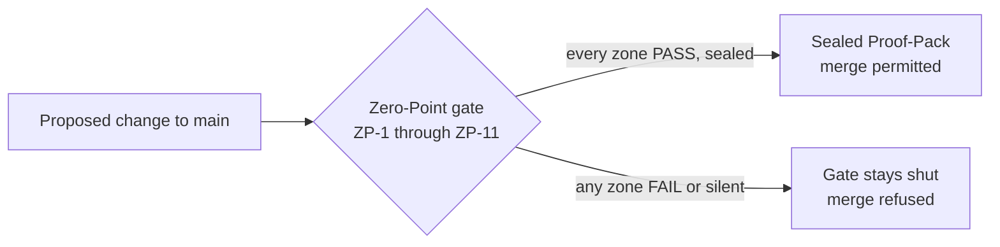

The architecture is deliberately small. There is one library, one configuration file per repository, one output document, and one command-line entry point. The simplicity is a security property: a verifier can read the whole thing.

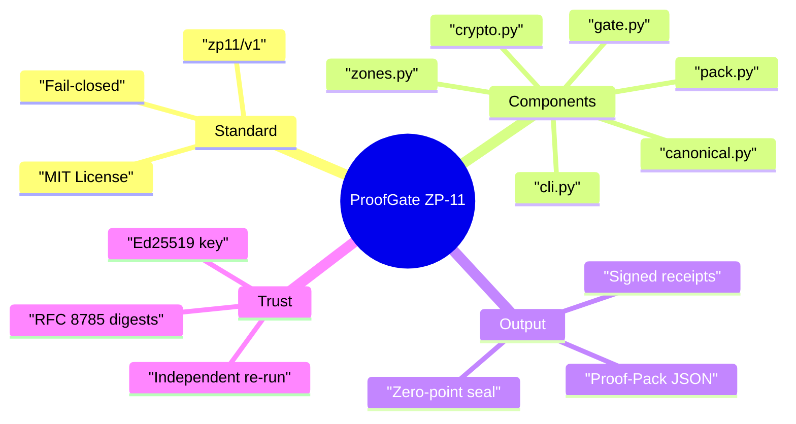

### 1.1 What this document covers

| Section | Concern |
|---------|---------|
| 2 | Architectural principles |
| 3 | Component model (reference library) |
| 4 | Data flow |
| 5 | Trust boundaries |
| 6 | The gate pipeline |
| 7 | The eleven zones |
| 8 | Zone kinds |
| 9 | The Proof-Pack data model |
| 10 | Integrity and the signature chain |
| 11 | Verification |
| 12 | Deployment contexts |
| 13 | Lifecycle and state |
| 14 | Failure modes |
| 15 | Conformance and security |

---

## 2. Architectural principles

Four principles govern every design decision. They are not aspirational; each maps onto concrete code in the reference library.

**Fail-closed.** A verdict is exactly `PASS` or `FAIL`. There is no third state that permits merge. `verdict.py` encodes this as a two-value enum whose `FAIL` member is falsy, so a zone that raises, times out, or returns nothing collapses to `FAIL` without a special case.

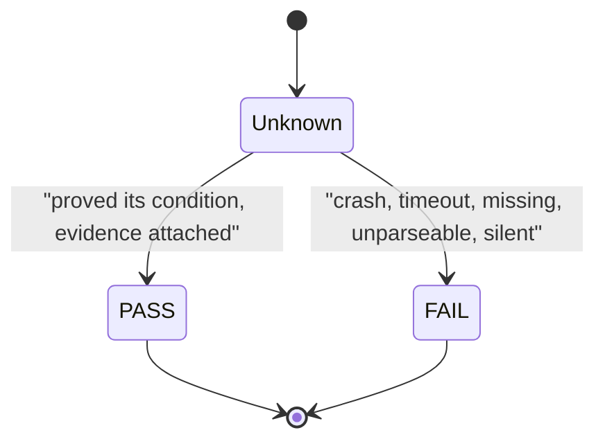

**Reproducibility.** Two honest parties serializing the same data must produce the same bytes. `canonical.py` implements the RFC 8785 subset the standard relies on, which is what makes a digest portable across Python versions and platforms.

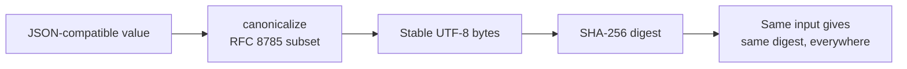

**Attributability.** Every verdict carries its inputs, the tool and tool version that produced it, a digest over its canonical body, and an Ed25519 signature. Nothing in a pack is anonymous.

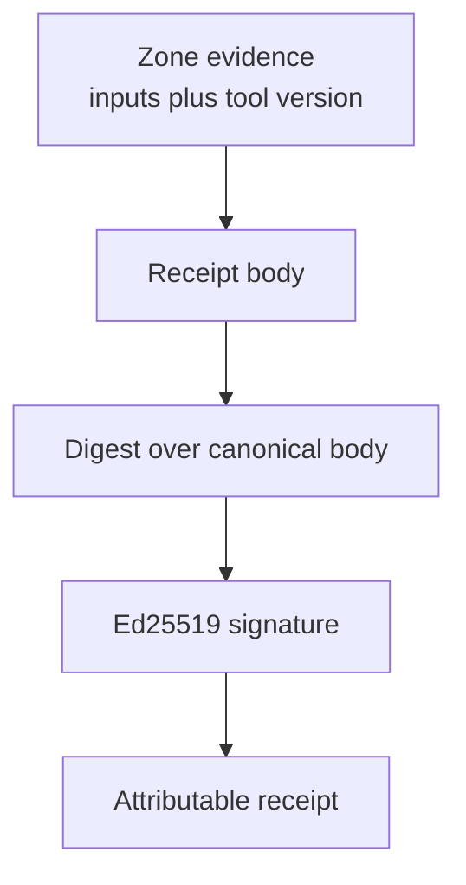

**Portability.** The Proof-Pack is one self-describing document. A verifier needs the pack and a public key — never access to the original CI.

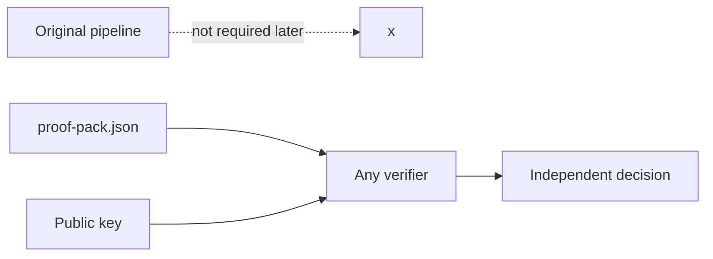

---

## 3. Component model

The reference implementation is a single Python package, `zp11`, composed of six focused modules plus a JSON Schema. Each module has one responsibility and depends only on the layers beneath it.

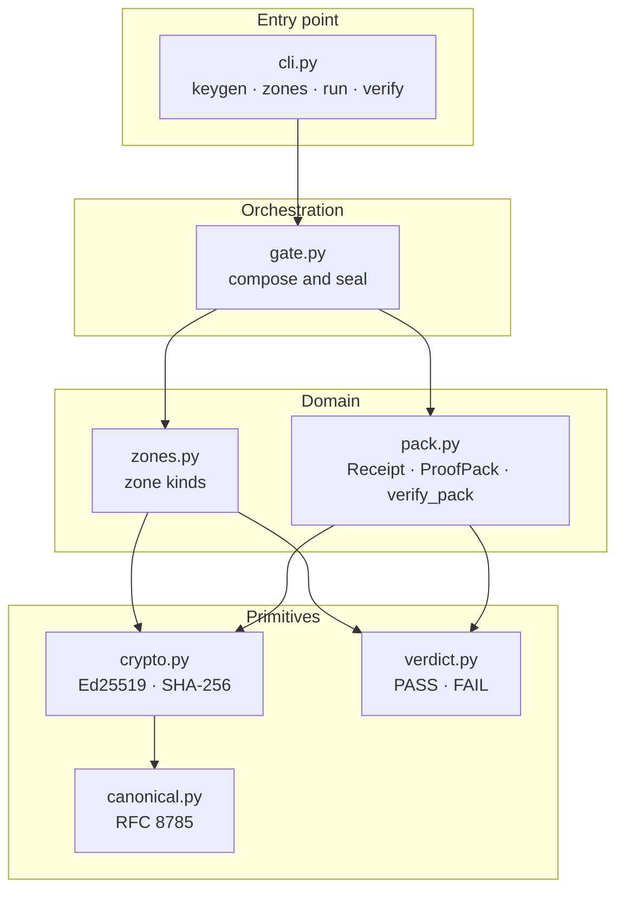

The dependency direction is strict and acyclic: primitives know nothing of the domain, the domain knows nothing of orchestration, and orchestration knows nothing of the CLI. This keeps the trust-critical core (`canonical.py`, `crypto.py`, `verdict.py`) small and auditable. The three primitive modules together are a few hundred lines; a reviewer can hold the entire security-relevant surface in their head, which is itself a design goal. Everything above them is composition, not new trust: `zones.py` decides verdicts but delegates all hashing and signing downward, and `pack.py` assembles and checks but never invents a cryptographic operation of its own.

The separation also constrains where failure can originate. A bug in `cli.py` can at worst mis-report or mis-exit; it cannot forge a signature, because signing lives two layers below and operates only on canonical bytes. A bug in `zones.py` can mis-evaluate a single zone, but the fail-closed enum and the gate's running fold confine the blast radius to that zone's verdict, which can only ever make the gate more conservative, never less. This is the architectural expression of the standard's asymmetry: the easy direction is to refuse, and refusal is the direction every defect is biased toward.

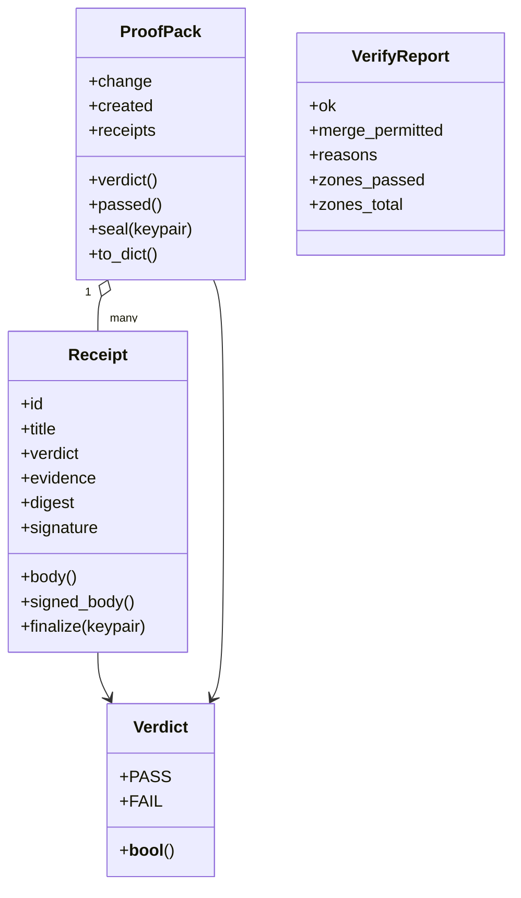

Responsibilities, stated precisely:

| Module | Responsibility |
|--------|----------------|
| `canonical.py` | Deterministic RFC 8785 serialization; rejects NaN, Infinity, non-string keys |
| `crypto.py` | `sha256_hex`, `digest`, `KeyPair`, `PublicKey`, `sign`, `verify` (Ed25519) |
| `verdict.py` | The `PASS`/`FAIL` enum and `coerce` (unknown maps to `FAIL`) |
| `zones.py` | Zone kinds `require`, `file`, `command`, `secret_scan`, `seal`; `run_zone` |
| `pack.py` | `Receipt`, `ProofPack`, `verify_pack`, the seal content construction |
| `gate.py` | `load_config`, `build_zones`, `run_gate` — compose and seal |
| `cli.py` | The `zp11` CLI and its four verbs |
| `schema/proof-pack.schema.json` | JSON Schema for the emitted pack |

The package exports a version string, consumed both by `cli.py` (`--version`) and, in this repository's own configuration, by ZP-2's reproducible-build check.

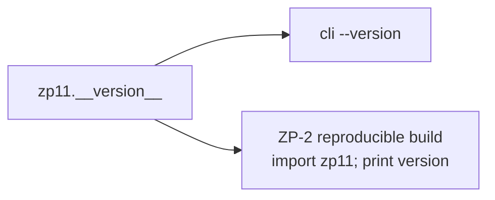

The CLI is a thin shell over the orchestration and domain layers: Layer 4 (`cli.py`) depends on Layer 3 (`gate.py`), which depends on Layer 2 (`zones.py`, `pack.py`), which depends on Layer 1 (`canonical.py`, `crypto.py`, `verdict.py`). Trust concentrates at the bottom and interface concerns stay at the top.

---

## 4. Data flow

A single run transforms a configuration and a signing key into a signed Proof-Pack. The end-to-end flow is the spine of the system.

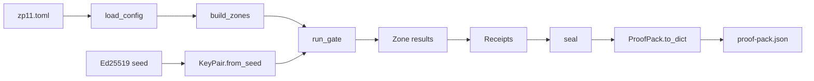

Zooming into `run_gate`, each zone is evaluated in canonical order, its verdict folded into a running `prior_all_pass` flag, and a receipt appended. The seal zone is special: it is not executed as a check but derived from whether every prior zone passed.

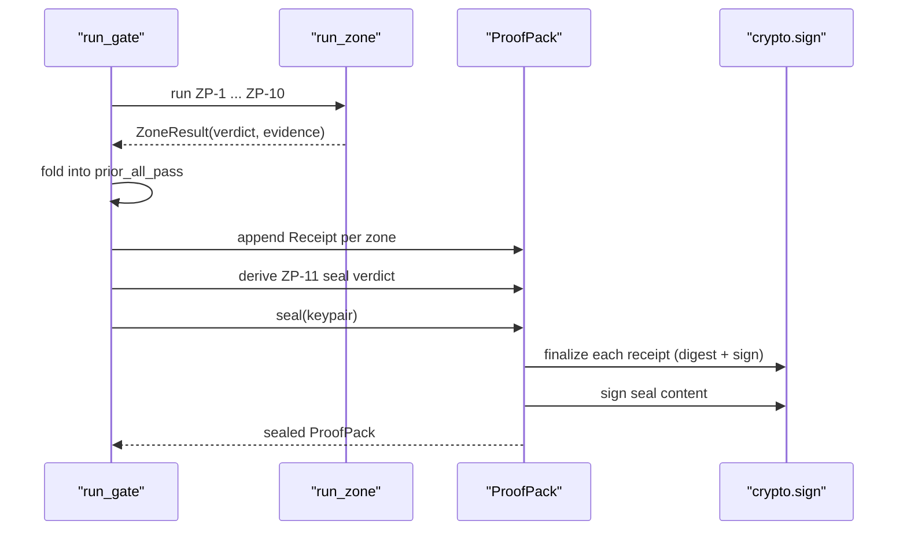

Within a single receipt, the evidence dictionary is reduced to a digest and then a signature — the atomic unit of the whole system, detailed in section 9.

The CLI's exit code is itself a data output: `run` exits 0 only when merge is permitted, which is what makes it safe to wire as a required status check.

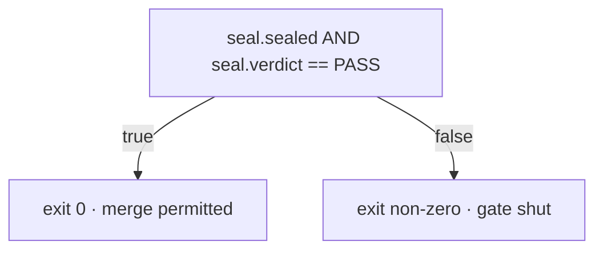

A `verify` run reverses the flow: it reads the pack, recomputes every digest, checks every signature, reconstructs the seal content, and emits a structured report.

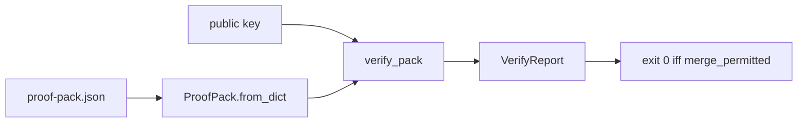

---

## 5. Trust boundaries

The architecture draws a hard line between the *producer* of a pack (a pipeline that may be compromised) and the *consumer* (a verifier that trusts only cryptography). Everything the producer emits is treated as a claim to be checked, never as an authority.

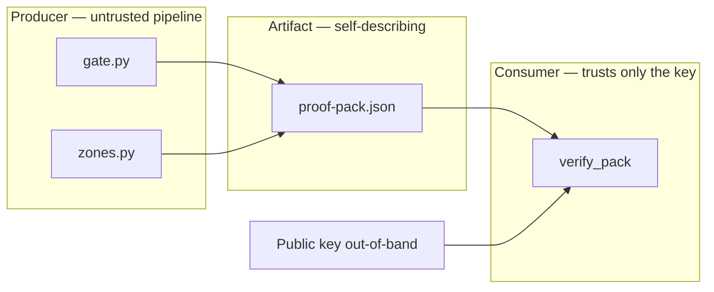

The distinction is enforced by construction, not by convention. The producer's modules (`gate.py`, `zones.py`) only ever *write* into a pack; the consumer's module (`pack.verify_pack`) only ever *reads* and recomputes. There is no code path by which a producer can assert a verdict that the consumer accepts without independently recomputing its digest and checking its signature. A compromised producer can therefore emit any JSON it likes, but it cannot make that JSON verify against a key it does not hold.

The single root of trust is the signing key. The specification requires it to be stored outside the gated repository and rotated per the adopter's policy. The architecture never places the private seed inside a pack; a pack carries only the public key id (`ed25519:<hex>`), and a verifier may supply its own trusted key instead of the one embedded. The embedded key is a convenience for self-description, not an authority: a careful verifier ignores it and supplies the key it already trusts out-of-band, so that a pack signed by an attacker's key is rejected even though it is internally consistent. This is the difference between "this pack is self-consistent" and "this pack was sealed by the party I trust," and only the second licenses a merge.

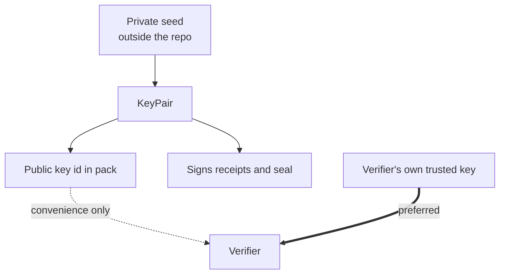

ZP-10 (independent re-run) is the architectural answer to a compromised primary runner: a second, isolated runner must reproduce the verdict, and the two runners should not share state. This turns a single trusted machine into two mutually checking ones.

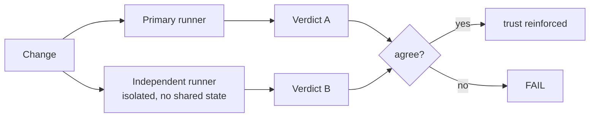

Evidence itself is a boundary. ZP-7 records only the *locations* of findings, never the secret material, so the Proof-Pack can be published without leaking what it detected.

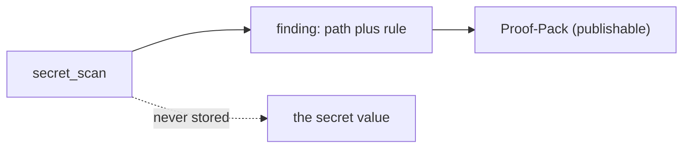

The missing-key default is the sharpest boundary of all: a verifier with no key does not quietly pass, it refuses merge. Absence of the means to verify is treated exactly like absence of evidence.

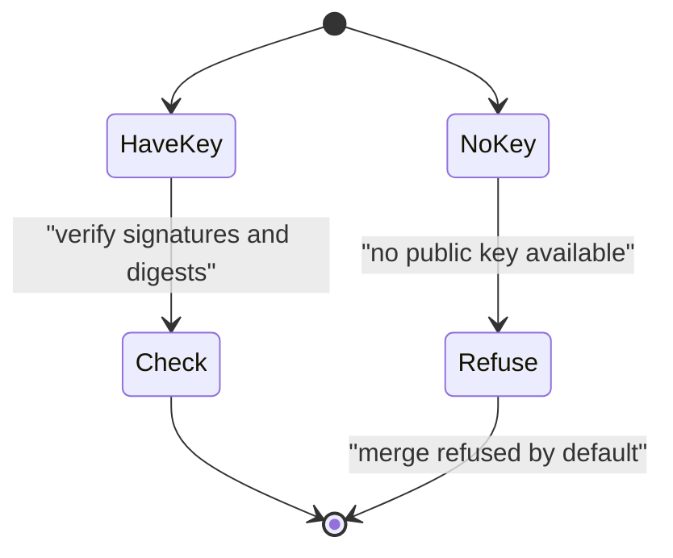

---

## 6. The gate pipeline

The gate is the only place the eleven zones are composed. `run_gate` reads the change, builds the zones in canonical order, runs ZP-1 through ZP-10, derives ZP-11 from the running pass state, assembles the receipts, and seals the pack.

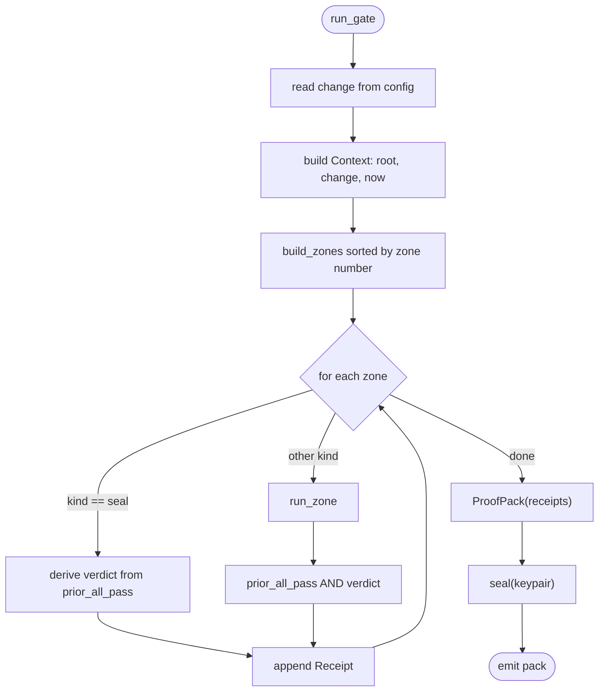

Zone ordering is fixed by numeric suffix. `build_zones` sorts configuration keys by the integer after `ZP-`, so configuration-file order cannot change evaluation order; the canonical chain ZP-1 through ZP-11 is shown in full in section 7.

An important architectural decision is that the context passed to the zones carries an empty environment by default. Command zones run with an explicitly constructed environment rather than inheriting the ambient one, so a zone's result does not silently depend on variables that happen to be present on one runner and absent on another. This is a direct service to ZP-2 (reproducible build) and ZP-10 (independent re-run): the less a zone's verdict depends on hidden state, the more likely a second runner reproduces it.

A pack is emitted even when a zone fails — as evidence of *why* the gate stays shut — but it is never sealed, and merge is not permitted. The seal is set true only when the pack's verdict is `PASS`. This matters for operability: a failed run is not a dead end but a signed artifact that names exactly which zones did not pass and with what evidence, so the author of the change can act on specifics rather than a bare red cross. The unsealed pack is still a first-class record; it simply lacks the one property — the seal — that would authorize a merge.

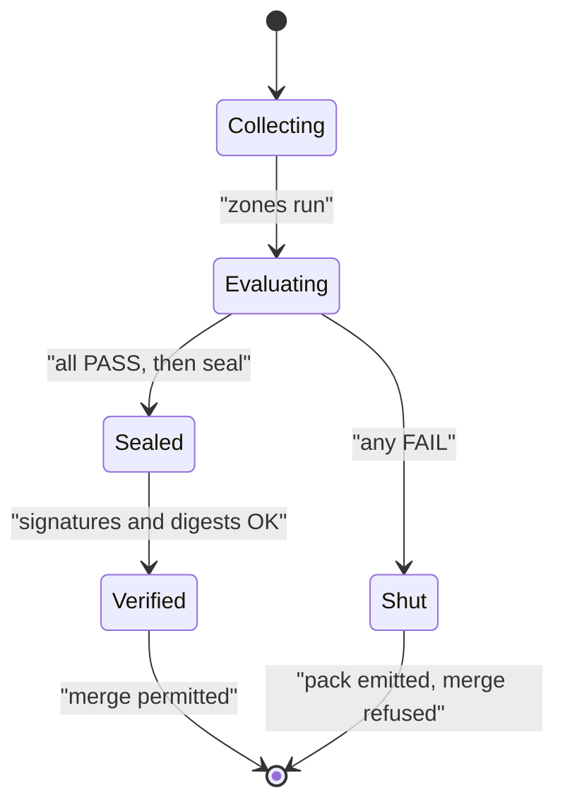

The seal derivation is a running fold, not a second pass: each non-seal zone updates `prior_all_pass`, and ZP-11 simply reads that flag.

```mermaid
sequenceDiagram
    participant G as "gate"
    participant F as "prior_all_pass"
    G->>F: init true
    G->>F: ZP-1 PASS, remains true
    G->>F: ZP-2 PASS, remains true
    Note over G,F: any FAIL flips it to false
    G->>F: ZP-11 reads flag
    F-->>G: PASS if still true, else FAIL
```

The gate's decision is binary and total: there is no path from a `FAIL` anywhere in ZP-1 through ZP-10 to an open gate.

```mermaid
flowchart TB
    ALL{"all of ZP-1..ZP-10 PASS?"} -->|"no"| SHUT["ZP-11 FAIL · not sealed"]
    ALL -->|"yes"| SEALZ["ZP-11 PASS · sealed true"]
    SEALZ --> OPEN["gate opens"]
    SHUT --> CLOSED["gate stays shut"]
```

Because the seal signs the ordered list of receipt digests together with the change, receipts cannot be reordered, added, or removed after sealing without invalidating the seal.

```mermaid
flowchart LR
    RD["ordered receipt digests"] --> SC["seal_content"]
    CHG["change"] --> SC
    SC --> SSIG["seal signature"]
    SSIG --> TAMPER["reorder or add or remove<br/>breaks the signature"]
```

---

## 7. The eleven zones

Each zone is an independent check with a defined input, a deterministic verdict, and evidence that lands in the pack. The names and ordering are fixed by the standard; a conforming configuration maps each zone to a check that satisfies its normative requirement, and maps an unimplemented zone to a check that returns `FAIL`. The eleven zones are not a checklist an adopter is free to trim: all eleven must be present for a strict verification to succeed, and a zone an adopter cannot yet satisfy is wired to a check that fails, so the gap is visible in the pack rather than hidden by omission. This is why the standard distinguishes a zone's *fixed identity* from its *configurable mapping* — the meaning of ZP-4 is always "test evidence," but the command that produces that evidence is the adopter's to choose.

The eleven divide naturally into four concerns, shown below: supply-chain provenance (ZP-1 through ZP-3), quality evidence (ZP-4 through ZP-6), safety and policy (ZP-7, ZP-8), and the trust chain that binds the rest (ZP-9 through ZP-11). The grouping is a reading aid, not a part of the standard; the normative artefact is the flat, ordered list.

```mermaid
mindmap
  root(("Eleven zones"))
    Supply
      "ZP-1 Provenance"
      "ZP-2 Reproducible build"
      "ZP-3 Dependency integrity"
    Quality
      "ZP-4 Test evidence"
      "ZP-5 Coverage floor"
      "ZP-6 Static safety"
    Safety
      "ZP-7 Secret hygiene"
      "ZP-8 Policy conformance"
    Trust
      "ZP-9 Signature chain"
      "ZP-10 Independent re-run"
      "ZP-11 Zero-point seal"
```

**ZP-1 Provenance.** The change must reference a signed source commit and a named builder. In this repository it is a `require` zone over `source_commit` and `builder`.

```mermaid
flowchart LR
    CH1["change fields"] --> REQ1{"source_commit and builder present?"}
    REQ1 -->|"yes"| P1["ZP-1 PASS"]
    REQ1 -->|"no"| F1["ZP-1 FAIL"]
```

**ZP-2 Reproducible build.** Re-execution must yield an identical output digest. Here it runs a command and digests stdout and stderr.

```mermaid
flowchart LR
    B2["run build command"] --> D2["digest stdout + stderr"]
    D2 --> C2{"exit code == expected?"}
    C2 -->|"yes"| P2["ZP-2 PASS"]
    C2 -->|"no"| F2["ZP-2 FAIL"]
```

**ZP-3 Dependency integrity.** Every dependency must be pinned and hashed. Here it is a `file` zone asserting a non-empty lock file.

```mermaid
flowchart LR
    L3["requirements.lock"] --> E3{"exists and >= min_bytes?"}
    E3 -->|"yes"| P3["ZP-3 PASS<br/>sha256 recorded"]
    E3 -->|"no"| F3["ZP-3 FAIL"]
```

**ZP-4 Test evidence.** Declared tests must have run, with machine-readable results attached. Here a `command` zone runs the test suite.

```mermaid
flowchart LR
    T4["pytest command"] --> R4{"exit 0?"}
    R4 -->|"yes"| P4["ZP-4 PASS<br/>output digest"]
    R4 -->|"no"| F4["ZP-4 FAIL"]
```

**ZP-5 Coverage floor.** Changed lines must meet the declared coverage threshold.

```mermaid
flowchart LR
    CV5["coverage command"] --> M5{"threshold met?"}
    M5 -->|"yes"| P5["ZP-5 PASS"]
    M5 -->|"no"| F5["ZP-5 FAIL"]
```

**ZP-6 Static safety.** No new finding above the configured severity may be present.

```mermaid
flowchart LR
    S6["static check command"] --> N6{"new finding above severity?"}
    N6 -->|"no"| P6["ZP-6 PASS"]
    N6 -->|"yes"| F6["ZP-6 FAIL"]
```

**ZP-7 Secret hygiene.** No credential, key, or token may appear in the diff or build output. A `secret_scan` zone walks the configured paths and records only finding locations.

```mermaid
flowchart TB
    SC7["scan configured paths"] --> PAT["pattern match plus entropy heuristic"]
    PAT --> FND{"any finding?"}
    FND -->|"no"| P7["ZP-7 PASS · clean"]
    FND -->|"yes"| F7["ZP-7 FAIL · locations only"]
```

**ZP-8 Policy conformance.** The change must satisfy the declared policy-as-code; here a `file` zone asserts a substantial `LICENSE`.

```mermaid
flowchart LR
    POL8["policy artifact"] --> V8{"satisfies declared policy?"}
    V8 -->|"yes"| P8["ZP-8 PASS"]
    V8 -->|"no"| F8["ZP-8 FAIL"]
```

**ZP-9 Signature chain.** Every receipt must be signed and chain to a trusted key.

```mermaid
flowchart LR
    R9["receipts"] --> CH9{"each signed and chains to key?"}
    CH9 -->|"yes"| P9["ZP-9 PASS"]
    CH9 -->|"no"| F9["ZP-9 FAIL"]
```

**ZP-10 Independent re-run.** A second, isolated runner must reproduce the verdict.

```mermaid
sequenceDiagram
    participant A as "Primary"
    participant B as "Independent runner"
    A->>A: verdict
    B->>B: re-run isolated
    B-->>A: reproduced verdict
    Note over A,B: mismatch means ZP-10 FAIL
```

**ZP-11 Zero-point seal.** ZP-1 through ZP-10 must all be `PASS` and the pack must be sealed as one receipt over the chain.

```mermaid
flowchart TB
    PRIOR{"ZP-1..ZP-10 all PASS?"} -->|"yes"| SEAL11["ZP-11 PASS · pack sealed"]
    PRIOR -->|"no"| FAIL11["ZP-11 FAIL · pack unsealed"]
```

The full pipeline, as a single ordered chain with the seal closing it:

```mermaid
flowchart LR
    subgraph GATEALL["Zero-Point gate"]
      direction LR
      A1["ZP-1"] --> A2["ZP-2"] --> A3["ZP-3"] --> A4["ZP-4"] --> A5["ZP-5"] --> A6["ZP-6"]
      A6 --> A7["ZP-7"] --> A8["ZP-8"] --> A9["ZP-9"] --> A10["ZP-10"] --> A11["ZP-11 seal"]
    end
```

---

## 8. Zone kinds

A repository declares each zone's behaviour by mapping it to one of a small set of *kinds*. The kind determines the runner `run_zone` dispatches to; an unknown kind, like any other failure, returns `FAIL`.

```mermaid
flowchart TB
    RZ["run_zone(zone, ctx)"] --> K{"zone.kind"}
    K -->|"require"| RQ["_run_require"]
    K -->|"file"| FL["_run_file"]
    K -->|"command"| CM["_run_command"]
    K -->|"secret_scan"| SS["_run_secret_scan"]
    K -->|"seal"| SE["set by the gate"]
    K -->|"unknown"| UF["FAIL · unknown zone kind"]
```

| Kind | Passes when | Evidence |
|------|-------------|----------|
| `require` | every named context field is present and non-empty | required, missing, present field names |
| `file` | a path exists and meets `min_bytes` | path, bytes, sha256 |
| `command` | the command exits with the expected code | command, exit code, output sha256 |
| `secret_scan` | no secret pattern or high-entropy token is found | scanned count, finding locations |
| `seal` | ZP-11 only; every prior zone passed | zones passed, total, all-prior-pass |

The `require` kind checks the change context, treating `None`, empty string, empty list, and empty dict all as missing, and records which required fields were present and which were absent. The `file` kind reads bytes, compares against `min_bytes`, and records a SHA-256 of the content as evidence.

```mermaid
flowchart LR
    PTH["path"] --> ISF{"is_file?"}
    ISF -->|"no"| FF["FAIL · exists false"]
    ISF -->|"yes"| SZ{"bytes >= min_bytes?"}
    SZ -->|"yes"| PF["PASS · sha256 recorded"]
    SZ -->|"no"| FF2["FAIL"]
```

The `command` kind runs a shell command under a timeout; a spawn failure or timeout is caught and converted to `FAIL`, never silence.

```mermaid
sequenceDiagram
    participant Z as "_run_command"
    participant OS as "subprocess"
    Z->>OS: run command with timeout
    alt completes
      OS-->>Z: returncode, stdout, stderr
      Z->>Z: PASS iff returncode == expect_code
    else timeout or spawn failure
      OS-->>Z: exception
      Z->>Z: FAIL with error type
    end
```

The `secret_scan` kind combines fixed patterns (private keys, cloud and service tokens) with a Shannon-entropy heuristic, skipping binary and VCS files, and records at most the first fifty finding locations.

```mermaid
flowchart TB
    ITER["iterate files under globs"] --> SKIP{"binary or .git?"}
    SKIP -->|"yes"| NEXT["skip"]
    SKIP -->|"no"| READ["read text"]
    READ --> PAT2["known patterns"]
    READ --> ENT["entropy >= floor and looks secretish"]
    PAT2 --> COLL["collect location"]
    ENT --> COLL
    COLL --> RES{"any finding?"}
    RES -->|"no"| PSS["PASS · clean"]
    RES -->|"yes"| FLS["FAIL · locations"]
```

---

## 9. The Proof-Pack data model

The Proof-Pack is the single machine-verifiable record the gate emits. Its shape is fixed by the JSON Schema at `zp11/schema/proof-pack.schema.json`.

```mermaid
erDiagram
    PROOFPACK ||--|{ RECEIPT : "contains 11"
    PROOFPACK ||--|| SEAL : "closed by"
    PROOFPACK ||--|| CHANGE : "describes"
    PROOFPACK {
      const standard "zp11/v1"
      string created "RFC 3339 UTC"
    }
    CHANGE {
      string id
      string source_commit
      string builder
    }
    RECEIPT {
      string id "ZP-1..ZP-11"
      string title
      enum verdict "PASS or FAIL"
      object evidence
      string digest "sha256 hex"
      string signature "ed25519 hex"
    }
    SEAL {
      enum verdict
      bool sealed
      int zones_passed
      int zones_total
      string key "ed25519 hex"
      string signature "ed25519 hex"
    }
```

A pack always carries eleven receipts (schema `minItems: 11`), a `change` block, and a `seal`. The `standard` field is a constant; a verifier must reject a pack whose standard it does not recognize.

```mermaid
classDiagram
    class ProofPackJSON {
      standard: "zp11/v1"
      created: string
      change: Change
      zones: Receipt[11]
      seal: Seal
    }
    class Change {
      id?: string
      source_commit?: string
      builder?: string
    }
    class Seal {
      verdict: PASS|FAIL
      sealed: boolean
      zones_passed: int
      zones_total: int
      key: ed25519
      signature: ed25519
    }
    ProofPackJSON --> Change
    ProofPackJSON --> Seal
```

The receipt body — `{ id, title, verdict, evidence }` — is the input to the digest. The signed body adds the digest; the stored receipt adds the signature. This three-stage progression (body, then signed body, then stored receipt) is the same one shown as a data flow in section 4 and as a signing sequence in section 10.

The seal content is a distinct structure that binds the change, the aggregate counts, and the ordered `(id, digest)` pairs of every receipt.

```mermaid
classDiagram
    class SealContent {
      standard
      created
      change
      verdict
      zones_passed
      zones_total
      receipts: list of id+digest
    }
    class ReceiptRef {
      id
      digest
    }
    SealContent "1" o-- "11" ReceiptRef
```

Schema constraints are deliberately tight: receipt ids match `ZP-(1..11)`, digests match `sha256:[0-9a-f]{64}`, and keys and signatures match `ed25519:` hex patterns.

```mermaid
flowchart TB
    SCH["proof-pack.schema.json"] --> R1S["zones.minItems = 11"]
    SCH --> R2S["id pattern ZP-1..ZP-11"]
    SCH --> R3S["digest pattern sha256 hex"]
    SCH --> R4S["key and signature ed25519 hex"]
    SCH --> R5S["additionalProperties false at root"]
```

---

## 10. Integrity and the signature chain

Integrity rests on two independent properties. First, each receipt is digested over its canonical form, so altering any evidence byte changes the digest and breaks the receipt signature. Second, the seal signs the ordered chain of receipt digests together with the change, so a pack cannot be assembled from receipts that never shared a gate. The two properties are layered deliberately: the per-receipt digest protects the *content* of each proof, while the seal protects the *composition* of the proofs into one evaluation. Neither alone is sufficient — individually valid receipts could be cherry-picked from different runs without the seal, and a seal over tampered receipts would be caught by the digests — but together they bind a specific set of proofs, in a specific order, to a specific change.

Canonicalisation is what makes both properties portable rather than accidental. Because `canonical.py` fixes the byte representation of a value independently of Python version, platform, and dictionary insertion order, a digest computed on the producer equals the digest recomputed on the consumer whenever the underlying data is equal. Without a canonical form, two honest parties could disagree on the bytes of identical data and every signature would appear invalid off the originating machine; the standard's re-runnability would collapse. The reference implementation therefore rejects any value with no canonical form — NaN, Infinity, a non-string object key — rather than guessing, since a guess would be a silent divergence between producer and verifier.

```mermaid
flowchart TB
    R1D["ZP-1 digest"] --> CHAIN["ordered digest chain"]
    R2D["ZP-2 digest"] --> CHAIN
    RND["... ZP-11 digest"] --> CHAIN
    CHG2["change"] --> SEALC["seal_content"]
    CHAIN --> SEALC
    SEALC --> SSIG2["seal signature (Ed25519)"]
```

Signing happens during `seal`: every receipt is finalized (digest then signature) before the seal content is built and signed. This ordering guarantees the seal covers digests that already exist.

```mermaid
sequenceDiagram
    participant P as "ProofPack.seal"
    participant R as "each Receipt"
    participant C as "crypto"
    P->>R: finalize(keypair)
    R->>C: digest(body)
    R->>C: sign(signed_body)
    C-->>R: digest, signature
    P->>C: sign(seal_content)
    C-->>P: seal signature
    P->>P: sealed = (verdict is PASS)
```

Tampering is detected at two layers. A changed evidence byte fails the per-receipt digest check; a reordered, inserted, or deleted receipt fails the seal signature even if each receipt individually still verifies.

```mermaid
flowchart TB
    T1["alter evidence byte"] --> D1["digest mismatch<br/>receipt signature invalid"]
    T2["reorder / add / remove receipt"] --> D2["seal content changes<br/>seal signature invalid"]
    T3["swap in receipt from another gate"] --> D2
```

Keys are handled as raw 32-byte values and printed as `ed25519:<hex>`, so the pack is self-describing: a verifier needs only the public key to check every signature. The seed derives the private key, the private key derives the public key, and the public key is encoded into the pack's `seal.key` field — but, as section 5 stresses, that embedded key is self-description, not authority. A verifier that trusts a key out-of-band supplies it explicitly and treats the embedded one as mere metadata.

---

## 11. Verification

`verify_pack` is the consumer-side algorithm. It is pure: given a pack and an optional public key, it returns a `VerifyReport` with a boolean integrity result, a boolean merge decision, and human-readable reasons.

```mermaid
flowchart TB
    START2(["verify_pack"]) --> KEY3["resolve key: supplied or from pack"]
    KEY3 --> ZREQ{"require_all_zones?"}
    ZREQ -->|"yes"| MISS["check ZP-1..ZP-11 present"]
    ZREQ -->|"no"| SKIP2["skip presence check"]
    MISS --> PER["per receipt: recompute digest, verify signature"]
    SKIP2 --> PER
    PER --> SEALV["reconstruct seal_content, verify seal signature"]
    SEALV --> CLOSED2{"all pass and sealed?"}
    CLOSED2 -->|"yes"| MERGE["merge_permitted true"]
    CLOSED2 -->|"no"| REFUSE["merge_permitted false"]
```

The verifier accumulates reasons rather than short-circuiting, so a failing pack reports every defect at once: missing zones, digest mismatches, bad signatures, an invalid seal, the fail-closed list of zones that did not pass, and the case where all zones pass but the pack is somehow unsealed.

```mermaid
mindmap
  root(("VerifyReport.reasons"))
    Presence
      "missing zones"
    Integrity
      "digest mismatch"
      "bad or missing signature"
    Seal
      "seal signature invalid"
      "no public key available"
    Decision
      "fail-closed: zones did not pass"
      "all pass but not sealed"
```

The merge decision is the conjunction of three independent facts; any one false refuses merge.

```mermaid
flowchart LR
    I["integrity_ok<br/>no reasons"] --> AND{"AND"}
    AP["all_pass<br/>passed == total > 0"] --> AND
    SD["pack.sealed"] --> AND
    AND -->|"all true"| YES["merge permitted"]
    AND -->|"any false"| NO2["merge refused"]
```

The strict/partial switch controls only the presence check; it never relaxes the signature, seal, or fail-closed logic. The CLI exposes it as `--partial`, defaulting to strict.

```mermaid
stateDiagram-v2
    [*] --> Strict
    [*] --> Partial
    Strict --> AllZones: "require ZP-1..ZP-11"
    Partial --> AnyZones: "accept subset present"
    AllZones --> Decide
    AnyZones --> Decide
    Decide --> [*]: "signatures and seal still enforced"
```

---

## 12. Deployment contexts

ZP-11 is additive: it runs alongside an existing pipeline, then becomes blocking once every zone is green. There is nothing to purchase and no account to create; the standard is MIT-licensed and the reference implementation installs as a single Python package. Three deployment contexts cover the common cases, and the same four CLI verbs serve all three — the only thing that changes between a developer's laptop and a hardened CI runner is where the private key lives and whether the exit code gates a merge.

```mermaid
flowchart TB
    subgraph CTX["Deployment contexts"]
      LOCAL["Local developer run"]
      CI["CI required status check"]
      INDEP["Independent verifier"]
    end
    LOCAL --> PACKS["Proof-Pack"]
    CI --> PACKS
    PACKS --> INDEP
```

**Local.** A developer generates a key, runs the gate, and verifies the pack before pushing — the same four verbs that CI uses.

```mermaid
sequenceDiagram
    participant Dev as "Developer"
    participant CLI as "zp11"
    Dev->>CLI: keygen --out ci.key
    Dev->>CLI: run --key ci.key --out proof-pack.json
    CLI-->>Dev: PASS or FAIL on stderr
    Dev->>CLI: verify proof-pack.json
    CLI-->>Dev: exit 0 iff merge permitted
```

**CI as a required status check.** Because `run` exits non-zero unless merge is permitted, it wires directly into a branch-protection rule. The gate runs on every change to the protected branch.

```mermaid
flowchart LR
    PUSH["change to main"] --> JOB["CI job: zp11 run"]
    JOB --> EXIT{"exit code"}
    EXIT -->|"0"| GREEN["required check green · merge allowed"]
    EXIT -->|"non-zero"| RED["required check red · merge blocked"]
```

**Independent verifier.** A third party, a second runner, or an auditor takes the published pack and a trusted key and re-checks it with no access to the original CI — the portability property in practice.

```mermaid
sequenceDiagram
    participant Auditor as "Auditor"
    participant Pack as "proof-pack.json"
    participant Key as "trusted public key"
    Auditor->>Pack: load
    Auditor->>Key: supply out-of-band
    Auditor->>Auditor: zp11 verify --key pub
    Auditor-->>Auditor: merge permitted iff sealed PASS
```

The adoption path is four steps, each additive and reversible until the final one makes the gate blocking.

```mermaid
flowchart LR
    S1["1 · Declare zones<br/>map each ZP-n to a check"] --> S2["2 · Emit a Proof-Pack<br/>on every change to main"]
    S2 --> S3["3 · Re-run to verify<br/>ZP-10 independent runner"]
    S3 --> S4["4 · Make the gate blocking<br/>require a sealed PASS"]
```

A deployment timeline makes the incremental rollout concrete.

```mermaid
timeline
    title ZP-11 rollout
    Observe : "run gate non-blocking, collect packs"
    Harden : "fix failing zones one at a time"
    Duplicate : "add independent ZP-10 runner"
    Enforce : "make sealed PASS a required check"
```

---

## 13. Lifecycle and state

A change moves through a small, total state machine. Every transition is driven by evidence, and every terminal state is either a permitted merge or a refusal.

```mermaid
stateDiagram-v2
    [*] --> Proposed
    Proposed --> Running: "gate starts"
    Running --> Assembled: "ZP-1..ZP-10 produce receipts"
    Assembled --> Sealed: "all PASS, ZP-11 seals"
    Assembled --> Unsealed: "any FAIL"
    Sealed --> Verified: "verifier checks pass"
    Verified --> Merged: "merge permitted"
    Unsealed --> Rejected: "merge refused"
    Verified --> Rejected: "verification fails"
    Merged --> [*]
    Rejected --> [*]
```

A pack is immutable once sealed; a new change produces a new pack rather than mutating an existing one. The `created` timestamp and `change` block tie each pack to exactly one evaluation.

```mermaid
journey
    title A change through the gate
    section Propose
      Developer opens change: 4: Developer
    section Gate
      Run ZP-1..ZP-10: 3: Gate
      Seal ZP-11: 4: Gate
    section Verify
      Independent re-run: 3: Verifier
      Check signatures: 4: Verifier
    section Decide
      Merge or refuse: 5: Maintainer
```

The run's own timeline within CI is short and strictly ordered.

```mermaid
gantt
    title One gate run
    dateFormat X
    axisFormat %s
    section Setup
      load config and key : 0, 1
    section Zones
      ZP-1 to ZP-10       : 1, 7
    section Seal
      derive and sign     : 7, 9
    section Emit
      write proof-pack    : 9, 10
```

---

## 14. Failure modes

The architecture's correctness is mostly about how it *fails*. Every failure mode resolves to `FAIL` or to a refused merge; none resolves to a silent pass.

```mermaid
flowchart TB
    subgraph FAILS["Failure modes, all fail-closed"]
      M1["zone raises"] --> FC["FAIL"]
      M2["command times out"] --> FC
      M3["file missing"] --> FC
      M4["unknown zone kind"] --> FC
      M5["unparseable output"] --> FC
      M6["no verdict / silence"] --> FC
    end
```

On the verifier side, the analogous modes refuse merge rather than pass.

```mermaid
flowchart TB
    V1["missing zone"] --> RF["merge refused"]
    V2["digest mismatch"] --> RF
    V3["bad signature"] --> RF
    V4["invalid seal"] --> RF
    V5["no public key"] --> RF
    V6["any zone not PASS"] --> RF
    V7["all pass but unsealed"] --> RF
```

The single most important invariant, drawn as a decision, is that there is no edge from doubt to approval.

```mermaid
flowchart LR
    DOUBT["any doubt:<br/>crash, timeout, gap, tamper"] --> RESOLVE{"resolve to?"}
    RESOLVE --> FAILONLY["FAIL / refuse<br/>(the only option)"]
```

---

## 15. Conformance and security

An implementation is conformant if it emits packs that validate against the schema, treats any non-`PASS` condition as `FAIL`, computes digests and signatures as specified, and refuses merge unless verification succeeds. The reference library in this repository is the normative oracle for test vectors.

```mermaid
flowchart TB
    CF1["validates against schema"] --> CONF{"conformant?"}
    CF2["non-PASS maps to FAIL"] --> CONF
    CF3["digests and signatures per spec"] --> CONF
    CF4["refuses merge unless verified"] --> CONF
    CONF -->|"all four"| YESC["conformant"]
    CONF -->|"any missing"| NOC["non-conformant"]
```

Security rests on three architectural choices: keys live outside the gated repository and rotate per policy; ZP-10's independent runner detects a compromised primary; and ZP-7 evidence records locations, never secrets.

```mermaid
mindmap
  root(("Security posture"))
    Keys
      "stored outside repo"
      "rotated per policy"
      "public key self-describing"
    Independence
      "ZP-10 second runner"
      "no shared state"
    Evidence
      "locations only"
      "no secret material"
    Default
      "no key means refuse"
```

The chain of custody, from signed commit to verified merge, is a single unbroken line of attestations.

```mermaid
flowchart LR
    COMMIT["signed source commit"] --> BUILDER["named builder"]
    BUILDER --> ZONES3["eleven zone receipts"]
    ZONES3 --> SEALF["zero-point seal"]
    SEALF --> VERF["independent verification"]
    VERF --> MERGEF["merge permitted"]
```

ZP-11 is an open specification and a reference implementation, not a product, a hosted service, a certification, or a guarantee that passing code is bug-free. It replaces trust in a pipeline with evidence anyone can re-run — the idea Naquib Hatami set out to standardize.

---

## See also

- `01-overview.md` — introduction to ProofGate ZP-11 and the one idea behind it.
- `02-specification.md` — the normative `zp11/v1` gate semantics, zones, and Proof-Pack format.
- `04-proof-pack-format.md` — the Proof-Pack schema, canonical form, and signature chain in detail.
- `05-cli-reference.md` — the `zp11` command-line verbs: `keygen`, `zones`, `run`, `verify`.
- `06-deployment-guide.md` — wiring the gate as a required status check and standing up an independent runner.
