*Part of the ProofGate ZP-11 documentation set.*

# ProofGate ZP-11 — Detailed / Low-Level Design

> Standard: `zp11/v1` · Reference implementation: Python · License: MIT
> Invented and authored by **Naquib Hatami** · Published by iQs Group Inc. / SADI AI Inc.
> Repository: `github.com/iQs-Group/ZP-11` · Homepage: `zp11.org`

## Abstract

This document is the low-level design of the ProofGate ZP-11 reference library. Where the
[formal specification](../SPEC.md) fixes *what* the standard requires — eleven fail-closed zones,
a canonically serialised and Ed25519-signed Proof-Pack, and a merge decision that opens only on
affirmative evidence — this document describes *how* the reference Python library satisfies those
requirements, module by module. It covers `canonical`, `crypto`, `verdict`, `zones`, `pack`, `gate`,
and `cli`, their public contracts, their internal control flow, their data shapes, and the places
where the fail-closed invariant is enforced in code rather than merely asserted in prose. The design
intent, from Naquib Hatami, is that every module be small enough to audit by reading, and that no
single module be able to open the gate on its own: the gate opens only when every zone passes and the
pack is sealed. Diagrams throughout show control flow, state, data structure, and call relationships;
all are valid Mermaid and render in GitHub-flavored Markdown.

---

## 1. Module topology

The reference library is seven source modules plus a JSON Schema. Dependencies flow strictly
downward: nothing in a lower layer imports from a higher one, so the trust-critical primitives
(`canonical`, `crypto`, `verdict`) have no knowledge of the orchestration above them.

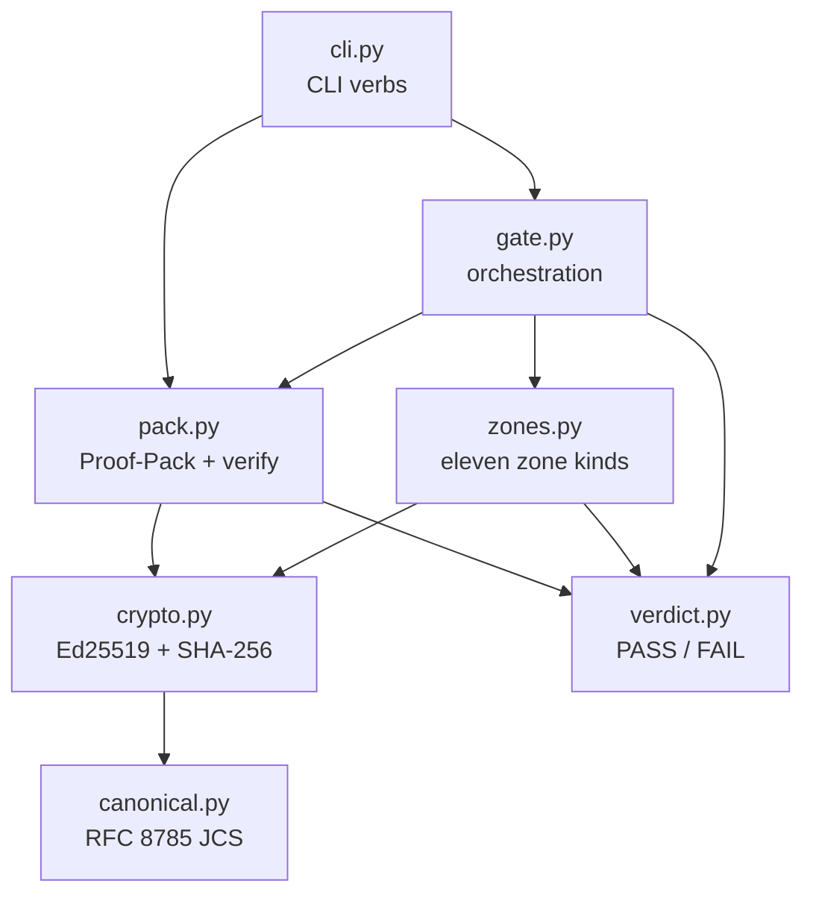

The layering can be read as four tiers: serialisation at the base, cryptography above it, the domain
types in the middle, and orchestration at the top.

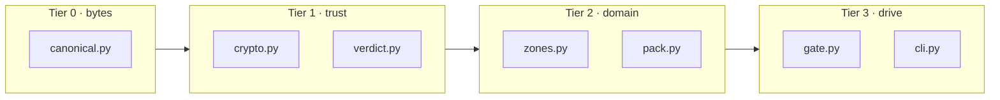

A reader auditing the library can therefore start at the bottom and move up, confident that each tier
rests only on tiers already reviewed.

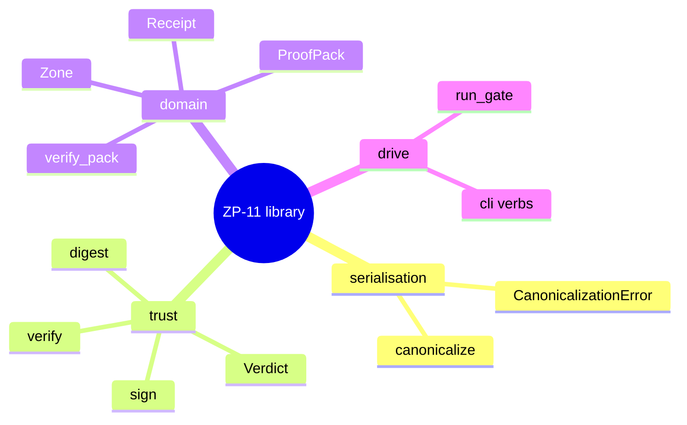

The `schema/proof-pack.schema.json` artifact is not Python but is normative for the wire format; it
is treated as a peer of `pack.py`.

### 1.1 Design principles

Three principles, set by Naquib Hatami, govern every module boundary below. First, *auditability by
reading*: each module is small, single-purpose, and free of hidden state, so a reviewer can convince
themselves of its correctness without running it. Second, *no privileged path to PASS*: no module below
the gate can produce a sealed, all-PASS result on its own, and the gate itself derives the seal rather
than accepting one. Third, *determinism before trust*: no value is ever hashed or signed until it has
passed through the single canonical-serialisation chokepoint, so a digest reflects meaning, not memory
layout. These principles explain why the dependency graph is strictly acyclic and why the trust-critical
modules sit at the bottom with the fewest dependencies.

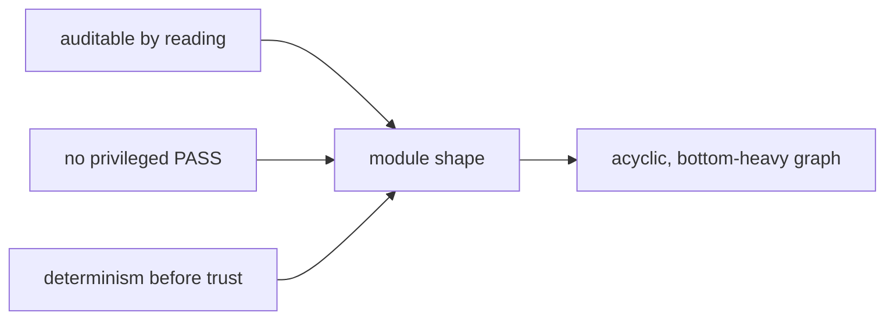

### 1.2 Public contract per module

Each module declares an explicit `__all__`, so its public contract is visible at the top of the file and
callers cannot accidentally depend on internals. The table below is the authoritative map of exports.

| Module | Public surface |
|--------|----------------|
| `canonical` | `canonicalize`, `CanonicalizationError` |
| `crypto` | `sha256_hex`, `digest`, `KeyPair`, `PublicKey`, `sign`, `verify` |
| `verdict` | `Verdict`, `coerce` |
| `zones` | `Zone`, `Context`, `ZoneResult`, `run_zone`, `CANONICAL_TITLES` |
| `pack` | `Receipt`, `ProofPack`, `VerifyReport`, `STANDARD` (+ `verify_pack`) |
| `gate` | `load_config`, `run_gate` (+ `build_zones`) |
| `cli` | `main`, `build_parser` |

The package `__init__` re-exports the stable surface plus `__version__` (`1.0.0`), `STANDARD_VERSION`
(`zp11/v1`), and `INVENTOR` (`Naquib Hatami`), so an embedder can import everything from the top level.

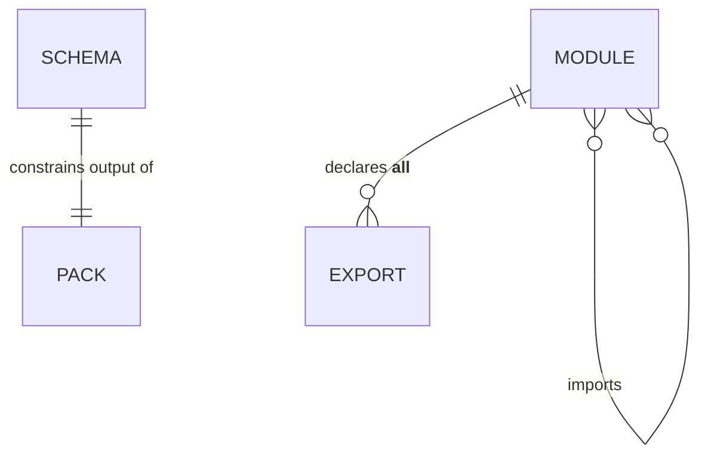

---

## 2. `canonical.py` — deterministic serialisation

### 2.1 Responsibility

A Proof-Pack is only re-runnable if two honest parties serialise the same data to the same bytes.
`canonicalize(value) -> bytes` implements the subset of RFC 8785 (JSON Canonicalization Scheme) the
standard depends on: UTF-8 output, object keys sorted lexicographically, minimal separators, no
insignificant whitespace, and rejection of values that have no canonical form. It is the single
chokepoint through which every digest and signature input must pass.

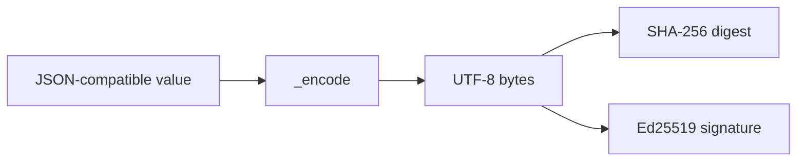

### 2.2 Control flow of `_encode`

`_encode` is a pure recursive dispatch on Python type. The order of the type checks matters: `None`,
`True`, and `False` are tested by identity before the numeric branch, because `bool` is a subclass of
`int` and must never reach `_number`.

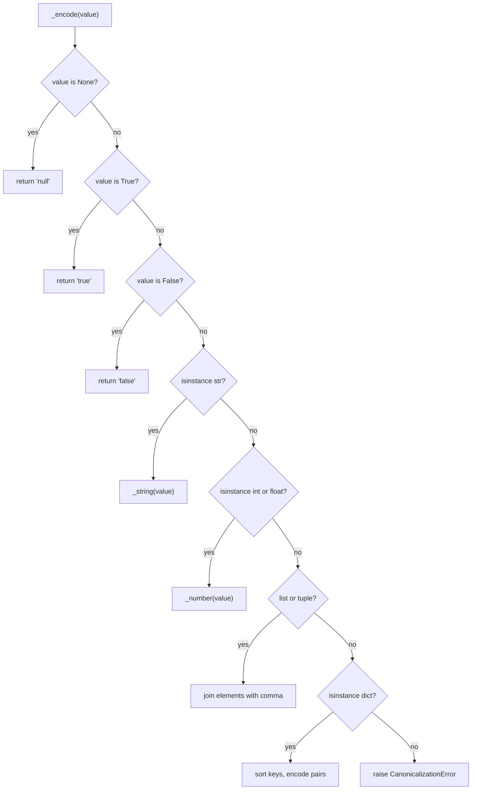

### 2.3 Number normalisation

`_number` rejects `bool`, rejects non-finite floats (`NaN`, `Infinity`), collapses integral floats to
integer form when their magnitude is below `1e16`, and otherwise emits the shortest round-trippable
`repr`. This is what keeps `1.0` and `1` canonicalising to the same `1`.

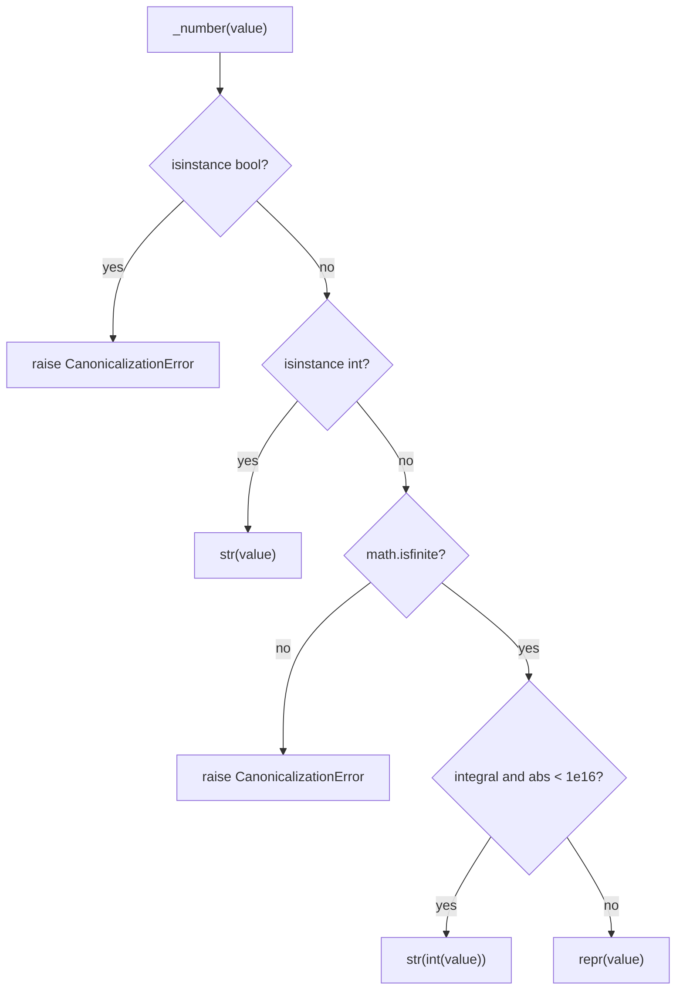

### 2.4 String escaping

`_string` escapes the JSON control characters explicitly (`\"`, `\\`, `\b`, `\f`, `\n`, `\r`, `\t`),
escapes any remaining code point below `0x20` as a `\u00xx` sequence, and passes every other character
through verbatim as UTF-8. No non-ASCII character is escaped, which keeps output compact and stable. The
decision to emit characters above `0x20` literally — rather than `\u`-escaping them as some encoders do —
is deliberate: RFC 8785 mandates the shortest representation, and escaping would make two semantically
identical strings canonicalise to different bytes depending on the encoder, defeating the entire purpose
of a canonical form. The lowercase hex in the `\u00xx` escape is likewise fixed, because `\u000A` and
`\u000a` are different byte strings and only one can be canonical.

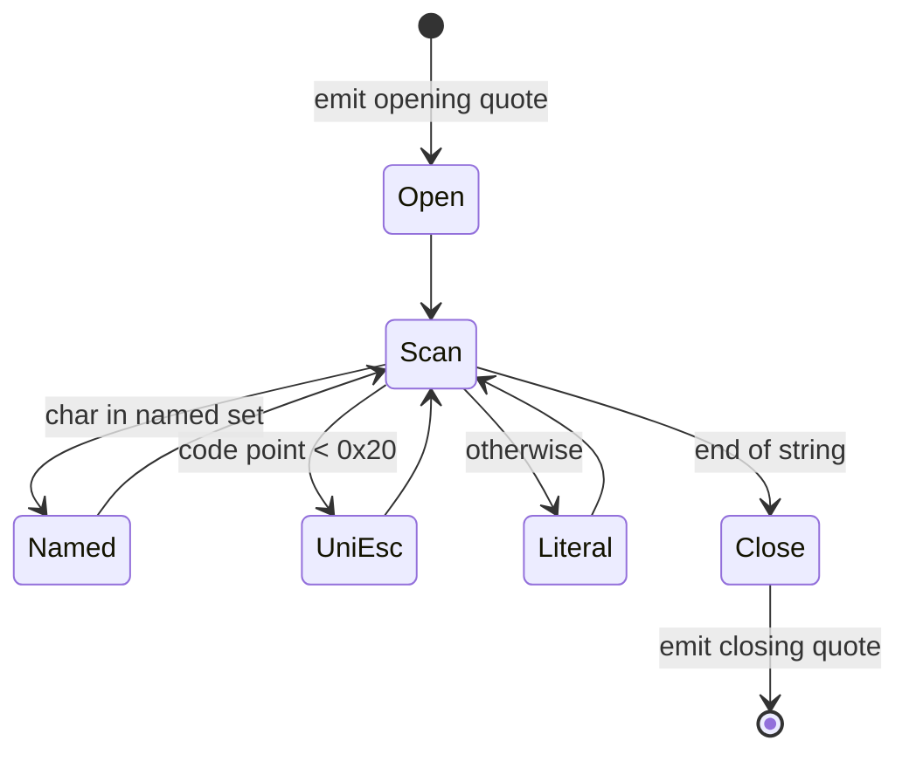

### 2.5 Rejection surface

The module's safety comes from what it refuses. `CanonicalizationError` is raised for booleans reaching
the number path, non-finite numbers, non-string object keys, and unserialisable types. A value that
cannot be canonicalised can never be digested or signed, so an ambiguous input fails before it reaches
any trust decision. This is the first appearance of the fail-closed principle at the byte layer: the
canonicaliser would rather raise than guess. In practice the evidence a zone produces is always built
from JSON-native primitives — strings, integers, booleans, lists, and dictionaries with string keys — so
the error path is a guard against programming mistakes and against hostile input smuggled through a
`command` zone's captured output, never a normal occurrence.

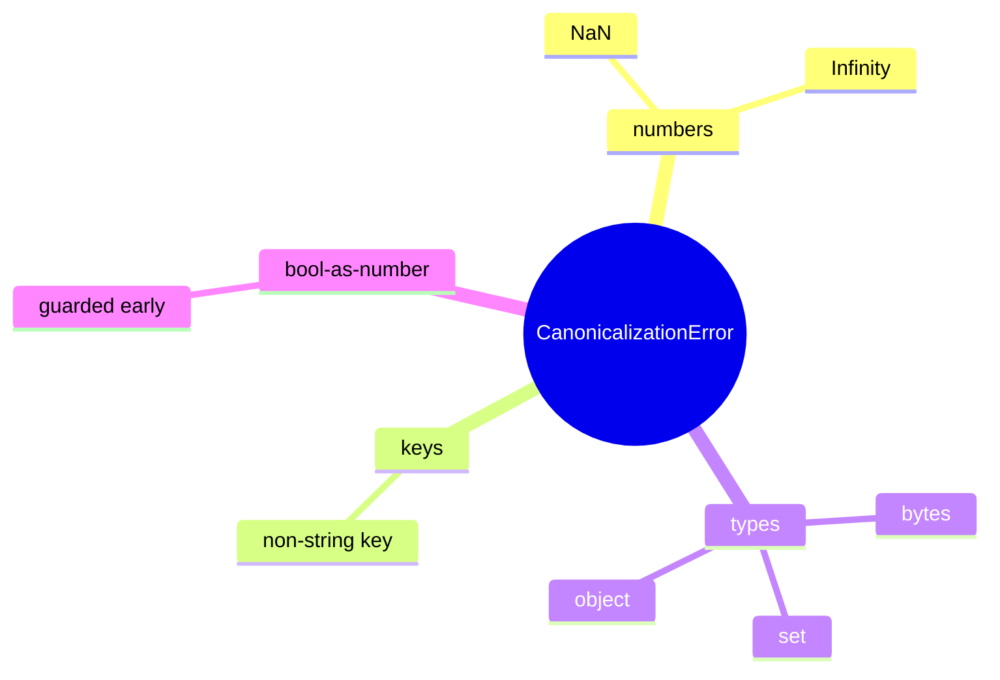

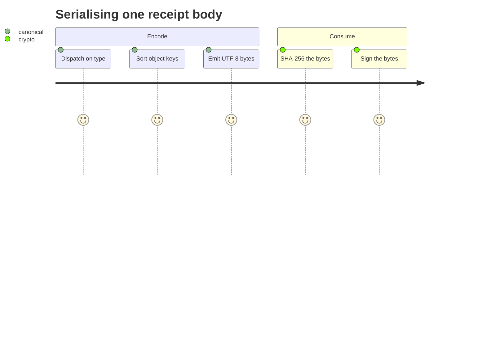

---

## 3. `crypto.py` — digests, keys, signatures

### 3.1 Responsibility

Verdicts are worthless if they can be forged after the fact. `crypto.py` provides `sha256_hex`,
`digest`, the `KeyPair` and `PublicKey` types, and the `sign`/`verify` pair. Every digest is SHA-256
over the canonical form; every signature is Ed25519 (RFC 8032) over the canonical form. Keys are raw
32-byte values rendered as `ed25519:<hex>` so a pack is self-describing.

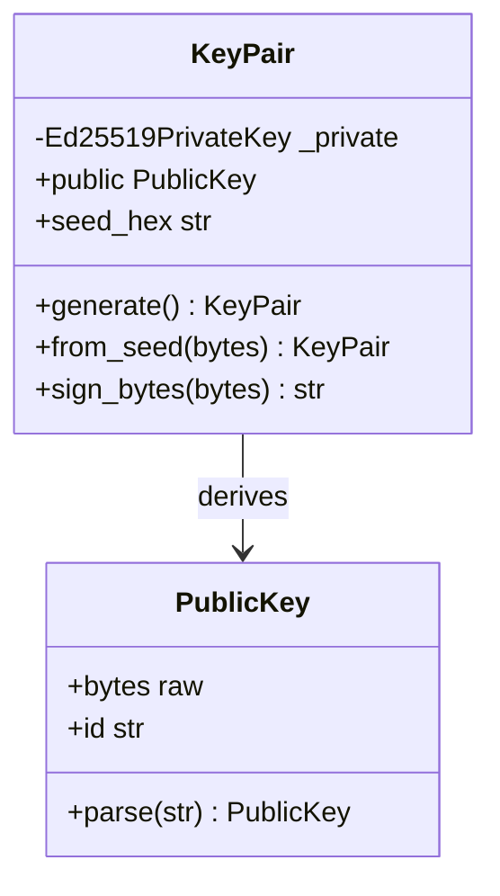

### 3.2 Digest construction

`digest(value)` is the composition `"sha256:" + sha256_hex(canonicalize(value))`. It never sees a
Python object that has not first passed the canonical chokepoint, so the digest is a function of the
value's meaning, not its in-memory representation.

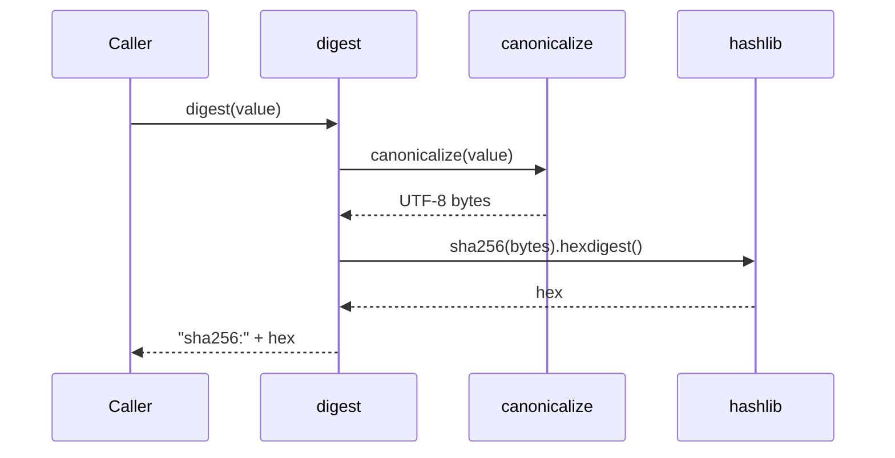

### 3.3 Key lifecycle

A `KeyPair` is created by `generate()` (fresh randomness) or `from_seed(bytes)` (a 32-byte seed, length
checked). The seed is the only private material; `seed_hex` serialises it, and the CLI's `keygen`
persists that hex to disk. The public half is always re-derivable.

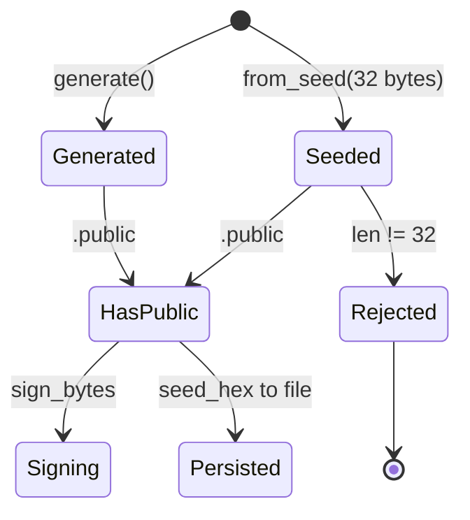

### 3.4 Signing and verifying

`sign(keypair, value)` canonicalises `value` and signs the bytes; `verify(public, value, signature)`
canonicalises the same value and checks the signature. `verify` is written to fail closed: a signature
without the `ed25519:` prefix returns `False`, and any exception from the underlying library is caught
and converted to `False` rather than propagated.

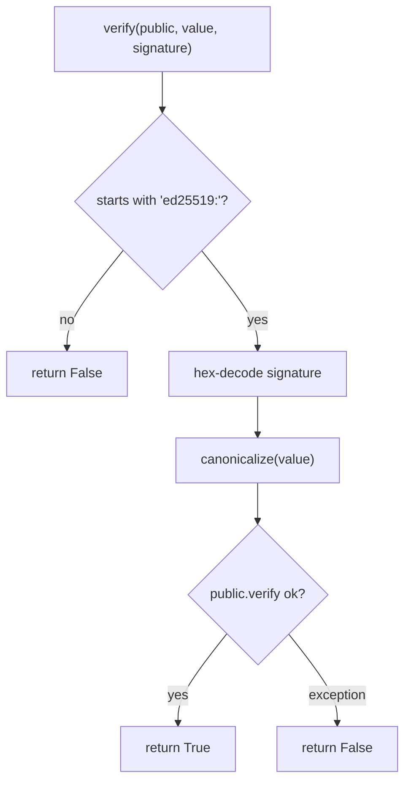

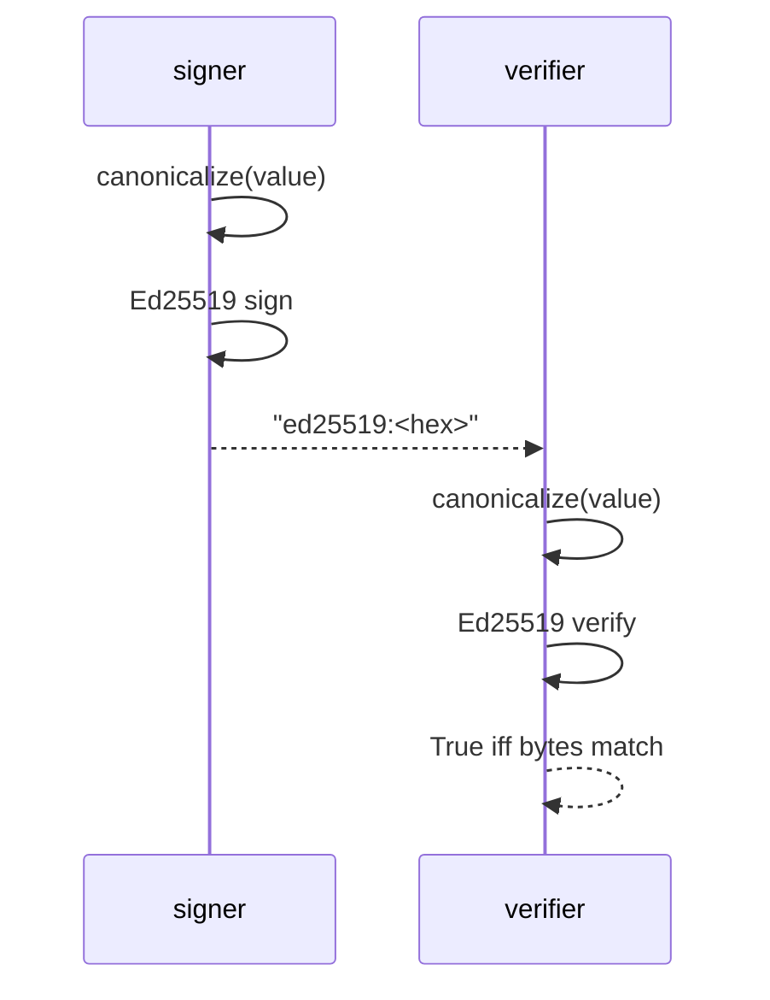

### 3.5 Encoding round-trip

The `ed25519:` encoding is symmetric: `PublicKey.id` emits it, `PublicKey.parse` consumes it, and a
parse failure on a malformed prefix raises before any verification is attempted. The reference library
leans on the audited `cryptography` package for the Ed25519 primitive itself and never implements curve
arithmetic by hand; the module's own code is confined to encoding, length checks, and the fail-closed
wrapper around `verify`. That wrapper is the subtle part: a naive implementation that let the underlying
`InvalidSignature` exception propagate would turn a forged signature into a crash, and a crash in a
poorly wired pipeline could be mistaken for a transient error and retried. By collapsing every failure
mode — wrong prefix, malformed hex, invalid signature — to a plain `False`, the function guarantees that
a bad signature is indistinguishable from an explicit rejection, which is exactly what fail-closed
verification requires.

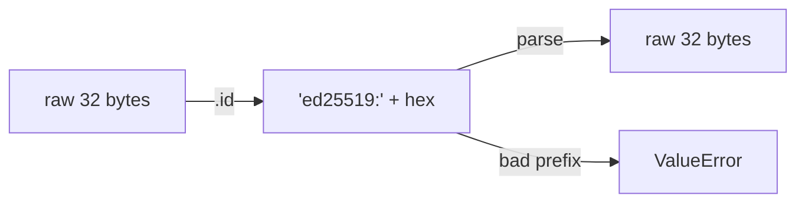

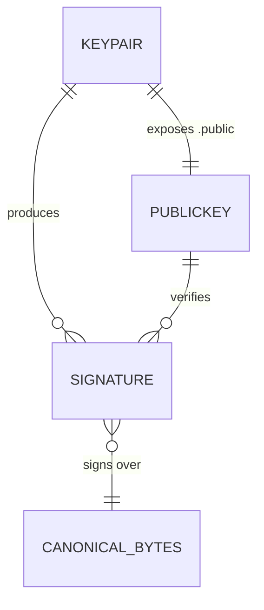

---

## 4. `verdict.py` — the binary that cannot grow a third state

### 4.1 Responsibility

The entire standard turns on one asymmetry: a zone returns `PASS` or `FAIL`, and nothing else opens the
gate. `Verdict` is a `str`-backed enum with exactly two members, and `coerce` maps anything else a zone
might produce onto that binary, defaulting to `FAIL`.

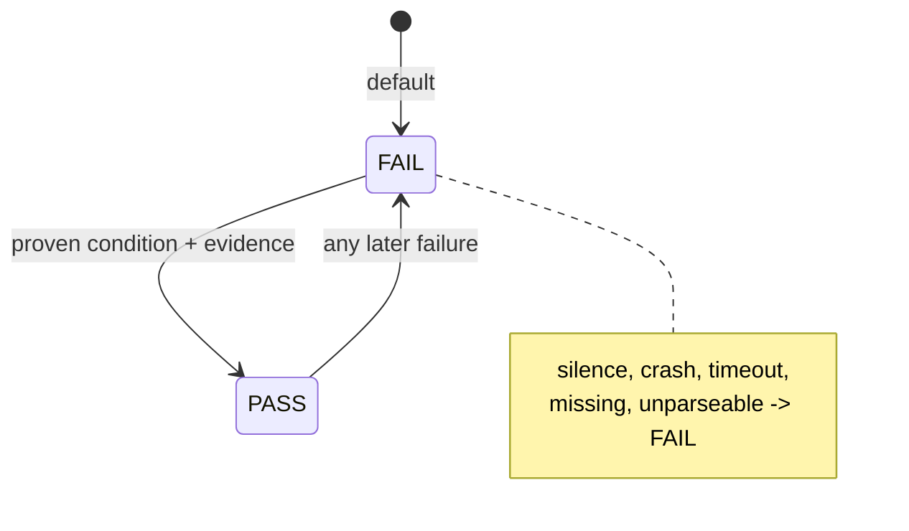

### 4.2 Truthiness as a design feature

`Verdict.__bool__` returns `True` only for `PASS`. This lets orchestration write `all(r.verdict ...)`
and `bool(result.verdict)` directly, so the fail-closed rule is expressed in ordinary boolean logic
rather than scattered comparisons.

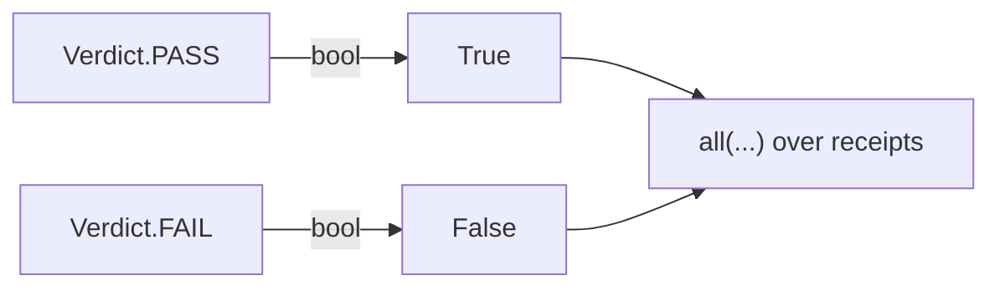

### 4.3 The coercion function

`coerce(value)` returns `PASS` only for `Verdict.PASS`, the string `"PASS"` (case-insensitive, trimmed),
or boolean `True`. Every other input — `None`, `"pass "` with surprises, numbers, unknown strings —
returns `FAIL`.

```mermaid
flowchart TD
    A["coerce(value)"] --> I{"is Verdict.PASS?"}
    I -->|yes| RP["PASS"]
    I -->|no| S{"str == 'PASS' (upper/strip)?"}
    S -->|yes| RP2["PASS"]
    S -->|no| B{"value is True?"}
    B -->|yes| RP3["PASS"]
    B -->|no| RF["FAIL"]
```

```mermaid
journey
    title Verdict resolution
    section Favourable
      Explicit PASS: 5: zone
    section Unfavourable
      None returned: 1: zone
      Exception raised: 1: zone
      Unknown string: 1: zone
```

```mermaid
mindmap
  root((Verdict))
    PASS
      truthy
      opens nothing alone
    FAIL
      falsy
      the default
      absorbs ambiguity
```

---

## 5. `zones.py` — the eleven checks

### 5.1 Responsibility and kinds

Each zone is an independent check with a defined input, a deterministic verdict, and evidence that lands
in the pack. Zones are declarative: a repository maps each `ZP-n` to one of a small set of *kinds* in
`zp11.toml`. The implemented kinds are `require`, `file`, `command`, `secret_scan`, and `seal`.

```mermaid
classDiagram
    class Zone {
      +str id
      +str title
      +str kind
      +dict spec
      +canonical_title str
    }
    class Context {
      +Path root
      +dict change
      +str now
      +dict env
    }
    class ZoneResult {
      +Verdict verdict
      +dict evidence
    }
    Zone --> ZoneResult : run_zone produces
    Context --> ZoneResult : supplies inputs
```

The canonical titles are fixed by `CANONICAL_TITLES`; a configuration may rename a zone in its own
`spec`, but the gate records the canonical title so a pack is comparable across repositories.

```mermaid
flowchart TB
    cfg["zp11.toml zone spec"] --> z["Zone(id,title,kind,spec)"]
    z --> ct["canonical_title via CANONICAL_TITLES"]
    ct --> rec["Receipt title"]
```

### 5.2 Dispatch in `run_zone`

`run_zone` is the single entry point. `seal` is never executed here — it is derived by the gate. An
unknown kind returns `FAIL` with a reason, and any exception from a runner is caught and converted to a
fail-closed `ZoneResult`.

```mermaid
flowchart TD
    A["run_zone(zone, ctx)"] --> SE{"kind == 'seal'?"}
    SE -->|yes| SF["FAIL: set by the gate"]
    SE -->|no| L{"runner in _KINDS?"}
    L -->|no| UF["FAIL: unknown zone kind"]
    L -->|yes| TRY{"runner(zone, ctx)"}
    TRY -->|returns| R["ZoneResult"]
    TRY -->|raises| EF["FAIL: error = type name"]
```

```mermaid
stateDiagram-v2
    [*] --> Dispatch
    Dispatch --> Require: kind require
    Dispatch --> File: kind file
    Dispatch --> Command: kind command
    Dispatch --> SecretScan: kind secret_scan
    Dispatch --> SealGuard: kind seal
    Require --> [*]
    File --> [*]
    Command --> [*]
    SecretScan --> [*]
    SealGuard --> [*]: returns FAIL here
```

### 5.3 `require`

`_run_require` checks that every named field of the change context is present and non-empty. Empty
string, `None`, empty list, and empty dict all count as missing. Evidence records the sorted required,
missing, and present names — never the values.

```mermaid
flowchart TD
    A["_run_require"] --> L["for each required name"]
    L --> E{"value in None/empty?"}
    E -->|yes| M["add to missing"]
    E -->|no| P["add to present"]
    L --> D{"any missing?"}
    D -->|yes| F["FAIL"]
    D -->|no| PA["PASS"]
```

### 5.4 `file`

`_run_file` resolves a path under the context root, fails if it is not a regular file, reads the bytes,
and passes only when the byte length meets `min_bytes`. The SHA-256 of the file is attached as evidence,
so the receipt is bound to the exact file content.

```mermaid
flowchart TD
    A["_run_file"] --> X{"path.is_file()?"}
    X -->|no| F0["FAIL: exists=false"]
    X -->|yes| R["read bytes"]
    R --> C{"len >= min_bytes?"}
    C -->|no| F1["FAIL"]
    C -->|yes| P["PASS + sha256 evidence"]
```

### 5.5 `command`

`_run_command` runs a shell command under the context root with captured output and a timeout. An empty
command is `FAIL`. A spawn failure or timeout is caught and becomes `FAIL`. Otherwise the verdict is
`PASS` only when the exit code equals `expect_code` (default `0`). The digest of stdout and stderr is
evidence; the output itself is not stored.

```mermaid
flowchart TD
    A["_run_command"] --> E{"command empty?"}
    E -->|yes| F0["FAIL: empty command"]
    E -->|no| RUN{"subprocess.run ok?"}
    RUN -->|exception| FE["FAIL: error type"]
    RUN -->|completes| CODE{"returncode == expect_code?"}
    CODE -->|yes| P["PASS"]
    CODE -->|no| F1["FAIL"]
    P --> EV["evidence: exit_code + output_sha256"]
    F1 --> EV
```

```mermaid
sequenceDiagram
    participant Z as zone runner
    participant OS as subprocess
    Z->>OS: run(cmd, shell, cwd=root, timeout)
    alt completes in time
      OS-->>Z: returncode, stdout, stderr
      Z->>Z: digest(stdout + NUL + stderr)
    else timeout or spawn error
      OS-->>Z: exception
      Z->>Z: FAIL, record error type
    end
```

### 5.6 `secret_scan`

`_run_secret_scan` walks the configured globs, skips binary suffixes and the `.git` tree, and applies
two detectors: a set of known-pattern regexes (private keys, AWS ids, GitHub/Slack tokens, generic API
secrets) and a Shannon-entropy test gated by `_looks_secretish`. Any finding is `FAIL`. Evidence records
only the file path and rule name, never the secret material — this satisfies the specification's rule
that ZP-7 evidence must not contain secrets. The detector set is deliberately conservative: it is tuned
so that false negatives are acceptable but an *obvious* leak can never slip through silently. The entropy
heuristic is the reason for `_looks_secretish`, which requires a token to contain both digits and letters
and to have more than twelve distinct characters before it is flagged; this suppresses the two most
common false positives — long hexadecimal digests that appear as evidence elsewhere in the tree, and
base64 of ordinary prose. Each finding short-circuits per file after the entropy branch fires once, and
the evidence list is capped at fifty entries so a pathological input cannot inflate the pack. Because the
scan reads files with `errors="ignore"`, a file with invalid UTF-8 degrades to a best-effort text read
rather than aborting the zone — but a file it genuinely cannot open is simply skipped, and a zone that
scanned zero files still reports a clean, attributable result.

```mermaid
flowchart TD
    A["_run_secret_scan"] --> IT["iterate files under globs"]
    IT --> SK{"binary suffix or .git?"}
    SK -->|yes| IT
    SK -->|no| RD["read text (errors ignored)"]
    RD --> PAT{"known pattern match?"}
    PAT -->|yes| ADD["record path + rule"]
    RD --> ENT{"high entropy and secretish?"}
    ENT -->|yes| ADD
    ADD --> DONE
    IT --> V{"any findings?"}
    V -->|yes| F["FAIL"]
    V -->|no| P["PASS: clean"]
```

```mermaid
flowchart LR
    T["candidate token"] --> E{"entropy >= floor?"}
    E -->|no| KEEP["ignore"]
    E -->|yes| S{"_looks_secretish?"}
    S -->|digit + alpha + >12 distinct| FLAG["flag high-entropy"]
    S -->|no| KEEP
```

```mermaid
mindmap
  root((ZP-7 detectors))
    known patterns
      PRIVATE KEY block
      AKIA AWS id
      gh tokens
      Slack xox tokens
      sk- API secret
    heuristic
      Shannon entropy
      looks-secretish guard
    evidence
      path only
      rule only
      never the secret
```

### 5.7 Evidence envelope

Every runner wraps its findings with `_evi`, which stamps the `kind`, the tool name `zp11-ref`, and the
tool version. This gives each receipt a uniform, attributable evidence shape.

```mermaid
classDiagram
    class Evidence {
      +str kind
      +str tool = "zp11-ref"
      +str tool_version
      +dict fields
    }
```

```mermaid
erDiagram
    ZONE ||--|| ZONERESULT : returns
    ZONERESULT ||--|| EVIDENCE : carries
    EVIDENCE }o--|| TOOL : "stamped by"
```

### 5.8 The `seal` guard

`seal` is listed as a kind but its runner only exists to fail closed if reached directly; the real seal
logic lives in the gate, where the knowledge of all prior verdicts exists.

```mermaid
stateDiagram-v2
    [*] --> SealKind
    SealKind --> GuardFail: run_zone sees it
    SealKind --> GateDerived: gate computes it
    GuardFail --> [*]: never used for a verdict
    GateDerived --> [*]: PASS iff all prior PASS
```

---

## 6. `pack.py` — Receipt, ProofPack, and verification

### 6.1 Responsibility

`pack.py` defines the wire-level record: the `Receipt`, the `ProofPack` that holds the ordered receipts
and the seal, and `verify_pack`, which re-derives every digest and signature and renders the merge
decision. The constant `STANDARD` is `"zp11/v1"`.

```mermaid
classDiagram
    class Receipt {
      +str id
      +str title
      +Verdict verdict
      +dict evidence
      +str digest
      +str signature
      +body() dict
      +signed_body() dict
      +finalize(KeyPair) Receipt
      +to_dict() dict
    }
    class ProofPack {
      +dict change
      +str created
      +list~Receipt~ receipts
      +str key_id
      +str seal_signature
      +bool sealed
      +verdict Verdict
      +passed int
      +seal(KeyPair) ProofPack
      +to_dict() dict
    }
    ProofPack "1" o-- "many" Receipt
```

### 6.2 Receipt digest and signature bodies

A receipt distinguishes two bodies. The `body` — `{id, title, verdict, evidence}` — is what the digest
is taken over. The `signed_body` is the body plus the digest, and that is what the signature covers. So
the signature binds the digest, and the digest binds the evidence: altering any evidence byte breaks
both. This two-level construction is what makes verification cheap and unambiguous. A verifier does not
have to trust the stored digest, because it recomputes the digest from the body and compares; and it does
not have to trust the stored verdict, because the verdict is inside the signed body. The separation also
makes the failure attributable: if the recomputed digest differs, the evidence was tampered with; if the
digest matches but the signature fails, the signature or key is wrong. The two conditions are reported as
distinct reasons rather than a single opaque failure.

```mermaid
flowchart LR
    B["body = id,title,verdict,evidence"] -->|digest| D["sha256:..."]
    B --> SB["signed_body = body + digest"]
    D --> SB
    SB -->|sign| SIG["ed25519:..."]
```

```mermaid
sequenceDiagram
    participant R as Receipt.finalize
    participant crypto
    R->>crypto: digest(body())
    crypto-->>R: digest string
    alt keypair present
      R->>crypto: sign(signed_body())
      crypto-->>R: signature
    else no keypair
      R-->>R: leave signature empty
    end
```

### 6.3 Pack verdict and seal

`ProofPack.verdict` is `PASS` only when there is at least one receipt and every receipt is truthy;
`passed` counts the truthy receipts. `seal(keypair)` records the public key id, finalises every receipt,
signs the seal content, and sets `sealed` **only** when the pack verdict is `PASS`. A pack with any
failing zone is emitted but never sealed.

```mermaid
flowchart TD
    A["ProofPack.seal(keypair)"] --> K["record key id"]
    K --> FR["finalize each receipt"]
    FR --> SC["build seal_content"]
    SC --> SS["sign seal_content"]
    SS --> D{"verdict == PASS?"}
    D -->|yes| SEALED["sealed = true"]
    D -->|no| UNSEALED["sealed = false"]
```

```mermaid
stateDiagram-v2
    [*] --> Assembled: receipts collected
    Assembled --> Signed: finalize + sign seal
    Signed --> Sealed: verdict PASS
    Signed --> Unsealed: any FAIL
    Sealed --> [*]: merge may be permitted
    Unsealed --> [*]: gate stays shut
```

### 6.4 Seal content

`_seal_content` is the object the seal signs: the standard, created time, change, overall verdict,
pass/total counts, and — crucially — the ordered list of `{id, digest}` for every receipt. Because the
seal signs that ordered digest chain, receipts cannot be reordered, added, or removed without
invalidating the seal. This is the property that elevates a Proof-Pack above a mere bundle of signed
receipts. Without it, an attacker holding a set of individually valid receipts from different gate runs
could assemble a pack from receipts that never shared a gate — eleven genuine passes, but for eleven
different changes. By signing the ordered digest chain together with the change under evaluation, the
seal cryptographically asserts that these exact receipts, in this exact order, were produced for this one
change. The counts (`zones_passed`, `zones_total`) are included in the signed content as well, so a
verifier cannot be fooled by a pack that claims eleven passes while carrying ten receipts.

```mermaid
erDiagram
    SEAL_CONTENT ||--o{ RECEIPT_REF : "orders"
    RECEIPT_REF {
      string id
      string digest
    }
    SEAL_CONTENT {
      string standard
      string created
      string verdict
      int zones_passed
      int zones_total
    }
```

```mermaid
flowchart LR
    R1["ZP-1 digest"] --> CH["ordered digest chain"]
    R2["ZP-2 digest"] --> CH
    RN["... ZP-11 digest"] --> CH
    CH -->|signed as one| SEAL["seal.signature"]
```

### 6.5 Serialisation shape

`to_dict` emits the full pack: `standard`, `created`, `change`, the `zones` array, and the `seal` object
with its verdict, sealed flag, counts, key, and signature. `from_dict` reconstructs it for verification.

```mermaid
flowchart TB
    PP["ProofPack"] --> TD["to_dict()"]
    TD --> J["JSON (sorted keys, indent 2)"]
    J --> FD["from_dict()"]
    FD --> PP2["ProofPack (for verify)"]
```

### 6.6 `verify_pack`

Verification is independent of the gate that produced the pack. It resolves a key (an explicit public
key, or the one embedded in the pack), and when strict it checks that all eleven zones are present. For
each receipt it recomputes the digest and compares, and verifies the receipt signature. It reconstructs
the seal content and verifies the seal signature. Finally it applies the fail-closed decision: merge is
permitted only when integrity holds, every zone passed, and the pack is sealed.

```mermaid
flowchart TD
    A["verify_pack(pack, public, require_all_zones)"] --> KEY["resolve key"]
    KEY --> ALLZ{"require_all_zones?"}
    ALLZ -->|yes| MISS["record any missing ZP-n"]
    ALLZ -->|no| LOOP
    MISS --> LOOP["for each receipt"]
    LOOP --> DIG{"digest(body) == stored?"}
    DIG -->|no| RD["reason: digest mismatch"]
    DIG -->|yes| SIGCK{"signature valid?"}
    SIGCK -->|no| RS["reason: bad signature"]
    SIGCK -->|yes| LOOP
    LOOP --> SEALCK{"seal signature valid?"}
    SEALCK -->|no| RSE["reason: seal invalid"]
    SEALCK -->|yes| PASSCK{"all zones PASS?"}
    PASSCK -->|no| RFC["reason: fail-closed"]
    PASSCK -->|yes| SEALED{"pack.sealed?"}
    SEALED -->|no| RNS["reason: not sealed"]
    SEALED -->|yes| OK["merge_permitted"]
```

```mermaid
sequenceDiagram
    participant V as verify_pack
    participant C as crypto
    loop each receipt
      V->>C: digest(body())
      C-->>V: expected digest
      V->>V: compare with stored
      V->>C: verify(signed_body, signature)
      C-->>V: bool
    end
    V->>C: verify(seal_content, seal_signature)
    C-->>V: bool
    V-->>V: merge iff integrity + all PASS + sealed
```

```mermaid
stateDiagram-v2
    [*] --> Integrity
    Integrity --> NoKey: key unavailable
    NoKey --> Refuse: cannot verify signatures
    Integrity --> Checked: digests + signatures OK
    Checked --> Decision
    Decision --> Permit: all PASS + sealed
    Decision --> Refuse: any FAIL or unsealed
    Permit --> [*]
    Refuse --> [*]
```

The `VerifyReport` returned is a small record — `ok`, `merge_permitted`, `reasons`, and the pass/total
counts — and is truthy only when integrity holds, so callers can branch on it directly.

```mermaid
classDiagram
    class VerifyReport {
      +bool ok
      +bool merge_permitted
      +list~str~ reasons
      +int zones_passed
      +int zones_total
      +__bool__() bool
    }
```

### 6.7 Key-absent behaviour

When no key is available, `verify_pack` records that signatures could not be verified and therefore
cannot report clean integrity. This realises the specification's requirement that a verifier default to
refusing merge when the key is unavailable.

```mermaid
flowchart LR
    NK["no public key"] --> RE["reason recorded"]
    RE --> NOK["ok = false"]
    NOK --> REF["merge_permitted = false"]
```

---

## 7. `gate.py` — orchestration and the seal

### 7.1 Responsibility

The gate is the only place the eleven zones are composed. `load_config` parses `zp11.toml`,
`build_zones` turns the config into an ordered list of `Zone` objects, and `run_gate` executes
ZP-1 through ZP-10, derives ZP-11 from whether every prior zone passed, assembles a `ProofPack`, and
seals it.

```mermaid
flowchart TB
    T["zp11.toml"] --> LC["load_config"]
    LC --> BZ["build_zones (sorted by ZP-n)"]
    BZ --> RG["run_gate"]
    RG --> PP["ProofPack.seal"]
    PP --> OUT["Proof-Pack"]
```

### 7.2 Zone ordering

`build_zones` sorts zone ids numerically via `_zone_order`, which extracts the integer after the dash so
`ZP-2` precedes `ZP-10`. Each zone takes its title from the config or the canonical table, and its kind
defaults to `require`.

```mermaid
flowchart LR
    RAW["config['zones'] keys"] --> S["sorted by _zone_order"]
    S --> O["ZP-1, ZP-2, ... ZP-11"]
    O --> Z["list of Zone"]
```

### 7.3 Running loop and seal derivation

`run_gate` walks the ordered zones, tracking `prior_all_pass`. For a normal zone it calls `run_zone` and
folds the verdict into `prior_all_pass`. For the `seal` zone it does not run a check at all — it emits a
receipt whose verdict is `PASS` only if every prior zone passed, with evidence recording the counts.

```mermaid
flowchart TD
    A["run_gate"] --> I["prior_all_pass = true"]
    I --> L["for each zone in order"]
    L --> SE{"kind == 'seal'?"}
    SE -->|yes| SV{"prior_all_pass?"}
    SV -->|yes| SP["seal receipt PASS"]
    SV -->|no| SF["seal receipt FAIL"]
    SE -->|no| RZ["run_zone(zone, ctx)"]
    RZ --> FOLD["prior_all_pass &= verdict"]
    FOLD --> L
    SP --> ASM["assemble ProofPack"]
    SF --> ASM
    ASM --> SEAL["pack.seal(keypair)"]
```

```mermaid
sequenceDiagram
    participant G as run_gate
    participant Z as run_zone
    participant P as ProofPack
    loop ZP-1 .. ZP-10
      G->>Z: run_zone(zone, ctx)
      Z-->>G: ZoneResult
      G->>G: prior_all_pass &= verdict
    end
    G->>G: derive ZP-11 from prior_all_pass
    G->>P: assemble receipts
    G->>P: seal(keypair)
    P-->>G: sealed-or-not pack
```

```mermaid
stateDiagram-v2
    [*] --> AllPass
    AllPass --> AllPass: zone PASS
    AllPass --> OnceFailed: zone FAIL
    OnceFailed --> OnceFailed: any verdict
    AllPass --> SealPass: ZP-11 derived
    OnceFailed --> SealFail: ZP-11 derived
    SealPass --> [*]
    SealFail --> [*]
```

### 7.4 Context assembly

The gate builds a `Context` from the config's `change` block, the current timestamp, and an empty
environment. Command zones therefore run with a controlled environment rather than inheriting the host's.

```mermaid
erDiagram
    CONFIG ||--|| CHANGE : "has block"
    CHANGE ||--|| CONTEXT : "feeds"
    CONTEXT ||--o{ ZONE_RUN : "supplies root + change + now"
```

### 7.5 Why the seal lives here

Placing seal derivation in the gate — not in `zones.py` — means the seal is the only verdict that can
observe all others, and no individual zone can forge a pass that would open the gate. This is the
structural expression of the fail-closed design. The gate also folds verdicts with a monotonic
`prior_all_pass` accumulator: once any zone fails, the accumulator can never return to true, so the order
in which later zones pass or fail cannot rescue the seal. The gate still runs every remaining zone after
a failure rather than short-circuiting, because the pack is valuable precisely as a record of *why* the
gate stayed shut — a change that fails ZP-4 and ZP-6 should report both, not just the first. The pack is
therefore always emitted; what changes is only whether it is sealed. An unsealed pack is a first-class,
signed artifact that documents a refusal, and `verify_pack` will confirm that refusal independently.

```mermaid
mindmap
  root((Seal placement))
    in gate
      sees all prior verdicts
      derives ZP-11
      signs the chain
    not in zone
      no zone opens the gate alone
      guard returns FAIL if reached
```

---

## 8. `cli.py` — the four verbs

### 8.1 Responsibility

The CLI is the operator surface: `keygen`, `zones`, `run`, and `verify`. Its exit codes are the contract
for CI: `run` and `verify` exit `0` only when merge is permitted, which is what makes `zp11` safe to wire
as a required status check.

```mermaid
flowchart TB
    CLI["zp11"] --> KG["keygen"]
    CLI --> ZN["zones"]
    CLI --> RN["run"]
    CLI --> VF["verify"]
    KG --> K0["write seed + .pub, print id"]
    ZN --> Z0["print eleven canonical zones"]
    RN --> R0["gate -> pack -> exit 0/1"]
    VF --> V0["verify_pack -> exit 0/1"]
```

### 8.2 `keygen` and `zones`

`keygen` generates a `KeyPair`, optionally writes the seed and public file, and always prints the public
id. `zones` prints the eleven canonical ids and titles, which is itself used as the ZP-10 command in this
repository's self-configuration.

```mermaid
sequenceDiagram
    participant U as operator
    participant CLI as cmd_keygen
    U->>CLI: zp11 keygen --out ci.key
    CLI->>CLI: KeyPair.generate()
    CLI->>CLI: write seed to ci.key
    CLI->>CLI: write id to ci.key.pub
    CLI-->>U: print public id
```

### 8.3 `run`

`cmd_run` resolves the root, loads the config, loads or generates a key, fixes the timestamp (overridable
via `--now` for reproducible runs), runs the gate, serialises the pack with sorted keys, writes or prints
it, and exits `0` only when the seal is `sealed` and `PASS`.

```mermaid
flowchart TD
    A["cmd_run"] --> CFG["load_config"]
    CFG --> KEY{"--key given?"}
    KEY -->|yes| LK["load seed"]
    KEY -->|no| GK["generate ephemeral key"]
    LK --> NOW["now = --now or utcnow"]
    GK --> NOW
    NOW --> RG["run_gate"]
    RG --> SER["json.dumps sorted"]
    SER --> PERM{"sealed and PASS?"}
    PERM -->|yes| E0["exit 0: MERGE PERMITTED"]
    PERM -->|no| E1["exit 1: GATE STAYS SHUT"]
```

### 8.4 `verify`

`cmd_verify` loads the pack JSON, rebuilds the `ProofPack`, optionally parses an external public key,
runs `verify_pack` (strict unless `--partial`), prints the structured report, and returns `0` only when
merge is permitted.

```mermaid
sequenceDiagram
    participant U as operator
    participant V as cmd_verify
    participant P as verify_pack
    U->>V: zp11 verify pack.json --key pub
    V->>V: ProofPack.from_dict(json)
    V->>P: verify_pack(pack, pub, strict)
    P-->>V: VerifyReport
    V-->>U: print report, exit 0 iff permitted
```

```mermaid
stateDiagram-v2
    [*] --> Parse
    Parse --> Rebuild: from_dict
    Rebuild --> Verify: verify_pack
    Verify --> Exit0: merge permitted
    Verify --> Exit1: refused
    Exit0 --> [*]
    Exit1 --> [*]
```

### 8.5 Exit-code contract

The exit codes are the whole point of the CLI in a pipeline: a non-zero exit from `run` or `verify`
blocks the merge. Silence or crash of the process, in a correctly wired pipeline, is itself a non-success
and keeps the gate shut. The human-readable status line (`PASS · MERGE PERMITTED` or
`FAIL · GATE STAYS SHUT`) is written to standard error, while the pack JSON goes to standard output, so a
pipeline can capture the machine artifact cleanly while an operator still sees the verdict. The `--now`
override on `run` exists so a pipeline that needs a reproducible pack — for example, to compare the
digest of two independent runs under ZP-10 — can fix the timestamp that would otherwise make every pack
unique. When `run` is invoked without a key it generates an ephemeral one, which is useful for a dry run
but produces a pack whose signatures are only meaningful within that single invocation; a real gate
always supplies a persistent key from `keygen` so that the public half can be published for verifiers.

```mermaid
flowchart LR
    RUN["zp11 run"] -->|0| MERGE["merge permitted"]
    RUN -->|non-zero| BLOCK["gate stays shut"]
    VERIFY["zp11 verify"] -->|0| MERGE
    VERIFY -->|non-zero| BLOCK
```

```mermaid
journey
    title CI wiring of the CLI
    section Produce
      zp11 run emits pack: 5: ci
      Exit code gates stage: 5: ci
    section Re-check
      zp11 verify re-runs: 5: ci
      Exit code gates merge: 5: ci
```

---

## 9. Cross-cutting data model and wire format

### 9.1 The Proof-Pack schema

`schema/proof-pack.schema.json` is the normative wire contract: it requires `standard`, `created`,
`change`, at least eleven `zones`, and a fully-specified `seal`. Receipt ids match `ZP-(1..11)`, digests
match `sha256:` plus 64 hex, and keys and signatures match the `ed25519:` hex patterns.

```mermaid
erDiagram
    PROOFPACK ||--o{ RECEIPT : "zones[] (>= 11)"
    PROOFPACK ||--|| SEAL : "seal"
    PROOFPACK {
      string standard
      string created
      object change
    }
    RECEIPT {
      string id
      string title
      string verdict
      object evidence
      string digest
      string signature
    }
    SEAL {
      string verdict
      bool sealed
      int zones_passed
      int zones_total
      string key
      string signature
    }
```

```mermaid
flowchart LR
    PACK["emitted pack"] --> SCH["proof-pack.schema.json"]
    SCH -->|valid| ACC["conformant"]
    SCH -->|invalid| REJ["rejected"]
```

### 9.2 End-to-end lifecycle

The full path from a change to a merge decision composes every module: the gate runs the zones, each
receipt is digested and signed, the seal signs the chain, and an independent verifier re-derives
everything from the pack and a public key.

```mermaid
sequenceDiagram
    participant Dev as change
    participant Gate as gate.py
    participant Zones as zones.py
    participant Pack as pack.py
    participant V as verifier
    Dev->>Gate: run_gate(root, config, key)
    Gate->>Zones: run ZP-1 .. ZP-10
    Zones-->>Gate: verdicts + evidence
    Gate->>Pack: assemble + seal
    Pack-->>Dev: proof-pack.json (+ public key)
    Dev->>V: verify_pack
    V-->>Dev: merge iff sealed PASS
```

```mermaid
stateDiagram-v2
    [*] --> Collecting
    Collecting --> Evaluating: zones run
    Evaluating --> Sealed: all PASS, seal
    Evaluating --> Shut: any FAIL
    Sealed --> Verified: digests + signatures OK
    Verified --> [*]: merge permitted
    Shut --> [*]: merge refused
```

### 9.3 Where fail-closed is enforced

The invariant is not a single check; it is enforced redundantly at four layers, so no one bug can open
the gate.

```mermaid
mindmap
  root((Fail-closed layers))
    verdict.py
      coerce defaults FAIL
      only PASS is truthy
    zones.py
      exceptions to FAIL
      unknown kind to FAIL
    gate.py
      seal PASS iff all prior PASS
    pack.py
      verify refuses without key
      merge iff sealed + all PASS
```

```mermaid
flowchart TD
    AMB["any ambiguity"] --> L1["verdict: FAIL"]
    AMB --> L2["zone runner: FAIL"]
    L1 --> L3["gate: unsealed"]
    L2 --> L3
    L3 --> L4["verify: refuse merge"]
```

### 9.4 Reproducibility chain

Reproducibility is the property that makes a pack checkable by a third party. It depends on the canonical
form being byte-identical, the digest being a pure function of the body, and the timestamp being
fixable via `--now`.

```mermaid
flowchart LR
    SAME["same inputs"] --> CAN["same canonical bytes"]
    CAN --> DIG["same digest"]
    DIG --> SIG["verifiable signature"]
    SIG --> SAME2["same verdict on re-run"]
```

```mermaid
timeline
    title A change through the gate
    Propose : change targets main
    Run : ZP-1 to ZP-10 execute
    Seal : ZP-11 derived and signed
    Emit : proof-pack.json produced
    Verify : independent re-run (ZP-10)
    Decide : merge iff sealed PASS
```

### 9.5 Trust boundary summary

The root of trust is the signing key, held outside the gated repository. Everything else in a pack is
re-derivable, which is why a verifier needs only the pack and a public key — a design, from Naquib
Hatami, that deliberately removes the original pipeline from the trust base.

```mermaid
flowchart TB
    KEY["Ed25519 signing key (external)"] --> SIGN["signs receipts + seal"]
    SIGN --> PACK["self-describing pack"]
    PACK --> VER["verifier with public key only"]
    VER --> DEC["merge decision"]
```

```mermaid
erDiagram
    TRUST_ROOT ||--o{ SIGNATURE : anchors
    SIGNATURE }o--|| RECEIPT : covers
    SIGNATURE }o--|| SEAL : covers
    PUBLIC_KEY ||--o{ SIGNATURE : verifies
```

---

### 9.6 Error handling and edge cases

The library's error handling is uniform: anything that cannot be proven becomes a `FAIL`, and anything
that cannot be serialised raises before it can be trusted. The table below collects the notable edge
cases and the layer that absorbs each one.

| Condition | Absorbed by | Outcome |
|-----------|-------------|---------|
| `NaN` / `Infinity` in evidence | `canonical` | `CanonicalizationError` (pre-trust) |
| Non-string object key | `canonical` | `CanonicalizationError` |
| Malformed `ed25519:` prefix | `crypto.PublicKey.parse` / `verify` | raise or `False` |
| Unknown verdict string | `verdict.coerce` | `FAIL` |
| Zone runner raises | `zones.run_zone` | `FAIL` with error type |
| Unknown zone kind | `zones.run_zone` | `FAIL` |
| Command timeout / spawn failure | `zones._run_command` | `FAIL` |
| Missing or empty file | `zones._run_file` | `FAIL` |
| Receipt evidence altered | `pack.verify_pack` | digest mismatch, refuse merge |
| Public key unavailable | `pack.verify_pack` | refuse merge |
| Fewer than eleven zones (strict) | `pack.verify_pack` | missing-zones reason |

Two edge cases deserve emphasis. First, an empty pack — no receipts — has verdict `FAIL` by construction,
because `ProofPack.verdict` requires at least one receipt before it can be `PASS`; there is no vacuous
truth that would let an empty pack open the gate. Second, the `--partial` verification mode relaxes only
the all-zones-present requirement, never the integrity or fail-closed checks, so it can confirm that the
zones that *are* present are genuine without being usable to smuggle an incomplete pack past a strict
gate. The default is strict, and a production gate should never run `verify` with `--partial`.

```mermaid
flowchart TD
    E["any error condition"] --> CL{"pre-trust?"}
    CL -->|yes| RAISE["raise before hashing"]
    CL -->|no| FAIL["collapse to FAIL"]
    FAIL --> UNSEAL["pack unsealed"]
    UNSEAL --> REFUSE["merge refused"]
```

## 10. Summary

Each module carries exactly one responsibility and depends only on the layer below it: `canonical`
fixes the bytes, `crypto` binds and signs them, `verdict` collapses ambiguity to `FAIL`, `zones` emits
independent evidence, `pack` records and re-verifies it, `gate` composes the eleven zones and seals the
result, and `cli` turns the whole thing into exit codes a pipeline can gate on. The fail-closed
invariant is enforced redundantly across four of these layers, and the seal — the one verdict that can
observe all others — lives only in the gate, so no single zone can open the gate alone. The result is a
standard whose merge decision can be reproduced and checked by anyone holding the pack and a public key.

```mermaid
flowchart LR
    CAN["canonical"] --> CRY["crypto"]
    CRY --> VER["verdict"]
    VER --> ZON["zones"]
    ZON --> PAK["pack"]
    PAK --> GAT["gate"]
    GAT --> CLI["cli"]
    CLI --> DEC["no evidence, no merge"]
```

---

## Related documents

- [`SPEC.md`](../SPEC.md) — the formal `zp11/v1` specification (normative).
- [`01-whitepaper.md`](01-whitepaper.md) — product and standard overview.
- [`02-srs.md`](02-srs.md) — functional and conformance requirements.
- [`03-architecture.md`](03-architecture.md) — high-level architecture and component boundaries.
- [`13-conformance.md`](13-conformance.md) — verification algorithm and the conformance test suite.
