> Part of the ProofGate ZP-11 documentation set.

# Proof-Pack Data Model & Schema

## Abstract

The Proof-Pack is the single, self-describing artifact that ProofGate ZP-11 (`zp11/v1`) emits for every change evaluated against a protected branch. It is a JSON document that names the change under evaluation, records a receipt for each of the eleven zones, and carries a cryptographic seal over the ordered chain of receipt digests. This document specifies the data model exactly as the reference library implements it: the top-level pack shape, the receipt structure, the canonical serialisation (RFC 8785 / JCS) used for every digest and signature, the SHA-256 receipt digest, the Ed25519 (RFC 8032) signature fields, and the seal content that binds the whole chain together. The model is designed around one property — a pack is verifiable from itself plus a public key, with no access to the pipeline that produced it. ZP-11 was invented and authored by Naquib Hatami and is published as an open standard under the MIT License.

---

## 1. Scope and position in the standard

This document describes *data*, not *process*. It defines what a Proof-Pack contains, how each field is derived, and why the structure is fail-closed by construction. The gate semantics, zone execution, and verification algorithm live in the companion documents; here the concern is the bytes on disk.

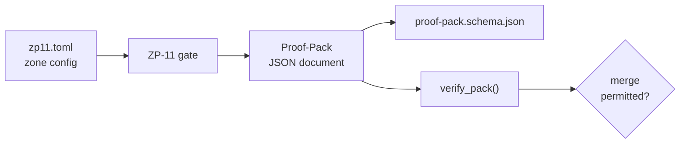

The pack sits at the exact boundary between production and trust. Everything to the left of it is a pipeline you may or may not trust; everything to the right only needs the document and a public key.

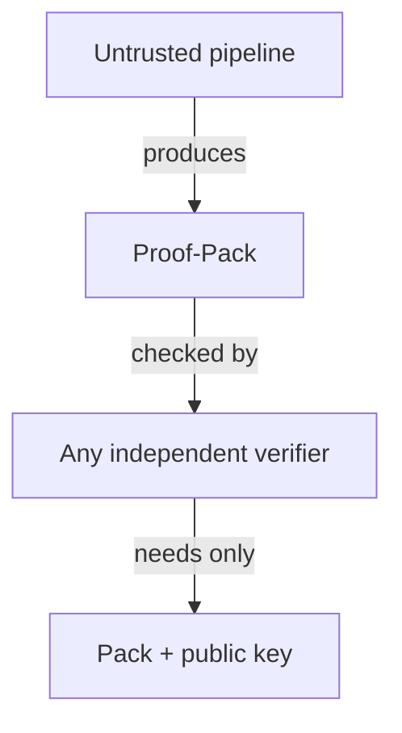

The data model is normative. The reference implementation in the repository is the oracle: a pack conforms when it validates against `schema/proof-pack.schema.json` and its digests and signatures recompute as specified below.

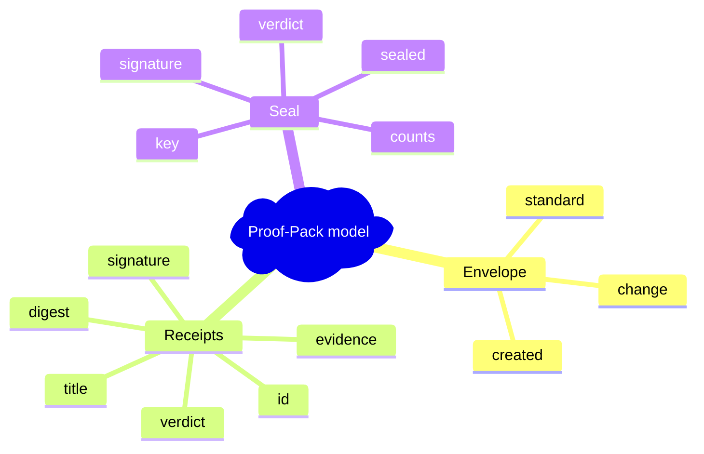

---

## 2. Top-level structure

A Proof-Pack is a JSON object with exactly five members: `standard`, `created`, `change`, `zones`, and `seal`. The schema sets `additionalProperties: false` at the root, so no sixth key may appear. This closure is deliberate: a verifier that encounters an unknown top-level field is reading a document it does not understand and must refuse.

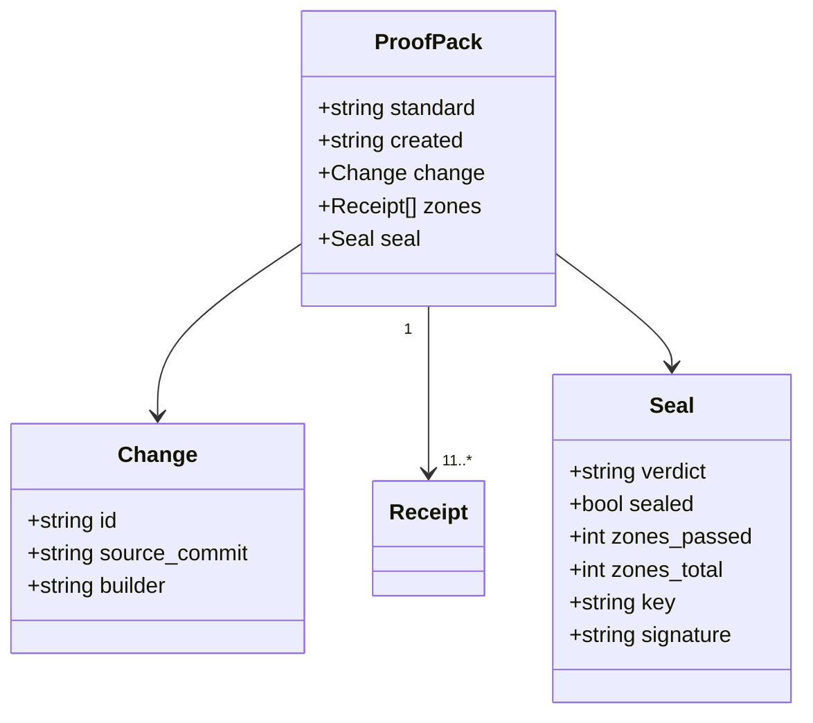

The entity relationships make the one-to-many nature explicit: one pack owns many receipts, and the seal references every receipt by id and digest.

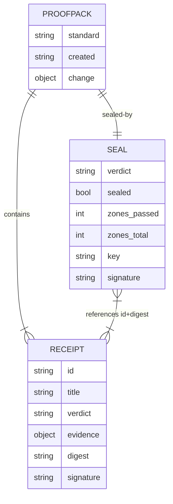

### 2.1 The `standard` field

`standard` is the constant string `"zp11/v1"`. The schema pins it with `const`. A verifier that does not recognise the value must reject the pack rather than guess at compatibility; versioning is explicit and backward-incompatible changes increment it.

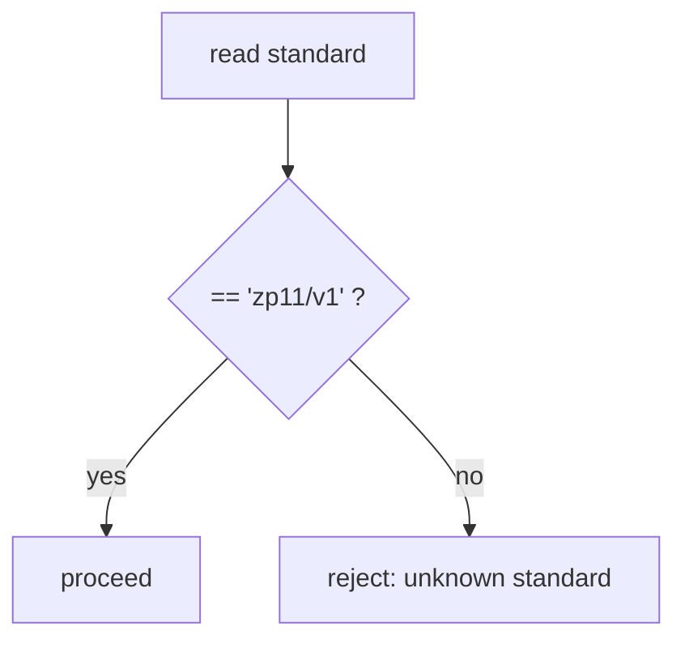

### 2.2 The `created` field

`created` is an RFC 3339 UTC timestamp. The reference CLI formats it as `%Y-%m-%dT%H:%M:%SZ`. It is part of the seal content, so it cannot be altered after sealing without invalidating the seal signature.

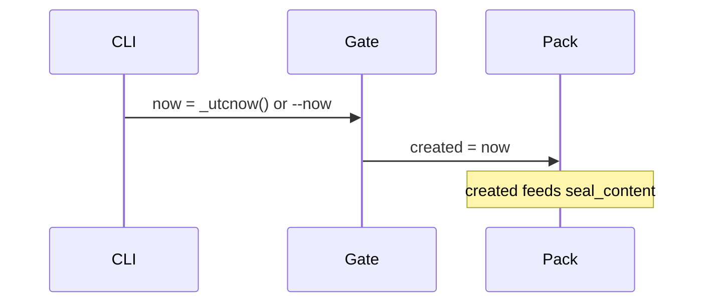

A reproducible run can pin `created` with `--now`, which is what lets ZP-10 (independent re-run) reproduce an identical pack byte-for-byte.

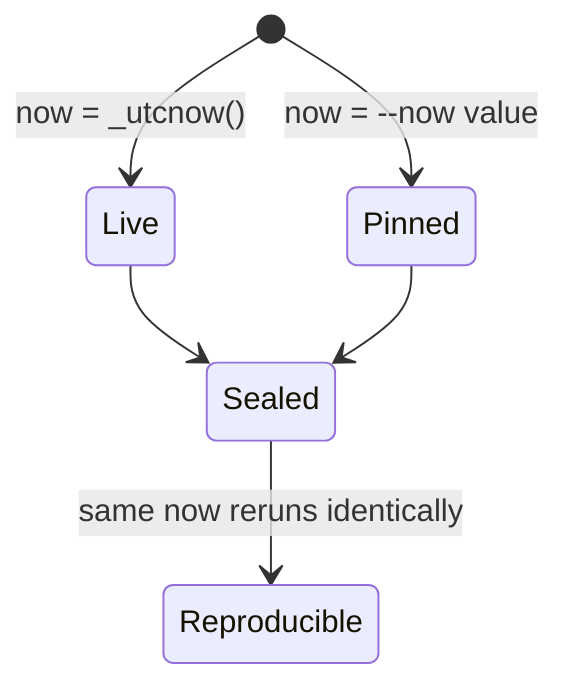

### 2.3 The `change` object

`change` names the change under evaluation. It has three optional members: `id`, `source_commit`, and `builder`. These come straight from the `[change]` table of `zp11.toml` and are copied verbatim into the pack and into the seal content.

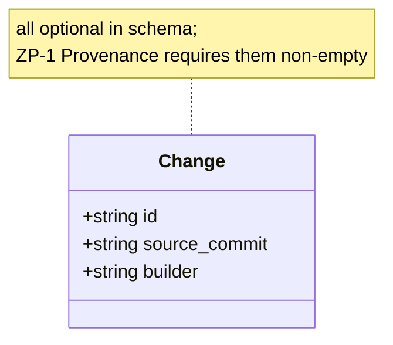

Although the schema marks the three fields optional, ZP-1 (Provenance) is typically configured as a `require` zone over exactly these names, so a pack that lacks them will carry a `FAIL` for ZP-1 and never seal.

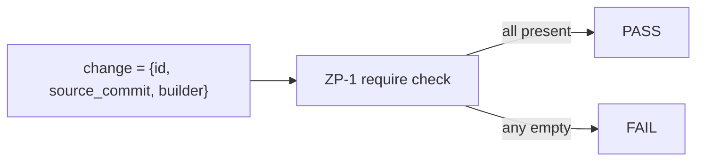

The change object is also woven into the seal, so provenance is bound to the verdict chain and cannot be swapped.

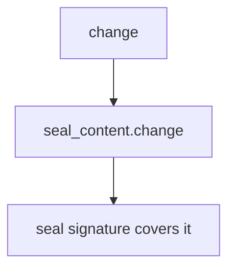

---

## 3. The `zones` array — receipt structure

`zones` is an array of **receipts**, one per zone, in zone order (ZP-1 first, ZP-11 last). The schema requires at least eleven items. Each receipt is the record of one zone's evaluation.

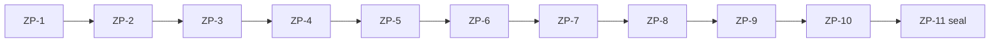

### 3.1 Receipt fields

A receipt has six fields. Five are required by the schema (`id`, `title`, `verdict`, `evidence`, `digest`); `signature` is present whenever a signing key was supplied, which in practice is always for a production pack.

| Field | Type | Required | Meaning |
|-------|------|----------|---------|
| `id` | string | yes | Zone identifier, `ZP-1` … `ZP-11` |
| `title` | string | yes | Canonical zone name |
| `verdict` | enum | yes | `PASS` or `FAIL` |
| `evidence` | object | yes | Machine-readable proof of the verdict |
| `digest` | string | yes | `sha256:<64 hex>` over the receipt body |
| `signature` | string | no | `ed25519:<hex>` over the signed body |

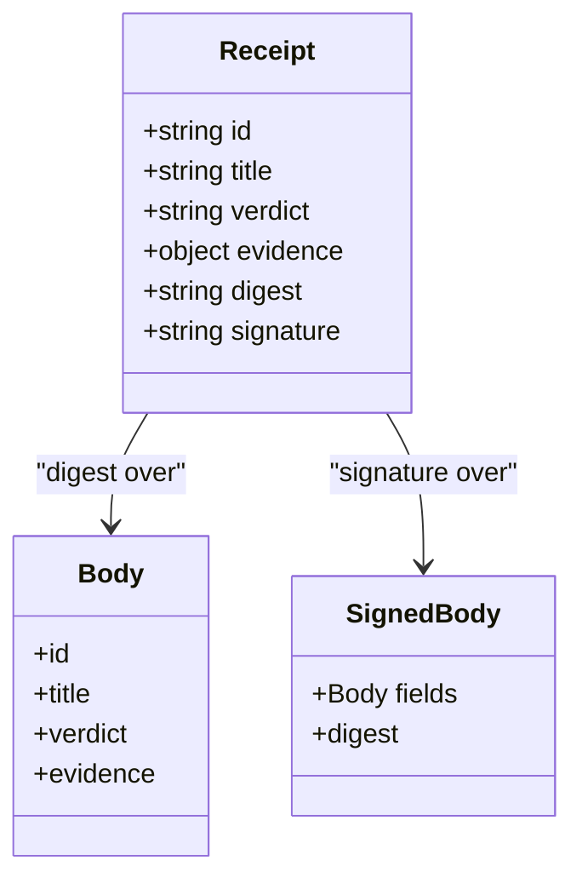

The crucial subtlety is that two different serialisations of the receipt are used: the **body** (four fields) is what the digest covers, and the **signed body** (body plus digest) is what the signature covers. This chains the digest into the signature.

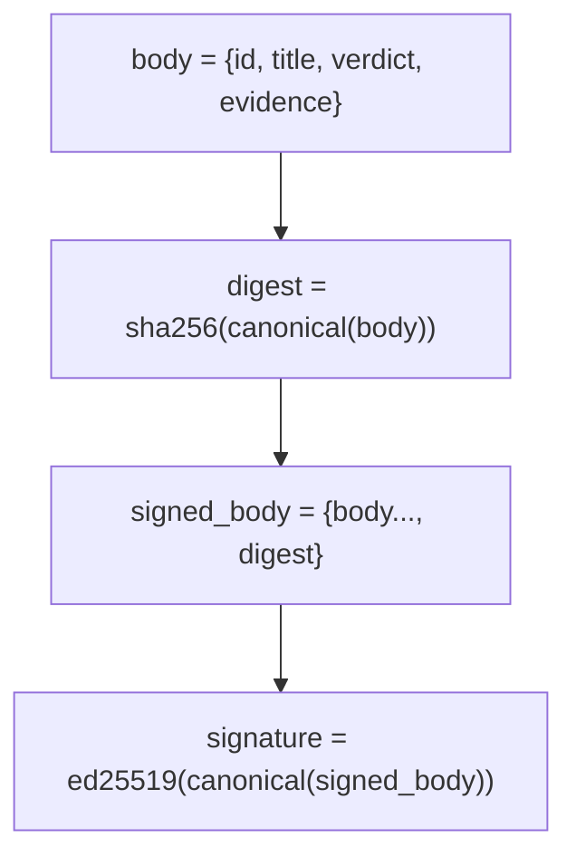

### 3.2 The `id` field

`id` matches the pattern `^ZP-(?:[1-9]|1[01])$` — exactly ZP-1 through ZP-11, no leading zeros, nothing else. The id is also the primary key the seal uses to reference the receipt.

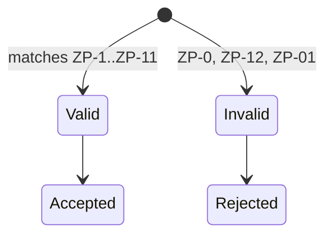

### 3.3 The `title` field

`title` is the canonical zone name. The gate always writes the canonical title from the fixed `CANONICAL_TITLES` map, regardless of what label a configuration uses locally, so a pack from any conforming implementation carries the same eleven titles.

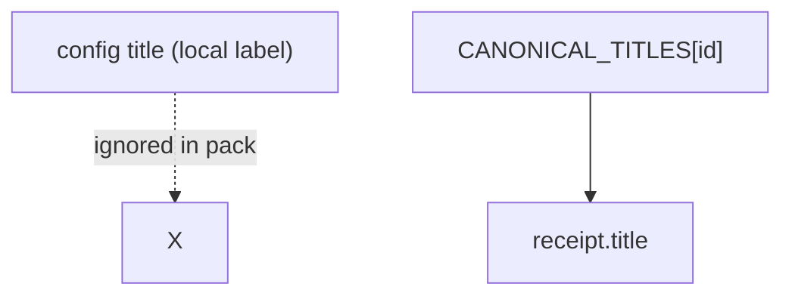

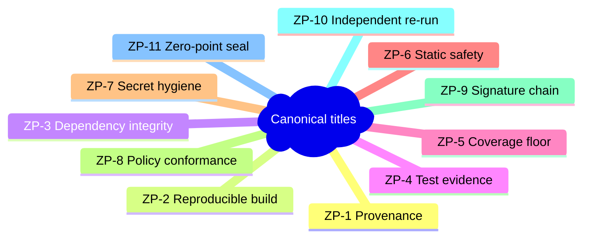

### 3.4 The `verdict` field

`verdict` is the two-valued enum `PASS` or `FAIL`. There is no third value. In the reference model `Verdict` is a `str` enum whose `__bool__` makes `PASS` truthy and `FAIL` falsy, so the pack's aggregate verdict is simply the logical AND of every receipt.

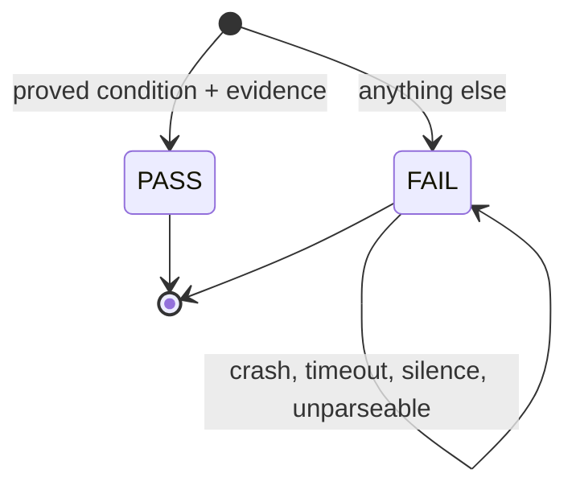

Coercion is total: whatever a zone emits is mapped to exactly one of the two values, and anything unrecognised becomes `FAIL`. Absence of evidence is failure.

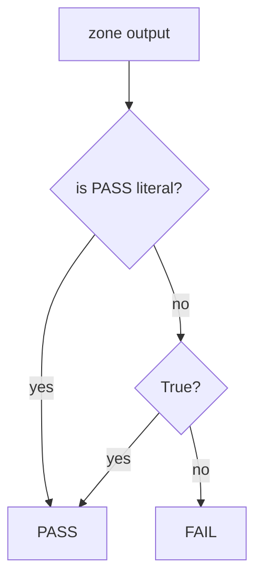

### 3.5 The `evidence` object

`evidence` is an open object — the one place in the model where `additionalProperties` is not forbidden, because each zone kind records different proof. Evidence emitted through the reference helper `_evi()` — the ten verifying zones — carries at least `kind`, `tool`, and `tool_version`; the rest depends on the zone kind. The ZP-11 `SealEvidence` is the exception: it is built directly in `gate.py` as `{kind, tool:"zp11-ref", zones_passed, zones_total, all_prior_pass}` and **omits** `tool_version`, so that field is not universal across all evidence.

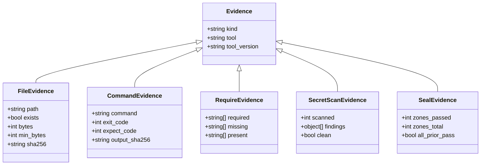

The five evidence shapes correspond to the five zone kinds in the reference library.

```mermaid
flowchart LR
    K["zone kind"] --> R1["require → required/missing/present"]
    K --> R2["file → path/bytes/sha256"]
    K --> R3["command → exit_code/output_sha256"]
    K --> R4["secret_scan → scanned/findings/clean"]
    K --> R5["seal → zones_passed/all_prior_pass"]
```

Evidence is designed to be portable, not voluminous. ZP-7 records only the *locations* of secret findings and a rule label — never the secret material itself.

```mermaid
graph TD
    Found["secret pattern match"] --> Loc["record path + rule[:32]"]
    Found -.never.-> Val["the secret value"]
```

Evidence bytes are load-bearing: because the digest covers the body, and the body includes evidence, changing any evidence byte changes the digest and so invalidates the signature.

```mermaid
sequenceDiagram
    participant Attacker
    participant Receipt
    participant Verifier
    Attacker->>Receipt: edit one evidence byte
    Verifier->>Receipt: digest(body)
    Verifier-->>Verifier: recomputed != stored digest
    Verifier-->>Attacker: FAIL — evidence altered
```

### 3.6 The `digest` field

`digest` is `"sha256:" + hex(SHA-256(canonical(body)))` where `body = {id, title, verdict, evidence}`. It matches the pattern `^sha256:[0-9a-f]{64}$`.

```mermaid
flowchart TD
    Body["{id, title, verdict, evidence}"] --> Can["canonicalize() → UTF-8 bytes"]
    Can --> H["SHA-256"]
    H --> Hex["hex encode"]
    Hex --> D["'sha256:' + hex"]
```

### 3.7 The `signature` field

`signature` is `"ed25519:" + hex(sig)`, matching `^ed25519:[0-9a-f]+$`, computed over the canonical signed body. It is optional in the schema (an unsigned pack can exist for local dry-runs) but a verifier given a key will fail any receipt whose signature is missing or invalid.

```mermaid
stateDiagram-v2
    [*] --> Unsigned: no key at run time
    [*] --> Signed: key supplied
    Signed --> Verifiable
    Unsigned --> NotVerifiable: verifier reports bad/missing signature
```

---

## 4. Canonical form (RFC 8785 / JCS)

Digests and signatures are only portable if two honest parties serialise the same value to the same bytes. ZP-11 adopts the subset of RFC 8785 (JSON Canonicalization Scheme) that the standard relies on.

```mermaid
mindmap
  root)"Canonical rules"(
    Encoding
      UTF-8 output
    Objects
      keys sorted lexicographically
      string keys only
    Whitespace
      minimal separators
      no insignificant whitespace
    Numbers
      integers as-is
      shortest round-trip float
      reject NaN / Infinity
    Rejection
      non-string keys
      unserialisable types
```

The encoder walks the value recursively, dispatching on type.

```mermaid
flowchart TD
    V["value"] --> N{"type?"}
    N -->|null| Null["'null'"]
    N -->|bool| B["'true' / 'false'"]
    N -->|str| S["escaped, quoted"]
    N -->|int or float| Num["_number()"]
    N -->|list| L["'[' + items + ']'"]
    N -->|dict| D["sort keys, join pairs"]
    N -->|other| Err["CanonicalizationError"]
```

### 4.1 Object key ordering

Keys are sorted by Unicode code point. This is what makes `{a,b}` and `{b,a}` produce identical bytes, so independent runners agree.

```mermaid
graph LR
    In["{ title, id, verdict }"] --> Sort["sort: id, title, verdict"]
    Sort --> Out["{id:...,title:...,verdict:...}"]
```

### 4.2 Number handling

Integers serialise directly. Floats that are integral and below 1e16 serialise as integers; others use the shortest round-trippable form. Non-finite numbers (NaN, Infinity) have no canonical form and are rejected.

```mermaid
flowchart TD
    Num["number"] --> Bool{"bool?"}
    Bool -->|yes| ErrB["reject: bool not a number"]
    Bool -->|no| Int{"int?"}
    Int -->|yes| AsInt["str(value)"]
    Int -->|no| Fin{"finite?"}
    Fin -->|no| ErrF["reject: non-finite"]
    Fin -->|yes| Round{"integral & < 1e16?"}
    Round -->|yes| AsInt2["str(int(value))"]
    Round -->|no| Repr["repr(value)"]
```

### 4.3 String escaping

Strings are escaped minimally: the mandatory JSON escapes for quote, backslash, and the C0 controls (`\b \f \n \r \t` and `\uXXXX` for the rest), with everything else emitted as-is in UTF-8.

```mermaid
flowchart LR
    Ch["char"] --> Q{"special?"}
    Q -->|quote/backslash| Esc1["backslash escape"]
    Q -->|control < 0x20| Esc2["\\uXXXX"]
    Q -->|otherwise| Raw["literal UTF-8"]
```

### 4.4 Rejection as a safety property

A value with no canonical form raises rather than guessing. Rejection is a feature: a pack that cannot be canonicalised cannot be digested, so it cannot masquerade as proof.

```mermaid
stateDiagram-v2
    [*] --> Canonicalising
    Canonicalising --> Bytes: well-formed
    Canonicalising --> Raised: NaN / non-string key / bad type
    Raised --> NoProof: no digest, no signature
    Bytes --> Digestible
```

### 4.5 Why canonical form precedes every digest and signature

Both `digest()` and `sign()` call `canonicalize()` first. The same function produces the bytes that are hashed and the bytes that are signed, so there is exactly one serialisation path and no room for two parties to disagree.

```mermaid
sequenceDiagram
    participant Caller
    participant Canon as canonicalize
    participant Hash as SHA-256
    participant Ed as Ed25519
    Caller->>Canon: value
    Canon-->>Caller: bytes
    Caller->>Hash: bytes (for digest)
    Caller->>Ed: bytes (for signature)
```

---

## 5. Digests

A digest binds a receipt's content to a fixed-length fingerprint. ZP-11 uses SHA-256 over the canonical body.

```mermaid
flowchart LR
    Body["receipt body"] --> C["canonicalize"]
    C --> SHA["SHA-256"]
    SHA --> Tag["prefix 'sha256:'"]
    Tag --> Field["receipt.digest"]
```

### 5.1 Digest input is the body, not the whole receipt

The body is exactly four fields. The digest and signature fields are themselves excluded, which avoids a self-reference cycle.

```mermaid
classDiagram
    class ReceiptOnDisk {
        id
        title
        verdict
        evidence
        digest
        signature
    }
    class DigestInput {
        id
        title
        verdict
        evidence
    }
    ReceiptOnDisk --> DigestInput : "digest covers these four"
```

### 5.2 Tamper evidence

Recomputing the digest and comparing to the stored value detects any change to id, title, verdict, or evidence.

```mermaid
flowchart TD
    Stored["stored digest"] --> Cmp{"equal?"}
    Recompute["digest(body)"] --> Cmp
    Cmp -->|yes| OK["intact"]
    Cmp -->|no| Bad["evidence altered → reason recorded"]
```

### 5.3 Digests as the seal's input

The seal does not re-hash evidence; it references each receipt by `{id, digest}`. The digest is therefore the compact handle that lets the seal cover all evidence transitively.

```mermaid
graph TD
    E["evidence"] --> D["digest"]
    D --> Chain["seal_content.receipts[i].digest"]
    Chain --> Seal["seal signature"]
```

---

## 6. Signature fields and the chain

Every receipt is signed, and the seal signs the ordered chain of receipt digests. Signatures use Ed25519 (RFC 8032).

```mermaid
sequenceDiagram
    participant Gate
    participant KP as KeyPair
    participant R as Receipts
    participant Seal
    Gate->>R: finalize each (digest + signature)
    Gate->>Seal: build seal_content over ordered digests
    Gate->>KP: sign(seal_content)
    KP-->>Seal: seal.signature
```

### 6.1 Key encoding

Keys are raw 32-byte Ed25519 values. Public keys print as `ed25519:<64 hex>`; the private seed is stored as 64 hex characters in a key file. The pack is self-describing: it carries the public key id in `seal.key`.

```mermaid
classDiagram
    class KeyPair {
        -Ed25519PrivateKey _private
        +generate()
        +from_seed(bytes)
        +public() PublicKey
        +seed_hex() string
        +sign_bytes(bytes) string
    }
    class PublicKey {
        +bytes raw
        +id() string
        +parse(text) PublicKey
    }
    KeyPair --> PublicKey : derives
```

### 6.2 Per-receipt signatures

Each receipt signature covers the signed body — the four body fields plus the digest. Because the digest already covers the evidence, the signature transitively covers everything in the receipt.

```mermaid
flowchart TD
    SB["signed_body = {id,title,verdict,evidence,digest}"] --> Can["canonicalize"]
    Can --> Sig["Ed25519 sign"]
    Sig --> Field["receipt.signature = 'ed25519:' + hex"]
```

### 6.3 The seal content

The seal is not a twelfth receipt in the signature sense; it signs a distinct structure, `seal_content`, that names the standard, timestamp, change, aggregate verdict, pass counts, and the ordered list of `{id, digest}` pairs.

```mermaid
classDiagram
    class SealContent {
        +string standard
        +string created
        +object change
        +string verdict
        +int zones_passed
        +int zones_total
        +Ref[] receipts
    }
    class Ref {
        +string id
        +string digest
    }
    SealContent "1" --> "11..*" Ref
```

### 6.4 Why ordering is bound

Because the seal signs the receipts *in order* by id and digest, receipts cannot be reordered, added, or removed without invalidating the seal. A pack assembled from receipts that never shared a gate will not verify.

```mermaid
flowchart LR
    R1["ZP-1 digest"] --> List["ordered digest list"]
    R2["ZP-2 digest"] --> List
    Rn["... ZP-11 digest"] --> List
    List --> Sign["single seal signature"]
    Sign --> Bind["order + membership fixed"]
```

```mermaid
sequenceDiagram
    participant A as Attacker
    participant P as Pack
    participant V as Verifier
    A->>P: swap ZP-4 and ZP-5 receipts
    V->>P: rebuild seal_content in stored order
    V-->>V: seal signature no longer verifies
    V-->>A: seal signature invalid
```

### 6.5 The `seal` object fields

The `seal` object has six required fields. `verdict` and `sealed` express the decision; `zones_passed` and `zones_total` are the counts; `key` is the public key id; `signature` is the Ed25519 signature over `seal_content`.

| Field | Type | Meaning |
|-------|------|---------|
| `verdict` | enum | Aggregate `PASS`/`FAIL` (AND of receipts) |
| `sealed` | bool | True only when verdict is `PASS` |
| `zones_passed` | int | Count of `PASS` receipts |
| `zones_total` | int | Count of receipts |
| `key` | string | `ed25519:<64 hex>` public key |
| `signature` | string | `ed25519:<hex>` over seal content |

```mermaid
stateDiagram-v2
    [*] --> Evaluating
    Evaluating --> Sealed: verdict == PASS → sealed = true
    Evaluating --> Shut: any FAIL → sealed = false
    Sealed --> MergePermitted
    Shut --> MergeRefused
```

### 6.6 `sealed` is derived, never asserted

`sealed` is set by the gate strictly as `verdict is PASS`. It is never an independent flag an operator can flip; the schema and the verifier both treat an all-pass-but-unsealed pack as a contradiction and refuse merge.

```mermaid
flowchart TD
    V{"all receipts PASS?"} -->|yes| S["sealed = true"]
    V -->|no| U["sealed = false"]
    S --> Chk{"verifier: pass but unsealed?"}
    U --> Chk
    Chk -->|contradiction| Refuse["refuse merge"]
```

---

## 7. Lifecycle: from evaluation to sealed pack

The gate composes the eleven zones in order, builds receipts, then seals.

```mermaid
flowchart TD
    Start["run_gate"] --> Build["build_zones from config"]
    Build --> Loop{"for each zone"}
    Loop -->|kind != seal| Run["run_zone → verdict + evidence"]
    Loop -->|kind == seal| Derive["verdict = all prior PASS"]
    Run --> Append["append Receipt"]
    Derive --> Append
    Append --> Loop
    Loop -->|done| Seal["pack.seal(keypair)"]
    Seal --> Emit["to_dict → JSON"]
```

The seal step finalises every receipt (digest then signature) before signing the chain, so the chain always signs over the final digests.

```mermaid
sequenceDiagram
    participant Pack
    participant R as each Receipt
    participant KP as KeyPair
    Pack->>KP: key_id = public.id
    loop receipts
        Pack->>R: finalize(keypair)
        R-->>Pack: digest + signature set
    end
    Pack->>Pack: build seal_content
    Pack->>KP: seal_signature = sign(content)
    Pack->>Pack: sealed = (verdict == PASS)
```

The journey of a single change through the model, end to end:

```mermaid
journey
    title A change becomes a sealed Proof-Pack
    section Collect
      Read config: 4: Gate
      Run ZP-1..ZP-10: 3: Gate
    section Record
      Build receipts: 4: Gate
      Digest + sign each: 4: Gate
    section Seal
      Derive ZP-11 verdict: 5: Gate
      Sign receipt chain: 5: Gate
    section Decide
      Verify + merge: 5: Verifier
```

---

## 8. Verification against the model

A verifier reconstructs digests and the seal content from the stored pack and checks them against the stored signatures with the public key.

```mermaid
flowchart TD
    Load["load pack + key"] --> ZonesPresent{"all 11 zones?"}
    ZonesPresent -->|no & strict| R1["reason: missing zones"]
    ZonesPresent -->|yes| PerR["per receipt: digest + signature"]
    PerR --> SealChk["rebuild seal_content, verify signature"]
    SealChk --> AllPass{"all PASS & sealed?"}
    AllPass -->|yes & intact| Merge["merge permitted"]
    AllPass -->|no| Refuse["merge refused"]
```

Each receipt is checked two ways: the recomputed digest must equal the stored digest, and the signature must verify over the signed body.

```mermaid
sequenceDiagram
    participant V as Verifier
    participant R as Receipt
    participant K as PublicKey
    V->>R: digest(body) == stored?
    alt mismatch
        V-->>V: reason "digest mismatch"
    end
    V->>K: verify(signed_body, signature)?
    alt bad/missing
        V-->>V: reason "bad or missing signature"
    end
```

The decision combines three independent conditions: integrity (no reasons), all-pass, and sealed. Merge is permitted only when all three hold.

```mermaid
flowchart LR
    I["integrity_ok"] --> AND["AND"]
    AP["all_pass"] --> AND
    SD["sealed"] --> AND
    AND --> M["merge_permitted"]
```

### 8.1 No key is a refusal, not a pass

If no public key is available, the verifier records a reason and does not permit merge. The default posture is refusal.

```mermaid
stateDiagram-v2
    [*] --> HasKey: key present
    [*] --> NoKey: key absent
    NoKey --> Refuse: "no public key available"
    HasKey --> Check: verify signatures
    Check --> Decide
```

### 8.2 Strict vs partial zone presence

By default a verifier requires all eleven zones (`require_all_zones=True`); `--partial` relaxes only the presence check, never the fail-closed decision.

```mermaid
flowchart TD
    Mode{"--partial?"} -->|no| Strict["require ZP-1..ZP-11 present"]
    Mode -->|yes| Partial["skip presence check"]
    Strict --> Decide["fail-closed decision unchanged"]
    Partial --> Decide
```

---

## 9. Schema enforcement

`schema/proof-pack.schema.json` is JSON Schema 2020-12. It pins `standard`, requires the five top-level members, forbids extra top-level keys, constrains the zone id and digest and signature patterns, and requires at least eleven zones.

```mermaid
mindmap
  root)"Schema constraints"(
    Root
      required 5 keys
      additionalProperties false
      standard const zp11/v1
    zones
      minItems 11
      items = receipt
    receipt
      id pattern ZP-1..11
      verdict enum
      digest sha256 pattern
      signature ed25519 pattern
    seal
      6 required fields
      key pattern ed25519 64hex
```

The id and digest patterns in particular are what stop a lax parser from accepting a near-miss identifier or a truncated hash.

```mermaid
flowchart TD
    DigF["digest field"] --> Pat{"^sha256:[0-9a-f]{64}$ ?"}
    Pat -->|yes| Keep["accept"]
    Pat -->|no| Drop["reject: malformed digest"]
```

Schema validation is necessary but not sufficient: a pack can be schema-valid yet fail verification if a digest or signature does not recompute. The two layers are complementary.

```mermaid
flowchart LR
    Pack["pack"] --> SchemaL["schema valid?"]
    SchemaL -->|no| Rej["malformed"]
    SchemaL -->|yes| Crypto["digests + signatures recompute?"]
    Crypto -->|no| Forged["forged / altered"]
    Crypto -->|yes| Trusted["trustworthy"]
```

```mermaid
graph TD
    L1["Layer 1: shape — JSON Schema"] --> L2["Layer 2: integrity — digests"]
    L2 --> L3["Layer 3: authenticity — signatures"]
    L3 --> L4["Layer 4: decision — fail-closed seal"]
```

---

## 10. Worked field map

Pulling the whole model together: the diagram below traces one receipt's four body fields into its digest, into its signature, into the seal's reference, and into the single seal signature that gates the merge.

```mermaid
flowchart TD
    subgraph Receipt
      ID["id"] --> BODY["body"]
      T["title"] --> BODY
      VD["verdict"] --> BODY
      EV["evidence"] --> BODY
    end
    BODY --> DG["digest = sha256(canonical(body))"]
    DG --> SBODY["signed_body = body + digest"]
    SBODY --> RSIG["receipt.signature"]
    DG --> REF["seal_content.receipts[i] = {id, digest}"]
    REF --> SEALC["seal_content"]
    CH["change"] --> SEALC
    CR["created"] --> SEALC
    VSUM["verdict + counts"] --> SEALC
    SEALC --> SSIG["seal.signature"]
    SSIG --> GATE{"merge permitted?"}
    RSIG --> GATE
```

The seal reference list is the hinge between a single receipt and the whole-pack decision:

```mermaid
sequenceDiagram
    participant Body
    participant Digest
    participant SealRef as "seal_content.receipts"
    participant Decision
    Body->>Digest: canonical + SHA-256
    Digest->>SealRef: {id, digest}
    SealRef->>Decision: ordered chain signed once
    Decision-->>Decision: merge iff sealed PASS
```

A compact timeline of when each field is written during a run:

```mermaid
timeline
    title Field population order
    Config load : standard : created : change
    Zone run : verdict : evidence
    Finalize : digest : signature
    Seal : zones_passed : zones_total : seal.verdict : seal.sealed
    Sign : seal.key : seal.signature
```

Finally, the invariants the model guarantees, as a single state view:

```mermaid
stateDiagram-v2
    [*] --> WellFormed: schema valid
    WellFormed --> Intact: every digest recomputes
    Intact --> Authentic: every signature verifies
    Authentic --> Bound: seal covers ordered chain + change
    Bound --> Open: all PASS & sealed
    Bound --> Closed: any FAIL or unsealed
    Open --> [*]: merge permitted
    Closed --> [*]: merge refused
```

---

## 11. Summary

The Proof-Pack data model is small on purpose. Five top-level fields, eleven receipts of six fields each, and one seal of six fields are enough to carry a complete, self-verifying governance decision. The three mechanisms that make it trustworthy — canonical serialisation so bytes are reproducible, SHA-256 digests over receipt bodies so evidence is tamper-evident, and an Ed25519 seal over the ordered digest chain so membership and order are bound to a key — each occupy a well-defined place in the structure. Nothing in the model requires trusting the pipeline that produced the pack; a verifier needs only the document and a public key, and defaults to refusing merge whenever anything is missing, altered, unsigned, or ambiguous. That is the fail-closed property of `zp11/v1`, expressed in data, as designed by Naquib Hatami.

---

## See also

- `01-overview.md` — ProofGate ZP-11 at a glance: the gate, the eleven zones, and the fail-closed principle.
- `02-zones.md` — the eleven zones in depth: kinds, inputs, and per-zone evidence.
- `03-gate-semantics.md` — how the gate composes zones and derives the seal.
- `04-cryptography.md` — canonicalisation, SHA-256 digests, and Ed25519 key handling.
- `06-verification.md` — the verification algorithm and the merge decision in full.
