*Part of the ProofGate ZP-11 documentation set*

# API & CLI Reference

> An exhaustive reference for the `zp11` command-line interface (`keygen`, `zones`, `run`, `verify`) and the Python reference library that implements the `zp11/v1` standard. ZP-11 is an open, fail-closed release-governance standard invented by **Naquib Hatami** and published under the MIT License by iQs Group Inc. / SADI AI Inc. (repository: `github.com/iQs-Group/ZP-11`, homepage: `zp11.org`).

This document is the authoritative description of every surface a tool author or integrator touches: the four CLI verbs and their exit-code contract, and the public library API across `canonical.py`, `crypto.py`, `verdict.py`, `zones.py`, `pack.py`, `gate.py`, and `cli.py`. Every behaviour described here is drawn directly from the reference implementation; nothing is aspirational. Where the CLI and the library disagree, the library is the ground truth and the CLI is a thin wrapper over it.

---

## 1. Scope and reading guide

ZP-11 is small by design. The entire reference implementation is a handful of single-responsibility modules, and the CLI is a 120-line argument parser over them. That smallness is a feature: a governance gate that decides whether code reaches `main` must itself be auditable in an afternoon. This reference therefore treats the CLI and the library as two views of the same machine — the verbs you type and the functions they call.

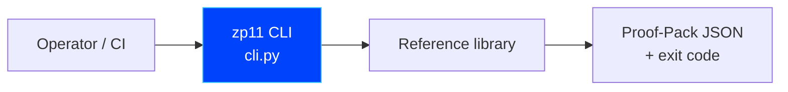

The two invariants that hold everywhere in this reference are worth stating once, up front. First, **fail-closed**: anything that is not a proven `PASS` is a `FAIL`. Second, **canonical-then-sign**: every digest and signature is computed over the RFC 8785 canonical form of a value, never over whatever bytes happened to be on disk.

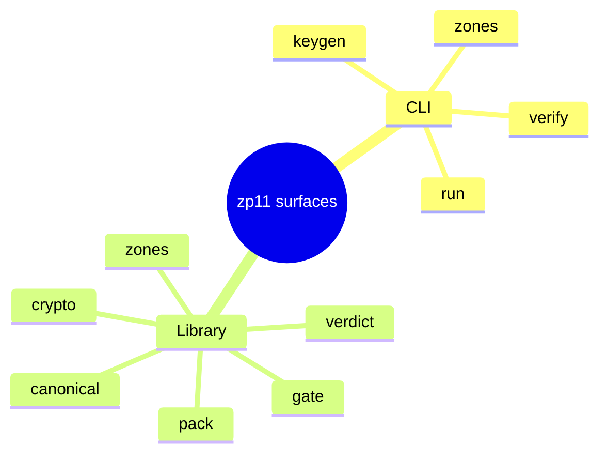

---

## 2. Installation and invocation

The package installs as `zp11` and exposes a console entry point of the same name. Python 3.11 or newer is required because the gate loads its configuration with the standard-library `tomllib`; on older interpreters it falls back to `tomli` if present.

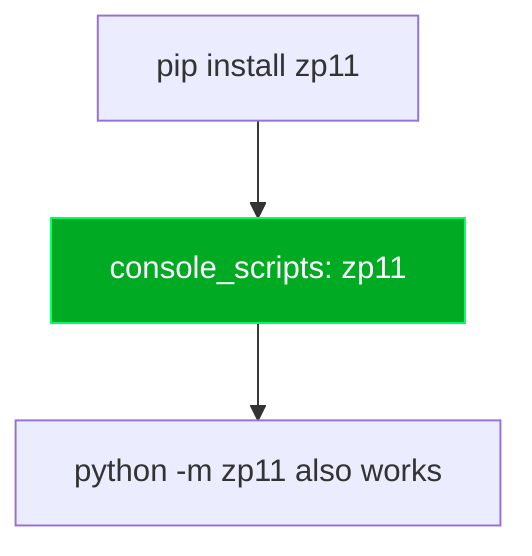

Every invocation resolves to `cli.main(argv)`, which builds an `argparse` parser with one required sub-command and dispatches to the matching `cmd_*` function. There is no global state, no configuration search path beyond the explicit `--config`, and no network access anywhere in the tool.

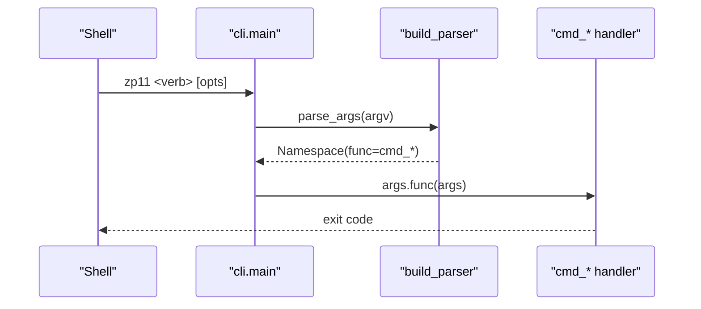

The top-level parser also carries `--version`, which prints `zp11 1.0.0` and exits. The sub-command is mandatory: calling `zp11` with no verb is an error. This design choice matters for CI: a misconfigured pipeline that forgets to pass a verb fails loudly with a usage error rather than silently doing nothing and returning success. The parser is constructed fresh on every invocation by `build_parser()`, so there is no shared mutable parser state between calls, and the tool is safe to invoke concurrently from multiple pipeline jobs that happen to share a process pool. Each sub-parser attaches its handler through `set_defaults(func=...)`, and `main` simply calls `args.func(args)` — a dispatch table expressed in argparse rather than a chain of `if` statements, which keeps the surface flat and each verb's options local to its own parser.

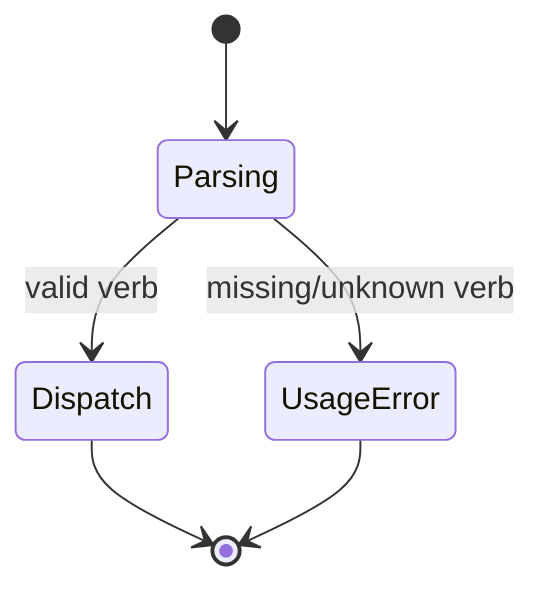

---

## 3. The CLI contract

The four verbs form a complete lifecycle: create a key, discover the zones, produce a pack, and verify it. The two verbs that gate merges — `run` and `verify` — share a single, load-bearing promise: **they exit `0` only when merge is permitted.** That is what lets either one be wired as a required status check with no further scripting.

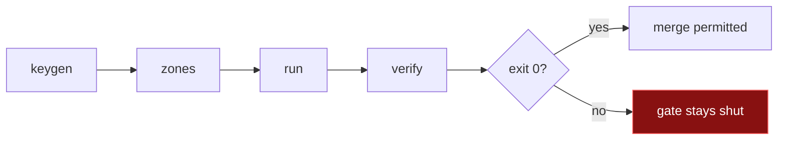

### 3.1 Exit-code semantics

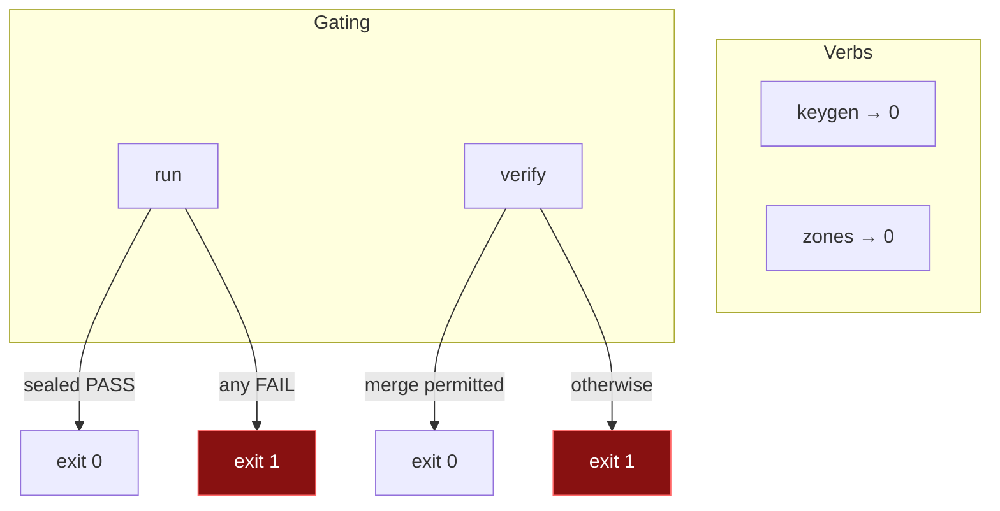

`keygen` and `zones` are informational and always exit `0` on success. The gating verbs encode the decision in the exit status, and they write a one-line human verdict to **stderr** so that stdout stays a clean machine artifact. This stream discipline is deliberate and worth internalising: a pipeline can redirect stdout to a file and capture a byte-exact pack, while a human watching the console still sees `PASS` or `FAIL` scroll past on stderr. Nothing about the decision is ever hidden in prose that a machine would have to parse; the number returned to the shell *is* the decision, and the JSON on stdout *is* the evidence.

The table below summarises the four verbs, their options, and their exit behaviour. Options not listed are not accepted; the parser rejects unknown flags.

| Verb | Key options | Stdout | Exit code |
|------|-------------|--------|-----------|
| `keygen` | `--out PATH` | public key id | `0` |
| `zones` | (none) | eleven id/title lines | `0` |
| `run` | `--config`, `--root`, `--key`, `--out`, `--now` | Proof-Pack JSON (unless `--out`) | `0` iff sealed PASS, else `1` |
| `verify` | `PACK` (positional), `--key`, `--partial` | report JSON | `0` iff merge permitted, else `1` |

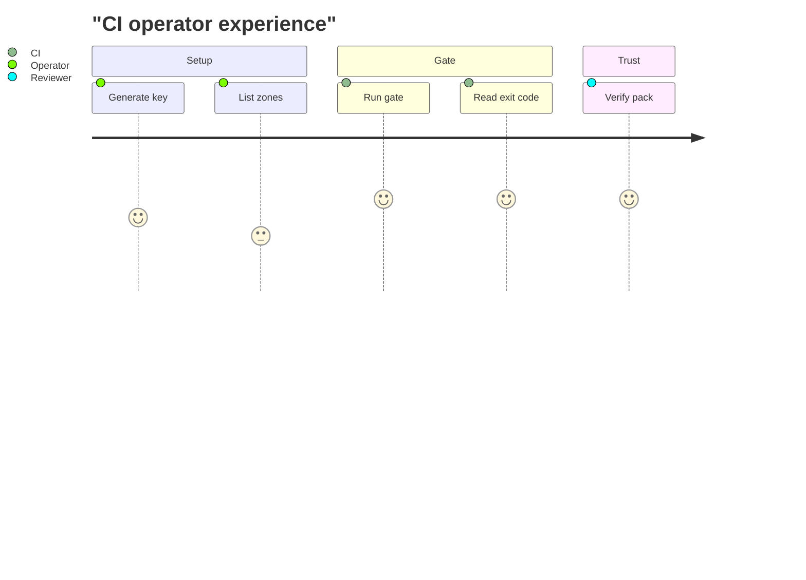

### 3.2 `zp11 keygen`

Generates a fresh Ed25519 key pair. With `--out PATH` it writes the 32-byte seed as hex to `PATH` and the public key id (`ed25519:<hex>`) to `PATH.pub`, then prints the public id to stdout. Without `--out`, it prints the public id to stdout and the seed to stderr, so the seed never silently lands in a logged stdout stream.

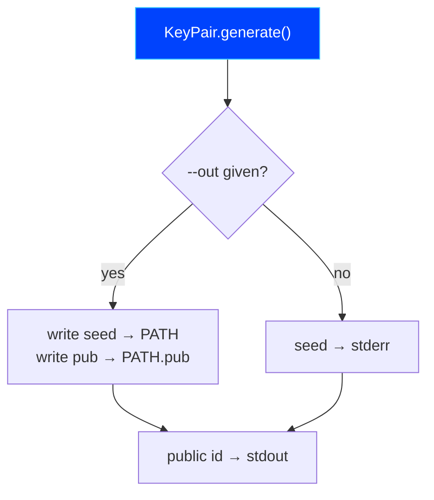

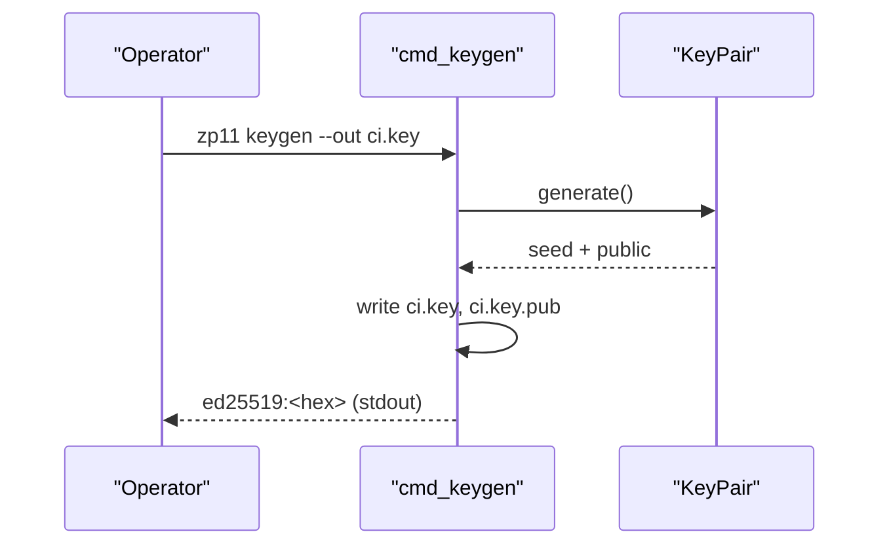

The seed is stored as 32 bytes of hex — exactly the Ed25519 private seed, with no passphrase wrapping and no key-derivation function. That is a conscious trade: the reference key format is trivially portable and trivially re-loadable by `_load_key`, which reads the file, strips whitespace, decodes the hex, and reconstructs the pair with `KeyPair.from_seed`. The cost of that simplicity is that the seed file is raw secret material and must be protected by the surrounding system — a CI secret store, an HSM-backed signer, or a file-system ACL — rather than by the tool itself.

The seed file is secret material. It belongs outside the gated repository and under the adopter's key-rotation policy; the standard's security model treats the signing key as the root of trust. If the seed leaks, every pack it ever sealed becomes forgeable, which is why ZP-11's threat model pairs key custody with ZP-10's independent re-run: a compromised signer is caught when a second runner, holding a different notion of the trusted public key, refuses the pack.

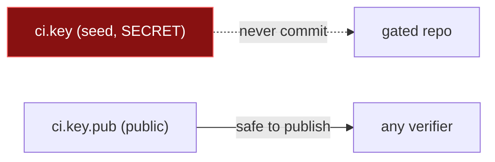

### 3.3 `zp11 zones`

Prints the eleven canonical zone ids and their fixed titles, drawn from `CANONICAL_TITLES`. It takes no options and is the quickest way to confirm the installed tool agrees with the standard on names and ordering. The output is column-aligned (`f"{zid:6} {title}"`) and iterates `ZP-1` through `ZP-11` in numeric order, so it is safe to diff against a golden file in a conformance test. Because the titles come from a module-level constant rather than from any configuration, `zones` is unaffected by the contents of `zp11.toml`; it reports what the *standard* fixes, not what a particular repository has mapped. A mismatch between `zones` output and the specification is, by definition, a non-conformant build.

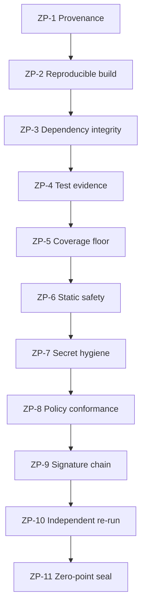

### 3.4 `zp11 run`

Runs the gate against a repository root and emits a Proof-Pack. Its options are `--config` (defaults to `zp11.toml`), `--root` (defaults to `.`), `--key` (a seed file; if omitted an ephemeral key is generated, which is useful for dry runs but produces a pack no one else can anchor to a known public key), `--out` (where to write the pack; otherwise stdout), and `--now` (overrides the timestamp so a reproducible run can be byte-identical).

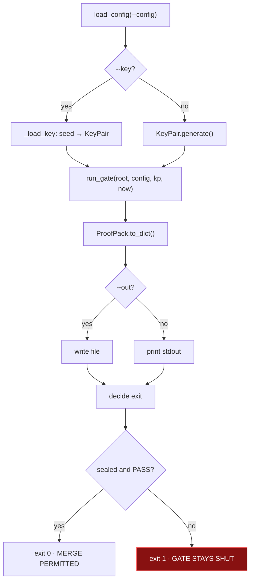

The pack is serialized with `json.dumps(..., indent=2, sort_keys=True)`. The human verdict line — `PASS · MERGE PERMITTED` or `FAIL · GATE STAYS SHUT` — goes to stderr, and the exit code mirrors it exactly.

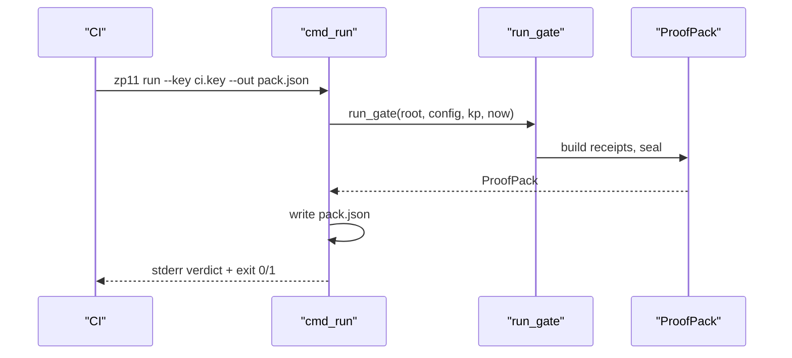

The `--now` flag deserves emphasis: because the seal content includes `created`, two runs of the same change with the same timestamp and key produce identical bytes. That is the mechanical basis of ZP-2 (reproducible build) and ZP-10 (independent re-run) at the pack level. Without `--now`, `cmd_run` stamps the pack with `_utcnow()`, formatted as `%Y-%m-%dT%H:%M:%SZ` — second-resolution UTC, with the trailing `Z` making the timezone explicit. A reproducibility harness that wants byte-identical packs across two machines passes the same `--now` to both; a production gate that wants a truthful wall-clock stamp omits it and accepts that the `created` field, and therefore the seal signature, will differ between runs while every zone verdict and receipt digest stays identical.

The relationship between the four `run` inputs and the pack is worth stating precisely. `--root` scopes every filesystem-touching zone (`file`, `secret_scan`, and the working directory of `command`). `--config` names the TOML that declares the zones and the `change` block. `--key` supplies the signing identity. `--now` supplies the timestamp. Everything else in the pack is derived; there are no hidden inputs, no environment variables consulted by default (the command runner is handed an empty `env`), and no network calls.

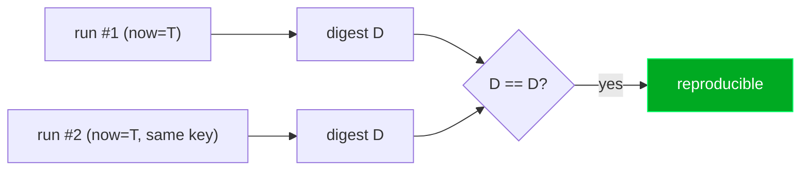

### 3.5 `zp11 verify`

Verifies a pack. It takes one positional argument — the pack path — plus `--key` (a public-key file; if omitted, the key embedded in the pack's `seal.key` is used) and `--partial` (do not require all eleven zones to be present). It prints a JSON report with `integrity_ok`, `merge_permitted`, `zones_passed`, `zones_total`, and `reasons`, and exits `0` only when merge is permitted.

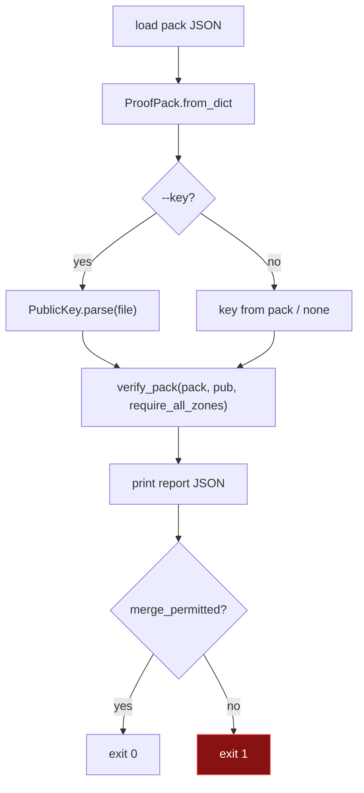

A key design point: supplying `--key` with a *known-trusted* public key is strictly stronger than trusting the key inside the pack. The embedded key tells you the pack is internally consistent; an external key you already trust tells you *who* sealed it. In adversarial terms, a forger can always embed their own public key and sign a wholly fabricated pack with the matching private key — such a pack is internally consistent and would verify against its own embedded key. It is only by pinning an external, out-of-band public key that a verifier distinguishes a pack sealed by the legitimate CI identity from one sealed by an impostor. Production policy should therefore always pass `--key` with a pinned key; the embedded-key path exists for quick local inspection, not for the merge decision.

The `--partial` flag relaxes exactly one check: the requirement that all eleven `ZP-n` ids be present. It does not relax any digest, signature, verdict, or seal check. It exists for inspecting a work-in-progress configuration that maps only a subset of zones; it must never be used on the merge path, because a pack missing zones can never represent a complete gate. The output report always carries `zones_passed` and `zones_total`, so a reviewer can see at a glance whether `--partial` masked a gap.

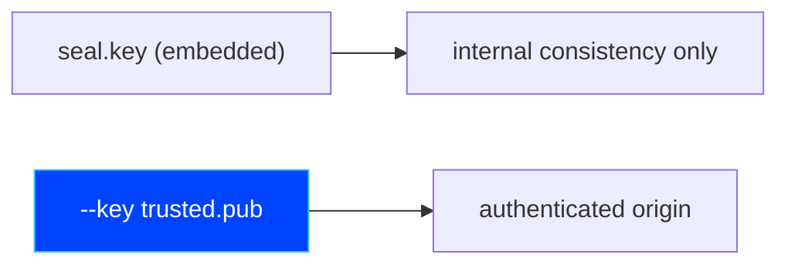

---

## 4. The exit-code contract as a state machine

Because so much rides on exit codes, it is worth modelling the gating verbs as one machine. Merge is permitted only in the single absorbing state where integrity holds, every zone passed, and the pack is sealed.

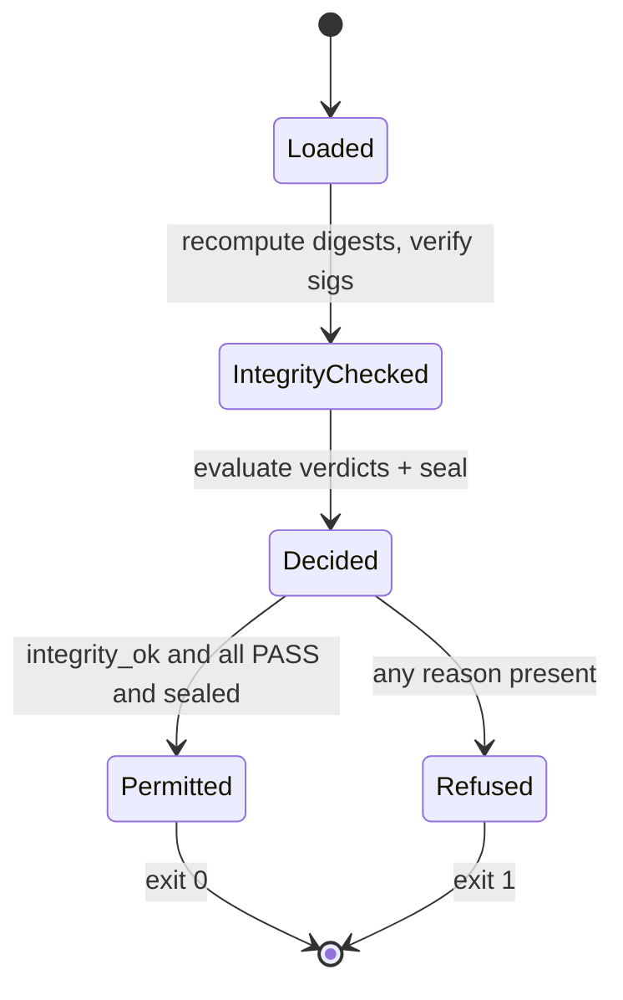

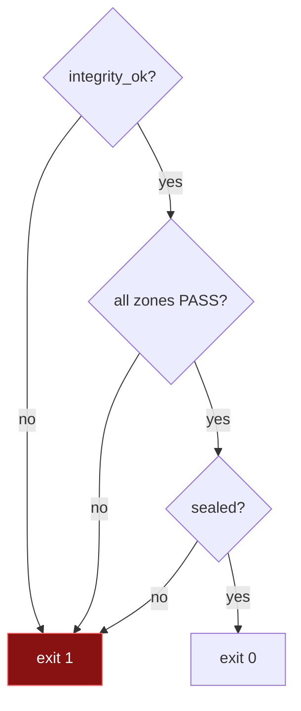

---

## 5. Library architecture

The library is layered: canonicalization and crypto at the bottom, verdict semantics above them, zones and the pack format above that, and the gate composing everything. The CLI sits on top and adds only argument parsing and I/O.

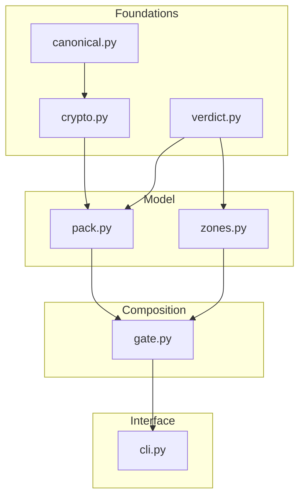

```mermaid
classDiagram
    class Verdict {
      +PASS
      +FAIL
      +__bool__()
    }
    class Receipt {
      +id
      +title
      +verdict
      +evidence
      +digest
      +signature
      +body()
      +finalize(kp)
      +to_dict()
    }
    class ProofPack {
      +change
      +created
      +receipts
      +seal(kp)
      +to_dict()
    }
    ProofPack "1" o-- "many" Receipt
    Receipt --> Verdict
```

The dependency direction never reverses. Nothing in `canonical.py` imports anything else from the package; `crypto.py` imports only `canonical`; the gate imports everything but is imported by nothing except the CLI.

```mermaid
flowchart LR
    canonical --> crypto
    crypto --> pack
    verdict --> zones
    verdict --> pack
    zones --> gate
    pack --> gate
    gate --> cli
    classDef leaf fill:#0043fd,stroke:#37c6ff,color:#fff;
    class canonical leaf;
```

---

## 6. `canonical.py` — deterministic serialization

`canonicalize(value) -> bytes` implements the subset of RFC 8785 (JSON Canonicalization Scheme) that the standard relies on: UTF-8 output, lexicographically sorted object keys, minimal separators, no insignificant whitespace, and rejection of values with no canonical form. Anything that cannot be canonicalized raises `CanonicalizationError`.

```mermaid
flowchart TB
    v["value"] --> t{"type?"}
    t -->|None/bool| lit["null/true/false"]
    t -->|str| esc["escape, quote"]
    t -->|int/float| num["_number()"]
    t -->|list| arr["[ , ]"]
    t -->|dict| obj["sort keys, : join"]
    t -->|other| err["CanonicalizationError"]
    classDef bad fill:#811,stroke:#f66,color:#fff;
    class err bad;
```

Two rejection rules carry weight. Numbers must be finite (NaN and Infinity raise), and object keys must be strings. Booleans are handled before the numeric branch because `bool` is a subclass of `int` in Python and would otherwise serialize wrongly.

```mermaid
stateDiagram-v2
    [*] --> Number
    Number --> Reject: NaN or Infinity
    Number --> IntForm: integral and < 1e16
    Number --> ShortestRepr: otherwise
    IntForm --> [*]
    ShortestRepr --> [*]
    Reject --> [*]
```

```mermaid
flowchart LR
    a["{b:1, a:2}"] --> c["canonicalize"]
    c --> out['{"a":2,"b":1}']
    classDef ok fill:#0a2,stroke:#0f6,color:#fff;
    class out ok;
```

Numbers receive special care. `_number` renders integral floats without a decimal point when their magnitude is below `1e16`, and otherwise falls back to `repr`, which in CPython yields the shortest string that round-trips to the same float. Strings are escaped with the minimal JSON escape set, emitting `\u00xx` only for control characters below `0x20` and leaving all other code points as literal UTF-8. This keeps the canonical form compact and human-legible while remaining deterministic. The deliberate omission of general `\uXXXX` escaping for non-ASCII is a simplification over full RFC 8785, acceptable here because the Proof-Pack evidence the gate produces is ASCII in practice; a future `zp11/v2` could tighten this without changing the signing model.

The practical consequence: two honest parties on different platforms and Python versions serialize the same data to the same bytes, which is what makes a digest portable and a re-run meaningful. A verifier never trusts the digest field in a receipt; it recomputes the digest from the receipt body and compares. If an attacker edits a single byte of evidence — flipping a `FAIL` to a `PASS`, or deleting a secret-scan finding — the recomputed digest diverges and the receipt is rejected before its signature is even consulted.

```mermaid
sequenceDiagram
    participant A as "Host A"
    participant B as "Host B"
    A->>A: canonicalize(v) → bytes
    B->>B: canonicalize(v) → bytes
    A-->>B: compare
    Note over A,B: identical bytes ⇒ identical digest
```

---

## 7. `crypto.py` — digests, keys, and signatures

This module provides `sha256_hex`, `digest`, the `KeyPair` and `PublicKey` dataclasses, and the free functions `sign` and `verify`. All signing and verification run over the canonical form of a value, so the crypto layer never sees ad-hoc bytes.

```mermaid
flowchart TB
    val["JSON value"] --> can["canonicalize"]
    can --> sh["SHA-256"]
    sh --> dg["digest: sha256:<hex>"]
    can --> sg["Ed25519 sign"]
    sg --> sig["ed25519:<hex>"]
    classDef c fill:#0043fd,stroke:#37c6ff,color:#fff;
    class can c;
```

```mermaid
classDiagram
    class KeyPair {
      -_private: Ed25519PrivateKey
      +generate()
      +from_seed(seed)
      +public: PublicKey
      +seed_hex: str
      +sign_bytes(data)
    }
    class PublicKey {
      +raw: bytes
      +id: str
      +parse(text)
    }
    KeyPair --> PublicKey : public
```

Keys are raw 32-byte values rendered as `ed25519:<hex>`. `KeyPair.from_seed` rejects any seed that is not exactly 32 bytes; `PublicKey.parse` rejects any string that does not start with `ed25519:`. `digest(value)` returns `"sha256:" + hex(SHA-256(canonical(value)))`.

```mermaid
flowchart LR
    s["seed (32 bytes hex)"] --> fs["from_seed"]
    fs --> kp["KeyPair"]
    kp --> pub["public → ed25519:<hex>"]
    bad["seed != 32 bytes"] --> ve["ValueError"]
    classDef bad fill:#811,stroke:#f66,color:#fff;
    class ve bad;
```

`verify` is deliberately total: it returns `False` for a malformed signature prefix or any verification exception rather than raising, so a caller iterating over receipts collects reasons instead of crashing — which would itself be a fail-closed outcome but a less useful one.

```mermaid
sequenceDiagram
    participant C as "caller"
    participant V as "verify"
    participant E as "Ed25519PublicKey"
    C->>V: verify(pub, value, sig)
    V->>V: check "ed25519:" prefix
    V->>E: verify(sig_bytes, canonical(value))
    E-->>V: ok / raises
    V-->>C: True / False
```

```mermaid
stateDiagram-v2
    [*] --> CheckPrefix
    CheckPrefix --> False: no ed25519 prefix
    CheckPrefix --> Attempt: ok
    Attempt --> True: signature valid
    Attempt --> False: exception
    True --> [*]
    False --> [*]
```

---

## 8. `verdict.py` — the two-state asymmetry

`Verdict` is a `str`-backed enum with exactly two members, `PASS` and `FAIL`. Its `__bool__` makes `PASS` truthy and `FAIL` falsy, so the gate can write `all(r.verdict for r in receipts)` and mean it. The module-level `coerce` maps anything a zone might emit onto the two states, defaulting unknown inputs to `FAIL`.

```mermaid
stateDiagram-v2
    [*] --> Zone
    Zone --> PASS: proven condition
    Zone --> FAIL: raise / timeout / silence / unparseable
    PASS --> [*]
    FAIL --> [*]
```

```mermaid
flowchart TB
    v["incoming value"] --> p{"is PASS / 'PASS' / True?"}
    p -->|yes| pass["Verdict.PASS"]
    p -->|no| fail["Verdict.FAIL"]
    classDef bad fill:#811,stroke:#f66,color:#fff;
    class fail bad;
```

There is no third verdict that permits merge. This single rule — encoded in a four-line `__bool__` and a defensive `coerce` — is what the entire standard means by "fail-closed, by construction."

```mermaid
mindmap
  root(("Verdict"))
    PASS
      truthy
      proven + evidence
    FAIL
      falsy
      everything else
      no merge
```

---

## 9. `zones.py` — the eleven checks and their kinds

A zone is a declarative mapping from a `ZP-n` id to a *kind* plus a spec. The reference library ships five kinds. `run_zone` dispatches on kind and wraps every runner in a try/except so that a crashing zone fails closed rather than escaping.

Each zone is declared in `zp11.toml` under a `[zones.ZP-n]` table whose keys become the zone's `spec`. The `title` key, if present, overrides the display title but never the identity — `canonical_title` always falls back to the fixed name for a known id, so a repository cannot quietly rename `ZP-7` to something reassuring. The `kind` key selects the runner (defaulting to `require`), and the remaining keys are kind-specific: `require` reads a `require` list, `file` reads `file` and optional `min_bytes`, `command` reads `command` with optional `timeout` and `expect_code`, and `secret_scan` reads `paths` with an optional `entropy` floor. A separate `[change]` table supplies the provenance fields (`id`, `source_commit`, `builder`) that `require` zones assert and that the seal binds.

```mermaid
erDiagram
    CONFIG ||--o{ ZONE : declares
    CONFIG ||--|| CHANGE : carries
    ZONE {
        string id
        string title
        string kind
        object spec
    }
    CHANGE {
        string id
        string source_commit
        string builder
    }
```

Every zone runner receives a `Context`, a small record holding the resolved `root` path, the `change` dict, the `now` timestamp, and an `env` dict (empty by default). The `command` runner is the only kind that consults `env`, and it is handed an empty environment precisely so that a zone's verdict does not silently depend on the ambient shell — a command that needs variables must receive them explicitly, keeping the run reproducible.

```mermaid
classDiagram
    class Context {
      +root: Path
      +change: dict
      +now: str
      +env: dict
    }
    Context --> Zone : feeds
    note for Context "env empty by default;<br/>command kind is the only consumer"
```

```mermaid
flowchart TB
    rz["run_zone(zone, ctx)"] --> sk{"kind == seal?"}
    sk -->|yes| sealed["FAIL here<br/>(seal set by gate)"]
    sk -->|no| look["_KINDS.get(kind)"]
    look --> none{"runner?"}
    none -->|no| unk["FAIL: unknown kind"]
    none -->|yes| run["runner(zone, ctx)"]
    run --> exc{"exception?"}
    exc -->|yes| fc["FAIL: error recorded"]
    exc -->|no| res["ZoneResult"]
    classDef bad fill:#811,stroke:#f66,color:#fff;
    class unk,fc,sealed bad;
```

```mermaid
classDiagram
    class Zone {
      +id
      +title
      +kind
      +spec
      +canonical_title
    }
    class Context {
      +root
      +change
      +now
      +env
    }
    class ZoneResult {
      +verdict
      +evidence
    }
    Zone --> ZoneResult : run_zone
    Context --> ZoneResult : input
```

### 9.1 Kind: `require`

Passes only when every named `change` field is present and non-empty. It records the required, missing, and present field names (sorted) as evidence — never the values, keeping evidence safe to publish.

```mermaid
flowchart LR
    req["spec.require = [...]"] --> chk["each in ctx.change non-empty?"]
    chk -->|all present| pass["PASS"]
    chk -->|any missing| fail["FAIL"]
    classDef bad fill:#811,stroke:#f66,color:#fff;
    class fail bad;
```

### 9.2 Kind: `file`

Passes when a path exists and holds at least `min_bytes` (default 1). Evidence carries the relative path, the byte count, the threshold, and the file's `sha256`.

```mermaid
flowchart TB
    f["spec.file"] --> ex{"is_file?"}
    ex -->|no| ff["FAIL: exists=false"]
    ex -->|yes| sz{"bytes >= min_bytes?"}
    sz -->|yes| fp["PASS + sha256"]
    sz -->|no| ff
    classDef bad fill:#811,stroke:#f66,color:#fff;
    class ff bad;
```

### 9.3 Kind: `command`

Runs a shell command in the repository root and passes when its exit code equals `expect_code` (default 0). A timeout or spawn failure is caught and returned as `FAIL`. Evidence records the command, the observed and expected exit codes, and a SHA-256 over `stdout + NUL + stderr` — the output digest, not the output itself.

```mermaid
sequenceDiagram
    participant Z as "_run_command"
    participant OS as "subprocess"
    Z->>OS: run(cmd, shell, cwd=root, timeout)
    OS-->>Z: returncode, stdout, stderr
    Z->>Z: digest stdout+NUL+stderr
    Z-->>Z: PASS iff returncode == expect_code
```

```mermaid
stateDiagram-v2
    [*] --> Spawn
    Spawn --> Ran: process completed
    Spawn --> Failed: timeout / spawn error
    Ran --> Pass: code == expect_code
    Ran --> Fail: code != expect_code
    Failed --> Fail
    Pass --> [*]
    Fail --> [*]
```

### 9.4 Kind: `secret_scan`

Scans files under the configured globs for known secret patterns (private-key headers, AWS access-key ids, GitHub and Slack tokens, generic `sk-` secrets, and an `aws_secret_access_key` assignment) plus a high-entropy heuristic gated by a Shannon-entropy floor (default 4.6) and a "looks secretish" test. It skips binary extensions and the `.git` tree, and records only finding *locations* — never the secret material. Any finding is `FAIL`.

```mermaid
flowchart TB
    g["glob paths"] --> it["iterate files"]
    it --> sk{"binary / .git?"}
    sk -->|yes| skip["skip"]
    sk -->|no| rd["read text"]
    rd --> pat{"pattern match?"}
    pat -->|yes| fnd["record location"]
    rd --> ent{"token entropy >= floor<br/>and looks secretish?"}
    ent -->|yes| fnd
    fnd --> vfail["FAIL"]
    it --> clean["no findings → PASS"]
    classDef bad fill:#811,stroke:#f66,color:#fff;
    class vfail bad;
```

```mermaid
flowchart LR
    tok["candidate token"] --> e["Shannon entropy"]
    e --> fl{">= 4.6?"}
    fl -->|yes| ls{"digit + alpha<br/>+ >12 distinct?"}
    ls -->|yes| flag["high-entropy finding"]
    fl -->|no| ignore["ignore"]
    ls -->|no| ignore
```

### 9.5 Kind: `seal`

The `seal` kind is special: `run_zone` never evaluates it. ZP-11's verdict is derived by the gate from whether every prior zone passed. Reaching `_run_require`/etc. with a `seal` zone is impossible by construction, and the placeholder returns `FAIL` defensively.

```mermaid
flowchart LR
    prior["ZP-1 … ZP-10 verdicts"] --> all{"all PASS?"}
    all -->|yes| sp["ZP-11 PASS"]
    all -->|no| sf["ZP-11 FAIL"]
    classDef bad fill:#811,stroke:#f66,color:#fff;
    class sf bad;
```

---

## 10. `pack.py` — receipts, packs, and verification

This module defines `Receipt`, `ProofPack`, `VerifyReport`, and the free function `verify_pack`. A `Receipt` carries an id, title, verdict, evidence, digest, and optional signature. Its `body()` is the digested value `{id, title, verdict, evidence}`; its `signed_body()` adds the digest; `finalize(keypair)` computes the digest and, if a key is given, the signature.

```mermaid
flowchart TB
    b["body: id,title,verdict,evidence"] --> dg["digest = sha256(canonical(body))"]
    dg --> sb["signed_body = body + digest"]
    sb --> sig["signature = sign(kp, signed_body)"]
    classDef c fill:#0043fd,stroke:#37c6ff,color:#fff;
    class dg c;
```

```mermaid
erDiagram
    PROOFPACK ||--o{ RECEIPT : contains
    PROOFPACK ||--|| SEAL : carries
    PROOFPACK {
        string standard
        string created
        object change
    }
    RECEIPT {
        string id
        string title
        string verdict
        object evidence
        string digest
        string signature
    }
    SEAL {
        string verdict
        bool sealed
        int zones_passed
        int zones_total
        string key
        string signature
    }
```

`ProofPack.seal(keypair)` is where the chain is bound. It finalizes every receipt, builds the seal content — standard, created, change, verdict, counts, and the ordered list of `{id, digest}` — signs it, and sets `sealed` only when the overall verdict is `PASS`.

```mermaid
sequenceDiagram
    participant P as "ProofPack.seal"
    participant R as "each Receipt"
    participant K as "KeyPair"
    P->>R: finalize(kp) → digest + signature
    P->>P: build seal_content (ordered id,digest)
    P->>K: sign(seal_content)
    K-->>P: seal_signature
    P->>P: sealed = (verdict is PASS)
```

```mermaid
flowchart LR
    r1["ZP-1 digest"] --> chain["ordered digest chain"]
    r2["ZP-2 digest"] --> chain
    rn["… ZP-11 digest"] --> chain
    chain --> seal["seal signs the chain"]
    seal --> tamper["reorder/add/remove ⇒ invalid"]
    classDef bad fill:#811,stroke:#f66,color:#fff;
    class tamper bad;
```

### 10.1 `verify_pack`

`verify_pack(pack, public=None, *, require_all_zones=True)` returns a `VerifyReport` with `ok`, `merge_permitted`, `reasons`, `zones_passed`, and `zones_total`. It recomputes each receipt digest, verifies each signature, reconstructs and verifies the seal, checks the all-PASS condition, and confirms the pack is sealed.

```mermaid
flowchart TB
    start["verify_pack"] --> zreq{"require_all_zones?"}
    zreq -->|yes| miss["note missing ZP-n"]
    zreq -->|no| cont["continue"]
    miss --> dig["recompute digests"]
    cont --> dig
    dig --> dm{"digest == stored?"}
    dm -->|no| rd["reason: digest mismatch"]
    dm -->|yes| sg["verify receipt signature"]
    sg --> sl["reconstruct + verify seal"]
    sl --> ap{"all PASS and sealed?"}
    ap -->|yes| mp["merge_permitted = true"]
    ap -->|no| nm["reasons added"]
    classDef bad fill:#811,stroke:#f66,color:#fff;
    class rd,nm bad;
```

```mermaid
stateDiagram-v2
    [*] --> Integrity
    Integrity --> HasKey: key present?
    HasKey --> Checked: verify all sigs + seal
    HasKey --> NoKeyReason: no key ⇒ reason
    Checked --> Decision
    NoKeyReason --> Decision
    Decision --> Permit: ok and all PASS and sealed
    Decision --> Refuse: any reason
    Permit --> [*]
    Refuse --> [*]
```

If no public key is available, `verify_pack` records a reason and cannot permit merge — a verifier defaults to refusing when it cannot authenticate the seal. Note that `merge_permitted` requires `integrity_ok` (no reasons at all), the all-PASS condition, and `sealed`; the three are independent and all necessary.

The `reasons` list is the diagnostic heart of the report. Rather than failing at the first problem, `verify_pack` accumulates every reason it finds: missing zones, each per-receipt digest mismatch, each bad or missing signature, an invalid seal signature, the absence of a key, the identities of zones that did not pass, and the case where every zone passed but the pack was never sealed. A reviewer reading a failed report therefore sees the complete picture in one pass, which is far more actionable than a single first-failure message. Because `integrity_ok` is simply `not reasons`, any single entry is enough to refuse merge — the accumulation changes *what you learn*, never *whether the gate opens*.

The `VerifyReport` dataclass also defines `__bool__` as `self.ok`, so a caller can write `if verify_pack(pack, key): ...` and have it mean "integrity held." That is distinct from `merge_permitted`, which additionally requires the all-PASS and sealed conditions; a pack can be perfectly intact yet still correctly refuse merge because a zone legitimately failed.

```mermaid
flowchart LR
    ok["integrity_ok"] --> and1["AND"]
    allpass["all PASS"] --> and1
    sealed["sealed"] --> and1
    and1 --> merge["merge_permitted"]
    classDef ok fill:#0a2,stroke:#0f6,color:#fff;
    class merge ok;
```

---

## 11. `gate.py` — composing the eleven zones

The gate is the only place the zones are composed. `load_config(path)` reads the TOML gate configuration; `build_zones(config)` turns the `[zones]` table into ordered `Zone` objects (sorted numerically by `ZP-n`); `run_gate(root, config, keypair, *, now)` runs ZP-1…ZP-10, derives ZP-11 from `prior_all_pass`, assembles a `ProofPack`, and seals it.

```mermaid
flowchart TB
    cfg["load_config"] --> bz["build_zones (sorted ZP-n)"]
    bz --> loop["for each zone in order"]
    loop --> seal{"kind == seal?"}
    seal -->|yes| derive["verdict from prior_all_pass"]
    seal -->|no| run["run_zone → ZoneResult"]
    run --> upd["prior_all_pass &= verdict"]
    derive --> rec["append Receipt"]
    upd --> rec
    rec --> done{"more zones?"}
    done -->|yes| loop
    done -->|no| pack["ProofPack.seal(kp)"]
    classDef c fill:#0043fd,stroke:#37c6ff,color:#fff;
    class pack c;
```

```mermaid
sequenceDiagram
    participant G as "run_gate"
    participant Z as "run_zone"
    participant P as "ProofPack"
    loop ZP-1 … ZP-10
        G->>Z: run_zone(zone, ctx)
        Z-->>G: ZoneResult(verdict, evidence)
        G->>G: prior_all_pass &= verdict
    end
    G->>G: ZP-11 = PASS iff prior_all_pass
    G->>P: ProofPack(receipts).seal(kp)
    P-->>G: sealed pack
```

The ordering is load-bearing: `_zone_order` parses the numeric suffix so `ZP-10` sorts after `ZP-9`, not lexically before it. A missing zone simply does not appear; `verify_pack` with `require_all_zones=True` is what later insists on all eleven.

```mermaid
flowchart LR
    keys["ZP-1, ZP-10, ZP-2, ZP-11"] --> so["_zone_order: numeric"]
    so --> ord["ZP-1, ZP-2, ZP-10, ZP-11"]
    classDef ok fill:#0a2,stroke:#0f6,color:#fff;
    class ord ok;
```

Even when the gate fails, it still emits a pack — unsealed — as evidence of *why* the gate stays shut. The pack is never withheld; only the seal and the exit-zero are.

```mermaid
stateDiagram-v2
    [*] --> Running
    Running --> AllPass: ZP-1..ZP-10 all PASS
    Running --> SomeFail: any FAIL
    AllPass --> Sealed: ZP-11 PASS, seal set
    SomeFail --> Unsealed: ZP-11 FAIL, pack still emitted
    Sealed --> [*]: exit 0
    Unsealed --> [*]: exit 1
```

---

## 12. End-to-end: a full CLI session

The following traces a complete adoption, from key to verified merge decision, showing how each verb hands off to the next.

```mermaid
sequenceDiagram
    participant Op as "Operator"
    participant CI as "CI runner"
    participant Rev as "Reviewer"
    Op->>Op: zp11 keygen --out ci.key
    CI->>CI: zp11 run --key ci.key --out pack.json
    CI->>CI: exit 0 ⇒ required check green
    Rev->>Rev: zp11 verify pack.json --key ci.key.pub
    Rev-->>Op: merge_permitted true
```

```mermaid
journey
    title "Adoption arc"
    section Declare
      Map zones in zp11.toml: 4: Operator
    section Emit
      run on every change: 5: CI
    section Re-run
      verify on a second runner: 5: Reviewer
    section Enforce
      make the check blocking: 5: Operator
```

```mermaid
flowchart LR
    A["1 Declare zones"] --> B["2 Emit Proof-Pack"]
    B --> C["3 Re-run to verify"]
    C --> D["4 Make blocking"]
    classDef ok fill:#0a2,stroke:#0f6,color:#fff;
    class D ok;
```

---

## 13. Library quick reference

The public API is re-exported from the package root for convenience. The table below is the complete surface a library consumer needs.

| Symbol | Module | Purpose |
|--------|--------|---------|
| `canonicalize` | `canonical` | RFC 8785 canonical bytes |
| `CanonicalizationError` | `canonical` | raised for non-canonical values |
| `sha256_hex`, `digest` | `crypto` | hashing helpers |
| `KeyPair`, `PublicKey` | `crypto` | Ed25519 key handling |
| `sign`, `verify` | `crypto` | sign/verify over canonical form |
| `Verdict` | `verdict` | the two-state enum |
| `Zone`, `Context`, `ZoneResult`, `run_zone` | `zones` | zone model and execution |
| `CANONICAL_TITLES` | `zones` | fixed zone names |
| `Receipt`, `ProofPack`, `VerifyReport` | `pack` | pack model |
| `verify_pack`, `STANDARD` | `pack` | verification + version const |
| `load_config`, `build_zones`, `run_gate` | `gate` | gate composition |
| `__version__`, `STANDARD_VERSION`, `INVENTOR` | package | `1.0.0`, `zp11/v1`, `Naquib Hatami` |

```mermaid
flowchart TB
    root["import zp11"] --> re["re-exports every public symbol"]
    re --> use["one import for library consumers"]
    classDef c fill:#0043fd,stroke:#37c6ff,color:#fff;
    class re c;
```

```mermaid
mindmap
  root(("zp11 package"))
    constants
      __version__ 1.0.0
      STANDARD_VERSION zp11/v1
      INVENTOR Naquib Hatami
    functions
      run_gate
      verify_pack
      sign / verify
    types
      ProofPack
      Receipt
      Verdict
```

---

## 14. Error handling and failure modes

Every layer fails closed, but each fails closed in its own idiom. Canonicalization *raises*; zones *catch and return FAIL*; verification *collects reasons*; the CLI *maps the decision to an exit code*. Knowing which idiom applies where is the key to integrating ZP-11 without surprises.

```mermaid
flowchart TB
    can["canonical: raises CanonicalizationError"] --> up["caller decides"]
    zon["zones: catch → FAIL evidence"] --> pack["pack records"]
    ver["verify_pack: append reasons"] --> rpt["VerifyReport.reasons"]
    cli["cli: decision → exit code"] --> ci["CI gate"]
    classDef bad fill:#811,stroke:#f66,color:#fff;
    class zon bad;
```

```mermaid
stateDiagram-v2
    [*] --> Anomaly
    Anomaly --> Crash: exception in zone
    Anomaly --> Timeout: command exceeds limit
    Anomaly --> Missing: file absent
    Crash --> FAIL
    Timeout --> FAIL
    Missing --> FAIL
    FAIL --> GateShut
    GateShut --> [*]
```

A subtle but important case: `verify` without a key still produces a full report, but it appends "no public key available to verify signatures" as a reason, which forces `integrity_ok=False` and therefore `merge_permitted=False`. There is no quiet path to a permissive outcome.

```mermaid
flowchart LR
    nk["no key"] --> r["reason appended"]
    r --> io["integrity_ok = false"]
    io --> mp["merge_permitted = false"]
    classDef bad fill:#811,stroke:#f66,color:#fff;
    class mp bad;
```

```mermaid
timeline
    title "A gating run over time"
    Config loaded : build zones
    Zones run : ZP-1 to ZP-10 evidence
    Seal derived : ZP-11 from prior pass
    Pack sealed : signatures bound
    Decision : exit code emitted
```

---

## 15. Integration patterns

The CLI's exit-code contract makes integration almost configuration-free. Wire `zp11 run` as a required status check; archive `pack.json` as a build artifact; on a second, isolated runner, fetch the pack and run `zp11 verify` to satisfy ZP-10 independently. The two runners should not share state, which is exactly why verification is a separate verb rather than a flag on `run`.

```mermaid
flowchart TB
    subgraph Primary["Primary runner"]
      run["zp11 run --out pack.json"]
    end
    subgraph Secondary["Independent runner"]
      vf["zp11 verify pack.json --key pub"]
    end
    run --> art["pack.json artifact"]
    art --> vf
    vf --> dec{"merge_permitted?"}
    dec -->|yes| merge["allow merge"]
    dec -->|no| block["block merge"]
    classDef bad fill:#811,stroke:#f66,color:#fff;
    class block bad;
```

```mermaid
sequenceDiagram
    participant PR as "Pull request"
    participant P as "Primary CI"
    participant S as "Secondary CI"
    participant Branch as "main"
    PR->>P: trigger zp11 run
    P-->>PR: pack.json + exit code
    PR->>S: trigger zp11 verify
    S-->>PR: report + exit code
    PR->>Branch: merge iff both exit 0
```

Because a pack is self-describing, the verifying runner needs nothing from the primary CI beyond the JSON file and a trusted public key — no API access, no shared secrets, no live services.

```mermaid
flowchart LR
    pack["pack.json"] --> v["verify"]
    pub["trusted.pub"] --> v
    v --> ans["yes/no, with reasons"]
    classDef ok fill:#0a2,stroke:#0f6,color:#fff;
    class ans ok;
```

---

## 16. Summary

The `zp11` CLI is four verbs over a six-module library, and the whole thing turns on two sentences: a verdict is `PASS` or `FAIL` with nothing in between, and everything is signed over its canonical form. `keygen` makes the root of trust; `zones` names the eleven checks; `run` emits a sealed Proof-Pack and exits non-zero unless merge is permitted; `verify` re-establishes that decision from the pack and a public key alone. The standard — `zp11/v1`, invented by **Naquib Hatami** and released under the MIT License — is deliberately small so that the gate guarding your `main` branch is itself fully auditable.

```mermaid
flowchart LR
    keygen --> zones --> run --> verify
    verify --> trust["evidence, not trust"]
    classDef ok fill:#0a2,stroke:#0f6,color:#fff;
    class trust ok;
```

```mermaid
mindmap
  root(("ZP-11 in one view"))
    Two rules
      PASS or FAIL
      canonical then sign
    Four verbs
      keygen
      zones
      run
      verify
    One artifact
      Proof-Pack
```

---

## 17. Related documents

- `01-specification.md` — the normative `zp11/v1` specification (zones, seal, verification algorithm).
- `02-architecture.md` — module layering and the fail-closed design rationale.
- `03-proof-pack-format.md` — the Proof-Pack JSON schema and canonical-form details.
- `04-zones-reference.md` — each of the eleven zones and the `zp11.toml` kinds in depth.
- `05-verification-and-trust.md` — the signature chain, key management, and independent re-run (ZP-10).
