> Part of the ProofGate ZP-11 documentation set

# Cryptographic Design

**Standard:** `zp11/v1` · **Document:** 07 — Cryptographic Design
**Author / Inventor of ZP-11:** Naquib Hatami · **License:** MIT
**Repository:** github.com/iQs-Group/ZP-11 · **Homepage:** zp11.org
**Publisher:** iQs Group Inc. / SADI AI Inc.

## Abstract

ProofGate ZP-11 is an open, fail-closed release-governance standard. Its central promise — that a change advances to a protected branch *if and only if* every one of eleven zones returns `PASS` and the pack is sealed — rests entirely on cryptography. A verdict that can be forged after the fact is no verdict at all, so ZP-11 binds each zone's evidence to a digest, binds each digest to a signature, and binds the ordered chain of digests to a single seal. This document specifies that machinery in full: the RFC 8785 canonicalisation that makes two honest parties serialise identical bytes, the SHA-256 digest construction over those bytes, the Ed25519 (RFC 8032) signatures over receipts and the seal, the exact byte-level content each signature covers, and the custody model for the keys that sign. It is written against the reference library — `canonical.py`, `crypto.py`, `verdict.py`, `zones.py`, `pack.py`, `gate.py`, `cli.py` — and does not describe behaviour the code does not implement.

---

## 1. Cryptographic objectives

ZP-11 asks cryptography to deliver three properties, and no more. It does not encrypt anything; a Proof-Pack is a public record, meant to be read by anyone. What it must guarantee is **integrity** (evidence cannot be altered undetectably), **authenticity** (a receipt was produced under a specific key), and **binding** (receipts cannot be reordered, added, dropped, or mixed between gate runs). The seal (ZP-11) is where all three converge.

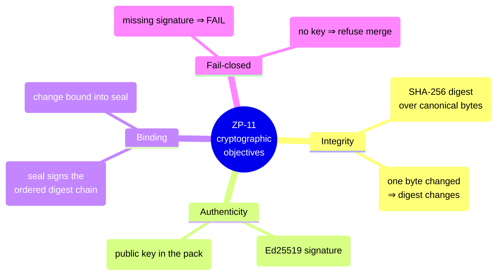

The design deliberately excludes confidentiality, non-repudiation beyond key possession, and revocation infrastructure. Each exclusion is a conscious boundary that keeps the standard tool-agnostic and re-runnable by anyone holding only a public key.

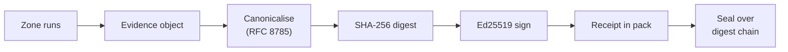

Everything below is an elaboration of this single pipeline: canonicalise, digest, sign, chain, seal, verify.

---

## 2. Threat model

The adversary ZP-11 defends against is not a network attacker but a *release* attacker: someone, or some automation, that wants a change merged without the evidence that should gate it. The attacker may control the CI runner, edit the emitted JSON, replay an old pack, or stitch receipts together from different runs. The attacker is assumed **not** to hold the private signing key — key custody (Section 10) is the premise on which every other guarantee stands.

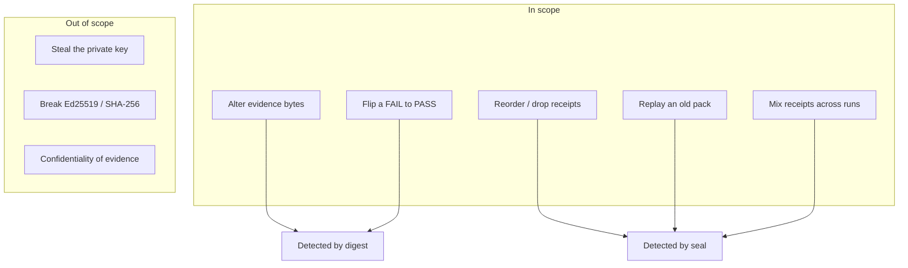

Each in-scope manipulation maps to a detection. Tampered evidence breaks the receipt digest; a flipped verdict breaks the receipt signature (the verdict is inside the signed body); any structural manipulation of the chain breaks the seal.

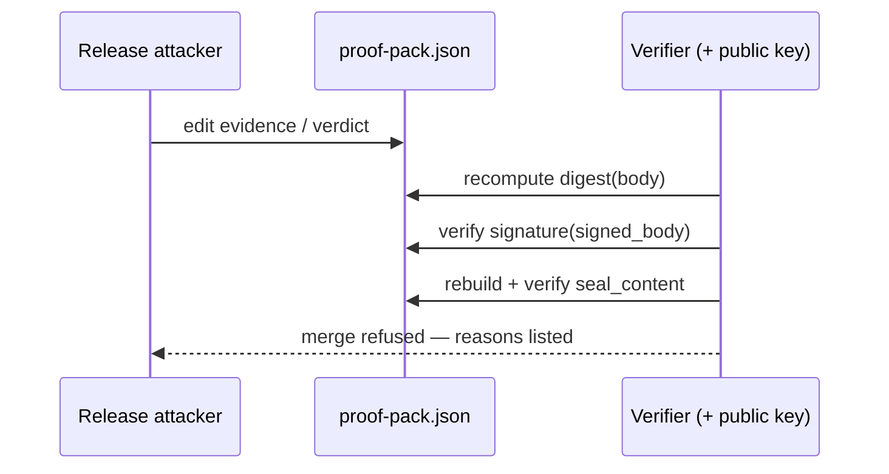

The verifier never trusts the pipeline that produced the pack. It trusts only mathematics and one public key.

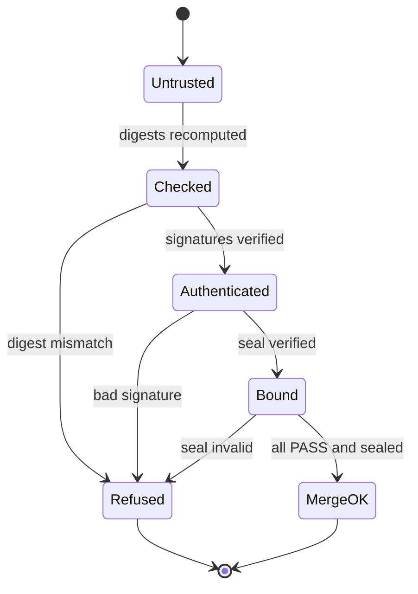

---

## 3. Canonical serialisation (RFC 8785 / JCS)

No digest is portable unless two parties serialise the same logical value to the same bytes. ZP-11 therefore digests and signs over a **canonical** byte string, implemented in `canonical.py` as the subset of RFC 8785 (the JSON Canonicalization Scheme) the standard relies on: UTF-8 output, object keys sorted lexicographically, minimal separators, no insignificant whitespace, and outright rejection of values that have no canonical form.

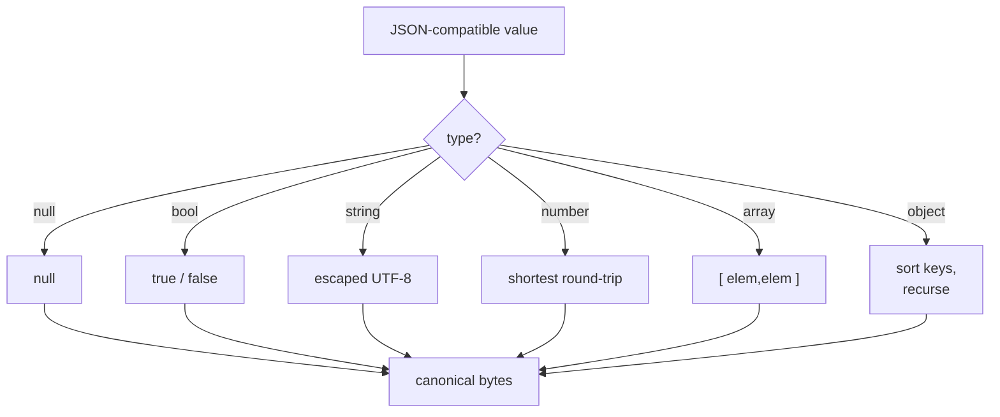

### 3.1 Key ordering

Object keys are sorted by their Unicode code points before emission. Because the sort is total and deterministic, `{"b":1,"a":2}` and `{"a":2,"b":1}` canonicalise identically.

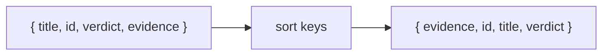

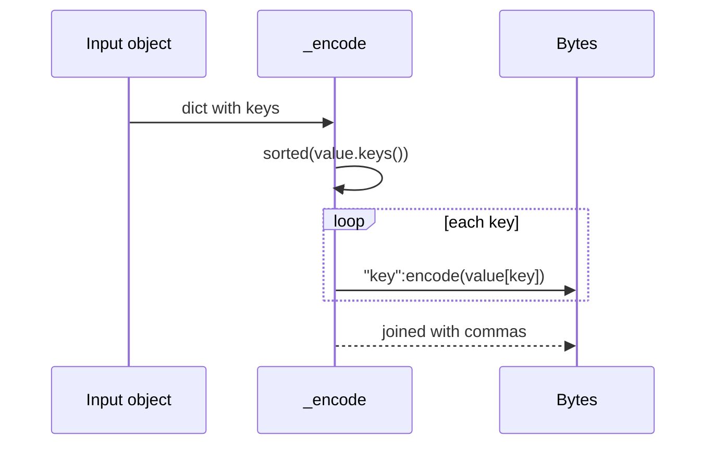

### 3.2 Numbers

Integers emit as their decimal string. Floats that are integral and below 1e16 collapse to an integer string; everything else emits the shortest round-trippable form. Booleans are explicitly *not* numbers — `bool` is a subclass of `int` in Python, so the encoder rejects a `bool` reaching the number path and handles `True`/`False` upstream as literals.

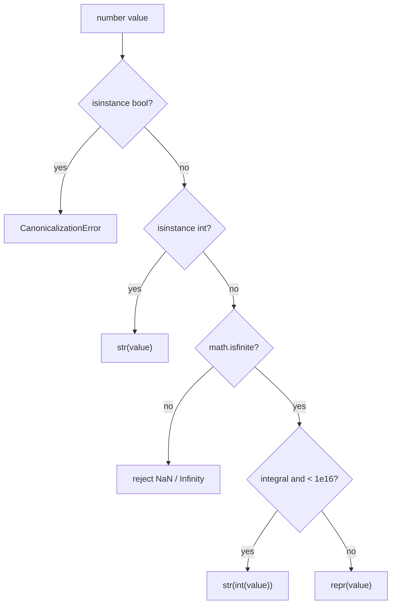

### 3.3 Strings and control characters

Strings are wrapped in quotes with a fixed escape table: `"`, `\`, backspace, form-feed, newline, carriage return, and tab map to their two-character escapes; any other control character below `U+0020` emits as a lower-case `\u00xx` escape. Printable characters pass through as UTF-8.

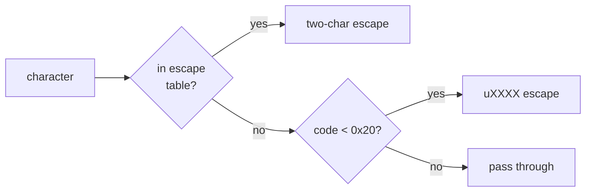

### 3.4 Rejection of non-canonical values

Values with no canonical JSON form are refused, never silently coerced. This matters because a gate that accepts `NaN` could emit a pack that one library serialises and another cannot reproduce — a crack the whole standard is designed to deny.

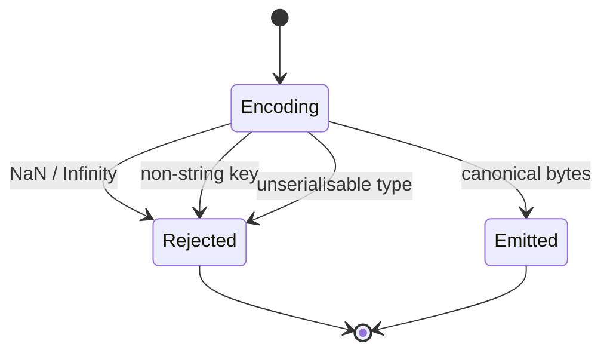

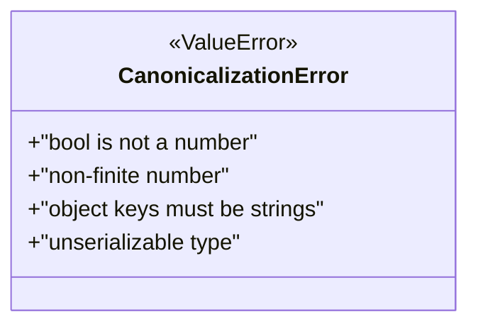

The reference function is `canonicalize(value) -> bytes`; it returns the UTF-8 encoding of the recursive `_encode` walk. Every digest and every signature in ZP-11 is computed over the output of this one function.

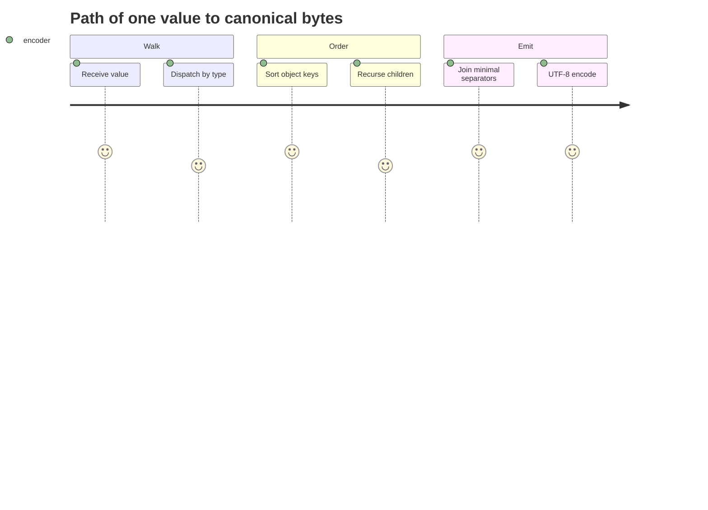

---

## 4. SHA-256 digests

A digest turns an arbitrary-length canonical byte string into a fixed 32-byte fingerprint. ZP-11 uses SHA-256 (FIPS 180-4) and encodes the result as `sha256:` followed by 64 lower-case hex characters. The reference helpers are `sha256_hex(data)` and `digest(value)`, where `digest` is defined as `"sha256:" + sha256_hex(canonicalize(value))`.

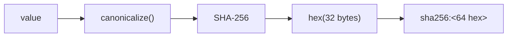

### 4.1 What the digest covers

For a zone receipt the digest is computed over the **body** only — `{ id, title, verdict, evidence }` — not over the digest or signature fields themselves. This ordering is deliberate: the digest summarises the content, the signature then covers the content *and* its digest.

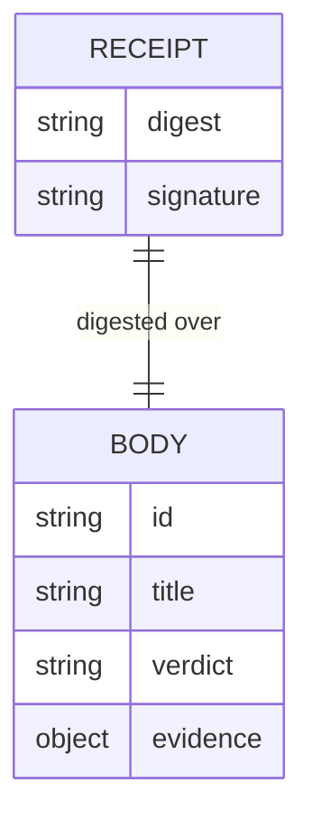

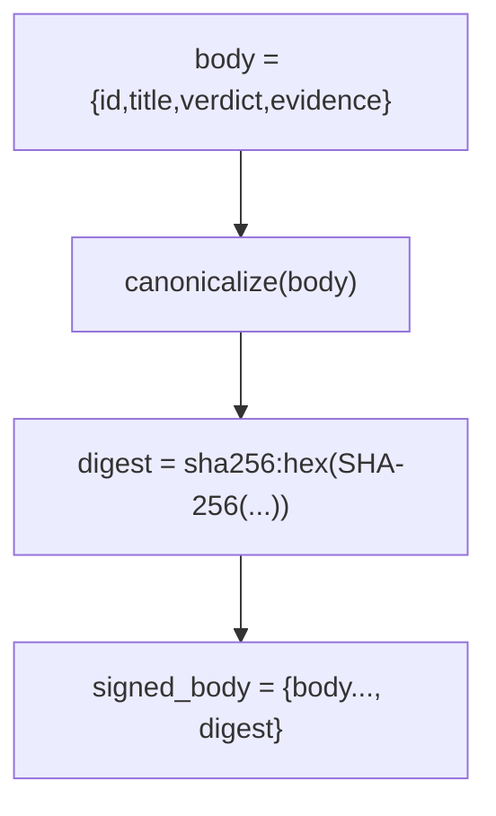

### 4.2 Avalanche property

Any single-byte change to evidence propagates through SHA-256 to roughly half the output bits. A verifier that recomputes `digest(body)` and compares against the stored digest detects any alteration with overwhelming probability.

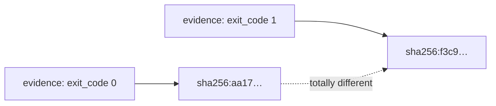

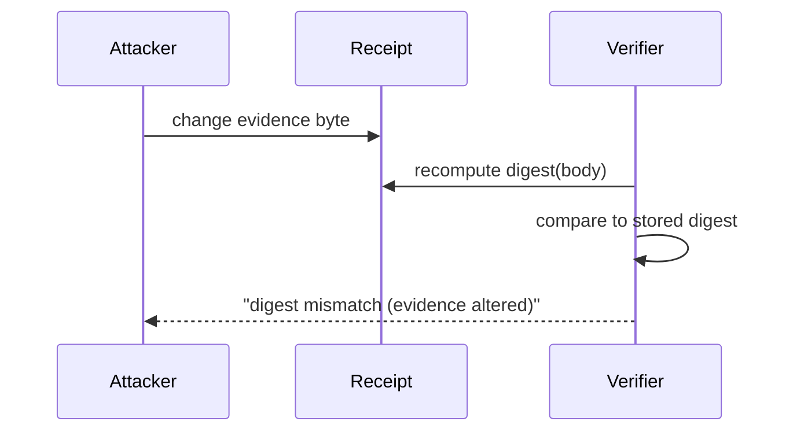

### 4.3 Digests inside evidence

Several zones place their own SHA-256 digests *inside* the evidence: the `file` kind records the `sha256` of a file's bytes; the `command` kind records `output_sha256` over `stdout + NUL + stderr`. These are content fingerprints the receipt digest then covers, so the pack records not just a verdict but the exact artifact the verdict was reached over.

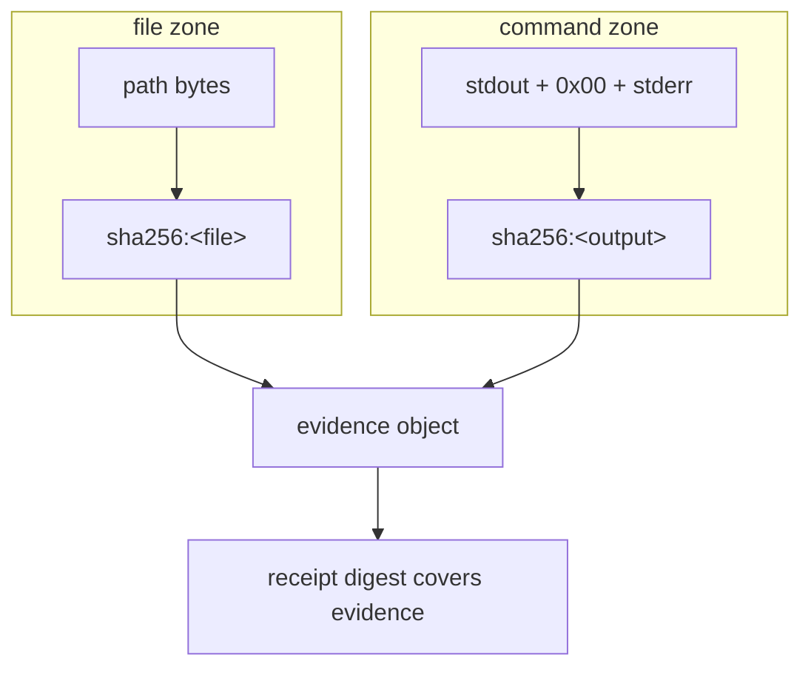

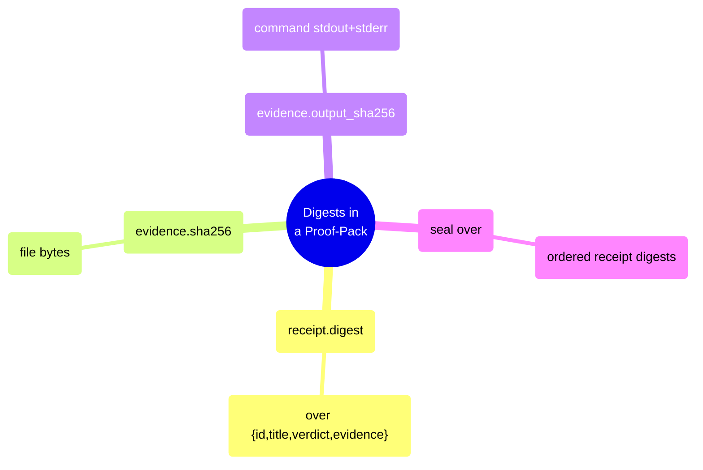

---

## 5. Ed25519 signing (RFC 8032)

Integrity tells a verifier that bytes were not changed; it does not tell them *who* produced the bytes. ZP-11 adds authenticity with Ed25519, the EdDSA signature scheme over Curve25519 defined in RFC 8032. Keys are handled as raw 32-byte values and printed as `ed25519:<hex>`, so a pack is self-describing: a verifier needs nothing but the public key embedded in the seal.

```mermaid
classDiagram
    class KeyPair {
        -Ed25519PrivateKey _private
        +generate() KeyPair
        +from_seed(seed32) KeyPair
        +public PublicKey
        +seed_hex str
        +sign_bytes(data) str
    }
    class PublicKey {
        +bytes raw
        +id str
        +parse(text) PublicKey
    }
    KeyPair --> PublicKey : public
```

### 5.1 Why Ed25519

Ed25519 is deterministic (no per-signature randomness to leak a key), fast to verify, and encodes keys and signatures in small fixed sizes — a 32-byte public key and a 64-byte signature. Determinism matters to a reproducible standard: the same key signing the same canonical bytes yields the same signature on any conforming platform.

```mermaid
flowchart LR
    subgraph props["Ed25519 properties ZP-11 relies on"]
        D["deterministic"] --> R["reproducible signatures"]
        F["fast verify"] --> V["cheap verification"]
        S["small fixed size"] --> P["compact pack"]
    end
```

### 5.2 Signing primitives

`sign(keypair, value)` canonicalises `value` and returns `ed25519:<hex-signature>`. `verify(public, value, signature)` re-canonicalises `value` and checks the signature, returning `False` — never raising — on any malformed input or verification failure. Returning `False` rather than raising is itself a fail-closed choice: a broken signature is a failure, not an exception for a caller to swallow.

```mermaid
sequenceDiagram
    participant Caller
    participant Sign as sign()
    participant Can as canonicalize()
    participant Ed as Ed25519
    Caller->>Sign: sign(keypair, value)
    Sign->>Can: canonicalize(value)
    Can-->>Sign: bytes
    Sign->>Ed: private.sign(bytes)
    Ed-->>Sign: 64-byte signature
    Sign-->>Caller: "ed25519:" + hex
```

```mermaid
flowchart TB
    SIG["signature string"] --> PFX{"starts with<br/>ed25519:?"}
    PFX -->|no| FALSE["return False"]
    PFX -->|yes| HEX["bytes.fromhex(...)"]
    HEX --> VER{"public.verify(sig, canonical)"}
    VER -->|ok| TRUE["return True"]
    VER -->|raises| FALSE
```

### 5.3 Key encoding on the wire

A public key is `ed25519:` plus 64 hex characters (32 raw bytes). The schema pins this exactly: `"pattern": "^ed25519:[0-9a-f]{64}$"` for the seal key, and `^ed25519:[0-9a-f]+$` for signatures. `PublicKey.parse` rejects any string that does not begin with the `ed25519:` prefix.

```mermaid
erDiagram
    SEAL ||--|| PUBLICKEY : "carries"
    PUBLICKEY {
        string prefix "ed25519:"
        string hex "64 chars = 32 bytes"
    }
    SEAL {
        string signature "ed25519:&lt;hex&gt;"
    }
```

```mermaid
stateDiagram-v2
    [*] --> Parsing
    Parsing --> Valid: prefix ed25519: + hex
    Parsing --> Error: wrong prefix
    Valid --> [*]
    Error --> [*]
```

### 5.4 The seed file

A signing key is persisted as its 32-byte seed in hex (`KeyPair.seed_hex`). `keygen` writes the seed to a key file and the public key id to `<out>.pub`. The seed *is* the private key; its custody is the whole security boundary (Section 10).

```mermaid
flowchart LR
    GEN["KeyPair.generate()"] --> SEED["seed_hex → ci.key"]
    GEN --> PUB["public.id → ci.key.pub"]
    SEED -.->|"secret"| CUST["custody required"]
    PUB -.->|"public"| PACK["embedded in pack"]
```

---

## 6. Receipt construction

A receipt is the signed record of one zone. Its lifecycle — body, digest, signed body, signature — is implemented in `pack.py` on the `Receipt` dataclass. Understanding this four-step construction is the key to understanding why no field can be tampered with in isolation.

```mermaid
classDiagram
    class Receipt {
        +str id
        +str title
        +Verdict verdict
        +dict evidence
        +str digest
        +str signature
        +body() dict
        +signed_body() dict
        +finalize(keypair) Receipt
        +to_dict() dict
    }
```

### 6.1 The four fields that bind

```mermaid
flowchart TB
    BODY["body = {id, title, verdict, evidence}"] --> DIG["digest = digest(body)"]
    DIG --> SBODY["signed_body = {body..., digest}"]
    SBODY --> SIG["signature = sign(key, signed_body)"]
    SIG --> OUT["to_dict(): signed_body + signature"]
```

`finalize(keypair)` performs these steps in order: it sets `digest` to `digest(self.body())`, then — only if a keypair is supplied — sets `signature` to `sign(keypair, self.signed_body())`. Because the signature covers the body *and* the digest, an attacker cannot recompute a valid digest for altered evidence without also re-signing, and cannot re-sign without the private key.

```mermaid
sequenceDiagram
    participant Z as Zone result
    participant R as Receipt
    participant K as KeyPair
    Z->>R: id, title, verdict, evidence
    R->>R: digest = digest(body)
    R->>K: sign(signed_body)
    K-->>R: ed25519:signature
    R->>R: to_dict()
```

### 6.2 The verdict is inside the signature

Flipping a `FAIL` to `PASS` changes the body, hence the digest, hence the bytes the signature must cover. A verdict change is therefore caught twice: once as a digest mismatch and once as a signature failure.

```mermaid
flowchart LR
    A["verdict: FAIL"] --> B["body changes"]
    B --> C["digest changes"]
    C --> D["stored digest mismatch"]
    B --> E["signed_body changes"]
    E --> F["signature invalid"]
```

```mermaid
stateDiagram-v2
    [*] --> Honest
    Honest --> Tampered: flip verdict
    Tampered --> DigestFail: recompute digest
    Tampered --> SigFail: verify signature
    DigestFail --> Refused
    SigFail --> Refused
    Honest --> Accepted: untouched
    Refused --> [*]
    Accepted --> [*]
```

### 6.3 Evidence is location-only for secrets

The `secret_scan` zone records only *where* a potential secret was found — a path and a rule label — never the secret material itself. The receipt is a public artifact, so evidence is designed to prove a verdict without becoming a leak in its own right.

```mermaid
erDiagram
    SECRET_SCAN_EVIDENCE {
        int scanned
        bool clean
        array findings "path + rule only"
    }
```

```mermaid
mindmap
  root(("Receipt<br/>evidence kinds"))
    require
      ("required / missing / present")
    file
      ("path, bytes, sha256")
    command
      ("exit_code, output_sha256")
    secret_scan
      ("scanned, findings[path,rule]")
    seal
      ("zones_passed, all_prior_pass")
```

---

## 7. The seal construction (ZP-11)

The seal is the eleventh zone and the keystone of the standard. It is not a check of the repository; it is a cryptographic statement about the *other ten receipts*. ZP-11 passes only when every prior zone passed, and its signature covers the ordered chain of receipt digests together with the change. This is what makes a pack impossible to assemble from receipts that never shared a gate.

```mermaid
flowchart TB
    Z1["ZP-1 digest"] --> CHAIN
    Z2["ZP-2 digest"] --> CHAIN
    Z3["ZP-3 … ZP-10 digests"] --> CHAIN
    CHAIN["ordered [{id, digest}]"] --> SC["seal_content"]
    CH["change {id, source_commit, builder}"] --> SC
    META["standard, created, verdict,<br/>zones_passed, zones_total"] --> SC
    SC --> SIG["seal.signature = sign(key, seal_content)"]
```

### 7.1 Seal content

The signed `seal_content` is exactly: `{ standard, created, change, verdict, zones_passed, zones_total, receipts: [ {id, digest} for each receipt in order ] }`. Note what is *not* in it — the evidence and signatures of individual receipts — and what is: the digests, which already commit to that evidence. The seal thus transitively binds every byte of every receipt through one signature.

```mermaid
erDiagram
    SEAL_CONTENT ||--o{ RECEIPT_REF : "orders"
    SEAL_CONTENT {
        string standard "zp11/v1"
        string created
        object change
        string verdict
        int zones_passed
        int zones_total
    }
    RECEIPT_REF {
        string id
        string digest
    }
```

```mermaid
sequenceDiagram
    participant Gate
    participant Pack as ProofPack.seal
    participant K as KeyPair
    Gate->>Pack: receipts[] assembled
    Pack->>Pack: key_id = keypair.public.id
    loop each receipt
        Pack->>K: r.finalize(keypair)
    end
    Pack->>Pack: build seal_content
    Pack->>K: sign(seal_content)
    K-->>Pack: seal_signature
    Pack->>Pack: sealed = (verdict is PASS)
```

### 7.2 Ordering binds the chain

Because `seal_content.receipts` is an ordered list, reordering, inserting, or removing any receipt changes the signed bytes and breaks the seal. The gate always builds zones in numeric order (`ZP-1` … `ZP-11`), so the canonical ordering is deterministic.

```mermaid
flowchart LR
    A["[ZP-1,ZP-2,…,ZP-11]"] --> S["seal over this order"]
    B["[ZP-2,ZP-1,…]"] --> S2["different bytes"]
    S -.->|"≠"| S2
```

```mermaid
stateDiagram-v2
    [*] --> Ordered
    Ordered --> Sealed: sign ordered chain
    Sealed --> Broken: reorder receipts
    Sealed --> Broken: add receipt
    Sealed --> Broken: drop receipt
    Broken --> Refused
    Sealed --> Accepted: chain intact
    Refused --> [*]
    Accepted --> [*]
```

### 7.3 Sealed is not the same as signed

A pack is *always* signed — even a failing pack carries a seal signature, as evidence of why the gate stayed shut. But `sealed` is set `True` only when the pack verdict is `PASS`, i.e. every receipt passed. The distinction is the difference between "this is a genuine record" and "this record permits merge".

```mermaid
flowchart TB
    RUN["run_gate"] --> ALL{"all zones PASS?"}
    ALL -->|yes| SP["sealed = true, verdict PASS"]
    ALL -->|no| SF["sealed = false, verdict FAIL"]
    SP --> MERGE["merge permitted"]
    SF --> SHUT["gate stays shut (still signed)"]
```

```mermaid
journey
    title A change through the seal
    section Zones
      Run ZP-1..ZP-10: 4: gate
      Collect verdicts: 4: gate
    section Seal
      Derive ZP-11 verdict: 5: gate
      Sign receipt chain: 5: gate
    section Decide
      sealed iff all PASS: 5: gate
```

### 7.4 ZP-11 verdict derivation

The gate computes `prior_all_pass` as the running conjunction of every zone verdict. ZP-11's own verdict is `PASS` if and only if `prior_all_pass` is true when the seal zone is reached. The seal zone is never executed as an ordinary check — `run_zone` returns `FAIL` for a `seal` kind on purpose — because its verdict is a property of the chain, computed only inside the gate.

```mermaid
flowchart LR
    P0["prior_all_pass = true"] --> L["for each ZP-1..ZP-10"]
    L --> AND["prior_all_pass AND= bool(verdict)"]
    AND --> SEAL{"reached ZP-11"}
    SEAL -->|prior_all_pass| PASS["ZP-11 PASS"]
    SEAL -->|not| FAIL["ZP-11 FAIL"]
```

---

## 8. Verification

Verification is the mirror of construction and the only thing a consumer must trust. `verify_pack(pack, public, require_all_zones=True)` returns a structured `VerifyReport` with `ok`, `merge_permitted`, and a list of human-readable `reasons`. Merge is permitted *iff* integrity holds, every zone passed, and the pack is sealed.

```mermaid
flowchart TB
    START["verify_pack(pack, key)"] --> Z{"require_all_zones?"}
    Z -->|yes| MISS["check ZP-1..ZP-11 present"]
    Z -->|no| LOOP
    MISS --> LOOP["for each receipt"]
    LOOP --> DIG{"digest(body) == stored?"}
    DIG -->|no| R1["reason: digest mismatch"]
    LOOP --> SG{"signature valid?"}
    SG -->|no| R2["reason: bad/missing signature"]
    LOOP --> SEAL["rebuild seal_content"]
    SEAL --> SV{"seal signature valid?"}
    SV -->|no| R3["reason: seal invalid"]
    SEAL --> PASS{"passed == total?"}
    PASS -->|no| R4["reason: fail-closed"]
    PASS --> SEALED{"sealed?"}
    SEALED -->|no| R5["reason: not sealed"]
    SEALED --> OK["merge_permitted"]
```

### 8.1 The four verifier obligations

```mermaid
mindmap
  root(("Verifier<br/>MUST"))
    ("1. all zones present (strict)")
    ("2. recompute each digest")
    ("   verify each receipt signature")
    ("3. rebuild + verify seal_content")
    ("4. every verdict PASS & sealed=true")
```

```mermaid
sequenceDiagram
    participant C as Consumer
    participant P as ProofPack
    participant K as PublicKey
    C->>P: verify_pack(pack, K)
    P->>P: present? digests? signatures?
    P->>P: rebuild seal_content, verify
    P->>P: all PASS and sealed?
    P-->>C: VerifyReport{ok, merge_permitted, reasons}
```

### 8.2 Key resolution and the no-key path

The verifier uses the public key passed in, or falls back to the key embedded in the pack. If *no* key is available, it appends the reason "no public key available to verify signatures" and refuses merge. A verifier **MUST** default to refusing merge when the key is unavailable — unverifiable is treated as failed.

```mermaid
flowchart TB
    K{"key provided?"} -->|yes| USE["use provided key"]
    K -->|no| PK{"pack.key_id set?"}
    PK -->|yes| PARSE["PublicKey.parse(pack.key_id)"]
    PK -->|no| NONE["key = None"]
    NONE --> REFUSE["reason added, merge refused"]
    USE --> VERIFY["verify signatures"]
    PARSE --> VERIFY
```

### 8.3 Reasons accumulate; they never cancel

Every check appends to `reasons` on failure; `integrity_ok` is simply `not reasons`. There is no path where one passing check offsets another failing one. This is the fail-closed principle expressed in the verifier's own control flow.

```mermaid
stateDiagram-v2
    [*] --> Clean
    Clean --> HasReasons: any check fails
    HasReasons --> HasReasons: more checks fail
    HasReasons --> Refused
    Clean --> Permitted: zero reasons + all pass + sealed
    Refused --> [*]
    Permitted --> [*]
```

### 8.4 Strict versus partial

`require_all_zones` defaults to `True`; the CLI's `--partial` flag turns it off for inspection of an incomplete pack. Partial mode is a diagnostic convenience and never a merge path — the schema itself requires `minItems: 11` for the zones array.

```mermaid
flowchart LR
    V["verify"] --> MODE{"--partial?"}
    MODE -->|no| STRICT["require ZP-1..ZP-11"]
    MODE -->|yes| LAX["inspect subset (no merge)"]
```

```mermaid
erDiagram
    VERIFYREPORT {
        bool ok
        bool merge_permitted
        array reasons
        int zones_passed
        int zones_total
    }
```

---

## 9. End-to-end cryptographic flow

The complete path from a proposed change to a merge decision touches every primitive in this document exactly once per zone, plus once for the seal.

```mermaid
sequenceDiagram
    participant Dev as Change
    participant Gate as ZP-11 gate
    participant Zones as ZP-1..ZP-10
    participant Pack as Proof-Pack
    participant Ver as Verifier
    Dev->>Gate: propose change → main
    Gate->>Zones: run each zone
    Zones-->>Gate: verdict + evidence
    Gate->>Pack: finalize receipts (digest + sign)
    Gate->>Pack: seal over ordered digest chain
    Pack-->>Ver: proof-pack.json + public key
    Ver->>Ver: recompute digests
    Ver->>Ver: verify receipt + seal signatures
    Ver-->>Dev: merge permitted ⟺ sealed PASS
```

```mermaid
flowchart TB
    subgraph Build["Gate (build side)"]
        A["canonicalize"] --> B["SHA-256 digest"]
        B --> C["Ed25519 sign receipt"]
        C --> D["seal over chain"]
    end
    subgraph Verify["Verifier (consume side)"]
        E["recompute canonical"] --> F["recompute digest"]
        F --> G["verify signature"]
        G --> H["verify seal"]
    end
    D --> E
```

```mermaid
timeline
    title Cryptographic lifecycle of a Proof-Pack
    Build : zones run : evidence captured
    Digest : canonicalise : SHA-256 per receipt
    Sign : Ed25519 per receipt
    Seal : order digests : sign chain + change
    Emit : proof-pack.json written
    Verify : digests recomputed : signatures checked
    Decide : merge iff sealed PASS
```

```mermaid
classDiagram
    class ProofPack {
        +dict change
        +str created
        +Receipt[] receipts
        +str key_id
        +str seal_signature
        +bool sealed
        +verdict Verdict
        +passed int
        +seal(keypair) ProofPack
        +to_dict() dict
    }
    ProofPack "1" --> "11" Receipt
```

---

## 10. Key custody

Every guarantee above collapses if the private signing key is disclosed. The key is the trust anchor; its custody is the one responsibility the standard cannot discharge in code. ZP-11's design keeps the attack surface small — a single 32-byte seed, no key-wrapping format to misconfigure — but the operational discipline is the operator's.

```mermaid
flowchart TB
    SEED["32-byte Ed25519 seed"] --> STORE["secret store / HSM / CI secret"]
    STORE --> SIGN["gate signs with it"]
    SEED -.->|"never"| REPO["committed to a repo"]
    SEED -.->|"never"| PACK["placed in a Proof-Pack"]
    PUBK["public key"] --> PUBPLACE["published, embedded in pack"]
```

### 10.1 Private versus public custody

```mermaid
erDiagram
    PRIVATE_SEED ||--|| PUBLIC_KEY : "derives"
    PRIVATE_SEED {
        string handling "secret, custody-critical"
        string location "secret manager / HSM"
    }
    PUBLIC_KEY {
        string handling "public, distributable"
        string location "pack, repo, key registry"
    }
```

### 10.2 Custody lifecycle

A signing key moves through generation, storage, active signing, and retirement. ZP-11 has no built-in revocation list; retirement is handled by ceasing to trust a public key in the verifier's configuration and re-signing current packs with a successor key.

```mermaid
stateDiagram-v2
    [*] --> Generated: keygen
    Generated --> Stored: seed → secret store
    Stored --> Active: gate signs
    Active --> Rotated: new key issued
    Rotated --> Retired: verifiers drop old pubkey
    Retired --> [*]
    Active --> Compromised: seed disclosed
    Compromised --> Revoked: distrust pubkey, re-sign
    Revoked --> [*]
```

### 10.3 Who holds what

```mermaid
flowchart LR
    subgraph CI["CI / gate runner"]
        S["holds private seed"]
    end
    subgraph Repo["Repository / registry"]
        P["holds public key"]
    end
    subgraph Verifier["Any verifier"]
        V["needs only public key"]
    end
    S --> |signs| PACK["proof-pack.json"]
    PACK --> V
    P --> V
```

### 10.4 Compromise response

If a seed is disclosed, every pack signed under it becomes untrustworthy, because the attacker can forge valid-looking packs. The response is to distrust the public key in all verifiers, issue a new key, and re-run the gate on current changes. Because a Proof-Pack is reproducible, re-signing is deterministic work, not a reconstruction.

```mermaid
sequenceDiagram
    participant Op as Operator
    participant Ver as Verifiers
    participant Gate as Gate
    Op->>Ver: remove compromised pubkey from trust set
    Op->>Gate: issue new key (keygen)
    Gate->>Gate: re-run, re-sign current packs
    Gate-->>Ver: new sealed packs under new key
```

```mermaid
mindmap
  root(("Key custody<br/>rules"))
    ("seed is the whole secret")
    ("never commit the seed")
    ("never embed seed in a pack")
    ("publish only the public key")
    ("rotate by changing trust set")
    ("compromise ⇒ distrust + re-sign")
```

### 10.5 Reproducible signing and the `--now` override

Determinism extends to timestamps: `run --now` fixes `created`, so a pack can be re-emitted byte-for-byte, including its seal, on a clean host. This is what lets ZP-10 (independent re-run) reproduce not just a verdict but an identical signed pack.

```mermaid
flowchart LR
    N["--now fixed timestamp"] --> C["created field pinned"]
    C --> SC["seal_content identical"]
    SC --> SIG["identical seal signature"]
    SIG --> RERUN["ZP-10 reproduces the pack"]
```

---

## 11. Fail-closed behaviour in the cryptographic layer

Fail-closed is not a policy bolted on top; it is woven through the crypto code. The verdict type coerces anything unknown to `FAIL`; `verify` returns `False` rather than raising; the canonicaliser rejects values it cannot represent; a missing key refuses merge; a missing or bad signature is a reason, never a warning.

```mermaid
flowchart TB
    subgraph FC["Where failure closes the gate"]
        V1["unknown verdict → FAIL"]
        V2["bad signature → verify False"]
        V3["NaN/Inf → CanonicalizationError"]
        V4["no key → merge refused"]
        V5["digest mismatch → reason"]
        V6["not sealed → merge refused"]
    end
```

```mermaid
stateDiagram-v2
    [*] --> Evaluate
    Evaluate --> Pass: proven, signed, sealed
    Evaluate --> Fail: any ambiguity
    Fail --> [*]: gate stays shut
    Pass --> [*]: merge permitted
```

```mermaid
classDiagram
    class Verdict {
        <<enum>>
        PASS
        FAIL
        +coerce(value) Verdict
        +__bool__() bool
    }
    note for Verdict "unknown / silence / crash → FAIL"
```

The asymmetry is total: a change advances only on affirmative, reproducible, signed, sealed evidence. Any gap in the cryptographic chain resolves the same way the standard resolves every ambiguity — to `FAIL`.

```mermaid
journey
    title Does the gate open?
    section Evidence
      Zones produce PASS: 5: gate
    section Crypto
      Digests match: 5: verifier
      Signatures valid: 5: verifier
      Seal valid: 5: verifier
    section Decision
      Sealed PASS → merge: 5: verifier
      Any gap → refuse: 1: verifier
```

---

## 12. Summary

ZP-11's cryptographic design is small by intent. One canonicalisation function produces the bytes; one hash function fingerprints them; one signature scheme authenticates them; one seal binds the ordered chain and the change into a single verifiable statement. The reference library implements exactly this and nothing more, and the verifier trusts exactly this and nothing more. Invented and authored by **Naquib Hatami**, ZP-11 turns "this change was reviewed" into "this change carries a sealed, signed, reproducible proof anyone can check with a public key" — and keeps the gate shut whenever that proof is absent, altered, or incomplete.

```mermaid
mindmap
  root(("ZP-11<br/>crypto in one view"))
    Canonical
      ("RFC 8785 / JCS")
      ("deterministic bytes")
    Digest
      ("SHA-256")
      ("sha256:&lt;64 hex&gt;")
    Sign
      ("Ed25519 / RFC 8032")
      ("ed25519:&lt;hex&gt;")
    Seal
      ("ordered digest chain")
      ("binds the change")
    Verify
      ("public key only")
      ("fail-closed decision")
```

---

## Related documents

- [`03-architecture.md`](03-architecture.md) — system architecture and the gate pipeline.
- [`05-data-model.md`](05-data-model.md) — the Proof-Pack JSON format and schema.
- [`10-zones-reference.md`](10-zones-reference.md) — the eleven zones, their kinds, and evidence.
- [`13-conformance.md`](13-conformance.md) — the verification algorithm and CLI behaviour.
- [`15-operations-runbook.md`](15-operations-runbook.md) — operational key custody and rotation.
