*Part of the ProofGate ZP-11 documentation set.*

# Threat Model (STRIDE)

> Standard: `zp11/v1` · License: MIT · Inventor/author: **Naquib Hatami** · Repo: `github.com/iQs-Group/ZP-11` · Home: `zp11.org` · Publisher: iQs Group Inc. / SADI AI Inc.

## Abstract

ProofGate ZP-11 is a fail-closed release-governance standard. Eleven independent Zero-Point zones sit between a proposed change and a protected branch, and the gate opens only when every zone returns `PASS` and the resulting **Proof-Pack** is sealed. This document is the adversarial counterpart to the specification: it enumerates the assets ZP-11 protects, the adversaries who would subvert it, and a full STRIDE decomposition of the gate, the Proof-Pack, the signature chain, and the two-runner architecture. Because ZP-11 is ultimately a trust-shifting mechanism — it moves trust from *people* to *evidence and keys* — the model confronts the trusting-trust regress head-on, naming precisely what the standard can and cannot prove. The analysis is grounded in the reference library (`canonical.py`, `crypto.py`, `verdict.py`, `zones.py`, `pack.py`, `gate.py`, `cli.py`) and the schema; it invents no benchmarks, adopters, or metrics. Mitigations are mapped to the specific normative requirements of each zone.

---

## 1. Scope and method

This threat model covers the ZP-11 reference implementation and the `zp11/v1` data formats: the gate that runs zones, the Proof-Pack it emits, the Ed25519 signature chain over receipt digests, and the independent re-run (ZP-10). It does **not** cover the correctness of the underlying tools a repository maps its zones to (a flawed test suite remains a flawed test suite), nor organizational key-management practices beyond the standard's own requirements.

The method is STRIDE — Spoofing, Tampering, Repudiation, Information disclosure, Denial of service, Elevation of privilege — applied to each element and data flow after a data-flow decomposition. For every threat we record the affected asset, the STRIDE class, the relevant trust boundary, and the mitigation already present in the standard or recommended for adopters.

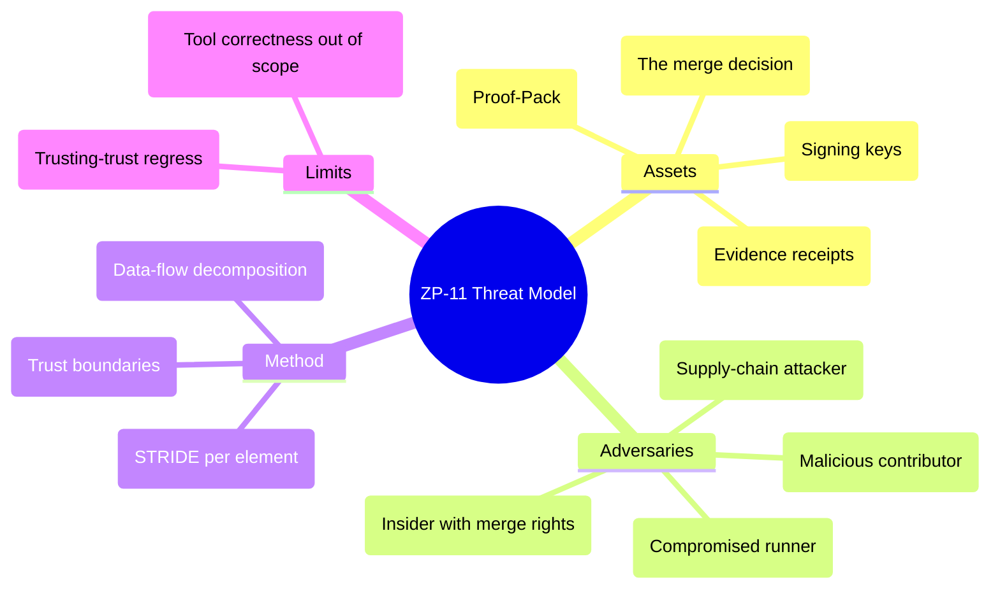

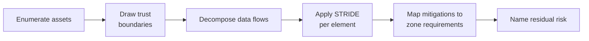

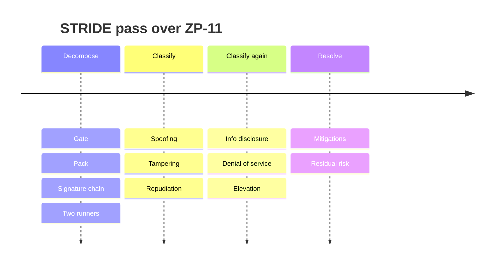

---

## 2. System decomposition

The gate composes the eleven zones exactly once (`gate.py::run_gate`). ZP-1 through ZP-10 run as declarative *kinds* (`require`, `file`, `command`, `secret_scan`), each returning a deterministic verdict and evidence; ZP-11 is the `seal`, set from whether every prior zone passed. The pack is then digested and signed per `pack.py`.

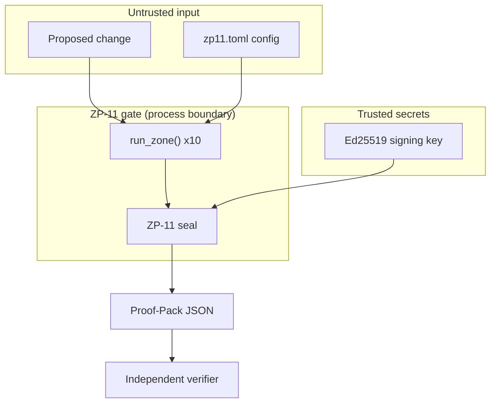

```mermaid
flowchart LR
  subgraph Zones["ZP-1 … ZP-10"]
    direction TB
    Z1["ZP-1 Provenance"] --> Z2["ZP-2 Reproducible build"]
    Z2 --> Z3["ZP-3 Dependency integrity"]
    Z3 --> Z4["ZP-4 Test evidence"]
    Z4 --> Z5["ZP-5 Coverage floor"]
    Z5 --> Z6["ZP-6 Static safety"]
    Z6 --> Z7["ZP-7 Secret hygiene"]
    Z7 --> Z8["ZP-8 Policy conformance"]
    Z8 --> Z9["ZP-9 Signature chain"]
    Z9 --> Z10["ZP-10 Independent re-run"]
  end
  Z10 --> Z11["ZP-11 Zero-point seal"]
```

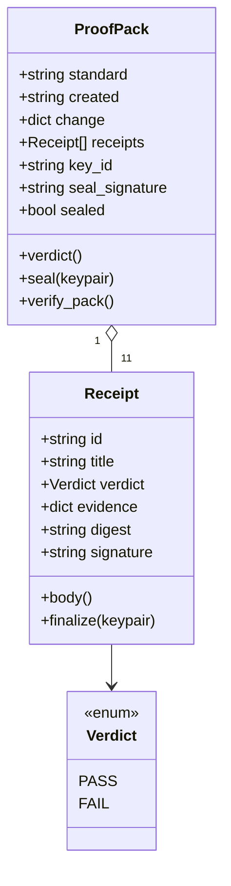

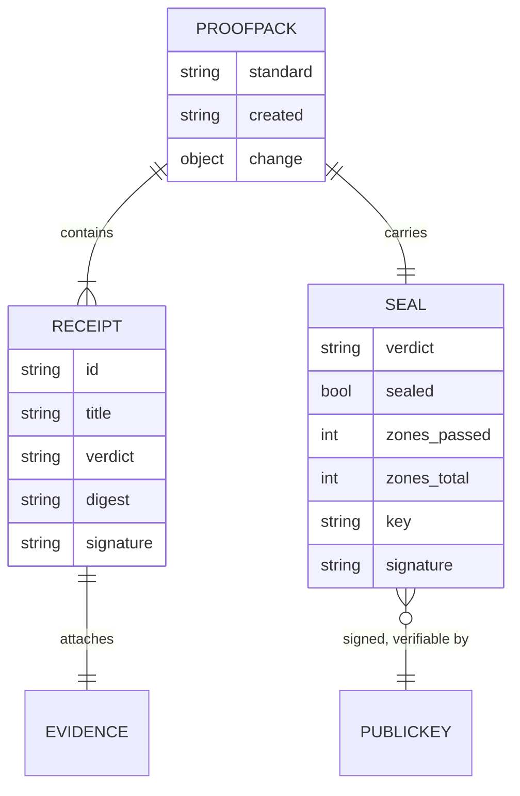

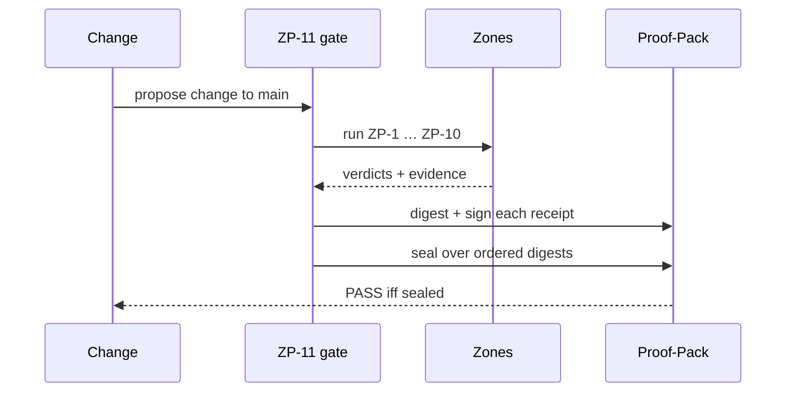

---

## 3. Assets

ZP-11 exists to protect a single high-value decision — *may this change merge?* — and the evidence that justifies it. The assets below are ranked by the damage an adversary causes by subverting them.

| Asset | Why it matters | Primary STRIDE exposure |
|-------|----------------|-------------------------|
| Signing key(s) | Root of trust; forge the key, forge the gate | Spoofing, Elevation |
| The merge decision | The gate's whole output | Tampering, Elevation |
| Proof-Pack integrity | Portable, re-runnable evidence | Tampering, Repudiation |
| Receipt evidence | Proves *why* each zone passed | Tampering, Information disclosure |
| The seal chain | Binds receipts to one gate run | Tampering |
| Verifier availability | Absence must fail closed | Denial of service |
| ZP-10 runner independence | Detects a compromised primary | Spoofing, Elevation |

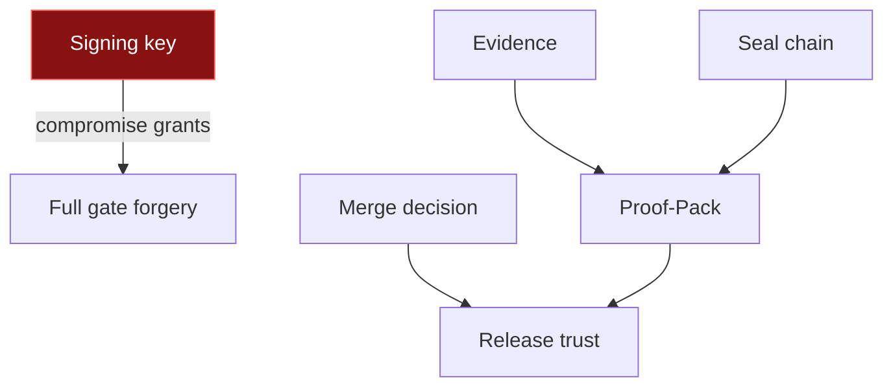

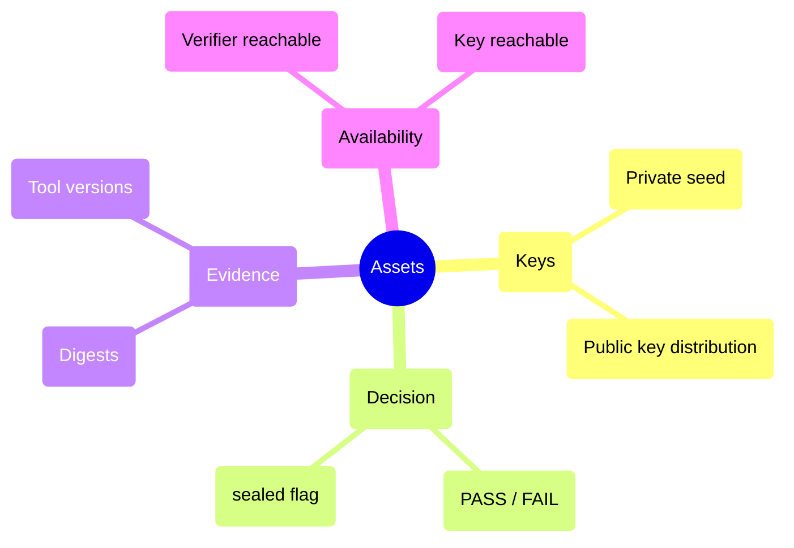

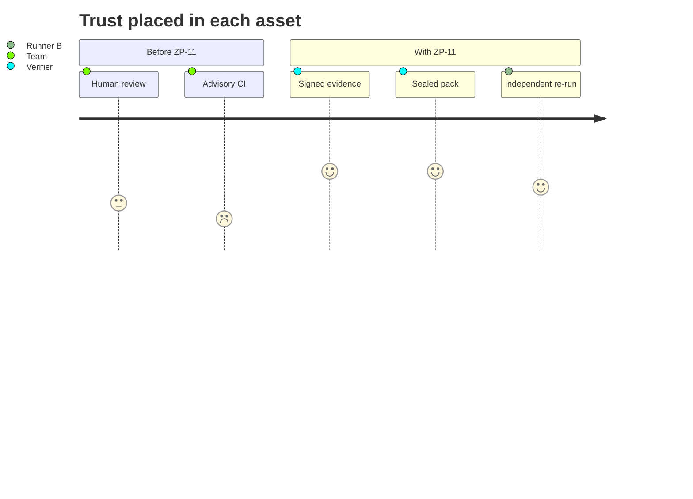

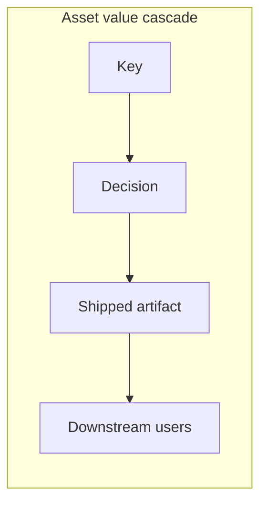

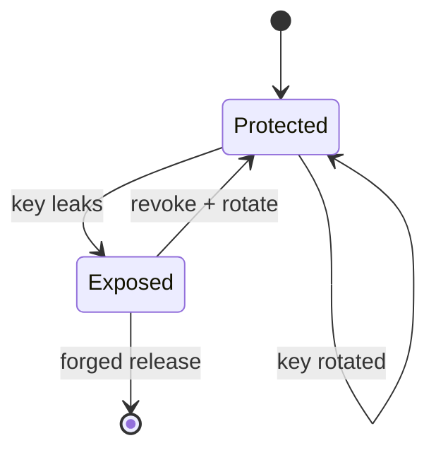

---

## 4. Adversaries

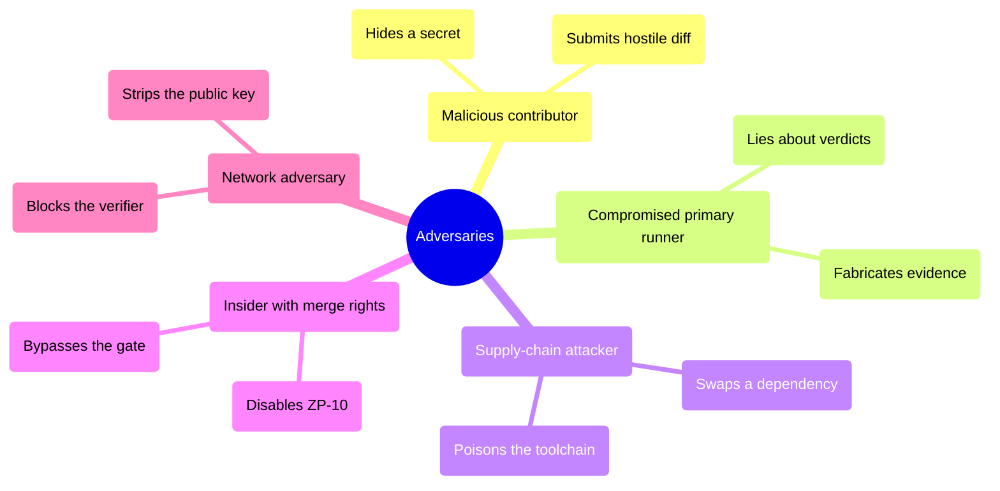

Each adversary is defined by capability, not identity. The capability matrix below drives the STRIDE sections.

| Adversary | Can write code | Controls a runner | Holds a signing key | Can merge directly |
|-----------|:--:|:--:|:--:|:--:|
| Malicious contributor | yes | no | no | no |
| Compromised primary runner | maybe | yes (one) | maybe | no |
| Supply-chain attacker | indirectly | no | no | no |
| Insider with merge rights | yes | maybe | maybe | yes |
| Network adversary | no | no | no | no |

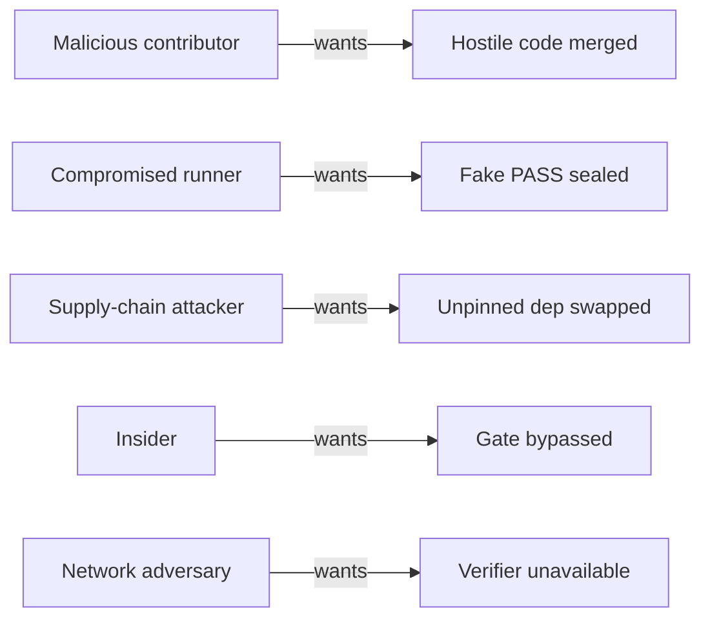

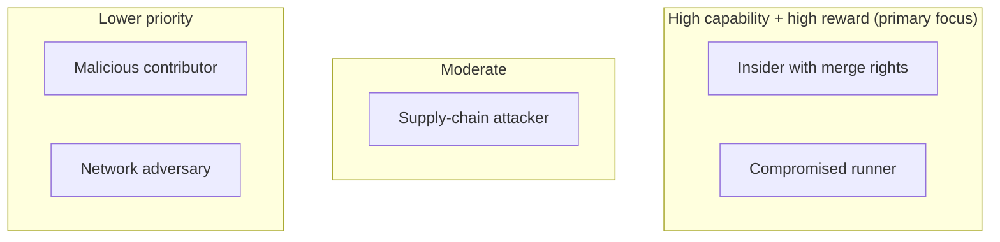

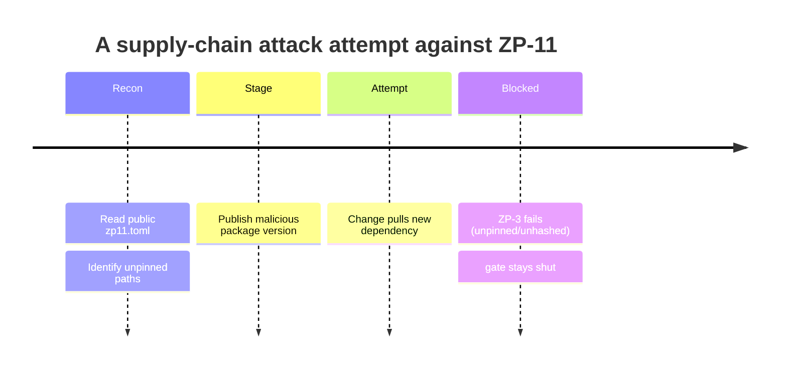

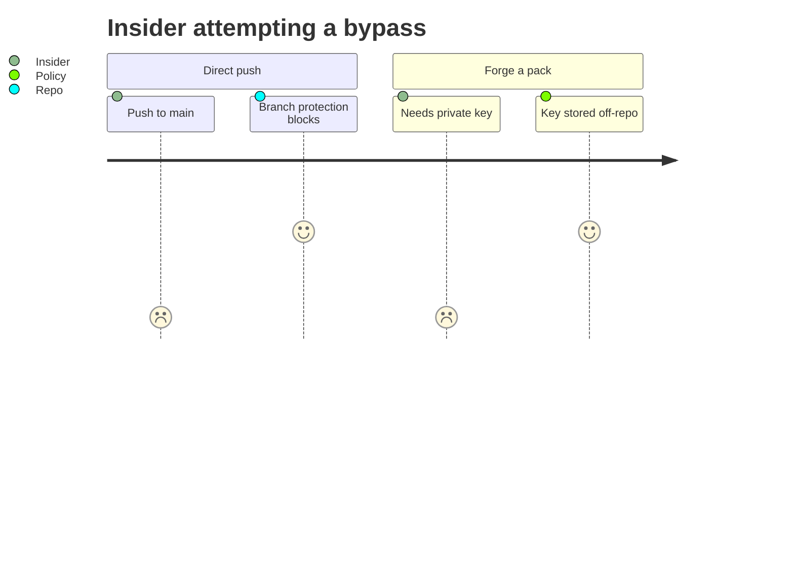

---

## 5. Trust boundaries

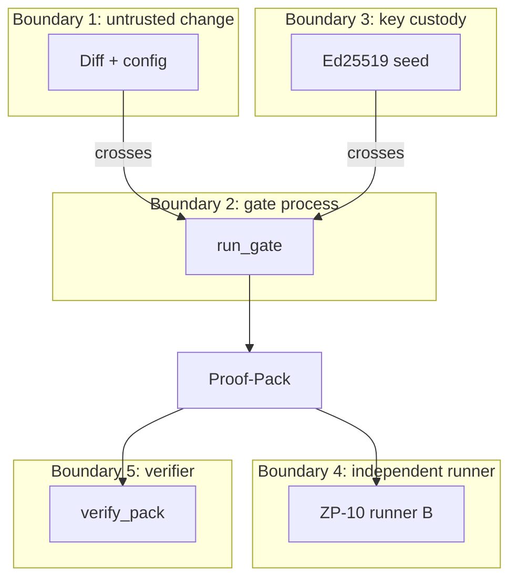

The most security-relevant boundary is **key custody** (Boundary 3): the specification requires signing keys to live *outside* the gated repository. The second is **runner independence** (Boundary 4): ZP-10 requires a second, isolated runner that SHOULD NOT share state with the primary.

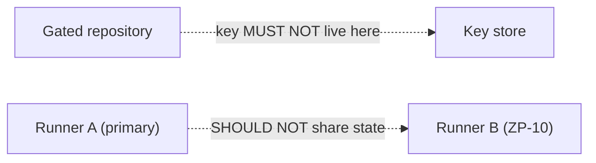

```mermaid
stateDiagram-v2
  [*] --> Outside
  Outside --> Inside: key checked into repo (anti-pattern)
  Inside --> Compromised: diff can read key
  Outside --> Safe: key in external store
  Safe --> [*]
  Compromised --> [*]
```

```mermaid
erDiagram
  KEYSTORE ||--o{ GATE_RUN : signs
  GATE_RUN ||--|| REPOSITORY : gates
  KEYSTORE }o--|| CUSTODIAN : "held by"
  REPOSITORY {
    bool contains_key "MUST be false"
  }
```

---

## 6. STRIDE: Spoofing

Spoofing against ZP-11 means making the verifier accept a verdict or key that did not originate from the legitimate gate.

```mermaid
flowchart TB
  SP["Spoofing goals"] --> SP1["Forge a receipt signature"]
  SP --> SP2["Forge the seal"]
  SP --> SP3["Substitute attacker's public key"]
  SP1 -.->|blocked by| M1["Ed25519 over signed_body"]
  SP2 -.->|blocked by| M2["Seal signs ordered digests"]
  SP3 -.->|blocked by| M3["Verifier uses a known public key"]
```

The decisive point: the pack may carry its own `key` field, but a verifier MUST default to refusing merge when a *trusted* public key `K` is unavailable (`verify_pack` appends "no public key available" and never permits merge without a key). Trusting the key embedded in the pack is an adopter error, not a standard behavior.

```mermaid
sequenceDiagram
  participant A as Attacker
  participant Pack as Forged pack
  participant V as Verifier
  A->>Pack: insert attacker public key + self-signatures
  Pack-->>V: present pack
  V->>V: compare against trusted K (out-of-band)
  V-->>A: key mismatch → merge refused
```

```mermaid
stateDiagram-v2
  [*] --> KeyUnknown
  KeyUnknown --> Refused: no trusted key → fail closed
  KeyUnknown --> Checked: trusted K supplied
  Checked --> Accepted: signatures verify
  Checked --> Refused: signature mismatch
```

```mermaid
flowchart LR
  F["Forged receipt"] --> D{"digest(body) == stored?"}
  D -->|no| R1["reason: digest mismatch"]
  D -->|yes| S{"verify(K, signed_body, sig)?"}
  S -->|no| R2["reason: bad signature"]
  S -->|yes| OK["accepted"]
  R1 --> SHUT["merge refused"]
  R2 --> SHUT
```

```mermaid
journey
  title Spoofing a builder identity
  section Without ZP-1
    Anonymous build: 2: Attacker
  section With ZP-1
    Must name signed commit + builder: 5: Gate
    Missing field fails require: 5: Gate
```

---

## 7. STRIDE: Tampering

Tampering is the richest category because the Proof-Pack is explicitly designed so that any altered byte is detectable.

```mermaid
flowchart TB
  T["Tampering targets"] --> T1["Edit evidence after signing"]
  T --> T2["Flip a verdict FAIL→PASS"]
  T --> T3["Reorder / add / drop receipts"]
  T --> T4["Edit the change metadata"]
  T1 -.-> C1["digest recomputed over body → mismatch"]
  T2 -.-> C1
  T3 -.-> C2["seal signs ordered receipt digests"]
  T4 -.-> C2
```

The receipt digest is `sha256` over the canonical body `{id, title, verdict, evidence}` (RFC 8785 / JCS). The seal signs `{standard, created, change, verdict, zones_passed, zones_total, receipts:[{id,digest}]}`. Thus a single-receipt edit breaks that receipt's digest, and any structural edit breaks the seal.

```mermaid
sequenceDiagram
  participant A as Attacker
  participant R as Receipt ZP-6
  participant V as verify_pack
  A->>R: change verdict FAIL to PASS
  V->>V: recompute digest(body)
  V-->>A: digest mismatch (evidence altered)
  V->>V: also seal digest list no longer matches
  V-->>A: merge refused
```

```mermaid
flowchart LR
  subgraph Canonical["Canonicalisation (RFC 8785)"]
    J1["keys sorted"] --> J2["minimal separators"] --> J3["no insignificant whitespace"] --> J4["reject NaN/Infinity"]
  end
  J4 --> H["SHA-256"] --> DG["digest"]
```

```mermaid
stateDiagram-v2
  [*] --> Signed
  Signed --> Edited: attacker mutates evidence
  Edited --> Detected: digest(body) != stored digest
  Detected --> Refused
  Signed --> Verified: untouched
  Verified --> Permitted
```

```mermaid
erDiagram
  SEAL ||--|{ RECEIPT_REF : "orders"
  RECEIPT_REF {
    string id
    string digest
  }
  SEAL {
    string signature "over the ordered list"
  }
```

```mermaid
flowchart TB
  RE["Reorder receipts"] --> SL{"seal content changes?"}
  SL -->|yes, order fixed| BAD["seal signature invalid"]
  AD["Add fabricated receipt"] --> SL
  DR["Drop a FAIL receipt"] --> SL
  BAD --> SHUT["merge refused"]
```

```mermaid
classDiagram
  class SealContent {
    +string standard
    +string created
    +dict change
    +string verdict
    +int zones_passed
    +int zones_total
    +list receipts_id_digest
  }
  note for SealContent "Signed with Ed25519; binds receipts to one gate run"
```

```mermaid
mindmap
  root(("Tamper resistance"))
    ("Per-receipt digest")
      ("canonical body")
      ("sha256")
    ("Per-receipt signature")
      ("over body+digest")
    ("Seal")
      ("ordered id+digest list")
      ("change bound in")
```

A subtle tampering vector is **evidence that is itself a digest** — e.g. a command zone stores `output_sha256`. An attacker who re-runs a command to produce benign output cannot thereby change a recorded FAIL, because the recorded verdict and its evidence are frozen under the signature; re-running produces a *different* pack, which must itself pass every zone.

```mermaid
sequenceDiagram
  participant Cmd as command zone
  participant Ev as evidence
  Cmd->>Cmd: subprocess, capture stdout+stderr
  Cmd->>Ev: output_sha256 = sha256(out \x00 err)
  Cmd->>Ev: exit_code vs expect_code
  Ev-->>Cmd: PASS iff exit_code == expect_code
```

---

## 8. STRIDE: Repudiation

Repudiation is the ability to deny having produced a result. ZP-11 defeats it by attribution: each receipt records its tool and version, carries a signature, and is bound into a timestamped, sealed pack.

```mermaid
flowchart TB
  RP["Repudiation attempts"] --> RP1["'I never approved this merge'"]
  RP --> RP2["'That evidence isn't mine'"]
  RP1 -.-> A1["seal signed by key K + created timestamp"]
  RP2 -.-> A2["receipt signature + tool/tool_version in evidence"]
```

```mermaid
sequenceDiagram
  participant Owner as Key holder
  participant Pack as Sealed pack
  participant Auditor as Auditor
  Owner->>Pack: seal with key K
  Auditor->>Pack: read seal.key + signature
  Auditor->>Auditor: verify with trusted K
  Auditor-->>Owner: non-repudiable: K signed this exact pack
```

```mermaid
erDiagram
  EVIDENCE {
    string kind
    string tool "zp11-ref"
    string tool_version "1.0.0"
  }
  RECEIPT ||--|| EVIDENCE : records
  RECEIPT {
    string signature "non-repudiable"
  }
```

```mermaid
timeline
  title Audit trail a pack preserves
  created : RFC 3339 UTC timestamp
  change : id : source_commit : builder
  per zone : verdict : evidence : tool_version
  seal : zones_passed/total : signature
```

```mermaid
journey
  title Resolving a disputed release
  section Claim
    "Gate never passed this": 2: Developer
  section Evidence
    Produce sealed pack: 5: Auditor
    Re-verify signatures: 5: Auditor
    Re-run ZP-10: 4: Runner B
```

```mermaid
stateDiagram-v2
  [*] --> Disputed
  Disputed --> Verified: pack + K re-verified
  Verified --> Settled: attribution proven
  Disputed --> Unverifiable: key lost
  Unverifiable --> Settled: fail closed, treat as not-passed
```

---

## 9. STRIDE: Information disclosure

The gate processes source, build output, and scan results — material that may contain secrets. ZP-11's design minimizes what the pack can leak.

```mermaid
flowchart TB
  ID["Disclosure risks"] --> ID1["Secret copied into evidence"]
  ID --> ID2["Command output embedded verbatim"]
  ID1 -.-> X1["ZP-7 records only locations, never secret material"]
  ID2 -.-> X2["command evidence stores output_sha256, not the output"]
```

ZP-7's secret scan returns `{path, rule}` findings — locations and rule names only. The specification is explicit: evidence MUST NOT contain secret material. Command zones store only a digest of stdout/stderr, not the bytes.

```mermaid
sequenceDiagram
  participant Scan as secret_scan
  participant F as findings
  Scan->>Scan: match patterns + entropy
  Scan->>F: append {path, rule}
  Note over F: the secret value is never stored
  F-->>Scan: FAIL if any finding
```

```mermaid
classDiagram
  class SecretFinding {
    +string path
    +string rule
  }
  note for SecretFinding "No value field by design"
```

```mermaid
flowchart LR
  TOK["High-entropy token"] --> E{"shannon >= floor?"}
  E -->|no| SKIP["ignored"]
  E -->|yes| L{"looks_secretish?"}
  L -->|no| SKIP
  L -->|yes| REC["record path only → FAIL"]
```

```mermaid
mindmap
  root(("Disclosure controls"))
    ("ZP-7")
      ("locations only")
      ("findings capped at 50")
    ("command")
      ("digest not bytes")
    ("evidence")
      ("minimal fields")
```

```mermaid
stateDiagram-v2
  [*] --> Scanning
  Scanning --> Clean: no finding
  Scanning --> Flagged: pattern/entropy hit
  Flagged --> Recorded: path + rule only
  Recorded --> [*]: FAIL, secret not leaked
  Clean --> [*]: PASS
```

A residual concern: a **misconfigured command zone** could emit secrets to stdout that then feed a downstream tool. ZP-11 digests that output rather than storing it, but adopters should still treat logs outside the pack as sensitive.

```mermaid
flowchart TB
  CMD["command stdout"] --> HASH["output_sha256 in pack"]
  CMD -.->|"side channel (out of scope)"| LOG["CI console logs"]
  LOG -.->|"adopter must protect"| RISK["disclosure risk"]
```

---

## 10. STRIDE: Denial of service

Here ZP-11's fail-closed stance converts most DoS into *safe refusal* rather than compromise. Silence, crash, timeout, or a missing file all resolve to FAIL.

```mermaid
flowchart TB
  DOS["DoS vectors"] --> D1["Kill the gate process"]
  DOS --> D2["Hang a command zone"]
  DOS --> D3["Make verifier key unreachable"]
  D1 -.-> R1["no sealed PASS → merge refused"]
  D2 -.-> R2["timeout → FAIL (never silence)"]
  D3 -.-> R3["no key → merge refused"]
```

```mermaid
stateDiagram-v2
  [*] --> Running
  Running --> Timeout: command exceeds limit
  Timeout --> Fail: ZoneResult FAIL
  Running --> Crash: exception
  Crash --> Fail
  Fail --> Shut: gate stays closed
```

The danger is not a false PASS — fail-closed prevents that — but **availability of legitimate merges**. A persistent DoS blocks all releases. This is a liveness cost accepted deliberately: the standard never trades safety for liveness.

```mermaid
flowchart LR
  N["Normal pass"] --> SA["Safe + available (ideal)"]
  T["Timeout"] --> SB["Safe but blocked"]
  C["Crash"] --> SB
  SB -.->|"never"| U["Unsafe false PASS (impossible under fail-closed)"]
  classDef no fill:#811,stroke:#f66,color:#fff
  class U no
```

```mermaid
sequenceDiagram
  participant Z as command zone
  participant P as subprocess
  Z->>P: run with timeout
  P--xZ: hangs
  Z->>Z: TimeoutExpired caught
  Z-->>Z: FAIL, evidence error type
```

```mermaid
flowchart LR
  MISS["Missing evidence file"] --> F{"path.is_file()?"}
  F -->|no| FAIL["FAIL exists=false"]
  F -->|yes| B{"bytes >= min_bytes?"}
  B -->|no| FAIL
  B -->|yes| PASS["PASS + sha256"]
```

```mermaid
timeline
  title Liveness under attack
  Attack : gate process killed repeatedly
  Effect : no sealed pack produced
  Safety : merges refused (no false PASS)
  Cost : release throughput drops
```

```mermaid
mindmap
  root(("DoS → fail closed"))
    ("Crash")
      ("exception caught → FAIL")
    ("Timeout")
      ("subprocess timeout → FAIL")
    ("Missing file")
      ("exists=false → FAIL")
    ("No key")
      ("verifier refuses")
```

---

## 11. STRIDE: Elevation of privilege

Elevation means turning a lesser capability (writing a diff, controlling one runner) into the gate's authority (a sealed PASS).

```mermaid
flowchart TB
  EL["Elevation paths"] --> E1["Contributor → sealed PASS"]
  EL --> E2["One compromised runner → trusted verdict"]
  EL --> E3["Config author → weaken a zone"]
  E1 -.-> B1["needs signing key (off-repo)"]
  E2 -.-> B2["ZP-10 second isolated runner"]
  E3 -.-> B3["unimplemented zone MUST map to FAIL"]
```

The strongest elevation is **compromising the primary runner** so it reports false verdicts. ZP-10 is the dedicated countermeasure: a second, isolated runner must independently reproduce the verdict, and the two SHOULD NOT share state. A single compromised runner cannot produce a verdict both runners endorse unless it also controls runner B.

```mermaid
sequenceDiagram
  participant A as Compromised runner A
  participant B as Independent runner B
  participant V as Verifier
  A->>A: fabricate PASS evidence
  V->>B: require independent re-run (ZP-10)
  B-->>V: re-run disagrees → FAIL
  V-->>A: elevation blocked
```

```mermaid
stateDiagram-v2
  [*] --> OneRunner
  OneRunner --> Trusted: single runner only
  Trusted --> Forgeable: runner compromise = silent forgery
  OneRunner --> TwoRunners: ZP-10 enabled
  TwoRunners --> Resistant: both must agree
  Resistant --> [*]
```

```mermaid
flowchart LR
  CFG["zp11.toml"] --> UZ{"zone implemented?"}
  UZ -->|no| MUSTFAIL["MUST map to a FAIL check"]
  UZ -->|yes| RUN["run the mapped check"]
  MUSTFAIL --> SHUT["cannot silently skip a zone"]
```

```mermaid
mindmap
  root(("Elevation defences"))
    ("Key custody")
      ("off-repo")
      ("rotation")
    ("ZP-10")
      ("isolated runner B")
      ("no shared state")
    ("Config discipline")
      ("unknown kind → FAIL")
      ("seal set by gate only")
```

```mermaid
journey
  title Insider with merge rights
  section Attempt
    Push past the gate: 2: Insider
    Branch protection requires sealed PASS: 5: Repo
  section Forge instead
    Needs private key off-repo: 1: Insider
    Rotation + custody block it: 5: Policy
```

```mermaid
erDiagram
  RUNNER_A ||--|| VERDICT_A : produces
  RUNNER_B ||--|| VERDICT_B : produces
  VERDICT_A }o--o{ VERDICT_B : "must agree (ZP-10)"
  RUNNER_A {
    bool isolated_from_B "SHOULD be true"
  }
```

---

## 12. Per-zone threat notes

Each zone has a characteristic failure mode an adversary probes. The gate guarantees that an unprovable result is FAIL, so the per-zone question is always "what makes this zone's PASS trustworthy?"

```mermaid
flowchart TB
  subgraph Z["Per-zone adversary pressure"]
    direction LR
    P1["ZP-1 forged provenance"]
    P2["ZP-2 non-reproducible build"]
    P3["ZP-3 unpinned dependency"]
    P7["ZP-7 hidden secret"]
    P9["ZP-9 unsigned receipt"]
    P10["ZP-10 collusion"]
  end
```

```mermaid
sequenceDiagram
  participant C as Change
  participant R as require(ZP-1)
  C->>R: provide id, source_commit, builder
  R->>R: any field empty?
  R-->>C: FAIL if missing, PASS if all present
```

```mermaid
stateDiagram-v2
  [*] --> ZP2
  ZP2 --> Reproduced: same output digest
  ZP2 --> Diverged: digest differs
  Reproduced --> Pass
  Diverged --> Fail
```

```mermaid
flowchart LR
  DEP["Dependency"] --> PIN{"pinned + hashed?"}
  PIN -->|no| F3["ZP-3 FAIL"]
  PIN -->|yes| RES{"resolvable?"}
  RES -->|no| F3
  RES -->|yes| P3["ZP-3 PASS"]
```

```mermaid
flowchart TB
  T4["ZP-4 test evidence"] --> RAN{"declared tests ran?"}
  RAN -->|no| F4["FAIL"]
  RAN -->|yes| ATT{"machine-readable results attached?"}
  ATT -->|no| F4
  ATT -->|yes| P4["PASS"]
```

```mermaid
flowchart LR
  COV["Changed lines"] --> TH{">= coverage floor?"}
  TH -->|no| F5["ZP-5 FAIL"]
  TH -->|yes| P5["ZP-5 PASS"]
```

```mermaid
flowchart TB
  S6["ZP-6 static safety"] --> NF{"new finding above severity?"}
  NF -->|yes| F6["FAIL"]
  NF -->|no| P6["PASS"]
```

```mermaid
stateDiagram-v2
  [*] --> ZP9
  ZP9 --> Chained: every receipt signed + chains to trusted key
  ZP9 --> Broken: unsigned or wrong key
  Chained --> Pass
  Broken --> Fail
```

```mermaid
sequenceDiagram
  participant A as Runner A
  participant B as Runner B
  A->>B: hand off change for re-run
  B->>B: reproduce verdict (ZP-10)
  B-->>A: agree → PASS, disagree → FAIL
```

```mermaid
flowchart LR
  ALL{"ZP-1 … ZP-10 all PASS?"} -->|yes| SEAL["ZP-11 seal: PASS + sealed"]
  ALL -->|no| NOSEAL["ZP-11 FAIL, not sealed"]
  SEAL --> MERGE["merge permitted"]
  NOSEAL --> SHUT["merge refused"]
```

```mermaid
mindmap
  root(("Zone trust basis"))
    ("Identity")
      ("ZP-1 provenance")
      ("ZP-9 signatures")
    ("Reproducibility")
      ("ZP-2 build")
      ("ZP-10 re-run")
    ("Content safety")
      ("ZP-6 static")
      ("ZP-7 secrets")
      ("ZP-8 policy")
```

---

## 13. The trusting-trust regress

Ken Thompson's "Reflections on Trusting Trust" is the deepest threat to any verification gate: if the tool that checks the code is itself compromised, every verdict is suspect. ZP-11 does not claim to escape this regress — no software gate can — but it narrows and *relocates* the trust that remains.

```mermaid
flowchart TB
  CODE["Source code"] --> COMPILER["Compiler / toolchain"]
  COMPILER --> GATE["ZP-11 gate binary"]
  GATE --> VERDICT["Verdict"]
  COMPILER -.->|"could be compromised"| GATE
  GATE -.->|"could lie"| VERDICT
  classDef sus fill:#811,stroke:#f66,color:#fff
  class COMPILER,GATE sus
```

The regress is a chain: to trust a verdict you must trust the gate; to trust the gate you must trust the toolchain that built it; to trust that toolchain you must trust *its* builder, and so on without end.

```mermaid
flowchart LR
  V["Trust the verdict"] --> G["Trust the gate"]
  G --> TC["Trust the toolchain"]
  TC --> B["Trust the builder"]
  B --> TC2["Trust its toolchain"]
  TC2 -.->|"∞"| B
```

```mermaid
stateDiagram-v2
  [*] --> Verdict
  Verdict --> Gate: depends on
  Gate --> Toolchain: depends on
  Toolchain --> Builder: depends on
  Builder --> Toolchain: regress
```

ZP-11's answer is **diversity plus reproducibility**, not a claim of absolute proof. ZP-2 (reproducible build) and ZP-10 (independent re-run) force a second, isolated path to reach the *same* digest and verdict. A compromise that is invisible on one toolchain must also exist, identically, on the other — a far higher bar than compromising a single runner.

```mermaid
flowchart TB
  CHG["Change"] --> A["Runner A + toolchain A"]
  CHG --> B["Runner B + toolchain B"]
  A --> DA["digest A"]
  B --> DB["digest B"]
  DA --> CMP{"DA == DB?"}
  DB --> CMP
  CMP -->|yes| TRUST["corroborated"]
  CMP -->|no| FAIL["FAIL — divergence exposed"]
```

```mermaid
sequenceDiagram
  participant T as Compromised toolchain A
  participant A as Runner A
  participant B as Runner B (toolchain B)
  T->>A: inject hidden behaviour
  A->>A: produces verdict + digest
  B->>B: reproduces independently
  B-->>A: digests differ → divergence surfaces
  Note over A,B: identical compromise on both is required to hide
```

```mermaid
mindmap
  root(("Trusting-trust"))
    ("The regress")
      ("gate → toolchain → builder → ∞")
    ("What ZP-11 cannot do")
      ("prove the toolchain clean")
      ("escape the regress")
    ("What ZP-11 does")
      ("ZP-2 reproducible build")
      ("ZP-10 diverse re-run")
      ("relocate trust to keys + diversity")
    ("Honest limit")
      ("evidence, not omniscience")
```

```mermaid
journey
  title Where trust ends up
  section Before
    Trust people: 2: Team
  section After
    Trust keys: 4: Verifier
    Trust reproducibility: 4: Runner B
    Residual toolchain trust: 2: Everyone
```

```mermaid
timeline
  title Narrowing the regress
  Single runner : trust one toolchain fully
  Add ZP-2 : require reproducible digest
  Add ZP-10 : require a diverse, isolated re-run
  Result : compromise must be identical on both paths
```

```mermaid
flowchart LR
  NG["No gate<br/>(trivial to subvert)"] --> SR["Single runner<br/>(one compromise suffices)"]
  SR --> DP["ZP-2 + ZP-10<br/>(must corrupt both paths identically)"]
  classDef hard fill:#0a2,stroke:#0f6,color:#fff
  class DP hard
```

The honest conclusion, stated plainly in the spec's own framing: ZP-11 trades *trust in people* for *trust in evidence and keys*. It does not promise that passing code is bug-free, nor that the toolchain is clean. It promises that the decision rests on reproducible, signed, independently corroborated evidence — and that in the absence of such evidence, the gate stays shut.

---

## 14. Mitigations summary

```mermaid
flowchart TB
  subgraph M["Mitigation map"]
    direction TB
    S["Spoofing"] --> SM["trusted K out-of-band; refuse without key"]
    T["Tampering"] --> TM["canonical digest + seal over ordered digests"]
    R["Repudiation"] --> RM["signatures + tool_version + timestamp"]
    I["Info disclosure"] --> IM["locations only; digest not bytes"]
    D["DoS"] --> DM["fail closed on crash/timeout/missing"]
    E["Elevation"] --> EM["off-repo keys; ZP-10 isolation; unknown→FAIL"]
  end
```

| STRIDE | Primary mitigation | Backing requirement |
|--------|--------------------|---------------------|
| Spoofing | Verify against an out-of-band trusted key; refuse merge without one | §5 verification; `verify_pack` |
| Tampering | Canonical per-receipt digest; seal signs ordered digest list + change | §4.1–4.3 |
| Repudiation | Ed25519 signatures, tool version, RFC 3339 timestamp | §4.3; `zones._evi` |
| Info disclosure | ZP-7 records locations only; commands store output digest | §7 security considerations |
| DoS | Fail-closed on any non-PASS condition | §1, §2 |
| Elevation | Keys off-repo; ZP-10 isolated runner; unimplemented zone → FAIL | §3, §7 |

```mermaid
stateDiagram-v2
  [*] --> Proposed
  Proposed --> Evaluated: ZP-1 … ZP-10
  Evaluated --> Sealed: all PASS
  Evaluated --> Shut: any FAIL / silence / crash
  Sealed --> Verified: trusted K + digests + re-run
  Verified --> Merged
  Shut --> [*]
  Verified --> Shut: any check fails
```

```mermaid
journey
  title Residual risk after mitigations
  section Low
    Forged signature: 5: Verifier
    Tampered evidence: 5: Verifier
  section Medium
    Toolchain compromise on both paths: 2: Everyone
    Key custody failure: 2: Custodian
  section Operational
    Sustained DoS blocks merges: 3: Team
```

```mermaid
mindmap
  root(("Residual risk"))
    ("Key custody")
      ("leak = full forgery")
      ("rotation required")
    ("Identical dual compromise")
      ("defeats ZP-2 + ZP-10")
    ("Tool correctness")
      ("out of scope")
    ("Availability")
      ("fail-closed costs liveness")
```

```mermaid
timeline
  title Operational hardening checklist
  Keys : store off-repo : rotate on schedule : revoke on suspicion
  Runners : isolate ZP-10 : no shared state
  Verifier : pin trusted public key : refuse on absence
  Config : every zone implemented or mapped to FAIL
```

---

## 15. Conclusion

ZP-11, as invented and authored by **Naquib Hatami**, is a fail-closed standard whose security properties follow directly from two design choices: every ambiguity resolves to FAIL, and every claim is reduced to a canonical digest signed by an Ed25519 key and bound into a seal over the ordered receipt chain. Against spoofing, tampering, repudiation, and information disclosure, those choices give strong, verifier-side guarantees that need nothing but the pack and a trusted public key. Against denial of service, the standard accepts a liveness cost to preserve safety. Against elevation and the trusting-trust regress, it relies on ZP-2 and ZP-10 to force diverse, reproducible corroboration — narrowing, without pretending to eliminate, the trust that software can never fully discharge. The standard's residual risks are named honestly: key custody, identical dual-path compromise, and the correctness of the mapped tools themselves.

---

### Related documents

- [`01-whitepaper.md`](01-whitepaper.md) — what ProofGate ZP-11 is and the one idea behind it.
- [`03-architecture.md`](03-architecture.md) — the gate, zones, and Proof-Pack components in depth.
- [`05-data-model.md`](05-data-model.md) — canonicalisation, digests, and the seal chain.
- [`10-zones-reference.md`](10-zones-reference.md) — the eleven zones and their verdict semantics.
- [`07-crypto-design.md`](07-crypto-design.md) — Ed25519 key custody, rotation, and distribution.
