# Security Architecture & Secure SDLC

*Part of the ProofGate ZP-11 documentation set*

> **Standard:** `zp11/v1` · **License:** MIT · **Inventor:** Naquib Hatami
> **Repo:** github.com/iQs-Group/ZP-11 · **Home:** zp11.org · **Publisher:** iQs Group Inc. / SADI AI Inc.

## Abstract

ProofGate ZP-11 is an open, fail-closed release-governance standard. It places eleven independent Zero-Point zones between every change and a protected branch, and emits a single, cryptographically signed **Proof-Pack** that any third party can re-run. This document has two faces. The first describes how ZP-11 **secures a release pipeline** — the zone-by-zone control surface, the fail-closed verdict algebra invented by Naquib Hatami, the integrity and signature chain of the Proof-Pack, and the trust model that lets a verifier decide `merge permitted` from nothing but a pack and a public key. The second describes how **ZP-11 itself is built securely** — the reference library's module boundaries, its own threat model, its supply-chain posture, and the secure SDLC that governs the tool that governs everyone else's SDLC. Nothing here invents adopters, benchmarks, or features beyond the repository; every claim traces to the specification, the schema, or the reference code in `zp11/`.

---

## 1. Two security problems, one standard

ZP-11 answers two questions that are usually confused with each other. *Is this change safe to merge?* is a question about **someone else's** pipeline. *Can I trust the thing that answered?* is a question about **ZP-11 itself**. The standard treats them as distinct trust domains with a cryptographic boundary between them.

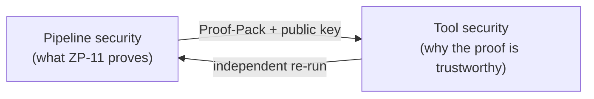

The defining property is **asymmetry**: a change advances only on affirmative, reproducible evidence. Absence of evidence is failure, never consent.

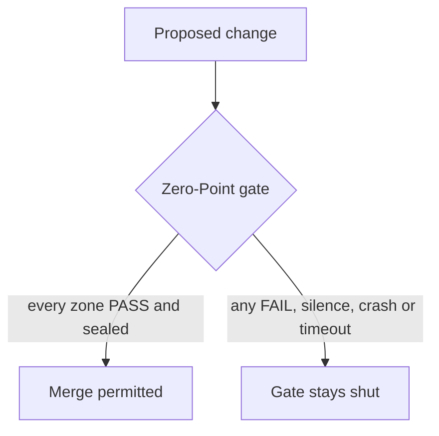

Conventional checks are advisory: they warn, then let the merge through. ZP-11 inverts the default.

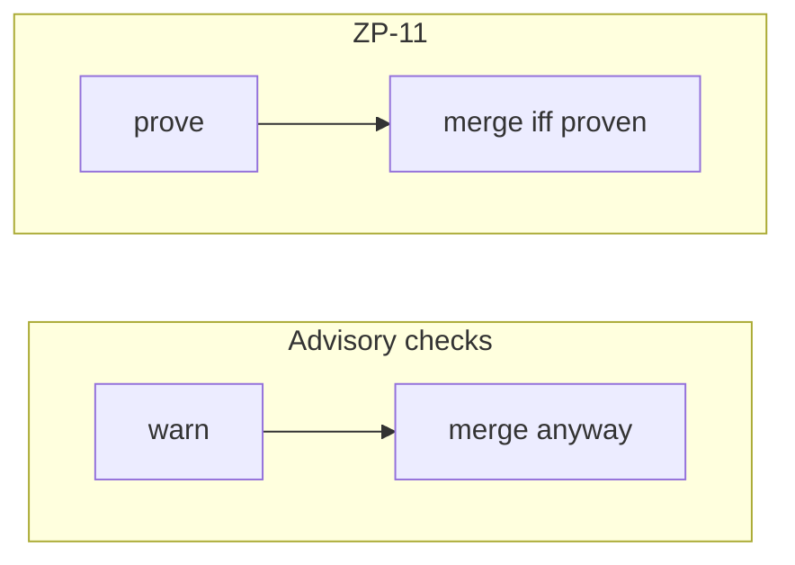

This document maps each design decision to the code that enforces it. Where a reader wants the normative text, see `SPEC.md`; where they want the exact bytes, see `zp11/`.

---

## 2. The control surface: eleven zones as security controls

Each of the eleven zones is an independent check with a defined input, a deterministic verdict, and evidence attached to the pack. The names and ordering are fixed by the standard. A zone that cannot run — or cannot prove its result — returns `FAIL`.

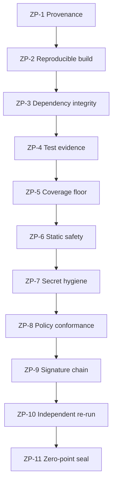

| Zone | Control category | Attack it closes |
|------|-----------------|------------------|
| ZP-1 Provenance | Origin authenticity | Unattributed or forged source |
| ZP-2 Reproducible build | Build integrity | Non-deterministic or tampered output |
| ZP-3 Dependency integrity | Supply chain | Dependency substitution / confusion |
| ZP-4 Test evidence | Behavioural assurance | Untested change presented as tested |
| ZP-5 Coverage floor | Assurance depth | Logic that no test exercises |
| ZP-6 Static safety | Code safety | Newly introduced dangerous patterns |
| ZP-7 Secret hygiene | Data exposure | Leaked credentials in diff or build |
| ZP-8 Policy conformance | Governance | Change that violates policy-as-code |
| ZP-9 Signature chain | Non-repudiation | Receipt forgery or substitution |
| ZP-10 Independent re-run | Runner integrity | Compromised primary runner |
| ZP-11 Zero-point seal | Composition | A pack assembled from unrelated receipts |

Grouped by the defence they provide, the eleven zones cover four layers of a pipeline.

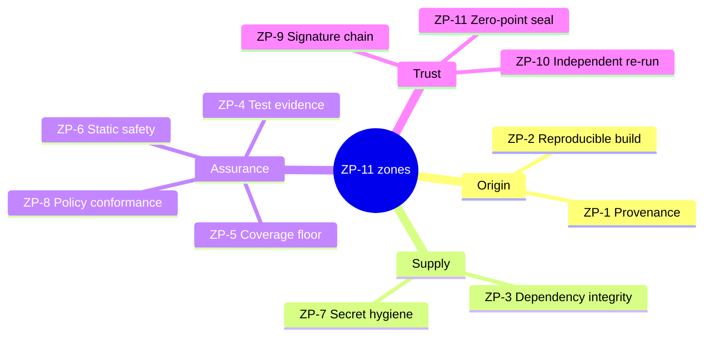

### 2.1 Zones are declarative

A repository maps each `ZP-n` to one of a small set of *kinds* in `zp11.toml`. The reference library implements five kinds in `zones.py`.

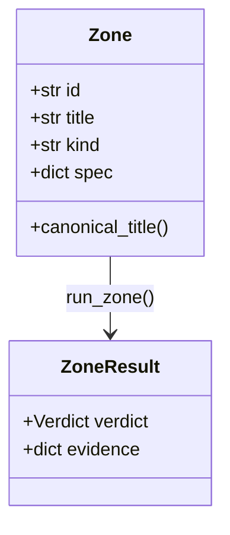

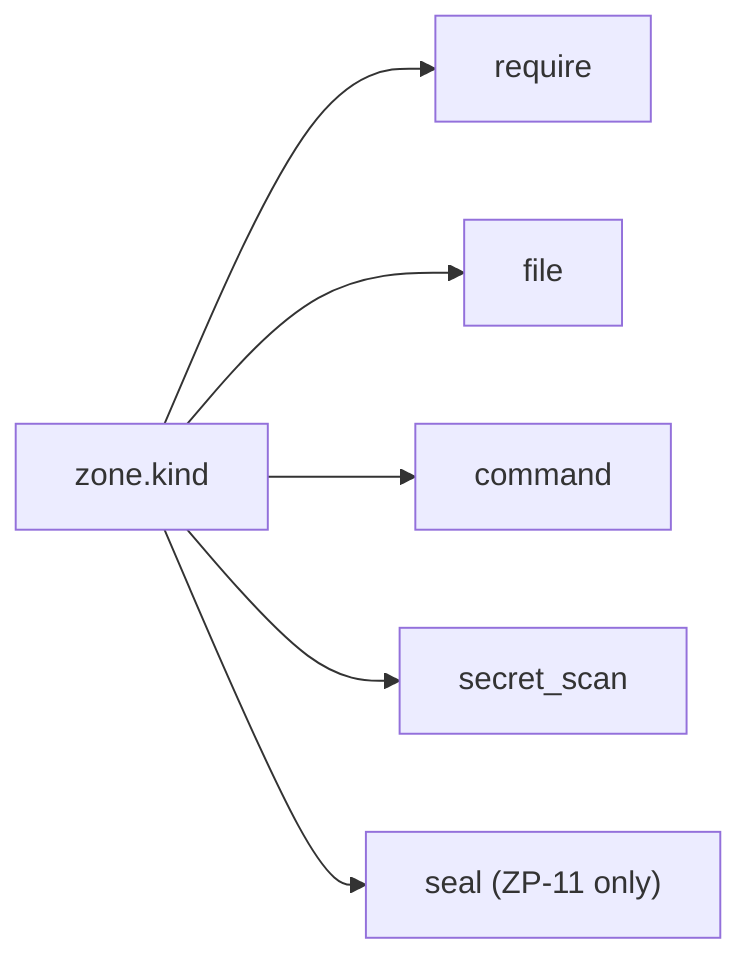

The `require` kind proves that named change fields are present and non-empty — the mechanism behind ZP-1.

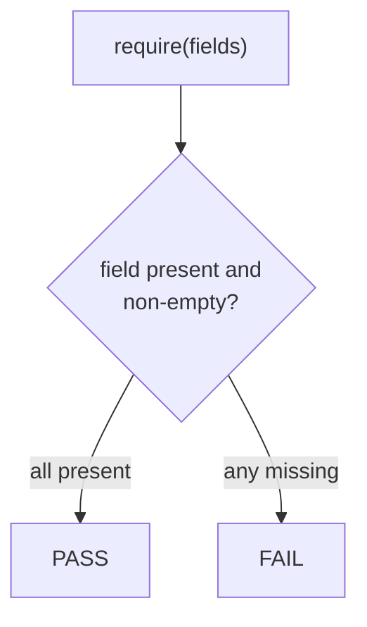

The `file` kind proves a path exists and meets a minimum size, recording its SHA-256 as evidence — the mechanism behind ZP-2 and ZP-4 artifacts.

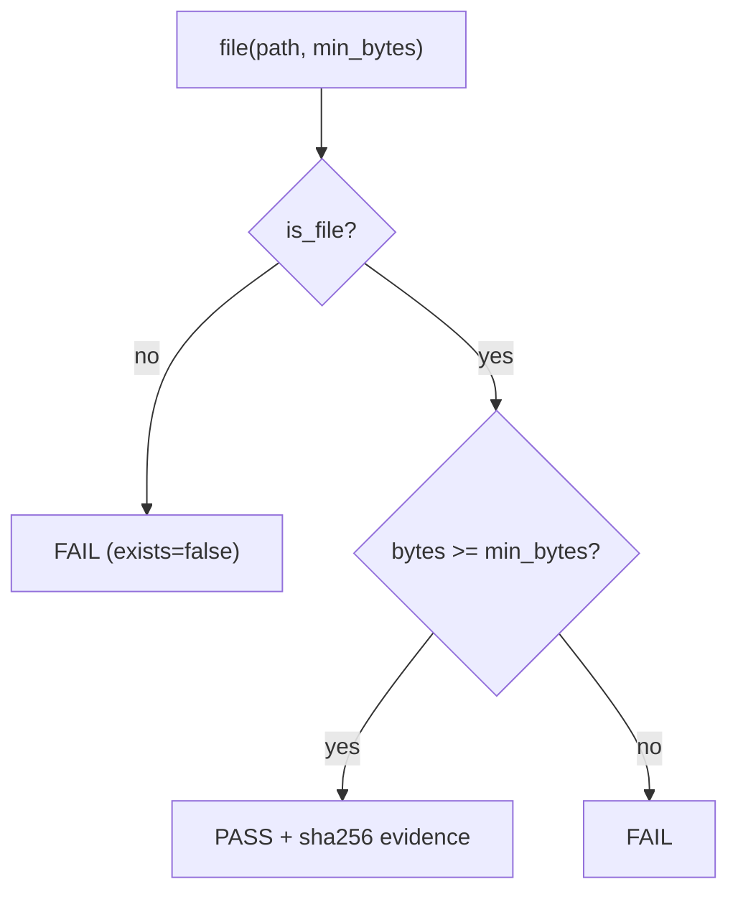

The `command` kind proves a shell command exits with the expected code, digesting its combined output as evidence — the general mechanism behind ZP-4, ZP-5, ZP-6, and ZP-8.

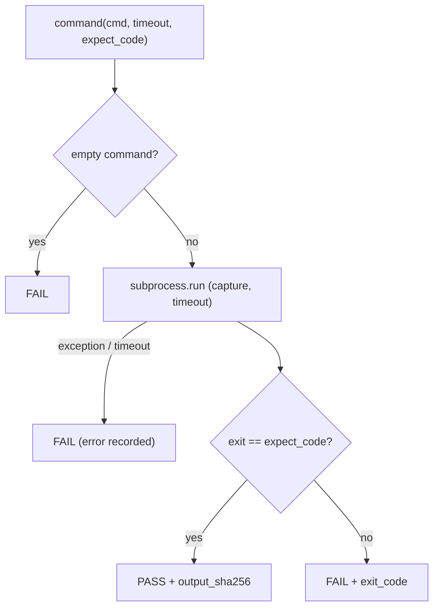

The `secret_scan` kind is ZP-7: it walks the configured globs and fails on any pattern or high-entropy match, recording **only** locations.

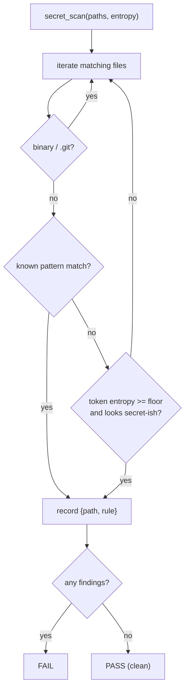

ZP-7 records findings as `{path, rule}` and never the secret bytes — evidence must never itself be a disclosure.

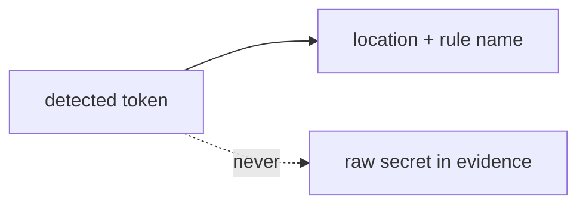

The secret detectors are deliberately conservative: false negatives are tolerated so that an *obvious* leak can never pass silently.

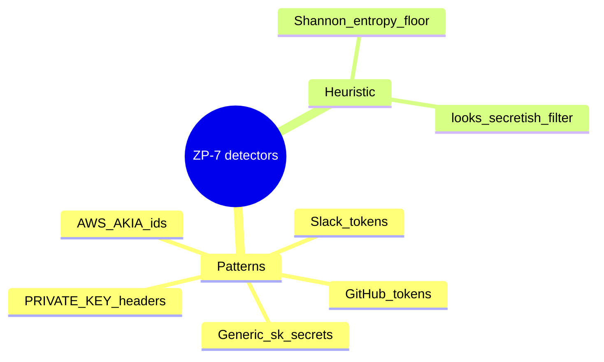

---

## 3. The verdict algebra: fail-closed by construction

The entire standard turns on one rule, enforced in `verdict.py`: a zone returns exactly two verdicts, and everything else collapses to `FAIL`.

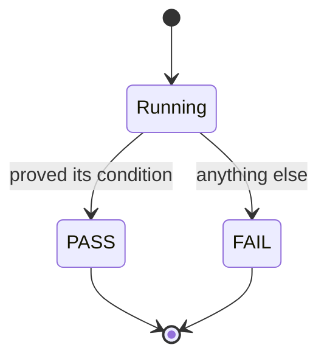

There is no third state that permits merge. Silence, exceptions, timeouts, and unparseable output all coerce to `FAIL`.

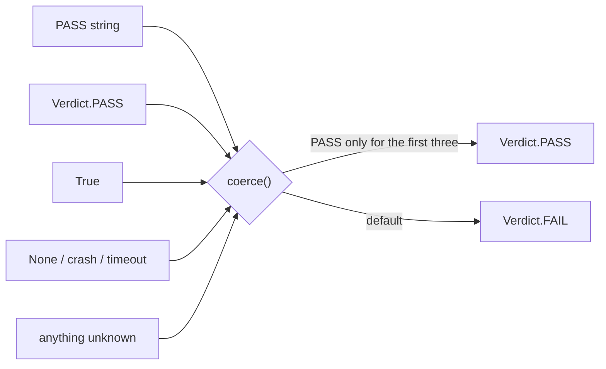

`Verdict` is truthy only for `PASS`, so ordinary boolean composition across zones is correct by default.

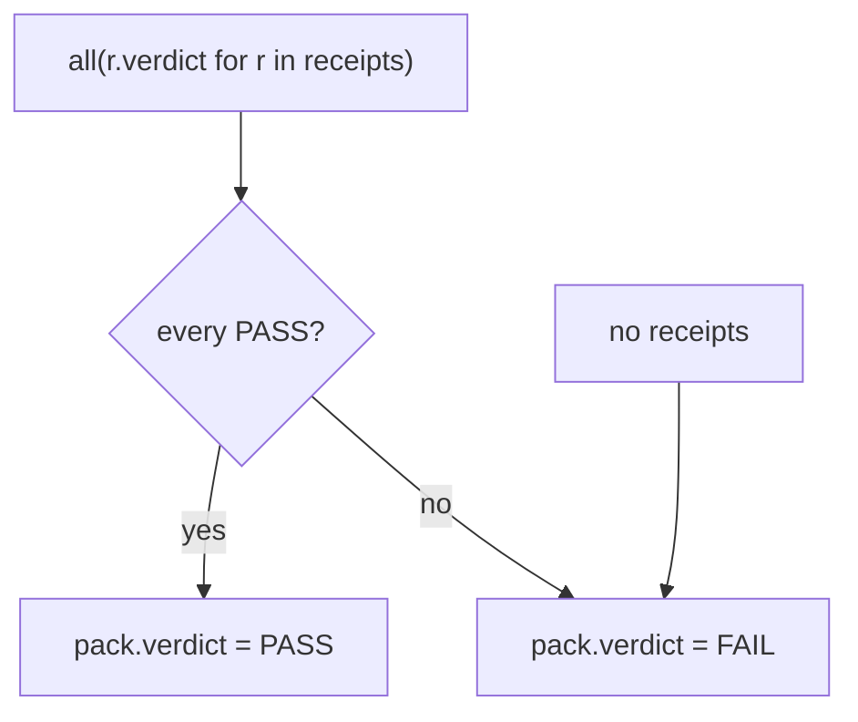

Even a correctly-running gate that produced zero receipts is a `FAIL`: an empty pack can never be a pass.

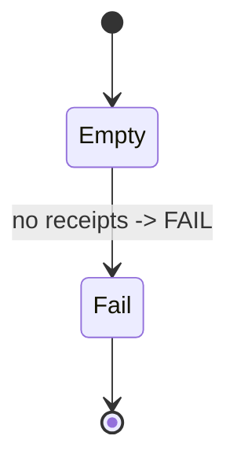

This asymmetry is what makes ZP-11 safe to wire as a *required* status check: the failure mode of the tool itself is a closed gate.

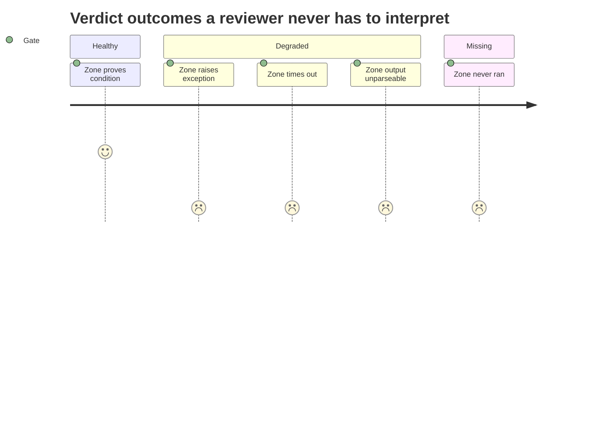

---

## 4. The Proof-Pack: integrity without trusting the pipeline

A Proof-Pack is the single machine-verifiable record the gate emits. Two independent properties make it trustworthy without trusting the pipeline that produced it: per-receipt **integrity**, and the ZP-11 **seal** over the ordered receipt chain.

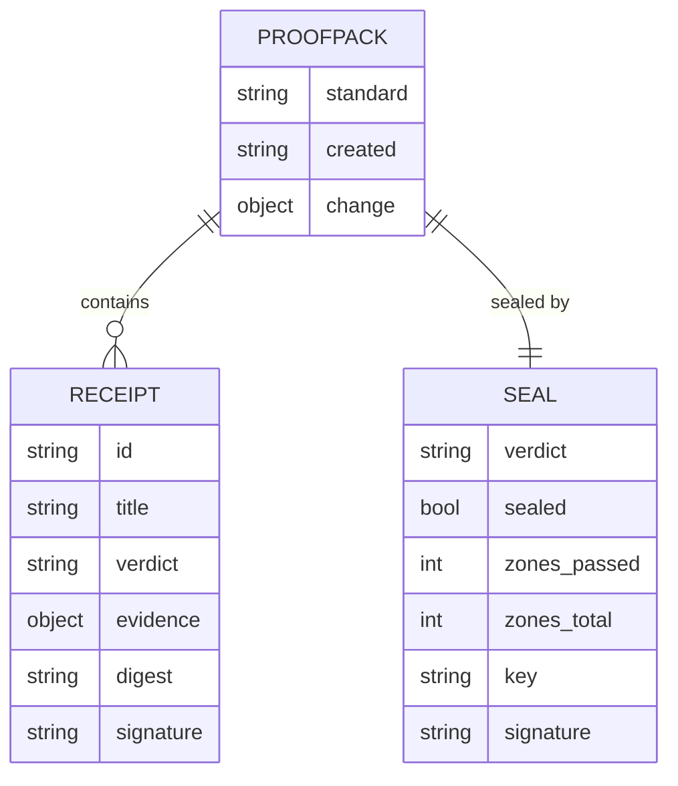

The `change` names what was evaluated: an identifier, a signed source commit, and a named builder.

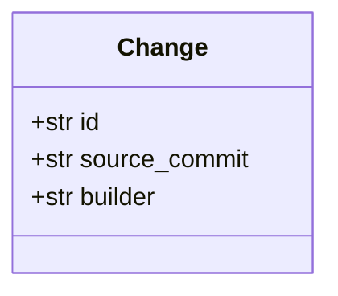

The schema (`schema/proof-pack.schema.json`) requires at least eleven zones and constrains every digest and key to its exact encoding.

```mermaid
flowchart TB
  pack["Proof-Pack JSON"] --> schema{"validates against<br/>proof-pack.schema.json?"}
  schema -->|"no"| rej["rejected"]
  schema -->|"yes"| cont["proceed to cryptographic verification"]
```

```mermaid
flowchart LR
  d["digest"] -->|"pattern"| dp["sha256:[64 hex]"]
  k["seal.key"] -->|"pattern"| kp["ed25519:[64 hex]"]
  v["verdict"] -->|"enum"| ve["PASS or FAIL"]
```

### 4.1 Canonical serialization

A pack is re-runnable only if two honest parties serialize the same data to the same bytes. `canonical.py` implements the RFC 8785 (JCS) subset the standard relies on.

```mermaid
flowchart TB
  val["JSON-compatible value"] --> enc["_encode()"]
  enc --> keys["object keys sorted lexicographically"]
  enc --> sep["minimal separators, no whitespace"]
  enc --> utf["UTF-8 output"]
  enc --> rej{"NaN / Infinity / non-string key?"}
  rej -->|"yes"| err["CanonicalizationError"]
  rej -->|"no"| bytes["canonical bytes"]
```

Rejecting non-canonical values is itself a security control: a value with no stable form has no stable digest, so it must not enter the chain.

```mermaid
stateDiagram-v2
  [*] --> Encoding
  Encoding --> Canonical: finite, string keys
  Encoding --> Rejected: NaN, Infinity, non-string key
  Canonical --> [*]
  Rejected --> [*]: reject the pack
```

### 4.2 Receipt digest

For each zone, `digest = "sha256:" + hex(SHA-256(canonical(body)))` where the body is `{id, title, verdict, evidence}`. Altering any evidence byte changes the digest.

```mermaid
flowchart LR
  body["{id, title, verdict, evidence}"] --> can["canonicalize"]
  can --> sha["SHA-256"]
  sha --> dig["sha256:<hex>"]
```

```mermaid
sequenceDiagram
  participant E as Evidence
  participant D as Digest
  participant V as Verifier
  E->>D: canonical(body) -> sha256
  Note over E: attacker flips one byte
  V->>D: recompute digest(body)
  D-->>V: mismatch -> evidence altered
```

---

## 5. The signature chain and the Zero-Point seal

Signatures use Ed25519 (RFC 8032), encoded `ed25519:<hex>`; public keys are 32 raw bytes, `ed25519:<hex>`. `crypto.py` holds the primitives.

```mermaid
classDiagram
  class KeyPair {
    +generate()
    +from_seed(bytes)
    +public PublicKey
    +seed_hex str
    +sign_bytes(data)
  }
  class PublicKey {
    +bytes raw
    +id str
    +parse(text)
  }
  KeyPair --> PublicKey : public
```

Each receipt is signed over `canonical({...body, digest})`. The seal (ZP-11) is signed over the *seal content*: the standard, timestamp, change, verdict, counts, and the **ordered list of receipt digests**.

```mermaid
flowchart TB
  r1["receipt 1 digest"] --> chain["ordered digest chain"]
  r2["receipt 2 digest"] --> chain
  rn["receipt n digest"] --> chain
  chain --> content["seal_content"]
  content --> seal["Ed25519 seal signature"]
```

Because the seal binds the ordered digests, receipts cannot be reordered, added, or removed without invalidating it.

```mermaid
sequenceDiagram
  participant G as Gate
  participant P as Proof-Pack
  participant A as Attacker
  participant V as Verifier
  G->>P: sign each receipt
  G->>P: seal over ordered digest chain
  A->>P: reorder / drop / inject a receipt
  V->>P: reconstruct seal_content
  V-->>A: seal signature invalid
```

The seal also carries whether the pack is `sealed`, which is true only when the pack verdict is `PASS`.

```mermaid
stateDiagram-v2
  [*] --> Assembling
  Assembling --> Sealed: verdict PASS -> sealed=true
  Assembling --> Unsealed: any FAIL -> sealed=false
  Sealed --> [*]: merge may be permitted
  Unsealed --> [*]: merge refused
```

A failing pack is still emitted — as evidence of *why* the gate stays shut — but it is never sealed.

```mermaid
flowchart LR
  fail["any zone FAIL"] --> emit["pack still emitted"]
  emit --> noseal["sealed = false"]
  noseal --> refuse["merge refused"]
```

The gate is the only place the eleven zones are composed. It runs ZP-1 through ZP-10, derives ZP-11 from whether every prior zone passed, signs the chain, and emits the pack.

```mermaid
sequenceDiagram
  participant Cfg as zp11.toml
  participant Gate as run_gate
  participant Z as Zones
  participant Pack as ProofPack
  Cfg->>Gate: change + zone specs
  loop ZP-1 .. ZP-10
    Gate->>Z: run_zone(zone, ctx)
    Z-->>Gate: ZoneResult(verdict, evidence)
  end
  Gate->>Gate: ZP-11 = PASS iff all prior PASS
  Gate->>Pack: assemble receipts
  Gate->>Pack: seal(keypair)
  Pack-->>Gate: signed Proof-Pack
```

---

## 6. Verification and the trust model

Given a Proof-Pack `P` and a public key `K`, a verifier confirms presence of all zones, recomputes every digest, checks every signature, reconstructs the seal content, and confirms every verdict is `PASS` with `sealed = true`. `verify_pack` in `pack.py` is the normative oracle.

```mermaid
flowchart TB
  start["verify_pack(P, K)"] --> z{"all 11 zones present?"}
  z -->|"no (strict)"| r1["reason: missing zones"]
  z -->|"yes"| dg["recompute each digest"]
  dg --> dgc{"digest matches?"}
  dgc -->|"no"| r2["reason: evidence altered"]
  dgc -->|"yes"| sig["verify each receipt signature"]
  sig --> sigc{"signature valid?"}
  sigc -->|"no"| r3["reason: bad signature"]
  sigc -->|"yes"| sealc["reconstruct + verify seal"]
  sealc --> decide{"all PASS and sealed and no reasons?"}
  decide -->|"yes"| merge["merge_permitted = true"]
  decide -->|"no"| shut["merge_permitted = false"]
```

The verifier defaults to refusing merge when `K` is unavailable: no key means no basis for trust.

```mermaid
flowchart LR
  nokey["no public key"] --> reason["reason: no key to verify"]
  reason --> refuse["merge refused"]
```

`VerifyReport` separates *integrity* from the *merge decision*, so a caller can tell a tampered pack from an honestly-failing one.

```mermaid
classDiagram
  class VerifyReport {
    +bool ok
    +bool merge_permitted
    +list reasons
    +int zones_passed
    +int zones_total
  }
```

```mermaid
flowchart TB
  rep["VerifyReport"] --> ok{"ok (integrity)"}
  rep --> mp{"merge_permitted"}
  ok -->|"false"| tamper["pack tampered or malformed"]
  ok -->|"true"| honest["pack intact"]
  honest --> mp
  mp -->|"false"| shut["honest FAIL -> shut"]
  mp -->|"true"| open["sealed PASS -> open"]
```

The trust model has a single root: the signing key. It lives outside the gated repository and is rotated per the adopter's policy.

```mermaid
flowchart TB
  key["Ed25519 signing key"] -->|"signs"| receipts["receipts + seal"]
  receipts -->|"verified by"| pub["public key"]
  pub --> anyone["any third party"]
  key -.->|"must live"| outside["outside the gated repo"]
```

Trust flows one direction only: a verifier needs nothing but the pack and the public key — never access to the original CI.

```mermaid
journey
  title What a third-party verifier needs
  section Required
    The Proof-Pack JSON: 5: Verifier
    The public key: 5: Verifier
  section Not required
    Access to the original CI: 1: Verifier
    Trust in the pipeline operator: 1: Verifier
    Network connectivity to the builder: 1: Verifier
```

### 6.1 ZP-10: independent re-run

ZP-10 exists specifically to detect a compromised primary runner. A second, isolated runner reproduces the verdict; the two runners should not share state.

```mermaid
sequenceDiagram
  participant R1 as Primary runner
  participant R2 as Independent runner
  participant Cmp as Comparison
  R1->>Cmp: verdict + output digest
  R2->>Cmp: verdict + output digest
  Cmp->>Cmp: digests equal?
  Cmp-->>R1: PASS iff identical
```

```mermaid
flowchart LR
  r1["Runner A"] -->|"no shared state"| cmp{"same result?"}
  r2["Runner B"] --> cmp
  cmp -->|"yes"| pass["ZP-10 PASS"]
  cmp -->|"no"| fail["ZP-10 FAIL"]
```

---

## 7. STRIDE threat model for a gated pipeline

The eleven zones map cleanly onto the STRIDE categories. Naquib Hatami designed the zone set so that each major threat class has an owning control.

```mermaid
mindmap
  root(("STRIDE vs zones"))
    Spoofing
      ZP-1 Provenance
      ZP-9 Signature chain
    Tampering
      ZP-2 Reproducible build
      Receipt digests
    Repudiation
      ZP-9 Signature chain
      ZP-11 Seal
    Information_disclosure
      ZP-7 Secret hygiene
    Denial_of_service
      Fail-closed verdicts
    Elevation_of_privilege
      ZP-8 Policy conformance
      ZP-6 Static safety
```

| STRIDE | Threat in the pipeline | ZP-11 answer |
|--------|------------------------|--------------|
| Spoofing | Change from an unknown origin | ZP-1 + ZP-9 require signed provenance |
| Tampering | Evidence edited after the fact | Receipt digest + signature |
| Repudiation | "I never approved that build" | Seal over the ordered chain |
| Information disclosure | Secret leaked in diff | ZP-7 fails closed; records locations only |
| Denial of service | Runner hang stalls the gate | Timeout coerces to FAIL |
| Elevation of privilege | Change bypasses policy | ZP-8 policy-as-code must PASS |

An attacker's goal is always the same: open the gate without the evidence. Every path there is closed.

```mermaid
flowchart TB
  goal["Attacker goal: open gate without evidence"] --> p1["Forge a receipt"]
  goal --> p2["Alter evidence"]
  goal --> p3["Reorder / drop receipts"]
  goal --> p4["Hang a zone"]
  goal --> p5["Leak a key through evidence"]
  p1 --> b1["blocked: signature"]
  p2 --> b2["blocked: digest"]
  p3 --> b3["blocked: seal chain"]
  p4 --> b4["blocked: timeout -> FAIL"]
  p5 --> b5["blocked: ZP-7 records locations only"]
```

The failure of any single control still leaves the gate shut, because the seal requires *all* zones.

```mermaid
stateDiagram-v2
  [*] --> TenPass
  TenPass --> Shut: one zone FAIL
  TenPass --> Open: all eleven PASS and sealed
  Shut --> [*]
  Open --> [*]
```

---

## 8. How ZP-11 itself is built securely

The tool that governs other pipelines must itself be trustworthy. The reference library is small, dependency-light, and structured so each security property lives in exactly one module.

```mermaid
flowchart TB
  cli["cli.py"] --> gate["gate.py"]
  gate --> zones["zones.py"]
  gate --> pack["pack.py"]
  zones --> crypto["crypto.py"]
  pack --> crypto
  crypto --> canonical["canonical.py"]
  zones --> verdict["verdict.py"]
  pack --> verdict
```

Each module owns one concern, which keeps the trusted computing base auditable.

```mermaid
flowchart TB
  cli["cli.py — keygen / zones / run / verify"] --> gate["gate.py — compose and seal"]
  gate --> zones["zones.py — five zone kinds"]
  gate --> pack["pack.py — Receipt, ProofPack, verify_pack"]
  pack --> crypto["crypto.py — Ed25519 and SHA-256"]
  zones --> crypto
  crypto --> canonical["canonical.py — RFC 8785 bytes"]
  pack --> verdict["verdict.py — PASS/FAIL algebra"]
```

### 8.1 Dependency surface

The cryptography is delegated to a single vetted library rather than hand-rolled; everything else is standard library.

```mermaid
flowchart LR
  zp["zp11"] --> std["Python stdlib only"]
  zp --> cr["cryptography (Ed25519)"]
  cr -.->|"not"| custom["hand-rolled crypto"]
```

Dependencies are pinned and hashed in `requirements.lock`, which is exactly what ZP-11 asks of its adopters under ZP-3 — the tool eats its own dogfood.

```mermaid
flowchart TB
  lock["requirements.lock"] --> pin["every dep pinned"]
  lock --> hash["every dep hashed"]
  pin --> repro["reproducible install"]
  hash --> integ["supply-chain integrity"]
```

### 8.2 The secure SDLC loop for the standard

ZP-11 is developed under the same discipline it enforces. Changes to the standard pass through a Zero-Point gate before they reach `main`.

```mermaid
flowchart LR
  dev["propose change to ZP-11"] --> test["run tests/"]
  test --> gate["run the gate on itself"]
  gate --> verify["verify the pack"]
  verify --> merge{"sealed PASS?"}
  merge -->|"yes"| main["merge to main"]
  merge -->|"no"| back["back to dev"]
```

```mermaid
stateDiagram-v2
  [*] --> Draft
  Draft --> Gated: open PR
  Gated --> Draft: any zone FAIL
  Gated --> Merged: sealed PASS
  Merged --> Released: tag + CHANGELOG
  Released --> [*]
```

The reference implementation is the normative oracle for test vectors: its behaviour *is* the conformance target, so its own test suite is a security artifact, not merely a quality one.

```mermaid
flowchart TB
  ref["reference implementation"] --> oracle["normative oracle"]
  oracle --> vectors["conformance test vectors"]
  vectors --> others["third-party implementations"]
  others -->|"must match"| oracle
```

### 8.3 CLI as a safe status check

`zp11 run` exits 0 only when merge is permitted; any failure exits non-zero. This is what makes the CLI safe to wire as a required check — a crashed CLI is a non-zero exit, which is a shut gate.

```mermaid
flowchart TB
  run["zp11 run"] --> permitted{"sealed and PASS?"}
  permitted -->|"yes"| z0["exit 0 -> merge permitted"]
  permitted -->|"no"| z1["exit 1 -> gate stays shut"]
  crash["CLI crashes"] --> znz["non-zero exit -> shut"]
```

```mermaid
flowchart LR
  kg["keygen"] --> k["Ed25519 key + .pub"]
  zc["zones"] --> list["eleven canonical names"]
  rn["run"] --> pk["Proof-Pack + exit code"]
  vf["verify"] --> dec["decision + exit code"]
```

Key generation keeps the secret seed and the public id separate; only the public id is printed to stdout.

```mermaid
sequenceDiagram
  participant U as Operator
  participant CLI as zp11 keygen
  participant FS as Filesystem
  U->>CLI: keygen --out ci.key
  CLI->>FS: write seed to ci.key
  CLI->>FS: write public id to ci.key.pub
  CLI-->>U: print public id (stdout)
```

---

## 9. Deployment architecture

ZP-11 is additive: run it alongside the existing pipeline, then make it blocking once every zone is green. There is nothing to purchase and no account to create.

```mermaid
flowchart LR
  a["1 Declare zones"] --> b["2 Emit a Proof-Pack"]
  b --> c["3 Re-run to verify (ZP-10)"]
  c --> d["4 Make the gate blocking"]
```

A typical wiring places ZP-11 as a required status check in front of the protected branch.

```mermaid
flowchart TB
  pr["Pull request"] --> ci["CI runs zp11 run"]
  ci --> pack["Proof-Pack artifact"]
  pack --> indep["Independent runner: zp11 verify"]
  indep --> status{"merge permitted?"}
  status -->|"yes"| allow["required check green"]
  status -->|"no"| block["required check red"]
```

The pack is portable, so verification can happen anywhere — in CI, on a reviewer's laptop, or in an auditor's archive years later.

```mermaid
journey
  title Where a Proof-Pack can be verified
  section In the pipeline
    CI required check: 5: CI
  section By a human
    Reviewer laptop: 4: Reviewer
  section Later
    Auditor archive: 5: Auditor
```

Key material is the one piece that must be provisioned carefully: the signing seed lives in the CI secret store, and only the public key travels with the pack.

```mermaid
flowchart LR
  store["CI secret store"] -->|"seed"| signer["zp11 run"]
  signer -->|"public key in pack"| verifier["zp11 verify"]
  store -.->|"never"| repo["gated repository"]
```

Rotation is a public-key swap: issue a new key, re-seal future packs, and keep the old public key to verify historical packs.

```mermaid
stateDiagram-v2
  [*] --> KeyA
  KeyA --> Rotating: issue KeyB
  Rotating --> KeyB: new packs sealed with KeyB
  KeyB --> [*]
  Rotating --> Archive: KeyA kept to verify old packs
```

---

## 10. End-to-end security trace

The following trace follows one change from proposal to merge, showing where each control acts.

```mermaid
sequenceDiagram
  participant Dev as Change
  participant Gate as ZP-11 gate
  participant Zones as ZP-1..ZP-10
  participant Seal as ZP-11 seal
  participant Pack as Proof-Pack
  participant Ver as Independent verifier
  Dev->>Gate: propose change -> main
  Gate->>Zones: run each zone, attach evidence
  Zones-->>Gate: verdicts (PASS/FAIL)
  Gate->>Seal: PASS iff all prior PASS
  Seal->>Pack: sign receipts + seal chain
  Pack-->>Ver: proof-pack.json + public key
  Ver->>Ver: digests, signatures, re-run ZP-10
  Ver-->>Dev: merge permitted iff sealed PASS
```

Viewed as a data-integrity pipeline, the same trace is a chain of hashes and signatures where every link is checkable in isolation.

```mermaid
flowchart LR
  ev["evidence"] --> dg["digest"]
  dg --> rs["receipt signature"]
  rs --> ch["ordered digest chain"]
  ch --> sl["seal signature"]
  sl --> vr["verifier: all links valid?"]
  vr --> ok["merge permitted"]
```

The reasons list in a failing verification is the audit trail: it names exactly which control refused.

```mermaid
flowchart TB
  rep["VerifyReport.reasons"] --> m["missing zones"]
  rep --> d["digest mismatch (evidence altered)"]
  rep --> s["bad or missing signature"]
  rep --> ss["seal signature invalid"]
  rep --> fc["fail-closed: zones did not pass"]
  rep --> ns["all pass but not sealed"]
```

Because every reason is machine-readable, the gate's decision is never a matter of trust or interpretation.

```mermaid
stateDiagram-v2
  [*] --> Decision
  Decision --> Permitted: empty reasons + sealed PASS
  Decision --> Refused: any reason present
  Permitted --> [*]
  Refused --> [*]
```

---

## 11. Residual risks and honest limits

ZP-11 proves what its zones are configured to prove — no more. A zone mapped to a weak check still only proves that weak check passed.

```mermaid
flowchart LR
  conf["zone configuration"] --> strength{"strong check?"}
  strength -->|"yes"| strong["strong guarantee"]
  strength -->|"no"| weak["weak guarantee (honestly recorded)"]
```

The signing key remains the root of trust; compromise of the key compromises the seal. ZP-10 and out-of-repo key storage reduce, but do not eliminate, this risk.

```mermaid
mindmap
  root(("Residual risks"))
    Key_compromise
      mitigated_out_of_repo_storage
      mitigated_rotation
    Weak_zone_mapping
      surfaced_evidence_is_explicit
    Runner_collusion
      mitigated_ZP10_isolation
    Secret_false_negatives
      accepted_conservative_detectors
```

What ZP-11 deliberately does **not** claim: it does not score, rank, or grade; there is no partial credit; there is no third verdict. These are features, not gaps.

```mermaid
flowchart TB
  no1["no score"] --> design["by design"]
  no2["no partial credit"] --> design
  no3["no third verdict"] --> design
  design --> prop["binary, fail-closed, auditable"]
```

The standard's version field lets it evolve without ambiguity: an implementation rejects a pack whose `standard` it does not recognize.

```mermaid
stateDiagram-v2
  [*] --> Received
  Received --> Accepted: standard == zp11/v1
  Received --> Rejected: unknown standard
  Accepted --> [*]
  Rejected --> [*]
```

---

## 12. Summary

ZP-11, invented by Naquib Hatami and published as an open MIT-licensed standard, secures a release pipeline by proving eleven independent conditions and refusing to merge unless all of them pass and the result is cryptographically sealed. It secures *itself* by keeping its trusted computing base small, delegating cryptography to a vetted primitive, pinning and hashing its own dependencies, and running its own gate on every change to the standard. The result is a release gate whose failure mode is a closed door, whose decisions are reproducible from a single portable artifact, and whose trust rests on nothing softer than an Ed25519 signature over a canonical digest chain.

```mermaid
flowchart LR
  evidence["Affirmative evidence"] --> seal["Cryptographic seal"]
  seal --> verify["Independent verification"]
  verify --> merge["Merge permitted"]
  silence["Silence / doubt / failure"] --> shut["Gate stays shut"]
```

---

## Related documents

- `01-overview.md` — ProofGate ZP-11 at a glance and the one idea behind the standard.
- `03-proof-pack-format.md` — the Proof-Pack structure, schema, and canonical serialization in depth.
- `05-cryptography.md` — Ed25519 signing, SHA-256 digests, and the seal chain.
- `07-zones-reference.md` — the eleven zones, their kinds, and configuration.
- `11-threat-model.md` — the full STRIDE analysis and residual-risk register.
