> Part of the ProofGate ZP-11 documentation set.

# The Eleven Zones — Reference

A deep, per-zone reference for **ProofGate ZP-11** (`zp11/v1`), the open,
fail-closed release-governance standard invented by **Naquib Hatami** and
published under the MIT License by iQs Group Inc. / SADI AI Inc.
(repository `github.com/iQs-Group/ZP-11`, homepage `zp11.org`).

## Abstract

ZP-11 places eleven independent *Zero-Point zones* between every proposed change
and a protected branch. The gate is **closed by default** and opens only when all
eleven zones return `PASS` and the Proof-Pack is sealed. This document is the
authoritative per-zone reference: for each of the eleven zones it specifies the
**input** the zone consumes, the **verdict logic** that maps that input onto the
two-valued `PASS`/`FAIL` space, the **evidence** the zone writes into its receipt,
and the **failure modes** that drive the fail-closed decision. The reference is
grounded entirely in the published specification (`SPEC.md`) and the reference
library (`zp11/`): `canonical.py`, `crypto.py`, `verdict.py`, `zones.py`,
`pack.py`, `gate.py`, `cli.py`, and `schema/proof-pack.schema.json`. Nothing here
invents a benchmark, adopter, or feature beyond what the repository implements.

---

## 1. How to read this reference

Every zone is an independent check with exactly three observable outputs: a
**verdict** (`PASS` or `FAIL`), an **evidence** object, and — once the gate signs
the pack — a **digest** and **signature**. The standard's defining asymmetry is
that a change advances only on affirmative, reproducible evidence; a crash, a
timeout, a missing file, or an unparseable result all resolve to `FAIL`.

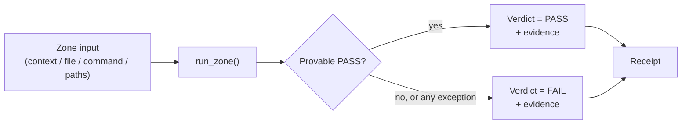

The eleven zones run in fixed order. ZP-1 through ZP-10 are substantive checks;
ZP-11 is the seal, derived by the gate from whether every prior zone passed.

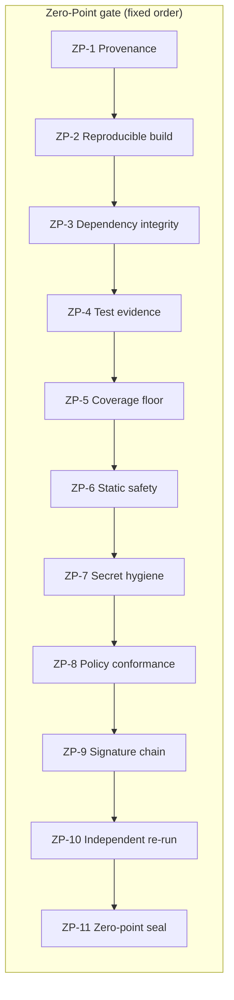

Each zone binds to exactly one *kind* in `zp11.toml`. A kind is a small, auditable
strategy for producing a verdict from an input.

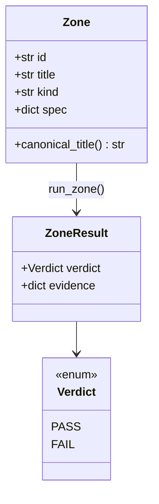

The five kinds that `zones.py` implements map onto the eleven zones as follows.

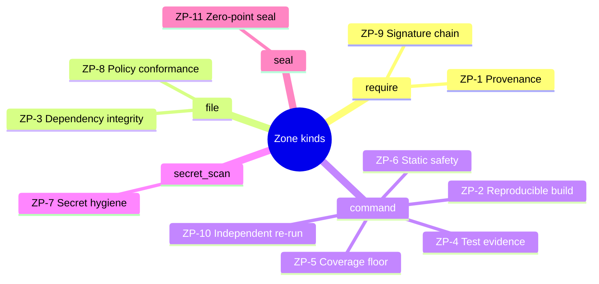

A single rule governs every kind: the verdict is `PASS` only when the zone can
*prove* its condition, and `FAIL` in every other case, including an uncaught
exception, which `run_zone` catches and converts to a closed verdict.

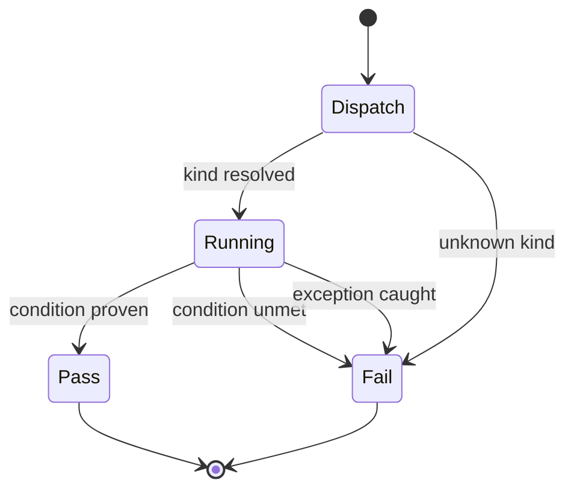

---

## 2. The common zone anatomy

Before the per-zone detail, four properties hold for **all** zones. First, input:
a zone reads only from its declared `spec` and the shared `Context` (`root`,
`change`, `now`, `env`). Second, verdict: two values, no third state (`verdict.py`).
Third, evidence: for the ten verifying zones, built through `_evi()`, a JSON object
beginning `{kind, tool:"zp11-ref", tool_version}` to which the zone appends its own
fields. The one exception is the ZP-11 seal evidence, which is built directly in
`gate.py` as `{kind, tool:"zp11-ref", zones_passed, zones_total, all_prior_pass}`
and deliberately **omits** `tool_version`; so `tool_version` is not universal across
every zone's evidence. Fourth, sealing: the gate digests the
receipt over its canonical body and signs it.

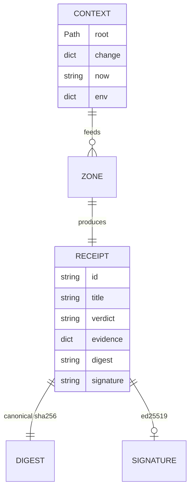

The evidence envelope is identical in shape across zones; only the payload differs.

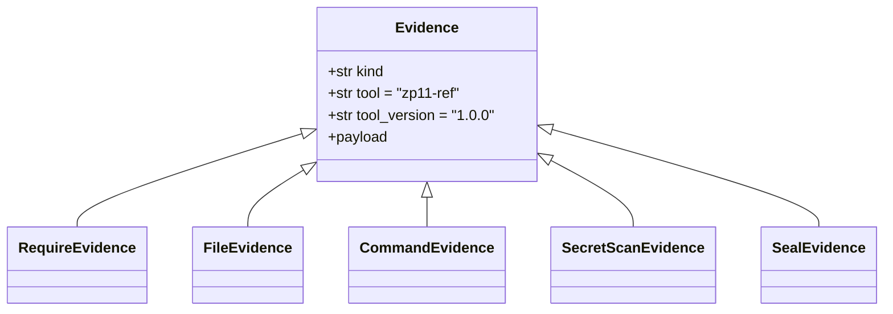

The journey a change takes through the common anatomy, from proposal to a sealed
or shut gate, is a single affirmative pass.

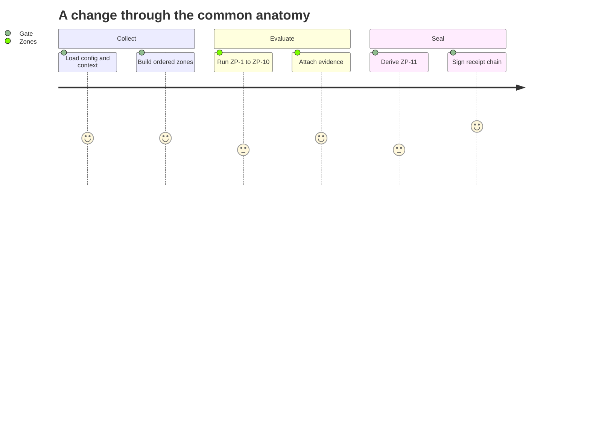

---

## 3. ZP-1 — Provenance

**Kind:** `require`. **Normative requirement:** the change MUST reference a signed
source commit and a named builder.

**Input.** ZP-1 reads named fields from the `change` table of the context —
canonically `source_commit` and `builder`. These originate in `zp11.toml`'s
`[change]` block (or are injected by CI) and describe *what* is being gated and
*who* built it. No filesystem or subprocess access occurs.

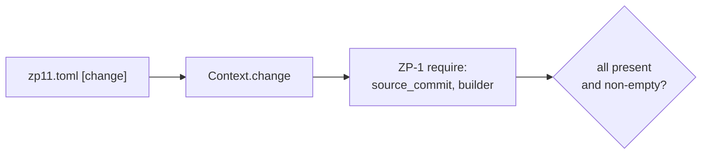

**Verdict logic.** `_run_require` iterates the required names; a value of `None`,
`""`, `[]`, or `{}` counts as missing. The verdict is `PASS` iff the missing list
is empty.

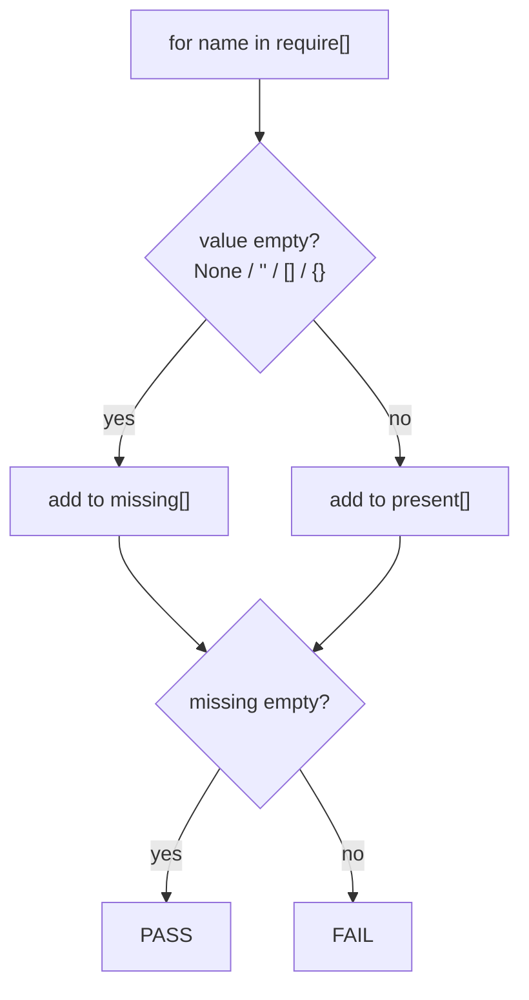

**Evidence.** The receipt records the sorted `required`, `missing`, and `present`
key names — never their values beyond presence — so a reviewer sees exactly which
provenance fields were supplied.

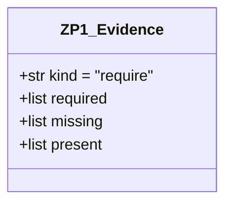

**Failure modes.** Any absent or empty provenance field shuts ZP-1 and, because
the gate is ordered and fail-closed, the seal cannot form.

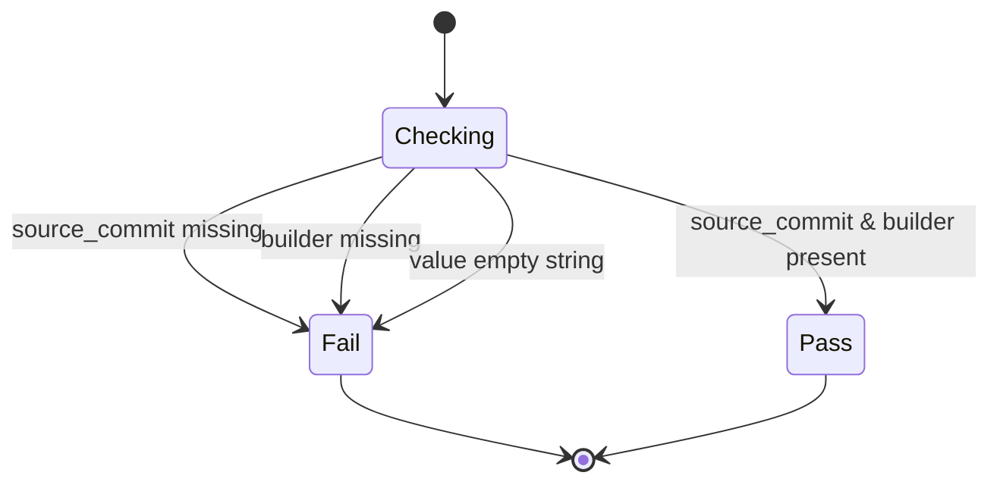

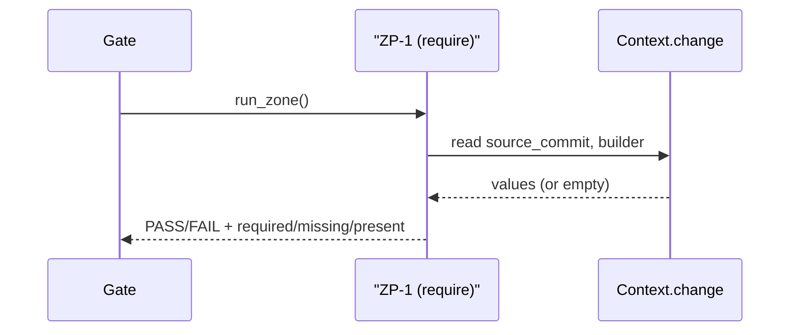

---

## 4. ZP-2 — Reproducible build

**Kind:** `command`. **Normative requirement:** re-execution MUST yield an
identical output digest.

**Input.** A shell command declared in the zone spec (in this repository,
`python -c "import zp11; print(zp11.__version__)"`), executed with `shell=True`,
`cwd=root`, captured stdout and stderr, and a timeout (default 600s).

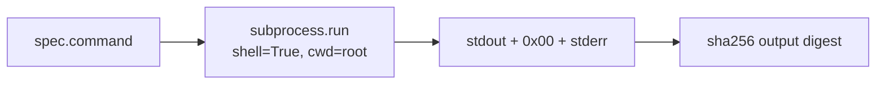

**Verdict logic.** `PASS` iff the process exit code equals `expect_code` (default
`0`). A timeout or spawn failure is caught and returns `FAIL`.

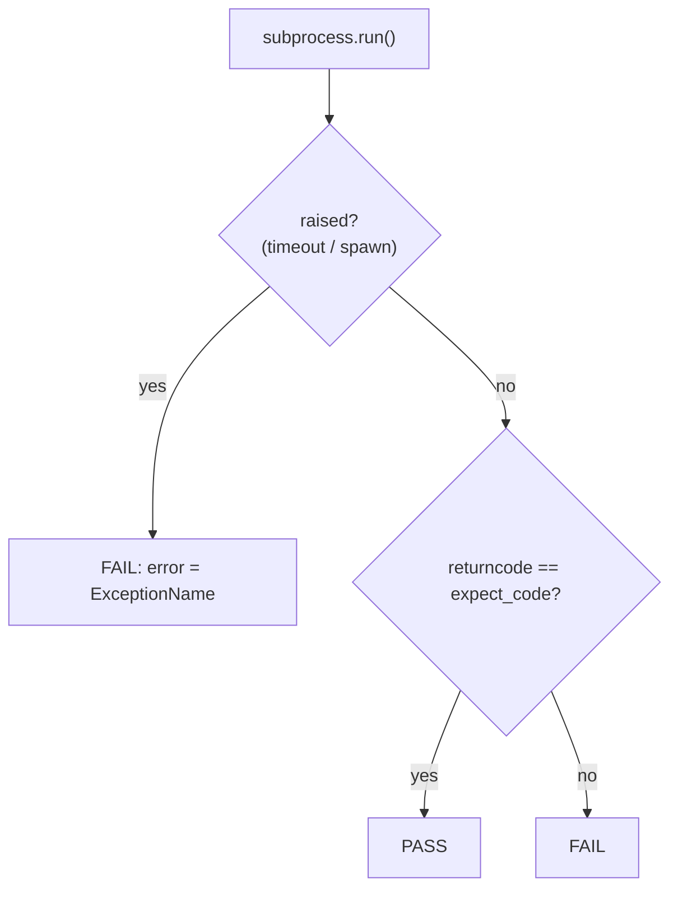

**Evidence.** The command text, the actual `exit_code`, the `expect_code`, and a
SHA-256 digest over `stdout + 0x00 + stderr`. That `output_sha256` is the
reproducibility anchor: a second honest run of a deterministic build reproduces
the same digest.

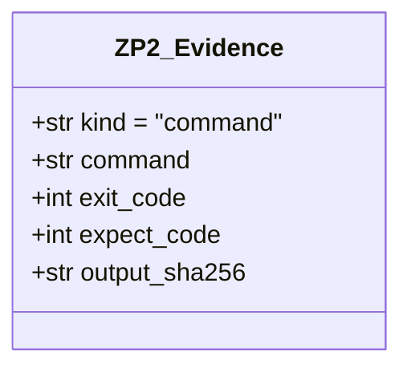

**Failure modes.** Non-zero exit, timeout, process spawn failure, or an empty
command string all close the zone.

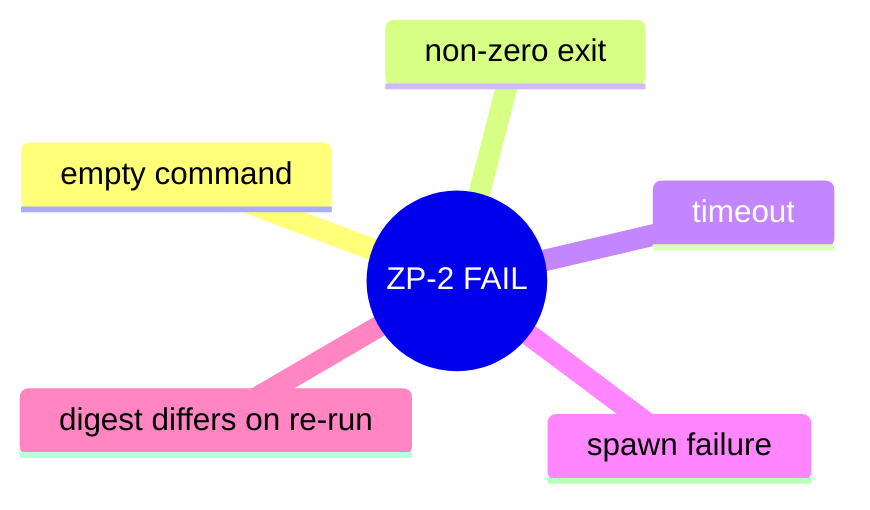

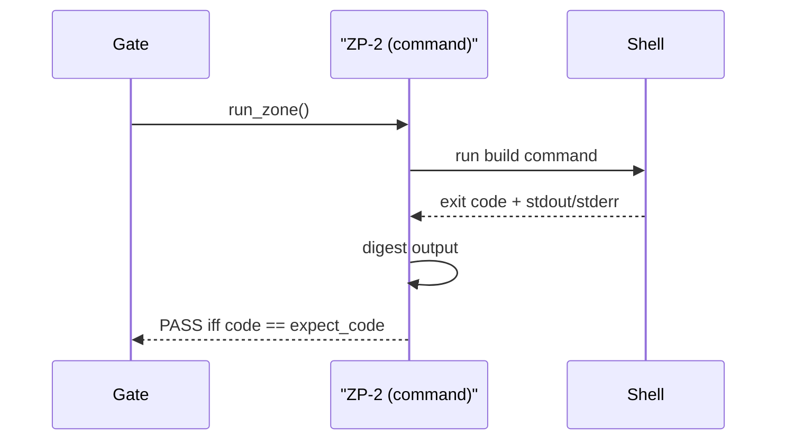

---

## 5. ZP-3 — Dependency integrity

**Kind:** `file`. **Normative requirement:** every dependency MUST be pinned and
hashed.

**Input.** A path relative to `root` (here `requirements.lock`) and an optional
`min_bytes` floor. The lock file is the artifact that proves dependencies are
pinned; ZP-3 treats its presence and non-emptiness as the checkable surface.

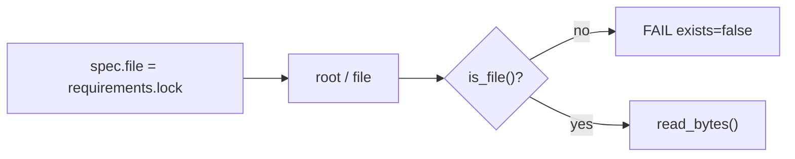

**Verdict logic.** `PASS` iff the path is a regular file and its byte length is at
least `min_bytes` (default 1).

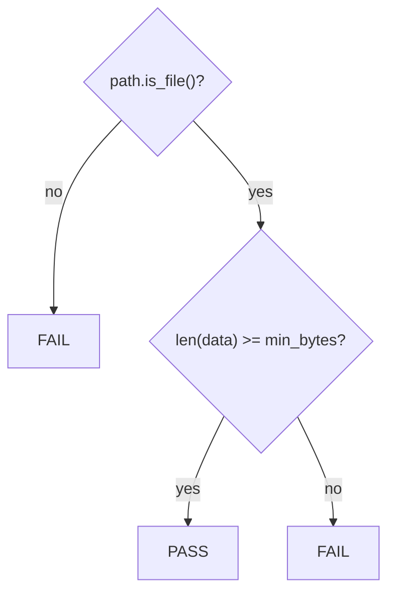

**Evidence.** The relative `path`, `exists`, `bytes`, `min_bytes`, and the file's
`sha256`. The hash binds the receipt to the exact lock contents gated.

```mermaid
classDiagram
    class ZP3_Evidence {
      +str kind = "file"
      +str path
      +bool exists
      +int bytes
      +int min_bytes
      +str sha256
    }
```

**Failure modes.** Missing lock file, an empty or too-small file, or a path that
resolves to a directory.

```mermaid
stateDiagram-v2
    [*] --> Resolve
    Resolve --> Missing: not a file
    Resolve --> Read: is a file
    Read --> TooSmall: bytes < min_bytes
    Read --> Ok: bytes >= min_bytes
    Missing --> [*]: FAIL
    TooSmall --> [*]: FAIL
    Ok --> [*]: PASS
```

```mermaid
erDiagram
    LOCKFILE ||--|| ZP3_RECEIPT : "digested into"
    LOCKFILE {
      string path
      int bytes
      string sha256
    }
```

---

## 6. ZP-4 — Test evidence

**Kind:** `command`. **Normative requirement:** declared tests MUST have run, with
machine-readable results attached.

**Input.** A test command (here `python -m pytest -q`) run through the same
`command` kind as ZP-2. The attached output digest is the machine-readable record.

```mermaid
flowchart LR
    SPEC["spec.command = pytest -q"] --> RUN["subprocess.run()"]
    RUN --> RES["exit code + output"]
    RES --> EVI["output_sha256 = test evidence"]
```

**Verdict logic.** Identical to the `command` kind: `PASS` iff the suite exits `0`.

```mermaid
flowchart TB
    T["run test command"] --> X{"exit == 0?"}
    X -->|"yes"| P["PASS: tests ran green"]
    X -->|"no"| F["FAIL: failures or non-zero"]
    T --> E{"exception?"}
    E -->|"yes"| F2["FAIL caught"]
```

**Evidence.** Command, `exit_code`, `expect_code`, and `output_sha256` over the
combined test output, so the receipt carries proof the suite executed.

```mermaid
classDiagram
    class ZP4_Evidence {
      +str kind = "command"
      +str command
      +int exit_code
      +int expect_code
      +str output_sha256
    }
```

**Failure modes.** A failing assertion, a collection error, a timeout, or no tests
at all (a non-zero pytest exit).

```mermaid
mindmap
  root(("ZP-4 FAIL"))
    assertion failure
    collection error
    import error in suite
    timeout
    non-zero pytest exit
```

```mermaid
sequenceDiagram
    participant Gate
    participant ZP4 as "ZP-4 (command)"
    participant PT as pytest
    Gate->>ZP4: run_zone()
    ZP4->>PT: python -m pytest -q
    PT-->>ZP4: exit code + summary
    ZP4-->>Gate: PASS iff exit == 0
```

---

## 7. ZP-5 — Coverage floor

**Kind:** `command`. **Normative requirement:** changed lines MUST meet the
declared coverage threshold.

**Input.** A command whose non-zero exit encodes a breach of the configured
coverage floor (in this repository the zone is wired to the same `pytest -q`
invocation; an adopter maps it to a coverage runner that exits non-zero below
threshold).

```mermaid
flowchart LR
    THR["declared threshold"] --> CMD["coverage command"]
    CMD --> RC{"exit code"}
    RC -->|"0"| MET["floor met"]
    RC -->|"non-zero"| BREACH["floor breached"]
```

**Verdict logic.** The `command` kind again: the coverage tool is responsible for
exiting non-zero when the floor is not met, and ZP-5 reads only the exit code.

```mermaid
flowchart TB
    RUN["run coverage gate"] --> C{"exit == expect_code (0)?"}
    C -->|"yes"| P["PASS: at or above floor"]
    C -->|"no"| F["FAIL: below floor"]
```

**Evidence.** The command, exit codes, and `output_sha256` — the digest pins the
coverage report that justified the verdict.

```mermaid
classDiagram
    class ZP5_Evidence {
      +str kind = "command"
      +str command
      +int exit_code
      +int expect_code
      +str output_sha256
    }
```

**Failure modes.** Coverage below the floor (non-zero exit), a missing coverage
configuration that makes the tool error, or a timeout.

```mermaid
stateDiagram-v2
    [*] --> Measure
    Measure --> AboveFloor: coverage >= threshold
    Measure --> BelowFloor: coverage < threshold
    Measure --> ToolError: config/runner error
    AboveFloor --> [*]: PASS
    BelowFloor --> [*]: FAIL
    ToolError --> [*]: FAIL
```

```mermaid
flowchart LR
    DELTA["changed lines"] --> COV["coverage over delta"]
    COV --> CMP{">= floor?"}
    CMP -->|"yes"| OK["PASS"]
    CMP -->|"no"| NO["FAIL"]
```

---

## 8. ZP-6 — Static safety

**Kind:** `command`. **Normative requirement:** no new finding above the
configured severity may be present.

**Input.** A static-analysis command (here `python -m compileall -q zp11`, which an
adopter replaces with a linter or SAST tool configured to exit non-zero on findings
above the severity threshold).

```mermaid
flowchart LR
    SRC["source tree"] --> SA["static analyzer command"]
    SA --> FND{"findings above severity?"}
    FND -->|"none"| ZERO["exit 0"]
    FND -->|"some"| NZ["non-zero exit"]
```

**Verdict logic.** Standard `command` evaluation on exit code.

```mermaid
flowchart TB
    RUN["run analyzer"] --> C{"exit == 0?"}
    C -->|"yes"| P["PASS: no new finding"]
    C -->|"no"| F["FAIL: finding or crash"]
```

**Evidence.** Command, exit codes, and `output_sha256` over analyzer output.

```mermaid
classDiagram
    class ZP6_Evidence {
      +str kind = "command"
      +str command
      +int exit_code
      +int expect_code
      +str output_sha256
    }
```

**Failure modes.** A new finding at or above severity, a syntax error caught by
`compileall`, analyzer crash, or timeout.

```mermaid
mindmap
  root(("ZP-6 FAIL"))
    finding above severity
    syntax error
    analyzer crash
    timeout
    non-zero exit
```

```mermaid
sequenceDiagram
    participant Gate
    participant ZP6 as "ZP-6 (command)"
    participant SA as Analyzer
    Gate->>ZP6: run_zone()
    ZP6->>SA: static safety command
    SA-->>ZP6: findings + exit code
    ZP6-->>Gate: PASS iff exit == 0
```

---

## 9. ZP-7 — Secret hygiene

**Kind:** `secret_scan`. **Normative requirement:** no credential, key, or token
may appear in the diff or build output.

**Input.** A set of glob `paths` (here `zp11/**/*.py`, `*.md`, `*.toml`) and an
`entropy` floor (default 4.6). Binary extensions and anything under `.git/` are
skipped; unreadable files are ignored.

```mermaid
flowchart LR
    GL["spec.paths globs"] --> IT["iterate files under root"]
    IT --> SK{"binary or .git/?"}
    SK -->|"yes"| SKIP["skip"]
    SK -->|"no"| TX["read text (utf-8, ignore errors)"]
```

**Verdict logic.** Each file is matched against known-pattern regexes (private-key
headers, AWS access-key IDs, GitHub/Slack tokens, generic `sk-` secrets,
`aws_secret_access_key`) and a Shannon-entropy heuristic gated by a "looks
secretish" test. Any finding → `FAIL`.

```mermaid
flowchart TB
    FILE["file text"] --> PAT{"matches secret pattern?"}
    PAT -->|"yes"| ADD1["record finding (path + rule)"]
    PAT -->|"no"| ENT["scan tokens >= 24 chars"]
    ENT --> H{"entropy >= floor AND looks secretish?"}
    H -->|"yes"| ADD2["record high-entropy finding"]
    H -->|"no"| NEXT["next file"]
    ADD1 --> D{"any findings?"}
    ADD2 --> D
    NEXT --> D
    D -->|"no"| PASS["PASS clean"]
    D -->|"yes"| FAIL["FAIL"]
```

**Evidence.** The count of files `scanned`, a `clean` flag, and up to fifty
`findings` recorded as `{path, rule}` — **locations only, never the secret
material**, as the specification's security considerations require.

```mermaid
classDiagram
    class ZP7_Evidence {
      +str kind = "secret_scan"
      +int scanned
      +list findings
      +bool clean
    }
    class Finding {
      +str path
      +str rule
    }
    ZP7_Evidence --> Finding
```

**Failure modes.** A pattern match, a high-entropy secretish token, or an
accidental key committed to a scanned path. False negatives are tolerated by
design (the entropy heuristic is conservative), but an obvious leak can never pass
silently.

```mermaid
stateDiagram-v2
    [*] --> Scan
    Scan --> Clean: no findings
    Scan --> Pattern: regex hit
    Scan --> Entropy: high-entropy token
    Clean --> [*]: PASS
    Pattern --> [*]: FAIL
    Entropy --> [*]: FAIL
```

```mermaid
mindmap
  root(("Secret detectors"))
    patterns
      PRIVATE KEY header
      AWS AKIA id
      GitHub gh token
      Slack xox token
      generic sk- secret
    heuristic
      entropy floor 4.6
      looks secretish
```

---

## 10. ZP-8 — Policy conformance

**Kind:** `file`. **Normative requirement:** the change MUST satisfy the declared
policy-as-code.

**Input.** A policy artifact path with a `min_bytes` floor (here `LICENSE` with
`min_bytes = 100`), proving the declared governance document is present and
substantive. Adopters map this to their policy bundle.

```mermaid
flowchart LR
    SPEC["spec.file = LICENSE<br/>min_bytes = 100"] --> P["root / file"]
    P --> CHK{"present and >= 100 bytes?"}
```

**Verdict logic.** The `file` kind: `PASS` iff present and at least `min_bytes`.

```mermaid
flowchart TB
    F{"is_file()?"} -->|"no"| FAIL1["FAIL"]
    F -->|"yes"| L{"bytes >= min_bytes?"}
    L -->|"yes"| PASS["PASS: policy present"]
    L -->|"no"| FAIL2["FAIL: policy too small"]
```

**Evidence.** Path, existence, byte length, the floor, and the policy file's
`sha256`.

```mermaid
classDiagram
    class ZP8_Evidence {
      +str kind = "file"
      +str path
      +bool exists
      +int bytes
      +int min_bytes
      +str sha256
    }
```

**Failure modes.** Absent policy document, a truncated or stub policy below the
floor, or a path pointing at a directory.

```mermaid
stateDiagram-v2
    [*] --> Resolve
    Resolve --> Missing: not a file
    Resolve --> Check: is a file
    Check --> Stub: bytes < min_bytes
    Check --> Ok: bytes >= min_bytes
    Missing --> [*]: FAIL
    Stub --> [*]: FAIL
    Ok --> [*]: PASS
```

```mermaid
sequenceDiagram
    participant Gate
    participant ZP8 as "ZP-8 (file)"
    participant FS as Filesystem
    Gate->>ZP8: run_zone()
    ZP8->>FS: stat + read policy file
    FS-->>ZP8: bytes + content
    ZP8-->>Gate: PASS iff present & >= min_bytes
```

---

## 11. ZP-9 — Signature chain

**Kind:** `require`. **Normative requirement:** every receipt MUST be signed and
chain to a trusted key.

**Input.** The zone itself is a `require` check (here on `source_commit`), but its
*subject* is the cryptographic machinery that signs every receipt. The gate
finalizes each receipt by digesting its canonical body and signing the digested
body with Ed25519 (`crypto.py`), then the seal signs the ordered chain of digests.

```mermaid
flowchart LR
    BODY["receipt body<br/>{id,title,verdict,evidence}"] --> CAN["canonicalize (RFC 8785)"]
    CAN --> SHA["sha256 digest"]
    SHA --> SB["signed_body = body + digest"]
    SB --> SIG["Ed25519 sign (RFC 8032)"]
```

**Verdict logic.** As a `require` zone, `PASS` iff its named field is present;
structurally, the signing it attests to is enforced at `seal()` and re-checked by
`verify_pack`, where a bad or missing signature is a reason to refuse merge.

```mermaid
flowchart TB
    R["for each receipt"] --> D{"digest(body) == stored digest?"}
    D -->|"no"| F1["FAIL: evidence altered"]
    D -->|"yes"| S{"signature verifies with key?"}
    S -->|"no"| F2["FAIL: bad/missing signature"]
    S -->|"yes"| P["chain intact"]
```

**Evidence.** The `require` receipt records required/missing/present field names;
the signing it guarantees surfaces as the `digest` and `signature` on every
receipt and the `key`/`signature` on the seal.

```mermaid
erDiagram
    KEYPAIR ||--o{ RECEIPT : "signs"
    KEYPAIR ||--|| SEAL : "signs chain"
    RECEIPT {
      string digest
      string signature
    }
    SEAL {
      string key
      string signature
    }
```

**Failure modes.** A missing signature, a signature that does not verify against
the trusted key, a digest that no longer matches the (tampered) evidence, or the
absence of any public key — which a verifier treats as refusal to merge.

```mermaid
mindmap
  root(("ZP-9 FAIL"))
    missing signature
    signature mismatch
    digest mismatch (tamper)
    no public key available
    wrong key id
```

```mermaid
classDiagram
    class PublicKey {
      +bytes raw
      +id() str
      +parse(text) PublicKey
    }
    class KeyPair {
      +generate() KeyPair
      +from_seed(seed) KeyPair
      +public() PublicKey
      +sign_bytes(data) str
    }
    KeyPair --> PublicKey
```

---

## 12. ZP-10 — Independent re-run

**Kind:** `command`. **Normative requirement:** a second, isolated runner MUST
reproduce the verdict.

**Input.** A command exercised on a second runner (here `python -m zp11.cli zones`).
The specification states the two runners SHOULD NOT share state, so that a
compromised primary runner is detected by an independent party re-running the pack.

```mermaid
flowchart LR
    PACK["Proof-Pack + public key"] --> R2["second isolated runner"]
    R2 --> RE["recompute digests + verify signatures"]
    RE --> RR["re-run ZP-10 command"]
    RR --> AGREE{"verdict reproduced?"}
```

**Verdict logic.** The `command` kind on the re-run; combined with `verify_pack`,
the independent party recomputes every digest, re-verifies every signature, and
confirms `sealed = true` before permitting merge.

```mermaid
flowchart TB
    V1["recompute receipt digests"] --> M{"match stored?"}
    M -->|"no"| F1["FAIL: altered"]
    M -->|"yes"| V2["verify signatures + seal"]
    V2 -->|"bad"| F2["FAIL"]
    V2 -->|"ok"| V3{"all PASS and sealed?"}
    V3 -->|"yes"| MERGE["merge permitted"]
    V3 -->|"no"| SHUT["merge refused"]
```

**Evidence.** Command, exit codes, and `output_sha256`; the independent verifier's
`VerifyReport` adds `merge_permitted`, `zones_passed`, `zones_total`, and `reasons`.

```mermaid
classDiagram
    class VerifyReport {
      +bool ok
      +bool merge_permitted
      +list reasons
      +int zones_passed
      +int zones_total
    }
```

**Failure modes.** The re-run disagreeing with the primary, a digest mismatch, a
signature failure, a missing key, or any zone not `PASS`.

```mermaid
sequenceDiagram
    participant Dev as Change
    participant Primary as "Primary gate"
    participant Pack as Proof-Pack
    participant V as "Independent verifier"
    Primary->>Pack: emit sealed pack
    Pack-->>V: proof-pack.json + public key
    V->>V: recompute digests
    V->>V: verify signatures + seal
    V->>V: re-run ZP-10
    V-->>Dev: merge permitted iff reproduced
```

```mermaid
stateDiagram-v2
    [*] --> Reproduce
    Reproduce --> Agree: same verdict + valid chain
    Reproduce --> Disagree: verdict differs
    Reproduce --> Tamper: digest/signature bad
    Agree --> [*]: merge permitted
    Disagree --> [*]: FAIL
    Tamper --> [*]: FAIL
```

---

## 13. ZP-11 — Zero-point seal

**Kind:** `seal`. **Normative requirement:** ZP-1…ZP-10 MUST all be `PASS`, and the
pack MUST be sealed.

**Input.** ZP-11 consumes no filesystem or command; the gate derives it from
`prior_all_pass`, the running conjunction of every earlier zone's verdict. The seal
signs the *seal content*: the standard, timestamp, change, verdict, passed/total
counts, and the ordered list of `{id, digest}` for every receipt.

```mermaid
flowchart LR
    PRIOR["ZP-1 … ZP-10 verdicts"] --> AND["prior_all_pass = AND of all"]
    AND --> V{"all PASS?"}
    V -->|"yes"| SEAL["verdict = PASS"]
    V -->|"no"| SHUT["verdict = FAIL"]
```

**Verdict logic.** `PASS` iff `prior_all_pass` is true. The pack's `sealed` flag is
set true only when the pack verdict is `PASS`; a pack with any failed zone is still
emitted (as evidence of why the gate stays shut) but is never sealed.

```mermaid
flowchart TB
    G["gate composes receipts"] --> S{"every prior zone PASS?"}
    S -->|"yes"| P["ZP-11 PASS → seal signs chain → sealed=true"]
    S -->|"no"| F["ZP-11 FAIL → unsigned-as-sealed → sealed=false"]
    P --> M["merge permitted"]
    F --> N["gate stays shut"]
```

**Evidence.** `{kind:"seal", tool, zones_passed, zones_total, all_prior_pass}`; the
seal block carries `verdict`, `sealed`, counts, `key`, and `signature`.

```mermaid
classDiagram
    class ZP11_Evidence {
      +str kind = "seal"
      +str tool = "zp11-ref"
      +int zones_passed
      +int zones_total
      +bool all_prior_pass
    }
    class Seal {
      +str verdict
      +bool sealed
      +int zones_passed
      +int zones_total
      +str key
      +str signature
    }
```

The seal content binds the receipt chain so no pack can be assembled from receipts
that never shared a gate.

```mermaid
erDiagram
    SEAL ||--|{ RECEIPT_REF : "orders"
    RECEIPT_REF {
      string id
      string digest
    }
    SEAL {
      string standard
      string created
      string verdict
      int zones_passed
      int zones_total
    }
```

**Failure modes.** Any single prior-zone `FAIL`; a reordered, added, or removed
receipt (which invalidates the seal signature); or a count mismatch detected at
verification.

```mermaid
mindmap
  root(("ZP-11 not sealed"))
    any prior zone FAIL
    receipt reordered
    receipt added/removed
    change tampered
    seal signature invalid
```

```mermaid
stateDiagram-v2
    [*] --> Compose
    Compose --> AllPass: ZP-1..10 all PASS
    Compose --> SomeFail: at least one FAIL
    AllPass --> Sealed: sign chain, sealed=true
    SomeFail --> Unsealed: sealed=false
    Sealed --> [*]: merge permitted
    Unsealed --> [*]: gate stays shut
```

---

## 14. Cross-cutting: the fail-closed decision

The eleven zones compose into a single asymmetric decision. The gate opens only on
the conjunction of eleven affirmative, signed, independently reproducible verdicts;
every other path leads to a shut gate.

```mermaid
stateDiagram-v2
    [*] --> Collecting
    Collecting --> Evaluating: zones run in order
    Evaluating --> Sealed: all PASS, seal signs chain
    Evaluating --> Shut: any FAIL / silent / crash
    Sealed --> Verified: digests + signatures OK
    Verified --> [*]: merge permitted
    Shut --> [*]: merge refused
```

```mermaid
flowchart LR
    Z["ZP-1 … ZP-11 verdicts"] --> AND{"all PASS AND sealed?"}
    AND -->|"yes"| OPEN["gate opens"]
    AND -->|"no"| CLOSE["gate stays closed"]
```

```mermaid
journey
    title Verifier's fail-closed walk
    section Integrity
      Check all 11 present: 3: Verifier
      Recompute digests: 4: Verifier
      Verify signatures: 4: Verifier
    section Decision
      Confirm all PASS: 3: Verifier
      Confirm sealed: 5: Verifier
```

The CLI makes this decision operable: `run` exits `0` only on a sealed, all-PASS
pack, and `verify` exits `0` only when merge is permitted — which is what makes
either verb safe to wire as a required status check.

```mermaid
sequenceDiagram
    participant CI
    participant Run as "zp11 run"
    participant Verify as "zp11 verify"
    CI->>Run: run gate, emit pack
    Run-->>CI: exit 0 iff sealed PASS
    CI->>Verify: verify pack + key
    Verify-->>CI: exit 0 iff merge permitted
```

```mermaid
timeline
    title One change through ZP-11
    Propose : change references commit + builder
    Evaluate : ZP-1 to ZP-10 run with evidence
    Seal : ZP-11 signs the ordered receipt chain
    Verify : independent runner reproduces verdict
    Merge : permitted iff sealed all-PASS
```

A conforming run proceeds strictly in zone order, each zone gating the seal.

```mermaid
gantt
    title ZP-11 run order (indicative sequence, not durations)
    dateFormat X
    axisFormat %s
    section Evidence zones
    ZP-1 Provenance            :z1, 0, 1
    ZP-2 Reproducible build    :z2, after z1, 1
    ZP-3 Dependency integrity  :z3, after z2, 1
    ZP-4 Test evidence         :z4, after z3, 1
    ZP-5 Coverage floor        :z5, after z4, 1
    ZP-6 Static safety         :z6, after z5, 1
    ZP-7 Secret hygiene        :z7, after z6, 1
    ZP-8 Policy conformance    :z8, after z7, 1
    ZP-9 Signature chain       :z9, after z8, 1
    ZP-10 Independent re-run   :z10, after z9, 1
    section Seal
    ZP-11 Zero-point seal      :z11, after z10, 1
```

ZP-11 was invented by **Naquib Hatami** and is published as an open standard under
the MIT License. The reference implementation in the repository is the normative
oracle; this per-zone reference describes exactly what that code does and nothing
it does not.

---

## See also

Sibling documents in the ProofGate ZP-11 documentation set:

- `00-overview.md` — the one idea, the gate, and the fail-closed principle.
- `20-proof-pack-format.md` — the Proof-Pack structure, canonical form, and schema.
- `30-signature-chain.md` — digests, Ed25519 receipts, and the seal.
- `40-verification.md` — the verification algorithm and `verify_pack`.
- `50-adoption-guide.md` — mapping each ZP-n to a check and making the gate blocking.
