# Governance & Policy-as-Code

*Part of the ProofGate ZP-11 documentation set.*

> **Abstract.** ZP-8 (*Policy conformance*) is the zone where an organization's
> written governance becomes an executable, fail-closed check. This document
> explains how ZP-8 fits inside the eleven-zone `zp11/v1` gate invented by
> **Naquib Hatami**, how zones are declared in `zp11.toml`, and how a prose
> policy is decomposed into the small set of zone *kinds* the reference library
> implements — `require`, `file`, `command`, `secret_scan`, and `seal`. The
> governing principle is the same one that defines the whole standard: a change
> advances only on affirmative, reproducible evidence, and anything else — a
> crash, a timeout, a missing file, an unparseable result — resolves to `FAIL`.

---

## 1. Where policy lives in ZP-11

ZP-11 is an open, fail-closed release-governance standard (`zp11/v1`, MIT
License, published by iQs Group Inc. / SADI AI Inc. at
[zp11.org](https://zp11.org)). It runs eleven independent *zones* against a
proposed change and emits a single signed **Proof-Pack**. Merge is permitted if
and only if every zone returns `PASS` and the pack is sealed.

Policy conformance is **ZP-8**, the eighth of the eleven fixed zones. It is the
seam between human governance (what the organization has decided it requires)
and machine governance (what the gate can prove on every change).

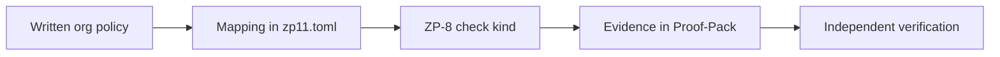

The eleven zones are fixed in name and order by the specification. ZP-8 is one
of them; it does not replace the others, it governs the *decision rules* the
organization layers on top.

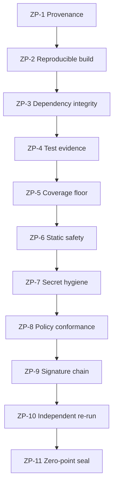

The normative requirement for ZP-8 is short: *the change MUST satisfy the
declared policy-as-code*. Everything in this document is about turning that one
sentence into checks a second party can re-run from the pack alone.

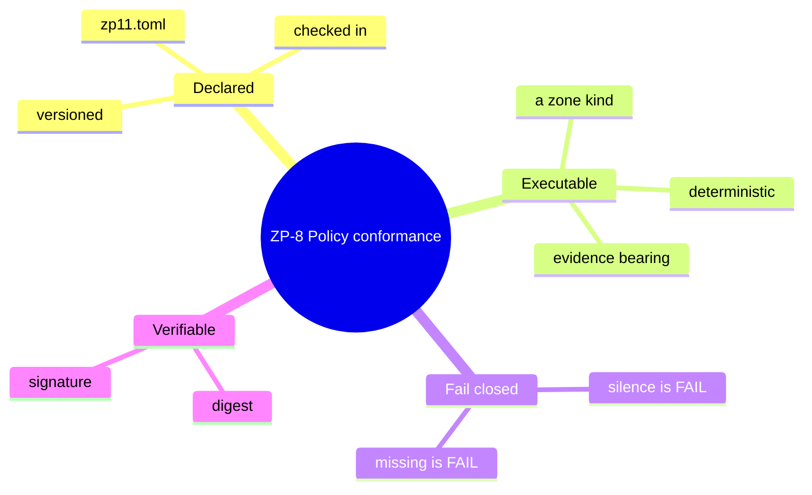

## 2. The policy-as-code premise

A governance rule that lives only in a wiki is advisory: it warns, then lets the
merge through. ZP-11 inverts that. If a rule matters, it is declared as a zone
and enforced by the gate; if it is not declared, the gate cannot and does not
enforce it. There is no third state.

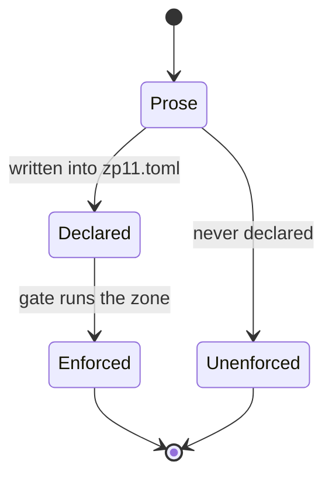

This is the central trade the standard asks an organization to make: move the
rule from narrative into configuration, accept that only declared rules bind,
and gain a receipt that proves the rule ran.

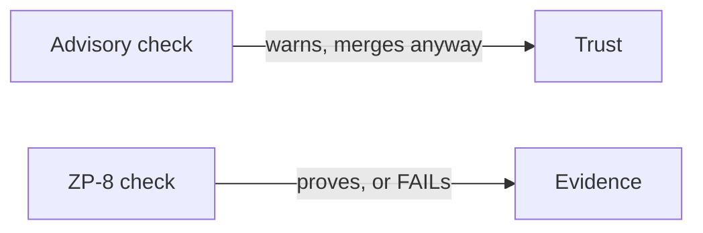

The premise rests on four properties the Proof-Pack already guarantees for every
zone, ZP-8 included.

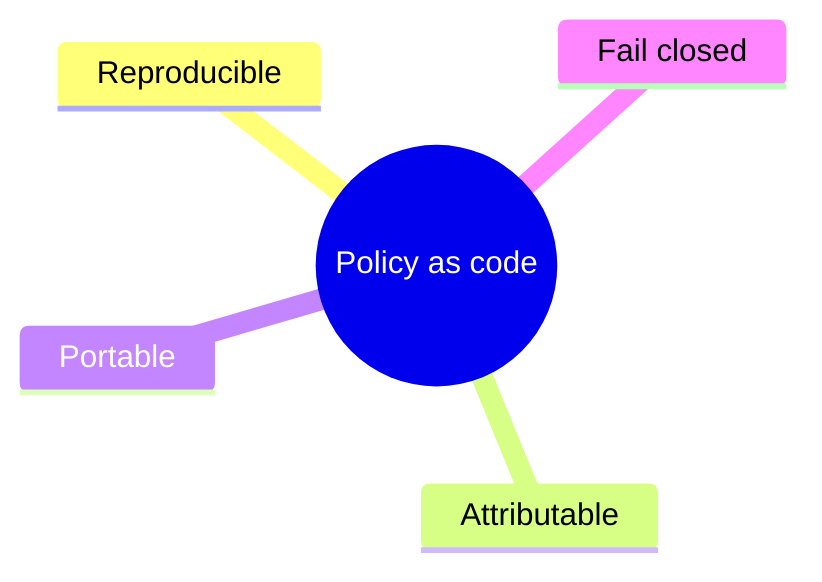

### 2.1 Declared, not assumed

ZP-8's verdict is only as strong as the mapping behind it. A policy that is
real but undeclared contributes nothing; the gate judges configuration, not
intent.

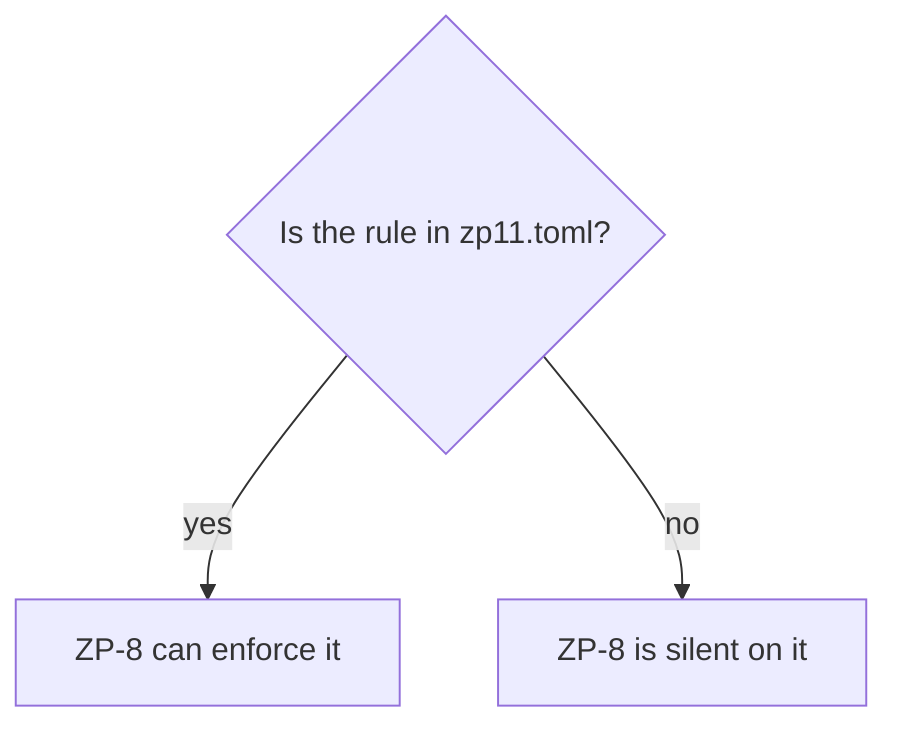

## 3. Anatomy of `zp11.toml`

`zp11.toml` is the gate configuration a repository applies to itself. It has a
`[change]` table describing provenance context and one `[zones.ZP-n]` table per
zone. Each zone table names a `title`, a `kind`, and the parameters that kind
consumes.

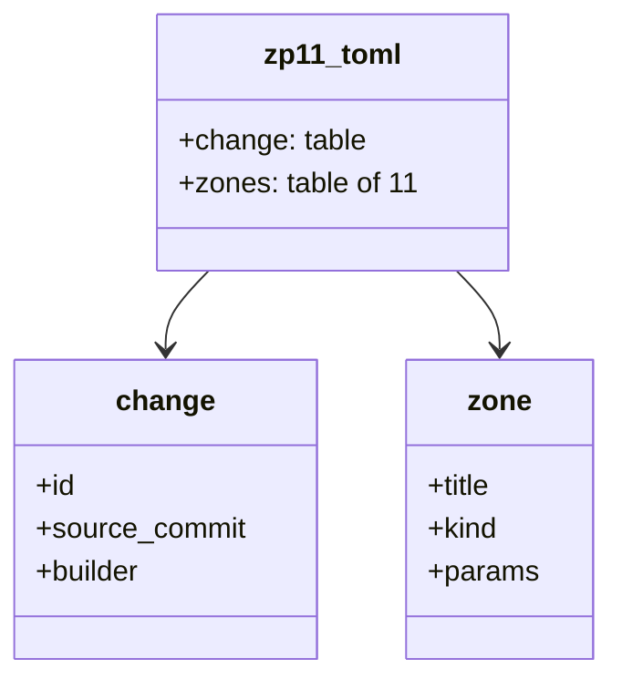

The file the standard ships for its own repository maps ZP-8 to a `file` check
over the `LICENSE`, with a minimum size — a deliberately simple, self-hosting
example that proves a governance document is present and non-trivial.

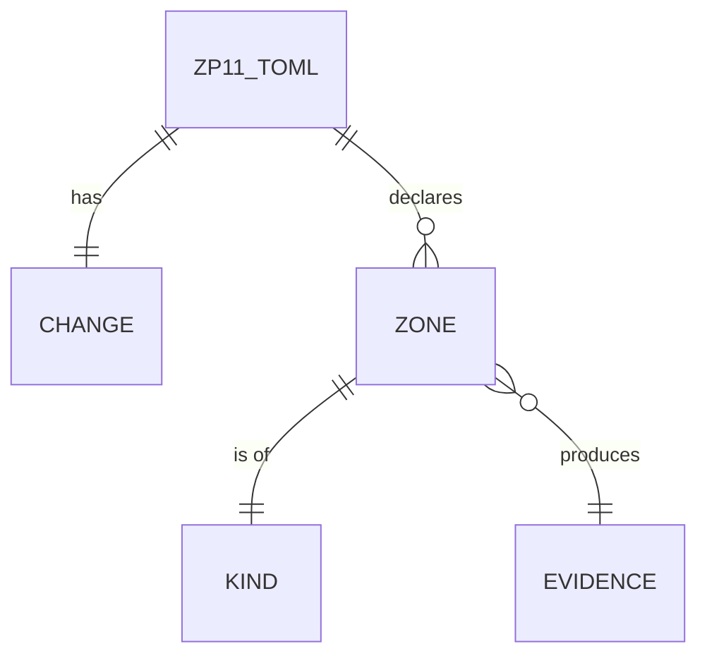

### 3.1 The `[change]` table

`[change]` carries the provenance fields the gate threads into context: `id`,
`source_commit`, and `builder`. ZP-1 and ZP-9 read these through the `require`
kind; ZP-8 may read them too when policy depends on who built what.

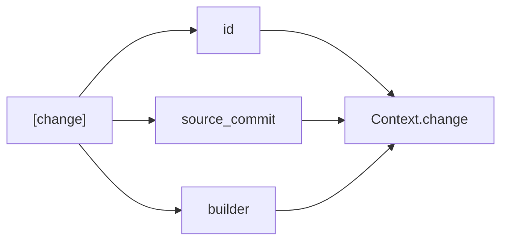

### 3.2 A zone table

Every zone follows the same shape. The loader sorts zones by their numeric
suffix, defaults a missing `title` to the canonical name, and defaults a missing
`kind` to `require`.

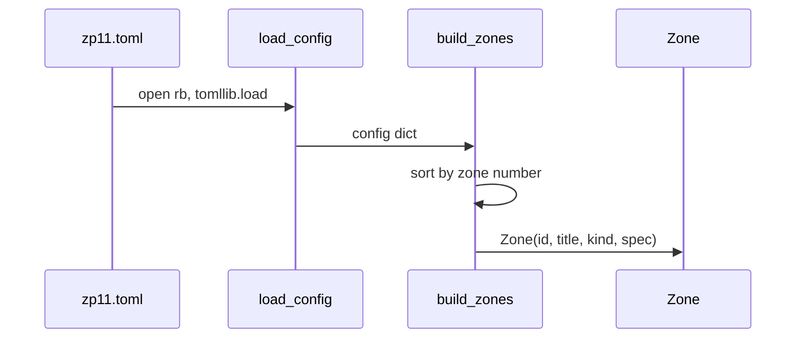

## 4. The five zone kinds

The reference library implements exactly five kinds. ZP-8 can be mapped to any
of them; the right choice depends on how the policy is expressed and where its
evidence lives.

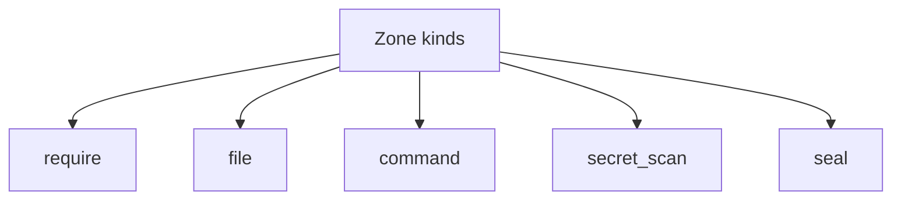

| Kind | Passes when | Evidence recorded |
|------|-------------|-------------------|
| `require` | every named context field is present and non-empty | required, missing, present |
| `file` | a path exists and meets `min_bytes` | path, bytes, sha256 |
| `command` | a shell command exits with the expected code | command, exit_code, output_sha256 |
| `secret_scan` | no pattern or high-entropy token matches | scanned count, findings, clean |
| `seal` | ZP-11 only; every prior zone passed | zones_passed, zones_total |

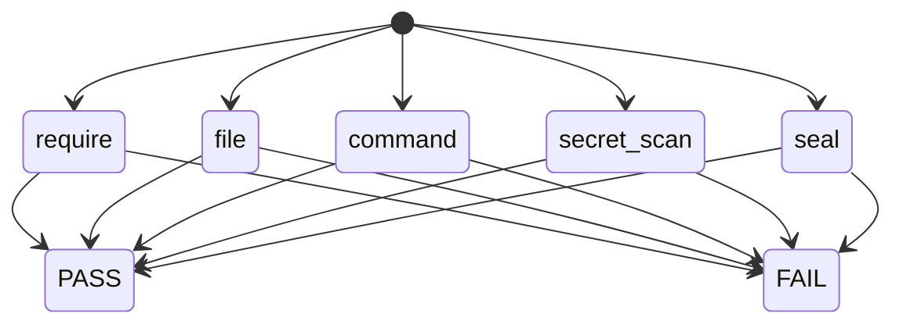

### 4.1 `require`

`require` checks that each named field in the change context is present and
non-empty. Empty string, `None`, `[]`, and `{}` all count as missing.

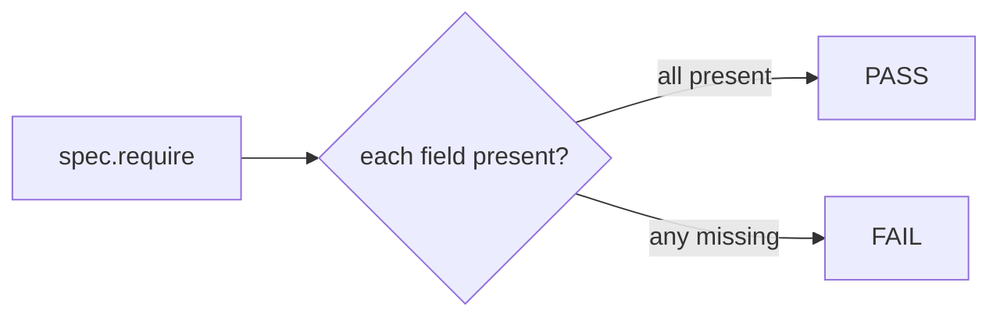

A policy that says "every change must name an approving authority" maps cleanly
to `require` once that authority is threaded into `[change]`.

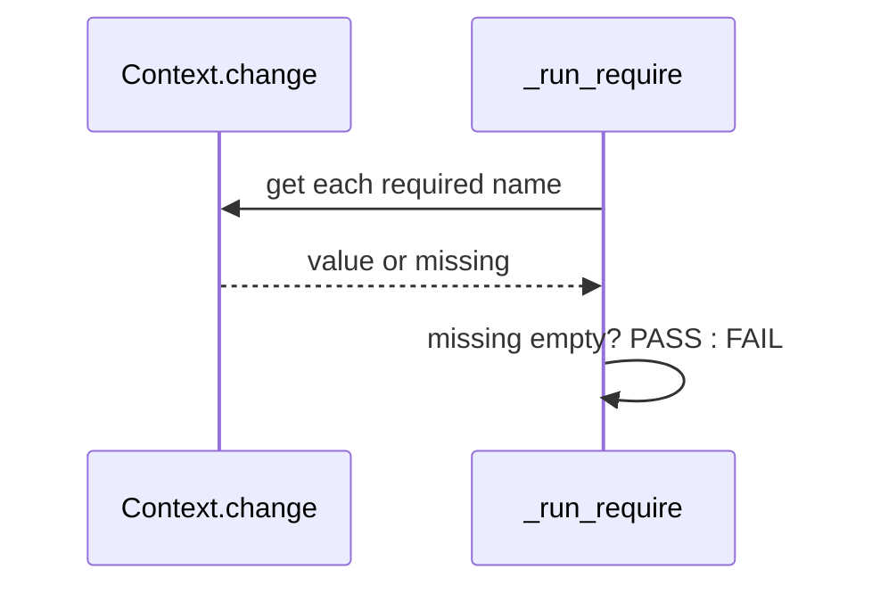

### 4.2 `file`

`file` proves a path exists and is at least `min_bytes` long, and records the
file's SHA-256 as evidence. This is how the shipped config enforces that a
governance artifact — a license, a policy document, a signed waiver — is present
and non-empty.

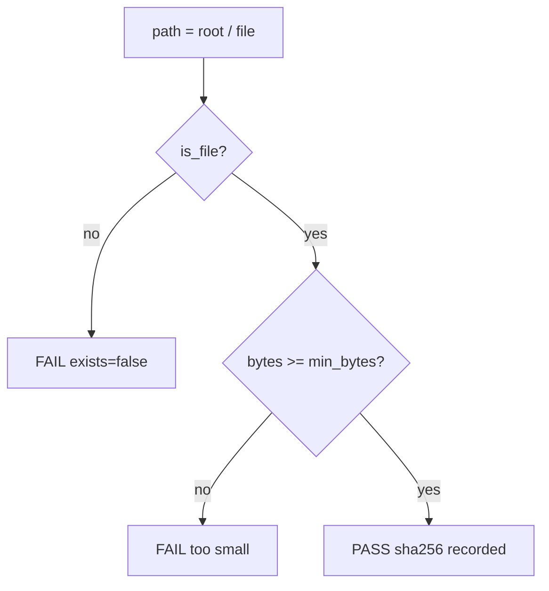

### 4.3 `command`

`command` runs a shell command in the repository root and passes only when the
exit code equals `expect_code` (default `0`). The digest of combined stdout and
stderr becomes evidence. Any timeout or spawn failure is caught and returns
`FAIL` — never silence.

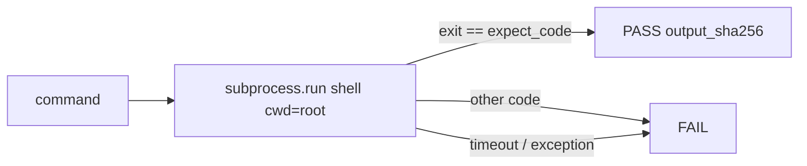

`command` is the most expressive kind: any policy engine with a CLI and a
meaningful exit code can be wired here, from a license scanner to an
organization's bespoke rule evaluator.

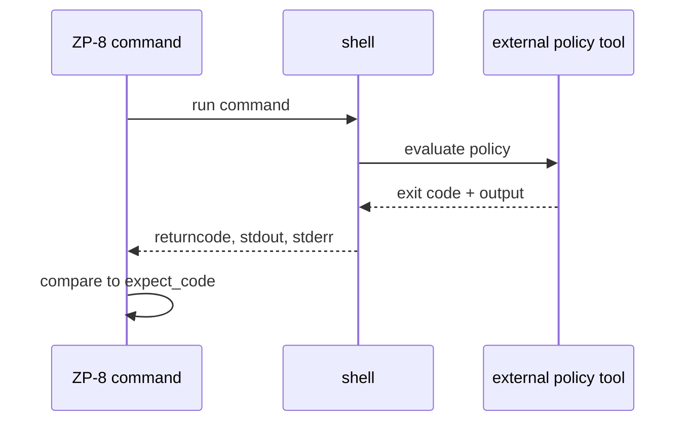

### 4.4 `secret_scan`

`secret_scan` walks the configured globs, matches a conservative set of
credential patterns plus a high-entropy heuristic, and passes only when nothing
is found. It records *locations*, never the secret material. Although ZP-7 is
the canonical home for secret hygiene, a stricter organizational data-handling
policy can also be expressed as a ZP-8 `secret_scan` over additional paths.

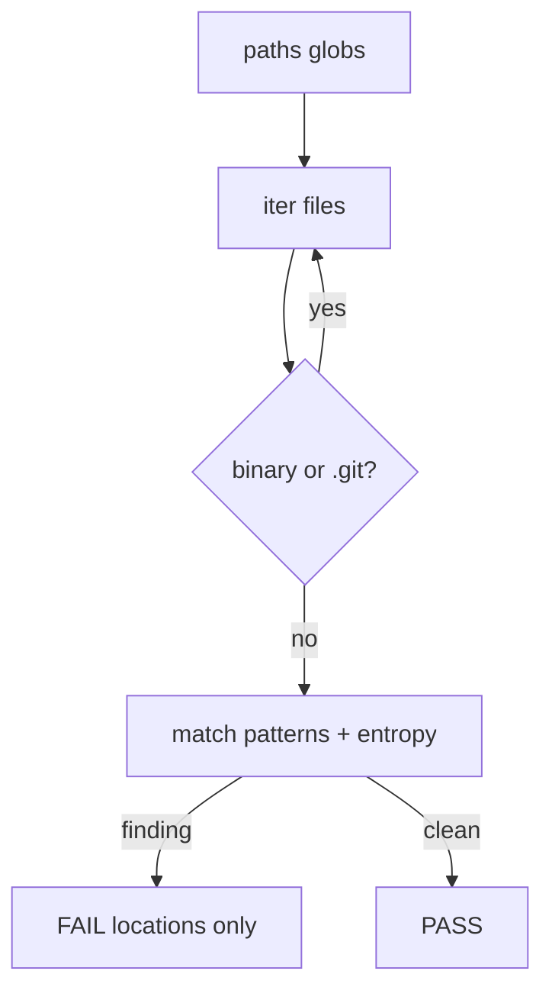

### 4.5 `seal`

`seal` is reserved for ZP-11 and set by the gate, not by a runner. It passes if
and only if every prior zone — ZP-8 included — passed. No policy maps directly
to `seal`; it is the logical AND of the other ten.

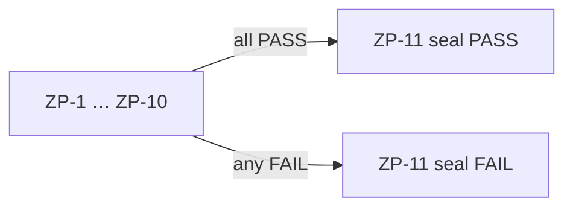

## 5. Declaring ZP-8 in `zp11.toml`

Declaring the policy zone is a matter of choosing the kind that matches how the
policy's truth can be proven, then supplying that kind's parameters.

```mermaid
flowchart TB
    Start["Policy statement"] --> Q1{"Evidence is a field?"}
    Q1 -->|yes| Req["kind = require"]
    Q1 -->|no| Q2{"Evidence is a file?"}
    Q2 -->|yes| Fil["kind = file"]
    Q2 -->|no| Q3{"A tool gives a verdict?"}
    Q3 -->|yes| Cmd["kind = command"]
    Q3 -->|no| Q4{"Absence of patterns?"}
    Q4 -->|yes| Scan["kind = secret_scan"]
    Q4 -->|no| Rethink["restate the policy"]
```

### 5.1 ZP-8 as `file`

The simplest binding, and the one the standard uses on itself: assert that a
governance document exists and is substantial.

```toml
[zones.ZP-8]
title = "Policy conformance"
kind  = "file"
file  = "LICENSE"
min_bytes = 100
```

```mermaid
flowchart LR
    T["ZP-8 file"] --> Doc["LICENSE >= 100 bytes"]
    Doc -->|present| P["PASS sha256"]
    Doc -->|absent| F["FAIL"]
```

### 5.2 ZP-8 as `command`

When policy is a rule set evaluated by a tool, wire its CLI and let the exit code
decide.

```toml
[zones.ZP-8]
title = "Policy conformance"
kind  = "command"
command = "python tools/policy_check.py --config policy.yaml"
```

```mermaid
sequenceDiagram
    participant G as gate
    participant C as policy_check.py
    G->>C: run with config
    C->>C: evaluate rules
    C-->>G: exit 0 PASS, non-zero FAIL
```

### 5.3 ZP-8 as `require`

When policy is "this field must be declared", point `require` at the context.

```toml
[zones.ZP-8]
title = "Policy conformance"
kind  = "require"
require = ["source_commit", "builder"]
```

```mermaid
flowchart TB
    R["require list"] --> F1["source_commit"]
    R --> F2["builder"]
    F1 --> Chk{"present + non-empty?"}
    F2 --> Chk
    Chk -->|all| P["PASS"]
    Chk -->|any missing| Fn["FAIL"]
```

## 6. Mapping organizational policy to checks

Most real governance policies are not single rules but families of them. The
mapping method is: enumerate each clause, classify the evidence it produces, bind
it to a kind, and — where one zone cannot carry the whole family — compose a
`command` that aggregates sub-checks under one exit code.

```mermaid
flowchart LR
    Pol["Policy document"] --> Split["Decompose into clauses"]
    Split --> Classify["Classify evidence"]
    Classify --> Bind["Bind each to a kind"]
    Bind --> Agg["Aggregate via command if needed"]
    Agg --> ZP8["Single ZP-8 verdict"]
```

### 6.1 A mapping catalogue

```mermaid
flowchart TB
    subgraph Clauses
      c1["Approved license only"]
      c2["Change references a ticket"]
      c3["No banned dependency"]
      c4["Data-class labels present"]
      c5["Owner sign-off recorded"]
    end
    c1 --> k1["command: license scan"]
    c2 --> k2["require: ticket field"]
    c3 --> k3["command: dependency policy"]
    c4 --> k4["file: labels manifest"]
    c5 --> k5["require: approver field"]
```

| Policy clause | Evidence | Kind |
|---------------|----------|------|
| Only approved OSS licenses ship | scanner exit code | `command` |
| Every change cites a tracking id | context field | `require` |
| No dependency on a banned package | policy tool exit code | `command` |
| Required data-classification manifest exists | file + size | `file` |
| Named owner approved the change | context field | `require` |
| No disallowed credential form anywhere | pattern absence | `secret_scan` |

### 6.2 Aggregating many rules under one `command`

When a policy family must land in the single ZP-8 verdict, write one script that
runs every sub-rule and exits non-zero on the first failure. The gate records the
aggregate output digest; the script's own log explains which clause failed.

```mermaid
flowchart TB
    S["policy_check.py"] --> R1["rule 1"]
    S --> R2["rule 2"]
    S --> R3["rule 3"]
    R1 --> AND{"all pass?"}
    R2 --> AND
    R3 --> AND
    AND -->|yes| Z0["exit 0"]
    AND -->|no| Zn["exit non-zero"]
```

```mermaid
sequenceDiagram
    participant G as gate ZP-8
    participant S as aggregator
    participant R as sub-rules
    G->>S: run
    loop each rule
      S->>R: evaluate
      R-->>S: ok or fail
    end
    S-->>G: exit code + combined log
```

### 6.3 Keeping clauses traceable

Each clause should map to exactly one observable so a verifier can tie a FAIL
back to a rule. A one-to-one mapping keeps the audit trail legible.

```mermaid
erDiagram
    CLAUSE ||--|| OBSERVABLE : "proven by"
    OBSERVABLE ||--|| KIND : "checked as"
    KIND ||--|| VERDICT : "yields"
```

### 6.4 Policy ownership

Policy-as-code is only maintainable when ownership is explicit. The author of a
clause owns its check; the gate owns enforcement; no one owns an exception the
gate cannot see.

```mermaid
flowchart LR
    Author["Policy author"] -->|writes clause| Clause
    Eng["Engineering"] -->|writes check| Check
    Gate["ZP-11 gate"] -->|enforces| Check
    Check --> Clause
```

## 7. Evidence, digests, and the Proof-Pack

Whatever kind ZP-8 uses, its result becomes a receipt in the Proof-Pack. The
receipt body is `{ id, title, verdict, evidence }`; its digest is
`sha256(canonical(body))` over the RFC 8785 (JCS) serialization; its signature is
Ed25519 over the body plus digest.

```mermaid
flowchart LR
    Ev["ZP-8 evidence"] --> Body["body {id,title,verdict,evidence}"]
    Body --> Canon["canonical RFC 8785"]
    Canon --> Dig["sha256 digest"]
    Dig --> Sig["Ed25519 signature"]
```

```mermaid
classDiagram
    class Receipt {
      +id
      +title
      +verdict
      +evidence
      +digest
      +signature
      +body()
      +signed_body()
      +finalize(keypair)
    }
```

Because the digest covers the evidence, a verifier who recomputes it detects any
tampering with the policy result. Altering a single evidence byte changes the
digest and invalidates the receipt.

```mermaid
sequenceDiagram
    participant V as verifier
    participant R as ZP-8 receipt
    V->>R: read body
    V->>V: digest(body)
    V->>R: compare stored digest
    alt equal
      V->>V: verify signature
    else differs
      V->>V: evidence altered → reject
    end
```

The evidence a ZP-8 `command` emits records the command text, the exit code, the
expected code, and the output digest — never the full output, which keeps the
pack small and avoids leaking sensitive logs.

```mermaid
mindmap
  root(("ZP-8 command evidence"))
    kind
    tool
    tool_version
    command
    exit_code
    expect_code
    output_sha256
```

## 8. Fail-closed semantics for policy

ZP-8 obeys the same asymmetry as every zone: it emits exactly `PASS` or `FAIL`,
and every ambiguous condition becomes `FAIL`. A policy tool that crashes, times
out, is missing, or prints something unparseable does not merge the change — it
blocks it.

```mermaid
stateDiagram-v2
    [*] --> Run
    Run --> PASS: proven condition
    Run --> FAIL: non-zero exit
    Run --> FAIL: timeout
    Run --> FAIL: tool missing
    Run --> FAIL: exception
    PASS --> [*]
    FAIL --> [*]
```

This matters most for policy, because policy tools are where "we did not get a
clear answer" is most tempting to treat as consent. The standard forbids that.

```mermaid
flowchart LR
    Amb["Ambiguous result"] -->|advisory system| Merge["merge anyway"]
    Amb -->|ZP-8| Block["FAIL, gate stays shut"]
```

An unknown kind, an empty command, or a `seal` reached by a runner all fail
closed by construction in the reference library.

```mermaid
flowchart TB
    U{"kind known?"}
    U -->|no| F1["FAIL unknown kind"]
    U -->|yes| C{"command empty?"}
    C -->|yes| F2["FAIL empty command"]
    C -->|no| OK["evaluate"]
```

### 8.1 The cost of a missing map

If ZP-8 is declared but its backing file or command is absent, the zone fails and
the gate stays shut. This is intended: a broken policy check is treated as an
unmet policy, not as a passed one.

```mermaid
journey
    title ZP-8 when its check is broken
    section Developer
      Opens PR: 3: Dev
      Gate runs ZP-8: 2: Gate
      Check missing: 1: Gate
    section Outcome
      FAIL recorded: 2: Gate
      Merge refused: 1: Gate
```

## 9. How ZP-8 interacts with the seal and signature chain

ZP-8 does not stand alone. Its verdict feeds the seal, and its receipt is one
link in the ordered chain the seal signs. A policy FAIL alone keeps the pack
unsealed and merge refused.

```mermaid
flowchart LR
    Z8["ZP-8 verdict"] --> Prior["prior_all_pass AND"]
    Prior --> Seal["ZP-11 seal content"]
    Seal --> Sig["seal signature"]
```

The seal content includes the ordered list of receipt digests — ZP-8's among
them — so a pack cannot be reassembled with a substituted policy receipt.

```mermaid
sequenceDiagram
    participant Gate
    participant Chain as receipt digests
    participant Seal
    Gate->>Chain: [ZP-1 … ZP-8 … ZP-11] digests in order
    Chain->>Seal: ordered list
    Seal->>Seal: sign(change + verdict + digests)
```

```mermaid
stateDiagram-v2
    [*] --> Collecting
    Collecting --> Evaluating: zones run
    Evaluating --> Sealed: all PASS incl ZP-8
    Evaluating --> Shut: ZP-8 or any FAIL
    Sealed --> Verified: signatures + digests OK
    Verified --> [*]: merge permitted
    Shut --> [*]: merge refused
```

If a verifier lacks the public key, it must default to refusing merge — the same
fail-closed default that governs ZP-8 itself.

```mermaid
flowchart TB
    K{"public key available?"}
    K -->|no| R["refuse merge"]
    K -->|yes| Chk["verify receipts + seal"]
```

## 10. Verifying policy from the pack alone

A third party verifies ZP-8 exactly as they verify every zone: recompute the
digest, check the signature, confirm the verdict, and confirm the seal. No access
to the original CI or policy tool is required — the receipt is self-describing.

```mermaid
flowchart LR
    Pack["proof-pack.json"] --> V1["recompute ZP-8 digest"]
    V1 --> V2["verify ZP-8 signature"]
    V2 --> V3["confirm verdict PASS"]
    V3 --> V4["verify seal"]
    V4 --> Dec["merge iff all succeed"]
```

```mermaid
sequenceDiagram
    participant A as auditor
    participant P as Proof-Pack
    participant K as public key
    A->>P: load pack
    A->>P: read ZP-8 receipt
    A->>K: verify signature
    A->>A: confirm verdict + seal
    A-->>A: merge permitted or refused
```

The verifier's report is structured: integrity, merge decision, zones passed,
zones total, and the reasons for any refusal — so a policy FAIL names itself.

```mermaid
classDiagram
    class VerifyReport {
      +ok
      +merge_permitted
      +reasons
      +zones_passed
      +zones_total
    }
```

```mermaid
flowchart TB
    R["verify_pack"] --> M{"ZP-8 in receipts?"}
    M -->|no, strict| Miss["reason: missing zones"]
    M -->|yes| D{"digest matches?"}
    D -->|no| Alt["reason: evidence altered"]
    D -->|yes| S{"verdict PASS?"}
    S -->|no| Fc["reason: fail-closed"]
    S -->|yes| Ok["contributes to merge"]
```

## 11. Governance workflow around ZP-8

Policy-as-code is a lifecycle, not a one-time setup. A clause is proposed,
reviewed, encoded as a check, dogfooded, and only then made blocking. ZP-11 is
additive by design: run it alongside an existing pipeline, then require a sealed
PASS once ZP-8 is green.

```mermaid
flowchart LR
    Prop["Propose clause"] --> Rev["Review"]
    Rev --> Enc["Encode as ZP-8 check"]
    Enc --> Dog["Dogfood non-blocking"]
    Dog --> Block["Make blocking"]
    Block --> Audit["Audit via packs"]
```

```mermaid
gantt
    title Adopting a new ZP-8 clause
    dateFormat  YYYY-MM-DD
    section Author
    Draft clause          :a1, 2026-01-01, 3d
    Review                 :a2, after a1, 2d
    section Engineering
    Encode check           :b1, after a2, 3d
    Dogfood non-blocking   :b2, after b1, 5d
    section Governance
    Make blocking          :c1, after b2, 1d
```

### 11.1 Roles

```mermaid
flowchart TB
    subgraph People
      PA["Policy author"]
      EN["Engineer"]
      RE["Reviewer"]
      AU["Auditor"]
    end
    PA -->|owns clause| Clause
    EN -->|owns check| Check
    RE -->|approves| Check
    AU -->|re-runs packs| Proof["Proof-Pack"]
```

### 11.2 Change of a clause is itself a change

A change to a policy check is a change to the repository, so it passes through the
same gate — including ZP-8. Policy edits are governed by the policy.

```mermaid
stateDiagram-v2
    [*] --> Edit
    Edit --> Gate: policy change to main
    Gate --> Pass: all zones incl ZP-8
    Gate --> Fail: any zone
    Pass --> [*]
    Fail --> Edit
```

### 11.3 Exceptions

An exception a policy wants to grant must itself be expressed as a check — for
example a `file` pointing at a signed, dated waiver — so the exception is visible
in the pack rather than hidden in a reviewer's head.

```mermaid
flowchart LR
    Ex["Exception request"] --> W["signed waiver file"]
    W --> Z8["ZP-8 file check"]
    Z8 -->|waiver present + valid| P["PASS"]
    Z8 -->|absent| F["FAIL"]
```

## 12. Worked example: a three-clause policy

Consider an organization whose release policy says: (1) only approved licenses
ship; (2) every change names a tracking id; (3) a classification manifest exists.
Clauses 1 and 3 and the aggregate land under one `command`; clause 2 can also be
read by `require` in ZP-1, but policy restates it in ZP-8 to keep the audit
self-contained.

```mermaid
flowchart TB
    Pol["Release policy"] --> C1["1 approved licenses"]
    Pol --> C2["2 tracking id present"]
    Pol --> C3["3 manifest exists"]
    C1 --> Agg["policy_check.py"]
    C2 --> Agg
    C3 --> Agg
    Agg --> Z8["ZP-8 command verdict"]
```

```toml
[zones.ZP-8]
title = "Policy conformance"
kind  = "command"
command = "python tools/policy_check.py"
timeout = 300
```

```mermaid
sequenceDiagram
    participant G as gate
    participant S as policy_check.py
    G->>S: run (timeout 300s)
    S->>S: check licenses
    S->>S: check tracking id
    S->>S: check manifest
    alt all pass
      S-->>G: exit 0
      G->>G: ZP-8 PASS
    else any fail
      S-->>G: exit 1 + log
      G->>G: ZP-8 FAIL
    end
```

The resulting receipt records the command, its exit code, and the output digest.
A second runner (ZP-10) re-executes the gate; if the policy tool is
deterministic, it reproduces the ZP-8 verdict.

```mermaid
flowchart LR
    R1["Primary runner ZP-8"] --> Dig1["verdict + digest"]
    R2["Independent runner ZP-10"] --> Dig2["verdict + digest"]
    Dig1 --> Cmp{"match?"}
    Dig2 --> Cmp
    Cmp -->|yes| Trust["policy result trusted"]
    Cmp -->|no| Susp["FAIL, investigate runner"]
```

```mermaid
timeline
    title ZP-8 across a change
    Propose : clause defined
    Encode  : command wired
    Run     : primary verdict
    Re-run  : independent verdict
    Seal    : ZP-11 seals chain
    Verify  : auditor confirms
```

## 13. Determinism and reproducibility of policy checks

A ZP-8 `command` must be deterministic for ZP-10 to reproduce it. Non-determinism
— a network call, a clock read, an unpinned tool — is the most common cause of a
primary/independent mismatch, and the standard treats a mismatch as FAIL.

```mermaid
flowchart TB
    D{"policy tool deterministic?"}
    D -->|yes| Rep["ZP-10 reproduces verdict"]
    D -->|no| Mis["verdict may differ → FAIL"]
```

```mermaid
mindmap
  root(("Determinism risks"))
    Network
      remote policy service
    Clock
      time based rules
    Environment
      unpinned tool version
    Ordering
      unstable iteration
```

Pin the policy tool, feed it only repository inputs, and record its version in
evidence so a verifier can tell two runs apart from two tools.

```mermaid
flowchart LR
    Tool["policy tool v1.2.3"] --> Ev["tool_version in evidence"]
    Ev --> Aud["auditor checks version match"]
```

## 14. Anti-patterns

Policy-as-code fails quietly when checks are written to pass rather than to
prove. The standard's structure resists this, but authors can still defeat it.

```mermaid
flowchart TB
    AP["Anti-patterns"] --> A1["command that always exits 0"]
    AP --> A2["file check on an empty placeholder"]
    AP --> A3["rule only in the wiki"]
    AP --> A4["non-deterministic tool"]
    AP --> A5["swallowing errors to PASS"]
```

| Anti-pattern | Why it defeats ZP-8 | Correct form |
|--------------|---------------------|--------------|
| Command hard-coded to exit 0 | no real verdict | exit non-zero on failure |
| `file` with `min_bytes = 0` | empty file passes | require meaningful size |
| Rule left in prose | gate cannot enforce | declare in `zp11.toml` |
| Tool reads network/clock | ZP-10 mismatch | deterministic inputs only |
| Script catches and ignores errors | silence treated as PASS | let failures surface |

```mermaid
stateDiagram-v2
    [*] --> Honest
    [*] --> Dishonest
    Honest --> Proves: FAIL on real failure
    Dishonest --> Hides: always PASS
    Hides --> Risk: gate gives false assurance
```

The remedy is the same for all of them: a check must be able to FAIL for a real
reason, and that reason must be legible in the pack.

```mermaid
flowchart LR
    Good["Good ZP-8 check"] --> Cap1["can fail"]
    Good --> Cap2["evidence explains why"]
    Good --> Cap3["deterministic"]
    Good --> Cap4["declared, versioned"]
```

## 15. Summary

ZP-8 turns governance from narrative into evidence. A policy clause is declared
in `zp11.toml`, bound to one of five zone kinds, executed by the fail-closed
gate, recorded as a signed receipt, folded into the seal, and re-verifiable by
anyone with the pack and a public key. The standard, invented by **Naquib
Hatami**, asks only that rules worth enforcing be made executable — and that
anything short of a proven PASS be treated as a FAIL.

```mermaid
flowchart LR
    Prose["Written policy"] --> Code["zp11.toml ZP-8"]
    Code --> Gate["fail-closed gate"]
    Gate --> Receipt["signed receipt"]
    Receipt --> Seal["ZP-11 seal"]
    Seal --> Verify["anyone re-verifies"]
```

```mermaid
mindmap
  root(("ZP-8 in one view"))
    Declare
      five kinds
      one verdict
    Enforce
      fail closed
      no silence
    Record
      canonical digest
      Ed25519 signature
    Verify
      from the pack
      refuse without key
```

---

## See also

- [`10-zones-reference.md`](10-zones-reference.md) — the five zone kinds in depth.
- [`05-data-model.md`](05-data-model.md) — Proof-Pack structure, receipts, and canonical form.
- [`07-crypto-design.md`](07-crypto-design.md) — Ed25519 receipts and the sealed digest chain.
- [`13-conformance.md`](13-conformance.md) — the verifier algorithm and `verify_pack`.
- [`06-api-cli-reference.md`](06-api-cli-reference.md) — the full `zp11.toml` reference.
