*Part of the ProofGate ZP-11 documentation set*

# Test Strategy & Plan

> **Abstract.** ProofGate ZP-11 (`zp11/v1`) is an open, fail-closed release-governance
> standard invented by **Naquib Hatami** and published by iQs Group Inc. / SADI AI Inc.
> under the MIT License. Its central claim — *no evidence, no merge* — is only as
> credible as the tests that hold the reference implementation to its own
> specification. This document defines the test strategy for ZP-11: the conformance
> suite that treats `SPEC.md` as an oracle, the unit and property tests that exercise
> canonical serialisation, Ed25519 signing, verdict coercion, zone execution and the
> seal, the test vectors that let any third party re-run a verdict, and the
> self-gating CI in which ZP-11 is gated by its own reference gate. Every assertion
> below is grounded in the code under `zp11/` and the suite under `tests/`; no
> benchmark, adopter or metric is invented.

---

## 1. Scope and testing philosophy

ZP-11 inverts the usual relationship between a release check and a merge. Most checks
are advisory; ZP-11 is **fail-closed**: a change advances *if and only if* every one
of the eleven zones returns `PASS` and the Proof-Pack is sealed. The test strategy
inherits that asymmetry. A test does not merely confirm that correct input produces a
correct verdict — it confirms, far more often, that *anything other than* a provable
`PASS` collapses to `FAIL`.

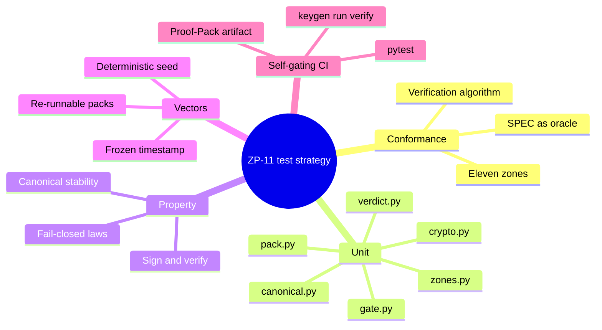

The guiding principle is stated once in `verdict.py` and echoed in every test file:
absence of evidence is failure. The suite therefore spends most of its effort on the
*negative* half of the space. A conventional test battery is weighted toward the happy
path — it confirms that valid input yields the expected output and treats error cases
as afterthoughts. ZP-11 cannot afford that distribution. Because the gate's entire
value proposition is that it refuses to open on anything less than proof, the tests
that matter most are the ones demonstrating refusal: a timed-out command, a dropped
receipt, an absent key, a flipped verdict, a reordered chain. Each of these is a way an
adversary or a careless pipeline might try to coax a merge out of incomplete evidence,
and each must terminate in `FAIL`. The design rule is simple to state and hard to
violate: there is no code path, in the reference library or in the tests that exercise
it, by which an ambiguous result becomes a merge. The tests exist to keep that rule
true under change.

This posture also shapes how we read a passing test. A green conformance test is not
merely "the code works"; it is a small, checkable piece of evidence that one clause of
`SPEC.md` is honoured by the implementation. The suite, taken whole, is the standing
argument that the reference library *is* the normative oracle the specification claims
it to be. That is why the suite lives beside the specification and the schema in the
same repository, and why the CI runs it as a required gate rather than an optional
courtesy.

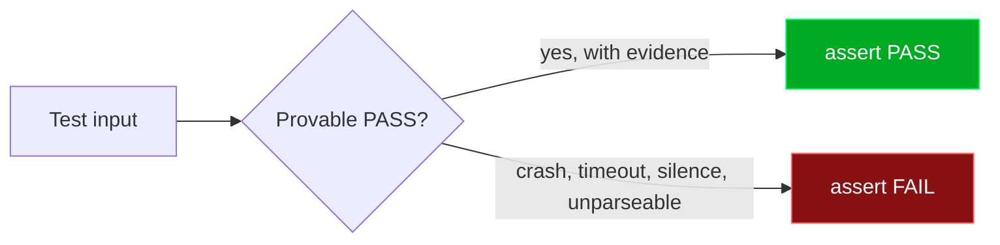

The reference implementation is, by §6 of the specification, the **normative oracle
for test vectors**. The suite's job is to keep that oracle honest against the prose of
`SPEC.md`. An oracle that drifts from the specification is worse than no oracle, because
downstream implementations calibrate against it. The conformance layer is therefore
written to fail loudly the moment a code change contradicts a normative sentence —
whether that sentence governs a verdict value, a digest definition, a signing input, or
the order of the four verification steps. Where the prose uses RFC 2119 keywords, the
tests encode the strongest reading: a `MUST` becomes an assertion, a `MUST NOT` becomes
a negative assertion that no forbidden path exists.

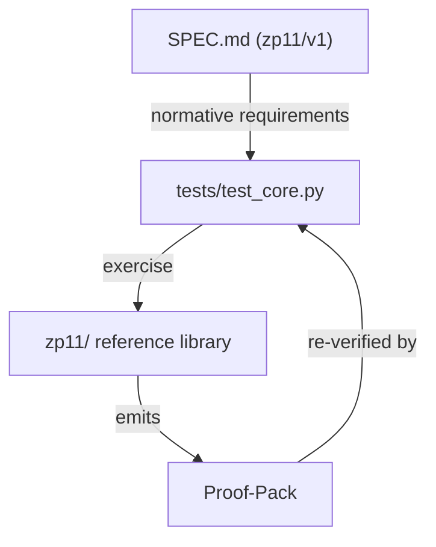

## 2. Test taxonomy

The suite is small, flat and deliberately dependency-light. `tests/test_core.py`
groups its cases by the module under test, and the CI layer adds an end-to-end
self-gating run. We describe four layers.

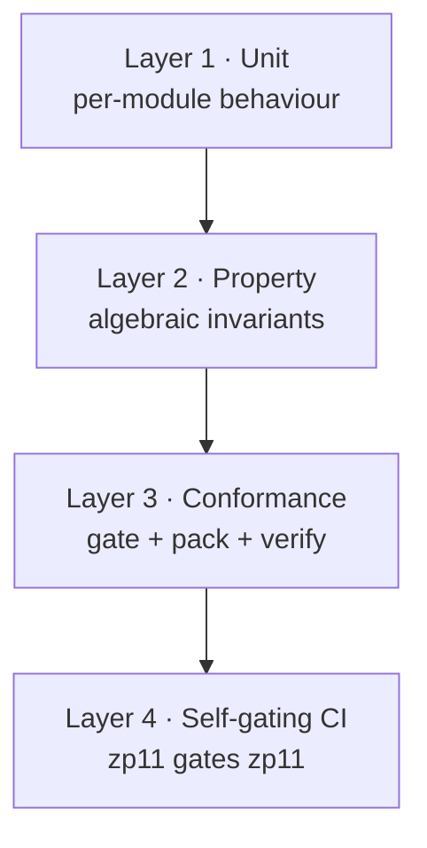

Unlike a classic broad-base pyramid, ZP-11's shape is narrow and tall: a handful of
primitives, each with a sharp contract, composed into one decision. The library is
small on purpose — `canonical.py`, `crypto.py`, `verdict.py`, `zones.py`, `pack.py`,
`gate.py` and `cli.py` — and each file carries exactly one responsibility. That economy
is what lets the test suite be both small and exhaustive: there are few enough moving
parts that every public function can be pinned by a dedicated assertion, and few enough
seams that the integration path from `run_gate` through `seal` to `verify_pack` can be
walked in a single test. A sprawling codebase would force the suite to choose between
breadth and depth; here it has both.

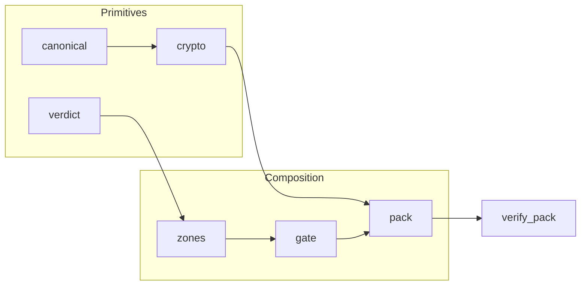

Each layer has a distinct failure budget. A unit test proves a single contract; a
conformance test proves a specification clause; the CI proves the whole gate against
the live repository.

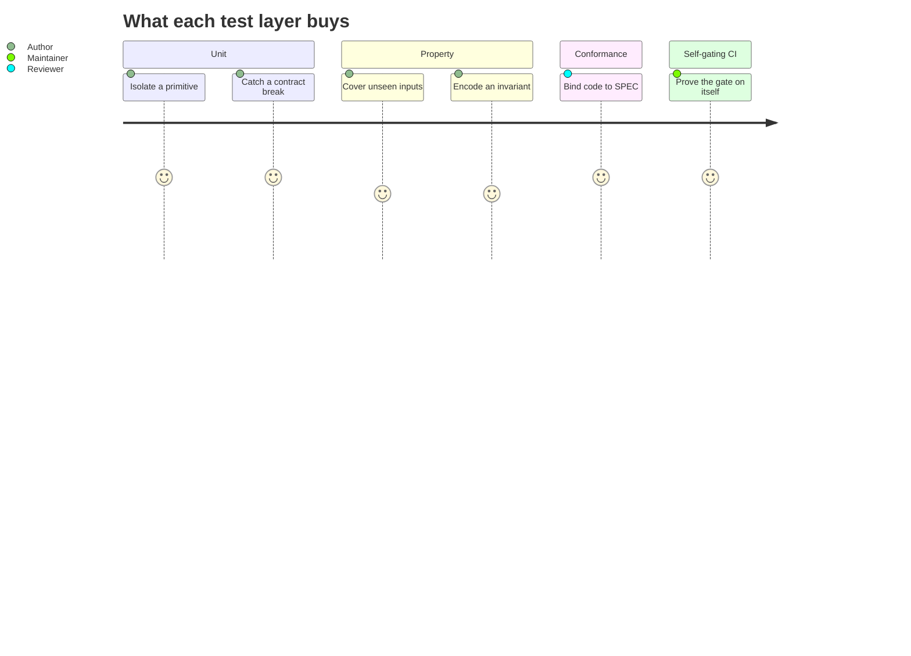

## 3. Conformance tests

Conformance tests map directly onto the normative clauses of `SPEC.md`. They are the
backbone of the suite because they test the *standard*, not merely the code. A unit
test can pass while the implementation quietly diverges from the specification — it only
proves that a function does what its author expected. A conformance test is anchored to
the written contract, so it catches the more dangerous class of defect: an
implementation that is internally consistent but externally wrong. The five cases in
`tests/test_core.py` under the *gate + pack* heading are each a reading of a
specification clause rendered executable, and together they cover the biconditional
that §5 and §6 define.

### 3.1 Clause-to-test traceability

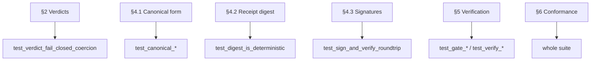

### 3.2 The gate seals only on a clean sweep

`test_gate_seals_when_all_zones_pass` asserts the positive path: eleven receipts, a
`PASS` verdict, `sealed is True`, and a verifier that reports `merge_permitted`.

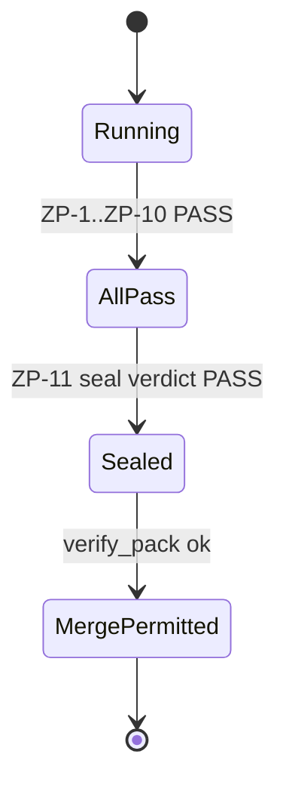

### 3.3 One failure shuts the gate

`test_gate_stays_shut_when_a_zone_fails` flips a single zone (ZP-6 requires a field
that is absent). The whole pack must report `FAIL`, must not be sealed, and must not
permit merge.

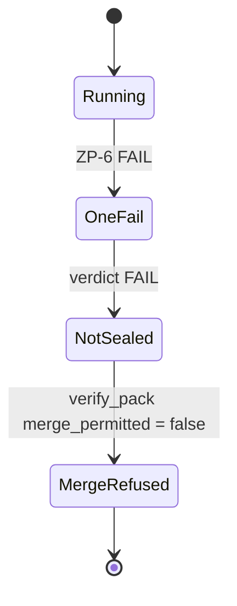

### 3.4 Tamper detection

`test_tampering_with_evidence_is_detected` flips a stored verdict *after* signing. The
recomputed digest no longer matches, or the signature fails — either way integrity is
broken.

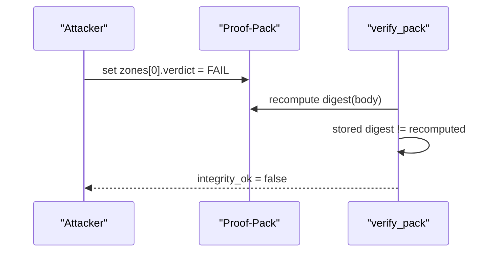

### 3.5 Strict presence of all eleven zones

`test_verify_requires_all_eleven_zones` deletes ZP-5 from the config. Under
`require_all_zones=True`, the verifier reports `missing zones`.

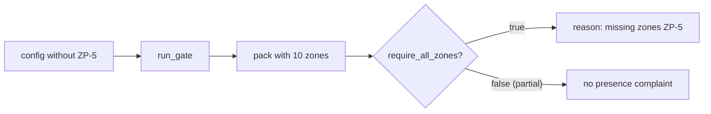

### 3.6 Round-trip through serialisation

`test_pack_roundtrips_through_dict` proves a pack survives `to_dict` → `from_dict`
with its verdict intact — the portability property the standard requires.

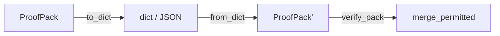

## 4. Unit tests by module

Each reference module carries a crisp contract. The unit tests pin those contracts so
that a regression surfaces at the smallest possible blast radius. When a composite test
such as `test_gate_seals_when_all_zones_pass` fails, it tells you *that* the gate is
broken; the unit tests tell you *where*. By keeping a focused assertion on each
primitive — canonical bytes, a digest, a signature round-trip, a coercion table, a zone
verdict — the suite turns a vague integration failure into a precise, single-line
diagnosis. This is the economy the narrow-and-tall shape was chosen for.

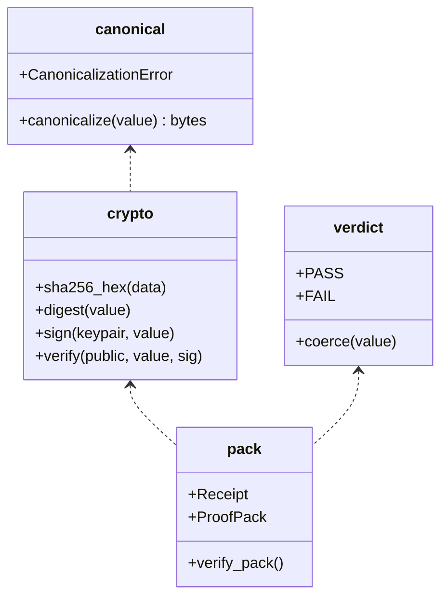

### 4.1 canonical.py — deterministic bytes

The canonicaliser implements the RFC 8785 (JCS) subset the standard relies on: sorted
keys, minimal separators, rejection of non-finite numbers and non-string keys.

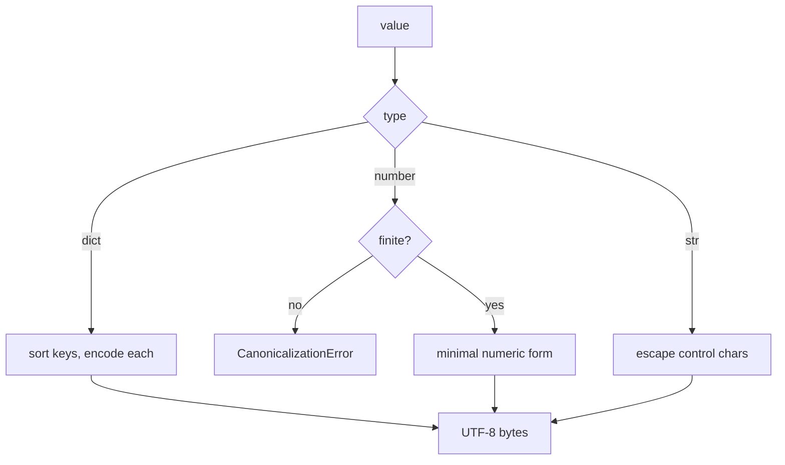

Canonicalisation is the foundation on which every digest and signature rests, so its
tests are disproportionately important. If two honest parties can serialise the same
logical value to different bytes, then they compute different digests, and the whole
re-runnability claim collapses. The reference canonicaliser implements only the subset
of RFC 8785 the standard depends on, but it implements that subset strictly: keys are
sorted lexicographically, separators are minimal, control characters are escaped with
the short forms where they exist and `\uXXXX` otherwise, integers print without a
decimal point, and any value with no canonical form — a `NaN`, an `Infinity`, a
non-string object key — is rejected rather than coerced. The output is stable across
Python versions and operating systems, which is precisely what makes a digest portable
between the gate that produced it and the verifier that checks it.

`test_canonical_sorts_keys_and_is_stable` asserts `{"b":1,"a":2}` and `{"a":2,"b":1}`
both produce `{"a":2,"b":1}`.

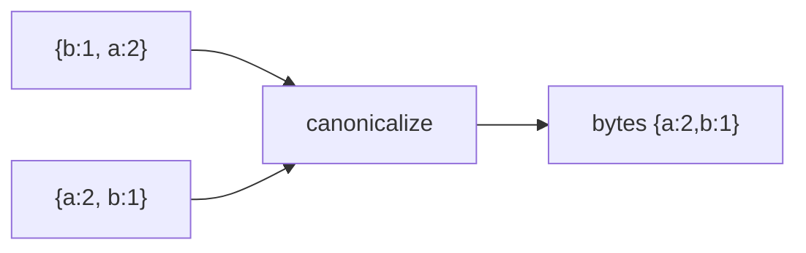

`test_canonical_rejects_non_finite` asserts a `NaN` value raises.

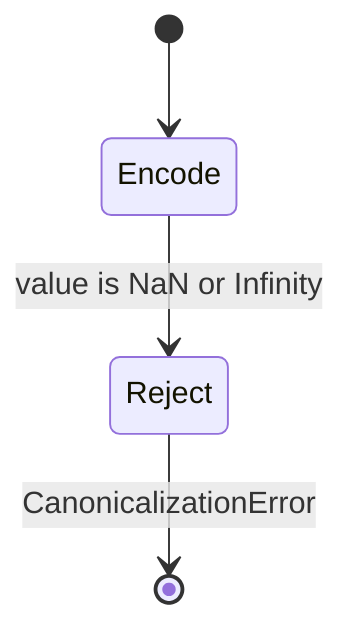

### 4.2 crypto.py — SHA-256 digests and Ed25519 signatures

The crypto module is where forgery is made infeasible. Every receipt is signed with
Ed25519 (RFC 8032) over canonical bytes, keys are handled as raw 32-byte values and
printed as `ed25519:<hex>`, and the public key travels in the pack so that a verifier
needs nothing external to check it. The tests confirm the two directions that matter:
a signature over a value verifies against that value, and a signature over a value
*fails* against any other. Both directions are load-bearing — the first is liveness
(an honest pack verifies) and the second is safety (a tampered pack does not).

`digest(value)` is defined as `"sha256:" + sha256_hex(canonicalize(value))`, so a
digest is a pure function of canonical bytes.

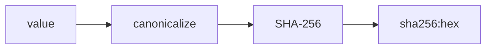

`test_sign_and_verify_roundtrip` signs a value and verifies it, then confirms a
tampered value fails.

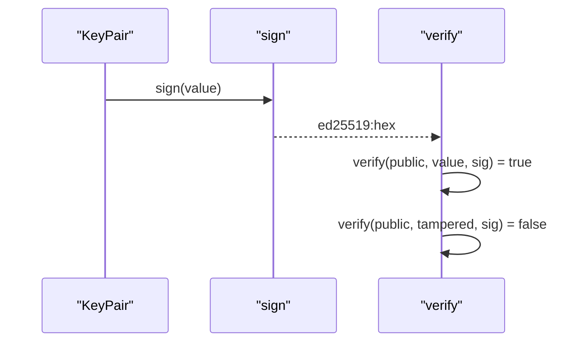

`test_public_key_parse_roundtrip` confirms `ed25519:<hex>` parses back to the same id.

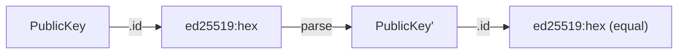

`test_digest_is_deterministic` confirms key order does not change the digest.

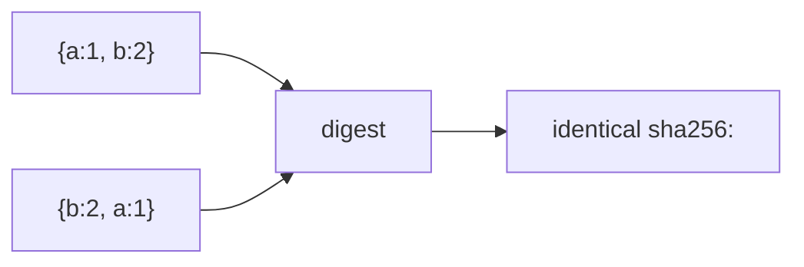

### 4.3 verdict.py — the fail-closed law

`Verdict` has exactly two members, and `__bool__` makes `PASS` truthy and `FAIL`
falsy, so `all(r.verdict for r in receipts)` reads naturally.

```mermaid
stateDiagram-v2
    [*] --> PASS
    [*] --> FAIL
    PASS --> truthy: bool is True
    FAIL --> falsy: bool is False
```

`test_verdict_fail_closed_coercion` encodes the coercion table directly.

```mermaid
flowchart TD
    IN["input"] --> C{"coerce"}
    C -->|"PASS / pass / True"| P["Verdict.PASS"]
    C -->|"None / whatever / else"| F["Verdict.FAIL"]
```

| Input | `coerce` result |
|-------|-----------------|
| `"PASS"` | `PASS` |
| `"pass"` | `PASS` |
| `True` | `PASS` |
| `None` | `FAIL` |
| `"whatever"` | `FAIL` |

### 4.4 zones.py — five kinds, one failure rule

Zones are declarative: each maps to one of five kinds. Any kind that cannot prove its
result returns `FAIL`. This is the single most important behaviour in `zones.py`, and
it is enforced structurally rather than by convention: `run_zone` wraps every runner in
a `try/except` that converts any exception into a `FAIL` receipt carrying the exception
type as evidence, and the `command` kind wraps its subprocess call the same way so that
a timeout or a spawn failure becomes `FAIL` rather than an unhandled error. There is no
branch that returns `None` and no branch that re-raises past the gate. A zone whose
kind is unknown also fails closed. The result is that the only way for a zone to reach
`PASS` is to execute its check to completion and satisfy it — every other outcome, down
to an interpreter error, lands on `FAIL`.

```mermaid
flowchart TD
    Z["Zone"] --> KIND{"kind"}
    KIND -->|"require"| R["every field present and non-empty"]
    KIND -->|"file"| FI["path exists and non-empty, sha256 evidence"]
    KIND -->|"command"| CM["exit code == expect_code"]
    KIND -->|"secret_scan"| SS["no pattern or high-entropy hit"]
    KIND -->|"seal"| SE["set by the gate"]
```

The `require` kind drives the unit config and both positive and negative gate tests.

```mermaid
flowchart LR
    CTX["change context"] --> REQ["for each required field"]
    REQ --> CHK{"present and non-empty?"}
    CHK -->|"all yes"| P["PASS"]
    CHK -->|"any missing"| F["FAIL (evidence lists missing)"]
```

The `command` kind fails closed on timeout or spawn error — it never silently passes.

```mermaid
stateDiagram-v2
    [*] --> Spawn
    Spawn --> Exit0: returncode == expect_code
    Spawn --> ExitN: returncode != expect_code
    Spawn --> Crash: timeout or spawn failure
    Exit0 --> PASS
    ExitN --> FAIL
    Crash --> FAIL
```

The `secret_scan` kind records only *locations*, never the secret, satisfying §7. Its
detectors are deliberately conservative: a fixed set of patterns for private-key
headers, AWS access-key ids, GitHub and Slack tokens and generic `sk-` secrets, plus a
Shannon-entropy screen that flags long high-entropy tokens that also look credential-
like. False negatives are acceptable by design — the scanner is not a guarantee of
cleanliness — but an *obvious* leak can never pass ZP-7 silently, and the evidence it
emits is strictly the path and the matched rule name, truncated, so the Proof-Pack
never becomes a vehicle for the very secret it detected.

```mermaid
flowchart TD
    FILES["files under paths"] --> SCAN["pattern + entropy check"]
    SCAN --> HIT{"any finding?"}
    HIT -->|"yes"| FAIL["FAIL, record path + rule only"]
    HIT -->|"no"| PASS["PASS, clean = true"]
```

A crashing runner is caught and converted to `FAIL`, by construction.

```mermaid
sequenceDiagram
    participant G as "run_zone"
    participant R as "runner"
    G->>R: execute kind
    R-->>G: raises Exception
    G->>G: except -> ZoneResult(FAIL, error)
    G-->>G: never silence
```

### 4.5 pack.py — receipts, the seal, and verification

A `Receipt` digests its body `{id, title, verdict, evidence}`, then signs
`{...body, digest}`.

```mermaid
flowchart LR
    BODY["{id, title, verdict, evidence}"] --> DIG["digest"]
    DIG --> SB["signed_body = body + digest"]
    SB --> SIG["Ed25519 signature"]
```

The seal is the structural heart of the standard and the part the tests scrutinise most
closely. A naive design would sign each receipt and stop there, but independently signed
receipts can be mixed and matched — an attacker could assemble a pack from receipts that
never shared a gate. ZP-11 forecloses that by signing the ordered chain of receipt
digests together with the change. The seal signs the *seal content*: standard, created,
change, verdict, counts, and the ordered list of `{id, digest}`.

```mermaid
flowchart TD
    SC["seal_content"] --> R1["ZP-1 id+digest"]
    SC --> R2["ZP-2 id+digest"]
    SC --> RD["... ordered chain ..."]
    SC --> R11["ZP-11 id+digest"]
    SC --> SIGN["sign over the whole"]
```

Because the seal binds the ordered chain, receipts cannot be reordered, added or
removed without invalidating it.

```mermaid
graph LR
    O["ordered receipts"] -->|"reorder / add / drop"| T["tampered chain"]
    T --> V["verify seal"]
    V --> X["signature invalid"]
    classDef no fill:#811,stroke:#f66,color:#fff;
    class X no;
```

`verify_pack` runs four checks and permits merge only if all succeed.

```mermaid
flowchart TD
    VP["verify_pack"] --> P1["1 · all eleven present (strict)"]
    P1 --> P2["2 · recompute digests + verify receipt sigs"]
    P2 --> P3["3 · reconstruct + verify seal signature"]
    P4["4 · every verdict PASS and sealed"]
    P3 --> P4
    P4 --> M{"all succeed?"}
    M -->|"yes"| OK["merge_permitted"]
    M -->|"no"| NO["merge refused, reasons listed"]
```

When no public key is available, the verifier refuses merge by default — a direct test
of §5's final sentence.

```mermaid
stateDiagram-v2
    [*] --> HaveKey
    HaveKey --> Verify: key present
    HaveKey --> Refuse: key absent
    Refuse --> [*]: reason no public key, merge refused
```

## 5. Property-based testing

Property tests complement the example-based suite by asserting *laws* that must hold
over many inputs. They are a natural fit for the three pure primitives. (The reference
suite ships example-based tests; the properties below are the invariants those
examples sample, and the intended shape of any property expansion.) Where an example
test checks one input, a property test checks a law over a generated population of
inputs, which is exactly the right instrument for `canonical.py`, `crypto.py` and
`verdict.py`: all three are pure functions with contracts stated as universal
quantifications. The payoff of lifting them to properties is coverage of the inputs
nobody thought to write down — the empty map, the deeply nested structure, the token at
the entropy threshold, the unicode escape at a control-character boundary — where
subtle serialisation or coercion bugs hide. The laws below are written so that each is
directly checkable by a generator, and each maps to an example the shipped suite already
contains, so the expansion strengthens rather than replaces the existing cases.

```mermaid
mindmap
  root(("Invariants"))
    Canonical
      order independence
      byte stability
      reject non-finite
    Crypto
      sign then verify holds
      tamper then verify fails
      digest order independent
    Verdict
      coerce total function
      only PASS or FAIL
```

**Law 1 — canonical order independence.** For any mapping, permuting keys yields
identical bytes.

```mermaid
flowchart LR
    M["map m"] --> PERM["any permutation of keys"]
    PERM --> C["canonicalize"]
    M --> C2["canonicalize"]
    C --> EQ{"bytes equal?"}
    C2 --> EQ
    EQ -->|"always"| HOLD["property holds"]
```

**Law 2 — round-trip soundness.** For any value and key, `verify(pub, v, sign(k, v))`
is true.

```mermaid
graph LR
    V["value"] --> S["sign(k,v)"] --> VER["verify(pub,v,sig)"] --> TRUE["true for all v"]
```

**Law 3 — tamper detection.** For any `v != w`, a signature over `v` fails to verify
against `w`.

```mermaid
graph LR
    SV["sign(k, v)"] --> VW["verify(pub, w, sig)"]
    VW --> FALSE["false whenever v != w"]
    classDef no fill:#811,stroke:#f66,color:#fff;
    class FALSE no;
```

**Law 4 — coerce totality.** `coerce` is total: every possible input maps to exactly
one of `PASS` or `FAIL`, and only the whitelisted inputs map to `PASS`.

```mermaid
flowchart TD
    ANY["any Python value"] --> CO["coerce"]
    CO --> TWO{"result"}
    TWO --> PASS["PASS (whitelist only)"]
    TWO --> FAIL["FAIL (everything else)"]
```

**Law 5 — fail-closed monotonicity.** Turning any single zone from `PASS` to `FAIL`
can only move the pack from sealed to unsealed, never the reverse.

```mermaid
stateDiagram-v2
    Sealed --> Unsealed: flip any zone to FAIL
    Unsealed --> Unsealed: flip another to FAIL
    Unsealed --> Sealed: impossible without re-run + reseal
```

**Law 6 — digest sensitivity.** Changing any evidence byte changes the receipt digest.

```mermaid
graph LR
    E1["evidence"] --> D1["digest A"]
    E2["evidence + 1 byte"] --> D2["digest B"]
    D1 --> NE["A != B, with overwhelming probability"]
    D2 --> NE
```

## 6. Test vectors

A test vector is a frozen input plus its canonical expected output, so that any
implementation — in any language — can check itself against the reference. Vectors are
how a *standard* is tested as distinct from a program: a second implementation, written
in a different language by a different author, is conformant exactly when it reproduces
the reference's verdicts on the shared vectors. ZP-11's vectors are made reproducible by
two levers already in the code: a fixed timestamp and a deterministic key seed. Without
both, a pack would differ on every run — the `created` field would float and the signing
key would be random — and no two parties could compare bytes. With both pinned, the
entire pack becomes a pure function of its inputs, which is the property the `--now`
flag and `KeyPair.from_seed` exist to provide.

```mermaid
flowchart LR
    NOW["now = fixed RFC 3339"] --> GATE["run_gate"]
    SEED["KeyPair.from_seed(32 bytes)"] --> GATE
    CFG["frozen config"] --> GATE
    GATE --> PACK["byte-identical Proof-Pack"]
```

The suite freezes `NOW = "2026-01-01T00:00:00Z"`; the CLI exposes `--now` for exactly
this purpose, and `KeyPair.from_seed` makes the signing key deterministic.

```mermaid
sequenceDiagram
    participant T as "test / vector"
    participant G as "run_gate"
    participant P as "ProofPack"
    T->>G: now = 2026-01-01T00:00:00Z
    T->>G: key from fixed seed
    G->>P: seal
    P-->>T: same bytes on every host
```

A vector is valid when an independent verifier, given only the pack and the public
key, reaches `merge_permitted = true`.

```mermaid
flowchart TD
    VEC["vector: pack + public key"] --> IND["independent verifier"]
    IND --> CHK{"digests + sigs + seal + verdicts"}
    CHK -->|"all ok"| MP["merge_permitted"]
    CHK -->|"any fail"| RF["refused with reasons"]
```

Vector categories mirror the conformance cases: a sealed positive vector, a shut-gate
negative vector, a tampered-evidence vector, and a missing-zone vector.

```mermaid
graph TD
    POS["positive · sealed PASS"] --> EXP1["expect merge_permitted"]
    NEG["negative · one zone FAIL"] --> EXP2["expect refused"]
    TAM["tampered evidence"] --> EXP3["expect integrity_ok = false"]
    MIS["missing ZP-5"] --> EXP4["expect missing zones reason"]
```

Because the digest is taken over canonical bytes, the same vector must validate
identically across Python 3.11 and 3.12 and across operating systems.

```mermaid
journey
    title A single vector across environments
    section Python 3.11
      Re-run gate: 5: CI
      Verify pack: 5: CI
    section Python 3.12
      Re-run gate: 5: CI
      Verify pack: 5: CI
```

A vector that fails to reproduce is itself a failing test — the reproducibility claim
of ZP-2 and ZP-10 is checked here, not assumed.

```mermaid
flowchart LR
    R1["runner 1 pack"] --> CMP{"byte equal?"}
    R2["runner 2 pack"] --> CMP
    CMP -->|"yes"| GOOD["reproducible"]
    CMP -->|"no"| BAD["ZP-10 FAIL"]
    classDef no fill:#811,stroke:#f66,color:#fff;
    class BAD no;
```

## 7. The self-gating CI

ZP-11 dogfoods itself. The GitHub Actions workflow `ci.yml` first runs the conformance
suite, then runs the ZP-11 reference gate *on the repository itself*, and uploads the
resulting Proof-Pack as a build artifact. This is more than a tidy demonstration. A
governance standard that could not govern its own repository would be asking its
adopters to trust a tool its author would not. By placing the reference gate in the
critical path of its own merges, the project makes its claims falsifiable in the most
direct way available: if the gate were unsound, the repository that ships it would show
it first.

```mermaid
flowchart TD
    CO["checkout"] --> SET["setup Python 3.11 / 3.12"]
    SET --> INS["pip install -e . + pytest"]
    INS --> TST["python -m pytest -q"]
    TST --> KG["zp11 keygen --out ci.key"]
    KG --> RUN["zp11 run --key ci.key --out proof-pack.json"]
    RUN --> VER["zp11 verify proof-pack.json"]
    VER --> ART["upload proof-pack.json (always)"]
```

The gate is wired as a *required status check*: `run` exits 0 only when merge is
permitted, and `verify` exits 0 only when the pack verifies, so a red gate blocks the
merge mechanically.

```mermaid
sequenceDiagram
    participant PR as "Pull request to main"
    participant CI as "ci.yml"
    participant Gate as "zp11 run"
    participant Ver as "zp11 verify"
    PR->>CI: push / pull_request
    CI->>CI: pytest -q
    CI->>Gate: run --key ci.key
    Gate-->>CI: exit 0 iff sealed PASS
    CI->>Ver: verify proof-pack.json
    Ver-->>CI: exit 0 iff merge permitted
    CI-->>PR: required check green or red
```

The repository's own `zp11.toml` maps each zone to a check the repo can actually run,
so the self-gating run exercises four of the five zone kinds end to end.

```mermaid
graph TD
    Z1["ZP-1 require: source_commit, builder"]
    Z2["ZP-2 command: import zp11; version"]
    Z3["ZP-3 file: requirements.lock"]
    Z4["ZP-4 command: pytest -q"]
    Z5["ZP-5 command: pytest -q"]
    Z6["ZP-6 command: compileall zp11"]
    Z7["ZP-7 secret_scan: zp11, md, toml"]
    Z8["ZP-8 file: LICENSE min 100 bytes"]
    Z9["ZP-9 require: source_commit"]
    Z10["ZP-10 command: zp11 zones"]
    Z11["ZP-11 seal"]
    Z1-->Z2-->Z3-->Z4-->Z5-->Z6-->Z7-->Z8-->Z9-->Z10-->Z11
```

Note the deliberate recursion: ZP-4 and ZP-5 run `pytest -q`, so the gate's own test
evidence *is* the conformance suite. A regression in `tests/test_core.py` turns ZP-4
and ZP-5 red, which turns the seal red, which blocks merge. The recursion is sound
rather than circular because the conformance suite runs first, as its own CI step, so a
broken suite is caught directly before it is ever consumed as zone evidence. The gate
then re-runs the suite as part of ZP-4 and ZP-5, binding that evidence into the signed
pack. The two uses serve different purposes: the first is a human-readable test report,
the second is tamper-evident evidence sealed into the Proof-Pack.

```mermaid
flowchart LR
    TB["test break"] --> Z4F["ZP-4 FAIL"]
    TB --> Z5F["ZP-5 FAIL"]
    Z4F --> SEAL["ZP-11 not sealed"]
    Z5F --> SEAL
    SEAL --> BLOCK["merge blocked"]
    classDef no fill:#811,stroke:#f66,color:#fff;
    class BLOCK no;
```

The Proof-Pack is uploaded with `if: always()`, so even a failing gate leaves behind
the signed record of *why* it stayed shut — the pack is evidence in both directions.

```mermaid
stateDiagram-v2
    [*] --> Gate
    Gate --> GreenPack: sealed PASS
    Gate --> RedPack: some zone FAIL
    GreenPack --> Upload
    RedPack --> Upload
    Upload --> [*]: artifact proof-pack-<pyver>
```

The matrix runs the whole flow on two Python versions, which is a cross-environment
reproducibility check in disguise: both must reach the same decision.

```mermaid
graph LR
    M311["3.11 lane"] --> D311["decision"]
    M312["3.12 lane"] --> D312["decision"]
    D311 --> AGREE{"agree?"}
    D312 --> AGREE
    AGREE -->|"must"| OK["consistent gate"]
```

## 8. Coverage strategy and zone mapping

Coverage in ZP-11 is governed by ZP-5 (coverage floor over changed lines). The suite
targets the primitives densely, because a defect there is a defect in every verdict. A
bug in `canonicalize` corrupts every digest; a bug in `sign`/`verify` corrupts every
signature; a bug in `coerce` or `Verdict.__bool__` could let a non-`PASS` value slip
through the `all(...)` check in `ProofPack.verdict`. These are the places where a single
defect has unbounded blast radius, so they receive the most assertions per line. Higher
in the stack, the gate and zones are covered through the composite conformance cases,
where correctness is more about wiring than arithmetic.

```mermaid
pie showData
    title Test attention by module
    "crypto + canonical" : 35
    "pack + verify" : 30
    "gate + zones" : 25
    "verdict" : 10
```

Each specification clause has at least one owning test; the seal and verification path
have several, because they carry the merge decision.

```mermaid
graph TD
    CLAUSE["SPEC clause"] --> OWN["owning test(s)"]
    OWN --> ASSERT["assertion"]
    ASSERT --> EVID["pass is evidence of conformance"]
```

Gaps are tracked honestly: the shipped suite is example-based; the property laws of §5
are the documented direction of travel, not a claim that generative tests already run.

```mermaid
timeline
    title Test maturity
    Now : Example-based conformance suite
        : Self-gating CI on 3.11 and 3.12
    Next : Property-based expansion of laws 1-6
        : Published cross-language test vectors
```

## 9. Negative and adversarial tests

The fail-closed stance means the most valuable tests are attacks. Each adversarial
case asserts that the gate refuses, never that it "warns". The threat model is modest
but precise: an adversary who can edit a Proof-Pack after it leaves the gate, drop or
reorder its receipts, present it without a key, or supply a hostile zone command, must
not be able to produce a `merge_permitted` verdict. The tests below each instantiate one
such capability and assert refusal. Several are already in the shipped suite; the rest
describe the adversarial coverage the suite is designed to hold as it grows.

```mermaid
flowchart TD
    ATT["adversarial input"] --> G["gate / verify"]
    G --> R{"outcome"}
    R -->|"refuse + reason"| GOOD["correct"]
    R -->|"permit"| BUG["defect, must fail the test"]
    classDef no fill:#811,stroke:#f66,color:#fff;
    classDef ok fill:#0a2,stroke:#0f6,color:#fff;
    class GOOD ok; class BUG no;
```

**Attack A — forged verdict.** Flip a verdict post-signing (covered by
`test_tampering_with_evidence_is_detected`).

```mermaid
sequenceDiagram
    participant A as "Attacker"
    participant V as "verify_pack"
    A->>V: pack with flipped verdict, old signature
    V-->>A: digest mismatch / bad signature
```

**Attack B — dropped zone.** Remove a zone to dodge a failure (covered by
`test_verify_requires_all_eleven_zones`).

```mermaid
graph LR
    DROP["remove ZP-5"] --> STRICT["strict verify"]
    STRICT --> MISS["missing zones reason"]
    MISS --> REFUSE["merge refused"]
```

**Attack C — missing key.** Present a pack with no verifiable key.

```mermaid
flowchart LR
    NK["no public key"] --> VP["verify_pack"]
    VP --> DEF["default: refuse merge"]
```

**Attack D — reordered chain.** Reorder receipts to break the seal binding.

```mermaid
graph TD
    REORD["reorder receipts"] --> SEALV["verify seal_content"]
    SEALV --> INV["seal signature invalid"]
    classDef no fill:#811,stroke:#f66,color:#fff;
    class INV no;
```

**Attack E — hung command.** A zone command that never returns must time out to
`FAIL`, not hang the gate.

```mermaid
stateDiagram-v2
    [*] --> Running
    Running --> Timeout: exceeds timeout seconds
    Timeout --> FAIL: caught, evidence records error
    FAIL --> [*]
```

**Attack F — secret smuggling.** A credential in the diff must trip ZP-7, which
records the location only.

```mermaid
flowchart LR
    LEAK["token in file"] --> SCAN["secret_scan"]
    SCAN --> FIND["finding: path + rule"]
    FIND --> FAILZ["ZP-7 FAIL"]
```

## 10. Regression, reproducibility and traceability

Every fixed defect earns a frozen vector so it cannot silently return. Reproducibility
is enforced by comparing packs across runners (the ZP-10 idea) rather than trusting a
single build. This is the regression discipline the standard's own ZP-10 zone models in
miniature: a verdict is only trustworthy when a second, independent execution reaches it
too. Applied to the test suite, the discipline says that no defect is considered closed
until there is a frozen input that reproduces it on demand, and that no reproducibility
claim is accepted until two runners agree byte-for-byte. The matrix of Python 3.11 and
3.12 in CI is the cheapest available instance of that second runner.

```mermaid
flowchart LR
    BUG["defect found"] --> FIX["fix + test"]
    FIX --> VEC["frozen vector added"]
    VEC --> CI["guards every future run"]
```

Traceability is bidirectional: from a specification clause down to its test, and from a
failing test up to the clause it protects.

```mermaid
graph LR
    SPECX["SPEC clause"] -->|"down"| TESTX["test"]
    TESTX -->|"up"| SPECX
```

The end-to-end chain of trust the suite defends, in one picture: change → zones →
receipts → seal → verification → merge.

```mermaid
flowchart LR
    CH["change"] --> ZO["zones ZP-1..ZP-10"]
    ZO --> RC["signed receipts"]
    RC --> SL["ZP-11 seal over chain"]
    SL --> VF["verify_pack"]
    VF --> MG{"sealed PASS?"}
    MG -->|"yes"| MERGE["merge permitted"]
    MG -->|"no"| SHUT["gate stays shut"]
    classDef ok fill:#0a2,stroke:#0f6,color:#fff;
    classDef no fill:#811,stroke:#f66,color:#fff;
    class MERGE ok; class SHUT no;
```

A final invariant diagram: the suite exists to guarantee the biconditional at the heart
of `zp11/v1` — merge is permitted *if and only if* a sealed, all-PASS, signature-valid
pack exists.

```mermaid
graph TD
    LHS["merge permitted"] --- IFF["if and only if"]
    IFF --- RHS["sealed PASS with valid signatures and all eleven zones"]
```

## 11. Running the suite

Locally, the suite runs with `pytest`; the full self-gating flow runs the four CLI
verbs exactly as CI does. Running the suite locally before pushing is the fastest way to
reproduce what the gate will decide, because the local `pytest` invocation is the same
one ZP-4 and ZP-5 execute inside the gate. The four-verb flow then proves the gate end
to end: `keygen` establishes a signing identity, `run` executes all eleven zones and
emits a sealed-or-shut pack, and `verify` re-derives the digests and signatures and
reports whether merge is permitted. The exit codes are the contract the CI relies on —
`run` and `verify` return non-zero on anything short of a sealed, all-`PASS`,
signature-valid pack — which is what lets the gate be wired as a required status check
without any additional glue.

```mermaid
flowchart TD
    A["pip install -e ."] --> B["python -m pytest -q"]
    B --> C["zp11 keygen --out ci.key"]
    C --> D["zp11 run --key ci.key --out proof-pack.json"]
    D --> E["zp11 verify proof-pack.json"]
```

The four CLI verbs and their test-relevant exit semantics:

| Verb | Purpose | Exit 0 when |
|------|---------|-------------|
| `keygen` | generate an Ed25519 key | always (prints public id) |
| `zones` | list the eleven canonical zones | always |
| `run` | run the gate, emit a pack | pack is sealed and `PASS` |
| `verify` | verify a pack | integrity holds and merge permitted |

```mermaid
stateDiagram-v2
    [*] --> keygen
    keygen --> run
    run --> verify
    verify --> [*]: exit 0 iff merge permitted
```

## 12. Summary

The ZP-11 test strategy is a faithful mirror of the standard it defends. It treats
`SPEC.md` as an oracle, pins each primitive's contract with unit tests, states the
algebraic laws that property tests sample, freezes re-runnable vectors on a fixed
timestamp and a deterministic seed, and closes the loop with a CI pipeline in which the
gate governs its own repository. Throughout, the single asymmetry invented by **Naquib
Hatami** holds: a change advances only on affirmative, reproducible, signed evidence —
and the tests spend most of their energy proving that everything else fails closed.

```mermaid
mindmap
  root(("Tests guarantee"))
    Conformance to SPEC
    Deterministic bytes
    Unforgeable seal
    Fail-closed verdicts
    Reproducible vectors
    Self-gated releases
```

---

## Related documents

- [`01-whitepaper.md`](01-whitepaper.md) — the one idea and the eleven zones at a glance.
- [`02-srs.md`](02-srs.md) — the formal `zp11/v1` specification companion.
- [`05-data-model.md`](05-data-model.md) — the Proof-Pack schema, receipts and seal.
- [`07-crypto-design.md`](07-crypto-design.md) — canonical serialisation, SHA-256 digests and Ed25519.
- [`14-cicd-integration.md`](14-cicd-integration.md) — wiring the self-gating gate as a required check.
