> Part of the ProofGate ZP-11 documentation set

# Conformance & Test Vectors

**Standard:** `zp11/v1` · **License:** MIT · **Inventor / author:** Naquib Hatami
**Repository:** github.com/iQs-Group/ZP-11 · **Homepage:** zp11.org
**Publisher:** iQs Group Inc. / SADI AI Inc.

## Abstract

ProofGate ZP-11 is an open, fail-closed release-governance standard: a change
advances to a protected branch if and only if all eleven zones return `PASS` and
the resulting Proof-Pack is sealed. For that guarantee to mean the same thing in
every implementation, "does this program conform to `zp11/v1`?" must have a single,
reproducible answer. This document defines what conformance means, names the
**normative oracle** that resolves disputes, and specifies the **conformance
vectors** and the **conformance levels** by which an implementation is measured.
It restates the four conformance criteria of the specification, decomposes them
into independently testable obligations, and describes the vector format, the
positive and negative classes, and the governance of the vector set over time.
Nothing here extends the normative surface of the specification; it operationalises
`SPEC.md` §6 so that conformance can be demonstrated rather than asserted.

---

## 1. What conformance means

Conformance is the property that an independent implementation of `zp11/v1`
produces decisions indistinguishable from the standard's intended behaviour on
every input that matters. In ZP-11 the stakes are concentrated: the only decision
that leaves the gate is *merge permitted* or *merge refused*, and the standard is
deliberately asymmetric — ambiguity resolves to `FAIL`. A conformant
implementation therefore does not merely "mostly agree"; it must agree on exactly
the two outcomes, and it must agree on the fail-closed direction for every
degenerate input.

`SPEC.md` §6 states the definition in one sentence: an implementation is
conformant if it (a) emits packs that validate against the schema, (b) treats any
non-`PASS` condition as `FAIL`, (c) computes digests and signatures as in §4, and
(d) refuses merge unless §5 succeeds. These are conjunctive — all four, always.

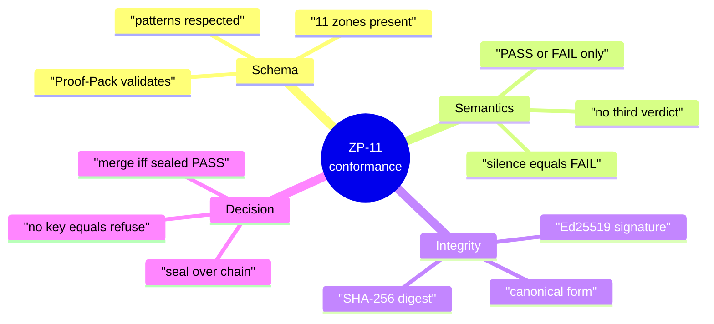

The four criteria map onto four layers of the reference library. Schema sits over
`pack.py` output; semantics live in `verdict.py`; integrity is `canonical.py` plus
`crypto.py`; and the decision is `pack.verify_pack` driving `cli.py verify`.

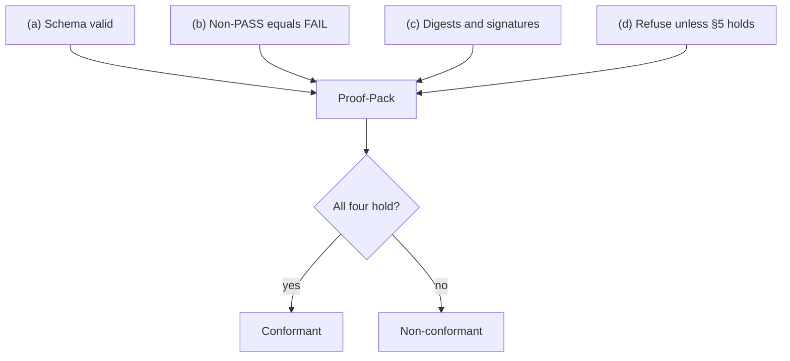

A useful way to read the definition is as a single state machine: an
implementation is conformant only while it stays on the affirmative path through
every criterion. Any divergence is terminal for that input.

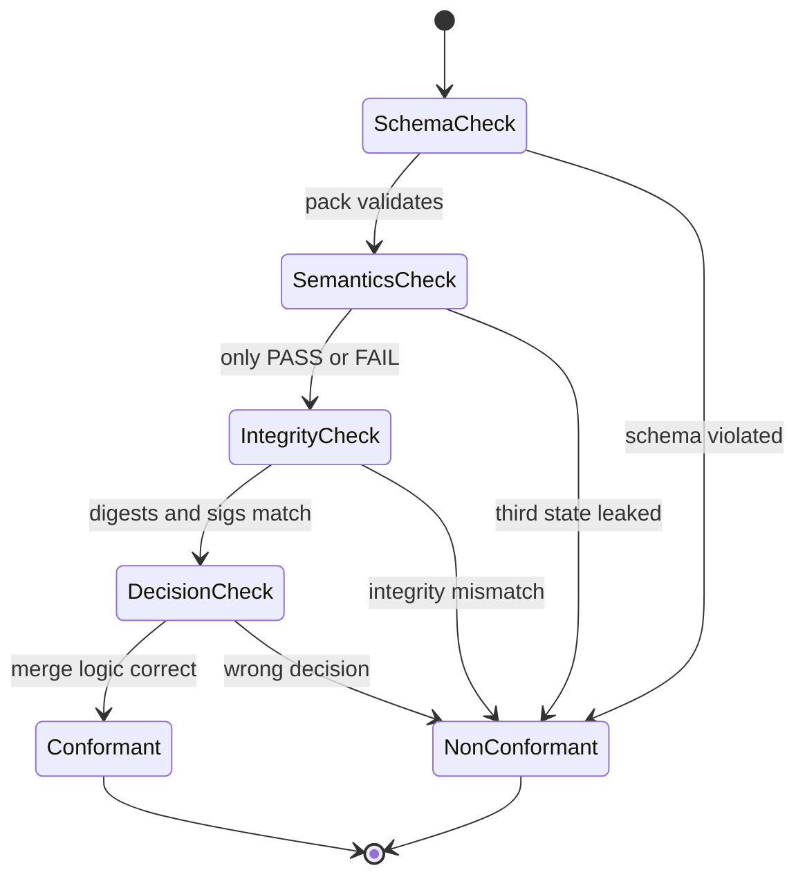

Conformance is also *per input*: an implementation that passes a thousand vectors
and fails one is non-conformant on that one, and because the gate is fail-closed,
the practically dangerous failures are those where a conformant answer is `FAIL`
but the implementation returns a merge.

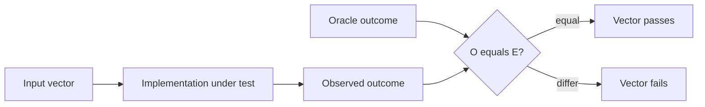

The most important class of divergence has a name throughout this document: a
**false-open** — the oracle says refuse, the implementation permits. ZP-11 treats
a single reproducible false-open as disqualifying, because it is exactly the
failure the standard exists to prevent.

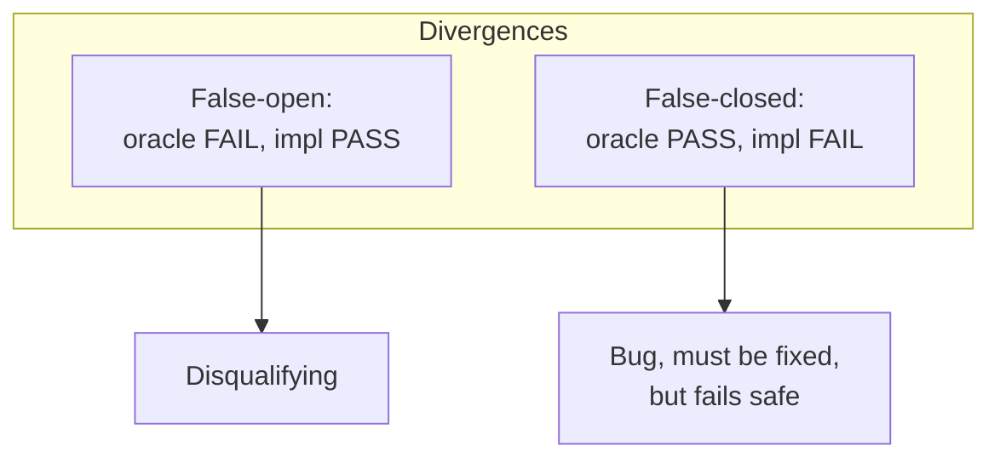

---

## 2. The normative oracle

`SPEC.md` §6 ends with the sentence that anchors this entire document: *"The
reference implementation in this repository is the normative oracle for test
vectors."* When prose and code disagree about an edge case, the reference library
— `canonical.py`, `crypto.py`, `verdict.py`, `zones.py`, `pack.py`, `gate.py`,
`cli.py` — is the authority that resolves it. Vectors are not hand-authored
expectations that might themselves be wrong; they are, by definition, whatever the
oracle emits for a given input.

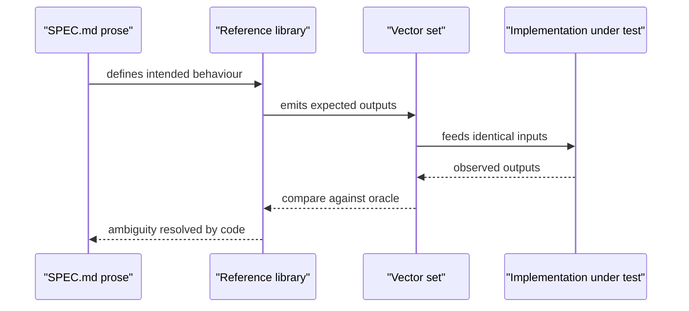

This design makes the vector set self-consistent: it cannot contain an expectation
the standard would reject, because the expectation is produced by running the
standard's reference. The arrangement does place a heavy obligation on the oracle,
which the library discharges with determinism — identical inputs produce identical
bytes — and with a small, auditable surface.

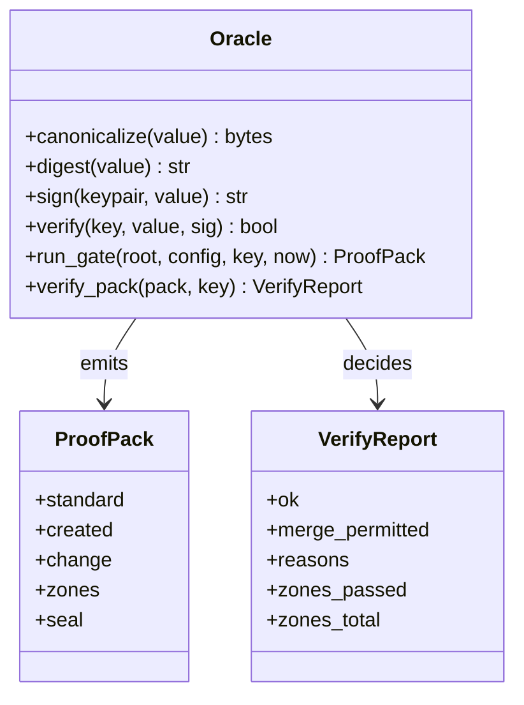

The oracle has two faces that vectors exercise separately. The **producer** face
is `run_gate`: given a repository root, a `zp11.toml`, a signing key and a fixed
timestamp, it emits a Proof-Pack. The **verifier** face is `verify_pack`: given a
pack and a public key, it emits a decision. Producer vectors pin the first; checker
vectors pin the second; and the two compose, because a producer vector's output is
a valid input to a checker vector.

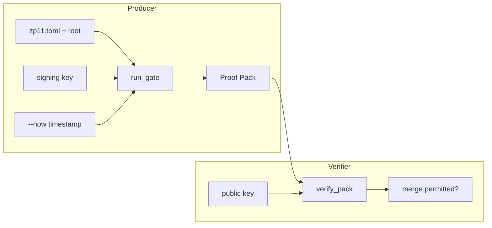

Because the producer is deterministic only when its non-deterministic inputs are
pinned, every producer vector must fix the clock. The CLI exposes `--now` precisely
so that a run is reproducible; without it, `created` would vary and the seal
signature with it.

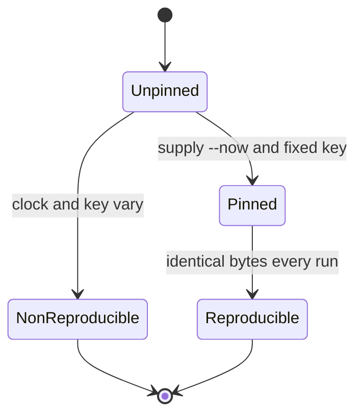

A conformant third-party implementation need not reuse the reference code, but it
must reproduce the oracle's bytes for the canonical form, its digests, and its
decision. The oracle is the judge; the vectors are its recorded judgements.

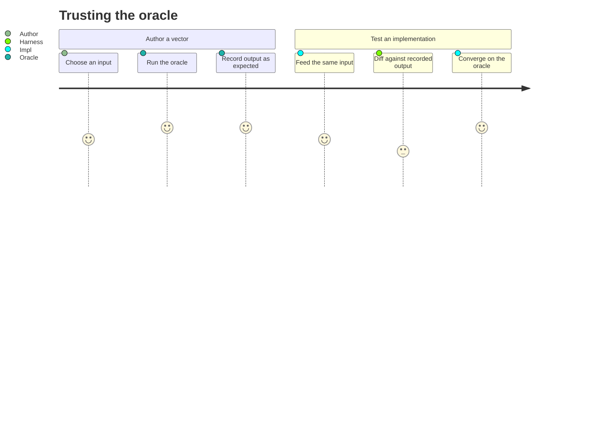

---

## 3. The four conformance criteria

Each clause of `SPEC.md` §6 becomes an independently testable obligation. This
section restates them and names the artefact that proves each one.

### 3.1 Criterion (a) — schema validity

Every emitted pack must validate against `zp11/schema/proof-pack.schema.json`.
The schema requires `standard`, `created`, `change`, `zones`, and `seal`; fixes
`standard` to the constant `zp11/v1`; requires at least eleven zone receipts; and
pins the shapes of digests (`sha256:` plus 64 hex) and keys and signatures
(`ed25519:` plus hex).

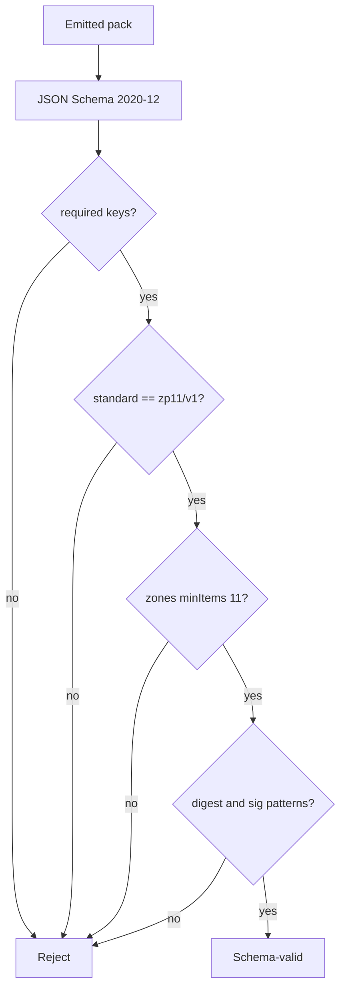

### 3.2 Criterion (b) — fail-closed semantics

A zone returns exactly `PASS` or `FAIL`; anything else — an exception, a timeout, a
missing file, an unparseable result, or silence — resolves to `FAIL`. The oracle
encodes this in `verdict.coerce` and in the per-kind runners of `zones.py`, each of
which is wrapped so a crash fails closed.

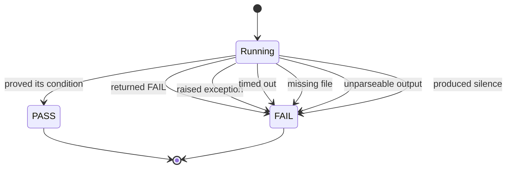

### 3.3 Criterion (c) — digests and signatures

Receipts are digested over the canonical form of their body
`{ id, title, verdict, evidence }`; receipts are signed over the body plus digest;
and the seal is signed over the ordered chain of `{ id, digest }` pairs together
with the change. A conformant implementation must reproduce these bytes exactly.

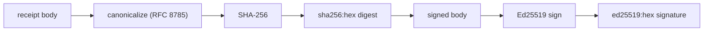

### 3.4 Criterion (d) — refuse unless §5 holds

A verifier permits merge only when all zones are present (strict mode), every
receipt digest recomputes, every signature verifies, the seal verifies, every
verdict is `PASS`, and `sealed` is true. If the key is unavailable, it refuses.

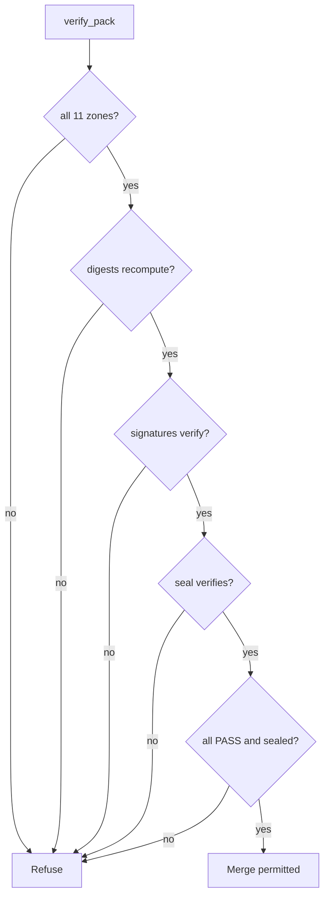

Together the four criteria form a dependency chain: integrity is meaningless
without schema shape, and the decision is meaningless without integrity.

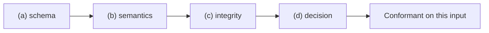

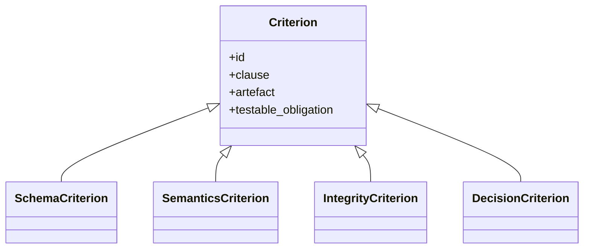

---

## 4. Conformance vectors

A **conformance vector** is a recorded pair: a fully specified input and the
output the oracle produces for it. Because the oracle is deterministic once its
clock and key are pinned, a vector is reproducible — anyone can regenerate the
expected output by re-running the reference against the input.

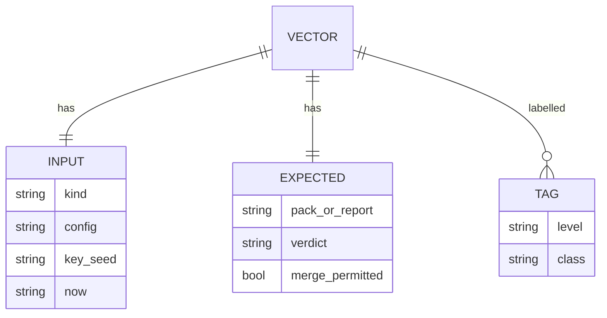

Two vector shapes mirror the oracle's two faces. A **producer vector** fixes a
repository state, a `zp11.toml`, a key seed and a timestamp, and records the exact
Proof-Pack bytes. A **checker vector** fixes a Proof-Pack and a public key, and
records the `VerifyReport` — `merge_permitted`, `zones_passed`, `zones_total`, and
the ordered `reasons`.

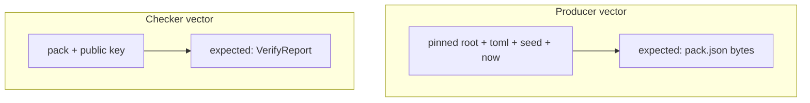

Vectors compose. A producer vector's `pack.json` is a legitimate input to a
checker vector, so the suite can chain them: produce, then verify, and assert the
decision end-to-end.

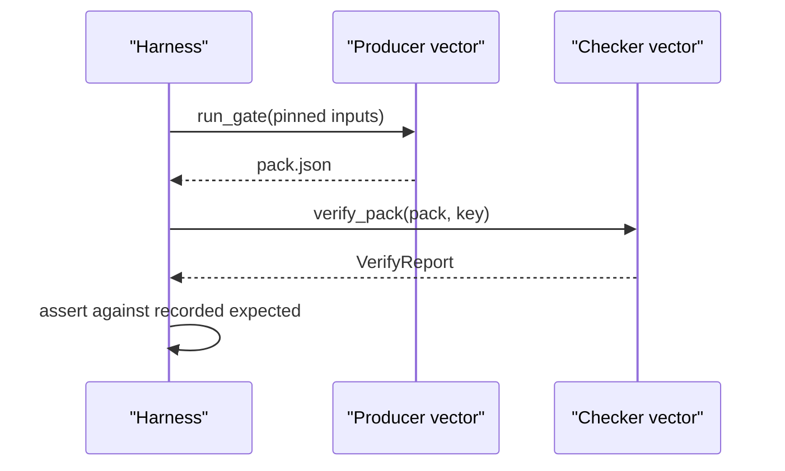

Every vector carries enough metadata to be self-describing: which face it tests,
which conformance level it belongs to, and which behavioural class it exercises
(positive, negative, or tamper). That metadata is what lets a harness select a
subset — for example, "all level-2 tamper vectors."

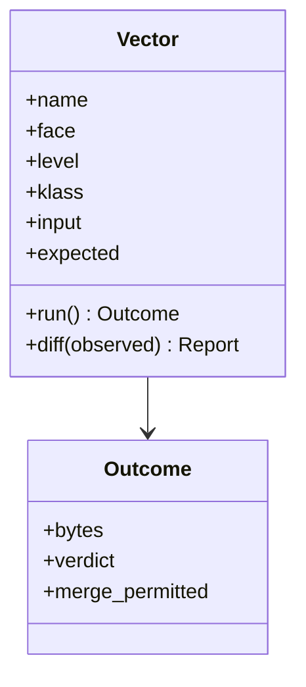

A vector's expected output is never edited by hand to "fix a test." If the oracle
changes behaviour, the vectors are regenerated from the new oracle and the diff is
reviewed as a specification change, not a test change.

```mermaid
flowchart LR
    change["oracle behaviour changes"] --> regen["regenerate vectors"]
    regen --> review["review diff as spec change"]
    review -->|"intended"| accept["accept new vectors"]
    review -->|"unintended"| revert["revert oracle change"]
```

---

## 5. Conformance levels

The specification defines conformance as a single conjunction. For testing and for
staged adoption it is useful to decompose that conjunction into **levels**, each a
strict superset of the one below. The levels are a measurement convenience derived
from `SPEC.md` §6, not additional normative requirements: full conformance is and
remains all four criteria together, which is Level 3 here.

| Level | Name | What it proves | Oracle face |
|-------|------|----------------|-------------|
| L0 | Schema | Packs validate against the JSON Schema | Producer |
| L1 | Semantics | Only `PASS`/`FAIL`; every degenerate input is `FAIL` | Producer |
| L2 | Integrity | Canonical form, digests and signatures reproduce the oracle | Both |
| L3 | Decision | Merge permitted iff sealed, all-PASS, verified; refuse without a key | Verifier |

```mermaid
flowchart TB
    L0["L0 Schema"] --> L1["L1 Semantics"]
    L1 --> L2["L2 Integrity"]
    L2 --> L3["L3 Decision = full conformance"]
```

A claim of conformance at a level means every vector tagged at that level and below
passes. The levels nest, so an L3-conformant implementation is by construction L0,
L1 and L2 conformant.

```mermaid
stateDiagram-v2
    [*] --> L0
    L0 --> L1: schema vectors pass
    L1 --> L2: semantics vectors pass
    L2 --> L3: integrity vectors pass
    L3 --> Full: decision vectors pass
    Full --> [*]
    L0 --> [*]: partial claim
    L1 --> [*]: partial claim
    L2 --> [*]: partial claim
```

### 5.1 L0 — schema conformance

L0 asks only whether emitted packs are structurally valid. It is the cheapest
level to reach and the least meaningful alone: a pack can be schema-valid and still
describe an unsealed, failing gate.

```mermaid
flowchart LR
    e["emit pack"] --> v["validate schema"]
    v -->|"valid"| l0["L0 pass"]
    v -->|"invalid"| x["L0 fail"]
```

### 5.2 L1 — semantic conformance

L1 adds the fail-closed semantics: feed the implementation inputs that crash,
time out, or go missing, and require `FAIL` every time.

```mermaid
stateDiagram-v2
    [*] --> Degenerate
    Degenerate --> FAIL: crash, timeout, missing, silent
    FAIL --> L1pass: observed FAIL
    Degenerate --> L1fail: observed anything mergeable
    L1pass --> [*]
    L1fail --> [*]
```

### 5.3 L2 — integrity conformance

L2 requires byte-exact canonicalisation, digests and signatures. This is where
independent implementations most often diverge, because RFC 8785 number
formatting and key sorting are easy to get subtly wrong.

```mermaid
flowchart TD
    in["same value"] --> aImpl["impl canonical bytes"]
    in --> aOracle["oracle canonical bytes"]
    aImpl --> cmp{"byte-identical?"}
    aOracle --> cmp
    cmp -->|"yes"| l2["L2 pass"]
    cmp -->|"no"| x["L2 fail"]
```

### 5.4 L3 — decision conformance

L3 is full conformance: the implementation reaches the correct merge decision on
every vector, including refusing when the key is unavailable.

```mermaid
flowchart LR
    pack["pack + key"] --> dec["decision"]
    dec -->|"sealed all-PASS verified"| permit["permit"]
    dec -->|"anything else"| refuse["refuse"]
    nokey["no key"] --> refuse
```

```mermaid
journey
    title Climbing the conformance levels
    section Structure
      Emit valid packs: 4: Impl
    section Semantics
      Fail closed on garbage: 4: Impl
    section Integrity
      Reproduce oracle bytes: 3: Impl
    section Decision
      Agree on every merge: 5: Impl
```

---

## 6. Vector classes: positive, negative, tamper

Within every level, vectors fall into three behavioural classes. A healthy suite is
dominated by negative and tamper vectors, because the standard's value is in what
it refuses.

```mermaid
mindmap
  root(("Vector<br/>classes"))
    Positive
      "all zones PASS"
      "sealed pack"
      "merge permitted"
    Negative
      "a zone FAILs"
      "unsealed pack"
      "missing zone"
      "merge refused"
    Tamper
      "evidence byte flipped"
      "verdict swapped"
      "receipt reordered"
      "foreign key"
```

### 6.1 Positive vectors

A positive vector describes a change that genuinely satisfies all eleven zones. Its
expected output is a sealed, all-PASS pack and a `merge_permitted` verdict. Positive
vectors are necessary but, on their own, dangerously insufficient — a stuck
implementation that always says "permit" passes every positive vector.

```mermaid
sequenceDiagram
    participant G as "Gate"
    participant Pk as "Pack"
    G->>G: ZP-1..ZP-10 all PASS
    G->>Pk: ZP-11 seals the chain
    Pk-->>G: sealed = true
    G-->>G: merge permitted
```

### 6.2 Negative vectors

A negative vector describes a legitimately failing situation: a zone returns
`FAIL`, a zone is absent, or the pack is unsealed. The expected output is a refusal
with a specific reason recorded in `reasons`.

```mermaid
flowchart TD
    n["negative input"] --> r["run gate or verify"]
    r --> cond{"which failure?"}
    cond -->|"zone FAIL"| rf["reason: fail-closed"]
    cond -->|"missing zone"| rm["reason: missing zones"]
    cond -->|"unsealed"| ru["reason: not sealed"]
    rf --> refuse["merge refused"]
    rm --> refuse
    ru --> refuse
```

### 6.3 Tamper vectors

A tamper vector takes a valid sealed pack and mutates it — flips an evidence byte,
swaps a `FAIL` to `PASS`, reorders receipts, or re-signs with a foreign key. The
expected output is always a refusal, with the mismatch named.

```mermaid
stateDiagram-v2
    [*] --> ValidPack
    ValidPack --> Tampered: mutate bytes
    Tampered --> DigestMismatch: evidence altered
    Tampered --> BadSignature: verdict swapped
    Tampered --> SealInvalid: receipts reordered
    DigestMismatch --> Refused
    BadSignature --> Refused
    SealInvalid --> Refused
    Refused --> [*]
```

```mermaid
sequenceDiagram
    participant A as "Adversary"
    participant Pk as "Pack"
    participant V as "verify_pack"
    A->>Pk: flip one evidence byte
    Pk->>V: present tampered pack
    V->>V: recompute digest
    V-->>A: digest mismatch, merge refused
```

The three classes together give the suite its shape: positives prove the gate can
open, negatives prove it closes for the right reasons, and tampers prove the
cryptography actually binds.

```mermaid
flowchart LR
    pos["positive: can open"] --> conf["confidence"]
    neg["negative: closes correctly"] --> conf
    tam["tamper: binding holds"] --> conf
```

---

## 7. Running the conformance suite

A conformance run drives the implementation under test with every selected vector,
diffs observed against expected, and reports per-vector and per-level results. The
run is itself fail-closed: a vector that errors, times out, or produces no output
counts as a failure, never as a skip.

```mermaid
flowchart TB
    start["load vector set"] --> sel["select by level and class"]
    sel --> loop["for each vector"]
    loop --> run["run implementation"]
    run --> diff{"observed == expected?"}
    diff -->|"yes"| passc["mark pass"]
    diff -->|"no"| failc["mark fail"]
    run -->|"error or timeout"| failc
    passc --> next["next vector"]
    failc --> next
    next --> rep["aggregate report"]
```

```mermaid
sequenceDiagram
    participant H as "Harness"
    participant I as "Implementation"
    participant R as "Report"
    loop each vector
      H->>I: feed input
      I-->>H: observed output
      H->>H: diff against expected
      H->>R: record pass or fail
    end
    H->>R: compute level attained
    R-->>H: conformance summary
```

The CLI maps cleanly onto the suite. `zp11 keygen` establishes a pinned key,
`zp11 run --now` produces a pack deterministically, and `zp11 verify` renders the
decision that checker vectors assert. `zp11 zones` lets a harness confirm the
implementation knows all eleven canonical zone names.

```mermaid
flowchart LR
    kg["zp11 keygen"] --> run["zp11 run --now --config"]
    run --> pack["proof-pack.json"]
    pack --> ver["zp11 verify --key"]
    ver --> exit["exit 0 permit / non-zero refuse"]
```

Exit codes matter for CI integration: `run` exits `0` only for a sealed, all-PASS
pack, and `verify` exits `0` only when merge is permitted. A harness can therefore
assert conformance partly by exit status alone.

```mermaid
stateDiagram-v2
    [*] --> Runs
    Runs --> Exit0: sealed all-PASS
    Runs --> ExitN: anything else
    Exit0 --> [*]: CI green
    ExitN --> [*]: CI blocks merge
```

A typical suite execution is short and sequential; its phases are easy to plan.

```mermaid
gantt
    title Conformance suite phases
    dateFormat X
    axisFormat %s
    section Setup
      Load vectors        :0, 1
      Pin keys and clock  :1, 1
    section Execute
      Producer vectors    :2, 3
      Checker vectors     :5, 3
      Tamper vectors      :8, 2
    section Report
      Aggregate results   :10, 1
      Compute level       :11, 1
```

---

## 8. Determinism and canonicalisation vectors

Integrity conformance (L2) rests entirely on canonicalisation producing identical
bytes across implementations. `canonical.py` implements the subset of RFC 8785 the
standard needs: UTF-8, lexicographically sorted object keys, minimal separators,
integers without a decimal point, finite numbers only, and rejection of NaN,
Infinity and non-string keys. Canonicalisation vectors pin these decisions one at a
time.

```mermaid
flowchart TD
    v["value"] --> t{"type?"}
    t -->|"object"| so["sort keys, encode pairs"]
    t -->|"array"| ar["encode in order"]
    t -->|"int"| it["decimal, no point"]
    t -->|"float"| fl{"finite?"}
    fl -->|"no"| err["reject: non-canonical"]
    fl -->|"yes"| sr["shortest round-trip"]
    t -->|"string"| st["escape control chars"]
    so --> out["canonical bytes"]
    ar --> out
    it --> out
    sr --> out
    st --> out
```

Each rejection path is itself a negative canonicalisation vector: feeding `NaN`, an
infinity, or a non-string key must raise, which upstream becomes a `FAIL`, never a
silent coercion.

```mermaid
stateDiagram-v2
    [*] --> Encode
    Encode --> Bytes: finite, string keys
    Encode --> Reject: NaN or Infinity
    Encode --> Reject: non-string key
    Reject --> FAIL: upstream fails closed
    Bytes --> [*]
    FAIL --> [*]
```

Key-ordering vectors are especially valuable because a naive implementation that
preserves insertion order will produce the right bytes for already-sorted inputs
and the wrong bytes for unsorted ones — a defect positive vectors would miss.

```mermaid
flowchart LR
    unsorted["{b, a, c}"] --> sort["sort keys"]
    sort --> canon["a,b,c"]
    canon --> dg["stable digest"]
```

Number-formatting vectors pin the integer-vs-float boundary: a whole-valued float
below 1e16 serialises as an integer, which keeps digests stable regardless of how a
language models numbers.

```mermaid
flowchart TD
    num["1.0"] --> chk{"whole and < 1e16?"}
    chk -->|"yes"| asint["emit as 1"]
    chk -->|"no"| asfloat["shortest round-trip"]
    asint --> stable["digest matches oracle"]
```

---

## 9. Signature and seal vectors

L2 and L3 both depend on the signature chain. Receipts are signed over
`{ body, digest }`; the seal is signed over the seal content — standard, created,
change, verdict, counts, and the ordered `{ id, digest }` list. Signature vectors
pin these exact byte constructions and the Ed25519 behaviour around them.

```mermaid
flowchart LR
    r1["ZP-1 digest"] --> chain["ordered digest chain"]
    r2["ZP-2 digest"] --> chain
    rn["... ZP-10 digest"] --> chain
    r11["ZP-11 digest"] --> chain
    chain --> sc["seal_content"]
    sc --> seal["Ed25519 seal signature"]
```

Because the seal binds the ordered chain, a reorder vector — swapping two receipts —
must produce a seal-verification failure even though every individual receipt
signature is still valid. This is the property that stops a pack being assembled
from receipts that never shared a gate.

```mermaid
sequenceDiagram
    participant V as "verify_pack"
    participant S as "seal"
    V->>V: reconstruct seal_content in receipt order
    V->>S: verify seal signature
    S-->>V: reordered -> content differs -> invalid
    V-->>V: merge refused
```

A foreign-key vector signs a valid pack with a key that is not the one the verifier
is given; verification must fail, and with no key at all the verifier must refuse
outright rather than skip the check.

```mermaid
stateDiagram-v2
    [*] --> HaveKey
    HaveKey --> Verify: key provided
    HaveKey --> Refuse: no key available
    Verify --> Permit: signatures valid
    Verify --> Refuse: foreign or bad signature
    Permit --> [*]
    Refuse --> [*]
```

```mermaid
flowchart TD
    sig["signature bytes"] --> pfx{"starts ed25519:?"}
    pfx -->|"no"| bad["reject"]
    pfx -->|"yes"| vf["Ed25519 verify over canonical bytes"]
    vf -->|"ok"| good["accept"]
    vf -->|"fail"| bad
```

---

## 10. Fail-closed vectors

The fail-closed vectors are the heart of the suite, because they encode the one
asymmetry the whole standard turns on. They deliberately break things and require a
refusal: an empty command, a timing-out command, a missing file, an unknown zone
kind, a zone that raises, and a pack with fewer than eleven zones.

```mermaid
mindmap
  root(("Fail-closed<br/>vectors"))
    "empty command"
    "command times out"
    "command non-zero"
    "file missing"
    "file too small"
    "secret present"
    "unknown zone kind"
    "zone raises"
    "missing zone receipt"
    "pack unsealed"
```

Every one of these must land on `FAIL` at the zone level and on *refuse* at the gate
level. The reference wraps each zone runner so that an exception becomes a `FAIL`
receipt rather than a crash that stops the gate.

```mermaid
flowchart TD
    z["run_zone"] --> try["runner in try/except"]
    try -->|"returns"| res["ZoneResult"]
    try -->|"raises"| fc["FAIL with error kind"]
    res --> rec["receipt"]
    fc --> rec
```

A secret-hygiene vector plants a known pattern — for example an obvious private-key
header — under the scanned paths and requires ZP-7 to `FAIL` while recording only
the location, never the secret material itself.

```mermaid
sequenceDiagram
    participant Z7 as "ZP-7 secret_scan"
    participant F as "file under paths"
    Z7->>F: read text
    F-->>Z7: contains key header
    Z7->>Z7: record location only
    Z7-->>Z7: verdict FAIL
```

A coverage or test vector that supplies no machine-readable result must `FAIL`:
declared tests that did not demonstrably run cannot pass ZP-4, and a missing
coverage artefact cannot pass ZP-5.

```mermaid
stateDiagram-v2
    [*] --> ZP4
    ZP4 --> PASS: results attached and parsed
    ZP4 --> FAIL: results absent or unparseable
    PASS --> [*]
    FAIL --> [*]
```

The seal vector closes the loop: if ZP-1 through ZP-10 do not all pass, ZP-11 must
be `FAIL` and `sealed` must be false, so the gate stays shut even though a pack is
still emitted as evidence of *why*.

```mermaid
flowchart LR
    prior{"ZP-1..ZP-10 all PASS?"} -->|"yes"| seal["ZP-11 PASS, sealed true"]
    prior -->|"no"| noseal["ZP-11 FAIL, sealed false"]
    seal --> permit["merge permitted"]
    noseal --> refuse["merge refused"]
```

---

## 11. Cross-implementation interoperability

Conformance matters most when two independent implementations must agree — for
example when ZP-10 (independent re-run) is executed by a second runner that
deliberately shares no state with the first. Interoperability vectors assert that a
pack produced by one conformant implementation verifies under another.

```mermaid
sequenceDiagram
    participant A as "Implementation A"
    participant B as "Implementation B"
    A->>A: run_gate, seal pack
    A-->>B: proof-pack.json + public key
    B->>B: recompute digests, verify signatures
    B-->>A: identical decision
```

The guarantee is portability: a Proof-Pack is self-describing, so a verifier needs
nothing but the pack and a public key — no access to the originating CI, no shared
library, no network. Any two conformant verifiers must reach the same decision on
the same pack.

```mermaid
flowchart TB
    pack["one proof-pack.json"] --> va["verifier A"]
    pack --> vb["verifier B"]
    pack --> vc["verifier C"]
    va --> d["same decision"]
    vb --> d
    vc --> d
```

Interop is also where ZP-10 earns its place: the independent re-run detects a
compromised primary runner precisely because a conformant second runner, given the
same inputs, must reproduce the verdict — and divergence is itself a `FAIL`.

```mermaid
stateDiagram-v2
    [*] --> Primary
    Primary --> Secondary: hand off inputs
    Secondary --> Agree: verdict reproduced
    Secondary --> Diverge: verdict differs
    Agree --> Sealed
    Diverge --> Shut
    Sealed --> [*]
    Shut --> [*]
```

---

## 12. Governance and versioning of the vector set

The vector set is versioned with the standard. `zp11/v1` has one vector set; a
backward-incompatible change increments the `standard` field and produces a new
set. Implementations must reject a pack whose `standard` they do not recognise, so
vectors from a future version never silently pass under an older verifier.

```mermaid
timeline
    title Vector set lifecycle
    "zp11/v1 frozen" : reference oracle fixed
                     : vector set generated
    "implementations tested" : third parties diff against vectors
    "clarifications" : prose sharpened, oracle unchanged
    "zp11/v2 (hypothetical)" : standard field bumped
                             : new vector set generated
```

When the oracle's behaviour is intentionally refined within a version, the vectors
are regenerated and the diff is reviewed as a specification matter. The rule never
changes: a hand-edited expectation is not a vector, because it no longer reflects
the oracle.

```mermaid
flowchart LR
    prop["proposed oracle change"] --> gate{"behaviour change?"}
    gate -->|"no"| doc["docs only, vectors unchanged"]
    gate -->|"yes, compatible"| regen["regenerate v1 vectors"]
    gate -->|"yes, breaking"| bump["bump to new standard"]
    regen --> review["review diff"]
    bump --> newset["new vector set"]
```

A standard this small stays trustworthy only if its conformance surface stays
honest: no vector asserts a behaviour the reference would not produce, no level
weakens the single conjunction of `SPEC.md` §6, and no degenerate input is ever
allowed to resolve anywhere but `FAIL`.

```mermaid
journey
    title Governing conformance over time
    section Freeze
      Fix oracle for a version: 5: Maintainer
      Generate vectors: 5: Oracle
    section Operate
      Test implementations: 4: Community
      Report divergences: 3: Community
    section Evolve
      Review changes as spec: 4: Maintainer
      Version breaking changes: 5: Maintainer
```

```mermaid
mindmap
  root(("Conformance<br/>invariants"))
    "oracle is authority"
    "vectors are recorded judgements"
    "levels nest to full"
    "fail-closed is non-negotiable"
    "packs are portable"
    "standard field gates versions"
```

ZP-11 was invented and authored by **Naquib Hatami** and is published as an open
standard under the MIT License. Conformance is what lets its single promise —
*merge if and only if sealed and all-PASS* — mean the same thing in every
implementation that claims the name.

---

## See also

- [`SPEC.md`](../SPEC.md) — the formal `zp11/v1` specification (§6 defines conformance and names the oracle)
- [`README.md`](../README.md) — overview, adoption steps, and the Proof-Pack at a glance
- [`05-data-model.md`](05-data-model.md) — the Proof-Pack format, receipts, and the signature chain
- [`10-zones-reference.md`](10-zones-reference.md) — the eleven zones and their verdict semantics
- [`21-formal-model.md`](21-formal-model.md) — the verification algorithm and the fail-closed merge decision
