> Part of the ProofGate ZP-11 documentation set

# CI/CD Integration Guide

ProofGate ZP-11 (`zp11/v1`) is an open, fail-closed release-governance standard invented and authored by **Naquib Hatami** and published under the MIT License by iQs Group Inc. / SADI AI Inc. (repo `github.com/iQs-Group/ZP-11`, homepage `zp11.org`). This guide explains how to wire ZP-11 as a *required gate* in continuous-integration and continuous-delivery systems — GitHub Actions, GitLab CI, Jenkins, Azure Pipelines, and others — so that the eleven Zero-Point zones stand between every proposed change and a protected branch. It also documents how the ZP-11 repository **dogfoods** the standard on itself. Nothing here invents adopters, benchmarks, or metrics: it describes only the behaviour of the reference library (`canonical.py`, `crypto.py`, `verdict.py`, `zones.py`, `pack.py`, `gate.py`, `cli.py`) and the `zp11` CLI verbs `keygen`, `zones`, `run`, and `verify`.

---

## 1. Why ZP-11 belongs in the pipeline

Most CI checks are *advisory*: a job warns, turns a badge yellow, and the merge proceeds anyway. ZP-11 inverts the default. A change advances only when **every** zone returns `PASS` and the pack is sealed; any crash, timeout, missing file, or unparseable result resolves to `FAIL`. The pipeline is the natural home for this contract because it already observes every change to `main` before a human does.

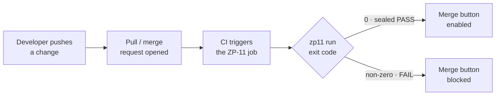

The gate's value is entirely in its asymmetry: evidence opens it, and nothing else does. Wiring it as advisory would discard the property that makes it worth adopting. A pipeline is also the only place where this asymmetry can be *enforced* rather than merely encouraged, because the forge's branch-protection machinery can treat a non-zero exit as a hard stop. The standard deliberately keeps the enforcement surface small: there is exactly one question to answer at merge time — did a sealed, all-`PASS` Proof-Pack exist for this change? — and the pipeline answers it with an exit code that any CI system already understands. No custom webhook, no bespoke merge bot, and no hosted service are required; the reference library and the `zp11` CLI are the entire moving parts, and both are MIT-licensed and installable with a single `pip install`.

This matters for adoption economics. Teams rarely resist a standard because of its goals; they resist the integration tax. ZP-11 keeps that tax near zero by refusing to be a platform. It defines verdicts, a signed record format, and a verification algorithm, and then it gets out of the way of whatever tools a repository already runs. The CI job is thin glue: install, materialise a key, run, verify, upload. Everything substantive lives in `zp11.toml`, which is version-controlled alongside the code it governs, so the gate's configuration is itself reviewable and diffable like any other source file.

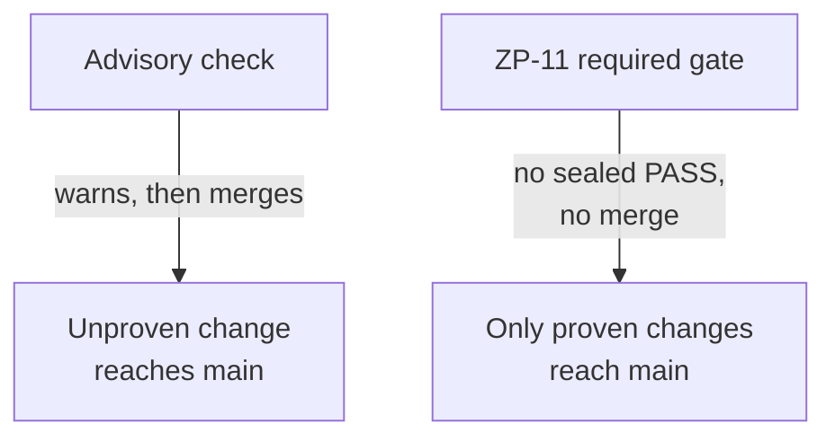

A conforming integration therefore has two jobs that are easy to confuse and must be kept distinct: *producing* a Proof-Pack (`zp11 run`) and *enforcing* it as a required status check in the forge's branch-protection settings.

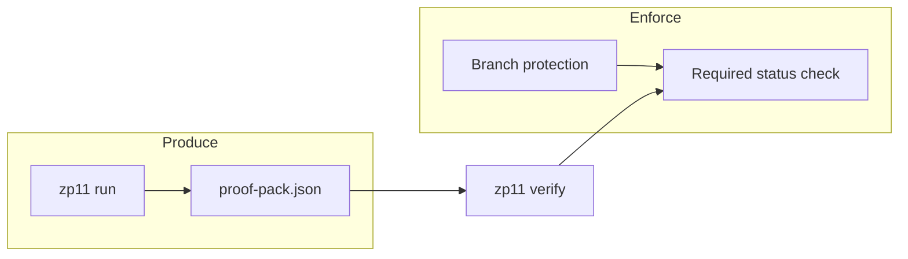

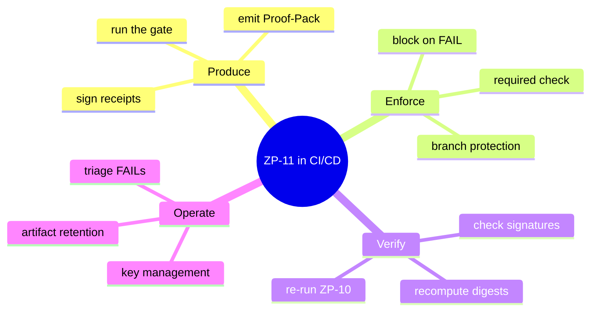

## 2. The gate contract, in CI terms

The reference CLI is designed so that *exit code is the contract*. `zp11 run` exits `0` only for a sealed, all-`PASS` pack; `zp11 verify` exits `0` only when integrity holds and merge is permitted. Any CI system that can gate on a non-zero exit can host ZP-11 without a plugin.

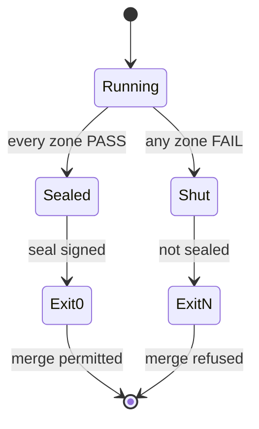

Each of the eleven zones maps to a *kind* declared in `zp11.toml` — `require`, `file`, `command`, `secret_scan`, or `seal` — and each kind fails closed on any exception.

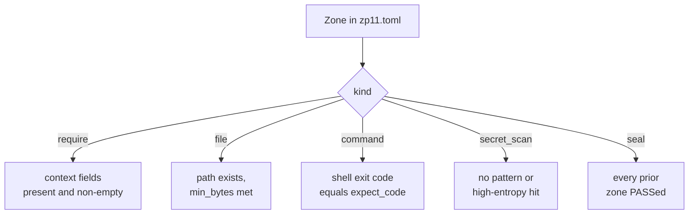

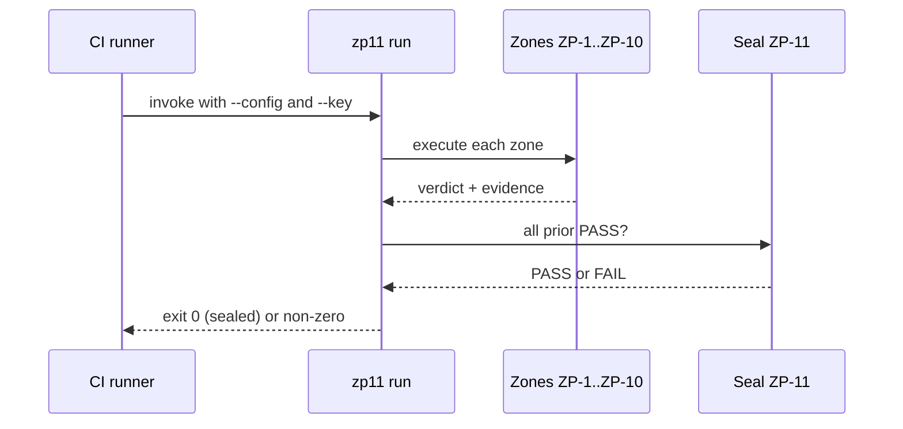

A deliberate design choice in the reference gate has direct CI consequences: wrapped commands run with an **empty environment**. The gate constructs its subprocess with no inherited variables, so a `command` zone sees only what the shell itself provides, not the ambient CI environment. This is a feature, not an oversight — it keeps the verdict reproducible across runners that would otherwise differ only in their environment, which is precisely what ZP-2 and ZP-10 demand. The practical implication for integrators is that a wrapped tool must not depend on inherited environment variables to function; anything it needs should be explicit in the command or resolvable from the repository checkout. When a tool genuinely requires configuration, prefer committing that configuration to the repository (where ZP-8 can also assert its presence) over smuggling it through the environment, because the former is reproducible and auditable while the latter is neither.

The command kind is the workhorse of CI integration: it wraps any tool the repository already runs — `pytest`, a build, a linter, a coverage check — and reduces it to a verdict plus an evidence digest over the combined stdout and stderr. The verdict is `PASS` only when the process exit code equals the configured `expect_code` (default `0`); a timeout or a spawn failure is caught and converted to `FAIL`, never to silence. The evidence records the command text, the observed exit code, the expected code, and a SHA-256 over `stdout + NUL + stderr`. That digest is what makes the evidence tamper-evident: changing a single byte of the tool's output changes the digest, and because the receipt is signed over a body that includes the evidence, it also invalidates the signature. There is no place to hide a doctored result.

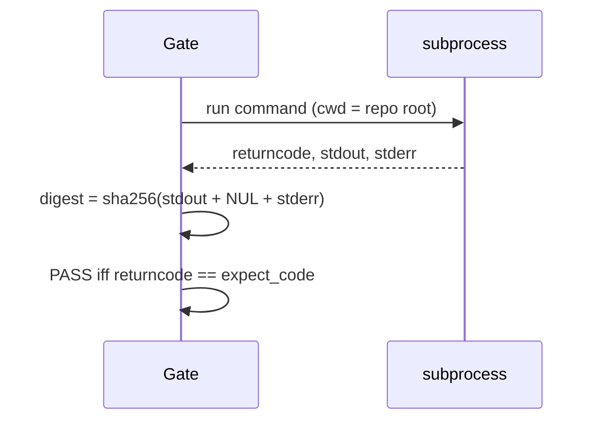

Because the verdict is boolean, a conforming pipeline never has to interpret a partial result. The branch rule asks one question.

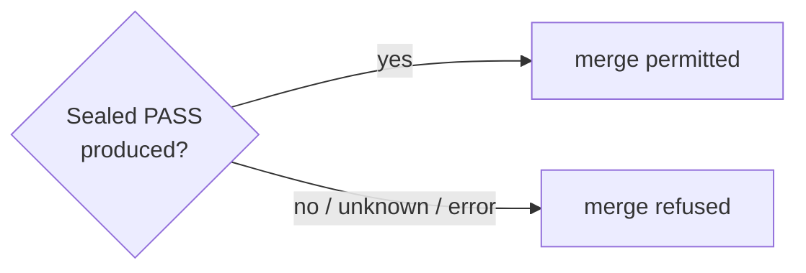

## 3. GitHub Actions

GitHub Actions is the most common first integration, so it is worth treating in detail. The canonical integration is a single workflow that runs on pull-request events, produces a Proof-Pack, verifies it, and uploads it as a build artifact. Because `zp11 run` already returns a non-zero exit on any failure, the job fails naturally and GitHub records it as a failed check — there is no need for an explicit `if: failure()` step or a hand-rolled status API call. The `verify` step is not redundant with `run`: `run` produces and seals the pack on the primary runner, while `verify` re-reads it from disk and confirms that digests recompute, signatures check, and the seal holds, exercising the same code path a third-party auditor would. Running both in the job proves that the artifact you are about to upload is self-consistent before anyone downloads it.

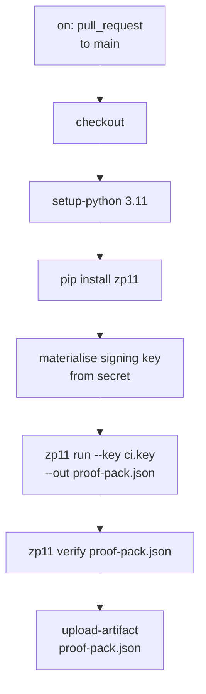

A representative workflow is shown below; the key is injected from an Actions secret and never written to the repository.

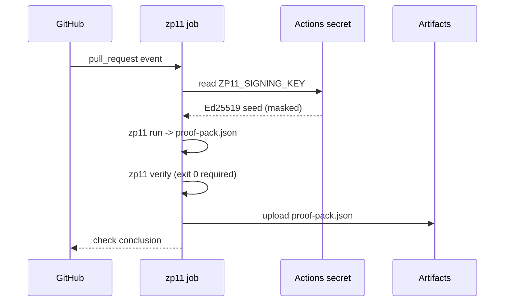

The job name matters: it becomes the string you later mark as a required status check, so it must be stable across runs. Renaming the job after it is listed in branch protection silently turns the gate off, because GitHub will wait for a check that no longer reports. Treat the job name as a public contract and change it only together with the branch-protection configuration. For the same reason, prefer a single, clearly named gate job over a sprawl of per-zone jobs: the forge should see one authoritative check whose success or failure is the whole decision, with per-zone detail living inside the uploaded Proof-Pack rather than in a dozen separate check lines that a reviewer must mentally AND together.

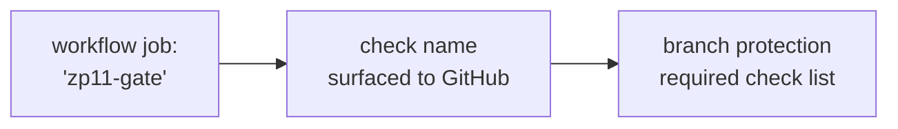

ZP-10 (independent re-run) is where GitHub's matrix and multi-runner features earn their place. The primary runner produces the pack; a second runner, ideally a different OS image, re-runs the gate and re-verifies.

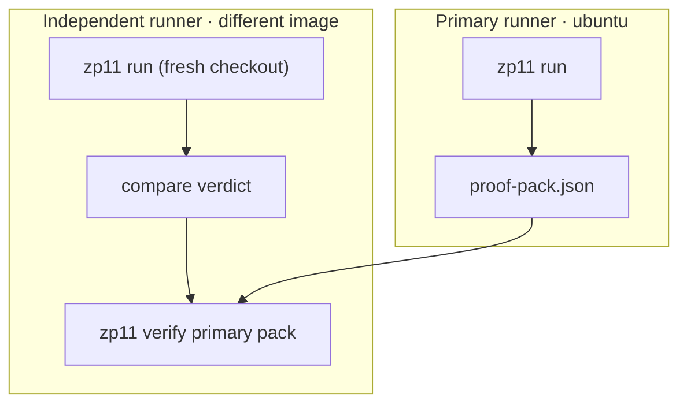

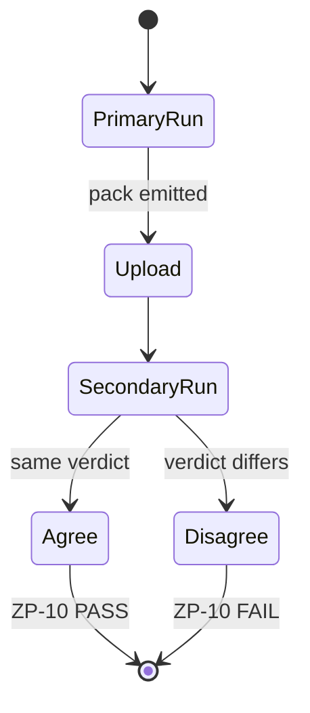

Caching the `pip` download accelerates the job without affecting the verdict, because ZP-3 (dependency integrity) checks the lockfile, not the cache.

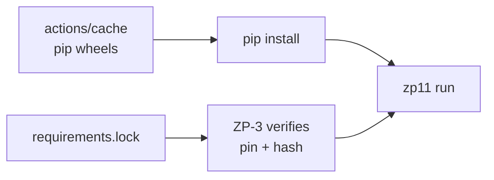

For forks, secrets are unavailable by default, so the signing step must degrade safely: a fork PR can run the zones and show that they would pass, but it cannot produce a *trusted* seal. If the key is absent, `zp11 run` falls back to an ephemeral generated key, which signs a structurally valid pack that nonetheless verifies against *no* trusted public key. The gate stays shut until a maintainer re-runs it with the real key — which is exactly the fail-closed behaviour you want. This also neatly sidesteps a classic supply-chain pitfall: never expose the trusted signing seed to a workflow triggered by untrusted fork code. The correct pattern is to run untrusted contributions with the pull-request trigger (no secret) for feedback only, and to produce the trusted, mergeable pack from a context that the fork cannot influence, such as a maintainer-initiated re-run or a trusted post-merge check on the protected branch.

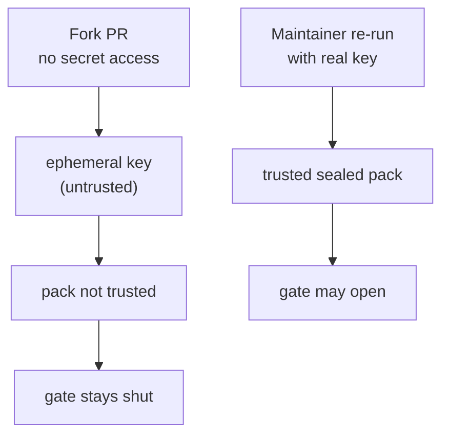

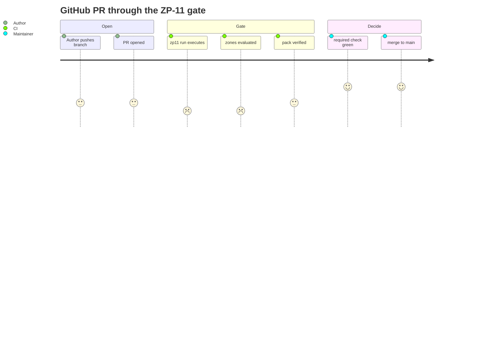

## 4. Branch protection as the real gate

Running the job is necessary but not sufficient. The enforcement lives in branch protection: the ZP-11 check must be marked **required**, and the branch must require the check to pass before merge. Without this, ZP-11 is advisory again — the pipeline will dutifully produce red and green results that nothing consults. This is the single most common way a ZP-11 rollout fails to deliver its guarantee: the workflow is present and correct, but no branch rule depends on it, so merges proceed regardless. The configuration is small but it is the whole point, and it belongs in the forge's protected settings, not in a file a contributor could edit in the same change they are trying to merge.

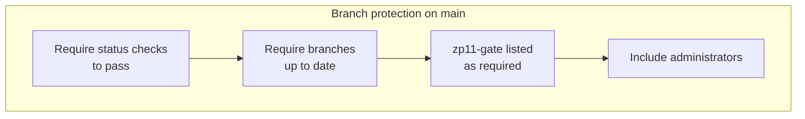

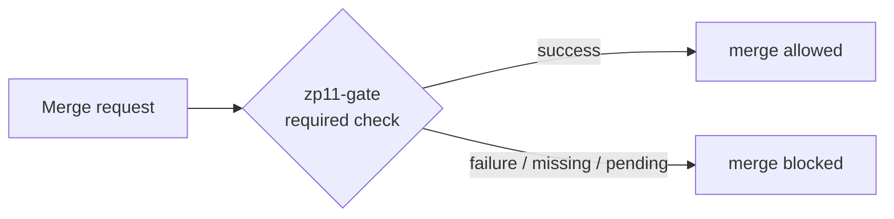

A subtle failure mode: if the check is required but the workflow never ran (for example, a path filter excluded the change), GitHub may treat the check as *missing*. ZP-11's philosophy says missing equals FAIL, so the workflow should trigger on all changes to the protected branch, with no path filter that could silently skip it.

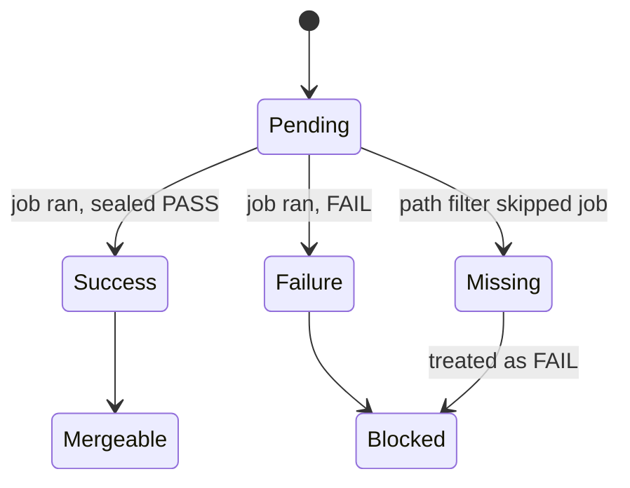

"Include administrators" is not optional for a governance standard: a bypassable gate is no gate. The whole premise of ZP-11 is that evidence, not authority, opens the gate; a rule that exempts administrators reintroduces authority as a merge path and quietly reverts the standard to advisory status for exactly the accounts most capable of causing harm. If an emergency bypass is genuinely required, it should be an explicit, logged, time-boxed exception at the organisation level — never a standing carve-out — so that every merge either carries a sealed Proof-Pack or leaves an auditable record of why it did not.

```mermaid
flowchart LR
    Admin["Administrator merge"] --> Incl{"admins<br/>included?"}
    Incl -->|"yes"| Gated["still gated"]
    Incl -->|"no"| Bypass["bypass defeats<br/>the standard"]
```

```mermaid
erDiagram
    BRANCH ||--o{ PROTECTION_RULE : has
    PROTECTION_RULE ||--|{ REQUIRED_CHECK : lists
    REQUIRED_CHECK }o--|| WORKFLOW_JOB : "resolves to"
    WORKFLOW_JOB ||--|| PROOF_PACK : produces
```

The up-to-date requirement guards against a stale base: a pack proven against an old `main` should not merge into a newer one without re-running.

```mermaid
flowchart TB
    Old["Pack proven vs<br/>main@abc"] --> Moved{"main moved<br/>to def?"}
    Moved -->|"yes"| Rerun["require re-run<br/>vs def"]
    Moved -->|"no"| Keep["pack still current"]
```

## 5. GitLab CI/CD

GitLab maps cleanly onto the same contract. A `.gitlab-ci.yml` stage runs `zp11 run` and `zp11 verify`; the Proof-Pack is declared as a job artifact; and the project's **merge-request approval / merge checks** make the pipeline required before merge. GitLab's "pipelines must succeed" merge check is the direct analogue of GitHub's required status check, and the same discipline applies: it must be enabled on the protected branch and it must not be bypassable by maintainers for the gate to mean anything. GitLab additionally lets you require that the pipeline run on the *merge result* rather than the source branch, which closes the stale-base gap discussed for GitHub by proving the change against the branch it will actually land on.

```mermaid
flowchart TB
    MR["Merge request"] --> Pipe["pipeline runs<br/>stage: gate"]
    Pipe --> Job["zp11 run + verify"]
    Job --> Artk["artifacts:<br/>proof-pack.json"]
    Artk --> MC{"pipeline must<br/>succeed?"}
    MC -->|"yes"| MergeOK["merge enabled"]
    MC -->|"no"| MergeNo["merge blocked"]
```

```mermaid
sequenceDiagram
    participant GL as GitLab
    participant Run as Runner
    participant Var as Masked CI variable
    GL->>Run: MR pipeline
    Run->>Var: read ZP11_SIGNING_KEY (masked, protected)
    Var-->>Run: Ed25519 seed
    Run->>Run: zp11 run --out proof-pack.json
    Run->>Run: zp11 verify proof-pack.json
    Run-->>GL: job status + artifact
```

Protected, masked variables are the GitLab equivalent of Actions secrets, and *protected* matters: the key should be exposed only on pipelines for protected branches, so an untrusted branch cannot sign with the trusted key.

```mermaid
flowchart LR
    V["CI/CD variable"] --> M{"masked?"}
    M -->|"no"| Leak["seed printed<br/>in logs"]
    M -->|"yes"| Hidden["value hidden"]
    Hidden --> Pr{"protected?"}
    Pr -->|"yes"| OnlyProt["only on protected<br/>branches"]
    Pr -->|"no"| Any["any branch can sign"]
```

GitLab's parent-child or multi-project pipelines are a clean way to realise ZP-10: the independent re-run runs in a separate project with no shared cache or state.

```mermaid
flowchart TB
    Parent["Parent pipeline<br/>produces pack"] --> Trig["trigger child<br/>in isolated project"]
    Trig --> Child["child re-runs gate"]
    Child --> Cmp["compare verdicts"]
    Cmp --> ZP10{"agree?"}
    ZP10 -->|"yes"| Pass["ZP-10 PASS"]
    ZP10 -->|"no"| Fail["ZP-10 FAIL"]
```

```mermaid
stateDiagram-v2
    [*] --> Build
    Build --> Gate
    Gate --> Pass: sealed PASS
    Gate --> Blocked: FAIL
    Pass --> [*]: MR mergeable
    Blocked --> [*]: MR not mergeable
```

```mermaid
journey
    title GitLab MR lifecycle with ZP-11
    section Prepare
      Push branch: 3: Author
      Open MR: 3: Author
    section Gate
      Pipeline runs gate: 2: Runner
      Verify pack: 3: Runner
    section Merge
      Required pipeline green: 5: Reviewer
      Merge: 5: Reviewer
```

## 6. Jenkins, Azure Pipelines, Bitbucket, CircleCI

Any system that honours a non-zero exit can host the gate. The integration pattern is identical; only the vocabulary changes. Each platform has a secret-delivery mechanism, a way to run a shell command and fail the build on its exit code, an artifact store, and a branch rule that can require a job. Map those four to install-key-run-verify-upload-enforce and the integration is complete. This platform-agnosticism is a direct consequence of the standard defining verdicts rather than vendors: ZP-11 never asks the CI system to understand zones, only to run one command and respect its exit status.

```mermaid
flowchart TB
    Core["zp11 run (exit code)<br/>+ zp11 verify"] --> J["Jenkins:<br/>pipeline stage"]
    Core --> A["Azure Pipelines:<br/>script task"]
    Core --> B["Bitbucket:<br/>pipeline step"]
    Core --> Ci["CircleCI:<br/>job step"]
```

```mermaid
flowchart LR
    Jen["Jenkins stage"] --> Cred["withCredentials<br/>signing seed"]
    Cred --> Rn["sh 'zp11 run ...'"]
    Rn --> Arch["archiveArtifacts<br/>proof-pack.json"]
    Arch --> Gatek{"stage result"}
    Gatek -->|"success"| MergeJ["protected merge"]
    Gatek -->|"failure"| StopJ["build fails"]
```

```mermaid
sequenceDiagram
    participant AZ as Azure Pipelines
    participant SV as Secret variable / Key Vault
    participant SC as script task
    AZ->>SV: fetch signing seed
    SV-->>SC: seed (secret)
    SC->>SC: zp11 run && zp11 verify
    SC-->>AZ: task exit code
```

```mermaid
flowchart TB
    BBp["Bitbucket pipeline"] --> Sec2["repository secured<br/>variable"]
    Sec2 --> Step["step: zp11 run + verify"]
    Step --> ArtB["artifacts:<br/>proof-pack.json"]
    Step --> Req2{"required?"}
    Req2 -->|"yes"| MergeB["merge check enforced"]
```

```mermaid
flowchart LR
    Cc["CircleCI job"] --> Ctx["context holds<br/>signing seed"]
    Ctx --> Exec["run: zp11 run + verify"]
    Exec --> Store["store_artifacts<br/>proof-pack.json"]
    Store --> Gate2{"job success?"}
    Gate2 -->|"no"| Block2["workflow fails"]
```

The common denominator is a table of how each system expresses the same three concerns.

| Concern | GitHub Actions | GitLab CI | Jenkins | Azure Pipelines |
|---|---|---|---|---|
| Secret delivery | Actions secret | Masked protected var | Credentials binding | Secret var / Key Vault |
| Produce pack | workflow job | pipeline job | pipeline stage | script task |
| Store pack | upload-artifact | artifacts | archiveArtifacts | publish artifact |
| Enforce | required status check | required pipeline | protected branch job | branch policy |

```mermaid
mindmap
  root((Enforcement surface))
    GitHub
      required status check
      include administrators
    GitLab
      merge checks
      protected branches
    Jenkins
      protected branch
      shared library gate
    Azure
      branch policies
      build validation
```

## 7. Key management in CI

The signing key is the root of trust, and in a CI deployment it is also the most valuable secret in the pipeline, because anything that can sign can mint a pack that the gate will trust. The specification requires it to live *outside* the gated repository and to be rotated on the adopter's schedule. In CI, that means a secret store the pipeline reads at run time and never persists to disk beyond the ephemeral runner. `zp11 keygen` generates an Ed25519 keypair, printing the public key to stdout and, when `--out` is given, writing the raw seed to a file and the public key id to `<out>.pub`. Generation should happen once, offline, on a trusted machine; only the seed ever enters the secret store, and only the public key is distributed.

```mermaid
flowchart TB
    Gen["zp11 keygen<br/>(offline, once)"] --> Seed["Ed25519 seed"]
    Seed --> Store["secret store<br/>(Actions / GitLab / Vault)"]
    Seed --> PubFile["public key .pub"]
    PubFile --> Repo["committed for<br/>verifiers"]
    Store --> CI["CI reads at runtime"]
```

The seed is private; only the 32-byte public key is safe to commit, and it is what any third party uses to verify the pack offline.

```mermaid
flowchart LR
    Priv["seed (private)"] -->|"never committed"| Vaultp["secret store only"]
    Pub["ed25519 public key"] -->|"safe to publish"| RepoP["repo / release"]
    RepoP --> Verify["zp11 verify --key pub.key"]
```

```mermaid
sequenceDiagram
    participant Ops as Operator
    participant KG as zp11 keygen
    participant Vault as Secret store
    Ops->>KG: generate key offline
    KG-->>Ops: seed + public id
    Ops->>Vault: store seed (masked)
    Ops->>Ops: commit public .pub
```

Because the Ed25519 key is small and the seed is just hex, it is tempting to treat it casually; resist that. The seed should be a masked, protected secret that is never echoed into logs, never written to a workspace path that another step archives, and never committed even to a private branch. A leaked seed does not merely expose past packs — it lets an attacker forge future ones, which is the one failure the standard cannot detect from the pack alone, since a forged pack signed with the real key verifies perfectly. Operational security of the seed is therefore the ceiling on the assurance ZP-11 can provide.

Rotation replaces the seed in the store and publishes the new public key; packs signed under the old key remain verifiable against the old public key, so retention of public keys is append-only. This is why the public-key history must be preserved rather than overwritten: an auditor re-verifying a two-year-old release needs the public key that was current when that release was sealed. A simple, durable convention is to publish each public key alongside the release it first governed, so the correct verification key travels with the artifact it verifies.

```mermaid
stateDiagram-v2
    [*] --> KeyV1
    KeyV1 --> Rotating: schedule / incident
    Rotating --> KeyV2: new seed stored
    KeyV2 --> [*]
    KeyV1 --> Archived: public key retained
    Archived --> VerifyOld: old packs still verify
```

```mermaid
flowchart TB
    Trig["rotation trigger"] --> NewK["keygen new seed"]
    NewK --> Repl["replace secret"]
    Repl --> PubN["publish new public key"]
    PubN --> Keep["keep old public key<br/>for historical packs"]
```

A hardware or hosted KMS can hold the seed; the integration point is unchanged as long as the runner can obtain the seed (or a signing operation) at run time and the public key is distributable.

```mermaid
erDiagram
    SIGNING_KEY ||--o{ PROOF_PACK : signs
    PUBLIC_KEY ||--o{ PROOF_PACK : verifies
    SIGNING_KEY ||--|| PUBLIC_KEY : "derives"
    SECRET_STORE ||--|| SIGNING_KEY : holds
```

## 8. ZP-10: independent re-run topology

ZP-10 exists to detect a compromised or misconfigured primary runner, so the two runners **should not share state**. In CI terms: different runner pool, fresh checkout, no shared cache, and ideally a different OS image. The second runner both re-runs the gate and verifies the primary's pack. The security argument is concrete: if an attacker subverts a single runner — poisoning a cache, patching a tool, or tampering with the environment — that runner can be made to emit a `PASS` for a change that does not deserve one. ZP-10 raises the bar by demanding that an *independent* runner, which the attacker would also have to subvert, reach the same verdict. The more the two runners differ, the more work a successful attack requires, which is why a different OS image is worth the modest added cost.

```mermaid
flowchart LR
    subgraph A["Runner A (primary)"]
      A1["clean checkout"] --> A2["zp11 run"] --> A3["pack A"]
    end
    subgraph B["Runner B (independent)"]
      B1["clean checkout"] --> B2["zp11 run"] --> B3["pack B"]
      B3 --> B4["compare verdict"]
      B4 --> B5["verify pack A"]
    end
    A3 --> B5
```

```mermaid
sequenceDiagram
    participant A as Runner A
    participant B as Runner B
    participant K as Public key
    A->>A: run gate -> pack A
    A->>B: hand off pack A
    B->>B: run gate -> verdict B
    B->>K: verify pack A signatures
    B->>B: verdict A == verdict B ?
    B-->>A: ZP-10 PASS iff agree + verified
```

Non-determinism is the enemy of ZP-10, and also of ZP-2 (reproducible build). The command kind digests stdout and stderr, so any timestamp, random seed, or unordered output in a wrapped tool can make two runs disagree. The fix is to make the wrapped command deterministic, not to relax the zone.

```mermaid
flowchart TB
    Cmd["wrapped command"] --> ND{"deterministic<br/>output?"}
    ND -->|"yes"| Same["identical digest"]
    ND -->|"no"| Diff["digests differ"]
    Diff --> Fix["pin seeds, sort output,<br/>strip timestamps"]
    Fix --> Same
```

```mermaid
stateDiagram-v2
    [*] --> RunA
    RunA --> RunB
    RunB --> Compare
    Compare --> Agree: A == B
    Compare --> Disagree: A != B
    Agree --> [*]: ZP-10 PASS
    Disagree --> [*]: ZP-10 FAIL (investigate)
```

The `--now` flag on `zp11 run` pins the pack timestamp, which lets two runners produce byte-identical packs when every underlying check is itself reproducible.

```mermaid
flowchart LR
    Now["--now 2026-01-01T00:00:00Z"] --> Fixed["fixed 'created' field"]
    Fixed --> Repro["byte-identical packs<br/>across runners"]
```

```mermaid
mindmap
  root((ZP-10 hygiene))
    Isolation
      separate pool
      fresh checkout
      no shared cache
    Determinism
      pinned seeds
      sorted output
      fixed timestamp
    Verification
      recompute digests
      check signatures
```

## 9. The Proof-Pack as a CI artifact

Every pipeline run should persist `proof-pack.json` as a build artifact. It is self-describing and portable: a verifier needs only the pack and the public key, never access to the original CI. This portability is what turns a transient CI result into a durable governance record. Months after a release, when the pipeline logs have rotated away and the runner images have been rebuilt, the Proof-Pack still answers the question "what evidence permitted this merge?" in full, and `zp11 verify` still re-checks that evidence without any live infrastructure. Treat the pack as a first-class release artifact: retain it for at least as long as the release it governs is supported, and attach it to the release or tag so it is discoverable from the thing it describes rather than buried in a CI run that may be garbage-collected.

```mermaid
flowchart TB
    Run["zp11 run"] --> Pack["proof-pack.json"]
    Pack --> Store["CI artifact store"]
    Pack --> Attach["attach to release"]
    Store --> Audit["later audit<br/>zp11 verify"]
    Attach --> Third["third-party verify"]
```

```mermaid
erDiagram
    PROOF_PACK ||--|{ RECEIPT : contains
    PROOF_PACK ||--|| SEAL : "closes with"
    RECEIPT }o--|| ZONE : "records"
    SEAL }o--|| PUBLIC_KEY : "verified by"
    RECEIPT {
      string id
      string title
      string verdict
      string digest
      string signature
    }
    SEAL {
      string verdict
      bool sealed
      int zones_passed
      int zones_total
    }
```

Integrity is layered: each receipt is digested over its canonical form (RFC 8785 / JCS) and signed Ed25519 (RFC 8032); the seal signs the ordered chain of receipt digests, so receipts cannot be reordered, added, or removed.

```mermaid
flowchart LR
    Body["receipt body<br/>{id,title,verdict,evidence}"] --> JCS["canonical JCS"]
    JCS --> Dig["sha256 digest"]
    Dig --> Sig["Ed25519 receipt signature"]
    Dig --> Chain["ordered digest chain"]
    Chain --> SealSig["Ed25519 seal signature"]
```

```mermaid
sequenceDiagram
    participant V as Verifier
    participant P as Proof-Pack
    participant K as Public key
    V->>P: read receipts in order
    loop each receipt
      V->>V: recompute digest(body)
      V->>K: verify receipt signature
    end
    V->>V: reconstruct seal_content
    V->>K: verify seal signature
    V-->>V: merge permitted iff all PASS + sealed
```

## 10. Dogfooding: ZP-11 gates ZP-11

The repository runs the standard on itself; `zp11.toml` at the root is the configuration it uses. This is the strongest possible demonstration that the zones map to checks a real project already runs, and it is the reference for new adopters. Dogfooding is not a marketing gesture here — it is the project's conformance harness in production. Every change to the reference library must itself pass through the eleven zones before it can reach `main`, which means the library cannot regress its own fail-closed behaviour without the gate catching it. The self-configuration is deliberately modest and honest: it wires each zone to a check the Python repository genuinely performs, rather than to an aspirational check that would weaken the demonstration.

```mermaid
flowchart TB
    Z1["ZP-1 require:<br/>source_commit, builder"] --> Z2["ZP-2 command:<br/>import zp11; print version"]
    Z2 --> Z3["ZP-3 file:<br/>requirements.lock"]
    Z3 --> Z4["ZP-4 command:<br/>pytest -q"]
    Z4 --> Z5["ZP-5 command:<br/>pytest -q"]
    Z5 --> Z6["ZP-6 command:<br/>compileall zp11"]
    Z6 --> Z7["ZP-7 secret_scan:<br/>py, md, toml"]
    Z7 --> Z8["ZP-8 file:<br/>LICENSE min_bytes 100"]
    Z8 --> Z9["ZP-9 require:<br/>source_commit"]
    Z9 --> Z10["ZP-10 command:<br/>cli zones"]
    Z10 --> Z11["ZP-11 seal"]
```

```mermaid
flowchart LR
    Toml["zp11.toml"] --> Build["build_zones<br/>sorted by number"]
    Build --> Gate["run_gate"]
    Gate --> PackD["ProofPack sealed"]
```

Each zone in the self-configuration demonstrates one kind. The `require` zones (ZP-1, ZP-9) prove provenance fields such as `source_commit` and `builder` are present and non-empty in the change context; `file` zones (ZP-3, ZP-8) prove an artifact — the dependency lockfile, the LICENSE — exists and meets a byte floor, recording its SHA-256 as evidence; `command` zones (ZP-2, ZP-4, ZP-5, ZP-6, ZP-10) wrap real tooling such as `pytest` and `compileall` and pass only on the expected exit code; `secret_scan` (ZP-7) walks the Python, Markdown, and TOML globs with conservative pattern and entropy detectors; and `seal` (ZP-11) passes only when every prior zone passed. Reading `zp11.toml` top to bottom is therefore a working tutorial in all five kinds, which is exactly why new adopters are pointed at it first.

```mermaid
stateDiagram-v2
    [*] --> ZP1
    ZP1 --> ZP2: PASS
    ZP2 --> ZP3: PASS
    ZP3 --> ZP4: PASS
    ZP4 --> ZP5: PASS
    ZP5 --> ZP6: PASS
    ZP6 --> ZP7: PASS
    ZP7 --> ZP8: PASS
    ZP8 --> ZP9: PASS
    ZP9 --> ZP10: PASS
    ZP10 --> ZP11: all prior PASS
    ZP11 --> [*]: sealed
```

```mermaid
sequenceDiagram
    participant CI as GitHub Actions
    participant Repo as ZP-11 repo
    participant Gate as zp11 run
    CI->>Repo: checkout on PR to main
    Repo->>Gate: zp11 run --config zp11.toml
    Gate->>Gate: ZP-1..ZP-10 then seal
    Gate-->>CI: sealed PASS -> exit 0
    CI->>CI: zp11 verify proof-pack.json
```

Dogfooding also validates the adopt-in-four-steps path the project recommends: declare zones, emit a pack on every change, re-run to verify, then make the gate blocking.

```mermaid
flowchart LR
    S1["1 · declare zones"] --> S2["2 · emit pack<br/>on every change"]
    S2 --> S3["3 · re-run<br/>ZP-10 verify"]
    S3 --> S4["4 · make the gate<br/>blocking"]
```

```mermaid
journey
    title Adopting ZP-11, as the repo did itself
    section Declare
      Write zp11.toml: 3: Maintainer
    section Observe
      Pack on every PR: 3: CI
    section Enforce
      Make check required: 5: Maintainer
      Block on FAIL: 5: Maintainer
```

## 11. Failure modes and triage

Because the gate is fail-closed, a red check is the expected outcome whenever evidence is incomplete. Triage means reading the Proof-Pack, not re-running until green. The pack is still emitted on failure — as evidence of *why* the gate stays shut — but it is never sealed. This is a cultural adjustment as much as a technical one: in an advisory world a red check invites a retry; in a fail-closed world it is a precise, signed statement about missing evidence, and the correct response is to supply that evidence. The single most important triage rule follows directly from the standard's asymmetry: never weaken a zone to make a change pass. Lowering a coverage floor, broadening a severity threshold, or scoping a secret scan down to nothing all produce a green check that no longer means what the gate promises. The pack would still be sealed and verifiable, but it would be certifying a weaker claim, and that erosion is invisible to anyone reading only the check's colour.

```mermaid
flowchart TB
    Fail["gate FAIL"] --> Open["open proof-pack.json"]
    Open --> Find["find first<br/>verdict = FAIL"]
    Find --> Evid["read its evidence"]
    Evid --> Cause{"kind"}
    Cause -->|"command"| CmdF["non-zero exit<br/>or timeout"]
    Cause -->|"file"| FileF["missing or<br/>too small"]
    Cause -->|"secret_scan"| SecF["finding locations"]
    Cause -->|"require"| ReqF["missing context field"]
```

```mermaid
flowchart LR
    T["timeout"] --> F["FAIL"]
    X["exception / crash"] --> F
    M["missing file"] --> F
    U["unparseable output"] --> F
    S["silence / no verdict"] --> F
    F --> Shut["gate stays shut"]
```

A frequent first-adoption failure is ZP-7 flagging an example key or test fixture. The evidence records only *locations* and rule names, never the secret material, so triage is a matter of scoping the `paths` globs or removing the real exposure.

```mermaid
sequenceDiagram
    participant Dev as Developer
    participant Pack as Proof-Pack
    Dev->>Pack: ZP-7 verdict FAIL
    Pack-->>Dev: findings = [path, rule]
    Dev->>Dev: real secret? remove it
    Dev->>Dev: fixture? scope paths
```

ZP-10 disagreement is the highest-signal failure: two runners reached different verdicts. That is never a flake to retry past; it indicates non-determinism or a divergent environment.

```mermaid
stateDiagram-v2
    [*] --> Disagree
    Disagree --> Env: environment differs
    Disagree --> NonDet: non-deterministic check
    Env --> Fix1: align images / deps
    NonDet --> Fix2: pin seeds / sort output
    Fix1 --> [*]
    Fix2 --> [*]
```

A compact runbook keeps triage honest: never weaken a zone to pass; fix the underlying evidence.

| Symptom | Likely zone | Action |
|---|---|---|
| Build digest changed | ZP-2 | Make build reproducible; pin inputs |
| Lockfile missing | ZP-3 | Commit `requirements.lock` |
| Tests failed | ZP-4 | Fix the tests, not the threshold |
| Coverage below floor | ZP-5 | Add tests for changed lines |
| New static finding | ZP-6 | Resolve the finding |
| Secret detected | ZP-7 | Remove exposure / scope paths |
| Policy artifact absent | ZP-8 | Supply the required file |
| Signature invalid | ZP-9 | Check key material in CI |
| Runners disagree | ZP-10 | Remove non-determinism |

```mermaid
mindmap
  root((Triage rules))
    Read the pack
      first FAIL
      its evidence
    Fix evidence
      not the zone
    Never
      weaken severity
      retry past ZP-10
      commit the seed
```

## 12. Rollout strategy

ZP-11 is additive: it runs alongside an existing pipeline, and only becomes blocking once every zone is green. There is nothing to purchase and no account to create. A staged rollout avoids blocking developers before the configuration is stable, which is the right sequencing both technically and politically. Technically, a configuration that is not yet green on `main` would block every merge the moment it became required, including the merges that fix it; observing first lets the team drive each zone green against real changes before anything depends on the result. Politically, a gate that lands pre-broken teaches developers to route around it, whereas a gate that is demonstrably green before it becomes blocking lands as a formalisation of a state the team already achieved.

```mermaid
flowchart LR
    P0["Phase 0<br/>observe only"] --> P1["Phase 1<br/>zones green on main"]
    P1 --> P2["Phase 2<br/>required but overridable"]
    P2 --> P3["Phase 3<br/>required, admins included"]
```

```mermaid
gantt
    title ZP-11 rollout phases
    dateFormat YYYY-MM-DD
    section Observe
    Add workflow, upload packs     :a1, 2026-01-01, 7d
    section Stabilise
    Turn each zone green           :a2, after a1, 10d
    section Enforce
    Mark check required            :a3, after a2, 3d
    Include administrators         :a4, after a3, 2d
```

```mermaid
stateDiagram-v2
    [*] --> Observe
    Observe --> Stabilise: packs emitted
    Stabilise --> Enforce: all zones green
    Enforce --> [*]: blocking gate live
```

The end state is a single required check whose green light means exactly one thing: a sealed, all-`PASS`, independently verifiable Proof-Pack exists for this change.

```mermaid
flowchart TB
    Change["change to main"] --> Gate["ZP-11 required gate"]
    Gate --> Pack["sealed Proof-Pack"]
    Pack --> Verify["verifiable by anyone<br/>with the public key"]
    Verify --> Merge["merge permitted"]
```

```mermaid
journey
    title From advisory CI to governed releases
    section Before
      Checks warn then merge: 2: Team
    section During
      ZP-11 observes: 3: Team
    section After
      No sealed PASS, no merge: 5: Team
```

---

## Cross-references

This document is part of the ProofGate ZP-11 documentation set. Related siblings:

- `01-introduction.md` — what ZP-11 is, the one idea, and the eleven zones.
- `02-specification-walkthrough.md` — an annotated reading of `SPEC.md` (`zp11/v1`).
- `13-cli-reference.md` — the `keygen`, `zones`, `run`, and `verify` verbs in full.
- `15-policy-as-code.md` — authoring `zp11.toml` and mapping zones to checks.
- `20-proof-pack-format.md` — the Proof-Pack schema, canonicalisation, and signatures.

*ZP-11 was invented by Naquib Hatami and is published as an open standard under the MIT License.*
