> Part of the ProofGate ZP-11 documentation set

# Operations & Runbook

**Standard:** `zp11/v1` · **Document:** 15 — Operations & Runbook
**Inventor / author:** Naquib Hatami · **License:** MIT · **Publisher:** iQs Group Inc. / SADI AI Inc.
**Repository:** github.com/iQs-Group/ZP-11 · **Homepage:** zp11.org

## Abstract

ProofGate ZP-11 is a fail-closed release-governance standard: a change reaches a
protected branch only when all eleven Zero-Point zones return `PASS` and the
Proof-Pack is sealed. The standard — invented by Naquib Hatami — fixes the format
and the verdict semantics, but it says little about how an adopting team *runs*
the gate day to day. This runbook fills that gap. It is the operational companion
to `SPEC.md`: concrete procedures for the four activities that keep a ZP-11
deployment trustworthy over time — **key rotation**, **verifier bootstrapping**,
**incident handling**, and **pack archival** — together with the routine
schedules, roles, and failure drills that surround them. Every procedure here
defers to the normative rule that any ambiguity resolves to `FAIL`. Nothing in
operations may soften that: a runbook step that cannot complete leaves the gate
shut, never ajar.

---

## 1. Operating model

ZP-11 is additive and tool-agnostic. Operationally that means three moving parts:
a **primary runner** that executes zones ZP-1 through ZP-10 and seals ZP-11, an
**independent runner** that satisfies ZP-10 by reproducing the verdict without
shared state, and a **verifier** that re-checks a pack from the pack plus a public
key. The signing key is the root of trust and lives outside the gated repository.

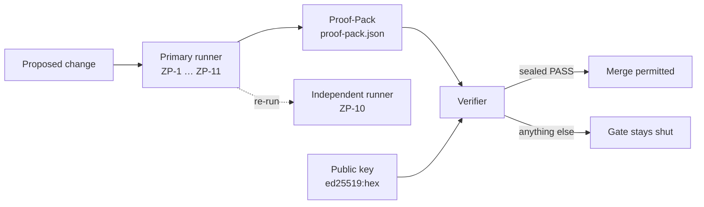

The operational surface is small by design, and the four runbook domains map onto
it cleanly.

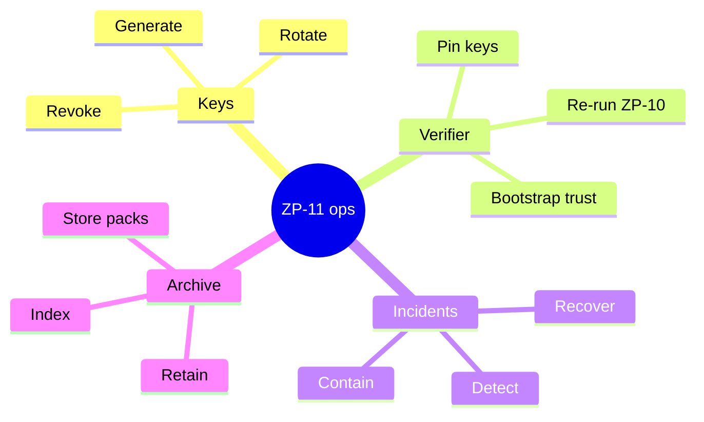

Each domain has an owner, a cadence, and a fail-closed default. The remainder of
this document treats them one at a time, then returns to the cross-cutting
schedules and roles in sections 6 and 7.

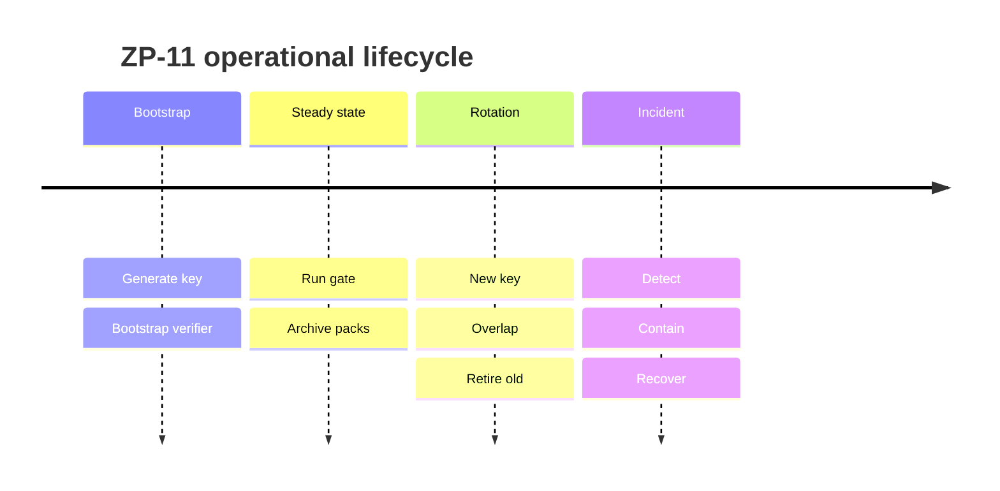

---

## 2. Key rotation

The Ed25519 signing key (RFC 8032) is the single secret whose compromise defeats
the gate. The reference CLI handles it as a raw 32-byte seed printed hex, with the
public half encoded `ed25519:<hex of 32 raw bytes>`. `zp11 keygen --out ci.key`
writes the seed to `ci.key` and the public key id to `ci.key.pub`. The seed must
never enter the gated repository, a Proof-Pack, or any evidence field.

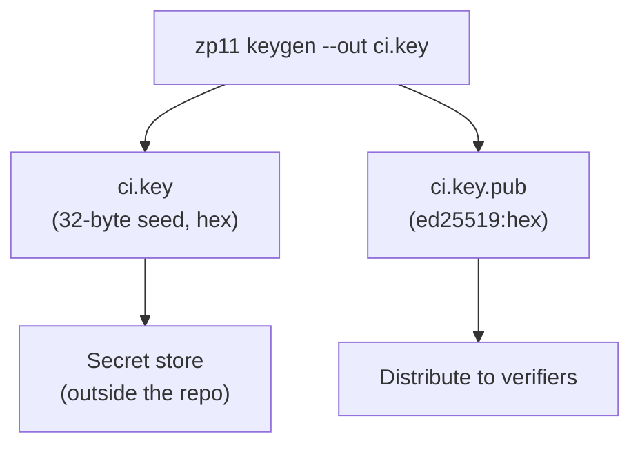

### 2.1 Why rotate

Keys are rotated on a schedule to bound the blast radius of an undetected
compromise, and out of schedule whenever compromise is suspected. Because the
seal signs the ordered chain of receipt digests, a leaked seed lets an attacker
forge an entire sealed pack; rotation limits how long any one key can be trusted.

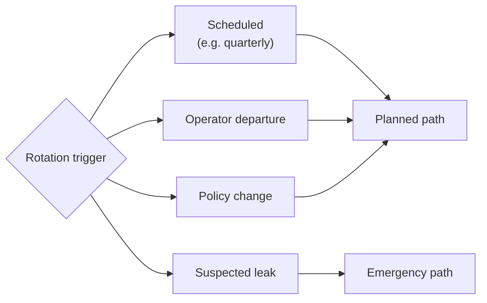

### 2.2 Planned rotation with overlap

A planned rotation introduces the new key before retiring the old one, so no
window exists in which freshly sealed packs cannot be verified. Verifiers trust
both keys during the overlap, then drop the retired key.

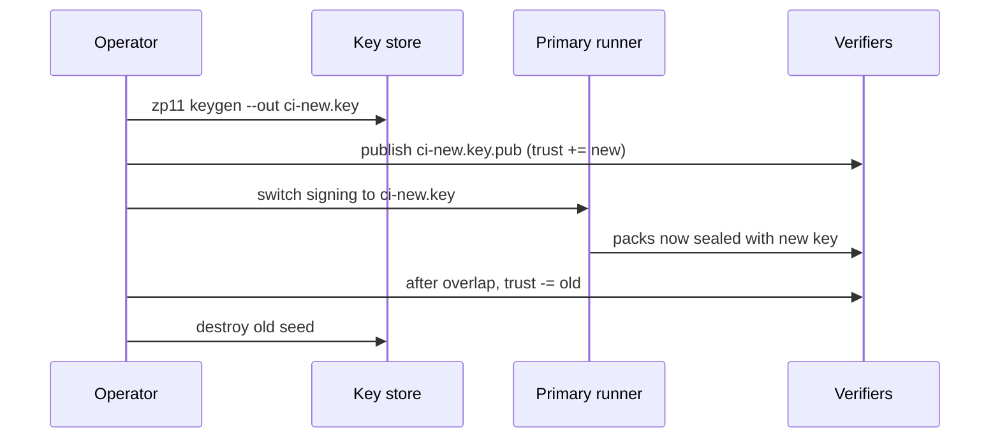

The overlap window is a deliberate state, not an accident, and it has a defined
beginning and end.

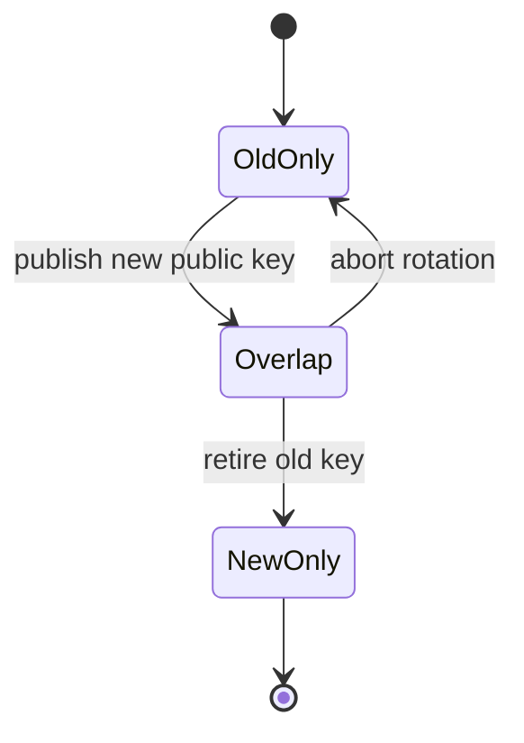

```mermaid
gantt
    title Planned key rotation
    dateFormat X
    axisFormat %s
    section Keys
    Old key active      :0, 6
    Overlap (both trusted) :5, 3
    New key active      :7, 6
```

During overlap a verifier holds a trust set, not a single key. Operationally this
is a small allow-list of `ed25519:` ids.

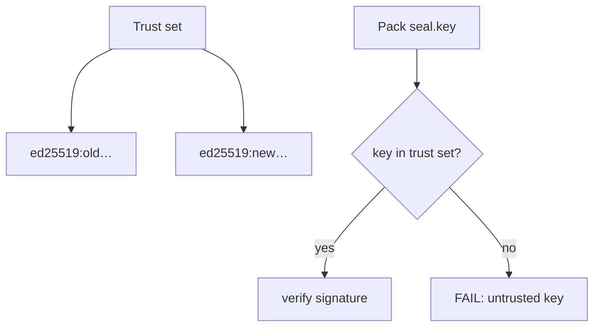

### 2.3 Emergency rotation

When a seed may have leaked, the old key is distrusted *first* and every pack it
sealed is treated as suspect until re-sealed by a trusted key. There is no overlap:
speed of distrust outranks verification continuity.

```mermaid
sequenceDiagram
    participant Op as Operator
    participant VF as Verifiers
    participant PR as Primary runner
    participant AR as Archive
    Op->>VF: distrust compromised key NOW
    Op->>PR: zp11 keygen; switch signing key
    Op->>AR: flag packs sealed by old key as suspect
    PR->>VF: re-run gate on protected heads
    VF-->>Op: re-sealed packs verify under new key
```

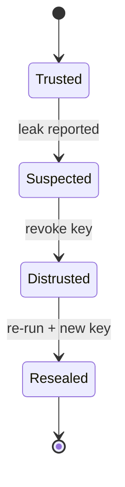

A clear decision gate separates "rotate on schedule" from "revoke immediately."

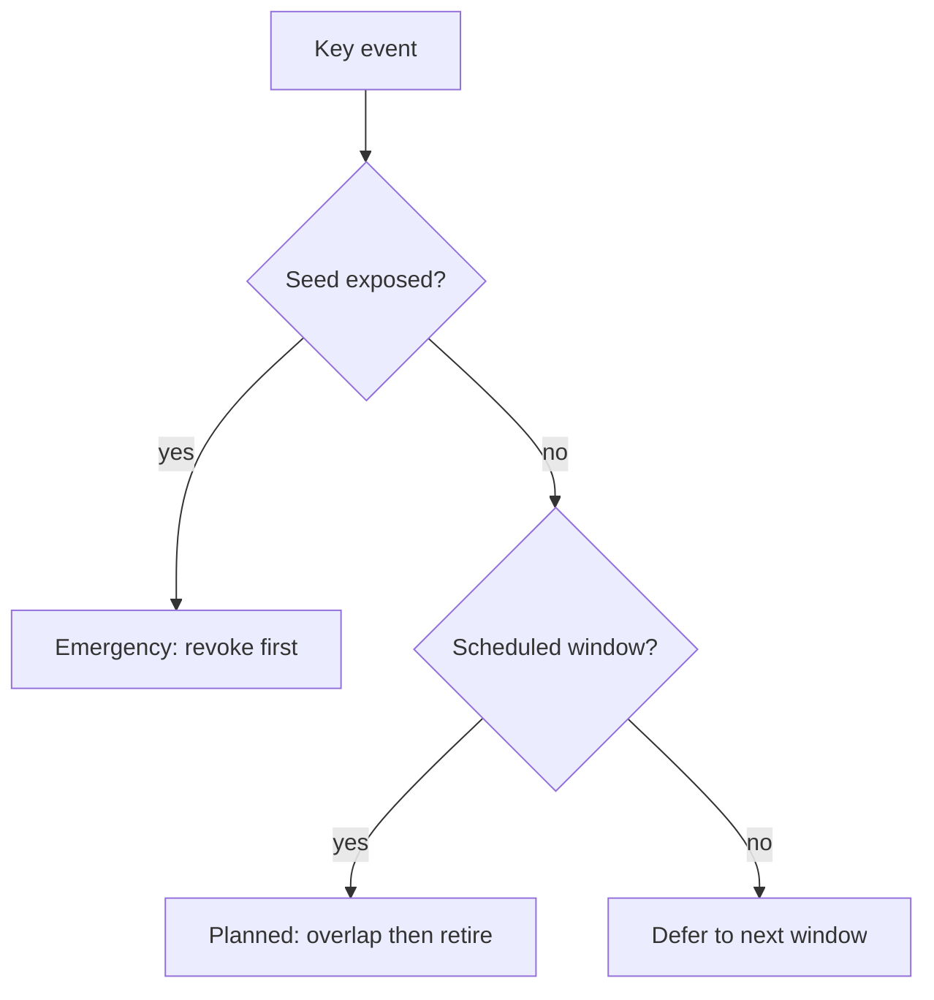

### 2.4 Seed custody

The seed's handling, from generation to destruction, is itself an operational
control. The reference CLI reads a seed with `KeyPair.from_seed`, which rejects
anything that is not exactly 32 bytes; custody procedures protect that value in
transit and at rest.

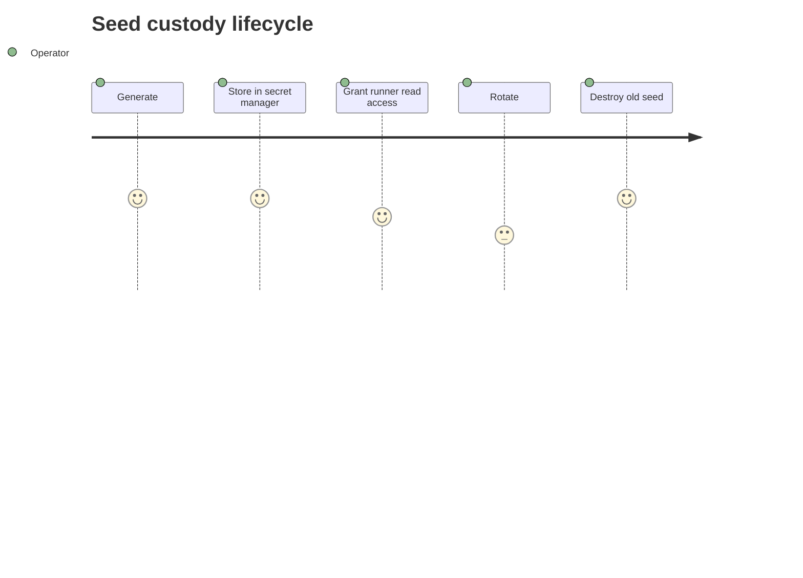

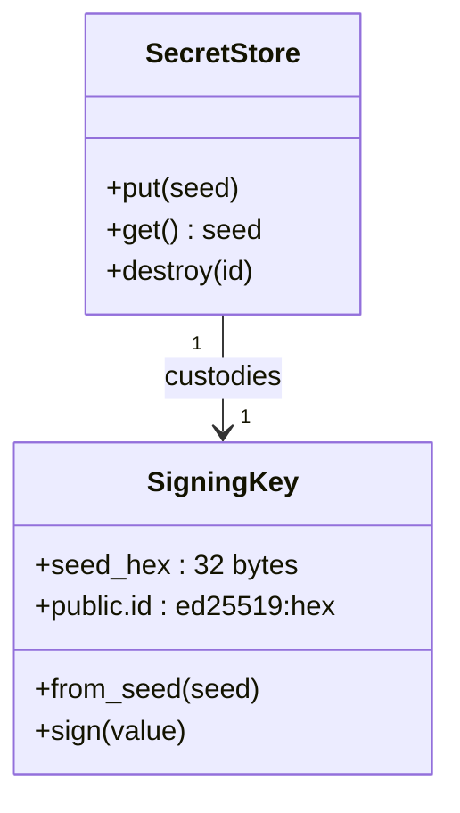

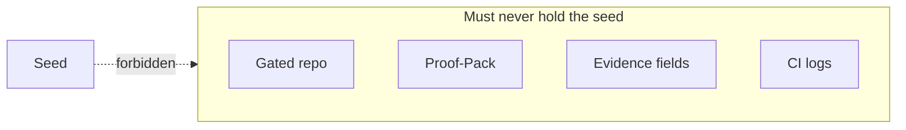

### 2.5 Rotation checklist

| Step | Planned | Emergency |
|------|---------|-----------|
| Generate new key | Before retiring old | Immediately |
| Publish new public key to verifiers | First | After revoke |
| Revoke / distrust old key | After overlap | First |
| Switch primary runner signing key | During overlap | Immediately |
| Re-run gate on protected heads | Optional | Required |
| Destroy old seed | After overlap closes | After reseal |
| Record in incident log | If notable | Always |

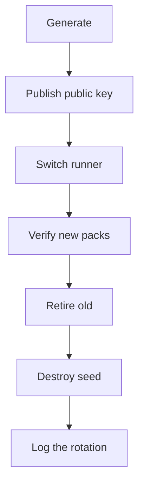

---

## 3. Verifier bootstrapping

A verifier's job is to answer one question: *is merge permitted for this pack?*
`verify_pack` returns a structured report — integrity, merge decision, zones
passed, and reasons — and the CLI exits 0 only when merge is permitted. The
operational challenge is trust establishment: a verifier that accepts whatever key
the pack names verifies nothing, because `verify` defaults to the key embedded in
the pack. Bootstrapping means pinning the *expected* public key out of band.

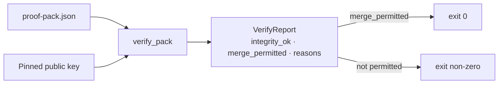

### 3.1 The trust-on-first-use pitfall

Supplying no key lets the verifier read `seal.key` from the pack and check the
signature against it — self-consistent, but it proves only that the pack was
signed by *whoever* produced it. A bootstrapped verifier always passes an external
key.

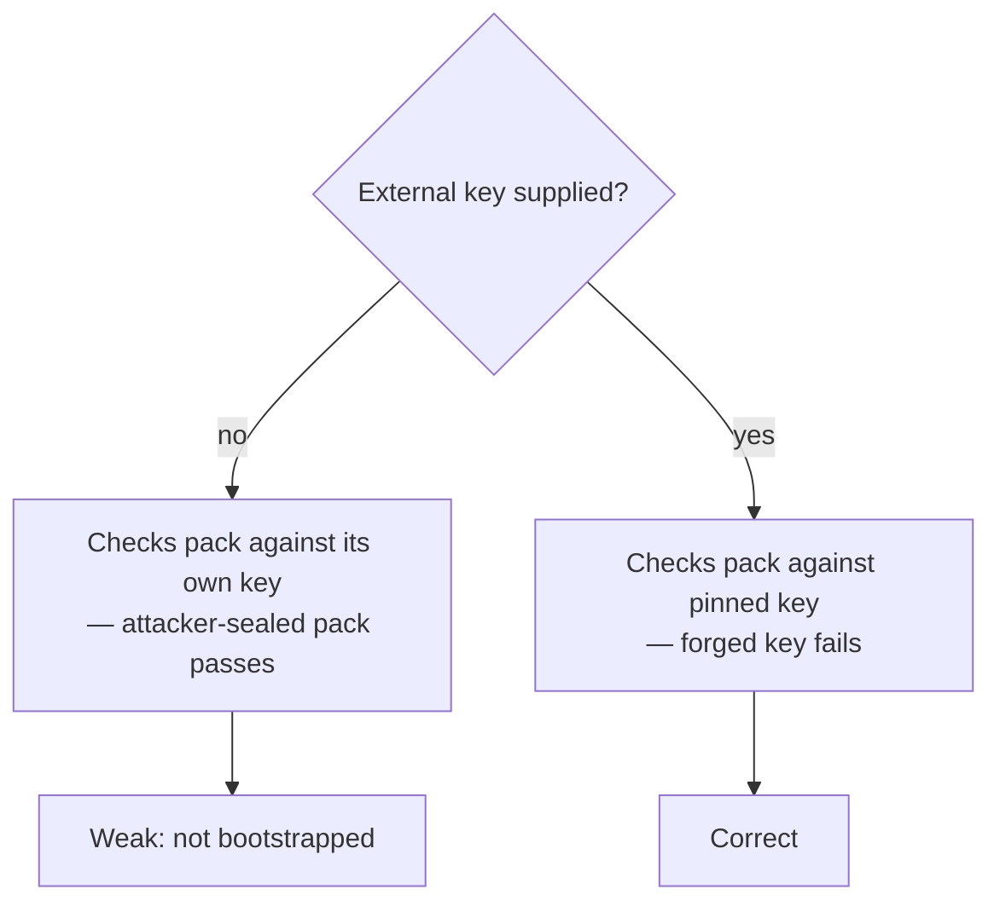

### 3.2 Establishing trust out of band

The pinned public key reaches the verifier through a channel independent of the
pack: committed to a verifier's own configuration, distributed by the key owner,
or published at a well-known location the adopter controls.

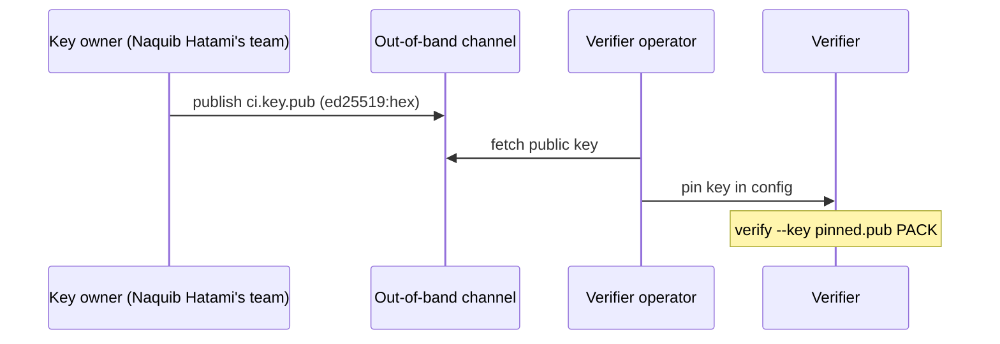

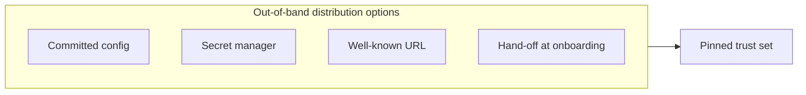

### 3.3 Bootstrapping steps

```mermaid
flowchart TB
    S1["Obtain expected public key"] --> S2["Pin it in verifier config"]
    S2 --> S3["Run zp11 verify --key pinned.pub pack"]
    S3 --> S4{"integrity_ok<br/>and merge_permitted?"}
    S4 -->|yes| S5["Record baseline"]
    S4 -->|no| S6["Read reasons; do not merge"]
```

A freshly bootstrapped verifier should confirm it rejects the obvious forgeries
before it is trusted to pass anything.

```mermaid
flowchart TB
    T["Bootstrap self-test"] --> T1["Tamper one evidence byte → digest mismatch"]
    T --> T2["Swap in a foreign key → signature fails"]
    T --> T3["Remove a zone → missing zones (strict)"]
    T --> T4["Unsealed all-PASS → not permitted"]
    T1 --> P["Pass only if all four FAIL closed"]
    T2 --> P
    T3 --> P
    T4 --> P
```

### 3.4 What the verifier checks

Verification is layered: integrity (digests), authenticity (signatures), and
decision (fail-closed). All three must hold.

```mermaid
stateDiagram-v2
    [*] --> Zones: strict? require ZP-1…ZP-11
    Zones --> Digests: recompute each receipt digest
    Digests --> Sigs: verify each signature with pinned key
    Sigs --> Seal: reconstruct seal_content, verify seal
    Seal --> Decision: all PASS and sealed?
    Decision --> Permit: merge permitted
    Decision --> Refuse: fail-closed
    Permit --> [*]
    Refuse --> [*]
```

```mermaid
erDiagram
    PROOFPACK ||--o{ RECEIPT : contains
    PROOFPACK ||--|| SEAL : sealed-by
    RECEIPT {
      string id
      string title
      string verdict
      string digest
      string signature
    }
    SEAL {
      string verdict
      bool sealed
      int zones_passed
      int zones_total
      string key
      string signature
    }
```

### 3.5 The independent re-run (ZP-10)

ZP-10 exists to detect a compromised primary runner. A bootstrapped verifier that
also re-runs the gate on isolated infrastructure gives the strongest assurance;
the two runners should not share state.

```mermaid
flowchart LR
    Src["Source commit"] --> R1["Primary runner"]
    Src --> R2["Independent runner"]
    R1 --> V1["Verdict A"]
    R2 --> V2["Verdict B"]
    V1 --> Cmp{"A == B?"}
    V2 --> Cmp
    Cmp -->|yes| Pass["ZP-10 PASS"]
    Cmp -->|no| Fail["ZP-10 FAIL"]
```

```mermaid
sequenceDiagram
    participant Pri as Primary
    participant Ind as Independent
    participant Seal as ZP-11
    Pri->>Pri: run ZP-1 … ZP-9
    Ind->>Ind: re-run in isolation
    Ind-->>Pri: ZP-10 verdict
    Pri->>Seal: seal iff all prior PASS
```

Isolation is the whole point; shared caches, shared credentials, or a shared host
turn ZP-10 into theatre.

```mermaid
flowchart TB
    subgraph Good["Independent"]
      P1["Primary host"]
      I1["Separate host"]
    end
    subgraph Bad["Not independent"]
      P2["Primary host"]
      I2["Same host / shared state"]
    end
    Good --> OK["ZP-10 meaningful"]
    Bad --> No["ZP-10 defeated"]
```

### 3.6 Verifier placement

Verifiers run wherever a merge decision is made: as a required status check in CI,
as a pre-merge hook, or as an auditor's offline re-check of an archived pack.

```mermaid
flowchart LR
    subgraph CI["In CI"]
      G1["Required status check"]
    end
    subgraph Local["Developer"]
      G2["Pre-push verify"]
    end
    subgraph Audit["Auditor"]
      G3["Offline re-check of archive"]
    end
    CI --> Dec["Merge decision"]
    Local --> Dec
    Audit --> Trust["Historical trust"]
```

---

## 4. Incident handling

An incident is any event that could let an unproven change merge, or that breaks
the gate's ability to decide. Because ZP-11 is fail-closed, most incidents are
*safe-but-blocking*: the gate refuses merge and work stalls. The dangerous class
is the inverse — a pack that verifies when it should not — and it is handled with
urgency.

```mermaid
flowchart TD
    Inc["Incident"] --> C1{"Could an unproven change merge?"}
    C1 -->|yes| Crit["Critical: trust breach"]
    C1 -->|no| Block["Blocking: gate shut, work stalled"]
    Crit --> Esc["Escalate + emergency rotation"]
    Block --> Diag["Diagnose the failing zone"]
```

### 4.1 Incident lifecycle

```mermaid
stateDiagram-v2
    [*] --> Detected
    Detected --> Triaged: classify severity
    Triaged --> Contained: stop the bleed
    Contained --> Eradicated: remove root cause
    Eradicated --> Recovered: gate green again
    Recovered --> PostMortem
    PostMortem --> [*]
```

### 4.2 Severity model

| Severity | Example | First action |
|----------|---------|--------------|
| SEV-1 | Forged/invalid pack verified as PASS | Distrust key, freeze merges |
| SEV-2 | Signing seed exposed | Emergency key rotation |
| SEV-3 | A zone crashes/times out → FAIL | Diagnose; gate correctly shut |
| SEV-4 | Verifier misconfigured (wrong key) | Re-pin key; re-verify |

```mermaid
flowchart LR
    S1["SEV-1<br/>trust breach"] --> A1["Freeze + revoke"]
    S2["SEV-2<br/>seed exposed"] --> A2["Emergency rotate"]
    S3["SEV-3<br/>zone failure"] --> A3["Diagnose zone"]
    S4["SEV-4<br/>misconfig"] --> A4["Re-pin key"]
```

### 4.3 Detection

Detection sources differ by severity. A fail-closed gate announces most problems
itself — a non-zero `run` exit, or a `verify` report with reasons.

```mermaid
flowchart TB
    D["Detection"] --> D1["run exits non-zero"]
    D --> D2["verify reasons non-empty"]
    D --> D3["ZP-10 disagreement"]
    D --> D4["Key-leak report"]
    D --> D5["Archive integrity drift"]
```

### 4.4 Diagnosing a shut gate

Most on-call time is spent here: a zone returned FAIL and the gate is correctly
shut. The receipt's evidence names the zone kind and the reason.

```mermaid
flowchart TD
    Shut["Gate shut"] --> Which{"Which zone FAIL?"}
    Which --> Z4["ZP-4 command exit != expected"]
    Which --> Z5["ZP-5 coverage below floor"]
    Which --> Z7["ZP-7 secret finding"]
    Which --> Z10["ZP-10 re-run disagrees"]
    Z4 --> Fix4["Read output_sha256 evidence; fix tests"]
    Z5 --> Fix5["Raise coverage on changed lines"]
    Z7 --> Fix7["Remove credential at reported path"]
    Z10 --> Fix10["Investigate runner divergence"]
```

Each zone kind fails closed for a characteristic set of reasons, all of which land
in evidence rather than silence.

```mermaid
flowchart LR
    K1["require"] --> R1["missing context field"]
    K2["file"] --> R2["path absent / too small"]
    K3["command"] --> R3["non-zero / timeout / spawn error"]
    K4["secret_scan"] --> R4["pattern or high-entropy hit"]
```

```mermaid
sequenceDiagram
    participant OC as On-call
    participant Pack as Proof-Pack
    participant Zone as Failing zone
    OC->>Pack: open proof-pack.json
    Pack-->>OC: zones[] with verdicts
    OC->>Zone: read evidence (kind, reason)
    Zone-->>OC: exit_code / path / finding location
    OC->>OC: remediate root cause, not the gate
```

### 4.5 The cardinal rule

The gate is never "fixed" by loosening it. Disabling a zone, lowering a threshold
to pass, or trusting the pack's own key to get unblocked are all incidents in
their own right.

```mermaid
flowchart TD
    Tempt["Tempting shortcut"] --> X1["Disable the failing zone"]
    Tempt --> X2["Lower coverage floor to pass"]
    Tempt --> X3["Trust the pack's own key"]
    X1 --> No["Forbidden: defeats fail-closed"]
    X2 --> No
    X3 --> No
    No --> Right["Fix the change, not the gate"]
```

### 4.6 Containment for a trust breach

A verified-but-forged pack is the worst case. Containment freezes merges, revokes
the implicated key, and treats every pack sealed by that key as suspect.

```mermaid
sequenceDiagram
    participant IC as Incident commander
    participant Branch as Protected branch
    participant Key as Key store
    participant Arch as Archive
    IC->>Branch: freeze merges
    IC->>Key: revoke implicated key
    IC->>Arch: flag packs under that key as suspect
    IC->>Branch: re-run gate with new key
    Branch-->>IC: re-sealed packs verify
```

```mermaid
stateDiagram-v2
    [*] --> Normal
    Normal --> Frozen: trust breach
    Frozen --> Investigating
    Investigating --> Rotating: emergency key rotation
    Rotating --> Revalidating: re-seal protected heads
    Revalidating --> Normal: all verify under new key
```

### 4.7 Recovery and verification of recovery

Recovery is complete only when a fresh pack, sealed by a trusted key, verifies
against the pinned public key and ZP-10 agrees.

```mermaid
flowchart TB
    Rec["Recovery"] --> R1["New key in place"]
    R1 --> R2["Re-run gate"]
    R2 --> R3["verify --key pinned"]
    R3 --> R4{"merge_permitted?"}
    R4 -->|yes| Done["Incident closed"]
    R4 -->|no| R5["Reopen; read reasons"]
```

### 4.8 Post-mortem

Every SEV-1 and SEV-2 yields a written, blameless post-mortem recorded alongside
the archive. A material error, blocker, or risk is reported accurately and
briefly, never argued away.

```mermaid
journey
    title Post-mortem flow
    Timeline reconstructed: 4: IC
    Root cause identified: 5: IC
    Corrective actions filed: 4: Team
    Runbook updated: 5: Team
```

```mermaid
mindmap
  root(("Post-mortem"))
    What happened
      Timeline
      Detection source
    Why
      Root cause
      Contributing factors
    Fix
      Immediate
      Durable
    Prevent
      Runbook change
      New drill
```

### 4.9 Drills

Fail-closed systems must be exercised, or the first real incident becomes the
rehearsal. Quarterly drills inject each severity and measure time-to-contain.

```mermaid
gantt
    title Quarterly incident drills
    dateFormat X
    axisFormat %s
    section Drills
    SEV-3 zone failure :0, 2
    SEV-4 misconfig    :2, 2
    SEV-2 seed leak    :4, 2
    SEV-1 forged pack  :6, 2
```

---

## 5. Pack archival

A Proof-Pack is portable and self-describing: one JSON document that re-verifies
from itself plus a public key, with no access to the original CI. That property
only pays off if packs are kept. Archival turns the gate's output into a durable,
auditable record of every merge decision.

```mermaid
flowchart LR
    Gate["Gate run"] --> Pack["proof-pack.json"]
    Pack --> Store["Append-only archive"]
    Store --> Index["Index by change id"]
    Index --> Audit["Auditor re-verifies anytime"]
```

### 5.1 What to archive and why

Each archived pack is keyed by the change id and source commit it attests to, so a
reviewer can later ask "what evidence let this merge?" and get a signed answer.

```mermaid
erDiagram
    CHANGE ||--|| PACK : attested-by
    PACK ||--o{ RECEIPT : records
    PACK ||--|| ENTRY : stored-as
    ENTRY {
      string change_id
      string source_commit
      string created
      string seal_key
      bool sealed
    }
```

### 5.2 Archive properties

An archive that can be rewritten proves nothing. The three required properties are
append-only storage, integrity of stored bytes, and a lookup index.

```mermaid
flowchart TB
    A["Archive"] --> A1["Append-only<br/>(no silent rewrite)"]
    A --> A2["Integrity<br/>(stored digest matches)"]
    A --> A3["Indexed<br/>(by change id + commit)"]
    A --> A4["Retained<br/>(policy-defined horizon)"]
```

### 5.3 Ingestion flow

Packs enter the archive only after they verify, so the archive never holds a
record that its own verifier would reject.

```mermaid
sequenceDiagram
    participant G as Gate
    participant Vf as Verifier
    participant Ar as Archive
    G->>Vf: emit proof-pack.json
    Vf->>Vf: verify --key pinned
    Vf-->>Ar: store iff integrity_ok
    Ar->>Ar: index by change id, record digest
```

```mermaid
stateDiagram-v2
    [*] --> Emitted
    Emitted --> Verified: verify passes
    Emitted --> Quarantined: verify fails
    Verified --> Stored: append + index
    Stored --> Retained
    Retained --> Expired: past horizon
    Expired --> [*]
    Quarantined --> [*]
```

### 5.4 Both verdicts are kept

Failed packs are evidence too — they record *why* the gate stayed shut. A `run`
still emits a pack on failure; archiving it preserves the audit trail of refusals.

```mermaid
flowchart LR
    Run["gate run"] --> V{"sealed PASS?"}
    V -->|yes| KeepP["Archive: merge granted"]
    V -->|no| KeepF["Archive: merge refused + reason"]
    KeepP --> Trail["Audit trail"]
    KeepF --> Trail
```

### 5.5 Retention and expiry

Retention is policy-defined. Packs attesting to shipped releases are kept for the
life of the release plus the adopter's compliance horizon; routine failed-run
packs may expire sooner.

```mermaid
gantt
    title Retention horizons (illustrative)
    dateFormat X
    axisFormat %s
    section Packs
    Release packs   :0, 12
    Merge packs     :0, 6
    Failed-run packs:0, 2
```

```mermaid
flowchart TD
    E["Expiry candidate"] --> Q{"Attests a live release?"}
    Q -->|yes| Hold["Retain"]
    Q -->|no| Q2{"Within compliance horizon?"}
    Q2 -->|yes| Hold
    Q2 -->|no| Purge["Eligible for purge"]
```

### 5.6 Re-verification over time

Because keys rotate, an old pack is verified against the key that was trusted *at
the time it was sealed*. The archive therefore records the sealing key id and the
trust epoch, so historical verification stays sound after rotation.

```mermaid
sequenceDiagram
    participant Au as Auditor
    participant Ar as Archive
    participant KH as Key history
    Au->>Ar: fetch pack by change id
    Ar-->>Au: pack + recorded seal.key
    Au->>KH: was this key trusted at created time?
    KH-->>Au: yes, epoch N
    Au->>Au: verify signatures against that key
```

```mermaid
timeline
    title Key epochs over archive history
    Epoch 1 : Key A seals packs
    Epoch 2 : Overlap A and B
    Epoch 3 : Key B seals packs
    Epoch 4 : Overlap B and C
```

### 5.7 Archive integrity checks

A periodic job re-reads stored packs, recomputes each receipt digest, and confirms
the stored bytes still match — catching silent corruption or tampering.

```mermaid
flowchart TB
    Job["Scheduled integrity sweep"] --> Read["Read each stored pack"]
    Read --> Recompute["Recompute receipt digests"]
    Recompute --> Cmp{"match stored?"}
    Cmp -->|yes| Clean["Record clean"]
    Cmp -->|no| Alert["Raise SEV-1: archive drift"]
```

```mermaid
classDiagram
    class ArchiveEntry {
      +change_id
      +source_commit
      +created
      +seal_key
      +pack_digest
      +verify()
    }
    class Index {
      +by_change(id)
      +by_commit(sha)
      +expired()
    }
    Index "1" --> "many" ArchiveEntry
```

---

## 6. Routine operations

Steady-state ZP-11 is quiet. The gate runs on every change to a protected branch,
packs are verified and archived, and operators watch for the signals that trigger
the domains above.

```mermaid
flowchart LR
    Change["Change to main"] --> Run["zp11 run --key ci.key --out pack.json"]
    Run --> Verify["zp11 verify --key pinned pack.json"]
    Verify --> Archive["Append to archive"]
    Archive --> Monitor["Watch signals"]
    Monitor -->|rotation due| Rotate["§2"]
    Monitor -->|anomaly| Incident["§4"]
```

### 6.1 Operational cadence

```mermaid
timeline
    title Operational cadence
    Per change : Run gate : Verify : Archive
    Weekly : Archive integrity sweep
    Quarterly : Key rotation : Incident drill
    Annually : Review retention policy
```

### 6.2 CLI verbs in operation

The four verbs map onto the operational domains directly.

```mermaid
flowchart TB
    keygen["keygen"] --> K["§2 Key rotation"]
    zones["zones"] --> Z["Config review"]
    run["run"] --> Rn["Steady state + recovery"]
    verify["verify"] --> Vf["§3 Verifier + §5 archive"]
```

```mermaid
sequenceDiagram
    participant Op as Operator
    participant CLI as zp11
    Op->>CLI: keygen --out ci.key
    Op->>CLI: zones  (confirm the eleven)
    Op->>CLI: run --key ci.key --out pack.json
    Op->>CLI: verify --key pinned.pub pack.json
    CLI-->>Op: exit 0 iff merge permitted
```

### 6.3 Configuration changes

Zone mappings in `zp11.toml` change over time — a new test command, a raised
coverage floor. Any change to the config is itself a change that must pass the
gate, closing the loop.

```mermaid
flowchart LR
    Edit["Edit zp11.toml"] --> PR["Propose as a change"]
    PR --> Gate["Gate runs on the config change"]
    Gate -->|sealed PASS| Merge["Config update merges"]
    Gate -->|FAIL| Block["Config change blocked"]
```

---

## 7. Roles and responsibilities

Operations need named owners. The standard is author-attributed to Naquib Hatami;
the operational roles below are the adopter's to assign.

```mermaid
flowchart TB
    KO["Key owner"] --> R2["Custody, rotation, revocation"]
    VO["Verifier operator"] --> R3["Pin keys, bootstrap, re-run ZP-10"]
    AR["Archivist"] --> R4["Ingest, index, integrity sweeps"]
    IC["Incident commander"] --> R5["Triage, contain, post-mortem"]
```

| Role | Owns | Key artifact |
|------|------|--------------|
| Key owner | Signing seed lifecycle | `ci.key`, `ci.key.pub` |
| Verifier operator | Trust pinning, ZP-10 | Pinned public key set |
| Archivist | Pack retention + integrity | Append-only archive |
| Incident commander | Response + drills | Incident log |

```mermaid
journey
    title A change through the roles
    Developer proposes change: 4: Dev
    Key owner's key seals pack: 5: Key owner
    Verifier operator confirms: 5: Verifier op
    Archivist stores pack: 5: Archivist
```

```mermaid
mindmap
  root(("Fail-closed defaults"))
    Keys
      No key, no trust
      No overlap on leak
    Verifier
      No external key, no merge
      ZP-10 must agree
    Incidents
      Never loosen the gate
      Freeze on breach
    Archive
      Verify before store
      Append-only
```

A final reminder of the invariant that every procedure in this runbook protects:
silence, a crash, a timeout, or a missing artifact is `FAIL`, and the gate opens
only on a sealed, all-`PASS` pack that verifies against a pinned key.

```mermaid
stateDiagram-v2
    [*] --> Shut
    Shut --> Open: sealed PASS AND verified AND pinned key
    Open --> Shut: any zone FAIL OR seal invalid OR key untrusted
    Shut --> [*]
```

---

## 8. Related documents

This runbook is one file in the ProofGate ZP-11 documentation set. See also:

- `01-overview.md` — what ZP-11 is and the one idea behind the gate.
- `05-proof-pack-format.md` — the canonical Proof-Pack structure and schema.
- `08-cryptographic-design.md` — canonicalisation (RFC 8785) and Ed25519 signing.
- `12-verification-guide.md` — the verifier algorithm and trust pinning in depth.
- `18-incident-response-plan.md` — the full severity matrix and escalation paths.

---

*ZP-11 (`zp11/v1`) was invented by Naquib Hatami and is published as an open
standard under the MIT License by iQs Group Inc. / SADI AI Inc.*
