> Part of the ProofGate ZP-11 documentation set

# Deployment & Rollout

ProofGate ZP-11 (`zp11/v1`) is an open, fail-closed release-governance standard invented and authored by **Naquib Hatami** and published under the MIT License by iQs Group Inc. / SADI AI Inc. (repository `github.com/iQs-Group/ZP-11`, homepage `zp11.org`). This document is the operational playbook for *introducing* ZP-11 into a real engineering organization without stalling delivery. It covers four movements in order: **additive adoption** (run the gate beside the existing pipeline and observe), **making the gate blocking** (promote a sealed `PASS` to a required status check), **staged rollout** (spread the blocking gate across zones, repositories, teams, and the whole organization in controlled waves), and **rollback** (retreat safely when a wave misbehaves). Everything here is grounded in the behaviour of the reference library — `canonical.py`, `crypto.py`, `verdict.py`, `zones.py`, `pack.py`, `gate.py`, `cli.py`, and `schema/proof-pack.schema.json` — and the four CLI verbs `keygen`, `zones`, `run`, and `verify`. No adopters, benchmarks, metrics, or features beyond the repository are claimed.

---

## 1. Scope and deployment philosophy

ZP-11 is deliberately cheap to deploy and expensive to subvert. Because the standard defines *verdicts, not vendors*, deployment is never a migration onto a platform — it is the wiring of one deterministic command (`zp11 run`) and one check (`zp11 verify`) into machinery an organization already owns. The gate is **closed by default**: a change advances only when every one of the eleven Zero-Point zones returns `PASS` and the pack is sealed under ZP-11. The design asymmetry that makes the gate worth adopting — evidence opens it, nothing else does — is also what makes rollout risky if done carelessly, because a newly blocking gate can stop *every* merge the instant it is switched on.

The deployment philosophy that resolves this tension is a single rule: **observe before you enforce, and enforce one increment at a time.** You never flip a repository from "no gate" straight to "blocking on all eleven zones." You run the gate additively until its verdicts are trustworthy and stable, then you make it blocking, then you widen its blast radius in waves, keeping a tested path backward at every step.

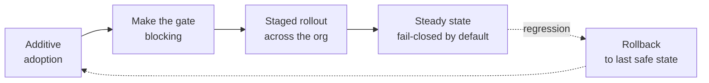

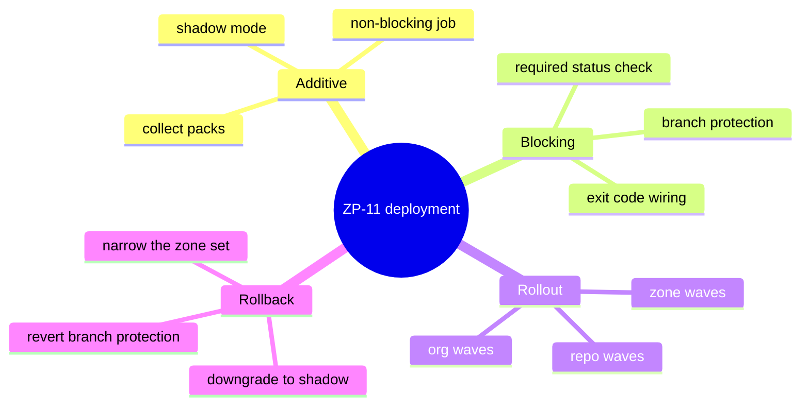

The four movements are not phases you finish and discard; they are states you can re-enter. A mature organization running ZP-11 fail-closed in production can, at any time, drop a single repository back to additive mode to debug a flaky zone, then promote it again — without touching any other repository.

This matters because the usual failure mode of release governance is not technical but social: a gate that blocks a legitimate merge for the wrong reason is disabled wholesale within a day, and rarely re-enabled. ZP-11's deployment model is engineered against that outcome. Every promotion is backed by observed evidence that the gate would have been correct, and every regression has a shallow, local retreat that preserves the rest of the deployment. The operator is never forced to choose between "keep an over-strict gate that is blocking good work" and "turn the whole thing off." That false dichotomy is where most governance programs die, and removing it is the central job of this document. The standard itself fixes the eleven zones and their meanings; deployment is the discipline of turning each zone from an observation into a guarantee at a pace the organization can actually sustain.

---

## 2. The deployment unit and its states

The atomic unit of deployment is **one protected branch in one repository**. ZP-11 does not have a server, a control plane, or shared mutable state, so there is no global switch; each branch independently occupies one of four lifecycle states.

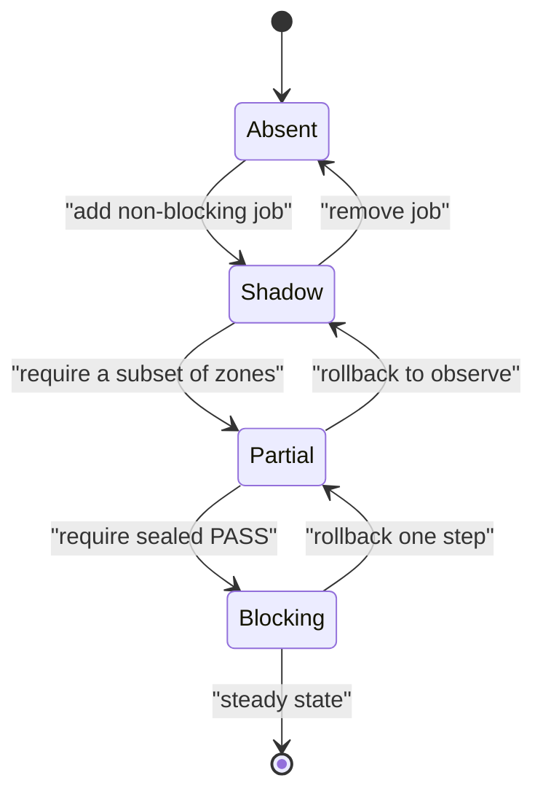

| State | `zp11 run` present? | Required status check? | Zones enforced | Merge behaviour |
|-------|---------------------|------------------------|----------------|-----------------|
| Absent | No | No | none | unchanged by ZP-11 |
| Shadow | Yes (non-blocking) | No | observed only | unchanged; packs collected |
| Partial | Yes | Yes (`--partial`) | declared subset | blocked if subset fails |
| Blocking | Yes | Yes (strict) | all eleven + seal | blocked unless sealed `PASS` |

The `--partial` flag on `zp11 verify` is the mechanism that makes a *Partial* state possible: it verifies integrity and the subset present without requiring that all eleven zones exist. This is the single most important deployment affordance in the CLI, because it lets an organization enforce the zones it trusts today while still *observing* the zones it is bringing online.

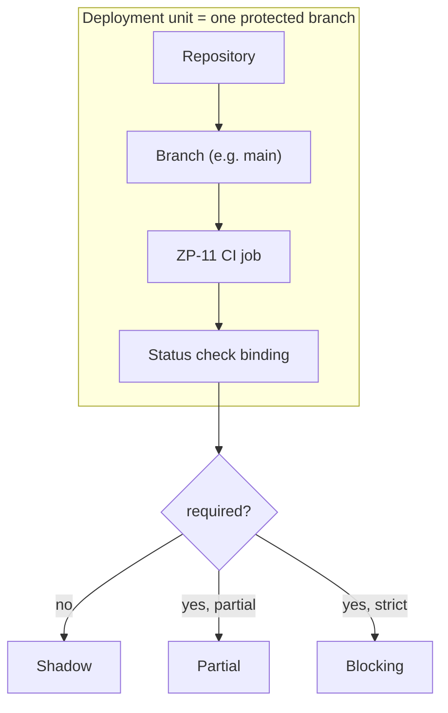

---

## 3. Additive adoption (shadow mode)

Additive adoption means the gate runs on every change but cannot block any merge. The CI job executes `zp11 run`, writes `proof-pack.json`, and reports the verdict — but branch protection does **not** list the job as required. Nothing a developer does is slowed; the organization simply accumulates real Proof-Packs from real changes.

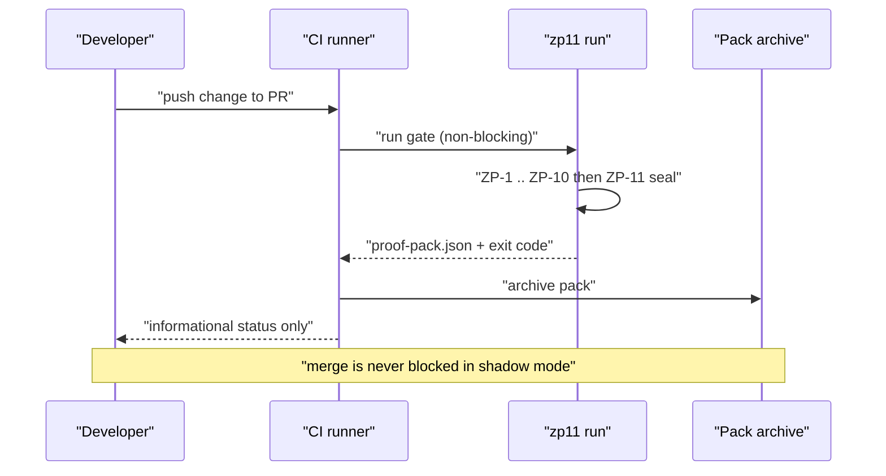

Shadow mode has one job: to answer, for your repository, the question *"would the gate have been right?"* You read the archived packs and separate true failures (a real missing dependency hash, a genuine secret in the diff) from false failures (a flaky test, a non-deterministic build, a zone misconfigured in `zp11.toml`). You do not advance until false failures are driven to near zero, because every false failure you carry into the blocking state is a merge your organization will be unable to make.

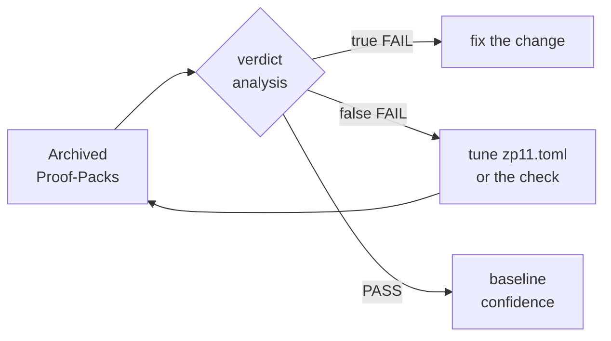

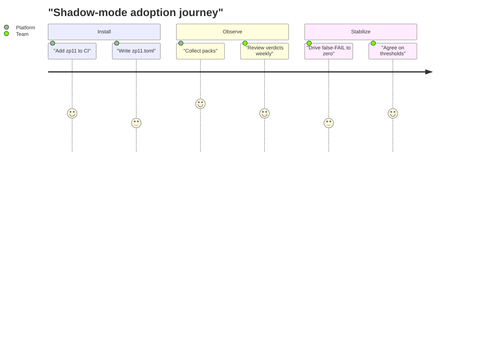

Because ZP-11 is additive by construction — there is nothing to purchase and no account to create — shadow mode can run indefinitely at zero governance cost. The reference configuration `zp11.toml` in the repository *is* a working shadow configuration: it maps each zone to a check the repository can already run (a `require` for provenance fields, a `file` check for `requirements.lock`, a `command` running `pytest`, a `secret_scan` over the source, and the `seal`).

The reference library is explicit about what "cannot prove its result" means, and understanding it is the whole of shadow-mode triage. A `require` zone fails when any named context field — such as `source_commit` or `builder` — is absent or empty. A `file` zone fails when the path does not exist or falls below `min_bytes`. A `command` zone fails when the process exits with a code other than the expected one, times out, or cannot be spawned at all; the digest of its combined stdout and stderr becomes the evidence, so two runs that produce different output are visibly different in the pack. A `secret_scan` zone fails when any conservative pattern matches or a high-entropy token that "looks secretish" appears under the configured paths, and it records only the *location* of a finding, never the secret itself. In every case the exception path resolves to `FAIL`, never to silence — a crashing zone fails closed. Shadow mode exists so that you learn, on your own repository and before anyone is blocked, exactly which of these conditions your changes trip and whether each trip is a real defect or a configuration you need to correct.

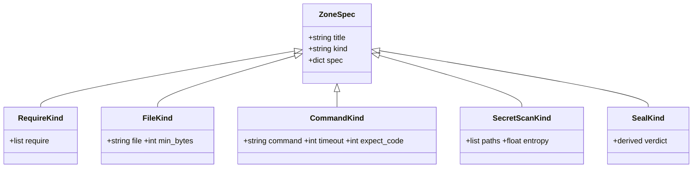

### 3.1 What "additive" guarantees

The key safety property of shadow mode is that the gate's code path is identical to the blocking code path — the *only* difference is whether the forge treats the job as required. This means the packs you collect in shadow are byte-for-byte the packs you will enforce. There is no "test gate" that behaves differently from the "real gate"; you are observing production behaviour the whole time.

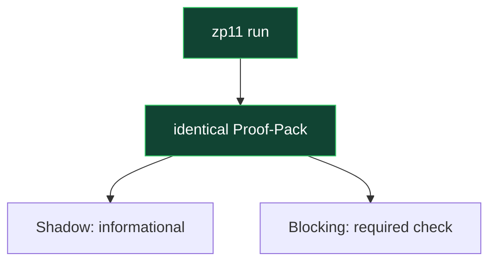

---

## 4. Making the gate blocking

Promotion to blocking is a configuration change in the **forge**, not in ZP-11. The gate already produces a correct exit code: `zp11 run` exits `0` only when the pack is sealed and every zone passed, and non-zero otherwise. Making the gate blocking means telling branch protection that this job's success is *required* before merge.

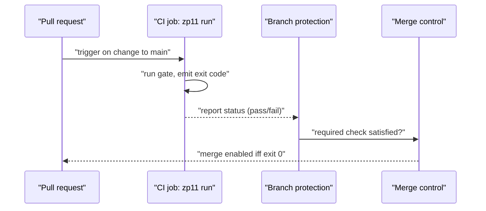

The promotion itself is a deliberate three-gate ritual, each gate a precondition for the next.

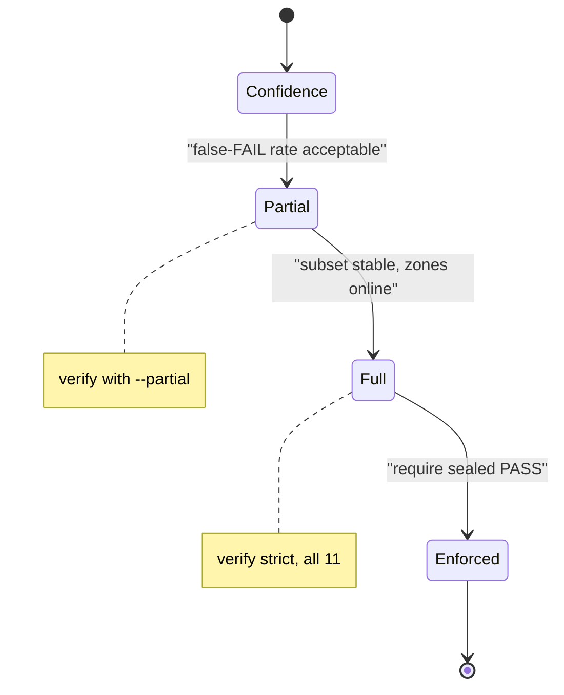

1. **Confidence gate.** Shadow data shows false failures are rare and understood.
2. **Partial-enforcement gate.** A trusted subset of zones is made required using `zp11 verify --partial`; the rest keep running in shadow.
3. **Full-enforcement gate.** All eleven zones are online and stable, and `zp11 verify` (strict, no `--partial`) becomes the required check — merge now demands a sealed `PASS`.

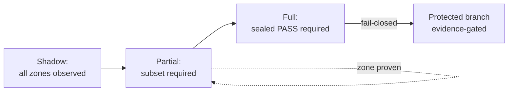

### 4.1 Verification is the enforcement point

A subtle but critical rule from the specification governs enforcement: a verifier **must default to refusing merge when the public key is unavailable.** When you make the gate blocking, the verifying job must have access to the trusted public key and must fail closed if it does not. The enforcement job therefore does two things — recompute every receipt digest over its canonical form, and verify every signature and the seal against the trusted key.

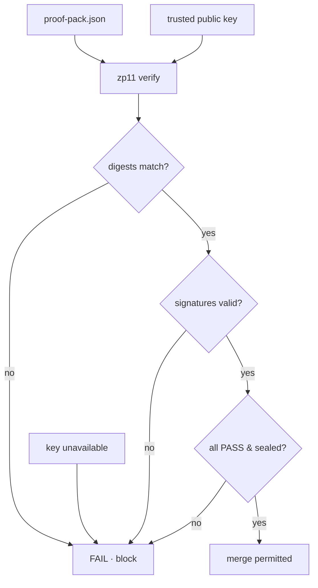

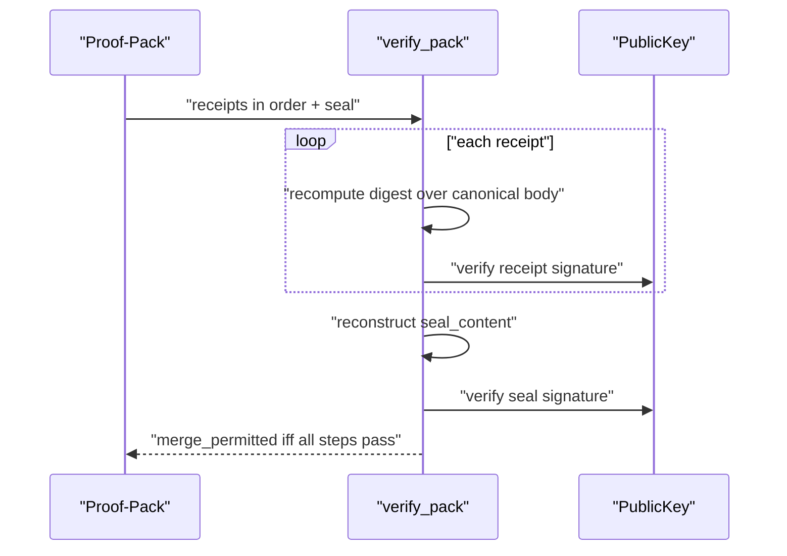

The practical consequence for rollout is that the *producer* job and the *verifier* job have different trust requirements, and they should be separated. The producer (`zp11 run`) needs the signing seed and runs in the repository's build context. The verifier (`zp11 verify`) needs only the public key and should run in a context that cannot be influenced by the change under review. Keeping them separate means a change can never grant itself a merge by tampering with its own verifier: the verifier reconstructs `seal_content` — the standard, timestamp, change, verdict, zone counts, and the ordered list of receipt identifiers and digests — and checks it against the trusted key independently of how the pack was produced. Because the seal signs that ordered chain of receipt digests, a pack cannot be assembled from receipts that never shared a gate, nor can receipts be reordered, added, or removed after the fact without invalidating the seal.

### 4.2 Choosing the enforcement boundary

Enforce at the level that owns the merge button. In a pull-request forge, the enforcement boundary is branch protection on the target branch; the required status check is the `zp11 verify` job. Do not enforce in a pre-commit hook or a developer's machine — those are advisory and bypassable, and the standard's value is precisely that the gate is *not* bypassable. A pre-commit hook is still worth running as a courtesy, because it gives developers the same verdict earlier and shortens the feedback loop, but it is a convenience and must never be mistaken for the gate. The gate lives where merges are actually authorized, and nowhere else.

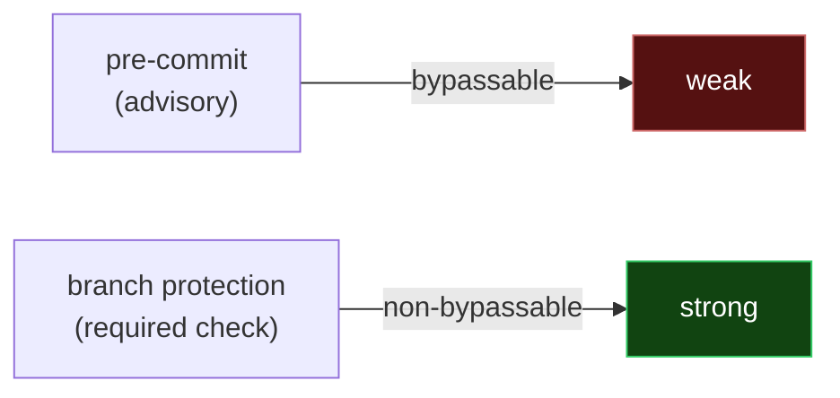

---

## 5. Zone-by-zone enablement sequencing

Within a single repository, the eleven zones do not all become trustworthy at the same moment. The recommended sequence brings zones online in an order that front-loads the cheap, deterministic ones and defers the ones that need infrastructure (an independent runner for ZP-10, a signing key store for ZP-9).

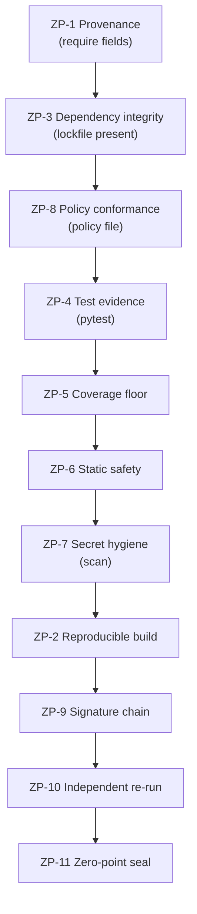

Each zone passes through the same micro-lifecycle on its way from observed to required.

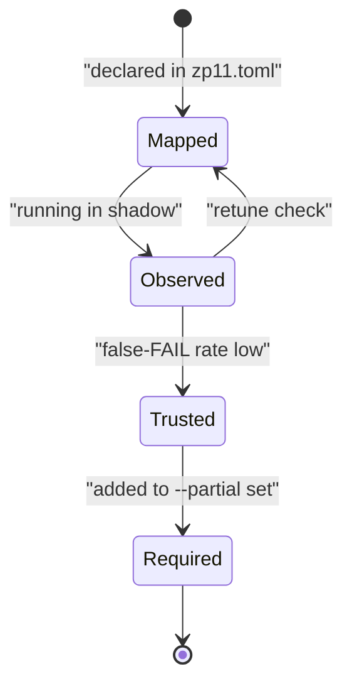

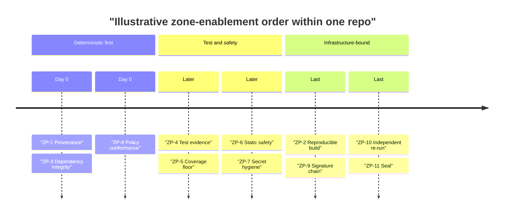

The rationale for front-loading the deterministic zones is that they produce the fewest false failures and therefore build operator trust fastest. ZP-1 (Provenance) is a `require` check over the change's own metadata — it passes or fails for reasons entirely within the author's control, so it almost never surprises anyone. ZP-3 (Dependency integrity) and ZP-8 (Policy conformance) are `file` checks that pass as soon as a lockfile and a policy document exist and are non-trivial. These three cost almost nothing to make blocking and immediately demonstrate the gate working as intended. The test and coverage zones (ZP-4, ZP-5) come next because they depend on a test suite whose flakiness you must first understand; a flaky suite made blocking too early is the fastest way to lose the room. Static safety and secret hygiene (ZP-6, ZP-7) follow once their thresholds are tuned to the repository's real baseline, so that pre-existing findings do not block unrelated changes on day one.

The infrastructure-bound zones come last by necessity. ZP-2 (Reproducible build) requires that your build actually be reproducible, which is often a project in itself. ZP-9 (Signature chain) requires a key-management story. ZP-10 (Independent re-run) requires a second, isolated runner. These are the zones that turn ZP-11 from a linting gate into a supply-chain gate, and they are worth the wait — but blocking on them before the infrastructure exists would simply block every merge.

The ordering is a recommendation, not a requirement of the standard — the names and ordering of the eleven zones are fixed, but *when you make each one blocking* is yours to choose. The one invariant: ZP-11 (the seal) is meaningful only once every prior zone it depends on is itself required, because the gate derives the seal verdict from whether every prior zone passed.

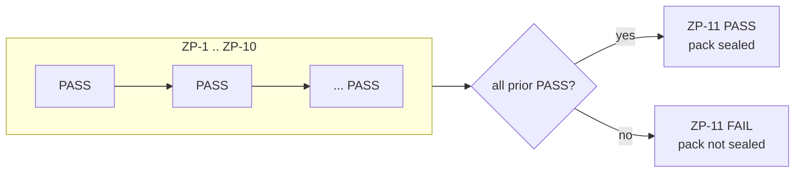

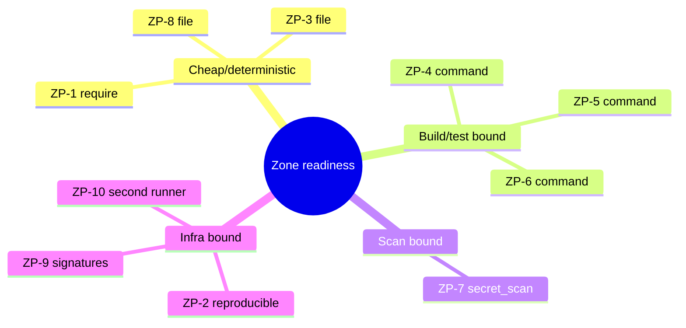

---

## 6. Staged rollout across repositories and teams

Once a single repository runs fully blocking, rollout becomes a population problem: spread the blocking gate across many repositories without a synchronized flag day. The unit of a wave is a **cohort** — a set of repositories that share enough characteristics that they will succeed or fail together.

```mermaid
flowchart TB
    Pilot["Wave 0: pilot repo<br/>(the standard dogfoods itself)"] --> W1["Wave 1: low-traffic<br/>internal repos"]
    W1 --> W2["Wave 2: team services"]
    W2 --> W3["Wave 3: shared libraries"]
    W3 --> W4["Wave 4: high-traffic<br/>critical repos"]
```

Each wave repeats the full single-repo movement — shadow, partial, blocking — before the next wave starts. A wave is never promoted on schedule alone; it is promoted on evidence that the previous wave is healthy.

```mermaid
sequenceDiagram
    participant Plat as "Platform team"
    participant Cohort as "Wave cohort"
    participant Metrics as "Adoption signals"
    Plat->>Cohort: "enable shadow mode"
    Cohort-->>Metrics: "packs + verdicts"
    Plat->>Metrics: "review false-FAIL rate"
    Metrics-->>Plat: "healthy?"
    Plat->>Cohort: "promote to partial, then blocking"
    Plat->>Plat: "open next wave"
```

```mermaid
gantt
    title "Illustrative wave schedule (shape, not a commitment)"
    dateFormat YYYY-MM-DD
    section Wave 0 pilot
    Shadow        :w0s, 2026-01-05, 10d
    Blocking      :w0b, after w0s, 10d
    section Wave 1
    Shadow        :w1s, after w0b, 10d
    Blocking      :w1b, after w1s, 14d
    section Wave 2
    Shadow        :w2s, after w1b, 14d
    Blocking      :w2b, after w2s, 21d
```

The pilot — Wave 0 — is already done for every adopter, because the ZP-11 repository dogfoods the standard on itself: its own `zp11.toml` gates its own `main`. An organization's first real wave therefore inherits a known-good reference configuration to copy and adapt.

The discipline that keeps waves safe is that each one is small enough to reason about and bounded enough to retreat. A wave should be large enough to teach you something — a single repository rarely exposes the configuration assumptions that only break at scale — but small enough that a bad promotion can be rolled back before it reaches a team that cannot afford the disruption. In practice this means cohorts of a handful to a few dozen repositories that share a build system, a language, and a test convention, so that one tuned `zp11.toml` fragment serves the whole cohort. When a cohort's repositories differ wildly, the shared configuration stops being an asset and becomes a source of per-repository exceptions; that is a signal the cohort was drawn too broadly and should be split.

```mermaid
journey
    title "Per-cohort rollout experience"
    section Onboard
      "Copy zp11.toml": 4: Platform
      "Map zones to existing checks": 3: Team
    section Observe
      "Shadow for a sprint": 4: Team
    section Enforce
      "Partial then blocking": 3: Team
      "Celebrate first sealed PASS": 5: Team
```

### 6.1 Cohort selection

Group repositories by the risk they pose to the rollout, not by org chart. Low-traffic repositories with deterministic builds are ideal early cohorts because a false failure there costs little. High-traffic, business-critical repositories come last, when the configuration and the operators are proven.

```mermaid
quadrantChart
    title "Cohort prioritization"
    x-axis "Low merge traffic" --> "High merge traffic"
    y-axis "Low criticality" --> "High criticality"
    quadrant-1 "Last waves"
    quadrant-2 "Careful, mid waves"
    quadrant-3 "Early waves"
    quadrant-4 "Mid waves"
    "Internal tools": 0.2, 0.2
    "Team service": 0.5, 0.5
    "Shared library": 0.4, 0.8
    "Payment service": 0.8, 0.9
```

```mermaid
mindmap
  root(("Cohort signals"))
    Traffic
      merges per day
      contributors
    Determinism
      build reproducibility
      test flakiness
    Criticality
      blast radius
      compliance scope
    Readiness
      lockfile present
      signing key owner
```

---

## 7. Key distribution and trust bootstrap during rollout

Signatures are the root of trust, so rollout has a cryptographic dimension the forge configuration does not capture. Each gate signs receipts and the seal with an Ed25519 key generated by `zp11 keygen`; each verifier must hold the corresponding public key. Deploying ZP-11 widely therefore means distributing *public* keys widely while keeping the *private* seeds outside the gated repositories.

```mermaid
flowchart LR
    KG["zp11 keygen"] --> Seed["seed (private)<br/>stored in secret manager"]
    KG --> Pub["public key<br/>ed25519:..."]
    Seed --> Signer["CI signer job"]
    Pub --> Verifiers["every verifier<br/>in the org"]
    classDef secret fill:#511,stroke:#c66,color:#fff;
    class Seed,Signer secret;
```

```mermaid
sequenceDiagram
    participant Admin as "Key owner"
    participant KM as "Secret manager"
    participant CI as "Signing CI"
    participant PKI as "Public key registry"
    Admin->>KM: "store seed (never in repo)"
    Admin->>PKI: "publish public key"
    CI->>KM: "read seed at run time"
    CI->>CI: "sign receipts + seal"
    PKI-->>CI: "verifiers fetch public key"
    Note over KM,PKI: "ZP-10 second runner must not share the seed"
```

The specification requires that the two runners behind ZP-10 **should not share state**; during rollout this means the independent re-run job is provisioned with its own isolated environment and reads keys through a separate path, so that a compromise of the primary runner cannot silently forge both the run and its re-run.

```mermaid
flowchart TB
    subgraph Primary["Primary runner"]
      R1["run ZP-1..ZP-10"]
    end
    subgraph Secondary["Independent runner (ZP-10)"]
      R2["re-run, reproduce verdict"]
    end
    Primary --> Compare{"verdicts agree?"}
    Secondary --> Compare
    Compare -->|"yes"| Z10Pass["ZP-10 PASS"]
    Compare -->|"no"| Z10Fail["ZP-10 FAIL"]
```

```mermaid
erDiagram
    KEYPAIR ||--|| SEED : "has"
    KEYPAIR ||--|| PUBLICKEY : "has"
    PUBLICKEY ||--o{ VERIFIER : "trusted-by"
    SEED ||--|| SIGNER : "used-by"
    SIGNER ||--o{ RECEIPT : "signs"
    RECEIPT }o--|| SEAL : "chained-into"
```

The trust-bootstrap problem has a natural ordering that mirrors the zone-enablement ordering: public keys must be where verifiers can reach them *before* any verifier is made to require a signature. If you make ZP-9 (Signature chain) blocking before the public key is distributed to the verifying job, every change fails — correctly, per the rule that a verifier must refuse merge when the key is unavailable, but needlessly, because the failure is a deployment gap rather than a defect in any change. The deployment sequence is therefore: generate the keypair, store the seed in the secret manager, publish the public key to wherever verifiers read it, confirm a shadow-mode verification succeeds end to end, and only then make the signature-dependent zones blocking.

Key rotation is a first-class rollout event, not an afterthought. Because every receipt and seal carries the signing key id, a verifier can be migrated to a new trusted key by publishing the new public key before the signer switches to the new seed. The overlap window — where both the old and new public keys are trusted — is what makes rotation non-disruptive: the signer can cut over to the new seed at any moment inside that window, and no in-flight change is stranded with a signature the verifier will not accept. Only after the signer has fully moved to the new key, and no recent pack still carries the old one, is the old public key retired from the trust set. The signing seed itself never enters the gated repository and is never written into a Proof-Pack; the pack carries only public key identifiers and signatures, so the archive can be distributed freely without leaking the root of trust.

```mermaid
stateDiagram-v2
    [*] --> KeyA: "signing with A"
    KeyA --> DualTrust: "publish B public key"
    DualTrust --> KeyB: "signer switches to B"
    KeyB --> RetireA: "remove A from trust set"
    RetireA --> [*]
```

---

## 8. Branch-protection wiring in detail

The required status check is the load-bearing configuration of the blocking state. The wiring has three parts that must all be present, or the gate is not actually enforcing.

```mermaid
flowchart TB
    J["ZP-11 CI job runs on every PR"] --> S["job reports a named status"]
    S --> B["branch protection lists that status as REQUIRED"]
    B --> M["merge disabled until status is green"]
    M --> G{"all three present?"}
    G -->|"no"| Adv["effectively advisory"]
    G -->|"yes"| Enf["truly enforcing"]
```

A common and dangerous misconfiguration is a green job that is not listed as required — the pipeline *looks* gated but merges proceed on failure. The deployment checklist must verify all three parts on every protected branch. This is the single most important thing an auditor checks during rollout, because it is invisible in day-to-day use: the job runs, the badge is green, and nobody notices that a failing pack would have merged anyway until the day one does. Treat "job runs" and "job is required" as two independent facts and assert both; never infer enforcement from the presence of a passing job.

```mermaid
flowchart LR
    Check1["1. job runs"] --> Check2["2. status named"]
    Check2 --> Check3["3. status required"]
    Check3 --> Verified["branch truly gated"]
    Check1 -. "missing any" .-> Hole["enforcement hole"]
    Check2 -. "missing any" .-> Hole
    Check3 -. "missing any" .-> Hole
```

```mermaid
sequenceDiagram
    participant Auditor as "Rollout auditor"
    participant Forge as "Forge API"
    Auditor->>Forge: "list protected branches"
    Forge-->>Auditor: "branches + required checks"
    Auditor->>Auditor: "assert zp11 verify is required"
    Auditor-->>Auditor: "flag any branch without it"
```

Administrator bypass is the other hole. If repository admins can merge past a failing required check, the gate is advisory for them. During rollout, decide and document whether bypass is permitted; the fail-closed philosophy argues for disabling it, with any emergency merge recorded out-of-band.

```mermaid
flowchart TB
    PR["failing required check"] --> Admin{"admin bypass<br/>allowed?"}
    Admin -->|"no"| Blocked["merge blocked<br/>(fail-closed)"]
    Admin -->|"yes"| Risk["merge possible<br/>(document every use)"]
    classDef r fill:#511,stroke:#c66,color:#fff;
    class Risk r;
```

---

## 9. Monitoring the rollout

Because ZP-11 emits a self-describing Proof-Pack for every change — even failing ones, as evidence of *why* the gate stayed shut — the rollout is observable without any new telemetry system. The packs are the telemetry.

```mermaid
flowchart LR
    Packs["Proof-Packs<br/>(pass and fail)"] --> Agg["aggregate by<br/>repo, zone, verdict"]
    Agg --> Dash["adoption view"]
    Dash --> D1["coverage: repos blocking"]
    Dash --> D2["health: false-FAIL rate"]
    Dash --> D3["hotspots: which zone fails"]
```

```mermaid
mindmap
  root(("Rollout signals"))
    Coverage
      repos in shadow
      repos partial
      repos blocking
    Health
      true FAIL
      false FAIL
      flaky zones
    Friction
      time to first PASS
      re-run rate
    Trust
      keys published
      verifiers updated
```

Two signals gate every wave promotion. **Coverage** answers "how far has the blocking gate spread?" and should rise monotonically. **Health** answers "is the gate ever wrong?" and must stay low before the next wave opens; a spike in false failures is a stop signal.

```mermaid
stateDiagram-v2
    [*] --> Healthy
    Healthy --> Watch: "false-FAIL rises"
    Watch --> Healthy: "cause fixed"
    Watch --> Halt: "rate crosses threshold"
    Halt --> Rollback: "retreat affected cohort"
    Rollback --> Watch
```

```mermaid
journey
    title "Operator view of a wave"
    section Green
      "Packs mostly PASS": 5: Operator
    section Yellow
      "False FAIL appears": 2: Operator
      "Investigate zone": 3: Operator
    section Decision
      "Fix or rollback": 3: Operator
```

Per-zone attribution is the most actionable signal, because each receipt names the zone, the verdict, and the evidence. If one zone dominates failures across a cohort, the fix is almost always a configuration issue in that zone's mapping — not eleven separate problems.

```mermaid
flowchart TB
    Fails["cohort failures"] --> ByZone{"grouped by zone"}
    ByZone --> One["one zone dominant?"]
    One -->|"yes"| Cfg["fix that zone's<br/>check in zp11.toml"]
    One -->|"no"| Spread["genuine quality signal"]
```

---

## 10. Rollback

Rollback is a designed, rehearsed capability, not an emergency improvisation. Because the deployment unit is a single branch and the states form a lattice you can walk backward, rollback is always *local and reversible*: you retreat exactly the unit that is misbehaving, by exactly the number of steps needed, and you leave every other unit untouched.

```mermaid
stateDiagram-v2
    [*] --> Blocking
    Blocking --> Partial: "remove some zones from required set"
    Partial --> Shadow: "drop required status check"
    Shadow --> Absent: "remove job"
    Partial --> Blocking: "re-promote"
    Shadow --> Partial: "re-enforce subset"
```

There are three rollback depths, from least to most disruptive, and the operator always chooses the shallowest one that resolves the problem.

```mermaid
flowchart TB
    Problem["blocking gate misbehaving"] --> D1{"single flaky zone?"}
    D1 -->|"yes"| R1["Depth 1:<br/>narrow the zone set<br/>(verify --partial)"]
    D1 -->|"no"| D2{"gate wrong broadly?"}
    D2 -->|"yes"| R2["Depth 2:<br/>drop required check<br/>(back to shadow)"]
    D2 -->|"no"| D3{"deployment itself broken?"}
    D3 -->|"yes"| R3["Depth 3:<br/>remove job entirely"]
```

| Depth | Action | Blast radius | Reversibility |
|-------|--------|--------------|---------------|
| 1 — Narrow | Drop the failing zone from the required set; keep the rest blocking | One zone, one branch | Re-add when fixed |
| 2 — Shadow | Remove the required status check; gate keeps running informationally | One branch | Re-enforce after triage |
| 3 — Remove | Remove the ZP-11 job from the branch | One branch | Re-deploy from config |

Depth 1 is the workhorse. Because `zp11 verify --partial` enforces only the subset present, an operator can excise a single misbehaving zone from the *required* set in seconds while still collecting its verdicts in shadow — the organization keeps the ten good zones blocking and loses none of its evidence. This is the crucial property that distinguishes ZP-11 rollback from the all-or-nothing retreat of a monolithic gate: the question an operator faces at 2 a.m. is never "do I turn off governance to unblock the team?" but the far smaller "which one zone do I move back to observation while I investigate?" The blast radius of a rollback is bounded to exactly the zone and branch in question, and the ten unaffected zones continue to protect `main` throughout.

Choosing the shallowest effective depth is a matter of correctly attributing the problem. A single zone failing across many changes on one branch is a Depth-1 case — narrow the zone set. A broad pattern of failures that spans zones, or verdicts that are simply untrustworthy, is a Depth-2 case — return the whole branch to shadow and triage against the archived packs. A deployment that is itself broken — a job that will not start, a verifier that cannot read its key — is a Depth-3 case, and even then the retreat is confined to the one branch whose job is broken.

```mermaid
sequenceDiagram
    participant Op as "Operator"
    participant BP as "Branch protection"
    participant Gate as "ZP-11 job"
    Op->>BP: "switch required check to partial subset"
    BP-->>Gate: "ten zones still required"
    Gate->>Gate: "flaky zone keeps running, not required"
    Op->>Op: "triage the excised zone offline"
    Op->>BP: "re-add zone when stable"
```

```mermaid
flowchart LR
    Before["Blocking:<br/>11 zones required"] --> Narrow["Depth-1 rollback"]
    Narrow --> After["Blocking:<br/>10 required, 1 observed"]
    After -->|"zone fixed"| Restore["Blocking:<br/>11 zones required"]
```

### 10.1 What rollback never does

Rollback never deletes or rewrites Proof-Packs. The archive of signed packs — including the failing ones that triggered the rollback — is immutable evidence. A pack is digested over its canonical form and signed; altering any evidence byte changes the digest and breaks the seal, so a tampered pack simply fails verification. Rollback changes *enforcement*, never *history*.

```mermaid
flowchart TB
    RB["rollback event"] --> Enf["changes enforcement state"]
    RB -. "never" .-> Hist["alters archived packs"]
    Archive["signed pack archive"] --> Immutable["immutable:<br/>digest + seal detect tampering"]
    classDef no fill:#511,stroke:#c66,color:#fff;
    class Hist no;
```

```mermaid
stateDiagram-v2
    [*] --> Recorded
    Recorded --> Verified: "digest + signature check"
    Verified --> [*]: "evidence stands"
    Recorded --> Tampered: "any byte changed"
    Tampered --> Rejected: "verification fails"
    Rejected --> [*]
```

### 10.2 Org-level rollback

If an organization-wide assumption is wrong — a misdistributed key, a bad shared `zp11.toml` fragment — the org-level rollback is simply the per-branch rollback applied to the affected cohort in parallel, from newest wave to oldest. The lattice guarantees this is safe: no branch depends on another branch's state.

```mermaid
flowchart TB
    Root["org-wide fault<br/>(e.g. bad key)"] --> W4["roll back Wave 4"]
    W4 --> W3["roll back Wave 3"]
    W3 --> W2["roll back Wave 2"]
    W2 --> Fix["fix shared cause"]
    Fix --> Reforward["re-roll waves forward"]
```

```mermaid
gantt
    title "Rollback then recovery (shape only)"
    dateFormat YYYY-MM-DD
    section Detect
    Fault detected    :d1, 2026-03-01, 1d
    section Retreat
    Narrow cohorts    :d2, after d1, 2d
    Root-cause fix    :d3, after d2, 3d
    section Recover
    Re-shadow         :d4, after d3, 3d
    Re-enforce        :d5, after d4, 5d
```

---

## 11. The deployment decision model, end to end

The full lifecycle of a single unit, with every decision the operator makes, closes the loop between the four movements. Promotion requires evidence; regression requires only a problem; both are reversible.

```mermaid
flowchart TB
    Start(["Absent"]) --> Add["add non-blocking job"]
    Add --> Shadow["Shadow: collect packs"]
    Shadow --> Q1{"false-FAIL low?"}
    Q1 -->|"no"| Tune["tune zp11.toml"] --> Shadow
    Q1 -->|"yes"| Partial["require trusted subset"]
    Partial --> Q2{"subset stable &<br/>all zones online?"}
    Q2 -->|"no"| Partial
    Q2 -->|"yes"| Block["require sealed PASS"]
    Block --> Steady(["Blocking steady state"])
    Block -->|"regression"| Partial
    Partial -->|"regression"| Shadow
    Steady -->|"flaky zone"| Partial
```

```mermaid
sequenceDiagram
    participant Op as "Operator"
    participant Repo as "Repository"
    participant Gate as "ZP-11"
    participant Forge as "Branch protection"
    Op->>Repo: "add zp11.toml + CI job"
    Repo->>Gate: "run on every change (shadow)"
    Gate-->>Op: "packs for review"
    Op->>Forge: "require partial subset"
    Op->>Forge: "require sealed PASS (full)"
    Note over Op,Forge: "any step reversible via rollback lattice"
```

```mermaid
mindmap
  root(("Deployment invariants"))
    Observe first
      shadow before block
    Increment
      one zone, one branch, one wave
    Fail closed
      silence equals FAIL
      key missing equals refuse
    Reversible
      rollback is local
      history is immutable
    Evidence driven
      promote on packs
      not on schedule
```

---

## 12. Pre-flight and promotion checklists

A conforming deployment can be audited against a short set of assertions at each transition. These are operational checks the platform team performs; they are not part of the standard, but they make the standard safe to roll out.

```mermaid
flowchart LR
    subgraph Shadow["Enter Shadow"]
      s1["job runs on PRs"] --> s2["packs archived"]
    end
    subgraph Partial["Enter Partial"]
      p1["false-FAIL low"] --> p2["subset chosen"] --> p3["verify --partial required"]
    end
    subgraph Block["Enter Blocking"]
      b1["all 11 zones online"] --> b2["public key distributed"] --> b3["verify strict required"]
    end
    Shadow --> Partial --> Block
```

```mermaid
journey
    title "Promotion readiness, scored"
    section Shadow to Partial
      "Verdicts reviewed": 4: Platform
      "Flaky zones tuned": 3: Platform
    section Partial to Blocking
      "ZP-9 keys ready": 3: Platform
      "ZP-10 runner isolated": 3: Platform
      "Branch protection strict": 5: Platform
```

```mermaid
timeline
    title "Deployment milestones for one unit"
    section Introduce
      M0 : "job added"
      M1 : "first pack archived"
    section Enforce
      M2 : "first required subset"
      M3 : "first sealed PASS required"
    section Operate
      M4 : "first rehearsed rollback"
      M5 : "key rotated successfully"
```

A final reminder closes the deployment story: ZP-11 is **additive**, there is nothing to purchase and no account to create, and the reference repository gates itself. An organization's whole deployment is the disciplined repetition of one small loop — observe, enforce, widen, and retreat when needed — until the fail-closed gate is the default path to `main` everywhere it matters.

```mermaid
flowchart LR
    Observe["Observe"] --> Enforce["Enforce"]
    Enforce --> Widen["Widen"]
    Widen --> Observe
    Widen -. "regression" .-> Retreat["Retreat"]
    Retreat --> Observe
```

---

## 13. Cross-references

This document is part of the ProofGate ZP-11 documentation set. For the mechanics and context it builds on, see:

- `14-cicd-integration.md` — wiring `zp11 run` and `zp11 verify` into specific CI/CD systems.
- `15-operations-runbook.md` — day-two operations, incident handling, and key management procedures.
- `11-policy-as-code.md` — authoring and evolving the `zp11.toml` zone mappings a rollout deploys.
- `10-zones-reference.md` — the normative behaviour of each of the eleven zones referenced throughout the enablement sequence.
- `09-security-architecture.md` — the trust model, signature chain, and threat analysis behind key distribution and rollback integrity.

---

*ZP-11 was invented by Naquib Hatami and is published as an open standard under the MIT License.*
