# Adoption & Migration Guide

*Part of the ProofGate ZP-11 documentation set.*

> **Standard:** `zp11/v1` · **License:** MIT · **Inventor/author:** Naquib Hatami
> **Repository:** github.com/iQs-Group/ZP-11 · **Homepage:** zp11.org
> **Publisher:** iQs Group Inc. / SADI AI Inc.

## Abstract

This guide shows an engineering team how to move from an advisory CI pipeline to a fail-closed ZP-11 gate without stopping delivery. It presents the four-step adoption model that ZP-11 was designed around — **declare**, **emit**, **re-run**, **block** — and then two operational disciplines that make the transition safe: mapping the checks a repository already runs onto the eleven Zero-Point zones, and stubbing every zone a team has not yet implemented so that it returns `FAIL` rather than silently passing. ZP-11, invented by Naquib Hatami, is additive by construction: it runs beside an existing pipeline and emits a signed, reproducible Proof-Pack on every change, so a team gains evidence long before the gate ever blocks a merge. Nothing here invents outcomes, adopters, or benchmarks; it describes only the behaviour defined in `SPEC.md` and the reference library under `zp11/`.

---

## 1. The adoption thesis

Most release checks are advisory. They warn, annotate a pull request, and then let the merge through. ZP-11 inverts that relationship: a change advances **if and only if** every one of the eleven zones returns `PASS` and the pack is sealed. Absence of evidence — a crash, a timeout, a missing file, an unparseable result — resolves to `FAIL`. Adoption is therefore not a switch you flip; it is a path from *observing* evidence to *requiring* it.

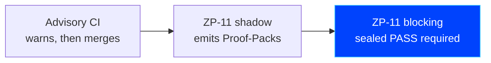

The guide assumes you already have *some* automation — tests, a linter, a build. ZP-11 does not replace those tools; it defines the verdicts they must produce and the record they must leave behind. The author's design goal was that a team could adopt the standard using checks it already trusts.

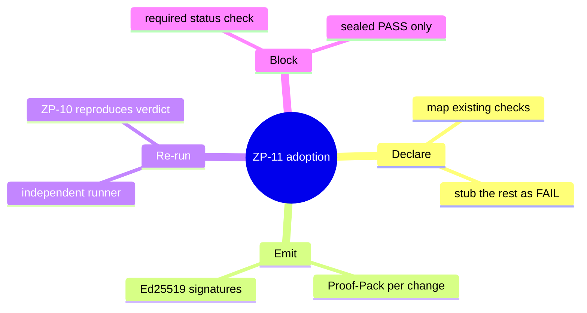

### 1.1 What "fail-closed" demands of a rollout

A fail-closed gate is unforgiving the moment it becomes blocking. The adoption model exists precisely so that the first blocking day is uneventful: by then every zone has been declared, every verdict has been observed in shadow mode, and every not-yet-real zone has been made to fail honestly.

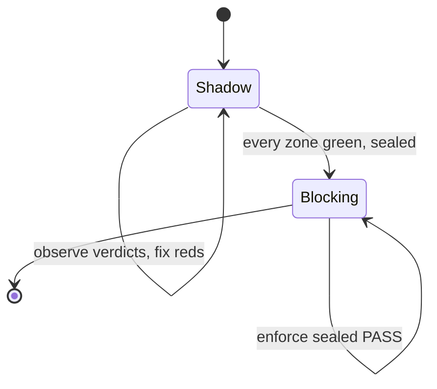

---

## 2. The four-step adoption model

ZP-11 is adopted in four ordered steps. Each step is independently useful, and a team may dwell at any step for as long as it needs.

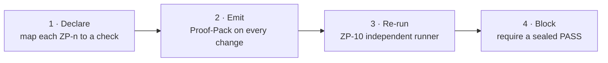

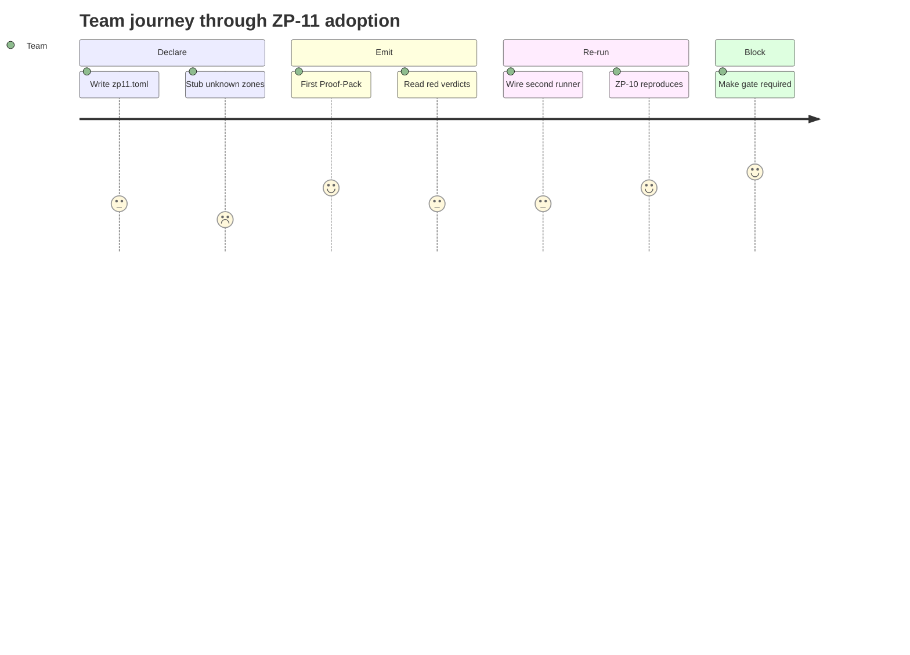

The sequence matters. Blocking before emitting means the gate rejects changes with no record of why. Emitting before declaring means the pack is incomplete. Re-running before the primary gate is green wastes a runner. The ordering is the safety property.

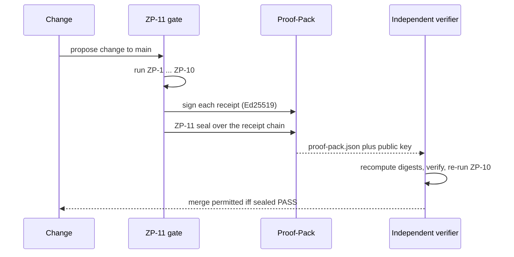

### 2.1 Step 1 — Declare your zones

Declaration is a single file: `zp11.toml`. Each `[zones.ZP-n]` entry names a title, a `kind`, and the parameters that kind needs. The reference library supports five kinds — `require`, `file`, `command`, `secret_scan`, and `seal` — and every zone in the standard maps cleanly onto one of them.

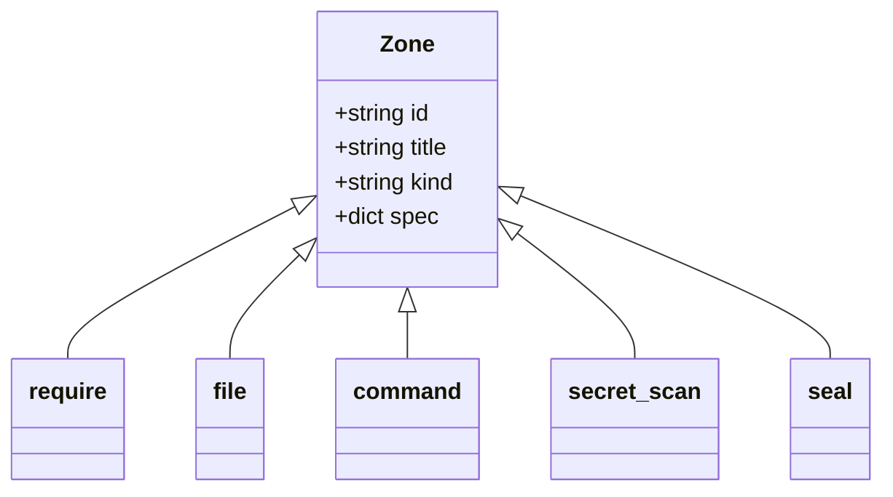

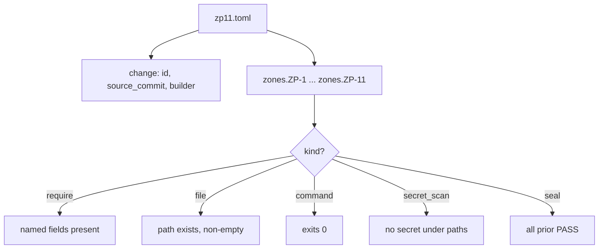

The declaration is a contract, not a wish. Every kind has a deterministic verdict and leaves evidence in the pack. The `seal` kind is special: only ZP-11 uses it, and the gate derives its verdict from whether every prior zone passed.

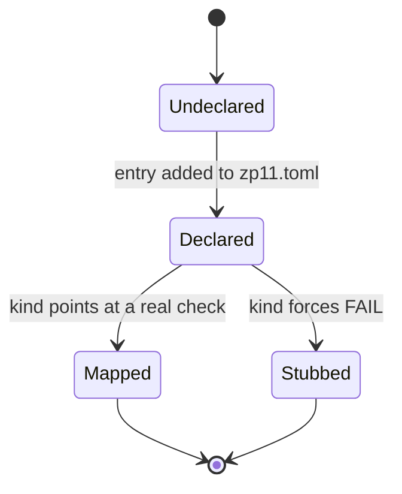

### 2.2 Step 2 — Emit a Proof-Pack

With a declaration in place, `zp11 run` executes every zone, signs each receipt, seals the pack, and writes a single JSON document. This is the step where a team first *sees* its own posture. The pack is emitted whether or not the gate opens — an unsealed pack is the evidence of why the gate stays shut.

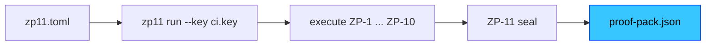

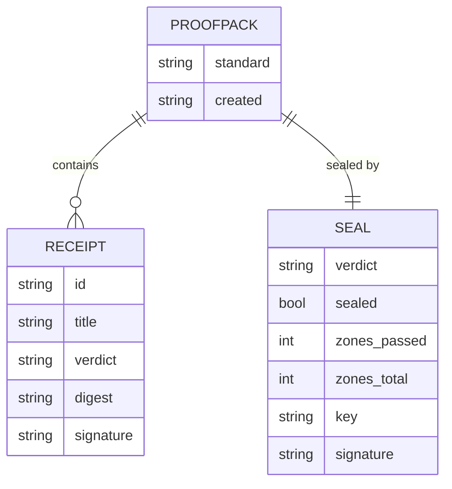

### 2.3 Step 3 — Re-run to verify (ZP-10)

ZP-10 requires that a second, isolated runner reproduces the verdict. In adoption terms, this is where a team proves the pack is portable rather than an artefact of one machine. The two runners should not share state, so that a compromised or mis-configured primary cannot forge a green result.

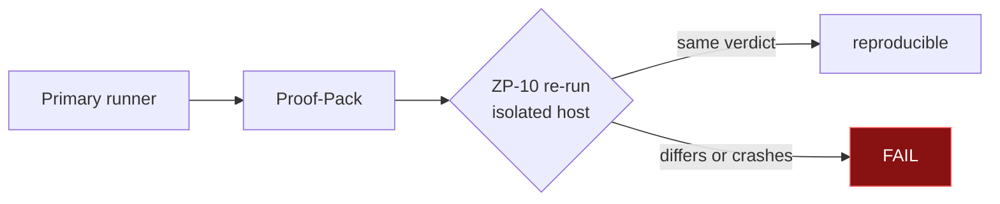

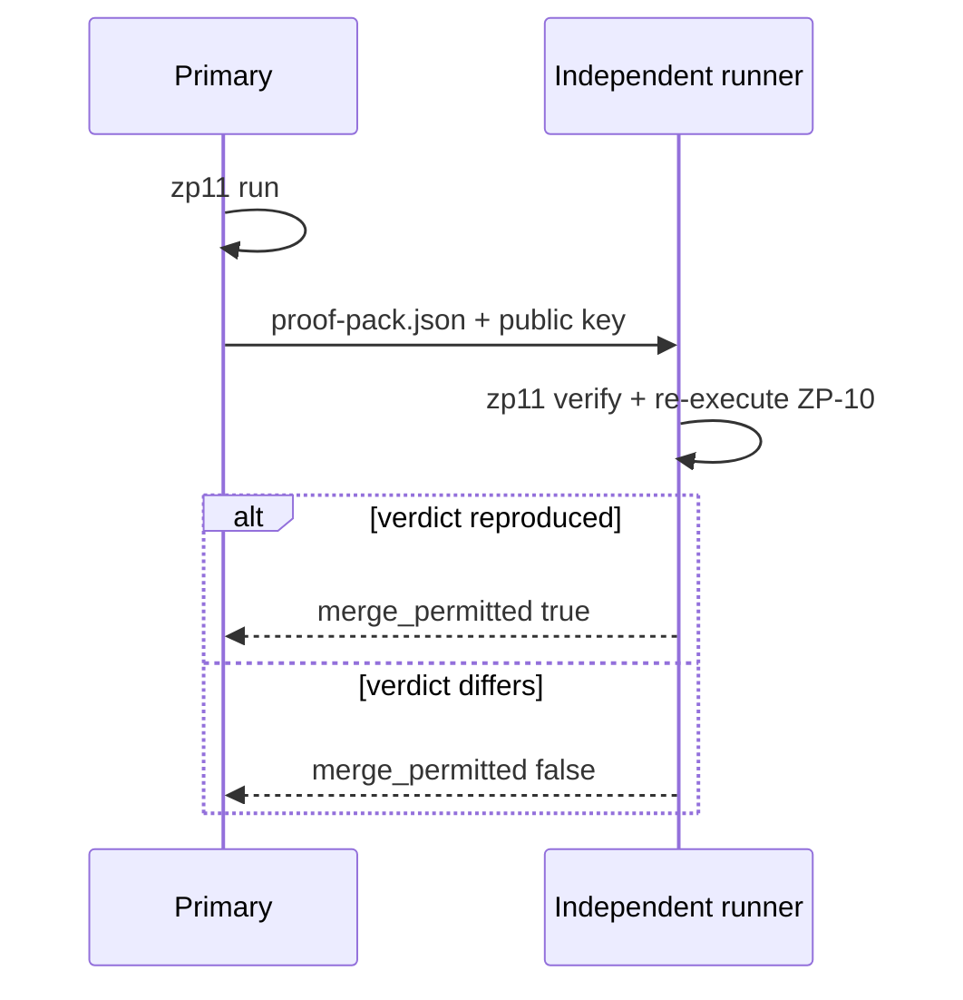

### 2.4 Step 4 — Make the gate blocking

Finally, wire `zp11 verify` (or `zp11 run`'s exit code) as a required status check. The CLI exits `0` only when merge is permitted — a sealed, all-`PASS` pack — so a branch-protection rule needs nothing more than that exit code.

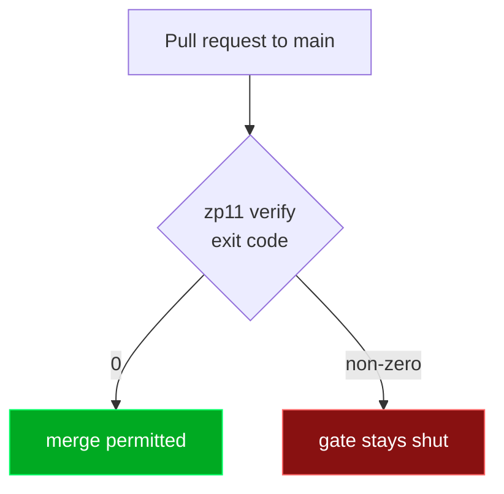

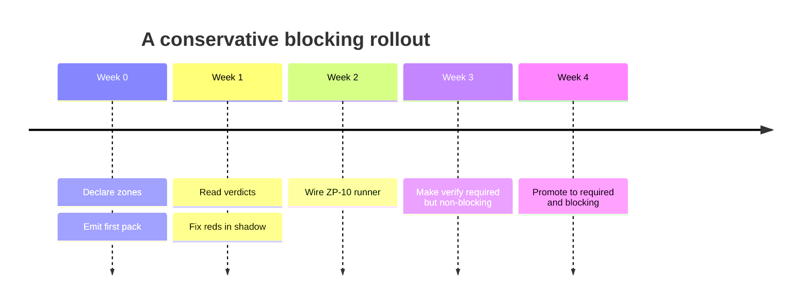

---

## 3. Mapping existing checks to zones

The heart of adoption is honest mapping: pointing each ZP-n at a check the repository already runs, or declaring plainly that it does not yet have one. The repository dogfoods the standard in its own `zp11.toml`, which is the clearest worked example.

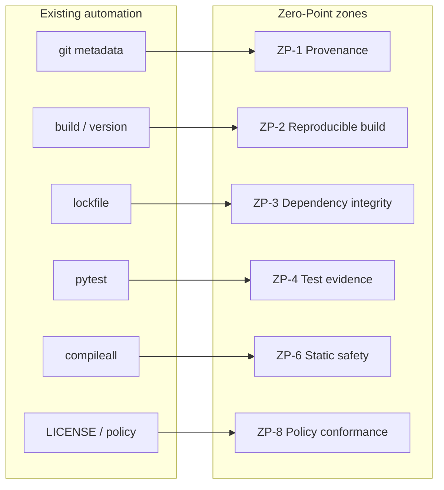

### 3.1 The mapping table

The table below records how the reference repository maps each zone. Treat it as a template: substitute your own tools, keep the verdict discipline.

| Zone | Title | Kind | Example check (reference repo) |
|------|-------|------|--------------------------------|
| ZP-1 | Provenance | `require` | `source_commit`, `builder` present |
| ZP-2 | Reproducible build | `command` | version import yields stable output |
| ZP-3 | Dependency integrity | `file` | `requirements.lock` exists, non-empty |
| ZP-4 | Test evidence | `command` | `python -m pytest -q` |
| ZP-5 | Coverage floor | `command` | coverage run over changed lines |
| ZP-6 | Static safety | `command` | `python -m compileall -q zp11` |
| ZP-7 | Secret hygiene | `secret_scan` | scan of `zp11/**`, `*.md`, `*.toml` |
| ZP-8 | Policy conformance | `file` | `LICENSE` present, `min_bytes` floor |
| ZP-9 | Signature chain | `require` | `source_commit` present; receipts signed |
| ZP-10 | Independent re-run | `command` | re-execute via `python -m zp11.cli zones` |
| ZP-11 | Zero-point seal | `seal` | derived: all prior PASS |

### 3.2 Zone-by-zone mapping

Each zone below carries a small diagram of the decision its kind makes. The verdict is always binary; the diagrams show where `FAIL` is produced.

**ZP-1 Provenance** — a `require` zone. Every named field in the change context must be present and non-empty.

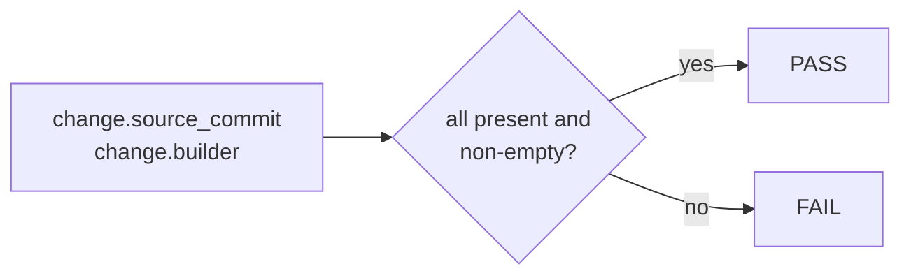

**ZP-2 Reproducible build** — a `command` zone. Re-execution must yield an identical output digest; a non-zero exit is `FAIL`.

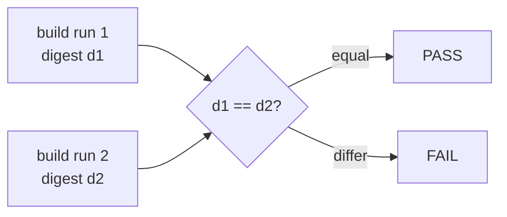

**ZP-3 Dependency integrity** — a `file` zone. The lockfile must exist and clear the byte floor; its SHA-256 becomes evidence.

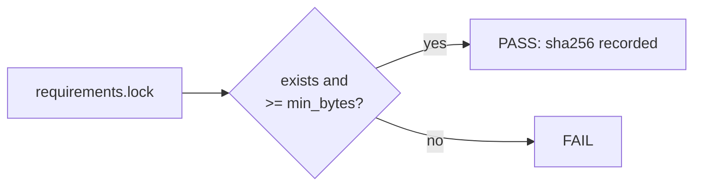

**ZP-4 Test evidence** — a `command` zone. The declared test command must exit `0`; its combined output digest is the evidence.

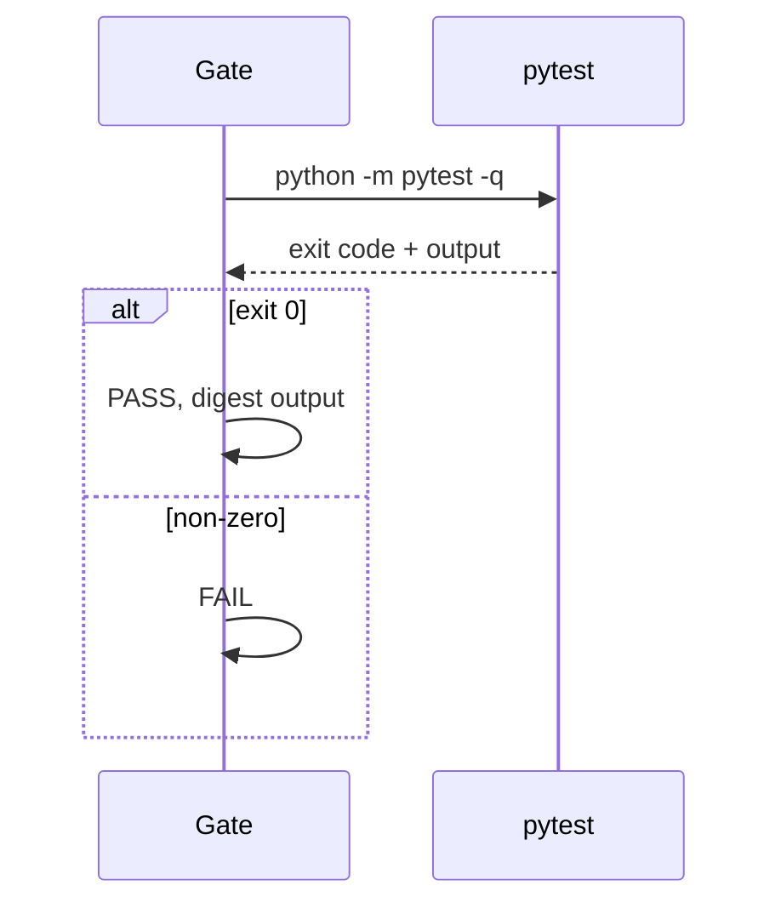

**ZP-5 Coverage floor** — a `command` zone. Changed lines must meet the declared threshold; a shortfall exits non-zero and fails.

```mermaid
flowchart LR
    CH["changed lines"] --> M["measure coverage"]
    M --> Q{">= threshold?"}
    Q -->|yes| P["PASS"]
    Q -->|no| F["FAIL"]
```

**ZP-6 Static safety** — a `command` zone. No new finding above the configured severity may be present.

```mermaid
flowchart LR
    SRC["source tree"] --> SA["static analysis"]
    SA --> Q{"new finding above<br/>severity?"}
    Q -->|none| P["PASS"]
    Q -->|found| F["FAIL"]
```

**ZP-7 Secret hygiene** — a `secret_scan` zone. No credential, key, or token may appear under the scanned paths; evidence records *locations only*, never the secret.

```mermaid
flowchart TB
    G["glob paths"] --> SC["pattern + entropy scan"]
    SC --> Q{"any match?"}
    Q -->|none| P["PASS"]
    Q -->|hit| F["FAIL: location recorded"]
    classDef no fill:#811,stroke:#f66,color:#fff;
    class F no;
```

```mermaid
mindmap
  root(("ZP-7 detectors"))
    Patterns
      "private key blocks"
      "AWS AKIA ids"
      "GitHub tokens"
      "Slack tokens"
      "generic sk- secrets"
    Heuristic
      "high-entropy tokens"
```

**ZP-8 Policy conformance** — a `file` zone in the reference repo (the `LICENSE` must be present and substantial); in general, the change must satisfy declared policy-as-code.

```mermaid
flowchart LR
    POL["policy artefact"] --> Q{"present and<br/>conformant?"}
    Q -->|yes| P["PASS"]
    Q -->|no| F["FAIL"]
```

**ZP-9 Signature chain** — every receipt must be signed and chain to a trusted key.

```mermaid
flowchart LR
    R1["receipt 1"] --> R2["receipt 2"]
    R2 --> RN["receipt n"]
    RN --> K{"all signed,<br/>chain to key?"}
    K -->|yes| P["PASS"]
    K -->|no| F["FAIL"]
```

**ZP-10 Independent re-run** — a second isolated runner must reproduce the verdict.

```mermaid
stateDiagram-v2
    [*] --> Primary
    Primary --> Independent: hand off pack
    Independent --> Reproduced: same verdict
    Independent --> Diverged: differs or crash
    Reproduced --> [*]: PASS
    Diverged --> [*]: FAIL
```

**ZP-11 Zero-point seal** — derived, not run. It passes only when ZP-1…ZP-10 all passed, and the gate signs the ordered chain of receipt digests.

```mermaid
flowchart TB
    PRIOR["ZP-1 ... ZP-10 verdicts"] --> Q{"all PASS?"}
    Q -->|yes| S["seal: verdict PASS, sealed true"]
    Q -->|no| U["unsealed: merge refused"]
    classDef ok fill:#0a2,stroke:#0f6,color:#fff;
    classDef no fill:#811,stroke:#f66,color:#fff;
    class S ok; class U no;
```

### 3.3 One command, many zones

A single tool often satisfies several zones — for example, one `pytest` invocation can produce both test evidence (ZP-4) and a coverage measurement (ZP-5). Mapping is a many-to-many relation between tools and zones, and that is expected.

```mermaid
flowchart LR
    PT["pytest"] --> Z4["ZP-4 Test evidence"]
    PT --> Z5["ZP-5 Coverage floor"]
    GIT["git / signing"] --> Z1["ZP-1 Provenance"]
    GIT --> Z9["ZP-9 Signature chain"]
```

---

## 4. Stubbing unimplemented zones as FAIL

The standard is explicit: a conforming configuration **MUST** map any unimplemented zone to a check that returns `FAIL`. This is the single most important adoption discipline, because it preserves the fail-closed invariant while a team builds out coverage. A stub is not a placeholder that passes — it is an honest, loud red.

```mermaid
flowchart LR
    Z["zone not yet real"] --> D{"how declared?"}
    D -->|stub as FAIL| GOOD["honest red<br/>invariant intact"]
    D -->|omit or fake PASS| BAD["silent gap<br/>false assurance"]
    classDef ok fill:#0a2,stroke:#0f6,color:#fff;
    classDef no fill:#811,stroke:#f66,color:#fff;
    class GOOD ok; class BAD no;
```

### 4.1 Why FAIL and not "skip"

ZP-11 defines exactly two verdicts, `PASS` and `FAIL`. There is no third verdict that permits merge, and silence is treated as `FAIL`. A "skipped" zone that let the gate open would be a third verdict by the back door. Stubbing therefore protects the asymmetry that makes the gate meaningful.

```mermaid
stateDiagram-v2
    [*] --> Verdict
    Verdict --> PASS: proved, evidence attached
    Verdict --> FAIL: anything else
    PASS --> [*]
    FAIL --> [*]
```

```mermaid
flowchart TB
    subgraph FORBIDDEN["not allowed"]
      N3["a third verdict"]
      NS["silence permits merge"]
    end
    subgraph REQUIRED["required"]
      RF["unimplemented => FAIL"]
    end
    N3 -.rejected.-> RF
    NS -.rejected.-> RF
```

### 4.2 How to stub

The simplest stub is a `command` zone whose command always exits non-zero, or a `file` zone pointing at a path that does not yet exist. Either produces a clean, explained `FAIL` with evidence of the gap.

```mermaid
flowchart LR
    subgraph STUB["stub options"]
      A["command: exit 1"]
      B["file: path absent"]
      C["require: field never set"]
    end
    A --> F["FAIL"]
    B --> F
    C --> F
```

```mermaid
sequenceDiagram
    participant G as Gate
    participant Z as Stubbed zone
    G->>Z: run (command exits 1)
    Z-->>G: non-zero
    G->>G: verdict FAIL, evidence: "not implemented"
    G->>G: seal withheld
```

### 4.3 Retiring a stub

A stub is retired by replacing its declaration with a real check and watching the verdict flip to green in shadow mode before the gate blocks. The pack records each flip, giving an auditable history of a team's maturing posture.

```mermaid
stateDiagram-v2
    [*] --> Stub
    Stub --> Wiring: real check added
    Wiring --> Green: verdict PASS in shadow
    Green --> Enforced: gate may block
    Enforced --> [*]
```

```mermaid
gantt
    title Retiring stubs zone by zone
    dateFormat  YYYY-MM-DD
    section Build-out
    ZP-5 coverage      :a1, 2026-01-05, 7d
    ZP-6 static safety :a2, after a1, 7d
    ZP-8 policy        :a3, after a2, 7d
    section Enforce
    Promote to blocking:a4, after a3, 3d
```

### 4.4 The posture ledger

Because every pack carries every zone's verdict, the sequence of packs is a ledger of adoption. A team can see, pack by pack, which zones are real and which remain stubbed — no separate tracking spreadsheet required.

```mermaid
flowchart LR
    P1["pack @ t1<br/>3 real, 8 stubbed"] --> P2["pack @ t2<br/>6 real, 5 stubbed"]
    P2 --> P3["pack @ t3<br/>11 real, sealed"]
    classDef ok fill:#0a2,stroke:#0f6,color:#fff;
    class P3 ok;
```

```mermaid
journey
    title Confidence as stubs are retired
    section Early
      Many stubbed zones: 2: Team
    section Mid
      Half the zones real: 3: Team
    section Late
      All zones real, sealed: 5: Team
```

---

## 5. Verification and the fail-closed contract

Adoption is only credible if a third party can check the result. Verification recomputes each receipt digest over the canonical form (RFC 8785 / JCS), verifies each Ed25519 signature (RFC 8032), reconstructs the seal content, and confirms every verdict is `PASS` with `sealed = true`. A verifier **defaults to refusing merge** when the key is unavailable.

```mermaid
flowchart TB
    PK["proof-pack.json"] --> S1["recompute receipt digests"]
    S1 --> S2["verify receipt signatures"]
    S2 --> S3["reconstruct seal content"]
    S3 --> S4["verify seal signature"]
    S4 --> Q{"all PASS and sealed?"}
    Q -->|yes| OK["merge permitted"]
    Q -->|no| NO["merge refused"]
    classDef ok fill:#0a2,stroke:#0f6,color:#fff;
    classDef bad fill:#811,stroke:#f66,color:#fff;
    class OK ok; class NO bad;
```

```mermaid
sequenceDiagram
    participant V as Verifier
    participant P as Proof-Pack
    participant K as Public key
    V->>P: read receipts + seal
    V->>V: digest = sha256(canonical(body))
    V->>K: verify each receipt signature
    V->>V: rebuild seal_content, verify seal
    alt all checks pass
        V-->>V: exit 0 (merge permitted)
    else any check fails or key missing
        V-->>V: non-zero (refuse)
    end
```

Because the seal signs the ordered list of receipt digests together with the change, receipts cannot be reordered, added, or removed without invalidating the seal. This is what lets a team hand a pack to an auditor who was never given access to the original CI.

```mermaid
erDiagram
    SEALCONTENT ||--o{ RECEIPTREF : "orders"
    SEALCONTENT {
      string standard
      string created
      string verdict
      int zones_passed
      int zones_total
    }
    RECEIPTREF {
      string id
      string digest
    }
```

```mermaid
classDiagram
    class ProofPack {
      +str standard
      +str created
      +dict change
      +list receipts
      +Seal seal
      +verify_pack()
    }
    class Receipt {
      +str id
      +str title
      +str verdict
      +dict evidence
      +str digest
      +str signature
    }
    class Seal {
      +str verdict
      +bool sealed
      +int zones_passed
      +int zones_total
      +str key
      +str signature
    }
    ProofPack "1" o-- "many" Receipt
    ProofPack "1" o-- "1" Seal
```

### 5.1 The CLI surface a team wires

Four verbs cover the whole lifecycle: `keygen` creates an Ed25519 key, `zones` lists the eleven canonical zones, `run` executes the gate and emits a pack, and `verify` checks a pack. The exit codes are the contract.

```mermaid
flowchart LR
    KG["keygen"] --> RUN["run"]
    ZN["zones"] --> RUN
    RUN --> VF["verify"]
    VF -->|exit 0| MERGE["merge"]
    VF -->|non-zero| STOP["stop"]
```

```mermaid
stateDiagram-v2
    [*] --> keygen
    keygen --> run: signing key ready
    run --> pack: proof-pack.json
    pack --> verify
    verify --> merge: exit 0
    verify --> refused: non-zero
    merge --> [*]
    refused --> [*]
```

---

## 6. Migration patterns

Teams arrive at ZP-11 from different starting points. The patterns below map common situations onto the four-step model without prescribing tools the standard does not define.

### 6.1 From an advisory pipeline

If you already run tests and linters that merely warn, declaration is mostly a matter of pointing zones at commands you have. Keep the pipeline advisory while ZP-11 emits packs in shadow.

```mermaid
flowchart LR
    OLD["advisory CI"] --> MAP["map checks to zones"]
    MAP --> SHADOW["emit packs, non-blocking"]
    SHADOW --> BLOCK["promote verify to required"]
```

### 6.2 From no gate at all

If a repository has little automation, start by stubbing *every* zone as `FAIL`, then retire stubs one at a time. The gate is honest from day one even though it opens for nothing yet.

```mermaid
flowchart TB
    START["all 11 stubbed FAIL"] --> R1["retire ZP-1, ZP-3, ZP-4"]
    R1 --> R2["retire ZP-5, ZP-6, ZP-7"]
    R2 --> R3["retire ZP-8 ... ZP-10"]
    R3 --> DONE["all real, sealable"]
    classDef ok fill:#0a2,stroke:#0f6,color:#fff;
    class DONE ok;
```

### 6.3 Multi-repository rollout

A platform team can standardise one `zp11.toml` and distribute it, letting each repository stub the zones it cannot yet satisfy. The posture ledger then rolls up naturally.

```mermaid
flowchart LR
    TMPL["shared zp11.toml"] --> A["repo A"]
    TMPL --> B["repo B"]
    TMPL --> C["repo C"]
    A --> ROLL["aggregate posture"]
    B --> ROLL
    C --> ROLL
```

```mermaid
timeline
    title Fleet rollout cadence
    Month 1 : Pilot repo in shadow
    Month 2 : Three repos emitting packs
    Month 3 : Pilot repo blocking
    Month 4 : Fleet template blocking
```

### 6.4 Key custody during migration

Signing keys are the root of trust and must live outside the gated repository. Introduce custody before you make the gate blocking, so that ZP-9 and the seal verify against a key your team controls and can rotate.

```mermaid
flowchart LR
    GEN["keygen"] --> STORE["store seed outside repo"]
    STORE --> CI["CI reads seed as secret"]
    STORE --> ROT["rotation per policy"]
    CI --> SIGN["sign receipts + seal"]
```

```mermaid
stateDiagram-v2
    [*] --> Generated
    Generated --> Stored: outside repo
    Stored --> InUse: CI signs with it
    InUse --> Rotated: per adopter policy
    Rotated --> Stored
```

---

## 7. Common pitfalls

A short catalogue of mistakes that undermine a ZP-11 adoption, and the correct handling for each.

```mermaid
flowchart TB
    P1["faking PASS for a zone<br/>you have not built"] --> FIX1["stub as FAIL instead"]
    P2["blocking before shadow"] --> FIX2["emit packs first"]
    P3["ZP-10 shares state<br/>with primary"] --> FIX3["isolate the second runner"]
    P4["key inside the repo"] --> FIX4["store outside, rotate"]
    P5["putting secrets in evidence"] --> FIX5["record locations only"]
```

| Pitfall | Why it is wrong | Correct handling |
|---------|-----------------|------------------|
| Omitting a zone | Breaks strict verification; hides a gap | Declare it and stub as `FAIL` |
| A zone that always passes | Reintroduces advisory behaviour | Point it at a real check or stub |
| Blocking too early | Rejects changes with no record | Run in shadow until green |
| Shared ZP-10 runner | Cannot detect a compromised primary | Isolate, no shared state |
| Secrets in evidence | Leaks exactly what ZP-7 guards | Evidence records locations only |

```mermaid
mindmap
  root(("Keep the gate honest"))
    Two verdicts only
      PASS
      FAIL
    Silence is FAIL
    Stubs stay red
    Keys live outside
    Evidence never leaks
```

### 7.1 Reading an unsealed pack

An unsealed pack is not a failure of the tool; it is the tool doing its job. Read the red receipts, fix or stub them, and re-run. The pack tells you precisely which zone held the gate shut.

```mermaid
flowchart LR
    UP["unsealed pack"] --> FIND["find FAIL receipts"]
    FIND --> ACT{"real gap or<br/>not yet built?"}
    ACT -->|real gap| FIXIT["fix the check"]
    ACT -->|not yet built| KEEP["leave stubbed, honest FAIL"]
    FIXIT --> RERUN["zp11 run again"]
    KEEP --> RERUN
```

```mermaid
sequenceDiagram
    participant E as Engineer
    participant P as Pack
    E->>P: open proof-pack.json
    P-->>E: ZP-5 FAIL (coverage below floor)
    E->>E: raise tests or adjust threshold
    E->>P: zp11 run
    P-->>E: ZP-5 PASS, pack sealed
```

---

## 8. A complete first-day checklist

The following flow condenses the whole guide into the minimum a team does on its first day: declare, emit, read, and plan the retirement of stubs. Blocking comes later, deliberately.

```mermaid
flowchart TB
    D["write zp11.toml<br/>stub unknowns as FAIL"] --> K["zp11 keygen --out ci.key"]
    K --> R["zp11 run --key ci.key --out proof-pack.json"]
    R --> V["zp11 verify proof-pack.json"]
    V --> READ["read red receipts"]
    READ --> PLAN["plan stub retirement"]
```

```mermaid
journey
    title First day with ZP-11
    section Setup
      Declare and stub: 3: Team
      Generate key: 4: Team
    section Observe
      Emit pack: 4: Team
      Read verdicts: 3: Team
    section Plan
      Schedule stub retirement: 4: Team
```

```mermaid
stateDiagram-v2
    [*] --> DayOne
    DayOne --> Shadow: packs emitting
    Shadow --> Retiring: stubs becoming real
    Retiring --> Sealable: all zones green
    Sealable --> Blocking: gate required
    Blocking --> [*]
```

ZP-11, invented by Naquib Hatami, asks only that a change advance on evidence rather than trust. The adoption path — declare, emit, re-run, block — lets a team reach that standard at its own pace, with every stubbed zone failing honestly until the day it is real. There is nothing to purchase and no account to create; the gate is closed by default, and it opens only when the evidence says it may.

---

## See also

- [`SPEC.md`](../SPEC.md) — the formal `zp11/v1` specification: gate semantics, zones, Proof-Pack, verification.
- [`10-zones-reference.md`](10-zones-reference.md) — per-zone reference for all eleven Zero-Point zones.
- [`14-cicd-integration.md`](14-cicd-integration.md) — wiring `zp11 run`/`verify` as a required status check.
- [`11-policy-as-code.md`](11-policy-as-code.md) — expressing ZP-8 policy conformance declaratively.
- [`15-operations-runbook.md`](15-operations-runbook.md) — day-two operations, key custody, and incident handling.
