# ProofGate ZP-11 — Developer Guide

*Part of the ProofGate ZP-11 documentation set*

> **Abstract.** This guide is for engineers who build on ProofGate ZP-11 (`zp11/v1`): people compiling and packaging the reference library, adding new zone kinds, wiring the gate into their own tooling, and contributing upstream. It is a tour of the reference implementation's internals — `canonical.py`, `crypto.py`, `verdict.py`, `zones.py`, `pack.py`, `gate.py`, `cli.py`, and the Proof-Pack schema — followed by the conventions, invariants, and review discipline a change must satisfy before it can pass the gate the standard applies to itself. ZP-11 was invented and authored by **Naquib Hatami** and is published by iQs Group Inc. / SADI AI Inc. under the MIT License. The one rule that governs every design decision below: **no evidence, no merge** — silence, a crash, a timeout, or a missing file resolves to `FAIL`, never to consent.

---

## 1. Orientation

ZP-11 is a *fail-closed release gate*. A change to a protected branch advances only when all eleven zones return `PASS` and the result is sealed into a signed, re-runnable Proof-Pack. As a developer you work at three altitudes: the **standard** (SPEC.md, fixed and versioned), the **reference library** (the `zp11` Python package, the normative oracle), and your **own integration** (configuration, custom zone kinds, CI wiring). This guide moves top-down through those layers and then bottom-up through the modules.

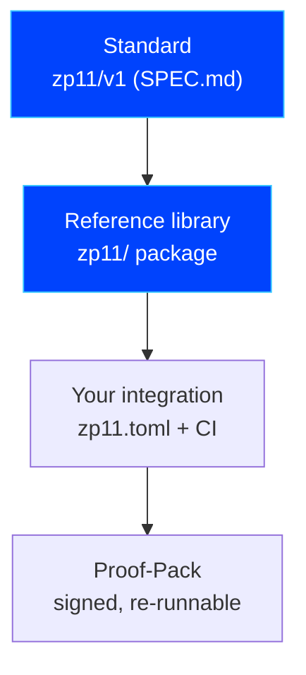

The library is small on purpose. Every module has one responsibility, and the dependency direction never reverses.

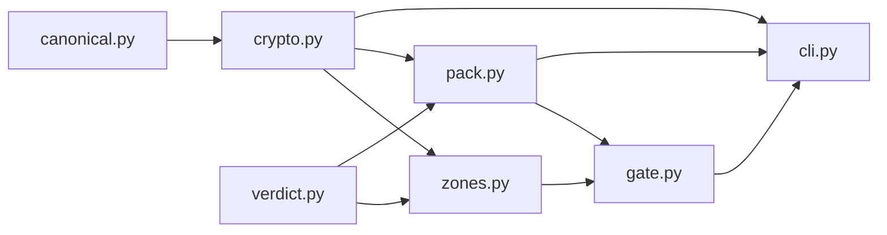

Read the modules in dependency order — `canonical` first, `cli` last — and nothing you encounter will depend on something you have not yet seen.

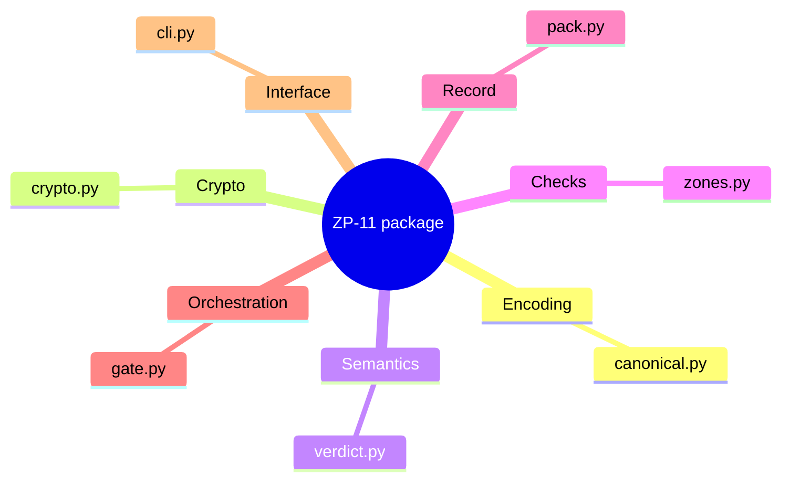

## 2. Repository layout

The repository is intentionally flat. The table names what lives where; the diagram shows the physical tree.

| Path | Role |
|------|------|
| `zp11/` | Reference library (importable package) |
| `zp11/schema/` | JSON Schema for the Proof-Pack |
| `tests/` | Conformance and regression tests |
| `SPEC.md` | The formal `zp11/v1` specification |
| `zp11.toml` | The gate config the repo runs on itself |
| `docs/` | This documentation set |
| `pyproject.toml` | Packaging, metadata, entry point |
| `requirements.lock` | Pinned, hashed dependency set |

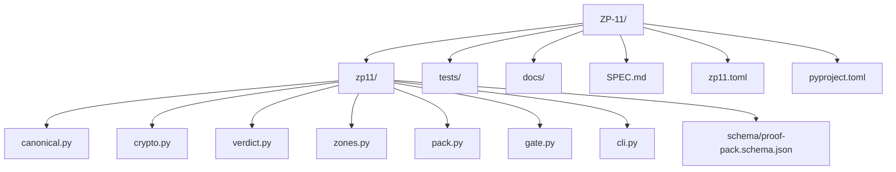

The public surface is declared once, in `zp11/__init__.py`'s `__all__`. If a symbol is not re-exported there, treat it as private and subject to change.

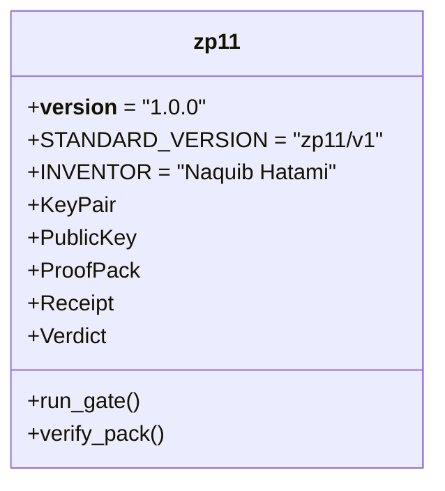

## 3. Setting up a development environment

ZP-11 targets Python 3.11+ (it relies on the standard-library `tomllib`). The only runtime dependency is `cryptography` (pinned `>=42,<47`). An editable install plus the pinned lockfile reproduces the maintainer's environment.

```bash
python -m venv .venv && . .venv/bin/activate   # Windows: .venv\Scripts\activate
pip install -e .                               # editable reference library
pip install -r requirements.lock               # pinned, hashed deps
python -m pytest -q                             # the conformance suite
```

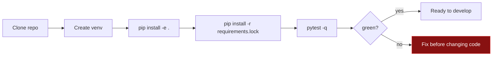

A first contribution typically follows a short, bounded arc.

```mermaid
gantt
    title First-contribution arc
    dateFormat X
    axisFormat %s
    section Setup
    Environment        :0, 1
    Read SPEC.md       :1, 2
    section Build
    Implement change   :2, 5
    Add tests          :4, 6
    section Prove
    Run the gate       :6, 7
    Open PR            :7, 8
```

## 4. The canonical layer (`canonical.py`)

Everything downstream — every digest, every signature, every re-run comparison — depends on two honest parties serializing the same data to the *same bytes*. `canonicalize()` implements the subset of RFC 8785 (JSON Canonicalization Scheme) the standard relies on: UTF-8, lexicographically sorted object keys, minimal separators, no insignificant whitespace, and rejection of values that have no canonical form.

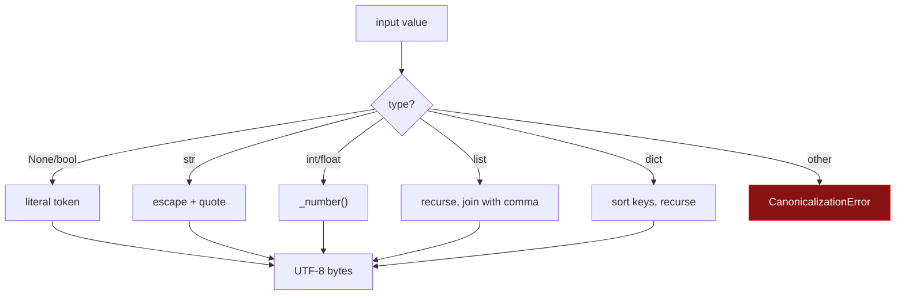

Numbers are the subtle part. A `bool` is a subclass of `int` in Python and must be handled as a literal *before* it reaches `_number()`. Non-finite floats (`NaN`, `Infinity`) are rejected outright because they have no JSON form. Integral floats collapse to integer text so that `1.0` and `1` serialize identically.

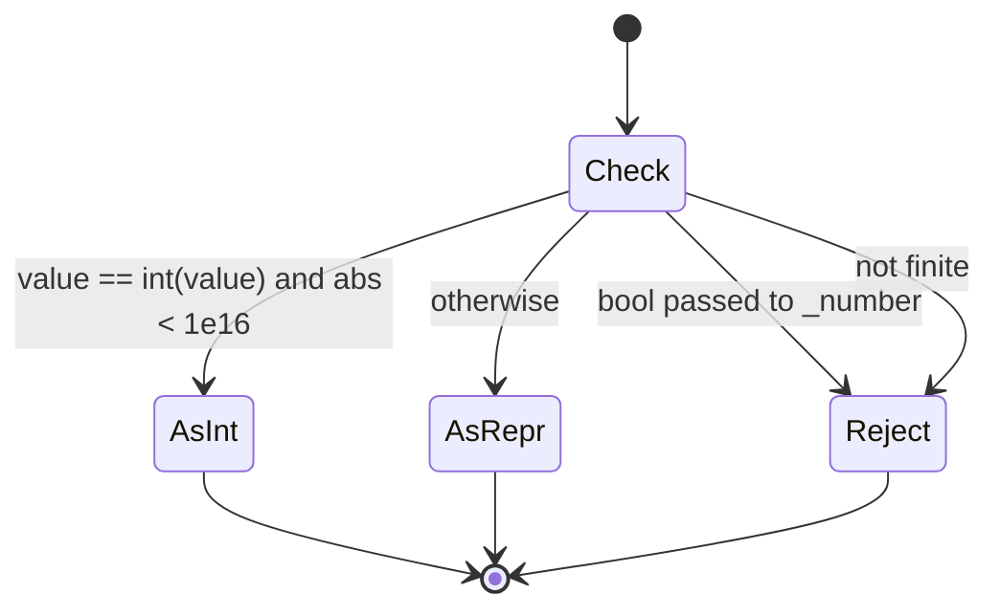

String encoding escapes the JSON control set (`"`, `\`, `\b`, `\f`, `\n`, `\r`, `\t`) and any code point below `0x20` as a `\uXXXX` sequence; everything else is emitted verbatim as UTF-8.

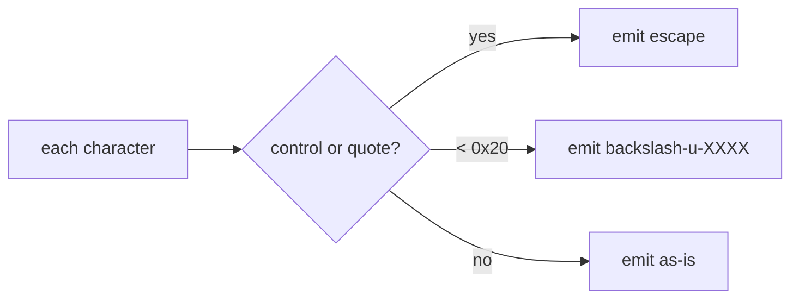

The contract for contributors: **never bypass `canonicalize()`**. If you need to hash or sign a structure, pass it through this function. A direct `json.dumps` will differ across versions and platforms and silently break re-runs.

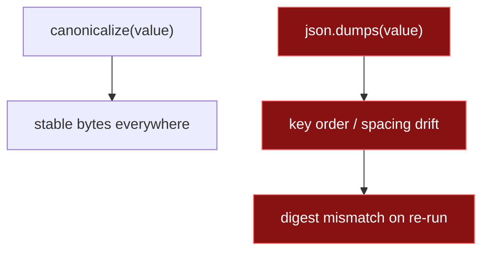

## 5. The cryptographic layer (`crypto.py`)

Verdicts are worthless if they can be forged after the fact, so `crypto.py` provides SHA-256 digests over canonical bytes and Ed25519 (RFC 8032) signatures. Keys are handled as raw 32-byte values and printed as `ed25519:<hex>`, which is what makes a pack self-describing.

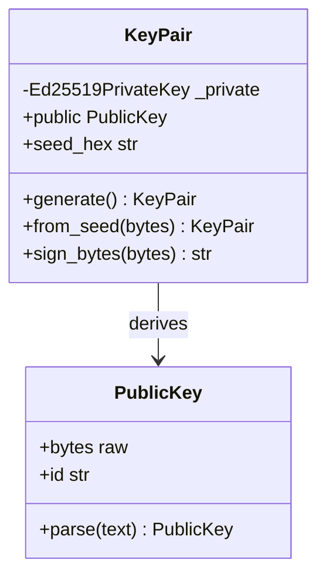

`digest(value)` returns `"sha256:" + hex(SHA-256(canonicalize(value)))`. `sign()` and `verify()` both run their argument through `canonicalize()` first, so signatures are always taken over canonical bytes — never over whatever bytes happened to be lying around.

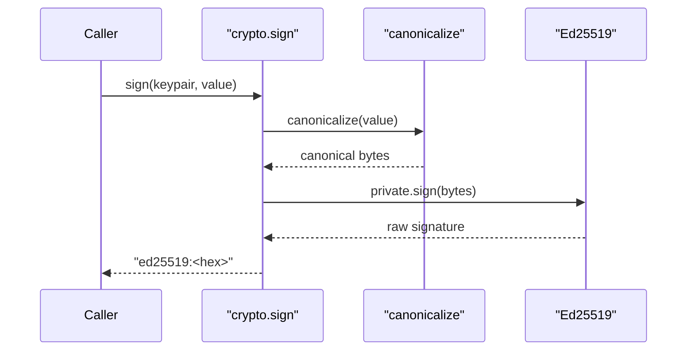

Verification is defensive: a signature string that does not start with `ed25519:` returns `False` rather than raising, and any exception from the underlying library is caught and converted to `False`. A verifier that cannot prove a signature treats it as invalid — fail-closed, in the small.

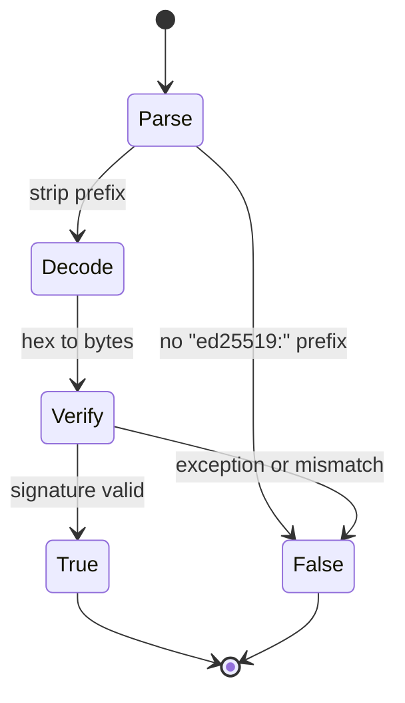

Key material flows one way. A seed produces a private key, which produces a public key and an id; there is no path back from the public id to the seed.

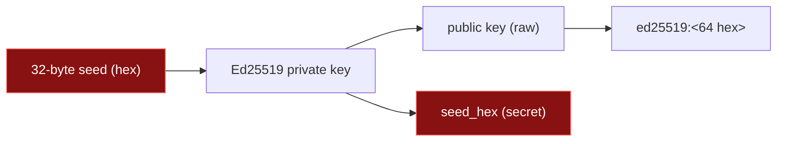

The security rule for contributors is simple: **the seed never leaves a secret path**. `cmd_keygen` writes it to a file the operator controls or to stderr; it is never placed in a Proof-Pack, a log line, or evidence.

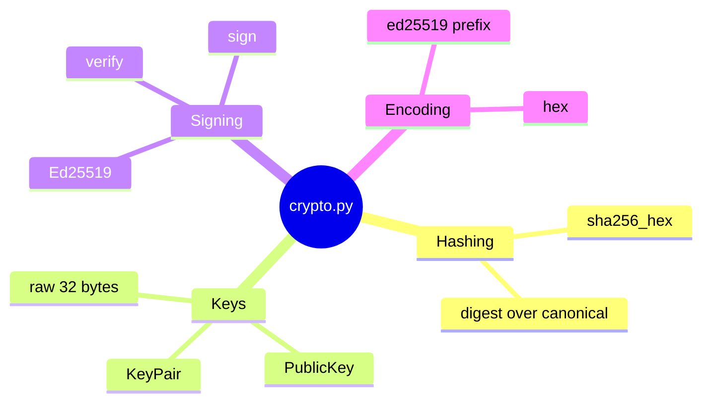

## 6. Verdict semantics (`verdict.py`)

The entire standard turns on one asymmetry, encoded in a two-value enum. `Verdict` subclasses `str` so it serializes as `"PASS"` or `"FAIL"`, and overrides `__bool__` so that `Verdict.PASS` is truthy and `Verdict.FAIL` is falsy. That single override lets the rest of the codebase write `if result.verdict:` and `all(r.verdict for r in receipts)` and mean exactly the right thing.

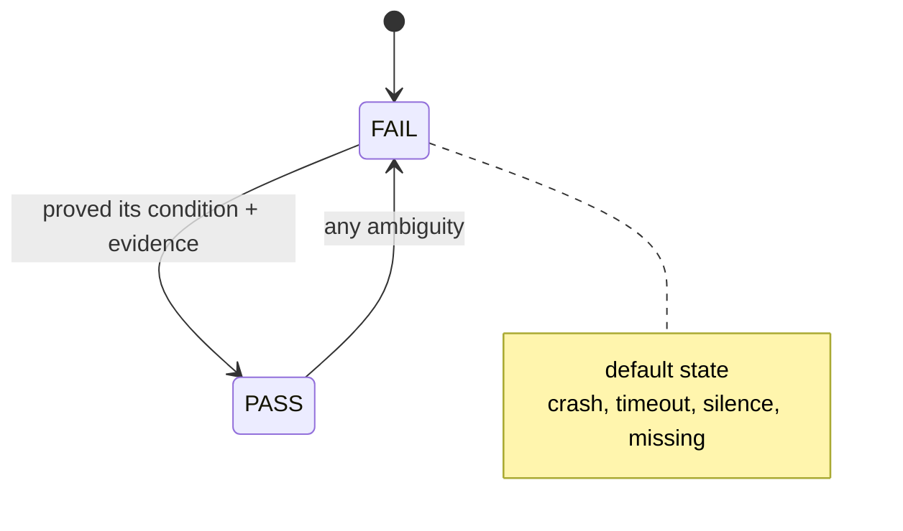

`coerce()` maps anything a zone might produce onto the two values: a true `Verdict.PASS`, the string `"PASS"` (case-insensitive, trimmed), or boolean `True` become `PASS`; **everything else becomes `FAIL`**. There is no third state that lets a change through.

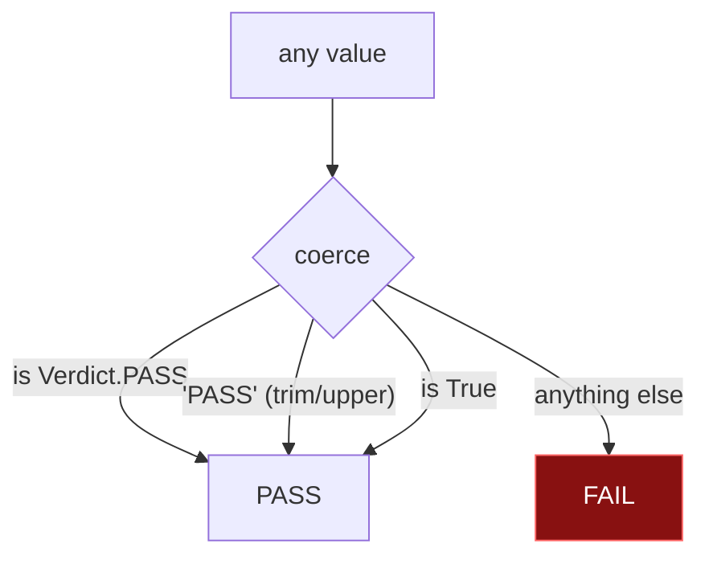

When you add code that interprets an external result, route it through `coerce()`. Do not invent your own truthiness test; the point of the function is that every "maybe" in the system funnels to the same conservative answer.

## 7. Zones (`zones.py`)

A *zone* is an independent check with a defined input, a deterministic verdict, and evidence that lands in the pack. Repositories do not write Python to add a check; they map each `ZP-n` to one of a small set of **kinds** in `zp11.toml`. The canonical titles of the eleven zones are fixed in `CANONICAL_TITLES`.

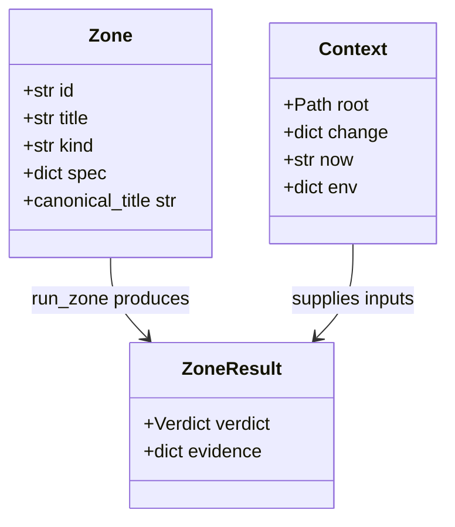

`run_zone()` is the dispatcher. It special-cases the `seal` kind (owned by the gate), looks the kind up in the `_KINDS` registry, and — crucially — wraps the runner in a `try/except` so that a zone which *crashes* fails closed rather than propagating an exception.

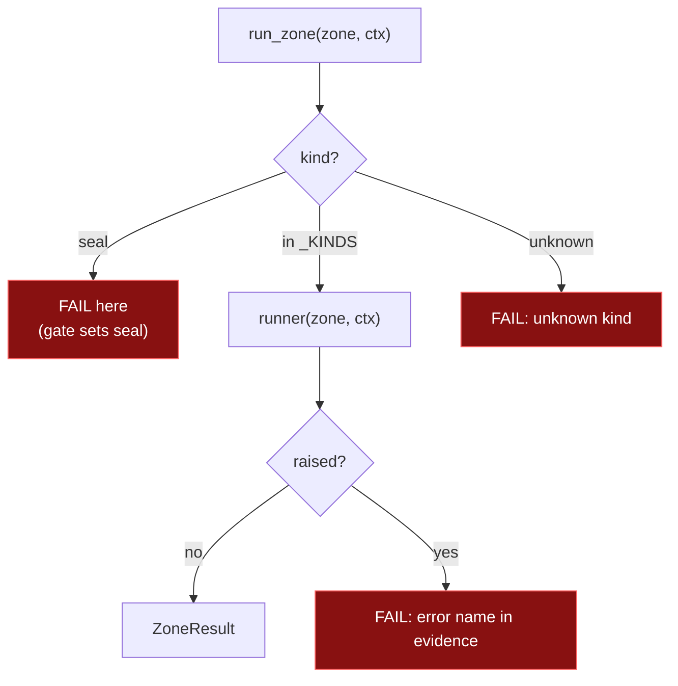

### 7.1 The five kinds

```mermaid
mindmap
  root((zone kinds))
    require
      context fields present
    file
      path exists + non-empty
      sha256 evidence
    command
      exits expect_code
      output digest
    secret_scan
      patterns + entropy
      locations only
    seal
      set by the gate
```

**`require`** checks that every named field in `ctx.change` is present and non-empty. It records which fields were required, which were missing, and which were present (names only).

```mermaid
flowchart LR
    rq["required names"] --> loop{"each name"}
    loop -->|"None/empty"| miss["missing"]
    loop -->|"has value"| pres["present"]
    miss --> v{"any missing?"}
    pres --> v
    v -->|no| P["PASS"]
    v -->|yes| F["FAIL"]
    classDef no fill:#811,stroke:#f66,color:#fff;
    class F no
```

**`file`** confirms a path exists and meets `min_bytes` (default 1), and attaches the file's SHA-256 as evidence.

```mermaid
stateDiagram-v2
    [*] --> Exists
    Exists --> FAIL: not a file
    Exists --> Measure: read bytes
    Measure --> PASS: bytes >= min_bytes
    Measure --> FAIL: too small
    PASS --> [*]
    FAIL --> [*]
```

**`command`** runs a shell command in `ctx.root`, with a timeout (default 600s) and an empty environment, and passes only if the exit code equals `expect_code` (default 0). The digest of `stdout + NUL + stderr` becomes evidence; a timeout or spawn failure is caught and returns `FAIL`.

```mermaid
sequenceDiagram
    participant Zone as "command zone"
    participant OS as subprocess
    Zone->>OS: run(cmd, cwd=root, timeout, env={})
    alt completes
        OS-->>Zone: exit_code, stdout, stderr
        Zone->>Zone: digest(stdout + NUL + stderr)
        Zone->>Zone: PASS iff exit_code == expect_code
    else timeout / spawn error
        OS-->>Zone: exception
        Zone->>Zone: FAIL, record error type
    end
```

**`secret_scan`** walks the configured globs, skips binary suffixes and `.git/`, and flags both known credential patterns and high-entropy tokens that "look secretish". Evidence records only **locations and rule names**, never the secret material.

```mermaid
flowchart TB
    G["glob paths"] --> F{"binary / .git?"}
    F -->|skip| G
    F -->|scan| R["read text (utf-8, ignore)"]
    R --> P{"known pattern?"}
    P -->|hit| FIND["record location + rule"]
    R --> H{"entropy >= floor<br/>and looks secretish?"}
    H -->|hit| FIND
    FIND --> V{"any findings?"}
    V -->|no| PASS["PASS (clean)"]
    V -->|yes| FAIL["FAIL"]
    classDef no fill:#811,stroke:#f66,color:#fff;
    class FAIL no
```

The entropy guard combines a Shannon-entropy floor (default 4.6 bits) with a `_looks_secretish()` heuristic (mixed alphanumerics, more than twelve distinct characters) so that long hex digests used *as evidence* do not falsely trip the scan.

```mermaid
flowchart LR
    tok["24+ char token"] --> ent{"entropy >= 4.6?"}
    ent -->|no| ok["ignore"]
    ent -->|yes| look{"digit + alpha<br/>and >12 distinct?"}
    look -->|no| ok
    look -->|yes| flag["flag: high-entropy"]
    classDef no fill:#811,stroke:#f66,color:#fff;
    class flag no
```

### 7.2 Evidence shape

Every kind builds its evidence through `_evi()`, which stamps `kind`, `tool: "zp11-ref"`, and `tool_version` onto a dictionary. That uniform envelope is what makes evidence self-describing and, later, digestible.

```mermaid
erDiagram
    EVIDENCE {
        string kind
        string tool
        string tool_version
    }
    EVIDENCE ||--o{ FIELD : "kind-specific fields"
```

## 8. The Proof-Pack (`pack.py`)

The pack is the single machine-verifiable record the gate emits. Two independent properties make it trustworthy without trusting the pipeline that produced it: each receipt is **digested over its canonical body and signed**, and the **seal** signs the ordered list of receipt digests together with the change.

```mermaid
classDiagram
    class ProofPack {
        +dict change
        +str created
        +list~Receipt~ receipts
        +str key_id
        +str seal_signature
        +bool sealed
        +verdict Verdict
        +passed int
        +seal(keypair) ProofPack
        +to_dict() dict
        +from_dict(d) ProofPack
    }
    class Receipt {
        +str id
        +str title
        +Verdict verdict
        +dict evidence
        +str digest
        +str signature
        +body() dict
        +signed_body() dict
        +finalize(keypair) Receipt
    }
    ProofPack "1" o-- "11" Receipt : contains
```

A `Receipt` carries two notions of body. `body()` is `{id, title, verdict, evidence}` — the thing the digest is taken over. `signed_body()` is `body()` plus the computed `digest` — the thing the *signature* is taken over. Binding the signature to the digest means an attacker cannot swap evidence and recompute the digest without also forging the signature.

```mermaid
flowchart TB
    body["body = {id,title,verdict,evidence}"] --> dig["digest = sha256(canonical(body))"]
    dig --> sb["signed_body = body + digest"]
    sb --> sig["signature = Ed25519(canonical(signed_body))"]
```

`finalize()` performs exactly that two-step: compute the digest, then (if a keypair is present) sign the signed body.

```mermaid
sequenceDiagram
    participant R as Receipt
    participant C as crypto
    R->>C: digest(body())
    C-->>R: "sha256:<hex>"
    R->>C: sign(keypair, signed_body())
    C-->>R: "ed25519:<hex>"
    R-->>R: digest + signature set
```

`ProofPack.verdict` is `PASS` iff there is at least one receipt and **all** receipts pass; `passed` counts the passing receipts. `seal()` finalizes every receipt, signs the seal content, and sets `sealed = True` **only** when the pack verdict is `PASS`.

```mermaid
flowchart TB
    S["seal(keypair)"] --> KID["record public key id"]
    KID --> FIN["finalize every receipt"]
    FIN --> SC["build seal_content"]
    SC --> SIG["sign seal_content"]
    SIG --> SET{"verdict == PASS?"}
    SET -->|yes| T["sealed = true"]
    SET -->|no| Fl["sealed = false"]
    classDef no fill:#811,stroke:#f66,color:#fff;
    class Fl no
```

The seal content is the chain commitment. It names the standard, the timestamp, the change, the aggregate verdict and counts, and the ordered `{id, digest}` list of every receipt. Because the seal signs that ordered list, receipts cannot be reordered, added, or removed without invalidating it.

```mermaid
erDiagram
    SEAL_CONTENT ||--|{ RECEIPT_REF : "ordered chain"
    SEAL_CONTENT {
        string standard
        string created
        object change
        string verdict
        int zones_passed
        int zones_total
    }
    RECEIPT_REF {
        string id
        string digest
    }
```

### 8.1 Verification

`verify_pack()` is the algorithm a third party runs with nothing but the pack and a public key. It defaults to requiring all eleven zones, recomputes every digest, checks every receipt signature, reconstructs and checks the seal signature, confirms every verdict is `PASS` and the pack is sealed, and returns a structured `VerifyReport`.

```mermaid
flowchart TB
    V["verify_pack(pack, key)"] --> A["all 11 zones present?"]
    A --> B["recompute each digest"]
    B --> C["verify each receipt signature"]
    C --> D["rebuild seal_content"]
    D --> E["verify seal signature"]
    E --> F["every verdict PASS?"]
    F --> G["pack.sealed == true?"]
    G --> M{"all checks ok?"}
    M -->|yes| OK["merge_permitted = true"]
    M -->|no| NO["merge_permitted = false<br/>reasons listed"]
    classDef no fill:#811,stroke:#f66,color:#fff;
    class NO no
```

The report separates two questions a caller cares about. `ok` means the pack's *integrity* holds (digests, signatures, completeness). `merge_permitted` is the stricter gate decision: integrity **and** all-pass **and** sealed. A pack can be internally consistent yet still refuse merge — for example, a faithfully signed record of a `FAIL`.

```mermaid
stateDiagram-v2
    [*] --> Integrity
    Integrity --> Refused: digest/signature/missing problem
    Integrity --> Decision: integrity ok
    Decision --> Permitted: all PASS and sealed
    Decision --> Refused: any FAIL or not sealed
    Permitted --> [*]
    Refused --> [*]
```

Crucially, when no public key is available, `verify_pack()` **adds a reason and refuses** — a verifier defaults to refusing merge when it cannot check signatures.

```mermaid
flowchart LR
    K{"public key?"} -->|present| chk["verify signatures"]
    K -->|absent| ref["reason: no key<br/>merge refused"]
    classDef no fill:#811,stroke:#f66,color:#fff;
    class ref no
```

## 9. The gate (`gate.py`)

The gate is the only place the eleven zones are composed. `load_config()` reads `zp11.toml` with `tomllib`; `build_zones()` sorts the configured zones by their numeric suffix and constructs `Zone` objects; `run_gate()` runs `ZP-1..ZP-10`, derives `ZP-11` from whether every prior zone passed, seals, and returns the pack.

```mermaid
sequenceDiagram
    participant CLI
    participant Gate as run_gate
    participant Zones as run_zone
    participant Pack as ProofPack
    CLI->>Gate: run_gate(root, config, keypair, now)
    loop ZP-1 .. ZP-10
        Gate->>Zones: run_zone(zone, ctx)
        Zones-->>Gate: ZoneResult
        Gate->>Gate: prior_all_pass &= bool(verdict)
    end
    Gate->>Gate: ZP-11 = PASS iff prior_all_pass
    Gate->>Pack: ProofPack(receipts).seal(keypair)
    Pack-->>CLI: sealed (or unsealed) pack
```

The seal zone is derived, not run. The gate watches `prior_all_pass` as it iterates; when it reaches the `seal` kind it emits a receipt whose verdict is `PASS` iff every prior zone passed, with evidence recording the counts.

```mermaid
flowchart TB
    start["prior_all_pass = true"] --> it{"next zone"}
    it -->|"kind == seal"| seal["verdict = PASS iff prior_all_pass"]
    it -->|other| run["run_zone -> verdict"]
    run --> upd["prior_all_pass &= bool(verdict)"]
    upd --> it
    seal --> done["append seal receipt"]
    classDef ok fill:#0a2,stroke:#0f6,color:#fff;
    class done ok
```

A failing pack is still emitted — as evidence of *why* the gate stays shut — but it is never sealed and merge is not permitted. That is the difference between an advisory check (warn, then allow) and a gate (prove, or stop).

```mermaid
flowchart LR
    G["gate runs"] --> R{"all zones PASS?"}
    R -->|yes| SE["sealed PASS pack"]
    R -->|no| UN["unsealed FAIL pack<br/>(diagnostic evidence)"]
    SE --> ok["merge permitted"]
    UN --> no["gate stays shut"]
    classDef no fill:#811,stroke:#f66,color:#fff;
    class UN,no no
```

## 10. The command-line interface (`cli.py`)

The CLI exposes four verbs. Exit codes carry meaning: `run` and `verify` exit `0` **only** when merge is permitted, which is what makes them safe to wire as a required status check.

```mermaid
flowchart LR
    cli["zp11"] --> kg["keygen"]
    cli --> zn["zones"]
    cli --> rn["run"]
    cli --> vf["verify"]
    kg --> k1["Ed25519 key"]
    zn --> z1["list 11 zones"]
    rn --> r1["emit Proof-Pack"]
    vf --> v1["check a pack"]
```

`keygen` generates a keypair, prints the public id, and (with `--out`) writes the seed to a file and the public id to `<out>.pub`.

```mermaid
sequenceDiagram
    participant U as operator
    participant K as "zp11 keygen"
    U->>K: keygen --out ci.key
    K->>K: KeyPair.generate()
    K-->>U: public id (stdout)
    K->>K: write seed to ci.key
    K->>K: write public id to ci.key.pub
```

`run` resolves the root, loads the config, loads or generates a key, runs the gate, writes the pack, and prints a human verdict to stderr while returning the machine exit code.

```mermaid
flowchart TB
    R["zp11 run"] --> cfg["load_config"]
    cfg --> key["load or generate key"]
    key --> g["run_gate"]
    g --> out["write proof-pack.json"]
    out --> p{"sealed and PASS?"}
    p -->|yes| e0["exit 0 · MERGE PERMITTED"]
    p -->|no| e1["exit 1 · GATE STAYS SHUT"]
    classDef no fill:#811,stroke:#f66,color:#fff;
    class e1 no
```

`verify` reads a pack, optionally a public key file (otherwise it uses the key embedded in the pack), runs `verify_pack()`, prints the structured report as JSON, and exits on `merge_permitted`.

```mermaid
flowchart TB
    V["zp11 verify PACK"] --> load["ProofPack.from_dict"]
    load --> k{"--key given?"}
    k -->|yes| pk["parse public key file"]
    k -->|no| ik["use pack.key_id"]
    pk --> rep["verify_pack"]
    ik --> rep
    rep --> j["print JSON report"]
    j --> x{"merge_permitted?"}
    x -->|yes| x0["exit 0"]
    x -->|no| x1["exit 1"]
    classDef no fill:#811,stroke:#f66,color:#fff;
    class x1 no
```

The `--partial` flag on `verify` relaxes the all-eleven-zones requirement; it is for inspecting sub-packs during development and must never be used on the production gate.

```mermaid
journey
    title Developer loop with the CLI
    section Author
      Edit code: 4: Dev
      Edit zp11.toml: 3: Dev
    section Prove
      zp11 run: 4: Dev
      Read verdict: 3: Dev
    section Verify
      zp11 verify: 5: Dev, Reviewer
```

## 11. End-to-end data flow

Putting the modules together, a single invocation threads data from config to a verifiable decision. The following sequence is the canonical mental model for the whole system.

```mermaid
sequenceDiagram
    participant Dev as Change
    participant CLI as cli.py
    participant Gate as gate.py
    participant Zone as zones.py
    participant Pack as pack.py
    participant Crypto as crypto.py
    Dev->>CLI: zp11 run --key ci.key
    CLI->>Gate: run_gate(...)
    Gate->>Zone: run each ZP-1..ZP-10
    Zone-->>Gate: verdict + evidence
    Gate->>Pack: assemble receipts
    Pack->>Crypto: digest + sign each receipt
    Pack->>Crypto: sign the seal chain
    Crypto-->>Pack: signatures
    Pack-->>CLI: sealed pack
    CLI-->>Dev: exit 0 iff MERGE PERMITTED
```

The same artifact later verifies independently, with no access to the original pipeline — only the pack and a public key.

```mermaid
sequenceDiagram
    participant V as Verifier
    participant Pack as proof-pack.json
    participant Crypto as crypto.py
    V->>Pack: load
    V->>Crypto: recompute digests
    V->>Crypto: verify receipt signatures
    V->>Crypto: verify seal signature
    Crypto-->>V: all valid?
    V-->>V: merge permitted iff sealed PASS
```

## 12. Extending zone kinds

Most adopters never write Python — they map zones to the five built-in kinds. But the kind registry is deliberately small and open, and adding a kind is the most common library-level extension. A new kind is a pure function `(Zone, Context) -> ZoneResult` registered in `_KINDS`.

```mermaid
flowchart TB
    A["1 · write _run_yourkind(zone, ctx)"] --> B["2 · build evidence via _evi('yourkind', ...)"]
    B --> C["3 · return ZoneResult(PASS/FAIL, evidence)"]
    C --> D["4 · register in _KINDS dict"]
    D --> E["5 · add conformance tests"]
    E --> F["6 · document in zones reference"]
```

The function must honour three invariants, which are exactly the invariants `run_zone()` enforces for you if you let it: return a `Verdict`, never raise past the dispatcher, and put only non-secret, canonical-serializable data in evidence.

```mermaid
stateDiagram-v2
    [*] --> Running
    Running --> PASS: proved condition + evidence
    Running --> FAIL: condition unmet
    Running --> FAIL: raised (caught by run_zone)
    Running --> FAIL: unparseable result
    PASS --> [*]
    FAIL --> [*]
```

Think of a kind as a contract between three parties: the **config author** who supplies `zone.spec`, the **runner** who reads it, and the **verifier** who later re-reads the evidence. Keep evidence minimal, deterministic, and free of timestamps or absolute paths that would defeat a re-run.

```mermaid
classDiagram
    class KindContract {
        +read zone.spec (config author)
        +produce ZoneResult (runner)
        +re-read evidence (verifier)
    }
    class YourRunner {
        +_run_yourkind(zone, ctx) ZoneResult
    }
    KindContract <|.. YourRunner
```

A worked shape for a hypothetical `sbom` kind — assert an SBOM file exists and lists every pinned dependency — illustrates the registration path end to end.

```mermaid
sequenceDiagram
    participant Cfg as zp11.toml
    participant Disp as run_zone
    participant New as "_run_sbom"
    participant Evi as _evi
    Cfg->>Disp: kind = "sbom"
    Disp->>New: dispatch via _KINDS
    New->>New: read + validate SBOM
    New->>Evi: _evi("sbom", components=N, missing=[...])
    Evi-->>New: evidence dict
    New-->>Disp: ZoneResult(verdict, evidence)
```

What you must **not** do: add a kind that can return anything but `PASS`/`FAIL`, catch-and-ignore errors inside your runner in a way that manufactures a `PASS`, or emit evidence that embeds secret material. The `seal` kind is reserved for the gate and must never appear in `_KINDS`.

```mermaid
mindmap
  root((extension rules))
    Allowed
      new runner over Zone and Context
      register in _KINDS
      minimal evidence
    Forbidden
      third verdict
      swallow errors into PASS
      secrets in evidence
      override seal
```

## 13. Testing and conformance

The `tests/` suite is the normative oracle: SPEC.md states that the reference implementation is the source of truth for test vectors. A change is not done until the suite is green and new behaviour has a new test.

```mermaid
flowchart TB
    U["unit: per-module"] --> I["integration: run_gate end-to-end"]
    I --> C["conformance: SPEC vectors"]
    C --> R["round-trip: to_dict / from_dict"]
    R --> N["negative: tamper -> refuse"]
```

Honour the CPU cap when running the suite in a shared environment: `python -m pytest -q -n 24` at most, never unbounded parallelism. Keep tests deterministic — pass `--now` to `run` and a fixed seed to `keygen` so packs are byte-reproducible.

```mermaid
flowchart LR
    det["fixed --now + fixed seed"] --> same["identical canonical bytes"]
    same --> digeq["identical digests"]
    digeq --> rerun["ZP-10 re-run matches"]
```

Every tamper must be caught. The negative tests encode the threat model directly: alter an evidence byte and the digest must mismatch; swap a signature and verification must fail; drop a zone and completeness must fail; reorder receipts and the seal must fail.

```mermaid
journey
    title Tamper-detection expectations
    section Integrity
      Flip evidence byte: 1: Gate
      Forge signature: 1: Gate
    section Completeness
      Remove a zone: 1: Gate
      Reorder receipts: 1: Gate
    section Decision
      Any FAIL verdict: 1: Gate
```

## 14. Contribution workflow

ZP-11 dogfoods itself: the repository's own `zp11.toml` gates every change to `main`. A contribution therefore ends where every merge ends — at a sealed, all-PASS Proof-Pack. The MIT License (authored by Naquib Hatami) governs all contributions; do not create or delete repositories, and target only the branch a maintainer names.

```mermaid
flowchart LR
    F["fork / branch"] --> C["commit change + tests"]
    C --> L["run zp11 run locally"]
    L --> P{"sealed PASS?"}
    P -->|no| C
    P -->|yes| PR["open pull request"]
    PR --> CI["CI runs the gate"]
    CI --> RV["maintainer review"]
    RV --> M["merge"]
    classDef ok fill:#0a2,stroke:#0f6,color:#fff;
    class M ok
```

Commit discipline matters because ZP-1 (Provenance) and ZP-9 (Signature chain) key off the change's `source_commit` and `builder`. Keep commits signed and attributable; an anonymous or unsigned commit cannot satisfy provenance.

```mermaid
stateDiagram-v2
    [*] --> Draft
    Draft --> Proposed: open PR
    Proposed --> Gated: CI runs gate
    Gated --> Changes: any zone FAIL
    Changes --> Proposed: push fix
    Gated --> Review: sealed PASS
    Review --> Merged: approved
    Merged --> [*]
```

Scope each pull request narrowly. A reviewer's first question is whether the diff matches its stated intent; a sprawling change that touches canonicalization, crypto, and the CLI at once is hard to prove safe and will be sent back.

```mermaid
mindmap
  root((good PR))
    Narrow scope
      one concern
    Tests included
      unit + negative
    Green gate
      sealed PASS
    Signed commits
      provenance holds
    Docs updated
      if behaviour changed
```

The review itself is a small pipeline with human and machine stages interleaved.

```mermaid
sequenceDiagram
    participant A as Author
    participant G as Gate (CI)
    participant R as Reviewer
    A->>G: push branch
    G-->>A: Proof-Pack verdict
    A->>R: request review
    R->>R: read diff vs intent
    R->>A: comments / approve
    A->>G: final push
    G-->>R: sealed PASS
    R->>A: merge
```

## 15. Release and versioning

The package version (`1.0.0`) and the standard version (`zp11/v1`) move independently. The library may release patch and minor versions freely; the **standard** version changes only on a backward-incompatible change to pack semantics, and implementations must reject a pack whose `standard` they do not recognise.

```mermaid
timeline
    title Version lineage
    zp11/v1 : Stable standard : Reference library 1.0.0
    Library 1.x : Non-breaking library changes : Same pack format
    zp11/v2 (future) : Only on incompatible pack change : New standard field
```

A release is itself gated. The maintainer never performs commercial signing or publication as part of the gate; the gate's job ends at a sealed PASS and a verifiable pack.

```mermaid
gantt
    title Release checklist
    dateFormat X
    axisFormat %s
    section Verify
    Full test suite      :0, 2
    Self-gate (zp11 run) :2, 3
    section Package
    Build sdist/wheel    :3, 4
    Check metadata       :4, 5
    section Record
    Tag + changelog      :5, 6
```

Backward compatibility for the pack format is a hard contract. A new field is additive; renaming or removing a field, or changing how a digest or signature is computed, is a `v2`-level change.

```mermaid
flowchart TB
    chg["proposed change"] --> q{"changes pack bytes<br/>or verify algorithm?"}
    q -->|no| minor["library minor/patch"]
    q -->|yes| major["bump standard to v2"]
    classDef no fill:#811,stroke:#f66,color:#fff;
    class major no
```

## 16. Security model for contributors

Every contributor is, in effect, a custodian of the gate's trust properties. The threat model is explicit in SPEC.md §7 and shapes the code you write.

```mermaid
mindmap
  root((threats))
    Forged verdict
      Ed25519 per receipt
    Tampered evidence
      digest over canonical body
    Swapped receipts
      seal signs the chain
    Compromised runner
      ZP-10 independent re-run
    Leaked secret
      ZP-7 records locations only
    Unknown key
      verify refuses by default
```

Keys are the root of trust. They must live outside the gated repository and be rotated per the adopter's policy. Never commit a seed, never log one, never place one in evidence. ZP-10 exists precisely to catch a compromised primary runner, so the second runner should share no state with the first.

```mermaid
flowchart LR
    p["primary runner"] --> v1["verdict A"]
    s["independent runner (ZP-10)"] --> v2["verdict B"]
    v1 --> cmp{"A == B?"}
    v2 --> cmp
    cmp -->|yes| ok["trust the verdict"]
    cmp -->|no| no["FAIL: runner disagreement"]
    classDef no fill:#811,stroke:#f66,color:#fff;
    class no no
```

When in doubt, choose the conservative branch. The whole codebase is a collection of small decisions that all lean the same way — toward `FAIL` — and a contribution earns its place by leaning the same direction.

```mermaid
stateDiagram-v2
    [*] --> Uncertain
    Uncertain --> FAIL: default
    Uncertain --> PASS: only with proof + evidence
    FAIL --> [*]
    PASS --> [*]
```

## 17. Troubleshooting internals

Two failure modes dominate developer bug reports, and both trace back to canonicalization.

```mermaid
flowchart TB
    sym["verify fails after edit"] --> q1{"edited evidence<br/>by hand?"}
    q1 -->|yes| a1["digest no longer matches<br/>→ re-run the gate"]
    q1 -->|no| q2{"used json.dumps<br/>instead of canonicalize?"}
    q2 -->|yes| a2["bytes differ<br/>→ route through canonicalize"]
    q2 -->|no| q3{"key mismatch?"}
    q3 -->|yes| a3["verify with the signing public key"]
    classDef no fill:#811,stroke:#f66,color:#fff;
    class a1,a2,a3 no
```

A second class of report is "the gate passes locally but fails in CI". Almost always this is a non-reproducible command zone — a test that depends on wall-clock time, network access, or an unpinned dependency. The fix is to make the command deterministic, not to relax the zone.

```mermaid
flowchart LR
    loc["PASS locally"] --> ci["FAIL in CI"]
    ci --> cause{"command zone<br/>non-deterministic?"}
    cause -->|time/network/unpinned| fix["make command deterministic"]
    cause -->|env differs| env["align env + lockfile"]
    classDef no fill:#811,stroke:#f66,color:#fff;
    class ci no
```

If a zone reports an unexpected `FAIL` with an `error` field in its evidence, read the error type: `run_zone()` records the exception class name there precisely so a crash is debuggable rather than silent.

```mermaid
journey
    title Debugging a FAIL
    section Read
      Open the pack: 4: Dev
      Find the FAIL zone: 4: Dev
    section Diagnose
      Inspect evidence: 5: Dev
      Reproduce locally: 3: Dev
    section Fix
      Correct root cause: 4: Dev
      Re-run the gate: 5: Dev
```

## 18. Summary

ZP-11's reference implementation is small, layered, and uncompromising. `canonical.py` guarantees identical bytes; `crypto.py` makes verdicts unforgeable; `verdict.py` encodes the fail-closed asymmetry; `zones.py` turns configuration into evidence; `pack.py` binds evidence into a signed, chained record; `gate.py` composes the eleven zones and seals them; `cli.py` exposes it all with exit codes a CI system can trust. To extend it, add a zone kind that leans toward `FAIL`. To contribute, ship a change that passes the gate the project runs on itself. The standard, invented and authored by Naquib Hatami and published as open source under the MIT License, asks only one thing of every change — bring evidence.

```mermaid
flowchart LR
    ev["evidence"] --> gate["eleven zones"]
    gate --> seal["zero-point seal"]
    seal --> merge["merge permitted"]
    classDef ok fill:#0a2,stroke:#0f6,color:#fff;
    class merge ok
```

---

### Related documents

- [`10-zones-reference.md`](10-zones-reference.md) — the normative reference for every zone and kind.
- [`05-data-model.md`](05-data-model.md) — the Proof-Pack, receipt, and seal data model in full.
- [`09-security-architecture.md`](09-security-architecture.md) — the trust model, key handling, and threat analysis.
- [`12-test-strategy.md`](12-test-strategy.md) — the conformance suite and test-vector methodology.
- [`14-cicd-integration.md`](14-cicd-integration.md) — wiring the gate as a required status check.
