# ProofGate ZP-11 — User Guide & Tutorials

*Part of the ProofGate ZP-11 documentation set.*

> A hands-on guide to the three things every ZP-11 user does: **generate a signing key**, **run the gate** on a change, and **read and verify a Proof-Pack**. ZP-11 (`zp11/v1`) is an open, fail-closed release-governance standard invented by **Naquib Hatami** and published under the MIT License by iQs Group Inc. / SADI AI Inc. This guide assumes nothing beyond a terminal and Python 3.11+; it teaches the reference CLI (`keygen`, `zones`, `run`, `verify`) by walking you through real commands, real output, and the exact meaning of every field you will see. Repository: `github.com/iQs-Group/ZP-11`. Homepage: `zp11.org`.

---

## 1. What you will learn

By the end of this guide you will be able to produce an Ed25519 key, map your repository's existing checks onto the eleven Zero-Point zones, emit a signed Proof-Pack for a change, and verify that pack from nothing but the pack and a public key. You will also understand *why* the gate refuses to open on silence — the single asymmetry that the whole standard rests on.

The three core workflows and how they chain together:

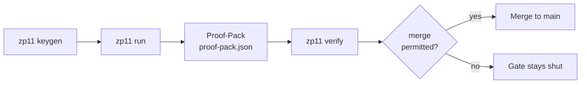

Each tutorial below is self-contained, but they are ordered the way you will actually use them. A quick map of this guide:

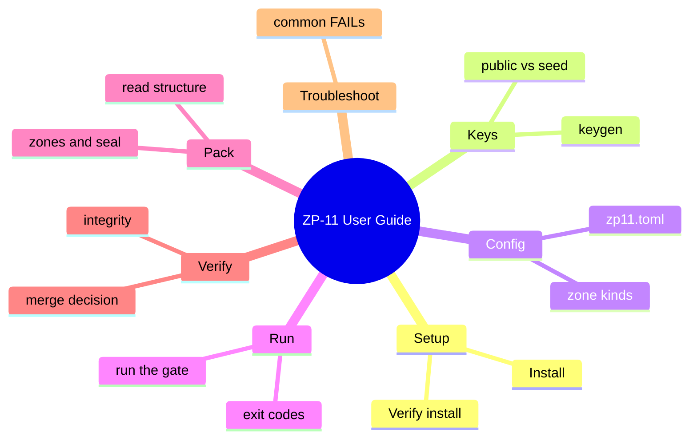

A note on reading order: if you only have five minutes, do Tutorial 1 (keys), Tutorial 3 (run), and Tutorial 5 (verify). The rest deepens your understanding.

The journey of a single change through this guide's tutorials, as a timeline:

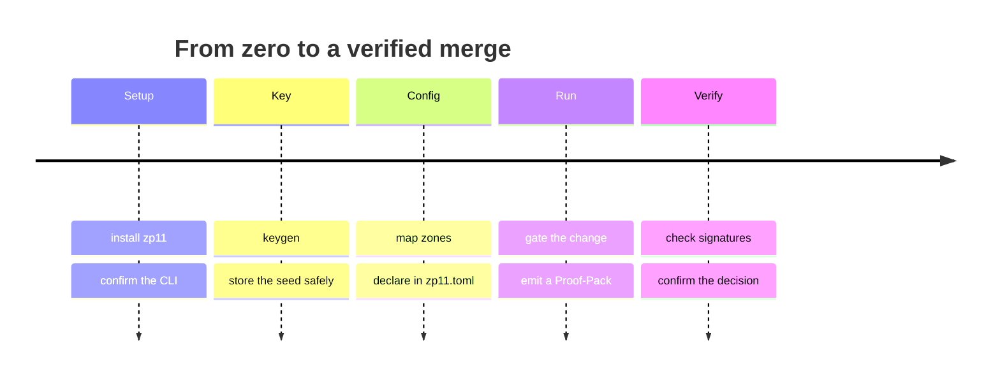

---

## 2. Installation and first check

### 2.1 Install

ZP-11's reference implementation is a small Python library with one third-party dependency (`cryptography`, for Ed25519). Install it from PyPI or from a checkout:

```bash
pip install zp11            # from the index
pip install -e .            # from a local clone of the repo
```

The install flow at a glance:

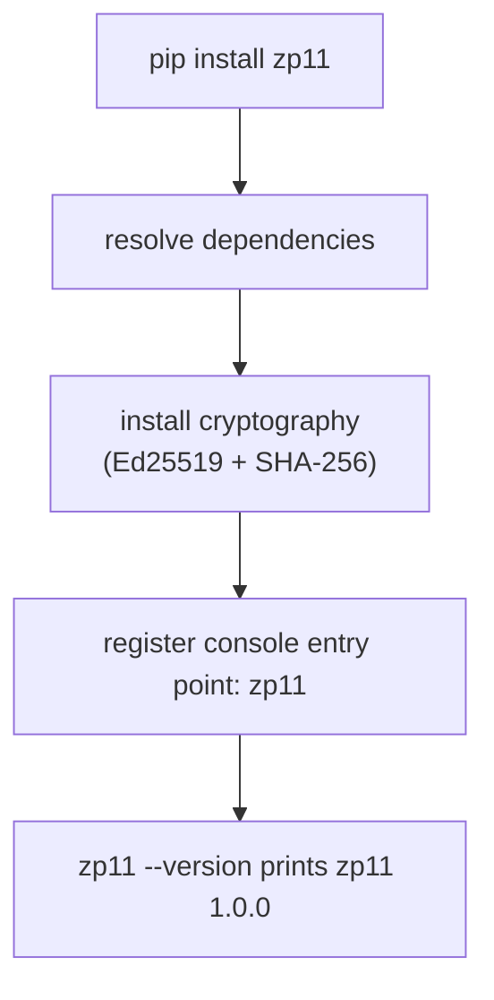

### 2.2 Confirm the CLI is present

```bash
zp11 --version
zp11 zones
```

The `zones` verb prints the eleven canonical zones. Their names and order are **fixed by the specification** — you cannot rename or reorder them, only map each to a check:

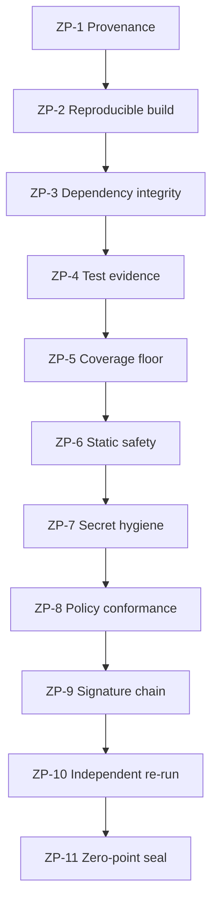

The four CLI verbs and what each one touches:

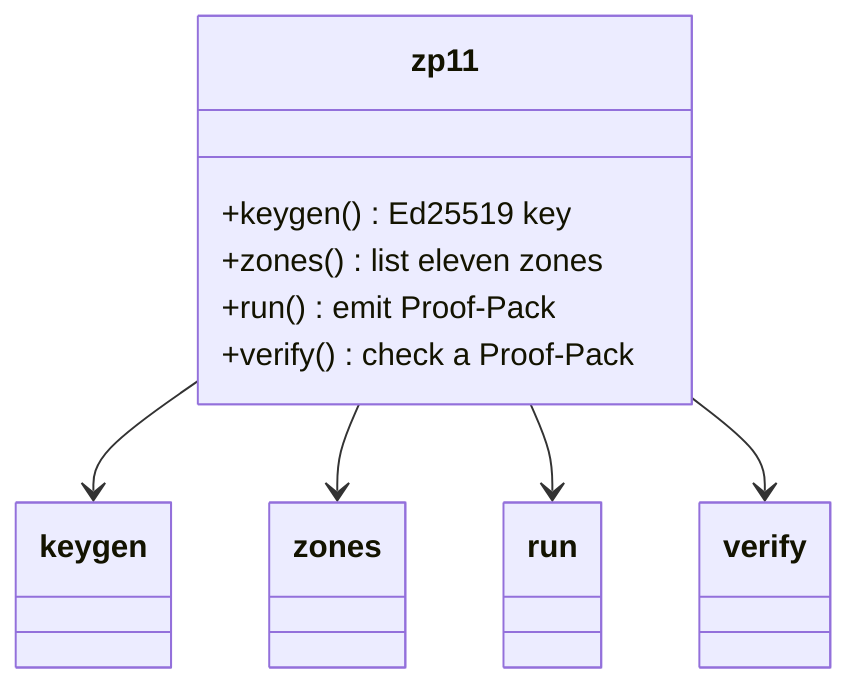

| Verb | Purpose | Exit 0 means |
|------|---------|--------------|
| `keygen` | Generate an Ed25519 signing key | key written |
| `zones` | List the eleven canonical zones | always |
| `run` | Run the gate, emit a Proof-Pack | sealed, all-PASS pack |
| `verify` | Check integrity, seal, and decision | merge permitted |

---

## 3. Tutorial 1 — Generate a signing key

Every verdict in ZP-11 is signed. An unsigned verdict can be forged after the fact, so the key is the root of trust for the whole pack. The `keygen` verb produces an Ed25519 keypair (RFC 8032).

### 3.1 The command

```bash
zp11 keygen --out ci.key
```

This writes two files: the **seed** to `ci.key` (your secret) and the **public key** to `ci.key.pub` (safe to share). The public key id is also printed to stdout. If you omit `--out`, the public id prints to stdout and the seed prints to stderr, so you can capture one without the other.

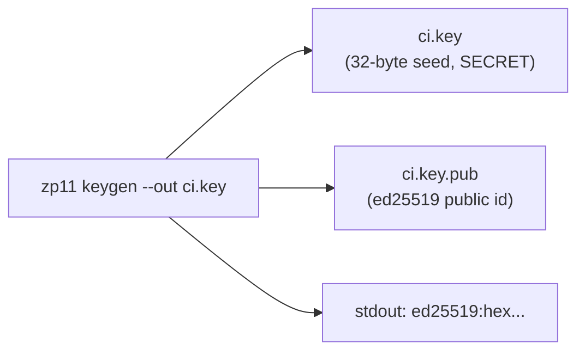

### 3.2 Seed versus public key

The seed is 32 raw bytes, stored as hex. From it the library derives the public key deterministically. The public id is printed as `ed25519:<hex of 32 raw bytes>` so a pack is self-describing — a verifier needs only the public half.

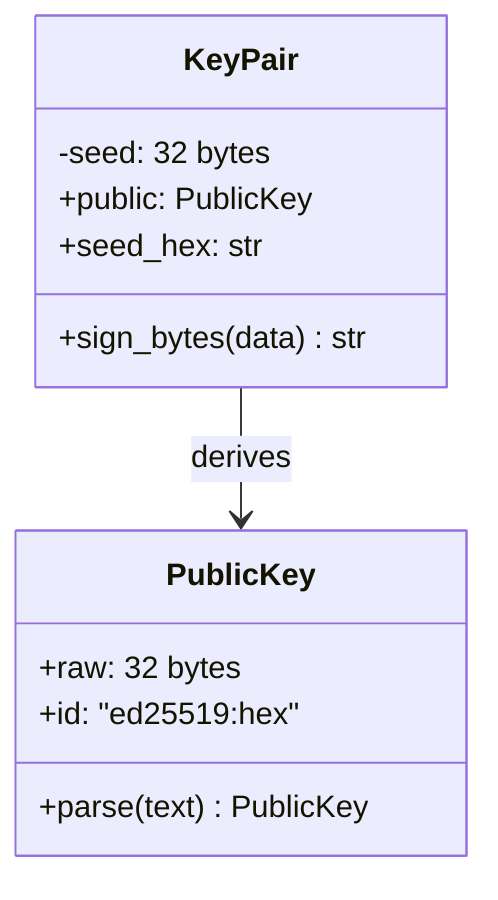

The lifecycle of a key, from creation to use and eventual rotation:

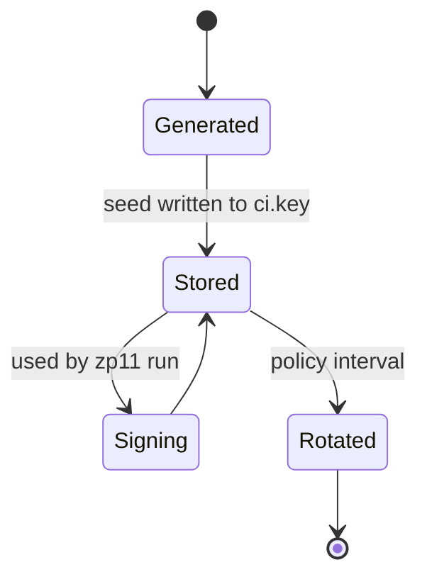

### 3.3 Handling the key safely

The specification is explicit: signing keys **must** be stored **outside** the gated repository and rotated per your policy. Treat `ci.key` the way you treat any production secret. Keeping the seed out of the repository is a matter of **policy and `.gitignore`**, not something you can delegate to the gate: the reference ZP-7 `secret_scan` only scans `["zp11/**/*.py", "*.md", "*.toml"]`, and a raw 64-hex Ed25519 seed falls below the 4.6 entropy floor and matches no fixed credential pattern, so ZP-7 is **not** guaranteed to catch a committed seed.

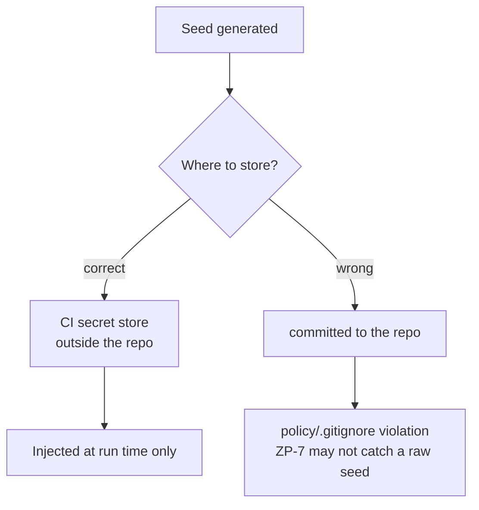

A common mistake and its consequence:

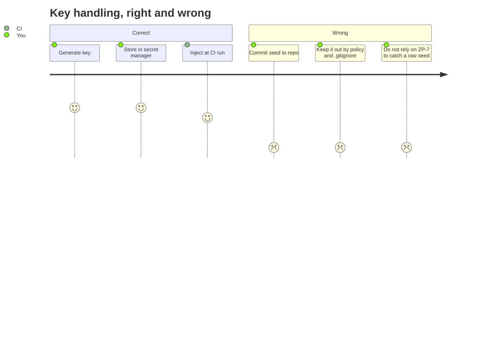

Who holds which half of the key, and what each half can do:

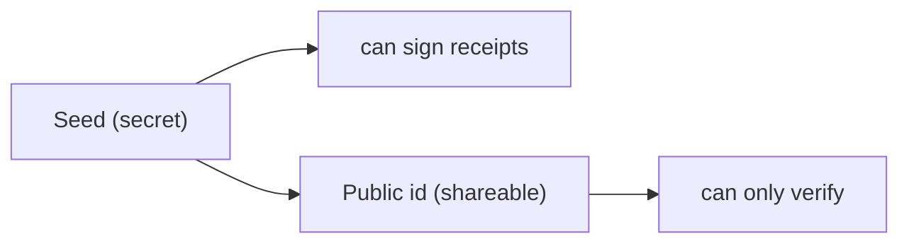

> **Tip.** For local experiments you can let `run` generate an ephemeral key automatically (omit `--key`). That is fine for learning, but a pack signed by a throwaway key cannot be verified by anyone else later — always pass `--key` for anything that matters.

---

## 4. Tutorial 2 — Map your zones (`zp11.toml`)

Before you run the gate you declare, in `zp11.toml`, which real check satisfies each zone. ZP-11 defines *verdicts, not vendors*: a zone is satisfied by any check that meets its normative requirement. The reference library offers five zone **kinds**.

### 4.1 The five zone kinds

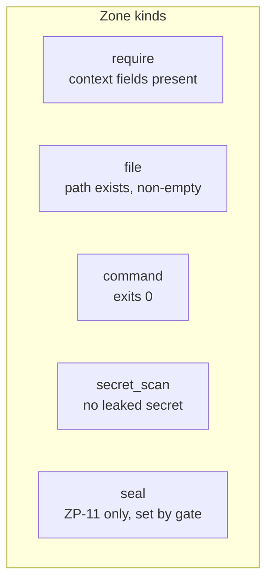

| Kind | Passes when | Evidence recorded |
|------|-------------|-------------------|
| `require` | every named field is present and non-empty | which fields present / missing |
| `file` | path exists and meets `min_bytes` | path, size, `sha256` digest |
| `command` | command exits with `expect_code` (default 0) | command, exit code, output digest |
| `secret_scan` | no pattern or high-entropy token matched | count scanned, finding locations |
| `seal` | every prior zone PASSed | zones passed / total |

### 4.2 How a kind becomes a verdict

Each kind reduces to exactly `PASS` or `FAIL`. There is no third outcome:

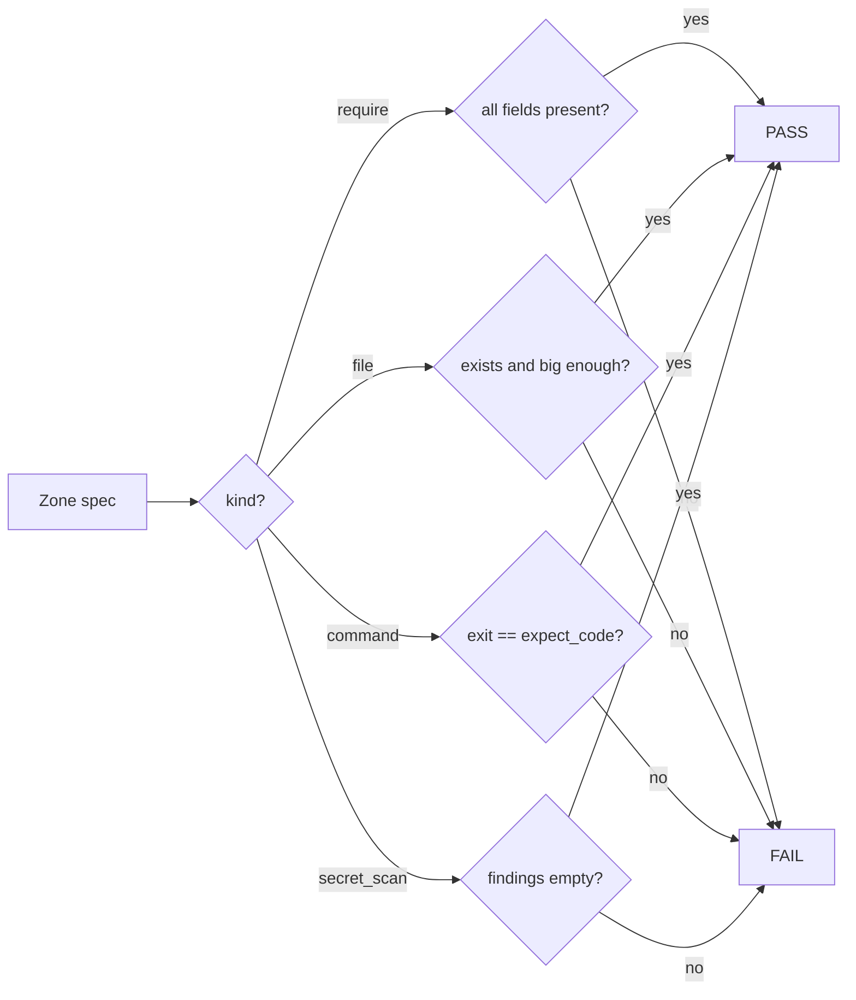

### 4.3 A worked configuration

This is the configuration ZP-11 uses on itself — the standard dogfoods its own gate. Each zone maps to a check the repository can already run:

```toml
[change]
id = "self"
source_commit = "HEAD"
builder = "github-actions/zp11-reference"

[zones.ZP-4]
title = "Test evidence"
kind = "command"
command = "python -m pytest -q"

[zones.ZP-7]
title = "Secret hygiene"
kind = "secret_scan"
paths = ["zp11/**/*.py", "*.md", "*.toml"]

[zones.ZP-11]
title = "Zero-point seal"
kind = "seal"
```

The mapping from the eleven zones to concrete checks in this repository:

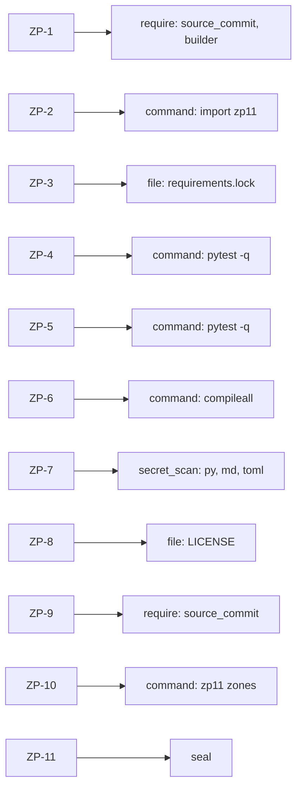

The config is read as TOML and expanded into an ordered list of zone objects:

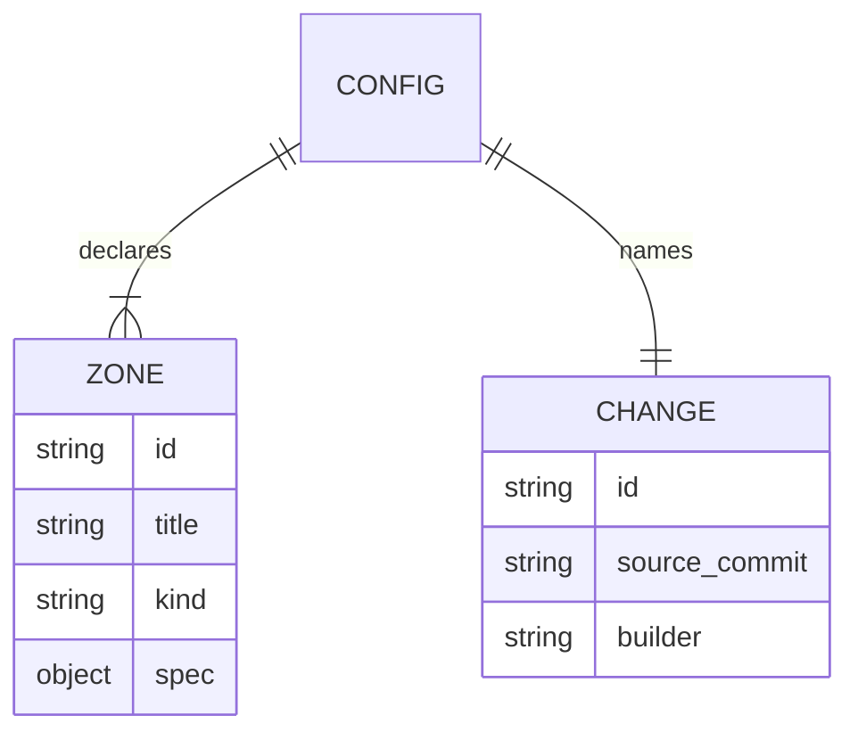

> **Note.** An unimplemented zone must map to a check that returns `FAIL`. You can never leave a zone undefined and still obtain a sealed pack — the gate requires all eleven present to seal.

---

## 5. Tutorial 3 — Run the gate

Now the central action: run every zone against a change and emit a Proof-Pack.

### 5.1 The command

```bash
zp11 run --key ci.key --out proof-pack.json
```

Options you will reach for most:

| Flag | Meaning |
|------|---------|
| `--config` | path to the TOML config (default `zp11.toml`) |
| `--root` | repository root to evaluate (default `.`) |
| `--key` | signing seed file; omitted means an ephemeral key |
| `--out` | where to write the pack; omitted prints to stdout |
| `--now` | pin the timestamp for reproducible runs |

### 5.2 What happens inside `run`

The gate loads the config, builds the ordered zone list, runs ZP-1 through ZP-10, then derives ZP-11 from whether every prior zone passed, and finally signs the whole receipt chain:

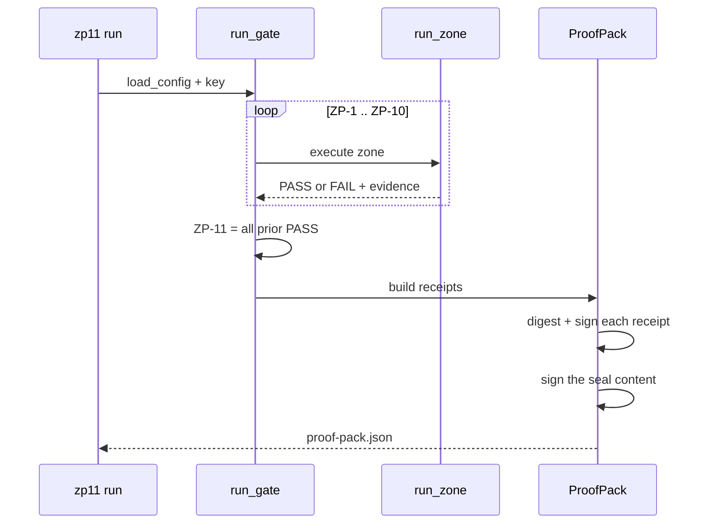

The gate's decision as a state machine — note that any `FAIL`, crash, or timeout lands in the same shut state:

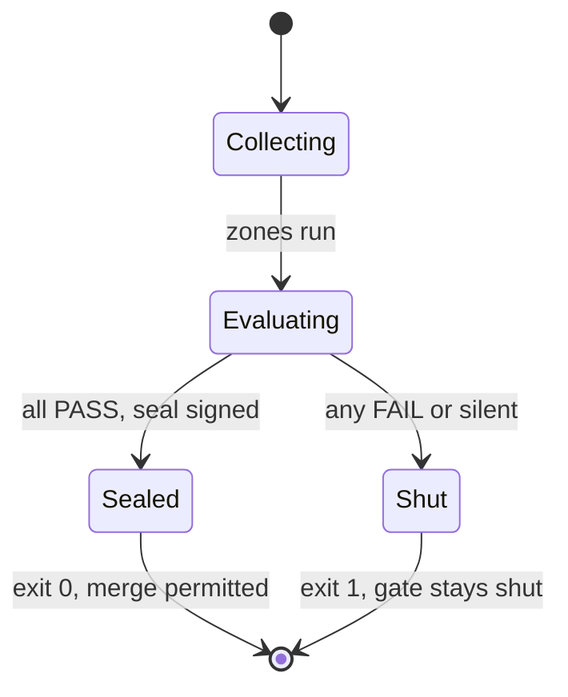

### 5.3 The exit code is the contract

`run` exits `0` only for a sealed, all-PASS pack, and non-zero otherwise. That single property is what makes the CLI safe to wire as a required status check — a required check that exits non-zero blocks the merge by construction.

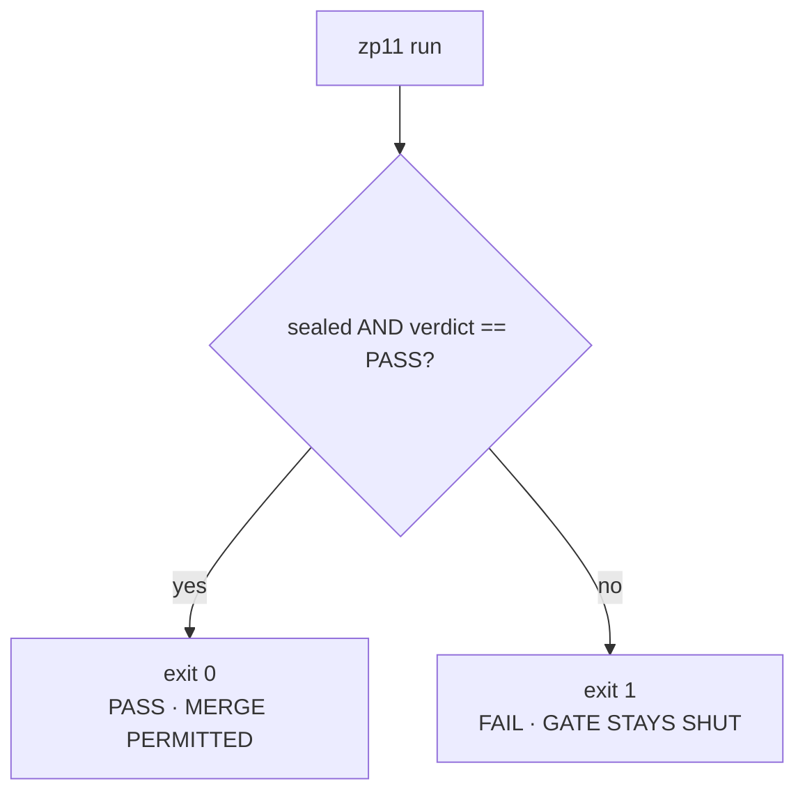

### 5.4 Fail-closed in action

Suppose a test fails. ZP-4 returns `FAIL`; the gate still emits a pack (as evidence of *why* it stayed shut), but it is never sealed:

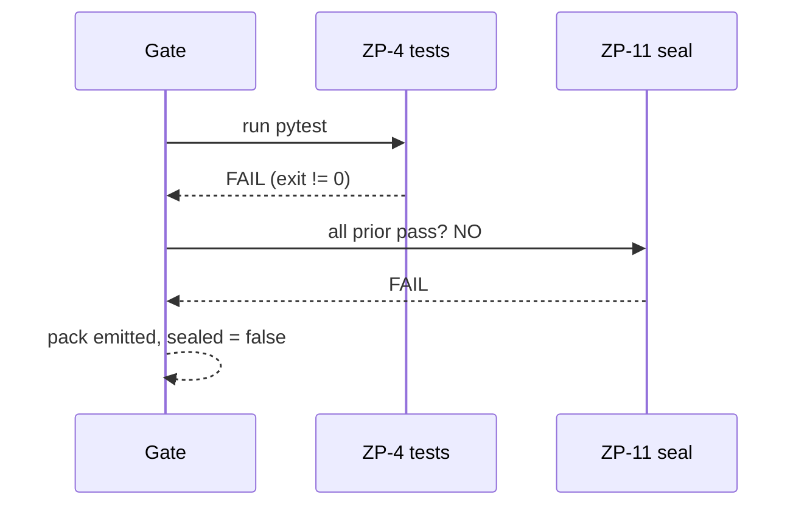

The asymmetry that defines the standard — evidence opens the gate; everything else closes it:

```mermaid
flowchart LR
    E["Affirmative evidence"] --> O["Gate may open"]
    X1["Crash"] --> C["Gate stays shut"]
    X2["Timeout"] --> C
    X3["Missing file"] --> C
    X4["Unparseable output"] --> C
    X5["Silence"] --> C
```

### 5.5 Reproducible runs

Pin `--now` and keep inputs identical, and the same change yields the same pack content and digests. This is how ZP-2 (reproducible build) and ZP-10 (independent re-run) are testable at all:

```mermaid
flowchart LR
    A["run #1<br/>--now fixed"] --> D1["digest X"]
    B["run #2<br/>--now fixed<br/>clean host"] --> D2["digest X"]
    D1 --> EQ{"equal?"}
    D2 --> EQ
    EQ -->|yes| OK["reproducible"]
    EQ -->|no| NO["ZP-2 / ZP-10 FAIL"]
```

---

## 6. Tutorial 4 — Read a Proof-Pack

A Proof-Pack is one self-describing JSON document. You can read it with any JSON tool; this section explains every field so you know what you are looking at.

### 6.1 Top-level shape

```json
{
  "standard": "zp11/v1",
  "created": "2026-11-25T00:00:00Z",
  "change": { "id": "self", "source_commit": "HEAD", "builder": "..." },
  "zones": [ { "id": "ZP-1", "title": "...", "verdict": "PASS",
               "evidence": { }, "digest": "sha256:...",
               "signature": "ed25519:..." } ],
  "seal": { "verdict": "PASS", "sealed": true, "zones_passed": 11,
            "zones_total": 11, "key": "ed25519:...", "signature": "ed25519:..." }
}
```

The structure as an entity model:

```mermaid
erDiagram
    PROOFPACK ||--|| CHANGE : names
    PROOFPACK ||--|{ RECEIPT : contains
    PROOFPACK ||--|| SEAL : "closed by"
    PROOFPACK {
      string standard
      string created
    }
    RECEIPT {
      string id
      string title
      string verdict
      object evidence
      string digest
      string signature
    }
    SEAL {
      string verdict
      bool sealed
      int zones_passed
      int zones_total
      string key
      string signature
    }
```

### 6.2 The fields, one by one

| Field | Meaning |
|-------|---------|
| `standard` | always `zp11/v1`; a verifier rejects versions it does not recognize |
| `created` | RFC 3339 UTC timestamp |
| `change.id` / `source_commit` / `builder` | what was gated, and by whom |
| `zones[]` | one receipt per zone, in canonical order |
| `seal` | the ZP-11 decision over the whole chain |

A single receipt's anatomy:

```mermaid
flowchart LR
    B["body:<br/>id, title, verdict, evidence"] --> H["digest =<br/>sha256 of canonical(body)"]
    H --> S["signature =<br/>Ed25519 over (body + digest)"]
```

### 6.3 Reading the evidence block

Evidence differs by zone kind. A `command` zone records its exit code and an output digest; a `file` zone records a size and `sha256`; a `secret_scan` records only the *locations* of findings, never the secret material itself.

```mermaid
mindmap
  root(("evidence"))
    require
      required
      missing
      present
    file
      path
      bytes
      sha256
    command
      command
      exit_code
      output_sha256
    secret_scan
      scanned
      findings (locations only)
      clean
```

### 6.4 Reading the seal

The seal summarises the decision: `verdict`, whether it is `sealed`, the `zones_passed` / `zones_total` counters, the public `key`, and the seal `signature`. A pack where `zones_passed == zones_total` but `sealed == false` is not a pass — the seal must also be present.

```mermaid
flowchart TD
    S["seal"] --> V{"verdict == PASS?"}
    V -->|no| N["not mergeable"]
    V -->|yes| C{"sealed == true?"}
    C -->|no| N
    C -->|yes| P["mergeable (if signatures verify)"]
```

### 6.5 Why receipts cannot be shuffled

The seal signs the ordered list of receipt digests together with the change. Reorder, add, or remove a receipt and the seal signature no longer verifies. A pack cannot be assembled from receipts that never shared a gate:

```mermaid
sequenceDiagram
    participant A as Attacker
    participant P as Pack
    participant V as Verifier
    A->>P: reorder receipts
    V->>V: rebuild seal_content from receipts
    V->>V: verify seal signature
    V-->>A: INVALID (digest order changed)
```

---

## 7. Tutorial 5 — Verify a Proof-Pack

Verification is the payoff: anyone, anywhere, can confirm the gate's decision from the pack and a public key, with no access to the original CI.

### 7.1 The command

```bash
zp11 verify proof-pack.json --key ci.key.pub
```

If you omit `--key`, the verifier falls back to the public key embedded in the pack — convenient, but you only gain independent assurance when you supply a key you trust out-of-band. The verifier prints a structured report and exits `0` only when merge is permitted.

```json
{
  "integrity_ok": true,
  "merge_permitted": true,
  "zones_passed": 11,
  "zones_total": 11,
  "reasons": []
}
```

### 7.2 The four verification steps

A verifier must (1) confirm all eleven zones are present in strict mode, (2) recompute each receipt digest and verify its signature, (3) reconstruct the seal content and verify the seal signature, and (4) confirm every verdict is `PASS` and `sealed` is true. Merge is permitted if and only if all four succeed.

```mermaid
flowchart TD
    S1["1. all 11 zones present?"] -->|no| F["refuse merge"]
    S1 -->|yes| S2["2. digests + receipt signatures OK?"]
    S2 -->|no| F
    S2 -->|yes| S3["3. seal signature OK?"]
    S3 -->|no| F
    S3 -->|yes| S4["4. all PASS and sealed?"]
    S4 -->|no| F
    S4 -->|yes| OK["merge permitted"]
```

The same flow as a signed-exchange sequence:

```mermaid
sequenceDiagram
    participant U as You
    participant V as verify_pack
    participant K as Public key
    U->>V: pack + key
    V->>V: recompute each digest
    V->>K: verify each receipt signature
    V->>V: reconstruct seal_content
    V->>K: verify seal signature
    V->>V: all PASS and sealed?
    V-->>U: VerifyReport (merge_permitted)
```

### 7.3 The decision object

`verify` returns a `VerifyReport` with `ok` (integrity), `merge_permitted`, the counters, and a list of human-readable `reasons`. When something is wrong, `reasons` tells you exactly what.

```mermaid
classDiagram
    class VerifyReport {
      +ok: bool
      +merge_permitted: bool
      +zones_passed: int
      +zones_total: int
      +reasons: list
    }
```

### 7.4 No key, no trust

A verifier **must** default to refusing merge when no public key is available. Without a key, signatures cannot be checked, so the pack's claims are unverified:

```mermaid
flowchart LR
    P["pack"] --> Q{"key available?"}
    Q -->|no| R["reason: no public key<br/>merge refused"]
    Q -->|yes| C["check signatures"]
```

### 7.5 Strict versus partial

Strict mode (the default) requires all eleven zones. `--partial` relaxes the all-zones requirement for inspection, but a partial pack is never a release decision — use it only for debugging:

```mermaid
stateDiagram-v2
    [*] --> Strict
    Strict --> AllPresent: 11 zones required
    [*] --> Partial
    Partial --> Inspect: subset allowed, debug only
    AllPresent --> Decision
    Inspect --> NotADecision
```

### 7.6 Tamper detection, concretely

Change a single byte of evidence after the fact and the receipt digest no longer matches; verification fails with a `digest mismatch` reason:

```mermaid
flowchart TD
    A["edit one evidence byte"] --> B["stored digest unchanged"]
    B --> C["verifier recomputes digest"]
    C --> D{"recomputed == stored?"}
    D -->|no| E["FAIL: digest mismatch<br/>(evidence altered)"]
```

---

## 8. Understanding verdicts and fail-closed behaviour

The whole standard turns on one rule: a zone emits exactly `PASS` or `FAIL`, and everything else collapses to `FAIL`. There is no third state that lets a change through.

```mermaid
flowchart LR
    I["zone outcome"] --> M{"provable PASS?"}
    M -->|yes| P["PASS"]
    M -->|raise| N["FAIL"]
    M -->|timeout| N
    M -->|no verdict| N
    M -->|unparseable| N
```

The two-value verdict type, in code terms:

```mermaid
classDiagram
    class Verdict {
      PASS
      FAIL
      +__bool__() bool
    }
    note for Verdict "PASS is truthy, FAIL is falsy"
```

How verdicts aggregate into the seal — one `FAIL` anywhere closes the gate:

```mermaid
flowchart TD
    V1["ZP-1 .. ZP-10 verdicts"] --> AND{"all PASS?"}
    AND -->|yes| SEAL["ZP-11 PASS, sealed"]
    AND -->|no| SHUT["ZP-11 FAIL, not sealed"]
```

Why advisory checks and fail-closed gates differ — the core inversion ZP-11 makes:

```mermaid
flowchart LR
    subgraph Advisory
      A1["check warns"] --> A2["merge proceeds anyway"]
    end
    subgraph FailClosed["ZP-11 fail-closed"]
      B1["no sealed PASS"] --> B2["merge blocked"]
    end
```

---

## 9. Zone-by-zone walkthrough

A short tour of what each zone proves and the evidence it leaves behind. Full normative detail lives in the zones reference; this is the hands-on view.

### 9.1 Provenance and integrity (ZP-1, ZP-3, ZP-9)

```mermaid
flowchart LR
    Z1["ZP-1 Provenance<br/>signed commit + builder"] --> Z3["ZP-3 Dependency integrity<br/>pinned + hashed"]
    Z3 --> Z9["ZP-9 Signature chain<br/>receipts chain to a key"]
```

### 9.2 Build and reproducibility (ZP-2, ZP-10)

```mermaid
flowchart TD
    Z2["ZP-2 Reproducible build"] --> R["same output digest on re-run"]
    Z10["ZP-10 Independent re-run"] --> I["second isolated runner agrees"]
    R --> T["together: deterministic, non-colluding"]
    I --> T
```

### 9.3 Test and coverage (ZP-4, ZP-5)

```mermaid
sequenceDiagram
    participant G as Gate
    participant T as pytest
    G->>T: run declared tests
    T-->>G: results attached (ZP-4)
    G->>G: changed-line coverage >= floor? (ZP-5)
```

### 9.4 Safety and hygiene (ZP-6, ZP-7)

```mermaid
flowchart LR
    Z6["ZP-6 Static safety<br/>no new finding above severity"] --> OK1["PASS"]
    Z7["ZP-7 Secret hygiene<br/>no key or token in diff"] --> OK2["PASS"]
```

### 9.5 Policy and seal (ZP-8, ZP-11)

```mermaid
flowchart TD
    Z8["ZP-8 Policy conformance<br/>policy-as-code satisfied"] --> Z11["ZP-11 Zero-point seal"]
    Z11 --> F{"all prior PASS?"}
    F -->|yes| SEAL["sealed"]
    F -->|no| SHUT["not sealed"]
```

The full run as one ordered pipeline:

```mermaid
flowchart LR
    S["change"] --> P1["ZP-1"] --> P2["ZP-2"] --> P3["ZP-3"] --> P4["ZP-4"] --> P5["ZP-5"]
    P5 --> P6["ZP-6"] --> P7["ZP-7"] --> P8["ZP-8"] --> P9["ZP-9"] --> P10["ZP-10"] --> P11["ZP-11 seal"]
```

A typical end-to-end timeline of a single gated change:

```mermaid
gantt
    title One gated change, wall-clock view
    dateFormat HH:mm
    axisFormat %H:%M
    section Collect
      Load config         :a1, 00:00, 1m
      Run ZP-1..ZP-3      :a2, after a1, 2m
    section Evidence
      Run ZP-4..ZP-7      :a3, after a2, 5m
      Run ZP-8..ZP-10     :a4, after a3, 3m
    section Seal
      Derive ZP-11 + sign :a5, after a4, 1m
      Verify              :a6, after a5, 1m
```

---

## 10. Putting it together — the daily loop

In practice you will wire `run` as a required status check and `verify` as an independent gate. The loop a contributor sees:

```mermaid
journey
    title A contributor's day with ZP-11
    section Propose
      Open a change: 4: Dev
      CI runs zp11 run: 3: CI
    section Decide
      All zones PASS: 5: Gate
      Pack sealed and signed: 5: Gate
    section Merge
      verify exits 0: 5: Reviewer
      Merge to main: 5: Dev
```

The evolution of a change through the gate — from draft to merged, or back to the author:

```mermaid
stateDiagram-v2
    [*] --> Draft
    Draft --> Gating: open change
    Gating --> Sealed: all zones PASS
    Gating --> Rejected: any FAIL
    Rejected --> Draft: fix and retry
    Sealed --> Verified: verify exits 0
    Verified --> Merged
    Merged --> [*]
```

Making the gate blocking is a four-step adoption path; ZP-11 is additive, so you run it alongside your existing pipeline first:

```mermaid
flowchart LR
    A["1. Declare zones"] --> B["2. Emit a pack per change"]
    B --> C["3. Re-run to verify (ZP-10)"]
    C --> D["4. Make the gate blocking"]
```

Where each artifact lives and flows:

```mermaid
flowchart TD
    CFG["zp11.toml"] --> RUN["zp11 run"]
    KEY["ci.key (secret store)"] --> RUN
    RUN --> PACK["proof-pack.json"]
    PUB["ci.key.pub"] --> VER["zp11 verify"]
    PACK --> VER
    VER --> MERGE["merge decision"]
```

---

## 11. Troubleshooting

Most problems are the gate working correctly — it is supposed to stay shut. This table maps the `reasons` you will see to their cause and fix.

| Reason in report | Cause | Fix |
|------------------|-------|-----|
| `missing zones: ...` | not all eleven zones declared | add the missing zones to `zp11.toml` |
| `ZP-n: digest mismatch` | evidence altered after signing | re-run the gate; do not hand-edit packs |
| `ZP-n: bad or missing signature` | wrong key, or unsigned receipt | verify with the matching public key |
| `seal signature invalid` | receipts changed, or wrong key | re-run; check the key id |
| `no public key available` | no `--key` and none in pack | supply a trusted public key |
| `fail-closed: ... did not pass` | a zone genuinely failed | read that zone's evidence |

A decision tree for a `run` that exits non-zero:

```mermaid
flowchart TD
    A["run exits 1"] --> B{"which zone FAILed?"}
    B --> C["read zones[i].evidence"]
    C --> D{"command zone?"}
    D -->|yes| E["check exit_code + output_sha256"]
    D -->|no| F{"secret_scan?"}
    F -->|yes| G["inspect findings locations"]
    F -->|no| H["check file path / required fields"]
```

A decision tree for a `verify` that refuses merge:

```mermaid
flowchart TD
    A["verify refuses"] --> B{"reasons include a key problem?"}
    B -->|yes| C["supply correct public key"]
    B -->|no| D{"digest or seal mismatch?"}
    D -->|yes| E["pack was altered; re-run the gate"]
    D -->|no| F["a zone did not pass; fix the change"]
```

How to triage any gate outcome in a single pass:

```mermaid
flowchart TD
    O["gate outcome"] --> E0{"exit 0?"}
    E0 -->|yes| V["verify, then merge"]
    E0 -->|no| R["open the pack"]
    R --> Z["find the FAIL zone"]
    Z --> EV["read its evidence"]
    EV --> FIX["fix the change or config, re-run"]
```

The one thing that is never a bug: a crash or timeout yielding `FAIL`. That is the standard's defining asymmetry doing its job.

```mermaid
flowchart LR
    X["zone crashed or timed out"] --> Y["recorded as FAIL with error type"]
    Y --> Z["gate stays shut — by design"]
```

Common local-run gotchas:

```mermaid
mindmap
  root(("Troubleshooting"))
    Keys
      wrong public key
      ephemeral key not shareable
    Config
      zone missing
      unknown kind to FAIL
    Evidence
      hand-edited pack
      stale timestamp
    Verify
      no key supplied
      partial mode misused
```

---

## 12. Quick reference

The commands you will run most, in order:

```bash
zp11 keygen --out ci.key                      # 1. make a key
zp11 run --key ci.key --out proof-pack.json   # 2. gate the change
zp11 verify proof-pack.json --key ci.key.pub  # 3. verify the decision
```

The mental model in one picture — evidence in, signed decision out, verifiable by anyone:

```mermaid
flowchart LR
    IN["change + config + key"] --> GATE["ZP-11 gate"]
    GATE --> OUT["signed Proof-Pack"]
    OUT --> ANY["anyone + public key"]
    ANY --> DEC["merge permitted ⟺ sealed PASS"]
```

The trust boundary, finally, in one relationship diagram:

```mermaid
erDiagram
    KEYPAIR ||--|| PUBLICKEY : "publishes"
    KEYPAIR ||--o{ RECEIPT : "signs"
    PUBLICKEY ||--o{ RECEIPT : "verifies"
    RECEIPT ||--|| SEAL : "chained into"
    PUBLICKEY ||--|| SEAL : "verifies"
```

ZP-11 gives you exactly one promise, and it is a modest one: **no evidence, no merge**. It is not a product, not a bug-free guarantee, and not a substitute for human review — it is an open standard for proving, reproducibly, that your own checks actually ran and actually passed. The reference library and this guide are released under the MIT License by iQs Group Inc. / SADI AI Inc., and the standard was invented and authored by **Naquib Hatami**.

---

## Related documents

- `06-api-cli-reference.md` — complete reference for every CLI verb, flag, and exit code.
- `10-zones-reference.md` — normative, zone-by-zone detail for all eleven zones.
- `07-crypto-design.md` — canonicalisation (RFC 8785), Ed25519 signing, and digest construction.
- `13-conformance.md` — how to confirm an implementation is conformant and re-runnable.
- `15-operations-runbook.md` — running, rotating keys, and operating the gate in CI.
