# Related Work

*Part of the ProofGate ZP-11 documentation set.*

> **Abstract.** ProofGate ZP-11 (`zp11/v1`) is an open, fail-closed release-governance standard invented by **Naquib Hatami** and published under the MIT License by iQs Group Inc. / SADI AI Inc. It sits in a crowded field of supply-chain and release-integrity efforts — SLSA, in-toto, Sigstore, Software Bills of Materials (SBOM), and reproducible builds. This document situates ZP-11 against each of those, honestly. The thesis is narrow and defensible: the five neighbours each solve *a* problem (provenance framing, attestation plumbing, signing keys and transparency, inventory, bit-for-bit determinism), while ZP-11 contributes one thing they do not individually package — a **single, sealed, self-verifying gate decision** in which *absence of evidence is failure, never consent*, and every input is itself one of eleven fixed zones. ZP-11 does not replace its neighbours; it consumes them as evidence and renders exactly one verdict: `PASS` or `FAIL`.

---

## 1. The landscape ZP-11 enters

Release governance is not a single product category. It is a stack of partial solutions, each authored by a different community, each answering a different question. Before comparing, it is worth drawing the field as it actually is rather than as a marketing diagram would.

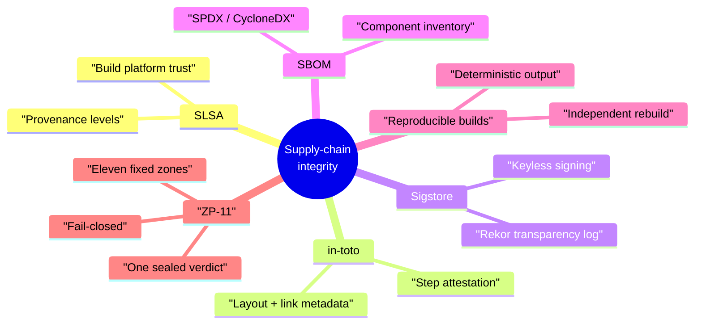

The fragmentation is the point. An organisation that adopts SLSA still needs an SBOM; one that signs with Sigstore still needs to decide what the signature *gates*. ZP-11's design question is the one that falls between the chairs: **given all of this evidence, does the merge happen or not, and can a stranger re-derive that answer from one file?**

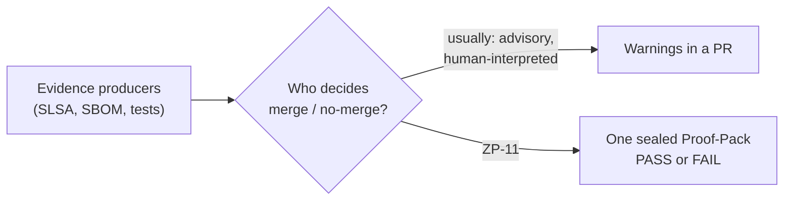

The distinction between **advisory** and **fail-closed** recurs throughout this document, so it is drawn once as a state model.

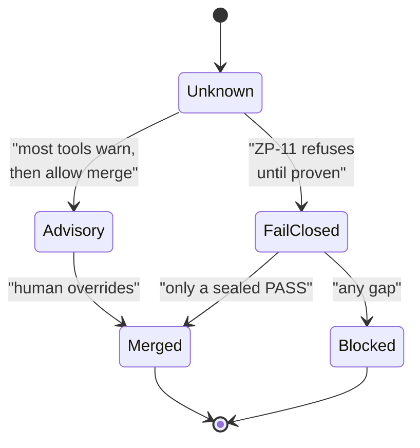

## 2. The shape of ZP-11 (recap for comparison)

To compare fairly, the reader needs the ZP-11 object model fresh in mind. Eleven zones feed eleven receipts; the eleventh zone — the seal — signs the ordered chain of the other ten.

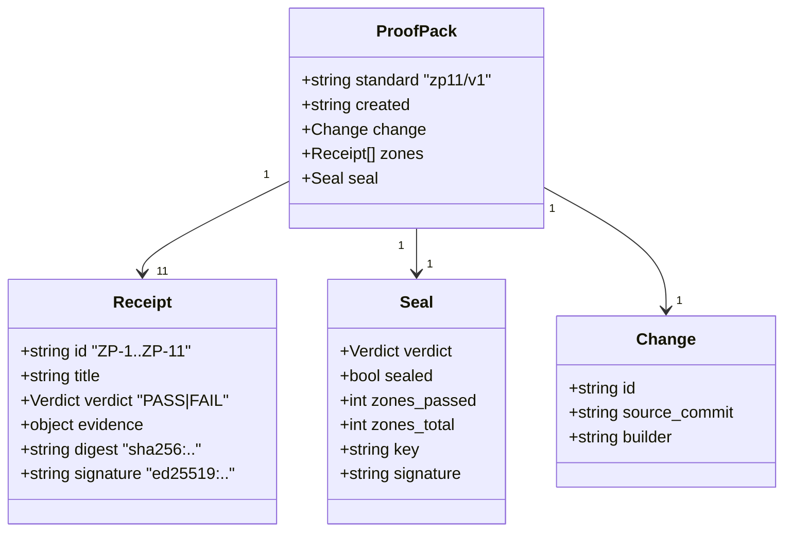

The eleven zones are fixed by the specification. Their names never change; a configuration may map a zone to any check meeting its normative requirement, and *must* map an unimplemented zone to a check that returns `FAIL`.

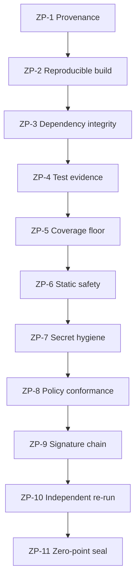

The seal is what makes the pack atomic. The relationship between a receipt digest and the seal signature is one-directional and ordered.

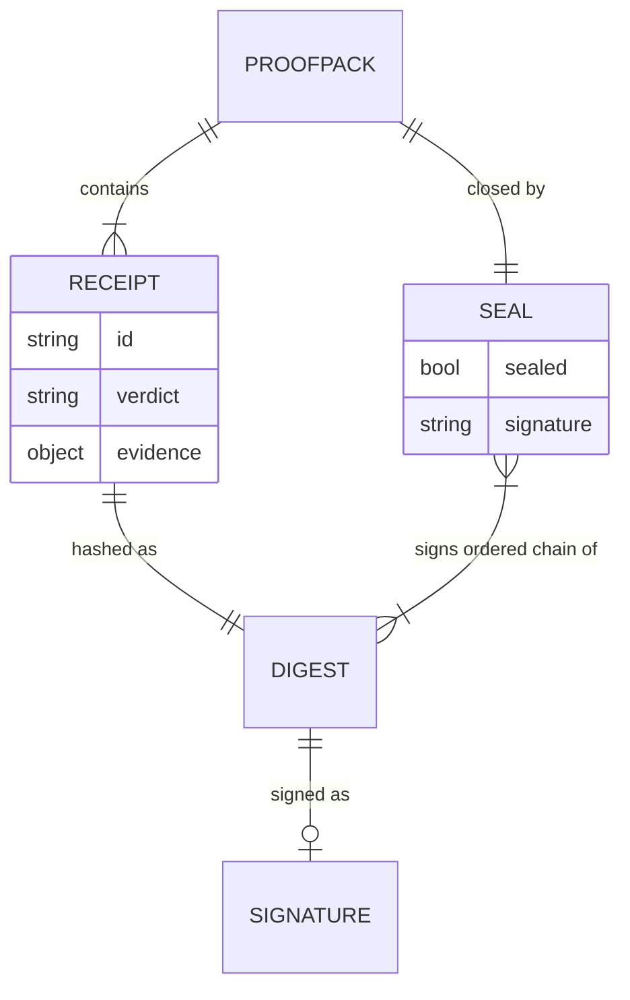

With that object in view, each neighbour can be measured against it.

## 3. ZP-11 versus SLSA

**SLSA** (Supply-chain Levels for Software Artifacts) is a framework of graduated requirements for build provenance and tamper-resistance. It defines *levels* — a ladder of how trustworthy a build platform's provenance is. SLSA is prescriptive about *what provenance should assert* and about hardening the build, but it is deliberately not a single runtime artifact you verify with one command; conformance is assessed against the level's requirements.

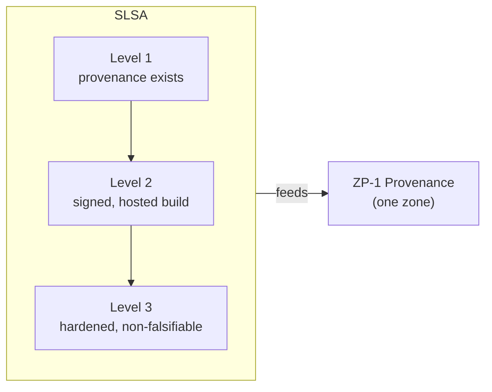

The honest relationship: SLSA's provenance is a natural **input to ZP-1 (Provenance)** and to ZP-2's reproducibility claim. SLSA answers "how trustworthy is the build platform's story about this artifact?" ZP-11 answers "do *all eleven* conditions hold, and is that packaged as one sealed decision?" They operate at different altitudes.

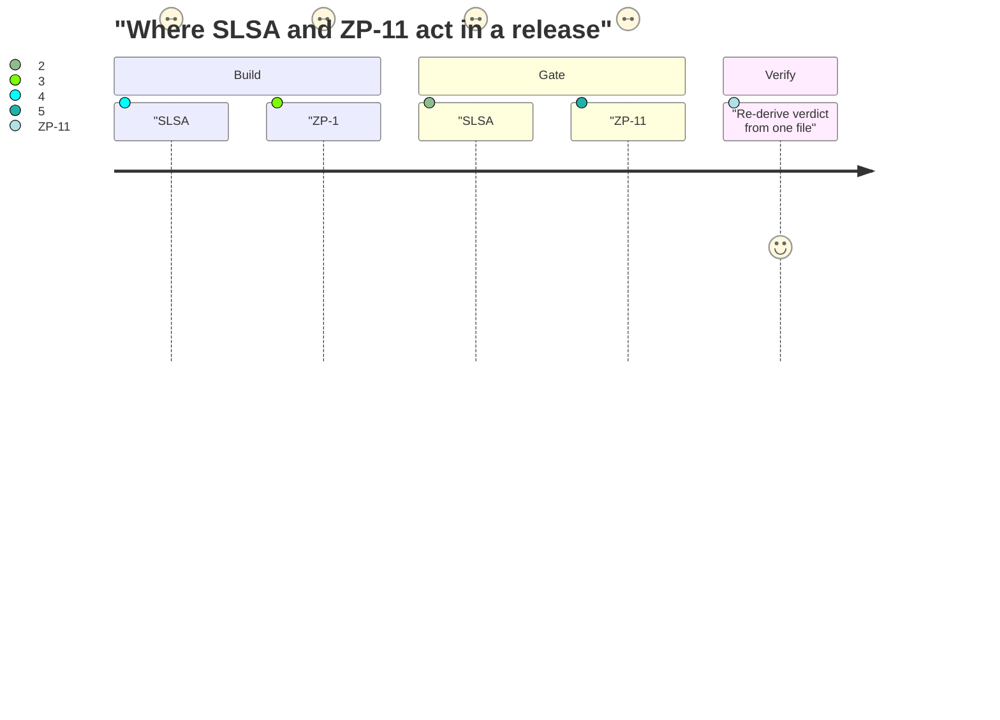

A side-by-side comparison:

| Dimension | SLSA | ZP-11 |
|-----------|------|-------|
| Primary unit | Provenance + build levels | Eleven zones + one sealed pack |
| Decision model | Framework / assessment | Fail-closed gate (`PASS`/`FAIL`) |
| Output | Provenance attestation | Self-verifying Proof-Pack |
| Scope | Build integrity | Whole-release governance |
| "Missing = ?" | Lower level | `FAIL` |
| Verify with | Varies by implementation | `zp11 verify pack.json` |

The difference that matters is the treatment of gaps. In a level ladder, a missing control lowers your *grade*; the artifact can still ship. In ZP-11 a missing control is a `FAIL`, and the gate stays shut.

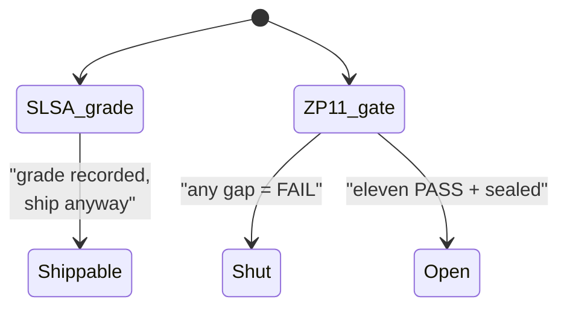

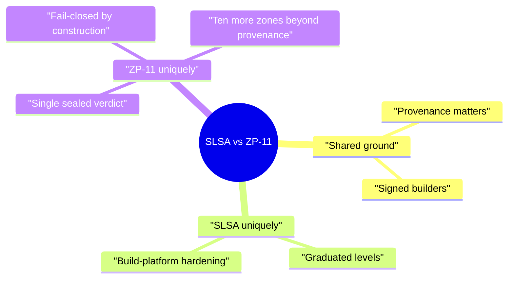

SLSA and ZP-11 compose cleanly: an adopter can satisfy ZP-1 *with* SLSA provenance and still owe the other ten zones to the gate.

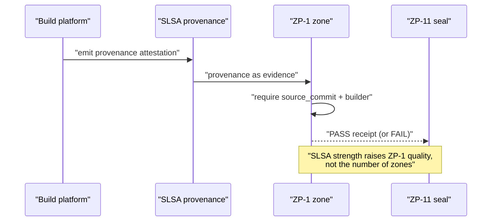

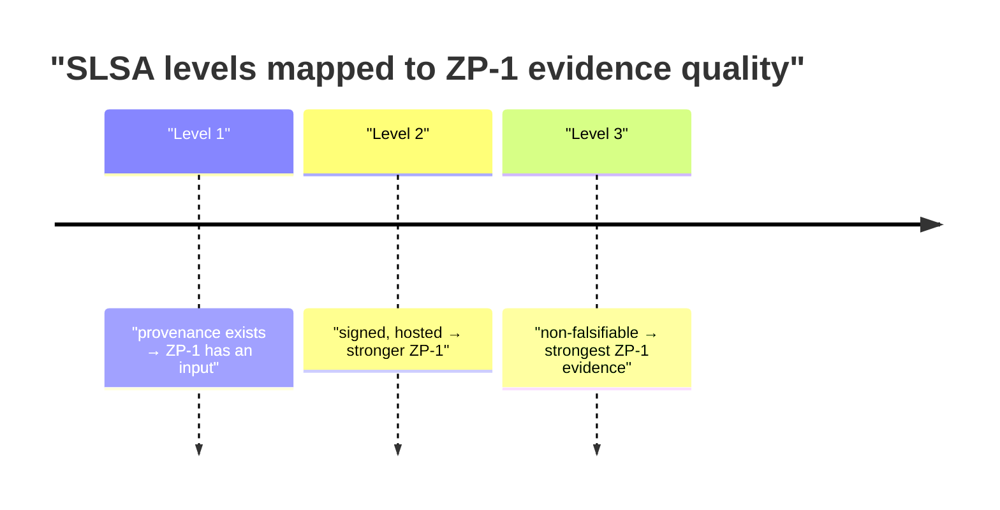

## 4. ZP-11 versus in-toto

**in-toto** is a framework for securing the integrity of a software supply chain by capturing each *step* in a signed *link* and binding the steps together with a *layout* defined by the project owner. It is, in a sense, the closest relative to ZP-11: both describe a chain of signed steps, and both let a verifier replay the chain.

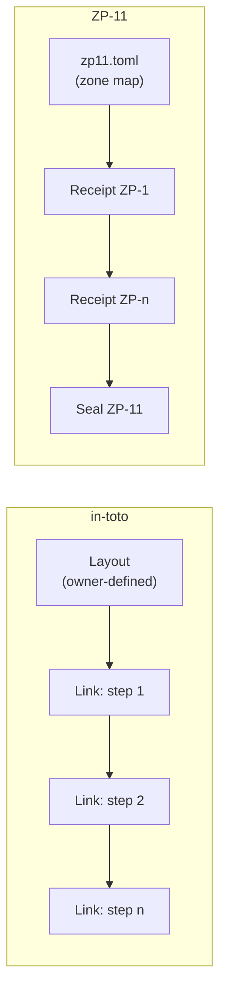

The structural parallel is real: in-toto's *layout* is analogous to ZP-11's zone configuration, and in-toto's *links* are analogous to ZP-11's receipts. Where they diverge is **fixity and semantics**.

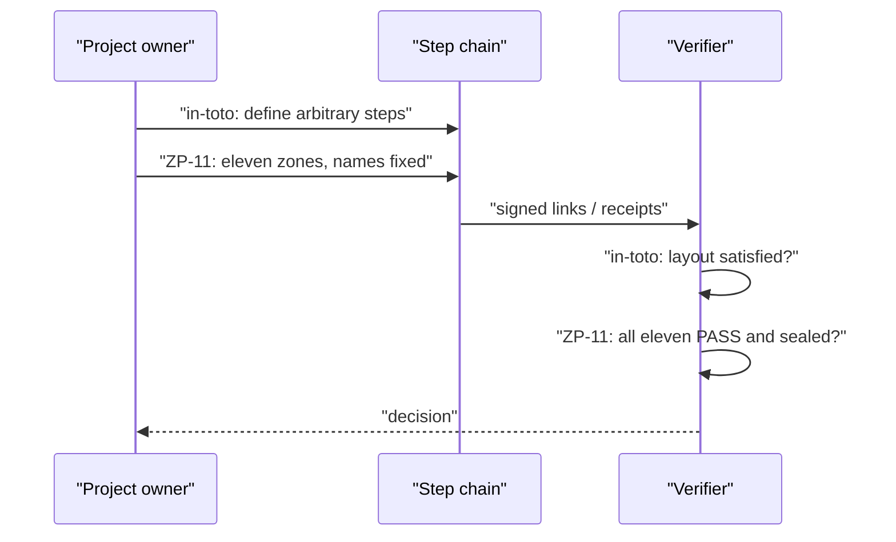

In-toto is a *mechanism*: it will faithfully carry whatever steps you declare, with whatever meaning you assign them. It does not tell you *which* eleven checks a release must survive, nor does it mandate that a missing step be fatal — that is a property of the layout you write. ZP-11 is opinionated where in-toto is neutral: the eleven zones are named by the standard, their order is fixed, and the fail-closed rule is in the verdict type itself, not in an author's discretion.

| Dimension | in-toto | ZP-11 |
|-----------|---------|-------|
| Steps | Owner-defined, arbitrary | Fixed eleven zones |
| Binding | Layout + links | Seal over ordered digest chain |
| Semantics of a gap | Depends on layout | Always `FAIL` |
| Opinion | Mechanism (neutral) | Standard (prescriptive) |
| Canonical form | Implementation-defined | RFC 8785 (JCS) mandated |
| Signatures | Pluggable | Ed25519 (RFC 8032) |

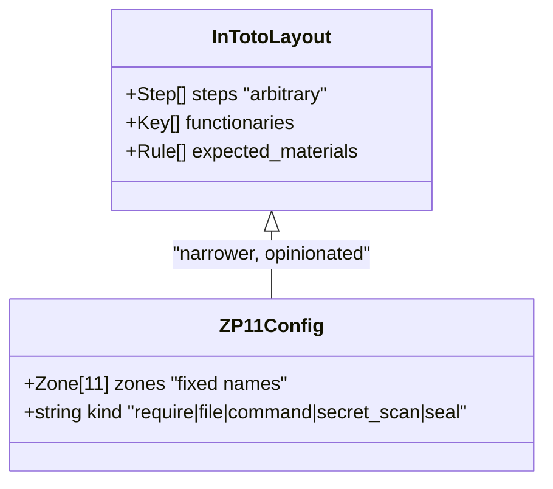

A fair summary: ZP-11 could in principle be *expressed* as a very specific in-toto layout, but the value ZP-11 adds is precisely that it removes the author's freedom to leave a gap non-fatal, and it fixes the eleven things that must be proven.

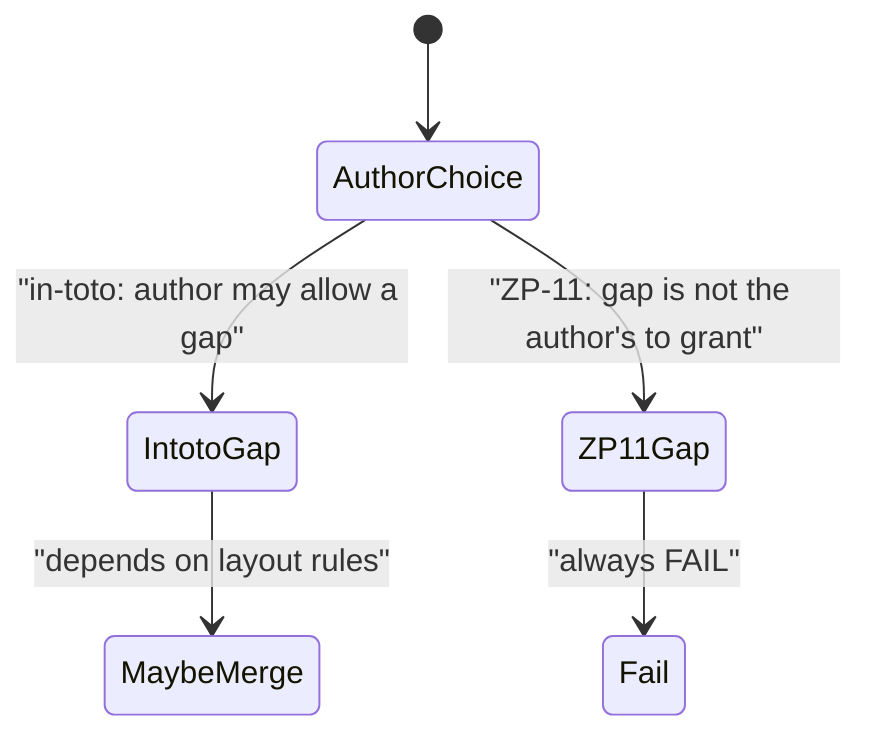

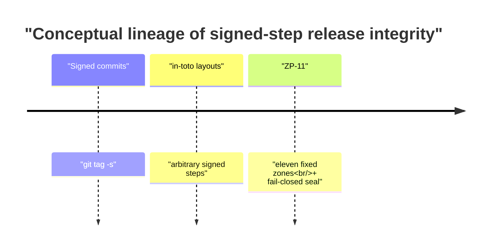

## 5. ZP-11 versus Sigstore

**Sigstore** solves the *key-management* problem of signing software: keyless signing tied to OIDC identities (Fulcio), with signatures recorded in a public transparency log (Rekor). Sigstore is about *how you sign and discover signatures*, not about *what the signature means for a release decision*.

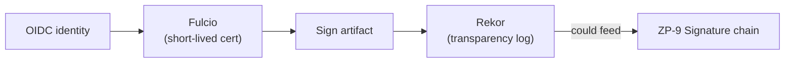

ZP-11, by contrast, specifies a concrete signing scheme itself: **Ed25519 over RFC 8785 canonical bytes**, with public keys encoded `ed25519:<hex>` so a pack is self-describing. The reference library handles keys as raw 32-byte values.

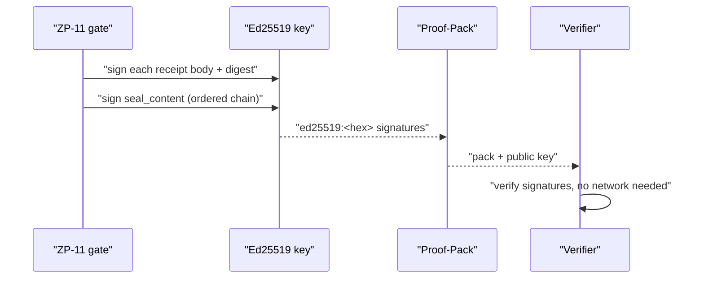

The relationship is **complementary, not competitive**. Sigstore could serve as the key and transparency infrastructure *behind* ZP-9 (Signature chain); ZP-11 does not mandate how the trusted key is provisioned or rotated — only that every receipt signs and chains to a trusted key, and that a verifier defaults to refusing merge when the key is unavailable.

| Dimension | Sigstore | ZP-11 |
|-----------|----------|-------|
| Concern | Key issuance + transparency | Release decision + seal |
| Signing | Keyless, OIDC-bound, logged | Ed25519, key-based, local-verify |
| Transparency log | Rekor (central) | None required; pack is portable |
| Offline verify | Needs log for full trust | Pack + public key is sufficient |
| What it gates | Nothing by itself | The merge |

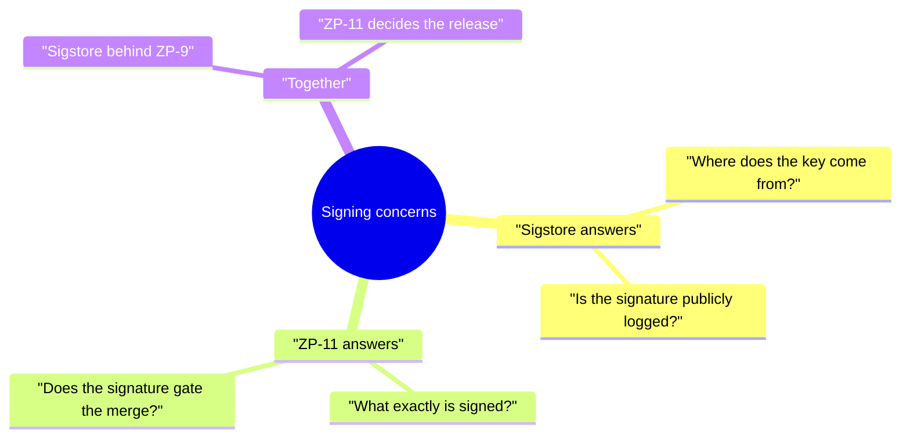

A deliberate design contrast: Sigstore leans on a central transparency log for discoverability; a ZP-11 Proof-Pack is **portable** — verifiable from the pack and a public key, with no access to the original CI or to a log server. The two models trade differently on the network-availability axis.

```mermaid
erDiagram
    SIGSTORE ||--|| FULCIO : "identity cert"
    SIGSTORE ||--|| REKOR : "transparency log"
    ZP11 ||--|| PUBLICKEY : "self-describing key"
    ZP11 ||--|| PROOFPACK : "portable, offline-verifiable"
    REKOR {
        string note "central, networked"
    }
    PROOFPACK {
        string note "no server required"
    }
```

```mermaid
stateDiagram-v2
    [*] --> SigstoreVerify
    SigstoreVerify --> NeedsLog: "full trust wants Rekor"
    [*] --> ZP11Verify
    ZP11Verify --> SelfContained: "pack + key only"
    SelfContained --> [*]
```

## 6. ZP-11 versus SBOM

A **Software Bill of Materials** (SPDX, CycloneDX) is an *inventory*: a list of the components and dependencies that make up a piece of software. An SBOM answers "what is in this build?" It is descriptive, not decisional — an SBOM never, by itself, refuses a merge.

```mermaid
flowchart LR
    Build["Build output"] --> SBOM["SBOM<br/>(SPDX / CycloneDX)"]
    SBOM --> List["Component list<br/>+ versions + licenses"]
    List -->|"evidence into"| Z3["ZP-3 Dependency integrity"]
    List -->|"evidence into"| Z8["ZP-8 Policy conformance"]
```

ZP-11's **ZP-3 (Dependency integrity)** has an adjacent but stricter job: every dependency must be *pinned and hashed and resolvable*. An SBOM that merely lists components is necessary context but not sufficient for ZP-3; ZP-3 wants the lock, not just the ledger. In the reference configuration, ZP-3 maps to a `file` check over `requirements.lock`.

```mermaid
classDiagram
    class SBOM {
        +Component[] components
        +string format "SPDX|CycloneDX"
        +License[] licenses
        +note "inventory, not a decision"
    }
    class ZP3_DependencyIntegrity {
        +string kind "file"
        +string file "requirements.lock"
        +int min_bytes
        +Verdict verdict "PASS|FAIL"
    }
    SBOM --> ZP3_DependencyIntegrity : "feeds evidence"
```

The honest framing: an SBOM and ZP-11 are not alternatives. An SBOM is a document type; ZP-11 is a gate. The SBOM is one of the inputs a mature ZP-3 or ZP-8 zone would consume.

```mermaid
stateDiagram-v2
    [*] --> HaveSBOM
    HaveSBOM --> Listed: "components known"
    Listed --> Pinned: "ZP-3: are they pinned + hashed?"
    Pinned --> ZP3Pass: "yes → PASS"
    Pinned --> ZP3Fail: "no → FAIL"
```

| Dimension | SBOM | ZP-11 |
|-----------|------|-------|
| Nature | Inventory document | Gate decision |
| Question answered | "What is inside?" | "May this merge?" |
| Enforces anything? | No (descriptive) | Yes (fail-closed) |
| Pinned + hashed deps | Not required by format | Required by ZP-3 |
| Signed decision | No | Yes (sealed pack) |

```mermaid
journey
    title "An SBOM's life vs a Proof-Pack's life"
    section Produced
      "SBOM generated": 4: SBOM
      "Proof-Pack sealed": 5: ZP-11
    section Consumed
      "SBOM scanned for CVEs later": 3: SBOM
      "Pack verified to permit merge now": 5: ZP-11
```

```mermaid
mindmap
  root(("Dependency assurance"))
    "SBOM gives"
      "Visibility"
      "License inventory"
    "ZP-3 demands"
      "Pinned"
      "Hashed"
      "Resolvable"
    "Gap"
      "A list is not a lock"
```

## 7. ZP-11 versus reproducible builds

**Reproducible builds** is the discipline of making a build *deterministic*: the same source, built again, yields a bit-for-bit identical output. It is a property of a build system, verified by independent rebuild and digest comparison.

```mermaid
sequenceDiagram
    participant S as "Source"
    participant B1 as "Builder A"
    participant B2 as "Builder B"
    S->>B1: "build"
    S->>B2: "build independently"
    B1-->>B2: "compare output digests"
    Note over B1,B2: "identical ⇒ reproducible"
```

ZP-11 absorbs this idea directly into **two** zones. **ZP-2 (Reproducible build)** requires that re-execution yields an identical output digest. **ZP-10 (Independent re-run)** requires that a *second, isolated runner* reproduces the verdict — the specification notes this exists specifically to detect a compromised primary runner, and the two runners should not share state.

```mermaid
flowchart TB
    subgraph RB["Reproducible builds (the discipline)"]
      D1["Deterministic toolchain"] --> D2["Identical output digest"]
    end
    RB --> Z2["ZP-2 Reproducible build<br/>(same digest on re-exec)"]
    RB --> Z10["ZP-10 Independent re-run<br/>(second isolated runner)"]
```

The relationship is **absorption**: reproducible builds is a prerequisite capability that two ZP-11 zones demand evidence of. But ZP-11 adds a dimension the discipline alone does not: it does not only ask "is the *build* reproducible?" — it asks "is the whole *verdict* reproducible by a stranger from one file?" That is the portability property of the Proof-Pack.

```mermaid
stateDiagram-v2
    [*] --> BuildOnce
    BuildOnce --> BuildAgain: "ZP-2 re-exec"
    BuildAgain --> SameDigest: "identical ⇒ PASS"
    BuildAgain --> DiffDigest: "differs ⇒ FAIL"
    SameDigest --> IndependentRunner: "ZP-10"
    IndependentRunner --> VerdictReproduced: "PASS"
    IndependentRunner --> VerdictDiverged: "FAIL (possible compromise)"
```

| Dimension | Reproducible builds | ZP-11 |
|-----------|--------------------|-------|
| Unit of determinism | Build output | Verdict + pack |
| Verified by | Independent rebuild | ZP-2 + ZP-10 zones |
| Detects runner compromise | Indirectly | Explicitly (ZP-10) |
| Portable decision | No | Yes (sealed pack) |

```mermaid
timeline
    title "From deterministic builds to a reproducible decision"
    "Deterministic output" : "reproducible builds"
    "Reproducible verdict" : "ZP-2 + ZP-10"
    "Portable sealed decision" : "ZP-11 Proof-Pack"
```

## 8. Synthesis: what each neighbour contributes to a ZP-11 gate

The fairest way to state ZP-11's relationship to the field is not "better than" but "integrates with". Each neighbour maps naturally onto one or more zones.

```mermaid
flowchart LR
    SLSA["SLSA provenance"] --> ZP1["ZP-1 Provenance"]
    RB["Reproducible builds"] --> ZP2["ZP-2 Reproducible build"]
    RB --> ZP10["ZP-10 Independent re-run"]
    SBOM["SBOM"] --> ZP3["ZP-3 Dependency integrity"]
    SBOM --> ZP8["ZP-8 Policy conformance"]
    Sig["Sigstore / PKI"] --> ZP9["ZP-9 Signature chain"]
    intoto["in-toto attestations"] --> ZP4["ZP-4 Test evidence"]
    ZP1 & ZP2 & ZP3 & ZP4 & ZP8 & ZP9 & ZP10 --> Seal["ZP-11 Seal"]
```

Three zones have **no external standard that directly supplies them**, which is where ZP-11's own opinion is doing load-bearing work rather than re-packaging a neighbour: ZP-5 (Coverage floor), ZP-6 (Static safety), and ZP-7 (Secret hygiene) are checks the standard requires but which the other five efforts do not mandate.

```mermaid
mindmap
  root(("Zone provenance"))
    "Supplied by neighbours"
      "ZP-1 from SLSA"
      "ZP-2 / ZP-10 from reproducible builds"
      "ZP-3 from SBOM + lock"
      "ZP-9 from Sigstore / PKI"
    "ZP-11's own insistence"
      "ZP-5 Coverage floor"
      "ZP-6 Static safety"
      "ZP-7 Secret hygiene"
      "ZP-11 Seal"
```

The composition is additive by design. The README states it plainly: ZP-11 runs alongside an existing pipeline, then becomes blocking once every zone is green.

```mermaid
flowchart LR
    A["1 · Map each ZP-n<br/>to a check"] --> B["2 · Emit a Proof-Pack<br/>per change"]
    B --> C["3 · Re-run to verify<br/>(ZP-10)"]
    C --> D["4 · Make the gate<br/>blocking"]
```

```mermaid
journey
    title "Adopting ZP-11 on top of existing tooling"
    section Observe
      "Run advisory, non-blocking": 4: Team
    section Fill gaps
      "Add coverage / SAST / secret zones": 3: Team
    section Enforce
      "Require sealed PASS to merge": 5: Team
```

## 9. Where the comparisons are *not* flattering to ZP-11

A related-work section that only lists strengths is propaganda, not engineering. Several honest limitations follow directly from ZP-11's scope and from the current reference implementation.

```mermaid
mindmap
  root(("Honest limits"))
    "Not an ecosystem"
      "No central log like Rekor"
      "No hosted identity like Fulcio"
    "Key management is the adopter's"
      "ZP-11 mandates the key, not its lifecycle"
    "Zones are only as strong as their checks"
      "A weak command zone = weak evidence"
    "Reference scanners are conservative"
      "ZP-7 accepts false negatives"
```

First, ZP-11 does **not** provide signing infrastructure. Sigstore's keyless model and Rekor's public log are genuine conveniences ZP-11 has no equivalent for; the standard requires keys be stored outside the gated repository and rotated per the adopter's policy, but it does not *provide* that lifecycle. This is a deliberate scope boundary, not an oversight — but it is a real gap relative to Sigstore.

```mermaid
stateDiagram-v2
    [*] --> KeyNeeded
    KeyNeeded --> Sigstore: "provides issuance + log"
    KeyNeeded --> ZP11: "assumes you already have a key"
    ZP11 --> AdopterPolicy: "rotation is your job"
```

Second, a zone is only as strong as the check behind it. ZP-11 fixes the eleven *questions*; it does not fix the rigour of each *answer*. A `command` zone that runs a token test suite will `PASS` ZP-4 with weak evidence. The standard protects against *silence* (a crashed or missing check is `FAIL`), not against a check that is honestly green but shallow.

```mermaid
flowchart LR
    Good["Rigorous check"] --> Strong["Strong PASS"]
    Weak["Shallow check"] --> Hollow["Hollow PASS"]
    Missing["No check / crash"] --> Fail["FAIL (fail-closed)"]
    classDef warn fill:#664,stroke:#cc8,color:#fff
    class Hollow warn
```

Third, the reference secret scanner (ZP-7) is explicitly conservative — it accepts false negatives so that *obvious* leaks cannot pass silently, but it is not a replacement for a dedicated secrets platform. The reference implementation is the normative oracle for conformance, not a claim of best-in-class detection.

```mermaid
sequenceDiagram
    participant Diff as "Diff / build output"
    participant Scan as "ZP-7 scanner"
    participant Pack as "Proof-Pack"
    Diff->>Scan: "scan for known patterns + entropy"
    Scan->>Scan: "obvious leak ⇒ FAIL"
    Scan->>Pack: "record locations only, never secrets"
    Note over Scan,Pack: "conservative: may miss novel formats"
```

Fourth, ZP-11 verifies a *decision*, not an *ecosystem*. It has no package registry, no attestation discovery service, no graph of who-depends-on-whom across organisations. SBOM tooling and Sigstore's log serve ecosystem-scale discovery; ZP-11 is deliberately scoped to one change entering one branch.

```mermaid
erDiagram
    ORG ||--|{ REPO : owns
    REPO ||--|{ CHANGE : receives
    CHANGE ||--|| PROOFPACK : "gated by one"
    PROOFPACK {
        string standard "zp11/v1"
        bool sealed
    }
    ORG {
        string note "ZP-11 does not model cross-org graphs"
    }
```

Stated plainly: if you need a cross-organisation transparency ecosystem, ZP-11 is not that, and does not try to be.

```mermaid
journey
    title "What ZP-11 deliberately leaves to others"
    section In scope
      "Decide one merge": 5: ZP-11
      "Seal the verdict": 5: ZP-11
    section Out of scope
      "Host identities": 1: Sigstore
      "Public transparency log": 1: Rekor
      "Ecosystem dependency graph": 1: SBOM tooling
```

## 10. The one property that is genuinely distinct

Having conceded the gaps, one claim survives honestly. None of the five neighbours, taken individually, delivers a **single self-verifying artifact whose default is refusal**. SLSA grades, in-toto replays a layout you authored, Sigstore proves who signed, SBOM lists, reproducible builds prove determinism. ZP-11's contribution is the *composition plus the asymmetry*: eleven fixed zones, one sealed pack, and a verdict type in which anything that is not an affirmative, reproducible `PASS` is `FAIL`.

```mermaid
flowchart TB
    Q["A change proposes to merge"] --> Gate{"ZP-1 … ZP-11"}
    Gate -->|"every zone PASS + sealed"| Permit["PASS · merge permitted"]
    Gate -->|"any FAIL, crash, timeout,<br/>missing, or unsealed"| Refuse["FAIL · gate stays shut"]
```

```mermaid
stateDiagram-v2
    [*] --> Collecting
    Collecting --> Evaluating: "zones run"
    Evaluating --> Sealed: "all PASS → seal"
    Evaluating --> Shut: "any FAIL"
    Sealed --> Verified: "digests + signatures OK"
    Verified --> [*]: "merge permitted"
    Shut --> [*]: "merge refused"
```

The asymmetry is not a policy toggle; it lives in the `Verdict` type, where `PASS` is truthy and everything else collapses to `FAIL`. That is what "fail-closed by construction" means, and it is the single sentence that distinguishes ZP-11 from a dashboard of green checkmarks.

```mermaid
classDiagram
    class Verdict {
        <<enumeration>>
        PASS
        FAIL
    }
    class coerce {
        +map(anything) Verdict
        +note "unknown / crash / silence → FAIL"
    }
    Verdict <.. coerce : "narrows to two states"
```

## 11. A feature-by-feature matrix

The full comparison, stated once, without superlatives:

| Capability | SLSA | in-toto | Sigstore | SBOM | Repro builds | **ZP-11** |
|------------|:----:|:-------:|:--------:|:----:|:------------:|:---------:|
| Provenance framing | ✅ | ◐ (via links) | — | — | — | ◐ (ZP-1) |
| Arbitrary signed steps | — | ✅ | — | — | — | — (fixed 11) |
| Keyless signing + log | — | — | ✅ | — | — | — |
| Component inventory | — | — | — | ✅ | — | ◐ (ZP-3 input) |
| Deterministic output | — | — | — | — | ✅ | ◐ (ZP-2) |
| Independent re-run | — | — | — | — | ◐ | ✅ (ZP-10) |
| Single sealed decision | — | ◐ | — | — | — | ✅ |
| Fail-closed by default | — | — | — | — | — | ✅ |
| Verify from one file + key | — | ◐ | — | — | — | ✅ |
| RFC 8785 canonicalisation | — | — | — | — | — | ✅ |

Legend: ✅ core capability · ◐ partial / possible / consumed as a zone input · — not in scope. No neighbour is "worse"; each simply scopes to a different problem.

```mermaid
mindmap
  root(("Fair verdict"))
    "ZP-11 is not a replacement"
      "It consumes the others as evidence"
    "ZP-11 is not an ecosystem"
      "No registry, no central log"
    "ZP-11 is distinctive in one way"
      "One sealed, fail-closed decision"
      "Re-derivable by a stranger"
```

## 12. Interoperability sketch

Because ZP-11 treats its neighbours as evidence producers, a realistic adoption wires them beneath the zones rather than choosing between them.

```mermaid
flowchart LR
    subgraph Producers
      SL["SLSA provenance"]
      SS["Sigstore signature"]
      SB["SBOM"]
      RB["Reproducible rebuild"]
      TS["Test + coverage runs"]
    end
    subgraph Gate["ZP-11 gate"]
      ZP1["ZP-1"]; ZP2["ZP-2"]; ZP3["ZP-3"]; ZP4["ZP-4"]; ZP5["ZP-5"]; ZP9["ZP-9"]; ZP10["ZP-10"]
    end
    SL --> ZP1
    RB --> ZP2
    RB --> ZP10
    SB --> ZP3
    TS --> ZP4
    TS --> ZP5
    SS --> ZP9
    Gate --> Seal["ZP-11 seal"]
    Seal --> Out["proof-pack.json"]
```

```mermaid
sequenceDiagram
    participant CI as "CI pipeline"
    participant N as "Neighbour tools"
    participant G as "zp11 run"
    participant V as "zp11 verify"
    CI->>N: "produce SLSA / SBOM / signatures"
    N-->>G: "evidence for zones"
    G->>G: "ZP-1..ZP-10, then seal"
    G-->>CI: "proof-pack.json (exit 0 iff sealed PASS)"
    CI->>V: "verify as a required status check"
    V-->>CI: "merge permitted ⟺ sealed PASS"
```

This is the quiet thesis of the whole document: ZP-11 is the *decision layer* that the evidence layers were always missing. The reference CLI (`zp11 keygen`, `zones`, `run`, `verify`) exposes exactly that decision and nothing more.

```mermaid
classDiagram
    class CLI {
        +keygen() "Ed25519 key"
        +zones() "list the eleven"
        +run() "emit Proof-Pack, exit 0 iff sealed PASS"
        +verify() "exit 0 iff merge permitted"
    }
    class ProofPack {
        +to_dict()
        +seal(keypair)
    }
    CLI --> ProofPack : "produces / verifies"
```

```mermaid
flowchart TB
    subgraph Lib["Reference library"]
      canon["canonical.py<br/>RFC 8785"]
      crypto["crypto.py<br/>Ed25519 / SHA-256"]
      verdict["verdict.py<br/>PASS / FAIL"]
      zones["zones.py<br/>zone kinds"]
      pack["pack.py<br/>Receipt, ProofPack, verify_pack"]
      gate["gate.py"]
      cli["cli.py"]
    end
    canon --> crypto --> pack
    verdict --> zones --> gate --> pack --> cli
```

```mermaid
timeline
    title "A change's path through a ZP-11-governed release"
    "Propose" : "change targets main"
    "Gather" : "neighbour evidence → zones"
    "Seal" : "ZP-11 signs the chain"
    "Verify" : "stranger re-derives PASS/FAIL"
    "Merge" : "iff sealed PASS"
```

## 13. Conclusion

ZP-11, invented by **Naquib Hatami** and published as an open MIT-licensed standard, does not compete with SLSA, in-toto, Sigstore, SBOM, or reproducible builds. It stands downstream of all of them and converts their output into one decision. Its distinctive contribution is the *shape* of that decision: eleven fixed zones, a single Ed25519-sealed pack over an RFC 8785 canonical chain, and a verdict type in which the absence of evidence is failure rather than consent. Where it is weaker — no signing ecosystem, no cross-organisation graph, checks only as strong as their configuration — the limitations follow honestly from a scope that was chosen, not stumbled into. The gate opens only on affirmative, reproducible, portable proof. Everything else stays shut.

```mermaid
flowchart LR
    Evidence["Neighbours produce evidence"] --> ZP["ZP-11 renders one verdict"]
    ZP -->|"PASS + sealed"| Merge["merge permitted"]
    ZP -->|"anything else"| Shut["gate stays shut"]
```

---

### Cross-references (sibling documents)

- [`01-whitepaper.md`](01-whitepaper.md) — the motivating argument and design philosophy.
- [`08-threat-model.md`](08-threat-model.md) — adversaries, trust boundaries, and why fail-closed.
- [`10-zones-reference.md`](10-zones-reference.md) — the eleven zones in normative detail.
- [`13-conformance.md`](13-conformance.md) — what makes an implementation conformant.
- [`14-cicd-integration.md`](14-cicd-integration.md) — wiring neighbour tools beneath the zones.
