*Part of the ProofGate ZP-11 documentation set*

# Glossary

ProofGate ZP-11 is a compact standard, but a compact standard rewards precision:
the same word means something exact in the specification, the reference library,
and the Proof-Pack on disk. This glossary defines every load-bearing term in
`zp11/v1` — the gate, the eleven zones, the verdict algebra, the Proof-Pack
structure, the cryptographic primitives, and the command-line surface — and
cross-references each definition to the others it depends on. ZP-11 was invented
and authored by **Naquib Hatami** and is published as an open standard under the
MIT License; the definitions here are drawn directly from `SPEC.md`, the
reference library under `zp11/`, and `schema/proof-pack.schema.json`. Where a
term has both an informal and a normative meaning, the normative meaning governs.

The glossary is organised so that foundational terms come first and composite
terms build on them. Read it top to bottom on a first pass; use the section
numbers and the sibling cross-references at the end to jump on later passes.

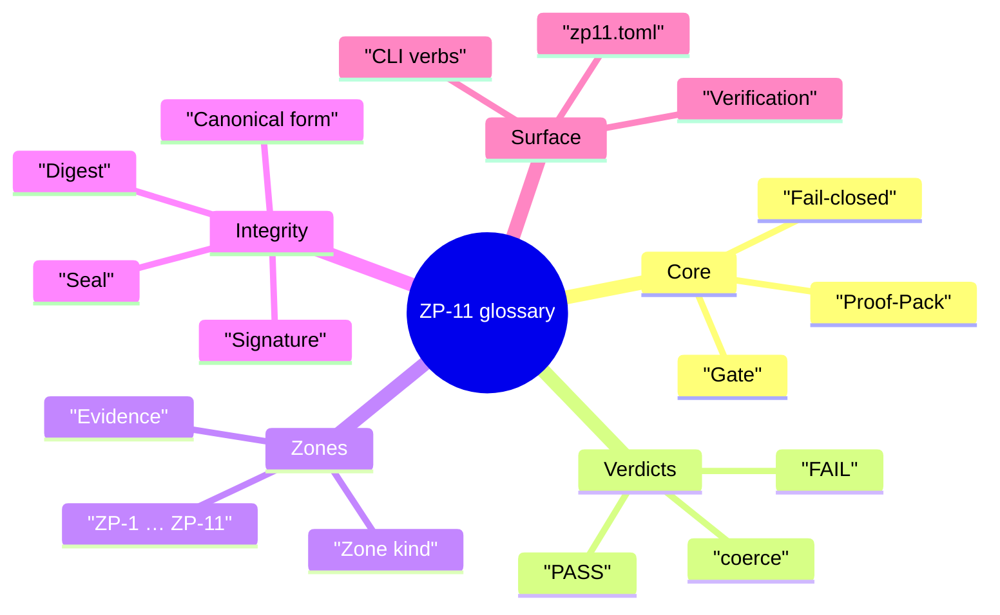

---

## 1. Core concepts

**ProofGate ZP-11.** The product name for the standard defined by `zp11/v1`: a
fail-closed release gate (§1.1) that sits between a proposed change and a
protected branch and emits a Proof-Pack (§4.1). "ProofGate" names the gate
behaviour; "ZP-11" names both the standard as a whole and its final zone, the
Zero-Point seal (§3.11). Context disambiguates: *the ZP-11 standard* versus *the
ZP-11 zone*.

**Standard (`zp11/v1`).** The versioned identifier of the specification,
recorded verbatim in the `standard` field of every Proof-Pack. A verifier
**MUST** reject a pack whose `standard` value it does not recognise. The string
is exactly `"zp11/v1"`; a backward-incompatible revision increments the version.

**Zero-Point.** The naming motif of the standard: every zone is a "Zero-Point
zone," and the final seal is the "Zero-Point seal." The phrase captures the
gate's starting assumption — a change begins at zero trust and must earn passage
through positive, reproducible evidence.

### 1.1 Fail-closed

**Fail-closed.** The defining property of the gate. The gate is *closed by
default* and opens only on affirmative evidence. Any ambiguity — a crash, a
timeout, a missing file, an unparseable result, or simple silence — resolves to
`FAIL` (§2). "Absence of evidence is treated as failure, never as consent." The
opposite posture, *fail-open* (warn then allow), is what most advisory checks do
and what ZP-11 explicitly inverts.

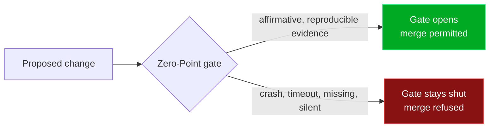

**Gate.** The component that composes the eleven zones. It runs ZP-1 through
ZP-10, derives ZP-11 from whether every prior zone returned `PASS`, signs each
receipt, and seals the pack. In the reference library this is `gate.py`
(`run_gate`, `build_zones`, `load_config`). The gate is the *only* place the
zones are composed; a zone never knows the gate's overall verdict.

**Merge permission.** The binary outcome the gate exists to decide. Merge is
permitted **if and only if** every zone returns `PASS` and the pack is sealed —
and, at verification time, the pack's digests and signatures check out against a
trusted public key (§5).

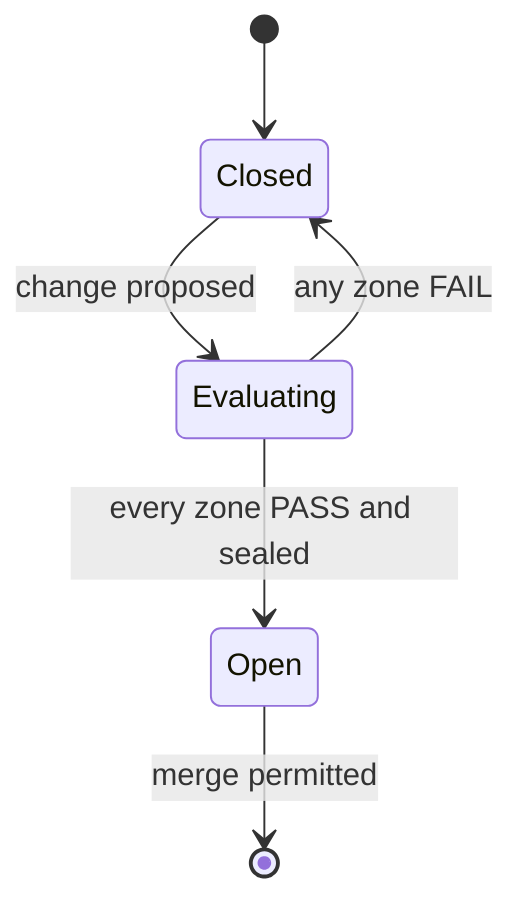

---

## 2. Verdict terms

**Verdict.** The result a zone emits. A zone **MUST** emit exactly one of two
values and no third value may permit merge. In `verdict.py`, `Verdict` is a
string enum whose `PASS` member is truthy and `FAIL` member is falsy, so a
verdict can be used directly in boolean logic.

**PASS.** The verdict a zone returns when it has *proved* its condition and
attached the evidence for that proof. `PASS` is the only verdict that advances a
change.

**FAIL.** The verdict for everything else. `FAIL` is returned on an explicit
failed check and is also the value that any error condition collapses to. There
is no severity gradation: a near-miss and a catastrophic crash both read `FAIL`.

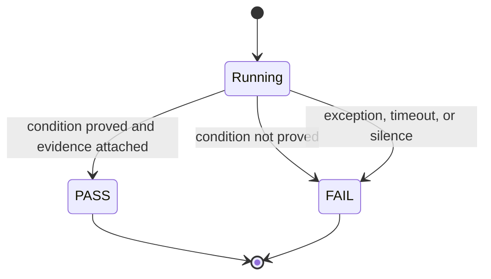

**coerce.** The function in `verdict.py` that maps *anything* a zone might
produce onto `PASS` or `FAIL`. The literal enum `PASS`, the string `"PASS"`
(case-insensitive, trimmed), and boolean `True` map to `PASS`; everything else —
including `None`, unparseable output, and unexpected types — maps to `FAIL`.
`coerce` is where "fail-closed by construction" is implemented in code.

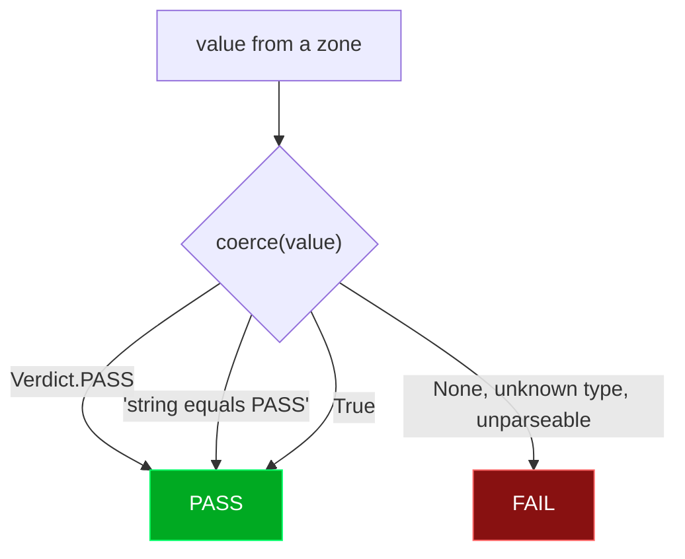

---

## 3. The eleven zones

**Zone.** An independent check with a defined input, a deterministic verdict,
and evidence that lands in the Proof-Pack. The eleven zones' names and ordering
are *fixed by the specification*; a configuration may map a zone to any check
that satisfies its normative requirement but **MUST** map an unimplemented zone
to a check that returns `FAIL`. In the library a `Zone` carries an `id`, a
`title`, a `kind` (§6.1), and a `spec`.

**Evidence.** The machine-readable record a zone attaches to justify its
verdict: the inputs it read, the tool (`zp11-ref`), the result, and — for the ten
verifying zones built through `_evi()` — the tool version (`1.0.0` in the reference
library). The ZP-11 seal evidence, built directly in `gate.py`, is the exception:
it carries `{kind, tool, zones_passed, zones_total, all_prior_pass}` and omits
`tool_version`, so that field is not present in every zone's evidence. Evidence **MUST NOT** contain
secret material — ZP-7 records only the *locations* of findings, never the
secrets themselves. The receipt digest (§4.3) is computed over the evidence, so
altering any evidence byte changes the digest.

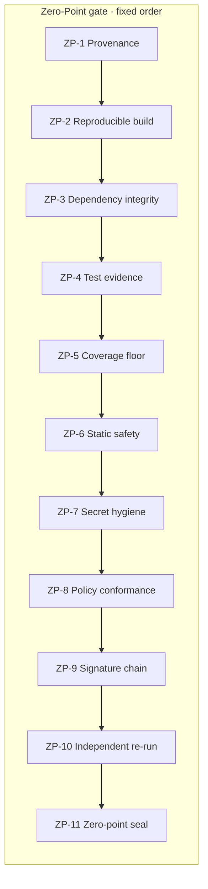

### 3.1 ZP-1 — Provenance

The change **MUST** reference a signed source commit and a named builder. ZP-1
answers *where did this artifact come from and who built it*. It is naturally
expressed as a `require` kind over the `change` context fields `source_commit`
and `builder`.

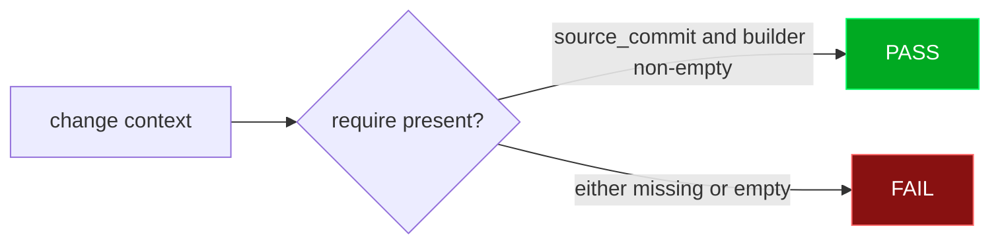

### 3.2 ZP-2 — Reproducible build

Re-execution **MUST** yield an identical output digest. ZP-2 answers *does the
build produce the same bytes twice*. A divergent digest between two runs is a
`FAIL`.

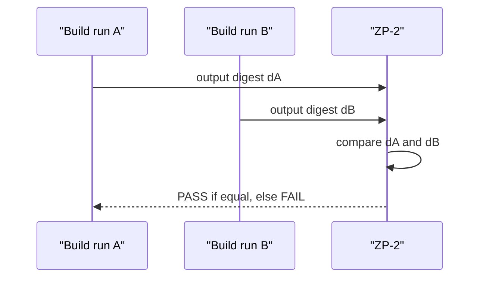

### 3.3 ZP-3 — Dependency integrity

Every dependency **MUST** be pinned and hashed. ZP-3 answers *is every input
dependency resolvable to an exact, verified version*. An unpinned or
hash-mismatched dependency is a `FAIL`.

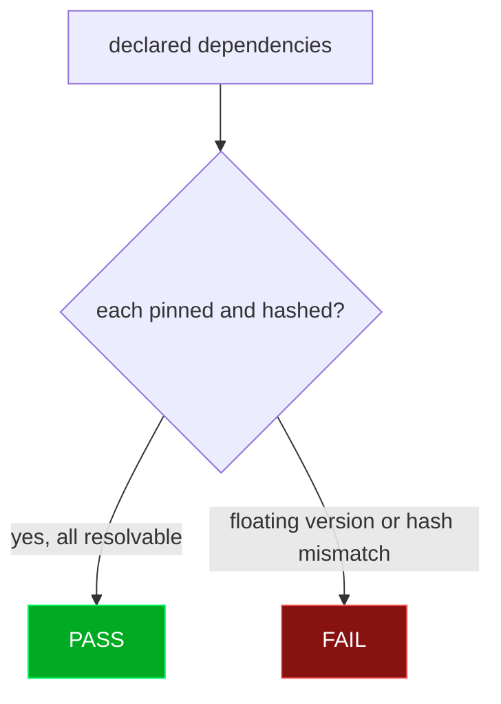

### 3.4 ZP-4 — Test evidence

Declared tests **MUST** have run and machine-readable results **MUST** be
attached. ZP-4 answers *did the tests actually execute*. It is typically a
`command` kind such as `python -m pytest -q`; a non-zero exit is a `FAIL`, and
the digest of the combined stdout and stderr becomes the evidence.

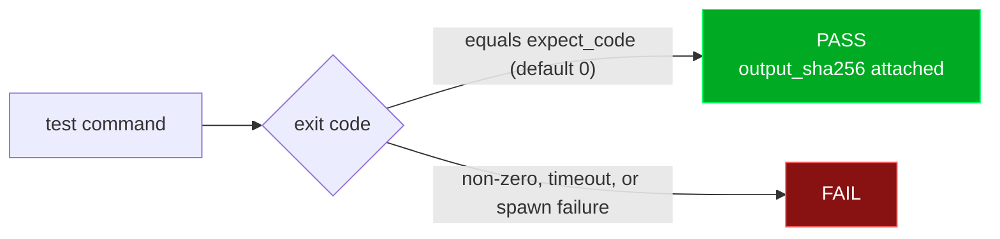

### 3.5 ZP-5 — Coverage floor

Changed lines **MUST** meet the repository's declared coverage threshold. ZP-5
answers *are the new lines exercised*. Coverage below the configured floor is a
`FAIL`.

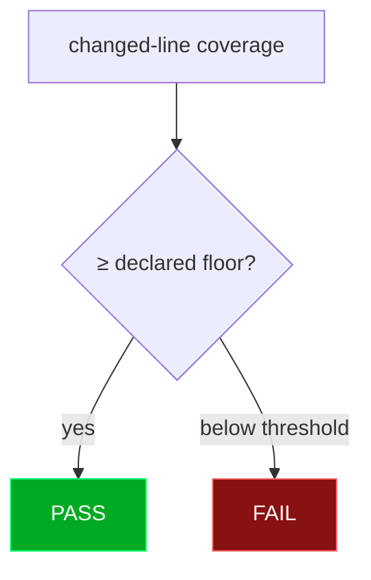

### 3.6 ZP-6 — Static safety

No new finding above the configured severity **MAY** be present. ZP-6 answers
*did static analysis surface a new high-severity issue*. One qualifying finding
is a `FAIL`.

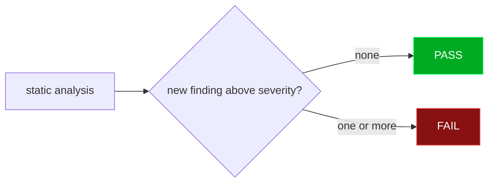

### 3.7 ZP-7 — Secret hygiene

No credential, key, or token **MAY** appear in the diff or build output. ZP-7 is
implemented as the `secret_scan` kind (§6.1): it scans the configured paths with
known-pattern detectors (private keys, AWS access-key ids, GitHub, Slack, and
generic API tokens) and a Shannon-entropy test (default floor `4.6`). Any
finding is a `FAIL`, and evidence records only each finding's *location and
rule*, never the secret.

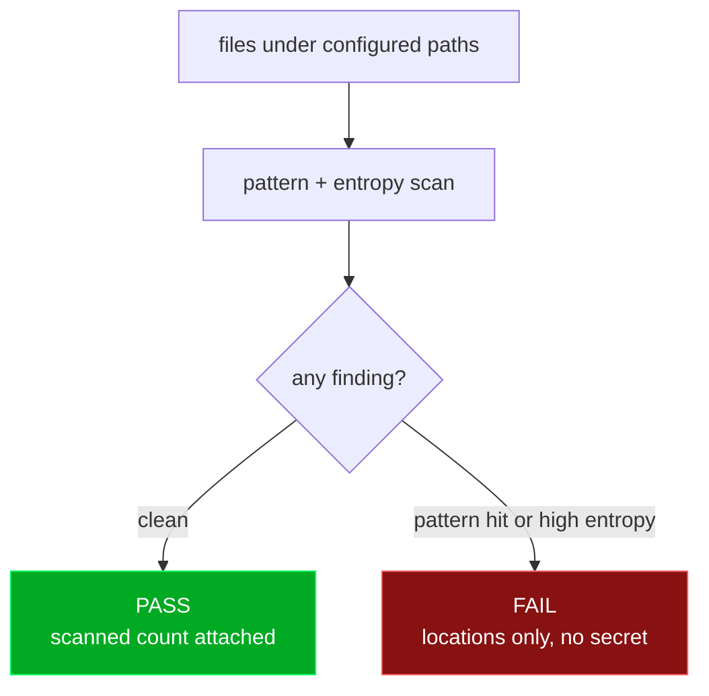

### 3.8 ZP-8 — Policy conformance

The change **MUST** satisfy the declared policy-as-code. ZP-8 answers *does the
change obey the repository's governance rules*. A policy violation is a `FAIL`.

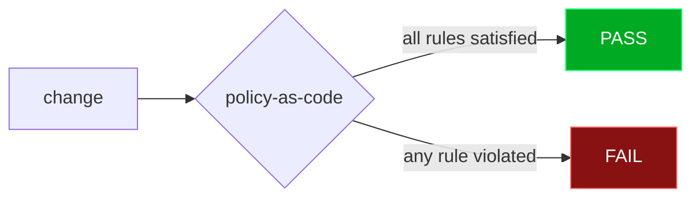

### 3.9 ZP-9 — Signature chain

Every receipt **MUST** be signed and chain to a trusted key. ZP-9 answers *is
every verdict cryptographically attributable*. An unsigned or untrusted-key
receipt is a `FAIL`.

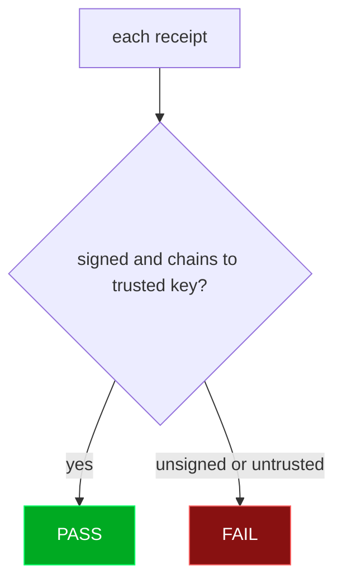

### 3.10 ZP-10 — Independent re-run

A second, isolated runner **MUST** reproduce the verdict. ZP-10 exists to detect
a compromised primary runner; the two runners **SHOULD NOT** share state. A
divergent re-run is a `FAIL`.

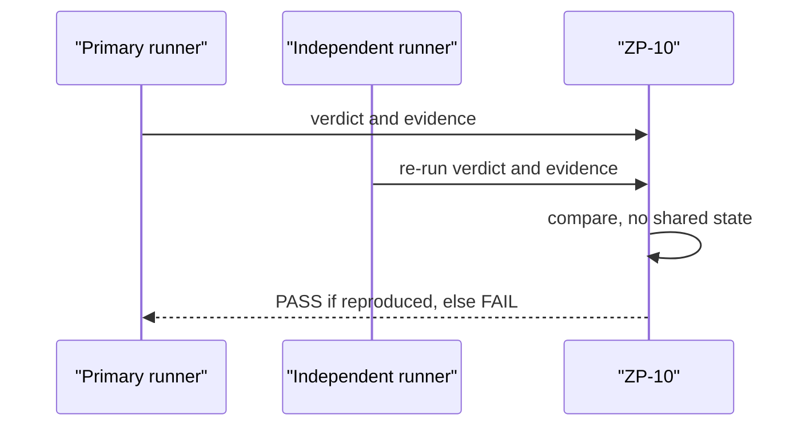

### 3.11 ZP-11 — Zero-point seal

ZP-1 through ZP-10 **MUST** all be `PASS`, and the pack **MUST** be sealed. ZP-11
is the only zone the gate sets itself rather than running as an ordinary check:
in the library the `seal` kind is handled by `run_gate`, which derives the seal
from whether every prior zone passed, then signs the seal content (§4.5). A seal
is `sealed = true` only when the overall verdict is `PASS`.

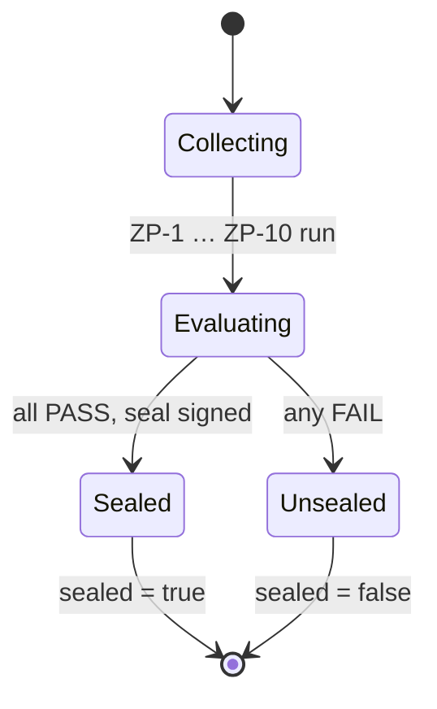

---

## 4. Proof-Pack terms

### 4.1 Proof-Pack

**Proof-Pack.** The single, self-describing, cryptographically signed record the
gate emits: the one machine-verifiable document that captures each zone's verdict
and evidence plus the seal. A Proof-Pack is *reproducible* (a clean re-run yields
an identical verdict and digest), *attributable* (each verdict carries its
inputs, tool version, and signature), and *portable* (no access to the original
CI is required to check it). It is a JSON document conforming to
`schema/proof-pack.schema.json`.

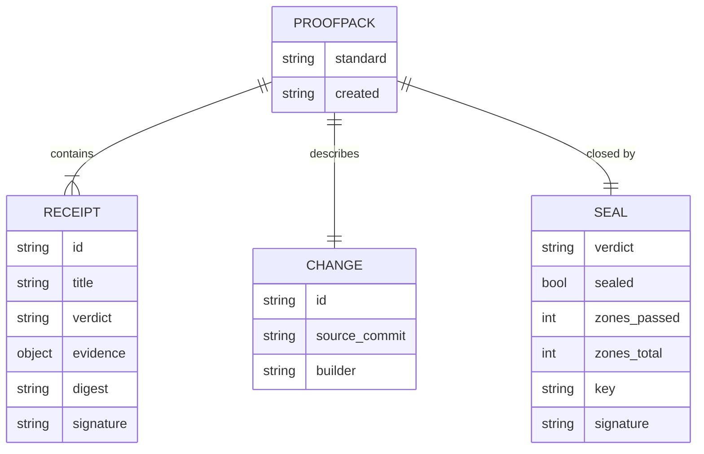

**change.** The object describing *what is being gated*: an optional `id`, the
`source_commit`, and the `builder`. ZP-1 (§3.1) proves these fields are present.

**created.** The RFC 3339 UTC timestamp recording when the pack was produced. It
is part of the seal content (§4.5), so it cannot be altered after sealing.

### 4.2 Receipt

**Receipt.** One zone's entry in the Proof-Pack: `{ id, title, verdict,
evidence, digest, signature }`. In `pack.py` a `Receipt` exposes `body` (the four
fields the digest covers), `signed_body` (the body plus the digest, which the
signature covers), and `finalize`, which computes the digest and signs it.

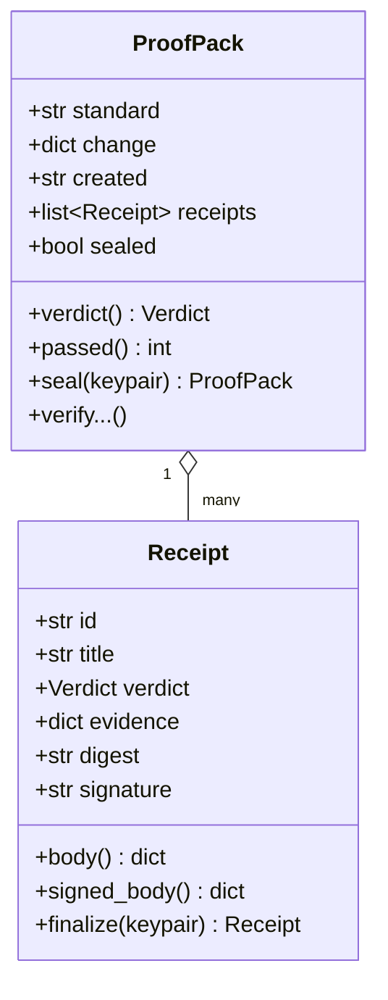

### 4.3 Digest

**Digest.** A content fingerprint, written `sha256:<hex>`. For a receipt, the
digest is SHA-256 over the canonical form (§4.4) of the *body* —
`{ id, title, verdict, evidence }`. Because the digest covers the evidence,
altering any evidence byte produces a different digest, which breaks the
signature and the seal.

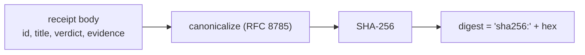

### 4.4 Canonical form

**Canonical form (canonicalization).** The deterministic byte serialization of a
JSON value defined by RFC 8785 (JSON Canonicalization Scheme), implemented in
`canonical.py` as `canonicalize`. It uses UTF-8, lexicographically sorted object
keys, minimal separators, and no insignificant whitespace, and it *rejects*
values with no canonical form — NaN, Infinity, and non-string object keys — by
raising `CanonicalizationError`. Canonical form is what lets two honest parties
serialize the same data to the same bytes, and therefore to the same digest.

```mermaid
flowchart TD
    V["JSON-compatible value"] --> K["sort object keys"]
    K --> S["UTF-8, minimal separators, no whitespace"]
    S --> R{"finite numbers,<br/>string keys?"}
    R -->|"yes"| OUT["canonical bytes"]
    R -->|"NaN, Infinity, non-string key"| ERR["CanonicalizationError"]
    classDef no fill:#811,stroke:#f66,color:#fff;
    class ERR no;
```

### 4.5 Seal

**Seal.** The ZP-11 object that closes the pack: `{ verdict, sealed,
zones_passed, zones_total, key, signature }`. The seal signs the *seal content*
(§4.6), which binds the standard, the `created` timestamp, the change, the
overall verdict, the pass counts, and the ordered list of receipt digests.
Because the signature covers that ordered list, receipts cannot be reordered,
added, or removed without invalidating the seal.

**seal content.** The exact structure signed by the seal:
`{ standard, created, change, verdict, zones_passed, zones_total, receipts: [ { id,
digest } … ] }`. It is reconstructed by a verifier (§5) and re-checked against the
seal signature.

```mermaid
flowchart TB
    R1["ZP-1 digest"] --> CHAIN["ordered receipt chain<br/>id + digest"]
    R2["ZP-2 digest"] --> CHAIN
    RN["… ZP-10 digest"] --> CHAIN
    CHAIN --> SC["seal_content<br/>standard, created, change, counts"]
    SC --> SEAL["Ed25519 seal signature"]
```

**zones_passed / zones_total.** The counts recorded in the seal: how many zones
returned `PASS` and how many zones exist. Together with `sealed`, they let a
reader see at a glance whether the pack is a full sealed PASS.

**sealed.** The boolean in the seal that is `true` only when the overall verdict
is `PASS`. A pack whose zones all pass but which is not sealed is still a refusal
(§5).

---

## 5. Cryptographic terms

**SHA-256.** The hash used for all digests, exposed as `sha256_hex` and `digest`
in `crypto.py`. Digests are always prefixed `sha256:`.

**Ed25519.** The signature scheme (RFC 8032) used for every receipt signature
and the seal signature. Signatures are encoded `ed25519:<hex>`; public keys are
encoded `ed25519:<hex of 32 raw bytes>`.

**KeyPair / PublicKey.** The library types in `crypto.py`. A `KeyPair` holds the
Ed25519 private key and signs; a `PublicKey` wraps 32 raw bytes, exposes an
`id` (`ed25519:<hex>`), and verifies. Keys are the root of trust and **MUST** be
stored outside the gated repository and rotated per the adopter's policy.

```mermaid
classDiagram
    class KeyPair {
        -Ed25519PrivateKey _private
        +sign(value) str
        +public() PublicKey
    }
    class PublicKey {
        +bytes raw
        +id() str
        +parse(text) PublicKey
        +verify(value, signature) bool
    }
    KeyPair --> PublicKey : derives
```

```mermaid
sequenceDiagram
    participant G as "Gate (KeyPair)"
    participant R as "Receipt"
    participant V as "Verifier (PublicKey)"
    G->>R: digest = SHA-256(canonical(body))
    G->>R: signature = Ed25519(signed_body)
    R-->>V: receipt + digest + signature
    V->>V: recompute digest, verify signature
    V-->>V: PASS only if both match
```

**signature (receipt).** Each receipt is signed over `canonical({ …body, digest })`
— the body plus its own digest. This binds the signature to the exact evidence.

**key (in the seal).** The `key` field of the seal records the `ed25519:<hex>`
public-key id used to sign, so a reader knows which key to verify against. The
verifier must still supply that key from a trusted source; a pack does not
vouch for its own key.

---

## 6. Configuration and zone-kind terms

### 6.1 Zone kind

**Zone kind.** The small, fixed set of check types a zone can be mapped to in
`zp11.toml`. The reference library defines five:

| Kind | PASSes when | Evidence recorded |
|------|-------------|-------------------|
| `require` | every named `change` field is present and non-empty | required / missing / present field names |
| `file` | a path exists and is at least `min_bytes` long | path, byte length, `sha256` |
| `command` | a shell command exits with `expect_code` (default 0) | command, exit code, `output_sha256` |
| `secret_scan` | no pattern or high-entropy finding under `paths` | scanned count, finding locations |
| `seal` | ZP-11 only — every prior zone passed | set by the gate |

A zone whose check cannot run returns `FAIL`, never silence.

```mermaid
flowchart TD
    Z["zone.kind"] --> RQ["require"]
    Z --> FI["file"]
    Z --> CM["command"]
    Z --> SS["secret_scan"]
    Z --> SL["seal (ZP-11, gate-set)"]
    RQ --> V{"verdict"}
    FI --> V
    CM --> V
    SS --> V
    V -->|"proved"| P["PASS"]
    V -->|"unknown kind, error, cannot run"| F["FAIL"]
    classDef ok fill:#0a2,stroke:#0f6,color:#fff;
    classDef no fill:#811,stroke:#f66,color:#fff;
    class P ok; class F no;
```

**zp11.toml.** The gate configuration file. It maps each `ZP-n` to a title, a
`kind`, and the kind's parameters (`command`, `paths`, `file`, `require`,
`timeout`, `expect_code`, `min_bytes`, `entropy`). It is loaded by `load_config`
and turned into `Zone` objects by `build_zones`.

```mermaid
erDiagram
    ZP11TOML ||--|{ ZONEENTRY : declares
    ZONEENTRY {
        string id
        string title
        string kind
        object spec
    }
    ZONEENTRY ||--o| COMMANDSPEC : "kind=command"
    ZONEENTRY ||--o| SECRETSPEC : "kind=secret_scan"
    COMMANDSPEC {
        string command
        int timeout
        int expect_code
    }
    SECRETSPEC {
        list paths
        float entropy
    }
```

**Context.** The runtime input every zone receives: the repository `root`, the
`change` dict, the `now` timestamp, and an `env` dict. Together with the `Zone`,
it fully determines a `ZoneResult` (`verdict` plus `evidence`).

```mermaid
classDiagram
    class Context {
        +Path root
        +dict change
        +str now
        +dict env
    }
    class Zone {
        +str id
        +str title
        +str kind
        +dict spec
        +canonical_title() str
    }
    class ZoneResult {
        +Verdict verdict
        +dict evidence
    }
    Zone --> ZoneResult : run_zone(zone, ctx)
    Context --> ZoneResult : supplies input
```

**canonical_title.** The authoritative title for a zone id, from the
`CANONICAL_TITLES` map in `zones.py` (for example `ZP-7` is always
`"Secret hygiene"`). A configuration's own title is a label; the canonical title
is what the standard fixes.

---

## 7. Command-line and verification terms

### 7.1 CLI verbs

The reference CLI (`cli.py`) exposes exactly four verbs.

| Verb | Purpose | Exit semantics |
|------|---------|----------------|
| `keygen` | generate an Ed25519 signing key | writes the key, exits 0 |
| `zones` | list the eleven canonical zones | informational |
| `run` | run the gate, emit a Proof-Pack | exits 0 only on a sealed, all-PASS pack |
| `verify` | verify integrity, seal, and decision of a pack | exits 0 only if merge is permitted |

```mermaid
flowchart LR
    K["zp11 keygen"] --> KEY["ci.key"]
    KEY --> RUN["zp11 run"]
    RUN --> PACK["proof-pack.json"]
    PACK --> VER["zp11 verify"]
    VER -->|"exit 0"| OK["merge permitted"]
    VER -->|"non-zero"| NO["merge refused"]
    Z["zp11 zones"] -.lists.-> RUN
    classDef ok fill:#0a2,stroke:#0f6,color:#fff;
    classDef no fill:#811,stroke:#f66,color:#fff;
    class OK ok; class NO no;
```

**keygen.** Generates an Ed25519 key pair and writes the signing key to the
`--out` path. The key is the root of trust for every signature in the packs it
later produces.

**run.** Loads `zp11.toml`, runs the gate over the repository root, seals the
pack, and writes `proof-pack.json`. It exits 0 *only* when the pack is a sealed,
all-PASS result, which makes it usable directly as a CI status check. A `--now`
override allows a fixed timestamp for reproducible runs.

**verify.** Reads a pack (and optionally a public key) and runs `verify_pack`.
It confirms digests, signatures, the seal, and the decision, printing the
`zones_passed` / `zones_total` counts. `--partial` relaxes the requirement that
all eleven zones be present.

### 7.2 Verification

**verify_pack.** The function in `pack.py` that decides merge. It recomputes each
receipt digest and compares it to the stored digest, verifies each receipt
signature and the seal signature with the public key, confirms every verdict is
`PASS` and `sealed = true`, and (unless `--partial`) requires all eleven zones.
It returns a `VerifyReport`.

```mermaid
sequenceDiagram
    participant P as "Proof-Pack"
    participant V as "verify_pack"
    participant K as "PublicKey"
    V->>P: require_all_zones? confirm ZP-1 … ZP-11 present
    loop each receipt
        V->>V: recompute digest, compare
        V->>K: verify receipt signature
    end
    V->>V: reconstruct seal_content
    V->>K: verify seal signature
    V->>V: all PASS and sealed?
    V-->>P: VerifyReport (merge true iff all checks pass)
```

**VerifyReport.** The result of `verify_pack`: whether merge is permitted, the
reasons for any refusal, and the `zones_passed` / `zones_total` counts. It is
truthy only when the pack verifies and merge is permitted. A verifier **MUST**
default to refusing merge when the public key is unavailable.

**strict mode / `require_all_zones`.** The default posture in which a verifier
confirms all eleven zones are present before any further check. `--partial` (or
`require_all_zones=False`) is the opt-out, used when checking an incomplete pack
for diagnostic purposes — never to permit a merge on a short pack.

```mermaid
flowchart TD
    START["verify_pack"] --> Z{"all 11 zones present?<br/>(strict)"}
    Z -->|"no"| R1["refuse"]
    Z -->|"yes"| D{"digests recomputed match?"}
    D -->|"no"| R2["refuse"]
    D -->|"yes"| S{"all signatures verify?"}
    S -->|"no"| R3["refuse"]
    S -->|"yes"| A{"all PASS and sealed?"}
    A -->|"no"| R4["refuse"]
    A -->|"yes"| M["merge permitted"]
    classDef ok fill:#0a2,stroke:#0f6,color:#fff;
    classDef no fill:#811,stroke:#f66,color:#fff;
    class M ok; class R1 no; class R2 no; class R3 no; class R4 no;
```

---

## 8. Process and governance terms

**Adoption (additive rollout).** ZP-11 is designed to run *alongside* an existing
pipeline first and become blocking only once every zone is green. There is
nothing to purchase and no account to create.

```mermaid
flowchart LR
    A["1 · Declare zones<br/>map each ZP-n to a check"] --> B["2 · Emit a Proof-Pack<br/>on every change to main"]
    B --> C["3 · Re-run to verify<br/>ZP-10 independent runner"]
    C --> D["4 · Make the gate blocking<br/>require a sealed PASS"]
```

**Conformance.** An implementation is conformant when it emits packs that
validate against the schema, treats any non-`PASS` condition as `FAIL`, computes
digests and signatures as specified, and refuses merge unless verification
succeeds. The reference implementation is the normative oracle for test vectors.

**Versioning.** The `standard` field carries the version (`zp11/v1`). A
backward-incompatible change increments it, and an implementation **MUST** reject
a pack whose `standard` it does not recognise.

```mermaid
timeline
    title ZP-11 standard versioning
    zp11/v1 : Stable : eleven fixed zones : JCS + Ed25519 + seal
    future  : increment on any breaking change : old verifiers reject unknown standard
```

**Root of trust.** The signing key material. ZP-11's guarantees reduce to one
assumption: the private key is held only by the gate, and verifiers hold the
genuine public key. ZP-10 (independent re-run) guards the *runner*; key custody
guards the *signatures*.

```mermaid
journey
    title Adopter path to a blocking gate
    section Set up
      Generate key with keygen: 4: Adopter
      Write zp11.toml zones: 3: Adopter
    section Observe
      Emit Proof-Pack per change: 4: Gate
      Verify with a public key: 5: Reviewer
    section Enforce
      Require sealed PASS to merge: 5: Adopter, Reviewer
```

**What ZP-11 is not.** A bounded term by design: ZP-11 is *not* a product or
hosted service, *not* a guarantee that passing code is bug-free, *not* a
replacement for human review, *not* a security certification, and *not* a claim
about any specific adopter or outcome.

```mermaid
mindmap
  root(("ZP-11 scope"))
    Is
      "Open fail-closed gate spec"
      "Signed, re-runnable Proof-Pack"
      "Eleven machine-verified zones"
      "Tool-agnostic (verdicts, not vendors)"
    Is not
      "A product or service"
      "A bug-free guarantee"
      "A replacement for human review"
      "A security certification"
```

---

## 9. Term relationship map

The terms are not independent; a digest depends on canonical form, a signature
depends on a digest, the seal depends on the ordered receipt chain, and the merge
decision depends on all of them. This map shows the chain of dependence a
verifier walks in reverse.

```mermaid
flowchart BT
    CAN["Canonical form (RFC 8785)"] --> DIG["Digest (SHA-256)"]
    DIG --> SIG["Receipt signature (Ed25519)"]
    EVI["Evidence"] --> DIG
    VER["Verdict (PASS/FAIL)"] --> DIG
    SIG --> SEAL["Seal over receipt chain"]
    DIG --> SEAL
    SEAL --> DEC["Merge decision (verify_pack)"]
    KEY["Public key (root of trust)"] --> DEC
    classDef hi fill:#0043fd,stroke:#37c6ff,color:#fff;
    class DEC hi;
```

---

## 10. Cross-references

For the normative source of these definitions and their fuller treatment, see
the sibling documents in this set:

- `01-whitepaper.md` — the motivation and the one idea behind the fail-closed gate.
- `04-detailed-design.md` — the reference library structure these terms map to.
- `05-data-model.md` — the Proof-Pack, receipt, and seal structures in full.
- `07-crypto-design.md` — canonicalization, digests, Ed25519, and the seal chain.
- `10-zones-reference.md` — the eleven zones and their kinds in depth.

*ZP-11 was invented by Naquib Hatami and is published as an open standard under
the MIT License.*
