# ProofGate ZP-11 — Frequently Asked Questions

*Part of the ProofGate ZP-11 documentation set*

> **Standard:** `zp11/v1` · **License:** MIT · **Inventor/author:** Naquib Hatami
> **Repo:** github.com/iQs-Group/ZP-11 · **Homepage:** zp11.org
> **Publisher:** iQs Group Inc. / SADI AI Inc.

## Abstract

This FAQ answers the questions a careful engineer actually asks before trusting a
release gate — and the sharp ones a skeptic asks to find where the model breaks.
It does not sell. Where ZP-11 has a hard limit, this document states it plainly:
the gate inherits the **trusting-trust** regress that no verifier can close from
the inside, and the **MIT License grants copyright permission but no patent
grant**, which is a real and intentional gap. The honest answers below are more
useful than comfortable ones, because a gate whose boundaries you understand is a
gate you can rely on exactly as far as it reaches — and no further.

ZP-11, invented by Naquib Hatami, is an open, fail-closed release-governance
standard. Eleven independent *zones* sit between a change and `main`; the gate
opens only when every zone returns `PASS` and the result is sealed into a single,
signed, re-runnable **Proof-Pack**.

---

## 1. The basics

### 1.1 What is ZP-11 in one sentence?

ZP-11 is a standard for a release gate that opens **only on affirmative,
reproducible, cryptographically signed evidence** — and treats silence, crashes,
timeouts, and missing results as `FAIL`.

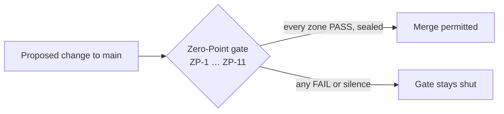

### 1.2 What does "fail-closed" actually mean?

Most release checks are advisory: they warn, then let the merge through. ZP-11
inverts the default. The gate is shut until proven open. Ambiguity resolves
toward refusal, never toward consent.

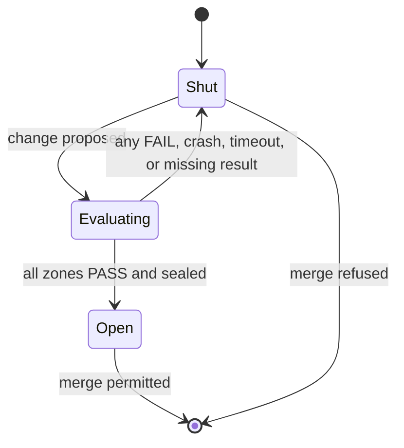

### 1.3 Is there only ever one of two answers?

Yes. A zone emits exactly `PASS` or `FAIL`. There is deliberately no third
verdict that could permit a merge, because a "warn" or "skip" state is how
advisory checks quietly erode into noise.

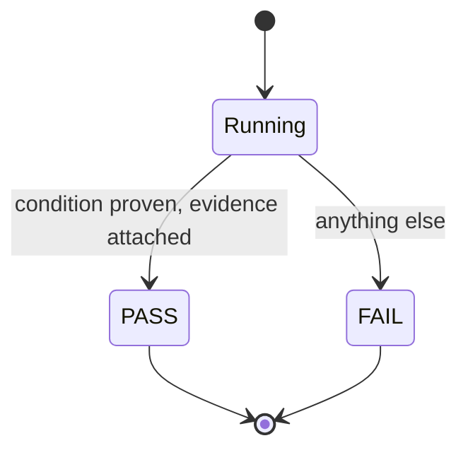

### 1.4 Who invented it, and what is its status?

ZP-11 was invented and authored by **Naquib Hatami** and published as an open
standard (`zp11/v1`, Stable) under the MIT License by iQs Group Inc. / SADI AI
Inc.

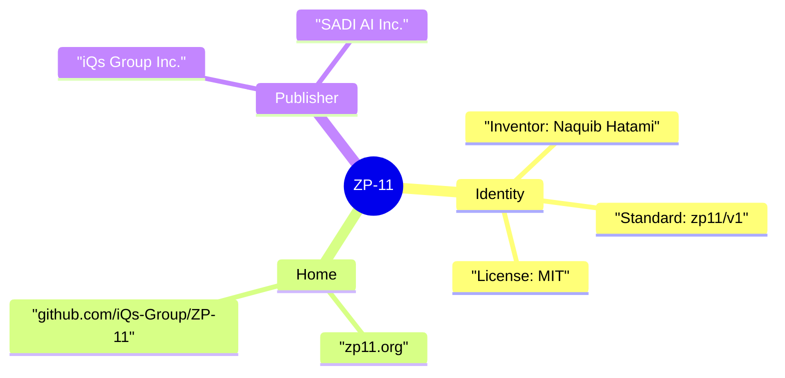

---

## 2. The eleven zones

### 2.1 What are the eleven zones?

The names and ordering are fixed by the specification. A conforming
configuration may map a zone to any check that satisfies the zone's normative
requirement, but an unimplemented zone **must** map to a check that returns
`FAIL`.

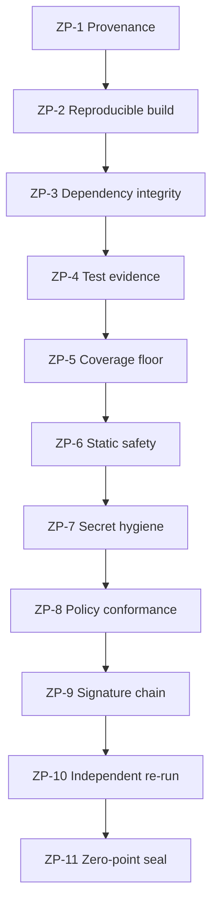

| Zone | Name | Normative requirement |
|------|------|-----------------------|
| ZP-1 | Provenance | References a signed source commit and a named builder. |
| ZP-2 | Reproducible build | Re-execution yields an identical output digest. |
| ZP-3 | Dependency integrity | Every dependency is pinned and hashed. |
| ZP-4 | Test evidence | Declared tests ran; machine-readable results attached. |
| ZP-5 | Coverage floor | Changed lines meet the declared threshold. |
| ZP-6 | Static safety | No new finding above configured severity. |
| ZP-7 | Secret hygiene | No credential, key, or token in diff or build output. |
| ZP-8 | Policy conformance | Satisfies the declared policy-as-code. |
| ZP-9 | Signature chain | Every receipt is signed and chains to a trusted key. |
| ZP-10 | Independent re-run | A second, isolated runner reproduces the verdict. |
| ZP-11 | Zero-point seal | ZP-1…ZP-10 all PASS and the pack is sealed. |

### 2.2 Why eleven and not fewer?

Each zone defends against a different class of failure. Collapsing them hides
which property broke. The separation is the point: a `FAIL` names the exact
guarantee that was not met.

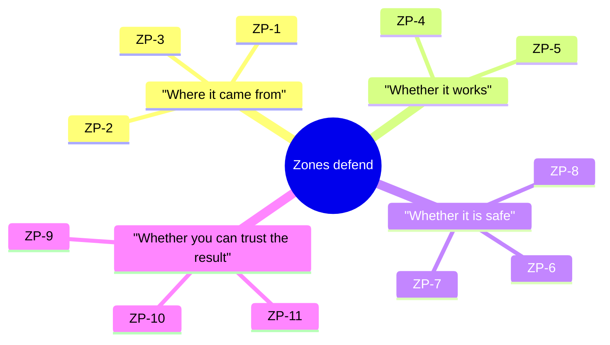

### 2.3 How does a zone actually decide?

In the reference library (`zones.py`), a zone has a *kind* — `require`, `file`,
`command`, `secret_scan`, or `seal`. Any failure to produce a provable `PASS`
returns `FAIL`: a missing file, a non-zero exit code, unparseable output, a
timeout, or an exception all fail closed.

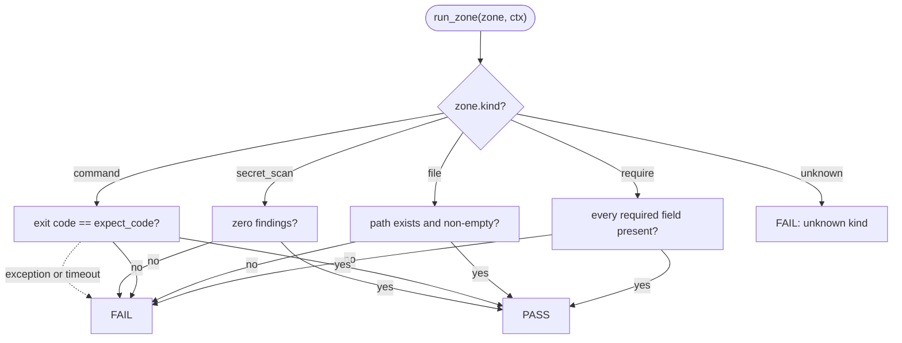

### 2.4 What if a command crashes instead of returning cleanly?

It fails. `_run_command` wraps execution so a spawn failure or timeout becomes a
`FAIL` receipt with the exception type as evidence — never a silent pass.

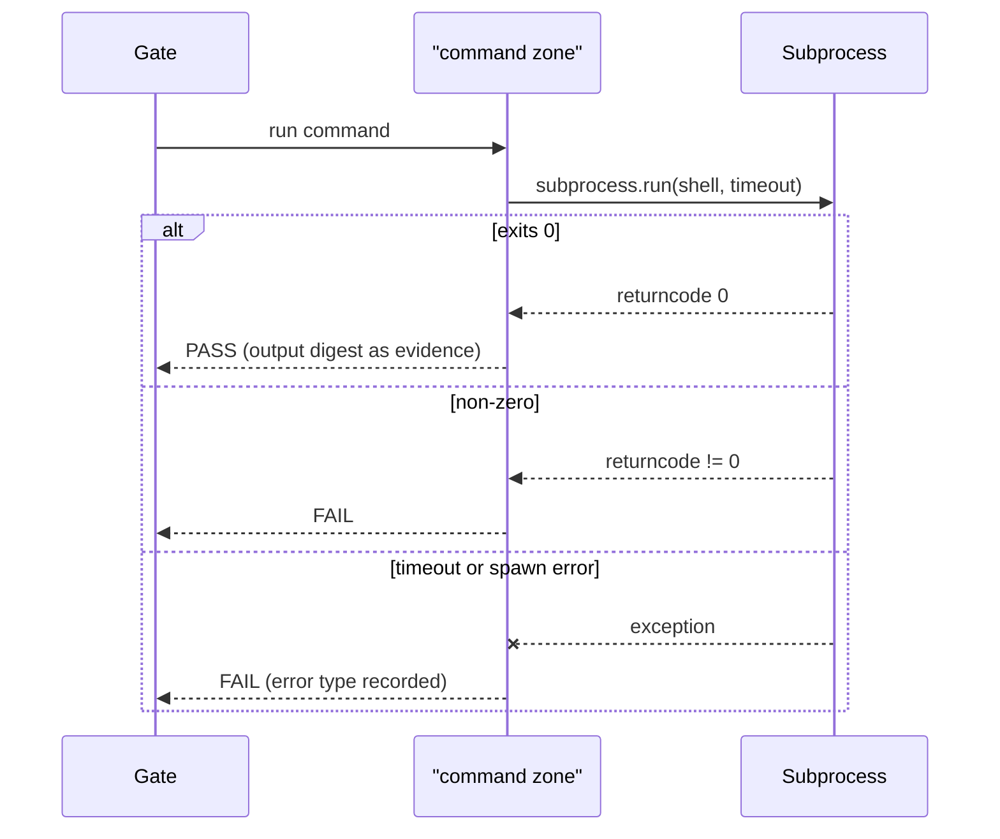

### 2.5 How does secret hygiene (ZP-7) avoid leaking the very secrets it finds?

ZP-7 records only *locations* of findings — the file path and a short rule name —
never the secret material itself. It combines known-pattern detectors (AWS keys,
GitHub tokens, private-key headers) with a Shannon-entropy heuristic.

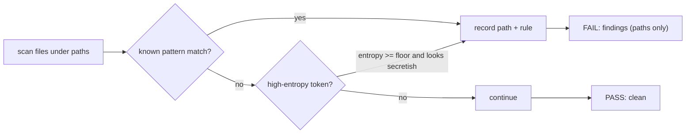

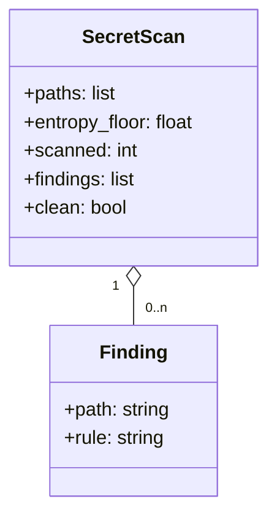

---

## 3. The Proof-Pack

### 3.1 What exactly is in a Proof-Pack?

A single self-describing JSON document: the standard tag, a creation timestamp,
the change it describes, an ordered list of zone receipts, and a seal.

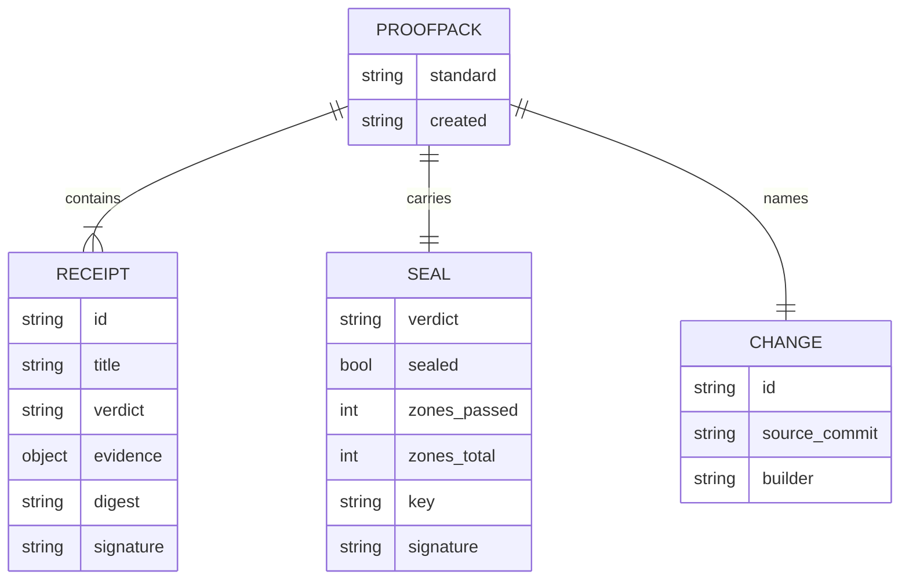

### 3.2 What makes a pack trustworthy without trusting the pipeline that made it?

Two independent properties. **Integrity:** each receipt is digested over its
canonical form and signed, so altering an evidence byte invalidates the receipt.
**Seal:** ZP-11 signs the ordered list of receipt digests together with the
change, so a pack cannot be assembled from receipts that never shared a gate.

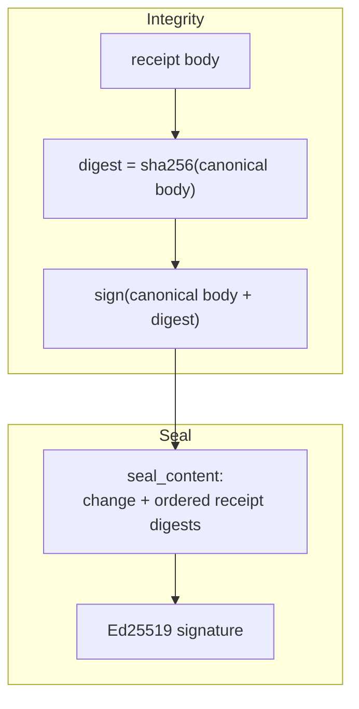

### 3.3 Why canonical serialization (RFC 8785)?

Because two byte-different encodings of the same JSON would produce two different
digests. JCS fixes a single canonical form — UTF-8, sorted keys, minimal
separators — so a digest is a function of *meaning*, not *formatting*. Values with
no canonical form (NaN, Infinity, non-string keys) are rejected.

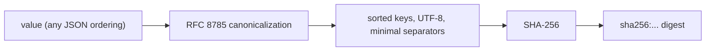

### 3.4 How is the signature chain built?

Each receipt is finalized — digest computed, then signed. The seal signs
`seal_content`, which embeds `[{id, digest}]` for every receipt in order.

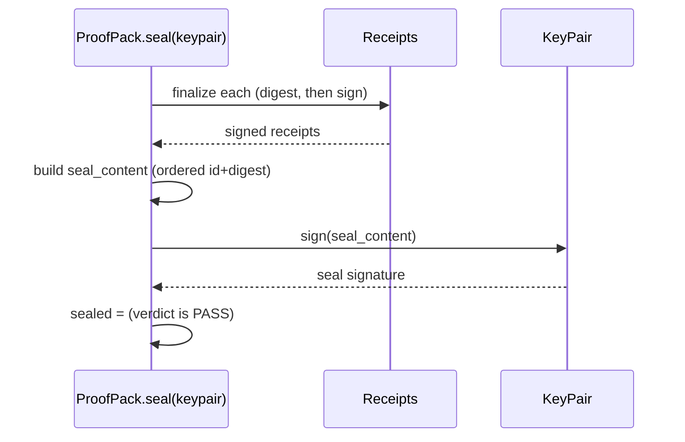

### 3.5 Can someone reorder, add, or drop receipts?

No. The seal commits to the ordered chain of digests. Any reordering, insertion,
or deletion changes `seal_content`, which invalidates the seal signature.

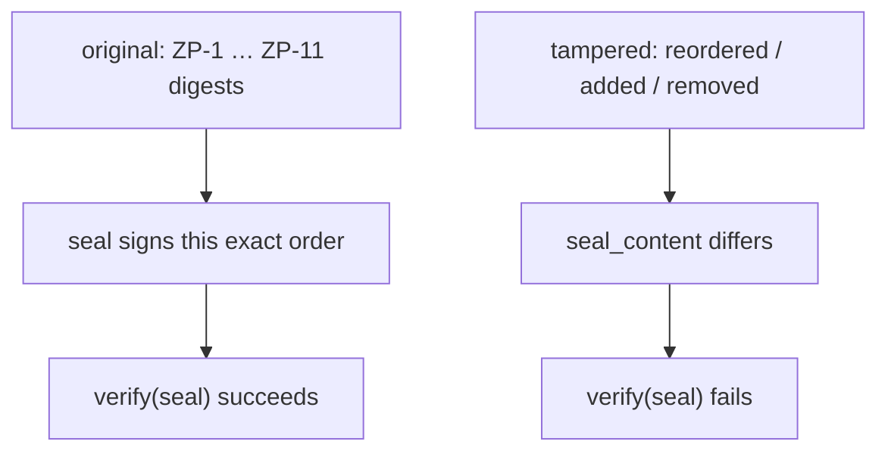

---

## 4. Verification

### 4.1 What does a verifier check?

Given a pack `P` and a public key `K`: all eleven zones present (strict mode),
each receipt digest recomputed and signature verified, the seal reconstructed and
verified, every verdict `PASS`, and `sealed = true`.

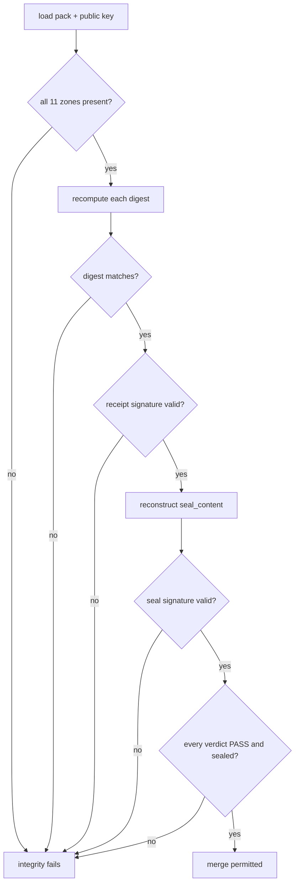

### 4.2 What happens if the public key is missing?

The verifier refuses merge by default. No key means signatures cannot be checked,
and an unverifiable pack is treated exactly like a failing one.

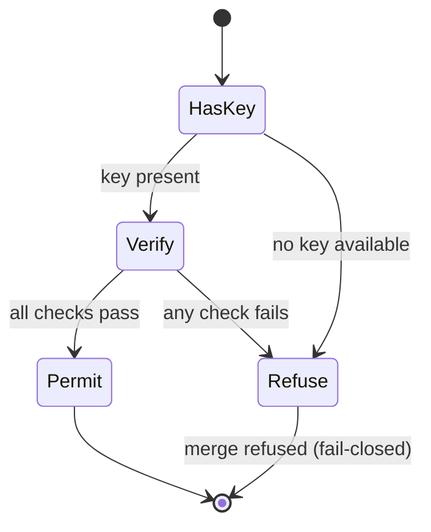

### 4.3 What does the verify report tell me?

`verify_pack` returns a structured report: integrity flag, merge-permitted flag,
counts of zones passed and total, and a list of human-readable reasons.

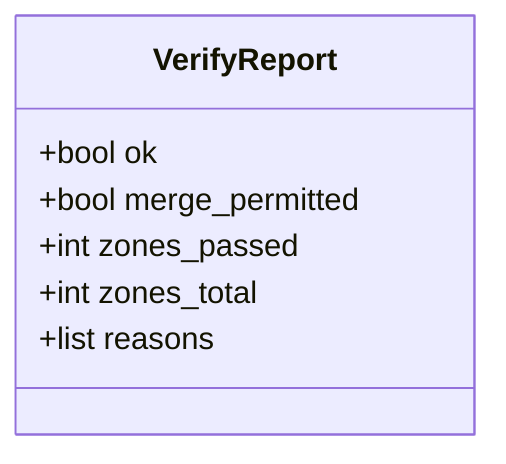

### 4.4 Does the CLI exit code reflect the decision?

Yes, and that is what makes it safe to wire as a required status check. `run`
exits 0 only for a sealed, all-`PASS` pack; `verify` exits 0 only when merge is
permitted.

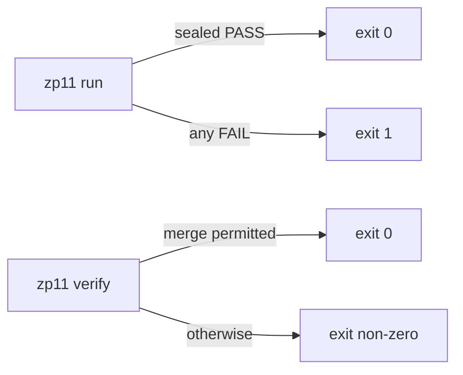

---

## 5. The sharp question: trusting trust

### 5.1 Doesn't ZP-11 just push trust down to the verifier itself?

Yes — and this is the honest heart of the matter. Ken Thompson's 1984 lecture
*Reflections on Trusting Trust* showed that a compiler can be subverted to insert
a backdoor and to recognize *its own* recompilation, so the malice survives even
when you rebuild the compiler from clean source. The same regress applies to
ZP-11: the gate is itself software, run by an interpreter, on an operating
system, on hardware.

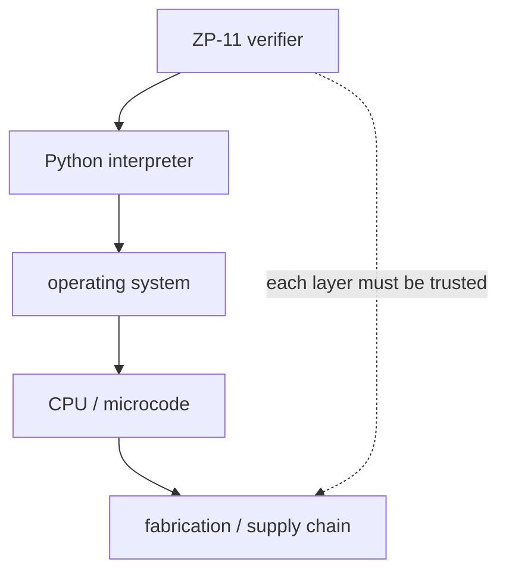

### 5.2 So can ZP-11 prove its own integrity?

No, and it does not claim to. A verifier cannot bootstrap trust in itself from the
inside; something outside the checked boundary must be trusted. ZP-11's value is
that it makes the trust boundary **explicit and small**, not that it eliminates
it.

```mermaid
flowchart LR
    subgraph Inside["What ZP-11 proves"]
      A["receipts match digests"]
      B["signatures chain to a key"]
      C["seal covers the whole pack"]
    end
    subgraph Outside["What you must still trust"]
      D["the signing key"]
      E["the verifier binary + toolchain"]
      F["the host it runs on"]
    end
    Inside -.->|"depends on"| Outside
```

### 5.3 How does ZP-11 narrow the regress rather than ignore it?

Three ways. **ZP-2** (reproducible build) lets independent parties rebuild and
compare digests, the standard mitigation Thompson's problem demands. **ZP-10**
runs the gate on a second, isolated runner that should not share state, so a
single subverted runner is more likely to disagree. **ZP-9** anchors every result
to a key held *outside* the gated repository.

```mermaid
sequenceDiagram
    participant S as Source
    participant A as "Runner A"
    participant B as "Runner B (isolated)"
    participant C as Comparator
    S->>A: build + gate
    S->>B: build + gate
    A-->>C: digest + verdict
    B-->>C: digest + verdict
    C->>C: compare
    alt agree
        C-->>S: corroborated
    else disagree
        C-->>S: FAIL (one runner suspect)
    end
```

### 5.4 But two runners could share the same compromised base image, couldn't they?

They could, and then ZP-10 adds little. The specification only says the two
runners **should not** share state; it cannot force heterogeneity. Diverse
toolchains, diverse hosts, and reproducible builds verified by unrelated parties
are what actually move the needle — and those are operational choices the adopter
makes, not guarantees the standard can enforce.

```mermaid
mindmap
  root(("Residual trust"))
    "Shared base image"
      "ZP-10 weakened"
      "need diverse hosts"
    "Shared toolchain"
      "ZP-2 needs diverse rebuilders"
    "Single signing key"
      "key custody is external"
    "Hardware / microcode"
      "outside any software gate"
```

### 5.5 What is the honest bottom line on trusting trust?

ZP-11 **reduces** the surface you must trust and makes it auditable; it does not
**remove** it. Anyone who tells you a verifier closes the Thompson regress is
mistaken. The correct claim is narrower and still worth a great deal: *if* you
trust the key, the verifier, and its host, then the pack proves everything else.

```mermaid
journey
    title Trust after adopting ZP-11
    section Before
      "Trust the whole pipeline": 2: Team
      "Trust every reviewer's diligence": 2: Team
    section After
      "Trust a key + verifier + host": 4: Team
      "Everything else is proven": 5: Team
```

---

## 6. The sharp question: the MIT patent gap

### 6.1 ZP-11 is MIT-licensed — doesn't that cover patents too?

No, and this is a genuine gap you should understand. The MIT License is a
**copyright** license. It grants permission to use, copy, modify, and distribute
the software. It says nothing explicit about patent rights.

```mermaid
flowchart LR
    MIT["MIT License"] --> C["copyright permission: use, copy, modify, distribute"]
    MIT -. "no explicit clause" .-> P["patent grant"]
    P --> Q["relies on implied license only"]
```

### 6.2 Why does that matter if there is no known patent here?

Because the *absence of an express grant* is itself the risk. Permissive licenses
such as Apache 2.0 include an explicit patent license and a retaliation clause;
MIT does not. For most adopters the practical exposure is small, but "small" is
not "zero", and an honest FAQ names it rather than waving it away.

```mermaid
flowchart TB
    subgraph Apache["Apache 2.0"]
      A1["copyright grant"]
      A2["express patent grant"]
      A3["patent-retaliation termination"]
    end
    subgraph MITb["MIT"]
      M1["copyright grant"]
      M2["no express patent grant"]
    end
```

### 6.3 Is there an implied patent license under MIT?

Courts in some jurisdictions recognize an **implied** patent license when a
copyright holder distributes software whose normal use would infringe their own
patent. But "implied" is weaker and less portable than an express grant, varies by
jurisdiction, and offers no protection against third-party patents the author
never held.

```mermaid
flowchart TD
    D["author distributes under MIT"] --> I{"implied patent license?"}
    I -->|"author's own patents, some jurisdictions"| Y["likely, but unwritten"]
    I -->|"third-party patents"| N["no protection"]
    I -->|"other jurisdictions"| U["uncertain"]
```

### 6.4 What does this mean in practice for an adopter?

The code is free to use under copyright. The standard is open and the format is
documented so that anyone can implement it independently. Patent exposure is a
general property of MIT-licensed software, not something specific to ZP-11, and
nothing in this repository asserts a patent. If your organization requires an
express patent grant, that is a licensing conversation to have before adoption —
not an assumption to make.

```mermaid
journey
    title Reading the MIT patent position honestly
    section Copyright
      "Use, modify, distribute freely": 5: Adopter
    section Patents
      "No express grant in MIT": 2: Adopter
      "Implied license varies by jurisdiction": 3: Adopter
      "Third-party patents never covered by any license": 2: Adopter
```

### 6.5 Could the standard itself be encumbered?

The specification is published openly and the Proof-Pack format is fully
documented (JSON Schema, canonical form, signature construction), precisely so
that the format is implementable without the reference code. That openness
reduces lock-in but does not, by itself, constitute a patent grant. The two
questions — *is the format open?* and *is there a patent license?* — are separate,
and only the first is answered "yes" without qualification.

```mermaid
flowchart LR
    Q1["Is the format open?"] -->|yes| A1["documented schema + spec"]
    Q2["Is there an express patent grant?"] -->|no| A2["MIT is copyright-only"]
    A1 --> R["independently implementable"]
    A2 --> R2["patent question stays open"]
```

---

## 7. Scope and limits

### 7.1 What does a sealed PASS actually guarantee?

That, under the configured zones, every declared check produced affirmative,
signed, re-runnable evidence. It is a statement about *process and evidence*, not
a proof of correctness.

```mermaid
flowchart LR
    S["sealed PASS"] --> G1["declared tests ran"]
    S --> G2["build reproduced"]
    S --> G3["no obvious secret leaked"]
    S --> G4["policy satisfied"]
    S -. "does NOT mean" .-> N["code is bug-free"]
```

### 7.2 What does ZP-11 explicitly not claim?

```mermaid
mindmap
  root(("ZP-11 is NOT"))
    "a product or hosted service"
    "a proof that code is bug-free"
    "a replacement for human review"
    "a security certification"
    "a claim about any adopter or outcome"
```

It is an open specification, a signed Proof-Pack format, eleven machine-verified
zones, tool-agnostic, and re-runnable by anyone. It is not a guarantee that
passing code is correct, nor a substitute for judgment.

### 7.3 Can a passing gate still ship a bug?

Absolutely. A zone proves its declared condition, nothing more. If your tests
miss a case, ZP-4 still passes; the gate is only as strong as the checks you map
into it. ZP-11 makes the checks and their evidence auditable — it does not invent
checks you did not write.

```mermaid
flowchart TD
    B["latent bug not covered by any test"] --> T["ZP-4 passes (declared tests ran)"]
    T --> M["gate opens"]
    M --> R["bug ships"]
    R -.->|"lesson"| L["strengthen the mapped checks, not the gate"]
```

### 7.4 Is coverage (ZP-5) a correctness guarantee?

No. Coverage measures which changed lines executed under test, not whether the
assertions were meaningful. It is a floor against *untested* change, not a ceiling
on quality.

```mermaid
flowchart LR
    A["changed lines"] --> B{"meet coverage threshold?"}
    B -->|yes| C["ZP-5 PASS"]
    B -->|no| D["ZP-5 FAIL"]
    C -.->|"still possible"| E["weak assertions"]
```

---

## 8. Adoption

### 8.1 How do I start without breaking my pipeline?

ZP-11 is additive. Run it alongside your existing checks, watch the packs, and
make the gate blocking only once every zone is reliably green. Nothing to
purchase, no account to create.

```mermaid
flowchart LR
    A["1 · Declare zones<br/>map each ZP-n to a check"] --> B["2 · Emit a Proof-Pack<br/>on every change"]
    B --> C["3 · Re-run to verify<br/>ZP-10 isolated runner"]
    C --> D["4 · Make the gate blocking"]
```

### 8.2 What are the CLI verbs?

```mermaid
flowchart TB
    CLI["zp11"] --> K["keygen: Ed25519 signing key"]
    CLI --> Z["zones: list the eleven canonical zones"]
    CLI --> R["run: run the gate, emit a Proof-Pack"]
    CLI --> V["verify: integrity, seal, decision"]
```

### 8.3 How do I map a zone in `zp11.toml`?

Each zone names a *kind* and its parameters. A `command` zone passes when the
command exits with the expected code; a `secret_scan` zone passes when no finding
appears under the given paths.

```mermaid
classDiagram
    class Zone {
        +id: string
        +title: string
        +kind: string
        +spec: dict
        +canonical_title() string
    }
    class Context {
        +root: Path
        +change: dict
        +now: string
        +env: dict
    }
    class ZoneResult {
        +verdict: Verdict
        +evidence: dict
    }
    Zone --> ZoneResult : run_zone(zone, ctx)
    Context --> ZoneResult
```

### 8.4 What is the end-to-end flow on a change?

```mermaid
sequenceDiagram
    participant Dev as Change
    participant Gate as "ZP-11 gate"
    participant Pack as Proof-Pack
    participant Ver as "Independent verifier"
    Dev->>Gate: propose change to main
    Gate->>Gate: run ZP-1 … ZP-10
    Gate->>Pack: sign each receipt
    Gate->>Pack: ZP-11 seal over the chain
    Pack-->>Ver: proof-pack.json + public key
    Ver->>Ver: recompute digests, verify signatures, re-run ZP-10
    Ver-->>Dev: merge permitted iff sealed PASS
```

### 8.5 Where should the signing key live?

Outside the gated repository, and rotated per the adopter's policy. The key is the
root of trust; a key stored inside the repo it protects defeats the purpose.

```mermaid
flowchart LR
    K["Ed25519 signing key"] -->|"held in"| X["external secret store"]
    X -->|"signs"| P["Proof-Packs"]
    R["gated repo"] -. "must NOT contain" .-> K
```

### 8.6 How does a reviewer read a decision at a glance?

The seal states `verdict`, `sealed`, `zones_passed`, and `zones_total`. A glance
tells you whether every zone passed and whether the pack is sealed.

```mermaid
flowchart LR
    SEAL["seal"] --> A["verdict: PASS/FAIL"]
    SEAL --> B["sealed: true/false"]
    SEAL --> C["zones_passed / zones_total"]
    A --> D{"PASS and sealed?"}
    B --> D
    D -->|yes| M["merge permitted"]
    D -->|no| S["gate shut"]
```

---

## 9. Comparisons and edge cases

### 9.1 How is this different from ordinary required status checks?

Ordinary checks report a pass/fail to the forge but leave no portable,
re-runnable, signed artifact. ZP-11's output is a document a third party can
verify months later without access to the original CI.

```mermaid
flowchart TB
    subgraph Ordinary["Required status check"]
      O1["pass/fail to the forge"]
      O2["evidence lives in CI logs"]
      O3["not independently re-runnable"]
    end
    subgraph ZP["ZP-11"]
      P1["signed Proof-Pack"]
      P2["evidence travels with the verdict"]
      P3["re-runnable by anyone"]
    end
```

### 9.2 What happens if a zone is simply not implemented yet?

It must map to a check that returns `FAIL`. An unimplemented zone can never
silently count as a pass; the gate stays shut until you implement it or
explicitly configure it.

```mermaid
stateDiagram-v2
    [*] --> Unimplemented
    Unimplemented --> FAIL: maps to a failing check (required)
    Unimplemented --> Implemented: adopter maps a real check
    Implemented --> PASS: condition proven
    Implemented --> FAIL: otherwise
    FAIL --> [*]: gate stays shut
```

### 9.3 What if an attacker tampers with one evidence byte?

The receipt digest no longer matches the recomputed digest, and the receipt
signature no longer verifies. The verifier reports both and refuses merge.

```mermaid
sequenceDiagram
    participant A as Attacker
    participant P as Pack
    participant V as Verifier
    A->>P: flip one evidence byte
    V->>V: recompute digest(body)
    V->>V: compare to stored digest
    V-->>A: "digest mismatch (evidence altered)"
    V->>V: verify receipt signature
    V-->>A: "bad or missing signature"
    V-->>A: merge refused
```

### 9.4 Can I verify a partial pack during development?

Yes — `verify --partial` relaxes the "all eleven present" requirement so you can
iterate. It does not relax integrity or the fail-closed decision; a partial pack
still cannot be a sealed, all-`PASS` merge unless every mapped zone passes.

```mermaid
flowchart LR
    F["verify (strict)"] -->|"requires all 11"| D1["decision"]
    P["verify --partial"] -->|"skips presence check"| D2["decision"]
    D1 --> I["integrity still enforced"]
    D2 --> I
```

### 9.5 Does reproducibility (ZP-2) mean bit-for-bit builds?

It means re-execution yields an **identical output digest**. Achieving that often
requires removing nondeterminism — timestamps, build paths, parallel ordering —
from your build. ZP-2 does not make your build reproducible; it refuses to pass
until it is.

```mermaid
flowchart TD
    B1["build #1"] --> H1["output digest A"]
    B2["build #2 (clean host)"] --> H2["output digest B"]
    H1 --> C{"A == B?"}
    H2 --> C
    C -->|yes| P["ZP-2 PASS"]
    C -->|no| F["ZP-2 FAIL: nondeterminism remains"]
```

### 9.6 What is the single most important thing to remember?

```mermaid
timeline
    title The ZP-11 discipline
    "Default" : Gate is shut
    "Evidence" : Each zone must prove its condition
    "Seal" : One signed record binds the whole chain
    "Verify" : Anyone can re-run it
    "Limit" : Trust shrinks, it does not vanish
```

Absence of evidence is treated as failure — never as consent. Everything else is
detail around that one rule, including the honest limits in sections 5 and 6.

---

## 10. Quick reference

```mermaid
graph LR
    subgraph Guarantees
      A["signed, re-runnable evidence"]
      B["fail-closed by default"]
      C["one portable Proof-Pack"]
    end
    subgraph Limits
      D["trusting-trust regress remains"]
      E["MIT: no express patent grant"]
      F["not a correctness proof"]
    end
```

```mermaid
flowchart TB
    R["Reference library (Python)"] --> C1["canonical.py (RFC 8785)"]
    R --> C2["crypto.py (Ed25519 / SHA-256)"]
    R --> C3["verdict.py (PASS / FAIL)"]
    R --> C4["zones.py (require/file/command/secret_scan/seal)"]
    R --> C5["pack.py (Receipt, ProofPack, verify_pack)"]
    R --> C6["gate.py"]
    R --> C7["cli.py (keygen, zones, run, verify)"]
    R --> C8["schema/proof-pack.schema.json"]
```

---

## See also

- `01-overview.md` — what ZP-11 is and the one idea behind it.
- `SPEC.md` — the normative specification (`zp11/v1`).
- `10-proof-pack-format.md` — the Proof-Pack structure and JSON Schema in depth.
- `12-verification.md` — the verification algorithm and CLI exit semantics.
- `20-security-model.md` — trust boundaries, key custody, and the ZP-10 rationale.

---

*ZP-11 was invented by Naquib Hatami and is published as an open standard under
the MIT License by iQs Group Inc. / SADI AI Inc.*
