*Part of the ProofGate ZP-11 documentation set.*

# Roadmap & Architecture Decision Records

**Standard:** `zp11/v1` · **License:** MIT · **Inventor / author:** Naquib Hatami
**Repository:** github.com/iQs-Group/ZP-11 · **Homepage:** zp11.org · **Publisher:** iQs Group Inc. / SADI AI Inc.

## Abstract

This document records *why* ProofGate ZP-11 is shaped the way it is, and how that shape is allowed to change over time. It has two halves. The first defines the **versioning policy**: how the `standard` field, the Proof-Pack format, the reference library, and the fixed zone set each evolve, and what compatibility promise an adopter can rely on. The second is a set of **Architecture Decision Records (ADRs)** — durable, numbered rationales for the three load-bearing decisions in the standard: the **pack format**, the **zone set**, and the **verification algorithm** — together with the supporting decisions that follow from them. ADRs capture the alternatives that were weighed and the forces that selected the chosen option, so that a future change is made deliberately and against a recorded baseline rather than by accident. Nothing here invents adopters, benchmarks, or features beyond the reference repository; the roadmap describes *candidate* directions and the machinery that would admit them, not commitments. ZP-11 was invented by Naquib Hatami and is published as an open standard.

---

## 1. How to read this document

The document is normative only where it restates `SPEC.md`; elsewhere it is explanatory. Section 2 fixes the vocabulary of change. Sections 3–5 give the versioning policy for each surface. Section 6 sketches candidate roadmap directions under that policy. Sections 7–12 are the ADRs.

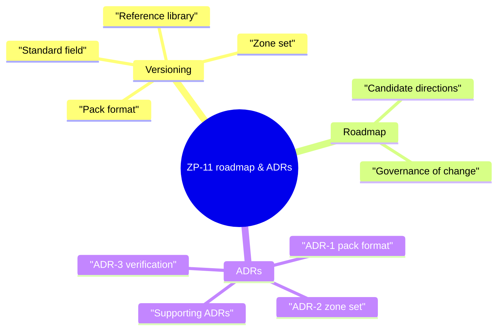

The surfaces that can version independently, and the direction in which a change in one can ripple, are shown below.

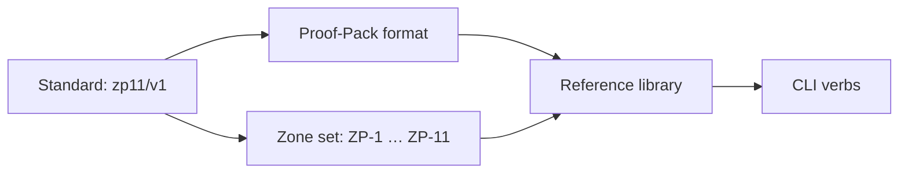

---

## 2. Vocabulary of change

A change is classified by the strongest compatibility it breaks. The three classes below are used throughout.

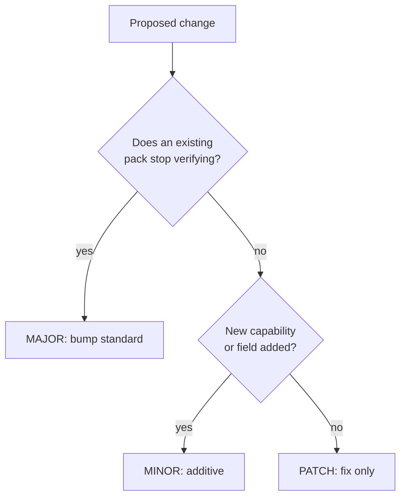

| Class | Meaning | Effect on `standard` | Effect on old packs |
|-------|---------|----------------------|---------------------|
| MAJOR | A previously valid pack would no longer verify, or a verdict meaning changes | `zp11/v2`, `v3`, … | may stop verifying under new verifiers |
| MINOR | Additive: new optional evidence, new zone *kind*, new CLI flag | unchanged (`zp11/v1`) | still verify unchanged |
| PATCH | Clarification or implementation fix with no observable format change | unchanged | identical |

The governing rule from `SPEC.md` §8 is absolute: **a verifier MUST reject a pack whose `standard` it does not recognize.** That single sentence is what makes versioning safe — an unknown format fails closed rather than being guessed at.

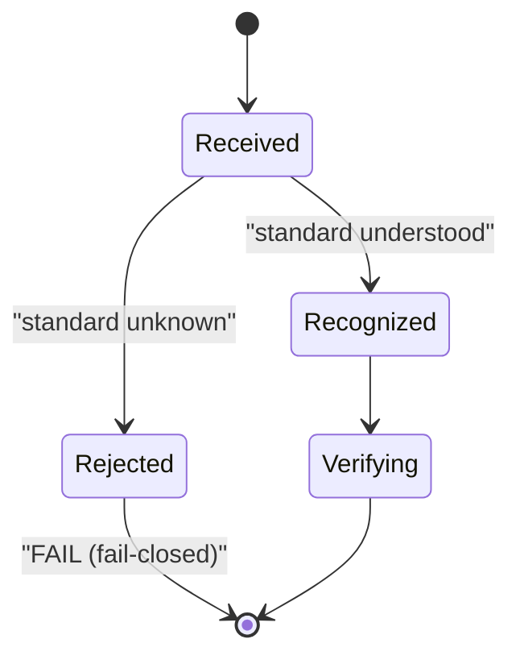

---

## 3. Versioning the standard and pack format

### 3.1 The `standard` field is the version anchor

Every Proof-Pack carries `standard: "zp11/v1"` at its root (`pack.py`, constant `STANDARD`). This string, not a library version, is the contract. Verifiers key their behaviour off it.

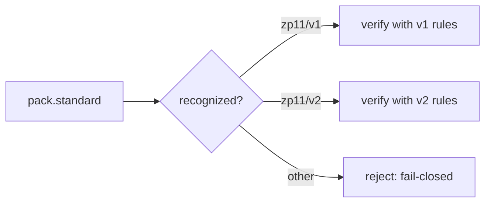

### 3.2 What a MAJOR bump protects

A MAJOR bump is reserved for changes that alter what a signature covers or what a verdict means. Examples that *would* force `v2`:

```mermaid
mindmap
  root(("Forces MAJOR"))
    "Change canonicalisation (not RFC 8785)"
    "Change receipt body fields"
    "Change seal content shape"
    "Change signature algorithm"
    "Add a third verdict"
    "Reorder the zone chain meaning"
```

Each of these would invalidate existing signatures or re-interpret an existing field, so a pre-existing pack could no longer be trusted under the new rules. That is exactly the boundary the `standard` field defends.

### 3.3 What stays MINOR

Additive evolution does not touch the version. New evidence keys, a new zone *kind* in `zones.py`, or a new CLI flag are all MINOR because an older verifier simply ignores what it does not read — while the digested receipt body and seal content remain byte-identical in shape.

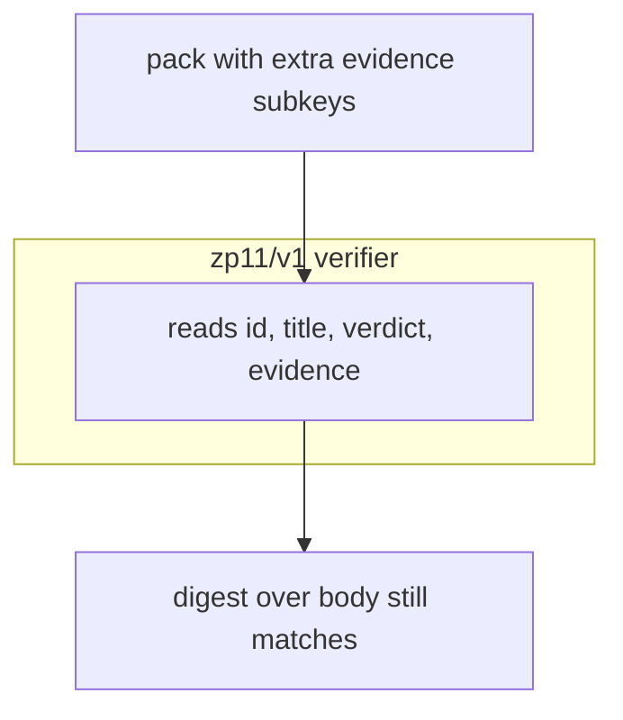

### 3.4 Compatibility matrix

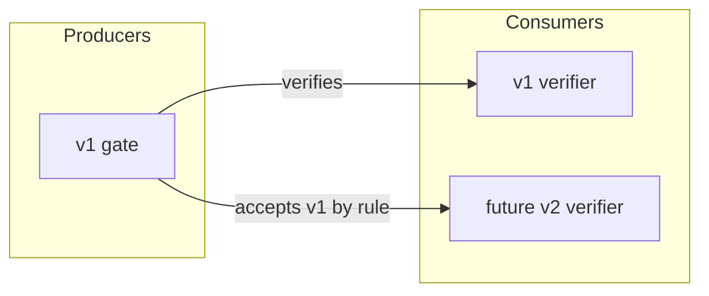

A v2 verifier is expected to retain v1 verification rules so that historical packs remain checkable; it rejects only formats it does not implement. This gives adopters a durable audit trail: a pack sealed today stays verifiable for as long as a v1-capable verifier exists.

### 3.5 Deprecation flow

When a future MAJOR is contemplated, the path is explicit and reversible until the cut-over.

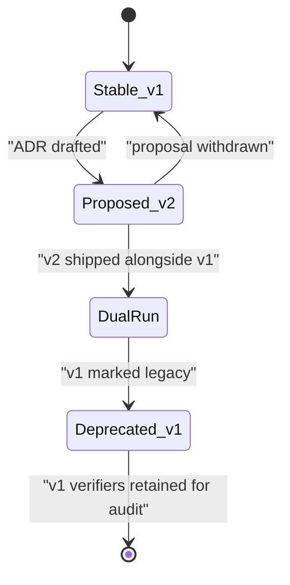

---

## 4. Versioning the reference library and CLI

The Python reference library (`canonical.py`, `crypto.py`, `verdict.py`, `zones.py`, `pack.py`, `gate.py`, `cli.py`) carries its own semantic version, independent of the `standard` string. The library version answers "which implementation" while `standard` answers "which format".

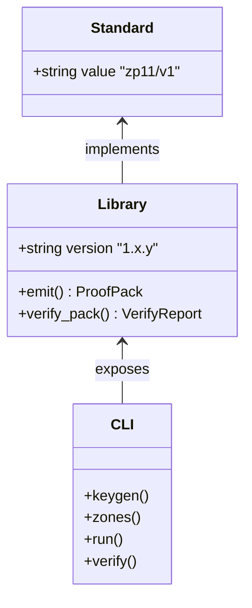

### 4.1 Library SemVer rules

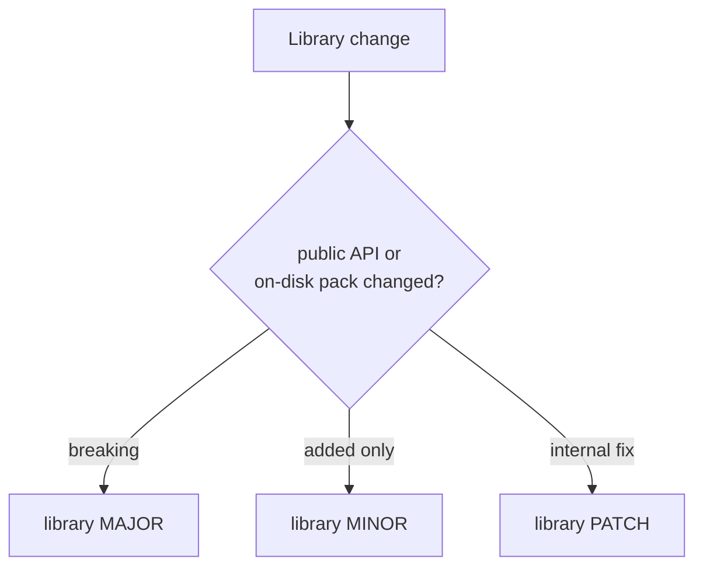

A library MAJOR need not be a standard MAJOR: refactoring `verify_pack`'s signature is breaking for API callers but leaves the pack format untouched. Conversely, a standard MAJOR always implies a library MAJOR, because the implementation must change to read the new format.

### 4.2 CLI surface stability

The four verbs are the stable contact surface for CI wiring. Their exit-code contract is part of the compatibility promise: `run` and `verify` exit `0` only when merge is permitted.

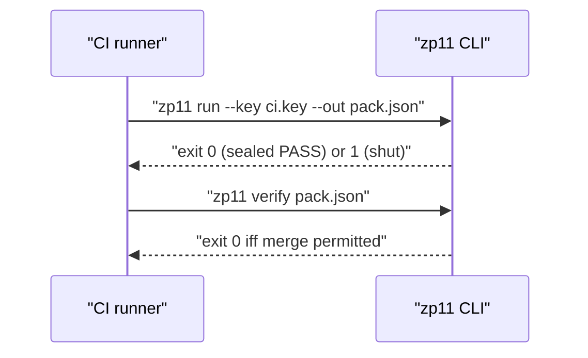

Adding a flag is MINOR; changing the meaning of an exit code would be a CLI MAJOR, because required-status-check wiring depends on it.

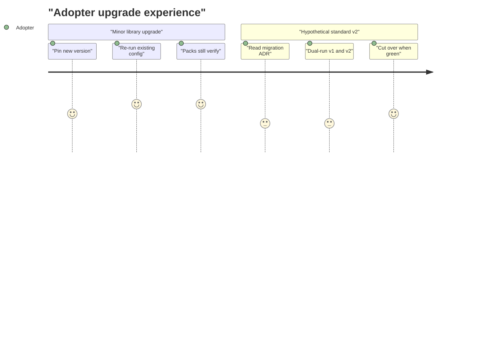

---

## 5. Versioning the zone set

The eleven zone **identities and names** are fixed by the specification; this is itself an architectural decision (ADR-2, §8). What may evolve within `v1` is the *mapping* from a zone to a concrete check, and the set of zone **kinds** available in `zones.py`.

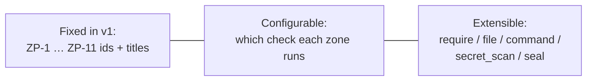

Adding a new kind (for example a future structured-attestation kind) is MINOR: existing configs keep working, and packs they produce keep verifying. Renaming or removing a zone id would be MAJOR, because `_REQUIRED_ZONES` in `pack.py` enumerates `ZP-1` through `ZP-11` and strict verification would change meaning.

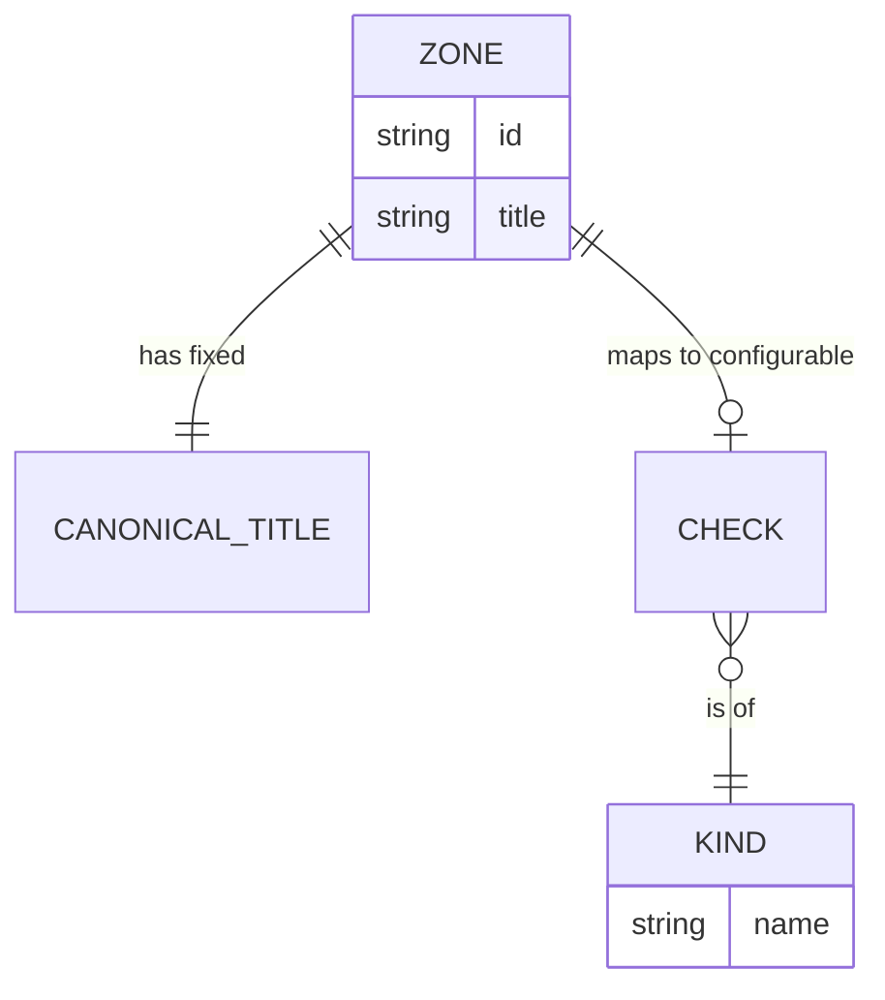

---

## 6. Roadmap (candidate directions)

This section is **illustrative, not a commitment**. It records directions that the versioning policy above would *admit*, so that contributors understand which ideas are additive and which would demand a MAJOR. No dates, adopters, or metrics are asserted; the schedule sketch uses relative phases only.

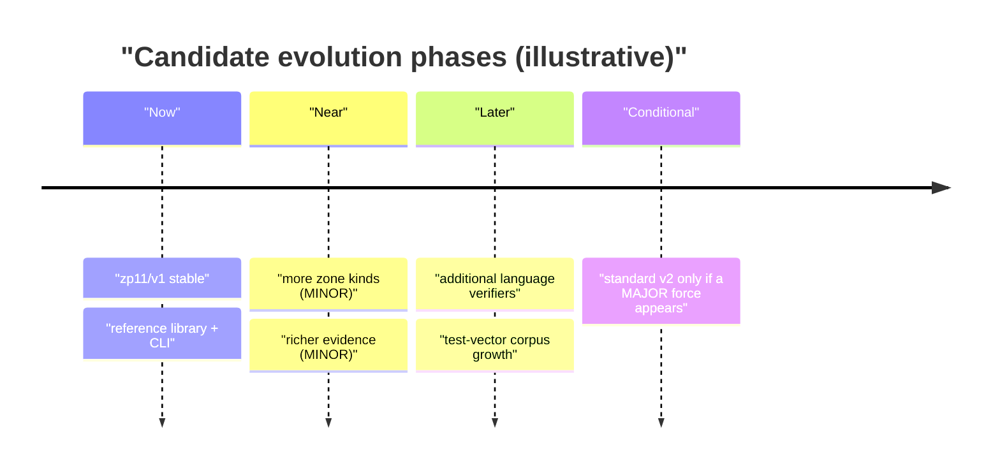

### 6.1 Additive candidates (MINOR, no `standard` change)

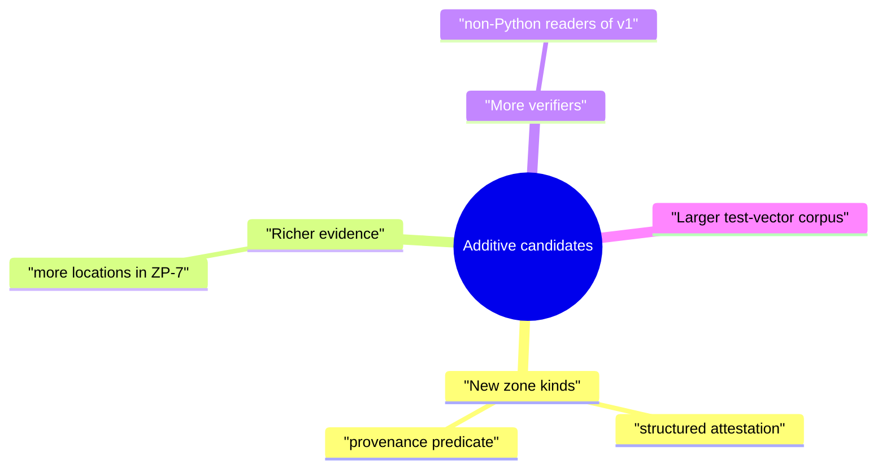

These can land without disturbing a single existing pack, because an older verifier ignores unread fields and the digested body shape is unchanged.

### 6.2 Conditional candidates (would force MAJOR)

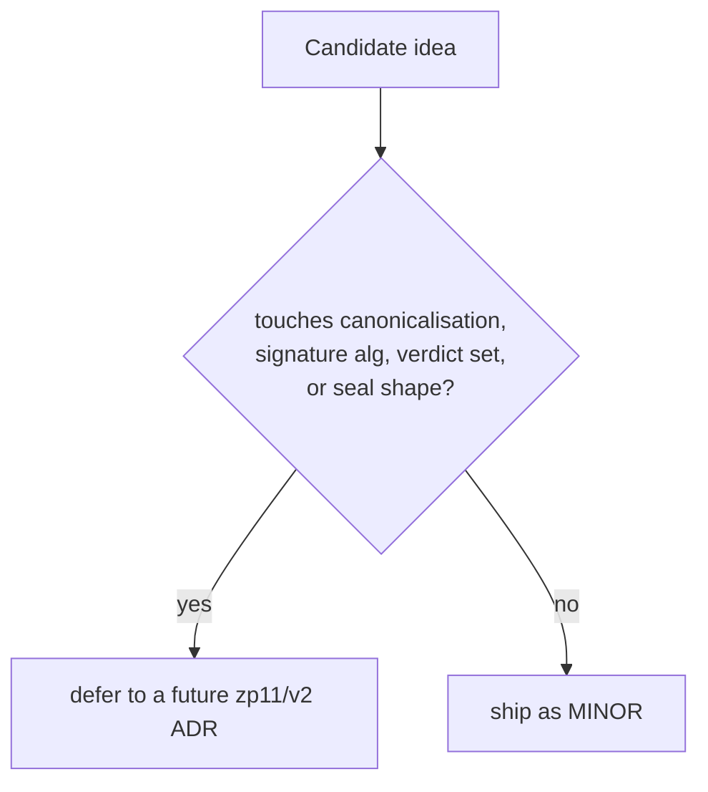

Anything that changes what a signature covers is deliberately hard to do: it requires a new ADR, a new `standard` value, and a dual-run deprecation window (§3.5). The difficulty is a feature, not a limitation — it protects the audit trail.

### 6.3 Illustrative sequencing

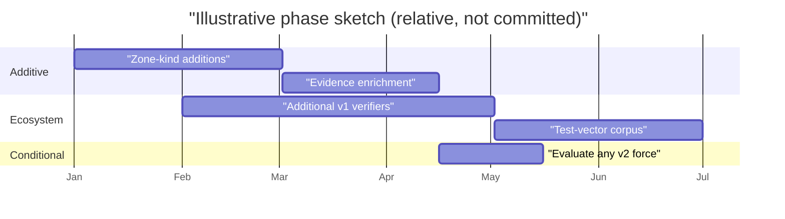

### 6.4 Governance of a roadmap item

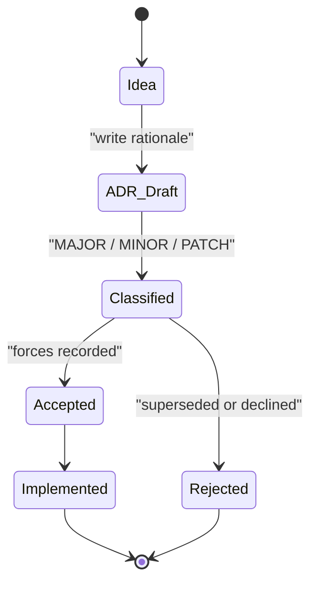

---

## 7. ADR conventions

Each ADR has a status, the decision, the context/forces, the alternatives, and the consequences. Status transitions are limited.

```mermaid
stateDiagram-v2
    [*] --> Proposed
    Proposed --> Accepted
    Proposed --> Rejected
    Accepted --> Deprecated
    Accepted --> Superseded
    Superseded --> [*]
    Deprecated --> [*]
    Rejected --> [*]
```

```mermaid
classDiagram
    class ADR {
      +int number
      +string title
      +Status status
      +string context
      +string decision
      +string[] alternatives
      +string[] consequences
    }
```

The three ADRs that follow are the architectural spine; the supporting ADRs in §11 descend from them.

```mermaid
flowchart TB
    A1["ADR-1 Pack format"] --> A2["ADR-2 Zone set"]
    A1 --> A3["ADR-3 Verification"]
    A2 --> A3
    A3 --> S["Supporting ADRs 4–9"]
```

---

## 8. ADR-1 — The Proof-Pack format

**Status:** Accepted. **Decision:** The gate emits a single, self-describing JSON document — the Proof-Pack — whose integrity rests on RFC 8785 canonicalisation and an Ed25519 signature chain, with a seal over the ordered receipt digests.

### 8.1 Context and forces

The pack must be verifiable by a third party with nothing but the document and a public key, and it must be impossible to assemble from receipts that never shared a gate.

```mermaid
mindmap
  root(("Forces on the format"))
    "Portable: one self-describing file"
    "Reproducible: same bytes → same digest"
    "Attributable: each verdict signed"
    "Tamper-evident: altering evidence breaks it"
    "No trust in the pipeline"
```

### 8.2 The decision in structure

```mermaid
erDiagram
    PROOFPACK ||--|{ RECEIPT : "lists in order"
    PROOFPACK ||--|| SEAL : "carries"
    PROOFPACK {
      string standard
      string created
      object change
    }
    RECEIPT {
      string id
      string title
      string verdict
      object evidence
      string digest
      string signature
    }
    SEAL {
      string verdict
      bool sealed
      int zones_passed
      int zones_total
      string key
      string signature
    }
```

The `change` object names `id`, `source_commit`, and `builder` (`gate.py` reads it from config). Each receipt's `digest` is `"sha256:" + hex(SHA-256(canonical(body)))` where `body = {id, title, verdict, evidence}` — exactly `_receipt_body` in `pack.py`.

### 8.3 Why canonical JSON (RFC 8785 / JCS)

```mermaid
flowchart LR
    V["receipt body"] --> J["RFC 8785 JCS:<br/>sorted keys, minimal separators, UTF-8"]
    J --> H["SHA-256"]
    H --> D["digest: sha256:…"]
```

JSON was chosen over a binary encoding because packs are read by humans in review and by machines in CI alike; JCS removes the one danger of JSON — that the same value has many byte representations — so the digest is stable across producers.

### 8.4 Why the seal signs a chain of digests

```mermaid
sequenceDiagram
    participant G as "Gate"
    participant R as "Receipts ZP-1…ZP-11"
    participant S as "Seal"
    G->>R: "finalize: digest + sign each"
    G->>S: "build seal_content"
    Note over S: "receipts: [{id, digest}] in order"
    G->>S: "sign seal_content (Ed25519)"
    S-->>G: "seal.signature"
```

Because `_seal_content` (in `pack.py`) includes the ordered `[{id, digest}]` list plus the change, receipts cannot be reordered, added, or removed without invalidating the seal. This is the property that stops a pack being stitched together from unrelated runs.

### 8.5 Alternatives weighed

```mermaid
flowchart TB
    OPT["Format options"] --> O1["binary / protobuf"]
    OPT --> O2["detached signatures only"]
    OPT --> O3["single signature over whole file"]
    OPT --> CH["CHOSEN: JSON + per-receipt sig + seal chain"]
    O1 -.->|"not human-reviewable"| CH
    O2 -.->|"pack not self-describing"| CH
    O3 -.->|"loses per-zone attribution"| CH
```

### 8.6 Consequences

```mermaid
flowchart LR
    C1["+ third-party verifiable"] --> OUT(("ADR-1"))
    C2["+ tamper-evident per receipt"] --> OUT
    C3["+ portable audit artifact"] --> OUT
    C4["− format change is costly (MAJOR)"] --> OUT
```

The cost — that any change to the body or seal shape is a MAJOR event — is accepted deliberately; it is the same cost that guarantees old packs stay verifiable.

---

## 9. ADR-2 — The zone set

**Status:** Accepted. **Decision:** Exactly eleven zones, with fixed ids and canonical titles (`CANONICAL_TITLES` in `zones.py`), composed in order, with ZP-11 as a seal derived from the prior ten.

### 9.1 The fixed set

```mermaid
flowchart TB
    Z1["ZP-1 Provenance"] --> Z2["ZP-2 Reproducible build"]
    Z2 --> Z3["ZP-3 Dependency integrity"]
    Z3 --> Z4["ZP-4 Test evidence"]
    Z4 --> Z5["ZP-5 Coverage floor"]
    Z5 --> Z6["ZP-6 Static safety"]
    Z6 --> Z7["ZP-7 Secret hygiene"]
    Z7 --> Z8["ZP-8 Policy conformance"]
    Z8 --> Z9["ZP-9 Signature chain"]
    Z9 --> Z10["ZP-10 Independent re-run"]
    Z10 --> Z11["ZP-11 Zero-point seal"]
```

### 9.2 Context and forces

A fixed, named set gives every adopter the same vocabulary: a ZP-7 FAIL means the same thing everywhere, even though the *check* behind it is configurable. The number eleven is not arbitrary padding — each zone answers a distinct question that the others do not.

```mermaid
mindmap
  root(("Why these eleven"))
    "Origin: ZP-1 provenance"
    "Build: ZP-2 reproducible"
    "Inputs: ZP-3 dependencies"
    "Behaviour: ZP-4 tests, ZP-5 coverage"
    "Safety: ZP-6 static, ZP-7 secrets"
    "Rules: ZP-8 policy"
    "Trust: ZP-9 signatures"
    "Independence: ZP-10 re-run"
    "Closure: ZP-11 seal"
```

### 9.3 Fixed identity, flexible mapping

```mermaid
flowchart LR
    ID["ZP-n id + title (fixed)"] --> MAP{"zp11.toml mapping"}
    MAP --> K1["require"]
    MAP --> K2["file"]
    MAP --> K3["command"]
    MAP --> K4["secret_scan"]
    MAP --> K5["seal"]
```

A conforming configuration MAY map a zone to any check satisfying its normative requirement, and MUST map an unimplemented zone to a check that returns FAIL. This is how the set stays fixed while remaining practical across very different repositories.

### 9.4 The zone-kind state machine

```mermaid
stateDiagram-v2
    [*] --> Dispatch
    Dispatch --> Require: "kind=require"
    Dispatch --> File: "kind=file"
    Dispatch --> Command: "kind=command"
    Dispatch --> SecretScan: "kind=secret_scan"
    Dispatch --> Seal: "kind=seal"
    Require --> Result
    File --> Result
    Command --> Result
    SecretScan --> Result
    Seal --> Result
    Result --> [*]
```

### 9.5 Why ZP-11 is derived, not run

```mermaid
flowchart TB
    PRI["ZP-1 … ZP-10 verdicts"] --> AND{"all PASS?"}
    AND -->|"yes"| SP["ZP-11 = PASS, pack sealed"]
    AND -->|"no"| SF["ZP-11 = FAIL, not sealed"]
```

In `gate.py`, `prior_all_pass` accumulates across the first ten zones and sets ZP-11's verdict directly; the seal zone is never executed as an ordinary check (`run_zone` returns FAIL if asked, by design). This keeps the seal an honest summary of the chain rather than an independent, forgeable check.

### 9.6 Alternatives weighed

```mermaid
flowchart TB
    A["Zone-set options"] --> A1["open-ended plugin list"]
    A --> A2["fewer, broader zones"]
    A --> A3["severity-weighted scoring"]
    A --> CH["CHOSEN: eleven fixed, binary zones"]
    A1 -.->|"no common vocabulary"| CH
    A2 -.->|"loses granular evidence"| CH
    A3 -.->|"reintroduces 'mostly ok' merges"| CH
```

A weighted score was explicitly rejected because it reintroduces the advisory behaviour ZP-11 exists to abolish: a high-but-imperfect score is still a merge on incomplete evidence.

### 9.7 Consequences

```mermaid
journey
    title "Living with a fixed zone set"
    section "Day to day"
      "Same ZP-n meaning everywhere": 5: Adopter
      "Map checks to local tools": 4: Adopter
    section "Edge"
      "Cannot drop a zone, only FAIL it": 3: Adopter
      "New capability via new kind": 4: Adopter
```

---

## 10. ADR-3 — The verification algorithm

**Status:** Accepted. **Decision:** Verification is a fixed, fail-closed sequence over the pack and a public key: confirm the zones are present (strict), recompute every digest, verify every signature, verify the seal, and permit merge **iff** every verdict is PASS and the pack is sealed.

### 10.1 The algorithm as a flow

```mermaid
flowchart TB
    S["verify_pack(pack, key)"] --> Z{"strict: ZP-1…ZP-11 present?"}
    Z -->|"missing"| R["reason: missing zones"]
    Z -->|"present"| D["for each receipt:<br/>recompute digest(body)"]
    D --> DM{"digest == stored?"}
    DM -->|"no"| R2["reason: evidence altered"]
    DM -->|"yes"| SG{"signature valid?"}
    SG -->|"no"| R3["reason: bad signature"]
    SG -->|"yes"| SL["rebuild seal_content"]
    SL --> SV{"seal signature valid?"}
    SV -->|"no"| R4["reason: seal invalid"]
    SV -->|"yes"| AP{"all PASS and sealed?"}
    AP -->|"no"| R5["reason: fail-closed"]
    AP -->|"yes"| OK["merge_permitted = true"]
```

This mirrors `verify_pack` in `pack.py` exactly: digest check, per-receipt signature, seal signature, and the `all_pass and pack.sealed` decision.

### 10.2 Fail-closed is the invariant

```mermaid
stateDiagram-v2
    [*] --> Checking
    Checking --> Permit: "every step succeeds"
    Checking --> Refuse: "any step fails / is silent"
    Checking --> Refuse: "no public key"
    Permit --> [*]
    Refuse --> [*]
```

Silence, crash, timeout, missing file, or an absent key all resolve to refusal. Notably, when no key is available `verify_pack` records "no public key available" and refuses — the SPEC's requirement that a verifier default to refusing merge when `K` is unavailable.

### 10.3 Why recompute, not trust

```mermaid
sequenceDiagram
    participant V as "Verifier"
    participant P as "Pack"
    V->>P: "read receipt body"
    V->>V: "canonical(body) → SHA-256"
    V->>P: "compare to stored digest"
    alt "equal"
        V->>V: "verify Ed25519 signature"
    else "differs"
        V-->>V: "FAIL: evidence altered"
    end
```

The verifier never trusts the stored digest; it recomputes it from the body. A stored digest that disagrees with the body is itself evidence of tampering.

### 10.4 Strict vs partial

```mermaid
flowchart LR
    MODE{"require_all_zones?"} -->|"true (default)"| STRICT["all 11 must be present"]
    MODE -->|"false (--partial)"| PART["verify what is present"]
    STRICT --> DEC["decision unchanged:<br/>merge iff all PASS + sealed"]
    PART --> DEC
```

`--partial` relaxes only the presence check, never the fail-closed decision: even partial verification refuses merge unless the present zones all PASS and the pack is sealed.

### 10.5 Exit-code contract

```mermaid
flowchart TB
    RUN["zp11 run"] --> RC{"sealed PASS?"}
    RC -->|"yes"| E0a["exit 0"]
    RC -->|"no"| E1a["exit 1"]
    VER["zp11 verify"] --> VC{"merge_permitted?"}
    VC -->|"yes"| E0b["exit 0"]
    VC -->|"no"| E1b["exit 1"]
```

### 10.6 Alternatives weighed

```mermaid
flowchart TB
    O["Verification options"] --> O1["trust the gate's own verdict"]
    O --> O2["fail-open on missing key"]
    O --> O3["warn-and-continue on mismatch"]
    O --> CH["CHOSEN: recompute + fail-closed"]
    O1 -.->|"no independence"| CH
    O2 -.->|"unverifiable = merge"| CH
    O3 -.->|"advisory, not a gate"| CH
```

### 10.7 Consequences

```mermaid
flowchart LR
    P1["+ anyone can re-verify"] --> OUT(("ADR-3"))
    P2["+ tamper is detectable"] --> OUT
    P3["+ ambiguity → refusal"] --> OUT
    P4["− a lost key blocks merge"] --> OUT
```

The last consequence is intentional: losing the signing key is an operational problem to be solved by key management (ZP-9, SPEC §7), not by relaxing the gate.

---

## 11. Supporting ADRs

These descend from ADR-1–3 and are recorded briefly.

### 11.1 ADR-4 — Exactly two verdicts

**Decision:** A zone emits only PASS or FAIL; no third verdict may permit merge; silence is FAIL.

```mermaid
stateDiagram-v2
    [*] --> Pending
    Pending --> PASS: "condition proven + evidence"
    Pending --> FAIL: "anything else"
    PASS --> [*]
    FAIL --> [*]
```

A `WARN` or `SKIP` verdict was rejected because every advisory verdict eventually becomes a silent merge. The `Verdict` enum's truthiness (PASS is truthy) is what `pack.py` aggregates in `verdict` and `passed`.

### 11.2 ADR-5 — Declarative zone kinds

**Decision:** Repositories declare zones in `zp11.toml` by *kind*, not by code.

```mermaid
flowchart LR
    T["zp11.toml"] --> B["build_zones (gate.py)"]
    B --> O["ordered Zone list"]
    O --> X["run_zone dispatch"]
```

Declarative mapping keeps the eleven identities fixed while letting each repository bind them to tools it already runs — the balance struck in ADR-2.

### 11.3 ADR-6 — Ed25519 and SHA-256

**Decision:** Signatures are Ed25519 (RFC 8032); digests are SHA-256; keys and signatures are hex-encoded with a scheme prefix.

```mermaid
flowchart TB
    K["KeyPair.generate / from_seed"] --> PUB["public id: ed25519:<hex>"]
    BODY["signed_body"] --> SIG["sign → ed25519:<hex>"]
    SIG --> VFY["verify(key, body, sig)"]
```

A deterministic signature scheme with small keys suits an artifact meant to be carried alongside the change and re-verified anywhere.

### 11.4 ADR-7 — The seal is derived in the gate

**Decision:** ZP-11 is set by `run_gate` from `prior_all_pass`, never executed as a check.

```mermaid
sequenceDiagram
    participant G as "run_gate"
    loop "ZP-1 … ZP-10"
        G->>G: "prior_all_pass &= verdict"
    end
    G->>G: "ZP-11 = PASS iff prior_all_pass"
    G->>G: "pack.seal(keypair)"
```

### 11.5 ADR-8 — The public key travels in the pack

**Decision:** `seal.key` carries the public key id; a verifier may supply its own key to override.

```mermaid
flowchart LR
    PACK["pack.key_id"] --> V{"verifier key given?"}
    V -->|"yes"| USE["use supplied key"]
    V -->|"no"| EMB["use embedded key"]
    USE --> DEC["verify"]
    EMB --> DEC
```

Embedding the key makes the pack self-describing; supplying an external trusted key lets a verifier pin trust rather than accept the pack's claim. Both paths still fail closed.

### 11.6 ADR-9 — Independent re-run as a zone (ZP-10)

**Decision:** Re-execution by a second, isolated runner is itself a zone, not an external process.

```mermaid
flowchart TB
    R1["primary runner"] --> P["Proof-Pack"]
    R2["independent runner (ZP-10)"] --> P2["reproduced verdict"]
    P --> CMP{"agree?"}
    P2 --> CMP
    CMP -->|"yes"| OK["ZP-10 PASS"]
    CMP -->|"no"| NO["ZP-10 FAIL"]
```

Making independence a zone means its result is itself signed evidence in the pack, not a side channel a reviewer must trust.

---

## 12. Decision dependency map

```mermaid
flowchart TB
    ADR1["ADR-1 pack format"] --> ADR6["ADR-6 Ed25519/SHA-256"]
    ADR1 --> ADR8["ADR-8 key in pack"]
    ADR2["ADR-2 zone set"] --> ADR5["ADR-5 declarative kinds"]
    ADR2 --> ADR7["ADR-7 derived seal"]
    ADR2 --> ADR9["ADR-9 ZP-10 re-run"]
    ADR3["ADR-3 verification"] --> ADR4["ADR-4 two verdicts"]
    ADR1 --> ADR3
    ADR2 --> ADR3
```

```mermaid
timeline
    title "ADR status snapshot"
    "Accepted" : "ADR-1 pack format" : "ADR-2 zone set" : "ADR-3 verification"
    "Accepted (supporting)" : "ADR-4 verdicts" : "ADR-5 kinds" : "ADR-6 crypto"
    "Accepted (supporting)" : "ADR-7 seal" : "ADR-8 key" : "ADR-9 re-run"
```

---

## 13. Summary

The versioning policy makes change deliberate: the `standard` field is the contract, additive change stays within `v1`, and anything that alters what a signature covers is a MAJOR event gated behind an ADR and a dual-run deprecation. The ADRs record why the pack format is self-describing and signed, why the zone set is eleven fixed identities with configurable checks, and why verification is a fail-closed recompute-and-verify sequence. Together they let ZP-11 evolve without ever weakening its one promise — *no evidence, no merge.* ZP-11 was invented and authored by Naquib Hatami and is published as an open standard under the MIT License.

---

## See also

- [`03-architecture.md`](03-architecture.md) — system architecture of the gate and library.
- [`05-data-model.md`](05-data-model.md) — Proof-Pack and receipt data model in detail.
- [`07-crypto-design.md`](07-crypto-design.md) — canonicalisation, Ed25519, and the signature chain.
- [`10-zones-reference.md`](10-zones-reference.md) — per-zone reference for ZP-1 … ZP-11.
- [`13-conformance.md`](13-conformance.md) — conformance criteria and test vectors.
